# 通往模拟电路之路

> 从欧姆定律到芯片内部结构，一份把原理推导、器件剖析、故障分析和动画演示连起来的模拟电路学习指南。

** [在线免费阅读](https://aliyun-hutuji.donglicao.com/analog-circuit-roadmap/)**（国内直连，无需构建）

** 离线整书**：单文件 HTML + A4 PDF，断网可读，内置 `Ctrl+K` 全文搜索与 400+ 页书签导航；[直接下载](https://github.com/zhuguang-ZFG/BMS-Z/releases/tag/v2.0.0)，构建方式见 [analog-book](https://github.com/zhuguang-ZFG/analog-circuit-roadmap/tree/main/analog-book)。

配套 20 集动画课（[逐章目录](#s7-3)）：B站/抖音搜「模拟电路动画课」或「本机实跑」。

<div class="repo-badges" markdown="1">

[](https://github.com/zhuguang-ZFG/analog-circuit-roadmap/actions/workflows/tests.yml)
[](#toc)
[](#part5)
[](#s7-3)
[](https://github.com/zhuguang-ZFG/BMS-Z/releases/tag/v2.0.0)
[](LICENSE)

</div>

<div class="learning-hero" markdown="1">

<p class="learning-eyebrow">理解原理 · 观察变化 · 动手验证</p>

## 从看懂一张电路图开始

电流为什么这样流？波形为什么变了？电路为什么没有按预期工作？沿着一条清晰的路线，用动画建立直觉，用计算和测量检验理解。

<p class="learning-actions">
  <a class="learning-primary" href="#ch0">从第 0 章开始 →</a>
  <a class="learning-ghost" href="#rc-study">先体验 RC 互动课</a>
</p>

<ul class="learning-stats">
  <li><strong>19</strong> 章核心内容</li>
  <li><strong>153</strong> 张原理动画</li>
  <li><strong>3</strong> 个可控教学样板</li>
  <li><strong>90</strong> 道章节题 + <strong>34</strong> 道专题题</li>
</ul>

</div>

## 卡住了？按现象直查

板子不工作、波形不对、读数在跳——先对号入座，再回到原理。完整故障表见[第 17 章](#ch17)，按需求找电路见[情景导航](docs/p0-04-by-need.md)。

| 你看到的现象 | 最可能的原因 | 先看这里 |
|---|---|---|
| 上电没反应、整机不工作 | 电源、极性、保险丝、地没接 | [第 16 章 排故五步法](#ch16) · [第 17 章 速查](#ch17) |
| 输出比算出来的低，一接负载就塌 | 内阻与带载效应 | [第 0 章 电路直觉](#ch0) · [速查表·直流](#dc) |
| 波形顶部/底部被削平 | 限幅、钳位、输出轨限 | [第 2 章 二极管](#ch2) · [第 12 章 运放电路族](#ch12) |
| 运放输出贴轨、不放大 | 供电、共模范围、反馈接错 | [第 6 章 运放](#ch6) · [第 12 章](#ch12) |
| 三极管/MOSFET 发烫 | 驱动不足、导通损耗、米勒振荡 | [第 3 章 BJT](#ch3) · [第 4 章 MOSFET](#ch4) |
| 输出自激、莫名振荡 | 容性负载、相位裕度、布局 | [第 6 章 运放](#ch6) · [第 15 章 PCB](#ch15) |
| ADC 读数在跳、噪声大 | 地线、去耦、基准 | [第 9 章 基准](#ch9) · [第 15 章 接地](#ch15) |
| 高频信号过不去、边沿变肉 | 寄生参数、带宽、探头负载 | [第 1 章 无源](#ch1) · [第 12 章 Sallen-Key](#ch12) |
| MCU 引脚推不动、总线通信失败 | 上拉、开漏、总线电容 | [第 5 章 推挽与开漏](#ch5) |
| 板子偶发复位、上电烧器件 | 电源跌落、地弹、浪涌 | [第 16 章](#ch16) · [第 17 章](#ch17) |

## 找到适合你的起点

<div class="learning-paths" markdown="1">

<div class="learning-path" markdown="1">

### 01 · 从零建立直觉

**适合** · 刚开始学电路。

先理解电压、电流和回路，再认识真实元件。遇到公式，先问它在描述什么变化。

[电路直觉](#ch0) → [无源元件](#ch1) → [二极管](#ch2)<br> 顺手算：[直流基础](#dc) · [无源与频域](#passive) · [二极管](#diode)

**阶段目标**：能解释分压器接上负载后，输出为什么会下降。

</div>

<div class="learning-path" markdown="1">

### 02 · 从单片机走向模拟

**适合** · 会用 MCU，想读懂外围电路。

从熟悉的 GPIO 出发，弄清接口、放大与布局之间的关系。

[推挽与开漏](#ch5) → [运放基础](#ch6) → [运放电路族](#ch12) → [PCB 实战](#ch15)<br> 顺手算：[输出级](#outstage) · [运放](#opamp) · [PCB](#pcb)

**阶段目标**：能说明上拉电阻的作用，并检查信号是否超出运放的工作范围。

</div>

<div class="learning-path" markdown="1">

### 03 · 带着工程问题来

**适合** · 正在调板，或需要复习。

先定位症状，再回到原理；保留测量条件，一次验证一个假设。

[按需求找电路](docs/p0-04-by-need.md) → [故障速查](#ch17) → [排故五步法](#ch16)<br> 顺手算：[现场排故判据](#debug) · [信号链反推](#design) · [全表 16 段](#cheatsheet)

**阶段目标**：写下一条可验证的故障假设，以及支持或推翻它的测量结果。

</div>

</div>

## 先学会一个电路

三个样板都把动画、实物、测量接线和就地自测放在一起。在线站支持暂停、阶段定位和局部放大。

<div class="learning-lessons" markdown="1">

<div class="learning-lesson" markdown="1">

<a href="#rc-study"></a>

### RC 充放电

看电压如何变化，对照时间常数，再按接线说明测一次。

[开始 RC 互动课 →](#rc-study)

</div>

<div class="learning-lesson" markdown="1">

<a href="#mosfet-study"></a>

### MOSFET 开关

暂停在米勒平台，比较栅极电压、漏极电压和电流。

[开始 MOSFET 互动课 →](#mosfet-study)

</div>

<div class="learning-lesson" markdown="1">

<a href="#lm358-study"></a>

### LM358 跟随器

认识引脚，检查输入与输出边界，理解为什么输出跟不上。

[开始 LM358 互动课 →](#lm358-study)

</div>

</div>

<a id="learning-depth"></a>
## 一个知识点要读到哪一层

<div class="learning-depth" markdown="1">

<div class="learning-depth-step" markdown="1">

### 01 现象

先说出什么在变、相对谁变。电压差、电流回路和“先直流后交流”，是后续所有分析的公共语言。

[回到第 0 章](#sec-0-4)

</div>

<div class="learning-depth-step" markdown="1">

### 02 模型

把现象压成理想元件与约束：欧姆定律、恒压源、恒流源、虚短虚断。先明确模型边界，再谈公式。

[查看元件与频域模型](#passive)

</div>

<div class="learning-depth-step" markdown="1">

### 03 数量级

带上单位、供电与负载算一笔：电压降怎么分、带载为什么塌、误差有多大。能估出范围，才算真的理解。

[用分压器算一笔](#sec-0-3)

</div>

<div class="learning-depth-step" markdown="1">

### 04 边界

追频率、温度与寄生参数，再和仿真、实测对照。差异不是噪音，而是理想模型失效前给出的信号。

[查模型失效边界](#limits) · [核对官方资料与参数条件](docs/p6-03-s6-3.md)

</div>

</div>

## 每章这样学

1. **带着问题看动画**：先预测哪个量会变、往哪个方向变，再播放核对。
2. **对照原理算一笔**：写下单位、供电、负载和所用假设，别只记结论。
3. **合上正文做自测**：在线站每章末尾都有对应题目入口；做错后回到该章复习。
4. **用实验检验理解**：参考 [里程碑项目](docs/p8-03-s8-3.md)，把计算、仿真与实测放在一起比较。

**动手资料已备好**：[RC 实验包](#lab-rc) · [MOSFET 实验包](#lab-mosfet) · [LM358 实验包](#lab-lm358)。包含可运行的参考电路、元件清单、测量表与验收步骤。

在线站会在当前浏览器记住上次阅读位置；章末可手动标记完成，自测题旁可收藏错题。记录不上传，清除浏览器站点数据后会丢失。

题目是帮助你发现薄弱环节的工具；做对题并不代替实验和设计评审。元件参数请结合具体型号与工作条件核对 [官方资料](docs/p6-03-s6-3.md)。

## 随手可查的工具

| 想解决什么 | 从这里进入 |
|---|---|
| 不知道从哪开始、该走哪条 | [入场诊断](#diagnostic)（6 题定路线） · [三条时间线](#timeline) |
| 看清完整学习顺序 | [学习路线图](#roadmap) · [全书目录](#toc) · [三条时间线](docs/p0-03-timeline.md) |
| 找一个电路或动画 | [情景导航](docs/p0-04-by-need.md) · [动画演示中心](#part5)（在线站侧栏另有可筛选画廊） |
| 遇到陌生术语 | [模拟黑话速查](#sec810) · [元件标识速查](docs/p6-05-s6-5.md) |
| 想快查公式、判据、经验值 | [公式速查表](#cheatsheet) · [顺口溜总表](#sec811) |
| 想知道「理想模型什么时候失效」 | [模型边界速查](#limits)（仿真与实测对不上时先来这里） |
| 查型号和参数条件 | [常用芯片](docs/p6-02-s6-2.md) · [Datasheet 阅读法](docs/p6-04-s6-4.md) · [原厂应用笔记](#sec88) |
| 检验自己是否理解 | [章节自测与专题加练](#part9) · [动手项目](docs/p8-03-s8-3.md) |

在线站顶部支持全文搜索，可以从“去耦电容”“相位裕度”“LM358”等具体术语开始。

## 常用命令

| 目标 | 命令 |
|---|---|
| 重建 README 入口与 BOOK.md | `make readme` |
| 构建在线站 | `make site` |
| 构建离线整书 HTML | `make book` |
| 构建 HTML + PDF | `make book-pdf` |
| 审计已有整书产物 | `make book-check` |
| 构建 16K 印刷上下卷（HTML + PDF） | `make print-volumes` |
| 静态测试（无需浏览器） | `make test-static` |
| 浏览器回归 | `make test-browser` |
| 全量校验 | `make verify` |
| 内容规模统计 | `make stats` |

Windows 无 `make` 时用 `mingw32-make <目标>`，或直接运行 `Makefile` 中对应的 `python` 命令。

<a id="news"></a>
## 最近更新

- **v3.78 · 16K 印刷拆上下卷、README 改为短入口**：15 章扩写后单卷 16K 排到 812 页，超过 700 页硬上限；上限不动，改为按自然篇界出两卷——上卷是前置页 + 第 0～10 章（336 页），下卷是第 11～18 章与附录 A～H（516 页），参考文献与索引两卷都带，每卷的目录、插图/表格目录与索引都按本卷重算，指向另一卷的链接降级成「（见上卷/见下卷）」。README 由 docs 全量拼合到 1.38 MB、超过 GitHub 在线渲染阈值后正文根本不显示，现在 `README.md` 只做短入口（29 KB），全量单文件移到 `BOOK.md`。详见[更新日志](#log-v345)。
- **v3.77 · 15 章扩写至 16K 审计线 + 19 章三视角审读**：ch0/1/3–10/12/15–18 按既有小节补技术正文、可复算算例与判据，章节结构与图表题库一个没动，官方口径 19 章全部 ≥15000 字、16K 字数 warning 清零；19 章逐章做技术/编辑/安全三视角复核，修掉 40+ 处数值与表述（ch8 的 12 位 LSB、TL431 空载最坏角、ch15 地弹量纲、表 12-5 环路裕度等），签字栏明确记为 AI 代理审读、不替代人工终审。详见[更新日志](#log-v345)。
- **v3.76.1 · 索引排版与回填收敛**：真实索引类名（`.index-columns` 等）补上 9pt 双栏与 `break-inside: avoid`，索引从 11 个物理页收进 7 页；页码回填改用字符级 000 定位，1337 个页码与目标页逐一核对 0 错，相邻术语不再被红条误删；`garbage=1` 让整次 `--pdf` 构建从 7 分钟降到 73 秒。详见[更新日志](#log-v345)。
- **v3.76 · 索引入库：40 → 311 条、1337 个节级页码**：术语表 91 条按正文叫法对齐（`Buck`、`电荷泵`、`一点接地`、`PWM`），再补章节小标题与导航页概念，`see_also` 112 条互链；每条给主锚点 + 最多 4 个副锚点（节级 id），英文名并存。16K 的「索引 300–400 条」warning 清零（17 → 16），索引占 11 个物理页。顺手修掉 PDF 页码回填的两处真坑：前置页（约定页/符号表）锚点会让页码停在 000，`_fill_index` 现在提前拦截；PyMuPDF 的 `get_text(clip=rect)` 会把行末零宽字符剪进词里（`000f`），改为按数字边界在剪出的词里找 `000`，并合并 Chromium 为同一页码重复生成的三条链接注记。详见[更新日志](#log-v345)。
- **v3.75 · 参考文献入库：118 条，逐条机械校验**：教材 64 条走 Open Library **版本级**核对（ISBN、出版社、年份必须同出一个 edition，题解与教师版判废），论文 16 条走 Crossref（DOI 全部可解析），数据手册与应用笔记 38 条走厂商直链并核对 PDF 正文关键词；章号映射覆盖 0–18 全部 19 章，附录「参考文献」按作者排序编号。16K 的「参考文献应 ≥100 条」warning 清零。详见[更新日志](#log-v345)。
- **v3.74 · 推导图扩编：米勒电容 + 降压纹波**：[米勒效应](#sec-11-5)与[降压纹波](#sec-13-2)各补一张六步推导动画——输出反相摆把 Cbc 撬成 (1+A) 倍（10pF → 1.01nF、15.8kHz），三角波面积把 ΔIL 摊成 ΔV=ΔIL/(8fswC)（7.4mV），公式里的 8 第一次有了出处；动画中心同步收齐 114 张（5.109–5.114），五张四拍图改成「纸色遮罩逐拍揭示」，减弱动效与印刷端都保持全亮。详见[更新日志](#log-v345)。
- **v3.73 · 公式推导插图 + 计算器收尾**：新增四张推导动画——[分压](#sec-0-3)、[纹波](#sec-2-3)、[共射增益](#sec-11-8)、[负反馈](#ch6)，左电路随拍点亮、右算式逐行推进、游标按拍下框；[就地算](#log-v345)补上 Miller 分界频率（§11.11，|A|=50 → C_in=255pF、f_p≈62kHz，与例 11-3 同数）与分压器三预设。顺带修掉背景渐变取错档的老毛病（112 张图下半页原本渐到近黑），并把内容与动效拆开，印刷端不再丢字。详见[更新日志](#log-v345)。
- **v3.72 · 表情标签全退役（去 AI 味 · 视觉轮）**：62 个内容页约 290 行提示块从「emoji + 粗体标签」换成纯文本粗体标签（`> **场景**：`），站点卡片配色与 19 章开场唯一性契约原样不动，16K 印刷端零 emoji；路线图页补上导语，ch17 排故决策树链接归入「相关链接」卡；§11.11 两张插图（三级信号链 + Miller 电荷账）的 FA-029 绘制提示词已备好。详见[更新日志](#log-v345)。
- **v3.61 · 含金量轮**：全书 217 个小节号链接对账零错标并上了护栏；[热噪声预算](#sec-11-6)成为第七只就地算（1kΩ、1MHz → 4.1µV，正文原数）；README 挂上 CI 徽章（站点端不显示，不碰首页的干净顶屏）。
- **v3.60 · 章末通关台 + 模型边界 18 张**：每章的最后一屏升级成与章首舞台呼应的收尾 band——「做第 N 章自测」变成品牌色主按钮；模型边界速查补上[振荡与起振](#limits-oscillator)、[光耦与隔离](#limits-optocoupler)、[传感器与自热](#limits-sensor)三张卡（晶振偏 3pF 每天差 4.8 秒、PC817 的 CTR 十年掉一半、PT100 自热随电流平方涨）。
- **v3.59 · 就地算扩到六只 + 速查表互链**：新增[运放选型双判据](#sec-6-3)（GBW 与压摆率分开验，默认 LM358 的账：增益 100 @ 10kHz 时小信号不够、大信号够）和[Buck 占空比与纹波](#sec-13-2)（D、ΔIL、ΔV 一改参数立刻重算）；公式速查表里六行对应的公式行各加一枚 「扳手」 就地算直达——查到公式顺手就能改参数试。
- **v3.58 · 「就地算」互动计算器**：正文算例旁长出了可调参数的小计算器——[分压器带载](#sec-0-3)（拖动负载看输出塌多少）、[电解电容寿命](#cap-dc-bias)（拖动温度看 10°C 法则）、[迟滞窗口](#sec-7-3)（改电阻比看双门槛撕开多宽）、[探头负载](#sec163)（×1 与 ×10 档的误差与带宽账）。铁律：每个计算器的默认值就是正文算例的原数，书上的数永远能当场对上；关闭 JavaScript 时正文算例即兜底。
- **v3.57 · 舞台铺满全书**：9 个篇级落地页的开屏升级成与章页同语言的舞台（品牌渐变 + 蓝图点阵 + 篇号水印），首页 → 篇 → 章三级开屏从此一套视觉；正文里 107 行「链接 动画演示」链接从普通段落变成图下的居中药丸，一眼能认出「这是个能点的入口」。
- **v3.56 · 章首舞台 + 模型边界速查**：19 个章节页的开屏不再是「光秃秃标题 + 三张灰卡」——现在每章开头是一方舞台：品牌渐变、蓝图点阵和一枚右下角的巨大章号水印，开场三张提示卡收进舞台里。知识网络同时补上**第五张速查表**：[模型边界速查](#limits)管「理想模型什么时候失效」——导线的 0.5mΩ/□ 与地弹的账、1MΩ 电阻从 ≈800kHz 被寄生电容夺权、II 类陶瓷降容、1N4007 的 30µs 反向恢复、2N7000 的 0.8~3V 阈值离散、运放七条公理各自的适用域、SOT-23 的 250°C/W……15 张卡把散在各章的失效边界收成一页定量速查，19 章章首各有一行 「显微镜」 直达本章对应卡；首页知识阶梯的「边界」层现在有了真正的落点。
- **v3.55.3 · 把站里的数重算了一遍**：七处算错改掉。最隐蔽的是第 7 章迟滞那段——公式和正文对同一个符号的理解刚好相反，于是"把反馈电阻改小→迟滞宽到 4.5V"方向和数值都错，还顺着抄进了题库答案；现在全篇按同一种记号统一，原本算对的 2.73V / 2.27V / 0.45V 一个没动，那句话反倒自己站住了。其余六处：BJT 散粒噪声小了 32 倍（20nA 应是 ≈80 fA/√Hz）、SAR 建立精度 0.02% 应是 0.012%、排故工时账多算 10 倍、GPIO 残流"10mA 级"实为 ≈35mA、I2C 上拉上限"≲1kΩ"按它自己的公式只有 890Ω（上限往上圆是往不安全方向偏）、以及一处容易被读错的建立时间图注。每一条都是把数字代回它上面那行公式核对后改的。
- **v3.55.2 · 手机上「公式没排版」的假红修掉了**：即时导航会**先改地址、再换正文**（6× CPU 节流下实测 6 次里 4 次撞上这个窗口），而回归测试只等到地址变化就断言，把「正文还没换过来」当成「公式没排版」，让 CI 间歇性红灯。现在测试先等公式真的排进当前正文再逐项断言，断言一条不减：公式真没排版照样红，「正文还在路上」不再算失败。
- **v3.55.1 · 更新日志的跳转不再被建站器报成死链**：正文里有三个把 HTML 标签写进反引号的示例（两个「原始文本」元素、一个没闭合的起始标签），MkDocs 扫源码登记页内锚点时会被它们带跑，把 7 个**真实存在**的系列速览跳转报成 `no such anchor`（站点里点得动，纯属误报）。危害是误报会把第一条真死链埋掉——站内跨页锚点只有这一路在全量校验。三处改成转义写法后误报清零，新护栏同时钉「构建日志零锚点误报」与「产物里 8 个系列锚点仍在」。
- **v3.55 · 知识点四层阶梯**：样板课下面补上「一个知识点要读到哪一层」——现象 → 模型 → 数量级 → 边界，四层各配一色、箭头串联，每层各留一个直达正文 / 速查表 / 资料页的出口；桌面横排、手机纵排。正文排印与三张学习卡同号，四层标题在明暗主题下都过正文级对比度。新增回归钉住列数、层标题顺序、排印与无横向溢出。
- **v3.54.1 · 公式换页不再缺字**：修复即时导航与浏览器返回后 MathJax 仍持有旧样式节点的问题；手机速查出口恢复正确排版与落点。新增回归逐字形比较完整加载和三次往返，不再把“有公式容器”误当成“公式可见”。
- **v3.54 · 分组打印 + 诊断速查出口**：速查表按 16 个场景、题库按章节及专题组另起一页，长组可续页；精选保持一页，并修掉打印空白尾页。入场诊断四条路线的结果卡和无 JS 对照表都有「顺手算」出口，直达相关公式与排故判据。
- **v3.53 · 打印分页 + 路线卡速查出口**：更新日志打印时每个系列组另起一页、第一页只剩「系列速览」当目录 —— 打印样式用该页独有锚点经 `:has()` 圈范围，不碰其它页面。首页三条路线卡各加一行「算盘 顺手算」，直达本路线章节对应的速查表段；三条新护栏钉住「出口存在、目标段在、分页不泄漏」。
- **v3.52 · 必读精选接上公式速查表**：精选 6 条每条尾部加 「算盘」 速查表直达（段映射复用章首 「算盘」 行的权威映射，不引入第二套），速查表 6 段自测行尾加 「五角星」 精选回链、并给每条精选配行级锚点直接落行。新护栏两条钉住「正链与回链必须对称」——只改一侧，CI 直接红。
- **v3.51 · 更新日志现在能跳了**：七十几条版本记录原本一表到底，查「v3.10 是怎么修的波形配速」只能一屏屏翻。现按内容走向切成 8 个系列组（奠基期、动画量产、四拍拆解与勘误、验证 CI 与排故方法论、全面美化与站点化、可读性与可复现、学习工具网络、首屏精修），页首「系列速览」给出每段的主线与条数、一点直达；历史行一字未动，并新增两条护栏钉住速览的锚点与条数——发版忘了同步，CI 直接红。
- **v3.50.2 · 地址不再跟着滚动走**：一处间歇性的 CI 红揪出了真问题 —— Material 的 `navigation.tracking` 会在你滚动约 250ms 后把「当前目录项」写进地址栏，而即时导航换页时又会把**上一页**地址上的碎片接到新页来，于是从滚动过的首页点进第 0 章，落地可能是 `p1-01-ch0.html#_2`：`_2` 是首页自动生成的标题 id，章节页根本没有它，这个地址复制出去只会让读者回到页首。本地复现不了，用 CPU 节流 8× 才逼出 CI 的节奏（滚动过的首页地址 6/6 挂着 `#_2`，关掉后 6/6 干净）。「读到哪了」本站已经用「继续上次阅读」记得更准（跨会话、带章节号），不需要 URL 再承担一遍，于是关掉该特性并补一条护栏：滚动与换页之后，地址必须还是你点的那个目标。
- **v3.50.1 · 修暗色 chip 对比度**：v3.50 把首页那四枚规模 chip 改小也改细了（`.7rem→.68rem`、字重 `700→600`），而这个字号上中文笔画本来就铺不满一个像素 —— 同一份 CSS，本地量到 4.80、CI 的 Linux 渲染器只有 **3.98**（正文级门槛 4.5）。字号字重回到线上验证过的取值，暗色的品牌色掺量再往亮让一档，实测 明 7.23 / 暗 5.78。顺带修了一个**测试看不见**的问题：数字原先单独掺更多品牌色（更饱和但更暗），成了整枚 chip 最读不清的一段，而按像素量对比度的老办法只会量到同一元素里较亮的那段文字 —— 现在数字继承标签颜色，并把「chip 数字」也变成一个独立的测量目标。
- **v3.50 · 首页舞台与卡片节奏**：首屏最上面约 250px 原本是**死重**（h1 重复侧栏站名还带一条通栏下划线、引子一块灰底、末尾的 「小径」 在 Chrome 下渲染成一枚像坏图的彩色方块），把该抓住视线的 hero 挤到了折叠线以下。现在顶部三段收成一层；hero 去掉那条属于「提示卡」的左色条，改成圆角舞台 + 底部一条**会走的正弦**（形状画在 mask 上、颜色画在 background 上，所以跟着主题走）；三条学习路线各配一色、「阶段目标」钉在卡底，三个样板课的缩略图统一成 4:3 取景框（原本三张图比例不同，标题落在三个高度上）；顶栏从一块完全平的纯色变成有纵深的一条横档。
- **v3.49 · 品牌标识与顶栏**：顶栏右上角的仓库链接原本写着全路径，被 Material 那段**写死 11.5rem** 的样式截成 `zhuguang-ZFG/analog-ci…`（每页都挂着一个省略号），现改短；顶栏 logo 与浏览器标签页图标此前都是 **Material 自带的「一本白书」**，跟模拟电路毫无关系，现换成自绘的「**节点圈 + 正弦**」—— 圆圈是器件/节点，正弦是本站 108 张动画的主角，favicon 用同一标识压品牌渐变。
- **v3.48 · 首屏与侧栏**：侧栏里**每个篇标题原本重复两行**（Material 的 `navigation.indexes` 认不出 `p1-00-part1.md` 这种篇首页），修完可见条目 73 → 64，篇标题本身变成可点链接；首页 hero 补上品牌渐变、**蓝图点阵**、辉光与投影，规模数据做成四枚 chip，暗色下的文字对比度从 2.56 提到 5.03。
- **v3.47 · 视觉层与站点 SEO**：正文里 「钻石」/「算盘」/「靶心」/「书本」 这类提示块变成 **168 张彩色卡片**（明暗主题各一套配色）；48 个页面「标题出现两遍」的老毛病修掉（62 页现在都是恰好一个 h1、不跳级）；新增整站排版层（标题字重、表格斑马纹、代码圆角、首页 hero）；og:image 换成自托管的 1200×630 品牌卡片，每页补 JSON-LD 结构化数据。
- **v3.46 · 修「减弱动效」翻车**：v3.45 把 reduce 的 media query 写进了 SVG，而 SVG 作为 `` 载入时 Chrome 把 `prefers-reduced-motion` **恒判为 reduce** —— 于是全站 108 张动画对**所有人**都静止了。现改为由**页面**选源：`<picture><source media="(prefers-reduced-motion: reduce)">` 挑静止版，无偏好下粒子照常飞、reduce 下粒子全停而字幕完整。
- **v3.45 · 无障碍与「减弱动效」**：108 张动画补上可读名称与描述（`<desc>` 里带上这张图自己的节拍文案）；补齐 3 处缺失的图片 `alt`。
- **v3.44 · 正文接上速查表**：19 章章首加「算盘 公式速查」直达对应场景段，读正文与查算式双向闭环；速查表与题库页首加入场诊断入口。
- **v3.43 · 诊断联动时间线**：入场诊断按你的每周时间预算，把结果卡的时间链接直接落到三条时间线对应档位行。
- **v3.42 · 题库接上速查表**：19 章自测「卡住先查公式」直达速查表场景段，速查表 16 段「自测」回链题库——做题与查式互为出口。

[查看完整更新日志 →](docs/p9-12-changelog.md)

---

[在线知识站](https://zhuguang-ZFG.github.io/analog-circuit-roadmap/) · [参与共建](CONTRIBUTING.md) · [CC BY-SA 4.0](LICENSE)
<a id="preface"></a>
## 前言

数字电路统治了世界，但世界本身是模拟的。传感器电压、麦克风声波、天线射频、电池电量全是模拟量；每颗数字芯片的供电、时钟、接口背后都站着模拟电路。模拟设计无法被综合工具替代，至今仍是一门"手艺活"。

本指南与其他教程的区别：**不只告诉你"是什么"，更讲透"为什么"**。每个器件从物理原理讲起，剖析经典芯片的内部电路，给出真实故障案例，配套动画演示。


## 如何使用本指南

| 你是谁 | 推荐路线 |
|---|---|
| **零基础小白** | [前言](#preface) → [第 0 章](#ch0) 建立直觉 → [第 1 章](#ch1) 认识真实元件 → 每章**先看动画再做题** → [里程碑项目 1-2](docs/p8-03-s8-3.md) 动手验证 |
| **有数电/单片机基础** | 直奔 [第 5 章 推挽开漏](#ch5)（痛点高发区）→ [第 12 章 运放电路族](#ch12) → [第 15 章 PCB](#ch15) |
| **工程师转模拟/复习** | [第 17 章 故障速查](#ch17) 当手册 → [第 11~13 章 拓扑](#part2) 补原理 → [8.8 官方资料](#sec88) 深入 |
| **时间紧只要精华** | [★ 必读精选](#picks)——从 6 个常见问题切入，再按需要展开 |

### 最短路径：先读通一条线，再回头补

19 章不是 19 座山，是 19 级台阶。零基础的人**不要从头读到尾**：先沿一条最短的线走到"能自己搭出一个运放电路"，再回头补芯片与电源。下面是三条最短路径，挑一条开始，读完再换下一条。

| 路径 | 走到哪儿算通 | 顺序（点章名直达） | 用时 |
|---|---|---|---|
| **① 直觉线**（先读这条） | 看得懂一张陌生电路图在干什么 | [第 0 章](#ch0) → [第 1 章](#ch1) → [第 2 章](#ch2) | 约 95 分钟 |
| **② 搭电路线** | 能算出一个运放电路、并知道它为什么这么接 | [第 4 章](#ch4) → [第 6 章](#ch6) → [第 12 章](#ch12) | 约 75 分钟 |
| **③ 修板线** | 板子不工作时，知道先量哪里 | [第 16 章](#ch16) → [第 17 章](#ch17) → [第 18 章](#ch18) | 约 110 分钟 |

三条线加起来约 4 小时 40 分，就摸到了全书的主干（表里的用时是每章开头的**精读分钟**之和，不含练习与回头查资料）。剩下的章（第 3 章 BJT、第 5、7、8、9、10 章的各类芯片、第 11 章放大拓扑、第 13 章电源、第 14 章设计方法论、第 15 章 PCB），等你手上真有一个电路要调时再读，效率高得多。

**全书难度地图**（想按难度而不是按顺序读，照这张表）：

| 等级 | 意味着 | 章节 |
|---|---|---|
| **L0 零基础** | 会四则运算就能读 | [0](#ch0) |
| **L1 入门** | 需要读过一个 L0/L1 章 | [1](#ch1)、[2](#ch2)、[3](#ch3)、[4](#ch4)、[5](#ch5)、[7](#ch7)、[8](#ch8)、[10](#ch10)、[17](#ch17) |
| **L2 进阶** | 要能自己列方程 | [6](#ch6)、[9](#ch9)、[11](#ch11)、[12](#ch12)、[14](#ch14)、[15](#ch15)、[16](#ch16) |
| **L3 深入** | 需要跨章综合、有项目经验更好 | [13](#ch13)、[18](#ch18) |

### 每章开头那三块牌子怎么读

每章标题下面是三块牌，按顺序读，30 秒就能决定"这一章现在读还是以后读"：

| 牌子 | 写的是什么 | 怎么用 |
|---|---|---|
| **场景** | 一个生活化的现场：这一章要解决的麻烦长什么样 | 先读它，后面所有公式都是在回答这个麻烦 |
| **难度** | 分级（L0 零基础 → L3 深入）+ 节数 + 精读用时 | 时间不够就先跳过 L2/L3；回头补不丢人 |
| **白话** | 用大白话说这一章到底在讲什么，不出现公式 | 读完场景还是不知道要学啥，就看这一句 |

再往下是 **先修**（读它之前最好先看过哪几章）、**学完你应能**（能自己讲出来就算过关）、**公式速查** 与 **模型边界**（哪些理想假设会在这里失效）。**卡住了往回翻先修，比硬啃省时间。**

每学完一章，先到 [自测题库](#part9) 找到对应章节，独立作答再展开答案。在线站的章末导航直接进本章题目，也能接着去下一章；做错时点击答案里的小节编号，回到对应原理，或用“返回本章复习”重读整章。

**保存学习进度**：在线站可手动标记章节完成、收藏错题，并从[首页](docs/index.md)继续上次阅读。换浏览器前，在首页“我的学习记录”里选择“导出学习记录”，然后到新浏览器选择“导入学习记录”。导入会合并完成章节与错题，保留已有阅读位置；文件仅在本机处理。若浏览器提示无法保存，当前临时记录也能先导出备份。

**怎样判断自己学会了**：能说清现象、在明确条件下算出数量级、解释计算与仿真或实测的差异。先看懂答案只完成了第一步。
<a id="timeline"></a>
## 读多久：三条时间线

> waytoagi 式读法：**先按时间预算挑一条，别对着全站目录焦虑。**

| 你有多少时间 | 读什么 | 读完能做什么 |
|---|---|---|
| <a id="t-min"></a>**5 分钟** | [0.1 水路比喻](#ch0) + [0.3 分压器](#ch0) + [★ 必读精选](#picks) 里的「虚短虚断」 | 看懂最常见的三种电路图，会算分压与带载误差 |
| <a id="t-1h"></a>**1 小时** | 第 0 章全部 + 第 1 章 + 第 5 章 + 看 5 张动画（[demo1](#demo1)/[demo4](#demo4)/[demo5](#demo5)/[demo22](#demo22)/[demo36](#demo36)） | 建立「电压/电流/回路」三件套直觉，能读懂 datasheet 前两页 |
| <a id="t-week"></a>**一周末** | 第 0~5 章 + 第 6 章参数 + 第 12 章运放族 + 焊一个里程碑项目 | 独立设计并调试一块含运放的小板子 |

**三种速度的读法**：5 分钟只扫标题与表格；1 小时顺着「先直流后交流」读；
一周末必须动手：每一章的 四拍拆解和 算一笔，就是为这一档准备的。

## 按需求找电路（情景导航）

> 别从头翻：先对号入座，直达那一章。每个场景都配了动画或仿真，能马上动手。

**表 E-1　按需求直达的电路导航**

| 你想做的事 | 直达 | 为什么是它 |
|---|---|---|
| LED 亮度要稳，电池电压变了也不变 | [13.5 恒流源](#ch13) | R_E 负反馈把电流钉死，与负载脱钩 |
| 做一个可调稳压电源 | [第 9 章 基准与稳压](#ch9) + [13.1 分立串联稳压](#ch13) | 从齐纳到 LDO 一条进化线 |
| MCU 引脚推不动继电器/灯带 | [第 5 章 推挽与开漏](#ch5) | 驱动能力、上拉下拉、I2C 为什么用 4.7kΩ |
| 定时、闪灯、按键去抖 | [第 10 章 555 定时器](#ch10) | 单稳 t=1.1·RC、无稳振荡全章拆解 |
| 把毫伏级信号放大几百倍 | [第 3 章 BJT](#ch3) → [11.1 三种组态](#ch11) → [第 6 章 运放](#ch6) | 单管不够上运放，差分对是心脏 |
| 采温度/应变桥的微伏级信号 | [14.4 PT100 全链复盘](#ch14) | 仪放→滤波→ADC 每一环怎么选、为什么 |
| 波形顶部被削/整体被抬高 | [2.7 限幅与钳位](#ch2) | 同一个 0.7V：一个当闸门，一个当垫脚石 |
| ADC 引脚怕过压/负压 | [2.7 轨到轨钳位](#ch2) + [第 8 章 模拟开关](#ch8) | 二极管钳位是保护的第一道墙 |
| 要"冻结"快速变化的信号 | [8.4 采样保持](#ch8) | droop 与电荷注入决定保持精度 |
| 电机要正反转 | [13.7 H 桥](#ch13) | 两对角线定方向，死区保命 |
| 电源噪声让 ADC 读数跳 | [15.2 接地](#ch15) + [15.1 布局](#ch15) | 回流在脚下 + 去耦电容贴脸放 |
| 板子偶发复位/莫名振荡 | [第 16 章 排故五步法](#ch16) → [第 17 章 速查总表](#ch17) | 症状对号入座，一次只改一个变量 |
| 高频信号过不去/边沿变肉 | [第 1 章 无源元件](#ch1) + [12.5 Sallen-Key](#ch12) | 寄生电感电容的真实代价 |
| 只想先看动画找感觉 | [第五篇 动画中心](#part5) | 118 张 SMIL 动画随便点开 |
<a id="picks"></a>
## 必读精选（编辑之选）

1. <a id="pick-rc"></a>[RC 充放电样板](#rc-study)：可暂停动画、对照实物，亲手量一次时间常数 · [速查表·无源与频域](#passive)。
2. <a id="pick-pushpull"></a>[推挽 vs 开漏](#ch5)："两人抢开车 vs 大家都能踩刹车"，I2C 的终极答案 · [速查表·输出级](#outstage)。
3. <a id="pick-miller"></a>[MOSFET Miller 平台](#ch4)：开关损耗是导通损耗 4 倍的现场还原 · [速查表·MOSFET](#mos)。
4. <a id="pick-virtual"></a>[虚短虚断两公理](#ch12)：三行推导打遍运放电路 · [速查表·运放](#opamp)。
5. <a id="pick-decoupling"></a>[去耦电容贴脸放](#ch15)："本地水库"与回流在脚下，PCB 两条军规 · [速查表·PCB](#pcb)。
6. <a id="pick-troubleshooting"></a>[排故五步法](#ch16)：先问 5 个问题，对数切半，一次只改一个变量 · [速查表·排故](#debug)。

---
<a id="roadmap"></a>
## 学习路线图

全书主线分四段（章号不变，仍为 ch0–18）：**A 地基**（ch0–ch2）→ **B 有源与接口**（ch3–ch8）→ **C 电路族与系统**（ch9–ch15）→ **D 排故与独立设计**（ch16–ch18）。每一段的过关标准写在各章验收清单里：A 段能画回路、估数量级；B 段能算偏置、分清推挽与开漏；C 段能选拓扑、算关键 RC、标出地回流；D 段能按五步收敛故障、交出五块齐全的设计说明。走到头再按方向深化分流：板级模拟设计或模拟 IC 设计。沿途全程伴读，动画中心、视频资源与图鉴速查随时可查。

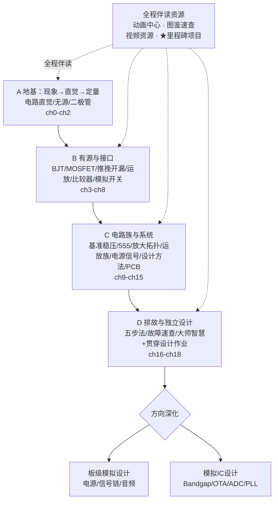
<a id="toc"></a>
## 目录

<details open markdown="1">
<summary><b>九篇十九章 · 点击收起</b></summary>

- **[第一篇：器件深度原理解析](#part1)**
  - [第 0 章 电路直觉学前班](#ch0) · [第 1 章 无源元件](#ch1) · [第 2 章 二极管](#ch2) · [第 3 章 BJT](#ch3) · [第 4 章 MOSFET](#ch4) · [第 5 章 推挽/开漏](#ch5)
  - [第 6 章 运算放大器](#ch6) · [第 7 章 比较器](#ch7) · [第 8 章 模拟开关](#ch8) · [第 9 章 基准与稳压](#ch9) · [第 10 章 555 定时器](#ch10)
- **[第二篇：经典电路拓扑原理](#part2)**
  - [第 11 章 放大电路拓扑](#ch11) · [第 12 章 运放应用电路族](#ch12) · [第 13 章 电源与信号产生](#ch13)
- **[第三篇：设计要点与 PCB 实战](#part3)**
  - [第 14 章 设计方法论](#ch14) · [第 15 章 PCB 注意事项](#ch15)
- **[第四篇：故障分析与排故方法论](#part4)**
  - [第 16 章 排故五步法](#ch16) · [第 17 章 故障速查表](#ch17) · [第 18 章 大师智慧](#ch18)
- **[第五篇：动画演示中心](#part5)** — 118 张 SVG 动画 + Falstad 地图
- **[第六篇：实物图鉴与速查](#part6)** — 实物照片 · 参数速查 · 元件标识速查 · [官方 datasheet 直达](#part6)
- **[第七篇：视频资源](#part7)** — B站系统课 · YouTube 频道
- **[第八篇：学习路线与资源索引](#part8)** — 路线图 · 书单 · 项目清单 · [AI 陪练](#sec85) · [官方资料](#sec88) · [经典论文](#sec89) · [术语表](#sec810) · [顺口溜总表](#sec811) · FAQ
- **[第九篇：自测与练习](docs/p9-00-quiz.md)** — 19 章 90 题 + 34 道专题加练，答案折叠自测

</details>

**动手样板**：[RC 充放电](#rc-study) · [MOSFET 开关](#mosfet-study) · [LM358 跟随器](#lm358-study) — 可控动画、实物编号、测量说明、视频与各 1 道自测。

**速查五件套**：[公式速查表](#cheatsheet) — 查算式；[模型边界速查](#limits) — 查失效；[模拟黑话](#sec810) — 查词；[常用芯片](docs/p6-02-s6-2.md) — 查型号；[故障速查](#ch17) — 查症状。

**不知道该走哪条**：[入场诊断](#diagnostic) — 6 题测处境，直接给你第一步和对应时间线。

---
<a id="cheatsheet"></a>
## 公式速查表：19 章设计式一页收藏

把散在 19 章正文里的设计式、判据和经验法则收进一页。每一行都是能直接抄进计算草稿的定量结论，全部从正文逐字回收。公式、数字、单位与正文一致，点「出处」回原小节看推导、动画与完整语境；带 的 135 行可一键直达对应动画。查词去黑话表，查型号去芯片表，查症状去故障表，查失效去[模型边界速查](#limits)；这一页管**算**。不知道自己该把这一页用到什么深度？3 分钟测一下 → [入场诊断](#diagnostic)。

> 用法：做设计时按场景查行，右两列分别是「什么时候用 / 在哪翻车」和出处；复习时从上到下过一遍，卡住的行就是该回正文的入口。想贴在工作台：在线站浏览器直接打印（Ctrl/⌘+P），侧栏、导航与章节跳转自动隐藏；16 个场景段各从新页开始，长段可续页，表头重复、表格行避免跨页。所谓「一页收藏」指一个网页，不是一张 A4 纸；可在打印预览里只选需要的场景页。

**目录**：[直流基础](#dc) · [无源与频域](#passive) · [二极管](#diode) · [BJT](#bjt) · [MOSFET](#mos) · [输出级](#outstage) · [运放](#opamp) · [比较器](#cmp) · [模拟开关](#switch) · [基准与稳压](#ref) · [555](#timer) · [拓扑·噪声·稳定](#topo) · [电源与信号](#power) · [设计与可靠性](#design) · [PCB](#pcb) · [排故](#debug)

<a id="dc"></a>
### 直流基础：电压·电流·电源思维（7 条）

一切设计的公共语言：分压带载、源阻抗、回路思维。这几条塌了，上面全塌。

**表 B-1　直流基础设计式与判据**

| 设计式 / 判据 | 什么时候用 · 翻车点 | 出处 |
|---|---|---|
| 电压=水压 / 电流=水流（必须成环）/ 电阻=细水管 / 电容=蓄水池 / 电感=水车惯性 / 二极管=单向阀 / MOSFET=闸门（栅压指挥）/ 地=海平面 | 全书通用语言；电流必须成环——没有"只进不出"的电流，地不是"下水道"而是测量基准。 | [第 0 章](#ch0) · [动画](#demo39) |
| $V = I \times R$ | 三个量知二求一；反着读才值钱——电流流过电阻会在电阻上"留下"一份电压降，串联路径上阻大分得多。 | [第 0 章](#ch0) · [动画](#demo39) |
| Vout = V × R2/(R1+R2) | 只在空载时成立！从 Vout 抽电流 = 给 R2 并联了一个电阻 → Vout 塌陷。 | [§0.3](#sec-0-3) · [动画](#demo39) · [就地算](#sec-0-3) |
| Vout=10×5/(10+5)=3.3V（R1=R2=10k 分 10V，接 10k 负载，空载应为 5V） | 口诀：分压器带载能力 ≈ 它自己的内阻（R1∥R2）——挂上负载即塌 33%。 | [§0.3](#sec-0-3) · [动画](#demo39) |
| 三个思维习惯：① 量电压，先问"相对谁"；② 看电路，先追"电流回路"；③ 先直流，后交流 | 电压永远是两点之差，悬空说"这点 5V"没有意义；顺序反了必乱。 | [§0.4](#sec-0-4) |
| $\Delta V = I \times Z_{out}$（横轴 I、纵轴 V，实际电源曲线斜率的绝对值对应输出阻抗） | 恒压源内阻趋近 0，短路是灾难；恒流源输出阻抗趋近 ∞，开路是灾难。负载一重电压就塌。 | [§0.6](#sec-0-6) · [动画](#demo78) |
| 横轴 I、纵轴 V：恒压源是水平线（I 怎么变，V 不动），恒流源是竖线（V 怎么变，I 不动） | 恒压源→负载并联（多路 LED 各自串限流电阻）；恒流源→负载串联（多颗 LED 串联恒流驱动）；恒流源全是拿恒压源+负反馈做出来的。 | [§0.6](#sec-0-6) · [动画](#demo78) |

自测：[第 0 章](#quiz-ch0)

<a id="passive"></a>
### 无源元件·频域·谐振（12 条）

元件在频率下露出真面目：SRF、ESR/ESL、Q 与谐振。它们是去耦和谐振设计的地基。

**表 B-2　无源元件、频域与谐振设计式**

| 设计式 / 判据 | 什么时候用 · 翻车点 | 出处 |
|---|---|---|
| 感抗 $X_L=2\pi fL$ 随频率线性增长，而电阻值不变 | 频率足够高时，电感分走的电压会超过电阻本身——"1kΩ 电阻"在射频里变成两颗元件。 | [§1.1](#sec-1-1) · [动画](#demo60) |
| C 在 $f_1=1/(2\pi RC)$ 开始夺权、L 在 $f_2=R/(2\pi L)$ 结束夺权 | 中间才是元件"当电阻"的区间；高频电路用贴片（引线≈0）。 | [§1.1](#sec-1-1) · [动画](#demo60) |
| 容抗 $1/2\pi fC$；100nF MLCC 谷底 0.3Ω @ 22.5MHz，10µF 电解谷底 1Ω @ 356kHz | 去耦选电容 = 选谷底低、谷底宽的那条；低频段容抗扛、ESR 中频兜底、ESL 高频接管。 | [§1.2](#sec-1-2) · [动画](#demo43) |
| 充电 $v_C(t)=V_S+(V_0-V_S)e^{-t/RC}$；放电 $v_C(t)=V_0e^{-t/RC}$ | 断开电源后必须有放电回路电压才按预期下降；电阻改为 2kΩ 时间常数翻倍但理想空载终值仍 5V。 | [第 1 章](#rc-study) · [动画](#demo36) |
| 变压器变比 $V_2/V_1 = N_2/N_1$；电流 $I_2/I_1 = N_1/N_2$；$V_1 I_1 \approx V_2 I_2$ | 升压处电流自动减半，能量原样过；初次级只有磁通耦合="隔离"的物理根源。 | [第 1 章](#rc-study) · [动画](#demo36) |
| 反电动势 $v=-L\frac{di}{dt}$ | 继电器/电机断电瞬间可产生数百伏尖峰，必须并联续流二极管——不是保护技巧，是电感物理的必然推论。 | [第 1 章](#rc-study) · [动画](#demo36) |
| $R_{th}=R_N=V_{th}/I_N$；带载 $V_{out}=V_{th}\cdot\dfrac{R_L}{R_{th}+R_L}$ | 任何线性网络压成两个数；$R_L=R_{th}$ 时只剩一半，$R_L=1M\Omega$ 时差 0.5%——"带不带得动"永远只需比 $R_{th}$ 与 $R_L$。 | [第 1 章](#rc-study) · [动画](#demo36) |
| $f_0=\dfrac{1}{2\pi\sqrt{LC}}$ | 串联谐振 $f_0$ 处阻抗=R 最小（带通）；并联谐振阻抗趋∞（带阻）；LC 交叉点即谐振点。 | [§1.5](#sec-1-5) |
| $Q = \dfrac{f_0}{BW}$；串联 RLC $Q = \dfrac{1}{R}\sqrt{\dfrac{L}{C}}$ | Q 高=峰尖选频锐利、Q 低=峰钝宽容；Q 高 ≠ 更好——选台要高 Q（锐利），电源滤波要低 Q（防振铃过冲）。 | [§1.5](#sec-1-5) |
| $\|Z\|=\sqrt{R^2+(X_L-X_C)^2}$；谐振时 $X_L=X_C=\sqrt{\dfrac{L}{C}}$，$V_L=V_C=Q\cdot V_{in}$，$BW=\dfrac{f_0}{Q}$ | 四拍口诀：低频电容拦、谐振两清账、高频电感拦；电源只有 1V 元件上却有 10V。 | [§1.6](#sec-1-6) |
| $L = L_0 \times 2^{\frac{T_0 - T}{10}}$（10°C 翻倍法则） | 105°C/2000h 的电容在 65°C 得 32000h≈3.7 年——开关电源里第一个坏的总是电解电容。 | [§1.7](#cap-dc-bias) · [动画](#demo103) · [就地算](#cap-dc-bias) |
| $\Delta V = \dfrac{\Delta I_L}{8 f_{sw} C}$ | 必须用降容后的有效容值做设计；标称 22µF 实际只剩 10µF 时容性纹波翻一倍多，还可能改变环路稳定性。 | [§1.7](#cap-dc-bias) · [动画](#demo103) |

自测：[第 1 章](#quiz-ch1) · ★ [必读精选·RC 充放电样板](#pick-rc)

<a id="diode"></a>
### 二极管：整流·限幅·保护（10 条）

0.7V 背后是指数律；整流纹波、限幅钳位、ESD 限流的算术都在这里。

**表 B-3　二极管整流、限幅与保护判据**

| 设计式 / 判据 | 什么时候用 · 翻车点 | 出处 |
|---|---|---|
| PN 结耗尽层内建电场约 0.7V（for Si） | 正向加压抵消内建电场→导通；反向加压加宽耗尽层→截止。二极管不是"过 0.7V 突然开"，是外加电压与内建电势的拔河。 | [第 2 章](#ch2) · [动画](#demo31) |
| $I_D = I_S\left(e^{\frac{V_D}{nV_T}} - 1\right), \quad V_T = \frac{kT}{q} \approx 26\text{mV @ 300K}$ | $I_S$ 反向饱和电流 nA~µA 级、$n$ 理想因子 1~2；恒压降模型只在特定电流附近成立，二极管不能当精密基准。 | [§2.2](#sec-2-2) · [动画](#demo46) |
| 每上升 60mV 电流爬一个十倍；$V_D$ 约 -2mV/°C | 同样电流下温度升 35°C 就掉 70mV；大功率二极管要防"温度升→电流增→更热"的正反馈。 | [§2.2](#sec-2-2) · [动画](#demo46) |
| 恒压降模型：Si 管 0.7V、肖特基 0.3V、LED 1.8~3.4V | 三种精度按场景选用；大电流场合用"恒压降+体电阻"。 | [§2.2](#sec-2-2) · [动画](#demo46) |
| $\Delta V \approx \frac{I_{load}}{f_{ripple} \cdot C}$，全波整流后 $f_{ripple}=2f_{AC}=100$Hz | 桥式全波整流任意时刻损失两个管压降（~1.4V）；电容在峰值充电、谷值放电。 | [§2.2](#sec-2-2) · [动画](#demo46) |
| 稳态峰值电流 = 负载电流 ×5~10；导通角只有 ~20% | 整个周期负载消耗的电荷全在 20% 窗口补回；所以选整流管看的是 $I_{FRM}$（重复峰值），1A 电源用 1N4007 余量很紧。 | [§2.6](#sec-2-6) · [动画](#demo83) |
| $\Delta V = I_{load}\cdot\Delta t/C$（放电段） | 二极管全关电容独自供负载，近似线性放电；1A/4700µF/100Hz → ≈2.1V 纹波。 | [§2.6](#sec-2-6) · [动画](#demo83) |
| 限幅门槛 $V_{ref}+0.7V$；钳位垫高 ≈峰值−0.7V（C 充到约峰值−0.7V 后变"串联电池"） | 限幅动"幅度"（削顶）、钳位动"直流"（垫高）；电阻 R 是限流命根，缺失时二极管和信号源对烧。 | [§2.7](#sec-2-7) · [动画](#demo31) |
| $V_C$（钳位电压，必须 < 被保护引脚的绝对最大值）；限流 $R \ge (V_{surge}-V_C)/I_{max}$ | 钳位二极管往电源轨灌电流是最隐蔽的坑（抬高 VCC、latch-up）；TVS 必须贴着接口放。 | [§2.8](#sec28) |
| ESD HBM 约 100pF + 1.5kΩ，2kV 放电峰值 ~1.3A、前沿 <10ns；最坏灌入电流 ≈ (8000-9.2)/330 ≈ 24A | 100Ω 限流电阻把进入 GPIO 内部二极管的残流压到 ≈35mA（(9.2−5.7)/100）——"限流电阻救芯片"的算术。 | [§2.8](#sec28) |

自测：[第 2 章](#quiz-ch2)

<a id="bjt"></a>
### BJT：偏置与开关（11 条）

β 靠不住，靠拓扑：分压偏置 + R_E 负反馈；开关按强制 β 算基极。

**表 B-4　BJT 偏置与开关设计式**

| 设计式 / 判据 | 什么时候用 · 翻车点 | 出处 |
|---|---|---|
| $I_C = \beta \cdot I_B$ | BJT 是电流控制器件；β（h_FE）不是精密常数——同型号离散 50~300，还随温度、$I_C$ 变化，好的设计绝不依赖 β 的具体值。 | [第 3 章](#ch3) · [动画](#demo40) |
| 三个工作区判据：截止（发射结反偏/零偏，$I_C≈0$）/ 放大（发射结正偏+集电结反偏，$I_C=\beta I_B$）/ 饱和（两结都正偏，$V_{CE}≈0.2V$） | 临界记忆值 $V_{BE}≈0.7V$、$V_{CE(sat)}≈0.2V$；饱和相当于闭合开关。 | [§3.2](#sec-3-2) · [动画](#demo40) |
| 共射电压增益 $\approx -g_mR_C$ | 共射反相、增益高；共集（射随）增益≈1、输入阻抗高输出阻抗低作缓冲；共基输入阻抗极低、高频用。 | [§3.2](#sec-3-2) · [动画](#demo40) |
| 固定偏置：$I_B=(V_{CC}-0.7)/R_B$，$I_C=\beta I_B$ | β 离散 3 倍导致工作点完全不可控——这就是工程上必须用分压偏置的原因。 | [§3.4](#sec-3-4) |
| 分压偏置：$V_B \approx V_{CC}\frac{R_2}{R_1+R_2}$；$V_E = V_B - 0.7$；$I_E = V_E/R_E$（与 β 无关！） | 分压电流 ≫ $I_B$，基流扰动可忽略；$R_E$ 是采样元件、分压器是基准、$V_{BE}$ 是比较器。 | [§3.4](#sec-3-4) |
| 设计经验法则：$V_E$ 取 1~2V，分压电流取 $I_B$ 的 10 倍以上 | 负反馈机制：温度↑→$I_C$↑→$V_E$↑→$V_{BE}$↓→$I_C$↓；β 从 100 漂到 300，$I_C$ 变化 <5%。 | [§3.4](#sec-3-4) |
| BJT 开关：取强制 β=10，$I_B = 70mA/10 = 7mA$；$R_B = \frac{V_{MCU}-V_{BE}}{I_B} = \frac{3.3-0.7}{7mA} ≈ 371Ω$（就近取 360Ω） | 分母是 $I_B$ 不是 $I_C$；感性负载必须加续流二极管——不是可选项，是必需品。 | [§3.4](#sec-3-4) |
| 达林顿：$\beta_{total}\approx\beta_1\beta_2$（可达 10000+） | 三笔代价：$V_{BE}$ 翻倍到 1.4V、$V_{CE(sat)}$ 升到约 0.9V（Q2 无法深度饱和）、速度慢。 | [§3.4](#sec-3-4) |
| $\text{温度↑} \;\Rightarrow\; V_{BE}\text{↓（}-2\text{mV/°C）} \;\Rightarrow\; I_C\text{↑} \;\Rightarrow\; \text{功耗↑} \;\Rightarrow\; \text{温度↑↑}$ | 唯一的刹车是射极负反馈电阻 $R_E$；没有 $R_E$ 的固定 $I_B$ 偏置没有任何回路能自己刹车。 | [§3.7](#sec-3-7) · [动画](#demo41) |
| 在线速判（NPN 放大态）：$V_B≈0.7V$、$V_E≈0V$（直耦）或 $V_E=V_B-0.7$、$V_C$ 明显高于 $V_B$ | $V_{BE}=0.7V$ 但 $V_C≈+12V$→查集电极回路；$V_C≈0.2V$→已饱和；$V_{BE}=0V$→查基极回路。先量电压不先拆管子。 | [§3.7](#sec-3-7) · [动画](#demo41) |
| 最大不失真摆幅 $= 2\times\min(6V,\ 4V) = \mathbf{8.0V_{pp}}$；$\|A_v\| = \frac{R_C}{r_e} ≈ \frac{2kΩ}{26mV/3mA} ≈ 230$ | 摆幅由更小的那份余量决定——Q 点偏置的任务就是把上行/下行余量尽量平分，否则一摆就削顶。 | [§3.7](#sec-3-7) · [动画](#demo41) |

自测：[第 3 章](#quiz-ch3)

<a id="mos"></a>
### MOSFET：驱动与损耗（10 条）

Qg 决定开关速度、Qgd 决定米勒平台；损耗 = 导通 + 开关 + 驱动，缺一不可。

**表 B-5　MOSFET 驱动与损耗判据**

| 设计式 / 判据 | 什么时候用 · 翻车点 | 出处 |
|---|---|---|
| 线性区：$I_D = \mu_n C_{ox}\frac{W}{L}\left[(V_{GS}-V_{TH})V_{DS} - \frac{V_{DS}^2}{2}\right]$ | 像可变电阻——模拟开关/可变衰减用这里。 | [第 4 章](#ch4) · [动画](#demo44) |
| 饱和区：$I_D = \frac{1}{2}\mu_n C_{ox}\frac{W}{L}(V_{GS}-V_{TH})^2$，边界 $V_{DS} \ge V_{GS}-V_{TH}$；跨导 $g_m = \frac{\partial I_D}{\partial V_{GS}}$ | MOSFET 饱和=恒流源（放大区），与 BJT"饱和=开关闭合"词同义反——无数初学者在这里掉坑。 | [第 4 章](#ch4) · [动画](#demo44) |
| 反型层形成条件 $V_{GS} > V_{TH}$；$R_{DS(on)}$ 随 $V_{GS}$ 连续下降 | "栅极不取电流"只在静态成立；开关瞬间要给栅电容充放电（$Q_g$），驱动电流能力决定开关速度。 | [第 4 章](#ch4) · [动画](#demo44) |
| 平台时间 $= Q_{gd}\div I_{drv} = 1.6nC\div10mA$（160ns） | 栅极电阻越小→平台越短→损耗越小→但 EMI 越大；datasheet 上 $Q_{gd}$ 比 $C_{rss}$ 更直接告诉你"这管子开关有多肉"。 | [§4.3](#sec-4-3) · [动画](#demo44) |
| 真正的电压电流重叠区 150ns 到 560ns = 410ns；按 100kHz 算 $P_{sw}\approx2W$ | 电压电流重叠产生开关损耗；不能只凭出现平台就给整个过程贴同一个工作区标签。 | [§4.3](#sec-4-3) · [动画](#demo44) |
| 栅氧层仅几十 nm，耐压通常 ±20V；驱动回路串 10~100Ω 电阻抑制振铃 | ESD 极易击穿 → 未用的 MOS 栅极不得悬空。 | [§4.4](#sec-4-4) · [动画](#demo68) |
| 体二极管：单只 MOS 做「理想二极管」防反接不行，要两只背靠背（共源）才有阻断能力 | 体二极管压降比肖特基大、反向恢复更慢；好处是 H 桥/同步 Buck 在死区时间靠它续流。 | [§4.4](#sec-4-4) · [动画](#demo68) |
| 误导通：$dv/dt$ 经 $C_{gd}$ 耦合抬升栅压；半桥直通=上下管同时导通 | 对策：栅源并 10kΩ 下拉、米勒钳位；死区时间控制防直通。热失效=只看了 $R_{DS(on)}$ 没算开关损耗。 | [§4.4](#sec-4-4) · [动画](#demo68) |
| $P_{cond} = I^2 R_{DS(on)} = 25\times 0.03Ω = 0.75W$ | 静态导通损耗；总损耗=导通+开关+驱动损耗。 | [§4.6](#sec-4-6) · [动画](#demo82) |
| 开关时间 $\approx\frac{Q_g}{I_{drv}}=\frac{7nC}{10mA}=700ns$；$P_{sw} = \frac{1}{2}\times 20\times 5\times 700ns\times 100kHz ≈ 3.5W$ | 是导通损耗的 4 倍多——高频必须看 $Q_g$ 不能只看 $R_{DS(on)}$；损耗应按实际波形积分，不能把总栅极充电时间当成重叠时间。 | [§4.6](#sec-4-6) · [动画](#demo82) |

自测：[第 4 章](#quiz-ch4) · ★ [必读精选·MOSFET Miller 平台](#pick-miller)

<a id="outstage"></a>
### 输出级与总线电平（10 条）

推挽 / 开漏 / 三态的选择就是总线协议的选择；上升沿与灌流的两个不等式。

**表 B-6　输出级与总线电平速查**

| 设计式 / 判据 | 什么时候用 · 翻车点 | 出处 |
|---|---|---|
| $I=\dfrac{5V}{25\Omega+25\Omega}=100mA$（两推挽直连，一推高一拉低） | 这个电流不经过负载，纯粹在两只管子之间烧掉——共享总线（I²C、多设备数据线）绝不能用推挽。 | [§5.1](#sec-5-1) · [动画](#demo53) |
| 上下管切换瞬间存在微小共同导通窗口 → 直通电流（shoot-through） | CMOS 动态功耗和电源毛刺的主要来源，芯片靠"死区时间"（先关后开）把它压下去。 | [§5.1](#sec-5-1) · [动画](#demo53) |
| 开漏上升沿 $t_r ≈ 0.8473 \times R_p \times C_b$；I2C 快速模式要求 $t_r<300ns$、$C_b<400pF$ → $R_p \lesssim 890\Omega$（取 820Ω；$C_b$ 只有 100pF 时才放宽到 3.5kΩ） | $\tau=R_p C_{bus}$：$R_p$ 小了快但静态费电，大了省电但慢——代价全在上升沿。 | [§5.2](#sec-5-2) |
| 上拉下限 $R_{p(min)} = \frac{V_{DD}-V_{OL(max)}}{I_{OL}}$；I2C 常用 2.2kΩ~4.7kΩ | I2C 标准模式典型 3mA → 5V 系统约 1.5kΩ 起；低速/长线偏大，高速/短距离偏小。 | [§5.2](#sec-5-2) |
| 线与：任何一个拉低，全线为低；全部释放才是高 | I2C 规范强制要求开漏+上拉——它用速度换来了多主机仲裁与时钟延展的能力。 | [§5.2](#sec-5-2) |
| 上拉/下拉经验范围：1kΩ~100kΩ，常用 10kΩ；MCU 内部上拉通常 30~50kΩ | 太弱（阻值大）→抗干扰差、翻转慢；太强（阻值小）→浪费功耗、驱动器拉不动。弱上拉不能当 I2C 上拉用。 | [§5.3](#sec-5-3) · [动画](#demo62) |
| 两条硬约束：上升沿 $t_r\approx0.8473\cdot R_p\cdot C$、低电平吸流 $I_{low}=V/R_p$；I²C 标准模式 $t_r<1000ns$ → $R_p\le11.8kΩ$，快速模式 ≤3.5kΩ | 两约束互相拉扯；实板常见 2.2k。 | [§5.3](#sec-5-3) · [动画](#demo62) |
| 高阻态：$\tau=RC=0.2\mu s$（20pF 总线 / 10kΩ 上拉） | 三态总线必须有机制保证同一时刻只有一个器件驱动；I²C 用开漏+上拉永不直通，并行总线靠严格片选时序。 | [§5.3](#sec-5-3) · [动画](#demo62) |
| 8Ω 负载、±12V：$I_{pk}=1.5A$、$P_{out}=9W$、B 类效率上限 78.5% | 交越失真=输入 ±0.6V 死区两管都够不着造成过零畸变，AB 类用二极管偏置消除。 | [§5.6](#sec-5-6) |
| 直通：$I=24/1=\mathbf{24A}$，瞬时功耗 $24^2\times0.5=\mathbf{288W}$ | 远超 TO-220 的 60W 极限，几十毫秒就冒烟；AB 类偏置必须"够小不交越、够稳不直通"。 | [§5.6](#sec-5-6) |

自测：[第 5 章](#quiz-ch5) · ★ [必读精选·推挽 vs 开漏](#pick-pushpull)

<a id="opamp"></a>
### 运放：选型参数与电路族（22 条）

虚短虚断推出全部电路族；GBW / SR / Vos / IB 四大参数各有各的杀手锏。

**表 B-7　运放选型参数与电路族**

| 设计式 / 判据 | 什么时候用 · 翻车点 | 出处 |
|---|---|---|
| $GBW ≥ 增益 × 信号最高频率 × 10$（留裕量） | 选型公式；闭环增益×闭环带宽≈GBW。LM358 噪声增益 100 时带宽仅 7kHz，覆盖不了 20kHz 音频。 | [§6.3](#sec-6-3) · [动画](#demo71) · [就地算](#sec-6-3) |
| $f_{max} = \frac{SR}{2\pi V_p}$ | 全功率带宽。SR=0.5V/µs、输出 5V 峰值正弦时仅≈16kHz，再高就畸变成三角波——大信号先看 SR。 | [§6.3](#sec-6-3) · [动画](#demo71) |
| $总噪声 = 密度 × √带宽$ | 白噪声带宽积分近似；低频还有 1/f 噪声，精密频带应分段积分而非简单乘 √带宽。 | [§6.3](#sec-6-3) · [动画](#demo71) |
| $V_{OS}×增益 = 输出端误差$ | 失调被噪声增益放大；噪声增益 100 倍时 3mV 失调→输出约 300mV 误差，直流精度电路第一杀手。 | [§6.3](#sec-6-3) · [动画](#demo71) |
| $I_B R_S$ | 偏流流过源阻抗变成额外失调；高源阻抗>100kΩ 必须选 FET 输入型（100kΩ 配 20nA 已有 2mV 误差）。 | [§6.3](#sec-6-3) · [动画](#demo71) |
| $V_+ \approx V_-$（虚短） | 仅当负反馈把输出拉在线性区成立；开环（比较器）用法时虚短立即失效——第 7 章正是利用这一点。 | [§6.3](#sec-6-3) · [动画](#demo71) |
| $1V ÷ 0.5V/µs = 2µs$ | 压摆率爬坡是恒速直线而非指数；ADC 多路切换前端要挑大信号 SR 够快的运放，光看 GBW 会严重乐观。 | [§6.7](#sec-6-7) · [动画](#demo45) |
| $V_{out} = -\frac{R_f}{R_{in}}V_{in}$ | 反相放大器三行推导：虚短→虚地→虚断，R_in 电流全部流入 R_f；本章（含 12.3~12.4）所有电路都是它的变体。 | [§12.1](#sec-12-1) · [动画](#demo32) |
| 同相 $1+R_f/R_1$；反相 $-R_f/R_{in}$ | 反相输入阻抗=$R_{in}$（增益100倍时往往只有几kΩ）会拖垮高阻传感器→改用同相或仪放；同相输入阻抗极高。 | [§12.2](#sec-12-2) · [动画](#demo52) |
| $V_{out} = \frac{R_2}{R_1}(V_2 - V_1)$（四电阻匹配时，见 12.3 差分放大器） | 四电阻匹配精度直接等于共模抑制能力——1%电阻只有40dB CMRR，要80dB以上用0.1%电阻或集成差放。 | [§12.2](#sec-12-2) · [动画](#demo52) |
| $V_{out} = -\frac{1}{RC}\int V_{in}\,dt$（见 12.4 积分器） | 运放 V_OS 会被当成直流一直积分→输出慢慢爬向电源轨（漂移饱和）→必须并在电容上一个超大电阻（如10MΩ）泄放直流。 | [§12.2](#sec-12-2) · [动画](#demo52) |
| $V_{out} = -RC\,\frac{dV_{in}}{dt}$（见 12.4 微分器） | 微分=高频增益无限上升=噪声放大器、极易自激→输入串小电阻、反馈并小电容把高频增益摁住。 | [§12.2](#sec-12-2) · [动画](#demo52) |
| $f_c = \frac{1}{2\pi\sqrt{R_1R_2C_1C_2}}$（常用 $R_1{=}R_2{=}R,\ C_1{=}C_2{=}C$：$f_c=\frac{1}{2\pi RC}$） | Sallen-Key 二阶低通截止频率；Q 只由"比值"决定、f_c 只由"绝对值"决定，所以调 Q 调比值、调频率调绝对值。 | [§12.5](#sec-12-5) · [动画](#demo10) |
| $\frac{1}{Q}=\sqrt{\frac{C_2}{C_1}}\left(\sqrt{\frac{R_1}{R_2}}+\sqrt{\frac{R_2}{R_1}}\right)$ | 单位增益 Sallen-Key（C_1 接输出是反馈电容、C_2 接地）；等值元件只给 Q=0.5（临界阻尼、滚降肉），Butterworth 需 C_1=2C_2。 | [§12.5](#sec-12-5) · [动画](#demo10) |
| $Q=\dfrac{\sqrt{R_1R_2C_1C_2}}{C_2(R_1+R_2)+R_1C_1(1-K)}$ | 非单位增益（K>1）时增益会污染 Q：增益越大 Q 越大，大到分母归零就自激→一般用单位增益跟随器把增益与 Q 分开。 | [§12.5](#sec-12-5) · [动画](#demo10) |
| $n$ 阶滤波器滚降 $=-20n$ dB/dec（$n/2$ 个二阶节级联） | 要 −60dB 抑制：一阶需3个十倍频程、二阶只需1.5个；级联时 Q 小的节放前面（避免前级峰化被后级放大）。 | [§12.5](#sec-12-5) · [动画](#demo10) |
| 自激条件 $\|A\beta\|\geq1$ 且总相移 −180°；相位裕度工程底线 45°、舒适区 60° | 负反馈每极点最多贡献−90°相移，攒够−180°原地转正反馈；\|Aβ\|<1 只是振铃、过冲，尚且可控。 | [§12.7](#sec-12-7) · [动画](#demo59) |
| $T(s)=\frac{1+sR_{iso}C_L}{1+s(R_o+R_{iso})C_L}$ | 反馈取自 Riso 之前（A点）时容性负载的传递因子，有一个极点一个零点；反馈改接 B 点则零点消失，稳定性结论不可照搬。 | [§12.9](#sec129) |
| $V_{out} = -I_{ph} R_f$；$f_p = \dfrac{1}{2\pi R_f C_j}$ | TIA 把光电流线性变电压；虚地把光电二极管钉在0V→结电容不充放电，线性度与速度最好（这是不用反相放大电压的答案）。 | [§12.10](#sec1210) |
| $C_f \ge \sqrt{\frac{C_j}{2\pi R_f \cdot GBW}}$ | TIA 反馈补偿电容下限（给噪声增益制造零点提前压平）；算出的值可能比焊盘寄生还小→留1~2pF并实测方波过冲确认。 | [§12.10](#sec1210) |
| $I_{avg}=f_{clk}\,C\,\Delta V\ \Longrightarrow\ R_{eq}=\frac{\Delta V}{I_{avg}}=\frac{1}{f_{clk}C}$ | 开关电容把电阻绝对值换成时钟频率与电容比值（精度来源从"造准元件"变成"造准时钟"）；但它对输入是采样系统，前面必须加抗混叠滤波器。 | [§12.12](#sec-12-12) |
| $V_{err} = I_b \cdot R_s$；$i_n=\sqrt{2qI_b}$ | 选型只看源阻抗：高阻(>100kΩ)挑 I_b 小的 CMOS/JFET，低阻(<10kΩ)挑 e_n 小的 BJT；I_b 每升10°C大约翻一倍。 | [§12.13](#sec1213) · [动画](#demo104) |

自测：[第 6 章](#quiz-ch6) · [第 12 章](#quiz-ch12) · ★ [必读精选·虚短虚断两公理](#pick-virtual)

<a id="cmp"></a>
### 比较器判决与迟滞（7 条）

开环判决 + 正反馈迟滞；上拉电阻同时决定速度、功耗与噪声免疫。

**表 B-8　比较器判决与迟滞设计式**

| 设计式 / 判据 | 什么时候用 · 翻车点 | 出处 |
|---|---|---|
| $\tau=RC=1\text{ms},\quad t_r\approx2.2\tau=2.2\text{ms}$ | 开集电极输出靠外部上拉；10kΩ 上拉带 100nF 电容，上升沿被拖到 2.2ms——判决再快也没用。 | [§7.1](#sec-7-1) · [动画](#demo47) |
| 共模范围 $0 ~ Vcc-1.5V$ | LM393 用 PNP 输入级所以共模能到地，单电源接地信号直接能比；输出只有一只对地 NPN（开集电极），必须外接上拉。 | [§7.2](#sec-7-2) · [动画](#demo54) |
| $V_{TH+} = V_{REF}\left(1+\frac{R_1}{R_2}\right) - \frac{R_1}{R_2}V_{OL},\qquad V_{TH-} = V_{REF}\left(1+\frac{R_1}{R_2}\right) - \frac{R_1}{R_2}V_{OH}$ | 上拉型开集电极比较器（正反馈分压）的两个翻转阈值；注意 V_TH+ 用 V_OL、V_TH- 用 V_OH。 | [§7.3](#sec-7-3) · [动画](#demo35) |
| $\Delta V = V_{TH+}-V_{TH-} = \frac{R_1}{R_2}(V_{OH}-V_{OL})$ | 迟滞窗口；须大于噪声峰峰值的 2 倍，但太大降低灵敏度。R2/R1 常用 100:1（窗口约电源的 1%）。 | [§7.3](#sec-7-3) · [动画](#demo35) · [就地算](#sec-7-3) |
| $T=2RC\ln 3\approx2.2\text{ms}$ | 迟滞比较器+一根 RC 即成振荡器（≈455Hz）；C 在两门槛间指数充放，每碰门槛输出翻转。 | [§7.3](#sec-7-3) · [动画](#demo35) |
| $\Delta V = \frac{1}{100}\times10V = 100mV$ | 噪声峰峰 20mV→窗口需≥40mV；取 R2/R1=100、V_OH-V_OL=10V 得 100mV，留 2.5 倍余量。先量噪声再定电阻。 | [§7.3](#sec-7-3) · [动画](#demo35) |
| $t_r\approx0.8473\cdot R\cdot C$ | 开集电极上拉上升时间；I²C 标准模式 R≤11.8kΩ。开集电极=一只对地开关，没有上拉就没有可靠高电平。 | [§7.3](#sec-7-3) · [动画](#demo35) |

自测：[第 7 章](#quiz-ch7)

<a id="switch"></a>
### 模拟开关与采样保持（8 条）

Ron、电荷注入、droop 三座山；精度与速度的取舍全在 C_h 一个数上。

**表 B-9　模拟开关与采样保持判据**

| 设计式 / 判据 | 什么时候用 · 翻车点 | 出处 |
|---|---|---|
| $R_{on,N}=\dfrac{R_0}{V_{DD}-V_{IN}-V_{TH}},\qquad R_{on,P}=\dfrac{R_0}{V_{IN}-V_{TH}}$ | 传输门两管导通电阻；输入接近 V_DD-V_TH 时 N 管 Ron→∞（阈值损失），P 管相反——互补并联才全程平坦。 | [§8.1](#sec-8-1) · [动画](#demo50) |
| $V_{DD}-V_{TH}$（单 N 管传高电平上限） | 5V 供电传 5V 信号实际只能到 4V；下游若是另一只 N 管或需轨到轨的 ADC 输入端，这 1V 缺口就是精度损失起点。 | [§8.1](#sec-8-1) · [动画](#demo50) |
| $\Delta V=Q/C$ | 电荷注入=关断瞬间沟道电荷被挤进保持电容；采样电路最隐蔽的误差源，手册里叫 Charge Injection。 | [§8.2](#sec-8-2) · [动画](#demo69) |
| 先断后合（Break-Before-Make） | 多路复用切换先断旧通道再接通新通道，防止两路信号源短路互怼；若误用先合后断型号接两个电源会短路。 | [§8.2](#sec-8-2) · [动画](#demo69) |
| $dV/dt=I_{leak}/C_{hold}$ | droop——开关漏电+缓冲器偏流让保持电压斜坡下垂；高阻源/长保持时间应用的关键误差源。 | [§8.4](#sec-8-4) · [动画](#demo22) |
| $\Delta V=\dfrac{Q_{ch}}{2C_h}=\dfrac{0.2pC}{2\times10pF}=10mV$ | 关断时沟道电荷一半注入 C_h；对 2.048V/12 位 ADC，1 LSB=500µV，这 10mV 就是 20 个 LSB。 | [§8.4](#sec-8-4) · [动画](#demo22) |
| $Q_{ch}=C_{ox}WL(V_{GS}-V_{TH})$ | 沟道电荷与信号电压有关，所以注入误差随信号变化，不是固定偏移。 | [§8.4](#sec-8-4) · [动画](#demo22) |
| $\tau=R_{on}C_h$ | 采样时间常数；C_h 从 10pF 加到 100pF 把 ΔV 从 10mV 降到 1mV，但采样时间长 10 倍——精度与速度的取舍。 | [§8.4](#sec-8-4) · [动画](#demo22) |

自测：[第 8 章](#quiz-ch8)

<a id="ref"></a>
### 电压基准与稳压器（9 条）

基准是系统的定盘星；LDO 是闭环，负载阶跃的坑要用 ESR 和电容两笔账算。

**表 B-10　电压基准与稳压器速查**

| 设计式 / 判据 | 什么时候用 · 翻车点 | 出处 |
|---|---|---|
| $V_{REF} = \underbrace{V_{BE}}_{-2mV/°C} + \underbrace{K \cdot V_T \ln N}_{+0.085mV/°C \times K} \approx 1.25V$ | 带隙基准：负温漂 V_BE 与正温漂 K·V_T·lnN 互相抵消；≈1.25V 是硅带隙电压，所有现代基准的核心。 | [§9.1](#sec-9-1) · [动画](#demo20) |
| $\Delta V_{BE}=V_T\ln 8\approx 26mV\times2.08=54mV$，配比 $K\approx 11.3$ | 电流密度比 N=8 时 ΔV_BE 温漂≈+0.177mV/°C；要抵消 V_BE 的 -2mV/°C 需 K≈11.3，V_REF≈1.26V——IC 里比值才可靠。 | [§9.1](#sec-9-1) · [动画](#demo20) |
| $V_{KA} = 2.5 \times \left(1 + \frac{R_1}{R_2}\right)$ | TL431 内部强制 REF=2.5V，外接两电阻分压设定输出；经典坑：阴极对地电容过大（>1µF 且 ESR 不合适）会振荡。 | [§9.1](#sec-9-1) · [动画](#demo20) |
| $V_{OUT} = V_{REF}(1+R_1/R_2)$ | LDO 本质=带隙基准+误差放大器+调整管的负反馈环路，强制输出此式；是闭环控制系统不是稳压元件。 | [§9.3](#sec-9-3) · [动画](#demo95) |
| $P=(V_{IN}-5V)\times I$ | 压差功耗全变成热；12V→5V@300mA=2.1W，无散热片必热关断——大压差×大电流直接上 DCDC。 | [§9.3](#sec-9-3) · [动画](#demo95) |
| 输入整流谷值 ≥ $V_{OUT}+V_{DROP}$ | 否则输出 100Hz 纹波；7805 需 2V 压差（5V 输出要 7V 输入），真 LDO 如 AMS1117=1.1V。 | [§9.3](#sec-9-3) · [动画](#demo95) |
| $\Delta V_1 = 490mA \times 50mΩ ≈ 25mV$ | 负载阶跃时输出电容 ESR 的零延迟跳变，环路拦不住；对策是换低 ESR 陶瓷电容压掉此项。 | [§9.3](#sec-9-3) · [动画](#demo95) |
| $\Delta V_2 = \dfrac{I\cdot\Delta t}{C} = \dfrac{0.49A \times 5µs}{10µF} ≈ 245mV$ | 环路带宽有限、电容独自供电的跌落；总跌落≈270mV 超过 3.3V 系统复位阈值 165mV→「MCU 一跑大程序就复位」。对策：加大输出电容/低 ESR/快环路 LDO。 | [§9.3](#sec-9-3) · [动画](#demo95) |
| PSRR：1kHz 时 60~80dB，1MHz 可能只剩 20dB | 开关电源后级滤波要看高频段 PSRR；高频下急剧变差，所以去耦电容不能省。 | [§9.3](#sec-9-3) · [动画](#demo95) |

自测：[第 9 章](#quiz-ch9)

<a id="timer"></a>
### 555 定时器（6 条）

0.693 与 1.1 两个常数打天下；CTRL 脚别忘了旁路。

**表 B-11　555 定时器设计式**

| 设计式 / 判据 | 什么时候用 · 翻车点 | 出处 |
|---|---|---|
| $f = \frac{1.44}{(R_1 + 2R_2)\,C}, \qquad 占空比 = \frac{R_1+R_2}{R_1+2R_2} > 50\%$ | 无稳态频率与占空比；充电走 R1+R2、放电只走 R2，所以占空比永远 >50%。 | [§10.1](#sec-10-1) |
| $t\approx1.1RC$ | 单稳态脉宽；精度与 R、C 的绝对误差直接挂钩。 | [§10.2](#sec-10-2) · [动画](#demo58) |
| $t_{充}=0.693(R_1+R_2)C ≈ 541µs,\quad t_{放}=0.693\,R_2\,C ≈ 471µs$ | 指数曲线 ⅓→⅔ 恰好 ln2≈0.693 个时间常数；R1=1k、R2=6.8k、C=100nF 时 f≈990Hz、占空比≈53%。想要准 50%：R2 并联二极管让充电抄近路绕过 R2。 | [§10.2](#sec-10-2) · [动画](#demo58) |
| $t_{脉宽} = 1.1\,R_A\,C = 1.1\times 100k\times 10µF ≈ 1.1s$ | 单稳脉宽：从 0V 充到 ⅔Vcc 恰好 ln3≈1.1 个时间常数；触发脉冲多窄都无所谓，输出宽度只认 RC。 | [§10.2](#sec-10-2) · [动画](#demo58) |
| 5 脚（CTRL）接 10nF 到地 | 5 脚直接接内部 ⅔Vcc 分压点，悬空等于高阻节点接天线→频率漂移；10nF 旁路同时不拖慢电源爬升。 | [§10.2](#sec-10-2) · [动画](#demo58) |
| 双极版 NE555：电源 4.5~16V、输出 200mA；CMOS 版 2~15V、低功耗 | 按驱动电流与功耗选型：双极版可直接驱动继电器但静态功耗大、输出非轨到轨；翻转瞬间 200mA 级电流冲击电源，就近 100nF+10µF 去耦必需。 | [§10.2](#sec-10-2) · [动画](#demo58) |

自测：[第 10 章](#quiz-ch10)

<a id="topo"></a>
### 拓扑·噪声·稳定性（14 条）

组态选择、电流镜、Miller 与极点分裂；噪声 RSS 与 Friis 定第一级。

**表 B-12　拓扑、噪声与稳定性判据**

| 设计式 / 判据 | 什么时候用 · 翻车点 | 出处 |
|---|---|---|
| $V_E = V_B - 0.7V$；$I_E=(1+\beta)I_B$ | 射随器电压只跟随不放大（差一个死板的0.7V），放大的是电流β倍——高进低出的阻抗变换/缓冲。 | [§11.1](#sec-11-1) · [动画](#demo64) |
| 共射 CE：高增益·反相；共集 CC：$A_v\approx1$·高进低出；共基 CB：高增益·高频 | 级联心法：共射打头阵放大、射随器垫后驱动、共基守高频前线（CB 把 C_bc 一端接地、无 Miller 效应）。 | [§11.1](#sec-11-1) · [动画](#demo64) |
| $I_C = I_{REF}$（两管 $V_{BE}$ 相同、工艺匹配） | 电流被"复印"；误差来自基极电流分流（β越大越准）与 Early 效应（Wilson 镜改进）——两大用途是偏置分发与有源负载。 | [§11.3](#sec-11-3) · [动画](#demo13) |
| $C_{eff} = (1+A)\cdot C_{bc}$ | 跨接增益级输入输出的寄生电容被增益"撬动"(1+A)倍，共射/共源最毒；本质是同一份电荷要多供(1+A)倍电流。 | [§11.5](#sec-11-5) · [动画](#demo16) |
| $f_H = \frac{1}{2\pi R_{sig}C_{eff}}$ | 与源内阻组成低通；10kΩ、10pF、A=100 → 约15.8kHz 就开始滚降——米勒效应是高频增益第一杀手。 | [§11.5](#sec-11-5) · [动画](#demo16) · [就地算](#sec-11-11) |
| $\omega_{p1}' \approx \frac{1}{g_{m2}R_1R_2C_c}$（左移，变低），$\omega_{p2}' \approx \frac{g_{m2}C_c}{C_1C_2+C_c(C_1+C_2)}$（右移，变高） | 极点分裂：C_c 被第二级增益米勒放大压住主极点、又给第二级开低阻通路把次极点推向高频，用带宽换相位裕度。 | [§11.5](#sec-11-5) · [动画](#demo16) |
| $\text{GBW}=g_{m1}/(2\pi C_c)$ | 带密勒补偿的两级运放，单位增益带宽几乎只由 C_c 决定（代价是主极点降低）。 | [§11.5](#sec-11-5) · [动画](#demo16) |
| PM=45°↔ζ≈0.42↔过冲≈23%；PM=60°↔ζ≈0.59↔过冲≈10%；PM=65°↔ζ≈0.71（Butterworth）↔过冲≈4% | ζ↔PM↔过冲换算表；"相位裕度60°"成为设计目标就是它把过冲压到10%附近又不牺牲太多带宽。 | [§11.5](#sec-11-5) · [动画](#demo16) |
| $V_n=\sqrt{4kTRB}$ | 电阻热噪声（白噪声、全频段均匀）——只看阻值/温度/带宽；源电阻能小就小。 | [§11.6](#sec-11-6) · [动画](#demo48) · [就地算](#sec-11-6) |
| $I_n=\sqrt{2qIB}$ | 散粒噪声：电流越大噪声越大，但只随√I 缩放、不随频率变（平的）。 | [§11.6](#sec-11-6) · [动画](#demo48) |
| $BW_n=\dfrac{\pi}{2}f_H\approx1.57f_H$ | 一阶低通对白噪声的等效噪声带宽（滚降段也算进去）——别拿 −3dB 带宽直接乘。 | [§11.6](#sec-11-6) · [动画](#demo48) |
| $e_{total}=\sqrt{e_1^2+e_2^2+e_3^2+\cdots}$ | 总噪声按功率（RSS）相加不是电压相加：4个等量源只涨到2倍（+6dB），最大一项说了算。 | [§11.6](#sec-11-6) · [动画](#demo48) |
| $F_{total}=F_1+\frac{F_2-1}{G_1}+\frac{F_3-1}{G_1G_2}+\cdots$ | Friis 数值版：后级噪声被前级增益除回去，整机 NF 几乎只看第一级——"前级必须低噪+高增益"的定量理由。 | [§11.6](#sec-11-6) · [动画](#demo48) |
| $A_{dm}=\dfrac{R_C}{2r_e}$；$A_{cm}\approx\dfrac{R_C}{2R_{tail}}$；$CMRR=20\log\dfrac{A_{dm}}{A_{cm}}$ | 尾电流源内阻 R_tail 越大 CMRR 越高；"匹配"是命根子——失配1%就能把CMRR从100dB拉到60dB。 | [§11.7](#sec-11-7) |

自测：[第 11 章](#quiz-ch11)

<a id="power"></a>
### 电源变换与信号产生（15 条）

伏秒平衡推出所有开关拓扑；ADC / 晶振 / 光耦的判据藏在细节里。

**表 B-13　电源变换与信号产生设计式**

| 设计式 / 判据 | 什么时候用 · 翻车点 | 出处 |
|---|---|---|
| $V_{out} = V_Z - 0.7V$ | 13.1 最简分立串联稳压；V_Z 与 V_BE 各贡献一份温漂（双重温漂）→远不如激光修调过的 7805，这正是它被集成方案取代的原因。 | [第 13 章](#ch13) · [动画](#demo11) |
| $(V_{in}-V_{out})\cdot D \cdot T = V_{out}\cdot(1-D)\cdot T \;\Rightarrow\; V_{out}=D\cdot V_{in}$ | Buck 伏秒平衡（稳态铁律：电感一个周期平均电压必须为0）；开关要么全开要么全关都不耗功率→效率90%+。 | [§13.2](#sec-13-2) · [动画](#demo11) · [就地算](#sec-13-2) |
| $V_{out} = \dfrac{V_{in}}{1-D}$（理想） | Boost：开关断开瞬间电感电压叠加在输入上泵向输出（"憋气弹簧"）→只能升压；12V→5V 用 LDO 效率只有42%。 | [§13.3](#sec-13-3) · [动画](#demo14) |
| $f_0=\dfrac{1}{2\pi RC}$；$\text{环路增益}=3\times\frac{1}{3}=1,\ \text{环路相移}=0°$（巴克豪森判据，见 13.4 文氏桥） | RC 串并网络在 f0 处相移0、衰减1/3，配增益3的同相放大器补偿；难点不在起振（增益>1即可）在稳幅（经典用白炽灯泡）。 | [§13.3](#sec-13-3) · [动画](#demo14) |
| $V_S \ge \underbrace{I\times R_L}_{负载} + \underbrace{I\times R_{sense}}_{采样电阻} + \underbrace{V_{drop}}_{调整管压差}$ | 恒流源的合规电压天花板；负载超过 R_L,max → 退出恒流区、I-V 曲线从平坦转为塌陷（与齐纳低于 V_Z 失去稳压是同一件事）。 | [§13.5.1](#sec-13-5-1) |
| $q=V_{FS}/2^N$；$e_q=\dfrac{q}{\sqrt{12}}=\dfrac{V_{FS}}{2^N\sqrt{12}}$ | 量化台阶与量化噪声 RMS；12位/3.3V→台阶≈0.8mV，这就是 ADC 读数末位抖动的物理根源。 | [§13.6](#sec136) · [动画](#demo19) |
| $\text{SNR}=6.02N+1.76\ \text{dB}$ | 满量程正弦输入的理想 N 位 ADC 信噪比——每多一位 SNR 约涨6dB。 | [§13.6](#sec136) · [动画](#demo19) |
| $\text{ENOB}=\dfrac{\text{SINAD}-1.76}{6.02}$ | 必须用 SINAD（含噪声与谐波失真）折算；只给排除了谐波的 SNR 不能确定 ENOB，只有失真可忽略时才可近似。 | [§13.6](#sec136) · [动画](#demo19) |
| $\text{SNR}_{jitter}\approx-20\log(2\pi f\Delta t)$ | 孔径抖动：1MHz/10ps→约84dB(≈14位)，10MHz 同样抖动只剩64dB(≈10位)——高速高精度 ADC 的真正门槛是时钟质量不是位数。 | [§13.6](#sec136) · [动画](#demo19) |
| 建立到 $1/2^{N+1}$ 需 $\ge(N+1)\ln2\approx9$ 个时间常数；$R_{max}=\tau/C_{in}$ | SAR 电荷桶建立：12位/1Msps/20pF→允许 τ=55ns→R_max=2.75kΩ，源阻抗超了读数就掉码→ADC 前必须加运放缓冲。 | [§13.6](#sec136) · [动画](#demo19) |
| $P_{shunt} = I^2 R$，$V_{shunt} = I R$；高侧需 $CMRR > 12/0.0002 = 60000 \approx 96\text{dB}$ | 分流电阻满量程压降工程折中取50~100mV；12V 共模要压到<0.2mV 需96dB，LM358 只有70dB→必须用专用电流检测放大器(CSA)。 | [§13.8](#sec138) |
| $THD = \dfrac{\sqrt{V_2^2+V_3^2+V_4^2+\cdots}}{V_1}\times100\%$ | 音频功放失真度量（<0.01%优秀、0.1%良好、1%可闻、>5%明显失真）；THD+N 更严格，测量须注明带宽与负载条件。 | [§13.9](#sec139) |
| $C_L = \frac{C_1 C_2}{C_1 + C_2} + C_{stray}\ (C_{stray}\approx3\sim5\text{pF})$；$\frac{\Delta f}{f_0} \approx -\frac{C_1}{2(C_0+C_L)^2}\,\Delta C_L$ | 晶振负载电容按标称值反算；牵引灵敏度约20ppm/pF——22pF 配12pF标称晶体偏55ppm≈每天4.8秒，"晶体没坏，是 C_L 没按标称配"。 | [§13.10](#sec1310) · [动画](#demo105) |
| $g_{m,crit} = 4 \cdot ESR \cdot (2\pi f_0)^2 \cdot (C_0 + C_L)^2$；起振判据 $R_{neg} \ge 5\times ESR_{max}$ | 负阻裕度不足会"起振慢"甚至低温不启振；32.768kHz 的 ESR 高达35~90kΩ→所需 g_m极小(~1.7µA/V)，RTC 振荡器才能做 µA 级。 | [§13.10](#sec1310) · [动画](#demo105) |
| $CTR = I_C / I_F \times 100\%$；$I_C = I_F \cdot CTR$ | 光耦设计式：必须按该档位 CTR 最小值+2倍以上老化余量算，别按典型值（PC817分档50%~600%），I_F 别超过10~20mA。 | [§13.11](#sec1311) · [动画](#demo106) |

自测：[第 13 章](#quiz-ch13)

<a id="design"></a>
### 信号链反推与可靠性（10 条）

从 ADC 满量程往回推增益与滤波；热、误差预算、良率都是可算的。

**表 B-14　信号链反推与可靠性速查**

| 设计式 / 判据 | 什么时候用 · 翻车点 | 出处 |
|---|---|---|
| 量程 0~100°C → $ΔR=100×0.385=38.5Ω$；1mA 恒流下输出 38.5mV。ADC 满量程取 2.048V（12 位），留 25% 余量 → 目标信号 1.54V → 增益 = 1.54V ÷ 38.5mV = 40 | 信号链必须从后往前推（ADC 满量程→增益分配→噪声预算），不是从前往后凑；增益不是越大越好——×100 会让 100°C 量程冲到 3.85V 顶死 ADC，放大到接近满量程才是及格。 | [§14.4](#sec-14-4) · [动画](#demo42) |
| 0.1°C 对应电压 $1mA\times0.0385\Omega=38.5\mu V$ | PT100 灵敏度 0.385Ω/°C；微伏级信号决定了下一环必须仪表放大器。1mA 恒流自热 $I^2R=0.1mW$（温升<0.05°C）可忽略——电流越大信号越大但自热越狠。 | [§14.4](#sec-14-4) · [动画](#demo42) |
| 12 位 ADC、V_FS=2.048V：台阶 $2.048V/4096=500\mu V$，经仪放增益 40 折算回传感器端是 12.5µV ≈ 0.032°C/码 | 关键动作是把 ADC 的台阶一路除回传感器端——永远别让 ADC 分辨率成为链里最紧的一环（0.032°C/码 比 0.1°C 目标细 3 倍）。 | [§14.4](#sec-14-4) · [动画](#demo42) |
| Sallen-Key 二阶低通 fc=10Hz：二阶在 50Hz 处衰减 $20\log_{10}\sqrt{1+(50/10)^4}\approx$ −28dB | 100sps 采样 → 奈奎斯特红线 50Hz，工频必须落在阻带；50Hz 残余交软件按 20ms 整周期平均天然归零。 | [§14.4](#sec-14-4) · [动画](#demo42) |
| $T_J = T_A + P \times (\theta_{JC} + \theta_{CS} + \theta_{SA})$ | 结温 $T_J$ 每升高 10°C，失效率大约翻倍（阿伦尼乌斯）；器件一般留 20~30°C 余量（如 150°C 器件按 125°C 设计）。只看 datasheet 的 $\theta_{JA}$ 不看铜皮会低估约 30°C。 | [§14.5](#sec145) |
| 散热器选型三步：① 算 P；② 定 $T_J$ 上限（留 20~30°C 余量）；③ $\theta_{SA} \le (T_J - T_A)/P - \theta_{JC} - \theta_{CS}$ | 热设计的全部算术就是一条热阻串联链：先算功耗再谈散热，顺序反了就白忙；硅脂只是填缝剂越薄越好。 | [§14.5](#sec145) |
| LDO 功耗 $P = (12-5)\times1 = 7\text{W}$（线性稳压全变热）；换 DCDC 效率 90% → $P = 5\times1/0.9 - 5 = 0.56\text{W}$ | 大压差必须用开关电源的热学理由：7W 要 TO-220+散热器（$\theta_{SA}\le9.1$°C/W），0.56W 则 SOT-23-6 什么都不用加。 | [§14.5](#sec145) |
| 74HC 门翻转瞬态 10mA/2ns → $\Delta Q=I\cdot t\approx10mA\times2ns=20pC$；去耦电容离 1cm（走线电感≈10nH）→ $Z=2\pi f L$（$f\approx0.35/2ns\approx175MHz$）→ $Z\approx11\Omega$ → 压降 $11\Omega\times10mA=110mV$ | 这就是去耦必须贴脸放的算术——不是电容不够，是电感来不及；1cm 走线在 2ns 内就造成 110mV 压降。 | [§14.7](#sec-14-7) |
| 误差预算：WC 合计 ±2.7%；RSS 列 = $\sqrt{0.24^2+0.33^2+0.07^2+0.17^2}$ → 合计 ±0.45%（$1\sigma$）→ ±1.35%（$3\sigma$） | RSS 的 3σ 大约只有 WC 的一半——最坏情况比实际悲观一倍的经验法则的算术来源；车规/医疗用 WC，消费类用 RSS + 3σ 良率估计。 | [§14.8](#sec148) · [动画](#demo107) |
| 良率：规格 ±2%，$3\sigma=1.35\%<2\%$ → 良率 > 99.7%；规格收紧到 ±1% 需 $1\%/0.45\%=2.24\sigma$ → 良率 $=2\Phi(2.24)-1\approx97.5\%$（每 1000 块 25 块超规） | 设计裕量的量化含义——把规格定在 3σ 之外算出来的，不是拍脑袋留 20%；想做到 99.7% 就得换 0.1% 电阻或更准的基准。 | [§14.8](#sec148) · [动画](#demo107) |

自测：[第 14 章](#quiz-ch14)

<a id="pcb"></a>
### PCB 布局军规（9 条）

去耦贴脸、星形接地、回流面积——辐射与串扰的算术都在几何里。

**表 B-15　PCB 布局军规速查**

| 设计式 / 判据 | 什么时候用 · 翻车点 | 出处 |
|---|---|---|
| 去耦电容贴脸放：与 IC 电源脚的距离 <3mm，电容→过孔→地平面的回路越短越好 | 100nF 贴脸 <3mm 是铁律不是建议——去耦电容是本地水库，ns 级电流尖峰面前 10cm 走线电感就是断路，放远了等于没放。 | [§15.1](#sec-15-1) · [动画](#demo96) |
| 共用地线 AB 段压降：10A×0.01Ω=100mV 直接踩进信号基准 | 大电流回流与小信号地分开走、汇于星形点（一点接地）；地不是 0V 参考点，是电流回家的路。 | [§15.2](#sec-15-2) · [动画](#demo100) |
| 线宽载流：1oz 铜 1mm 宽≈1A（经验值，温升 10°C） | 来自 15.3 布线规则表：电源线过细发热甚至烧断。 | [第 15 章](#ch15) · [动画](#demo90) |
| 过孔寄生：每过孔约 1nH+0.5pF | 来自 15.3 布线规则表：高速/大电流路径少打孔，电源过孔打多个并联。 | [第 15 章](#ch15) · [动画](#demo90) |
| 阻抗控制：USB 90Ω、RF 50Ω | 来自 15.3 布线规则表：与板厂确认叠层参数计算线宽；差分对需等长、等距、紧邻。 | [第 15 章](#ch15) · [动画](#demo90) |
| 天线判据：任何长度接近 $\lambda/20$ 的导体——1m 电缆在 30MHz 就是高效天线 | 地平面开槽形成的缝隙天线同理；EMC 三要素（干扰源→耦合路径→敏感设备）掐断任意一个即可，90% 的辐射问题在改 layout 时消失。 | [§15.6](#sec156) |
| 高频去耦用小封装：0402 比 0805 的 ESL 小一半 | 去耦电容贴引脚；高频段 ESL 主导，封装越小环路电感越小。 | [§15.6](#sec156) |
| 5cm 长、离地 1mm 的信号线：完整地平面回路面积 $\approx5cm\times1mm=0.5cm^2$；开槽绕到板边变 $\approx5cm\times3cm=15cm^2$ —— 面积放大 30 倍，辐射直接涨 30 倍（约 30dB） | EMC 整改第一刀永远是检查关键信号的回流面是否完整；高频回流只认最小回路面积，你逼它绕远它就当天线。 | [§15.7](#sec-15-7) |
| 共阻抗耦合：LED 200mA 与 MCU 5mA 共用 0.05Ω 地走线 → 压降 $200mA\times0.05\Omega=10mV$ 叠在 MCU 地参考 | 大电流踩了小信号的路 → ADC 读数跳、比较器误翻转；解法是一点接地（星形）或按功能分区。 | [§15.7](#sec-15-7) |

自测：[第 15 章](#quiz-ch15) · ★ [必读精选·去耦电容贴脸放](#pick-decoupling)

<a id="debug"></a>
### 现场排故判据（20 条）

先量电源、二分定位、测量不改变被测对象；把返修挡在评审里。

**表 B-16　现场排故判据速查**

| 设计式 / 判据 | 什么时候用 · 翻车点 | 出处 |
|---|---|---|
| 二分定位：$n$ 个串联节点，最多 $\lceil\log_2 n\rceil$ 次测量定位 | 6 级放大链只需 3 次测量，随机乱查的期望次数是其 2 倍以上；从最可疑×最易测的节点下刀（电源、连接器、最近焊过的地方优先）。 | [§16.1](#sec-16-1) · [动画](#demo38) |
| 烙铁 320~350°C，单点加热 <3 秒 | 换件先断电；贴片件焊完用洗板水清掉助焊剂残留（吸潮漏电）。 | [§16.1](#sec-16-1) · [动画](#demo38) |
| 探头负载：×1 档 1MΩ‖~100pF，×10 档 10MΩ‖~10pF；源阻 100kΩ 挂 ×1 分压 $1\text{M}/(100\text{k}+1\text{M})=0.909$（误差 9%），$100k\times100pF=10\mu s$ 把截止频率压到 16kHz | 探头是负载——测高阻节点直接压垮电路，模拟节点一律 ×10 档（误差 1%、fc 提到 159kHz）；测量本身不能改变电路（Jim Williams 铁律）。 | [§16.3](#sec163) · [动画](#demo49) · [就地算](#sec163) |
| 电流档=短路：万用表电流档内阻≈0，并联到电源两端=放炮；新板第一次上电串限流灯泡或用恒流模式电源（限 50mA） | 测完电流立刻把表笔插回电压孔（肌肉记忆保命）；短路板子冒的是灯泡的烟，不是芯片的。 | [§16.3](#sec163) · [动画](#demo49) |
| 20 人硬件团队每人每年 10 个故障、平均每次 2 小时 → 全年 $20\times10\times2=400$ 人时；记录+复盘把重复故障砍掉一半 = 省 200 人时（≈0.1 个全职，够一人埋头干五周） | 排故的终点不是修好了而是经验下次能复用；记录不是形式，是知识资产。 | [§16.4](#sec164) |
| LDO 相位裕度：室温 58°，-20°C 只剩 32°（低于 45° 的工程下限） | MLCC 的 ESR 只有几 mΩ（钽电容 200mΩ 级），零点跑到高频相位裕度就没了；修复：输出电容串 0.15Ω 人为造回零点，或选 ceramic-stable 的 LDO——换电容类型前必须重看环路稳定性。 | [§16.5](#sec165) |
| 2% 返修率 = 1000 块返 20 块，按每块返修+物流 200 元算 4000 元；首件 X-Ray 一次只要几十元 | 提前发现的成本永远比事后返修低两个数量级；BGA 钢网开口按焊盘 1:1（不要缩开口），首件必过 X-Ray。 | [§16.5](#sec165) |
| LDO 发烫判据：功耗 $P=(V_{in}-V_{out})I$ 超封装 → 量 $V_{in}-V_{out}$ 与电流算功耗 | 压差过大、功耗超封装 → 换 DC-DC 或加散热/降输入电压；一分钟验证即可用算术断定。 | [§17.1](#sec-17-1) · [动画](#demo91) |
| 纹波频率判据：示波器看纹波频率——100Hz → 工频整流后电容（滤波电容干涸 ESR 升高） | 输出偏低且纹波大的头号嫌疑是滤波电容干涸；换低 ESR 电解/并联陶瓷，按 1.2 算容量。 | [§17.1](#sec-17-1) · [动画](#demo91) |
| I²C 上升时间判据：标准模式 ≤1µs | 上拉过大 → 上升沿太慢、总线电容超规格 → 减小上拉电阻或降速；I²C 总线一直为低则断开从机逐个恢复。 | [§17.3](#sec-17-3) |
| 时钟过冲/振铃：串 22~33Ω 端接电阻 | 走线阻抗不匹配、无源端串阻；示波器用接地弹簧看边沿，勿用长地线。 | [§17.3](#sec-17-3) |
| 电阻功率留 2 倍裕量：算实际功率（含脉冲），提高功率等级（留 2 倍裕量） | 功率超额定、脉冲过载 → 电阻变黑/阻值漂移；电容鼓包则要选低 ESR 高纹波电流型号并留电压裕量。 | [§17.5](#sec-17-5) |
| AMS1117 12V→5V、500mA → $P=(12-5)\times0.5=3.5W$；SOT-223 $\theta_{JA}≈60$ → $T_J=25+3.5\times60=235$°C 必炸；换 TO-220+大散热器（θJC+θCS+θSA≈3+1+5=9）→ $T_J=25+31.5≈57$°C | 结论：3.5W 就不该用线性稳压，直接上 Buck；这是把热账算平的量化判据。 | [§17.5.1](#sec1751) |
| 分诊决策树：上电无反应 → 输入电压在不在 → 关键电源轨 → 复位/时钟正常吗 → 功能异常分支（完全不动→17.3 / 读数不对→17.2 / 时好时坏→17.6 再查 17.4 / 发热异常→17.5） | 30 秒定方向：真正的排故高手不是记得多，而是每次都从最高概率的地方开始查，并且每一步都能被证伪。 | [§17.8](#sec-17-8) · [动画](#demo102) |
| 数字万用表测不出振荡：一个稳定的 2.5V 读数可能是 ±2V 的 MHz 级振荡被平均了 | 模拟节点永远示波器复核；先量电源——Pease 统计的真实维修记录里电源问题占近一半。 | [§18.1](#sec-18-1) · [动画](#demo97) |
| 测量链不能改变被测对象：为测 20µV 级信号自制低噪声前置放大器；探头地线从 15cm 换成 1cm，振铃立刻现形 | 你看到的异常，可能是你的测量方式造成的；测量之前先在脑子里预测波形，预测与实测不符的地方就是理解缺口。 | [§18.2](#sec-18-2) |
| 原理图评审：每个电源引脚就近 100nF 去耦 + 大容量储能；LDO 压差与结温留 2× 余量；上电有软启动或限流 | 不做 → 去耦失效致数字噪声灌进模拟、上电浪涌烧管（对应 17.1/17.7）；极性元件标注清楚。 | [§18.4](#sec-18-4) |
| 布局评审：去耦电容贴脸（离引脚 <2mm）；高速回流紧贴去路正下方（回路面积≈0）；大电流路径短而粗 | 不做 → 回流绕远 = 大环天线 → EMI、去耦形同虚设 → 地弹（对应 17.1/17.4）。 | [§18.4](#sec-18-4) |
| 首板上电前：先限流（50mA）再上电；空载测各路电压、再带载复测；目视查桥连/虚焊/立碑 | 不做 → 短路直接冒烟、虚焊导致偶发复位（对应 17.6/17.7）。 | [§18.4](#sec-18-4) |
| 出货回归：低温（-20°C）到高温（70°C）全温走一遍；额定负载上下拉偏 ±10%；老化 ≥24h；关键节点示波器抓纹波/过冲/振荡 | 不做 → 温漂故障流到客户、偶发故障无法复现（对应 17.5/17.4）。 | [§18.4](#sec-18-4) |

自测：[第 16 章](#quiz-ch16) · [第 17 章](#quiz-ch17) · [第 18 章](#quiz-ch18) · ★ [必读精选·排故五步法](#pick-troubleshooting)

---

本页与另外四页构成五件套速查族；查失效看 [模型边界速查](#limits)、查词看 [模拟黑话速查](#sec810)；查型号看 [常用芯片速查](docs/p6-02-s6-2.md)、查症状看 [故障速查表](#ch17)。回到系统学习请走 [学习目录](#toc)。
<a id="diagnostic"></a>
## 入场诊断：3 分钟选对你的路线

> 别对着全站目录焦虑。回答 6 个选择题，直接告诉你**从哪一章开始、按哪条时间线走**。测的不是水平，是处境：同样的零基础，备考、转行、修板子的最优路线完全不同。

结果卡的「顺手算」直达本路线相关的公式与判据；刚入门先看动画，等需要估算时再查。下面的静态对照表提供相同出口，关闭 JavaScript 也能使用。

<div class="diag-root"></div>

### 不想测？按这行自己对号入座

**表 E-2　入场诊断：四条学习路线对号入座**

| 你的处境 | 走哪条 | 第一步 | 顺手算 |
|---|---|---|---|
| 时间紧或纯零基础，先要画面感 | 5 分钟直觉线 | [0.1 水路比喻](#ch0) + [动画中心](#part5) | [直流基础](#dc) |
| 有烙铁万用表，想焊点什么 | 一周末硬件线 | [第 0 章](#ch0) → 第 1 章 → [第 5 章](#ch5)，焊里程碑项目 | [直流基础](#dc) · [输出级](#outstage) |
| 工作要调板子排故障 | 工程实战线 | [第 14 章方法论](#ch14) + [第 16 章排故五步法](#ch16) | [设计与可靠性](#design) · [排故](#debug) |
| 转行做模拟设计（板级/IC） | 模拟设计深造线 | 精读第 3、4 章 → [第 11 章拓扑](#ch11)，走 [四段主线地图](#roadmap) | [MOSFET](#mos) · [拓扑·噪声·稳定](#topo) |

判定规则与上表等价：工作+有底子 → 实战线；转行+有底子会算 → 深造线；有装备想动手 → 周末线；其余 → 直觉线。三条时间线的完整排法见 [读多久：三条时间线](#timeline)；按需求找电路见 [情景导航](docs/p0-04-by-need.md)；查公式去 [公式速查表](#cheatsheet)。
<a id="limits"></a>
## 模型边界速查：理想模型什么时候失效

公式速查表管「怎么算」，这一页管「**算出来的数什么时候开始不算数**」。零阻抗的导线、纯电容、恒压降的二极管、恒定的 β、虚短虚断，都是理想模型。每个模型都有一条失效边界：一个频率、一个温度、一个电流的数量级。越过它，误差不再是噪声，而是模型在提醒你该升级了。已有数字与正文逐字一致；正文没有的按数量级给出（标「量级」），选型时仍以具体型号的 datasheet 为准。不知道自己该用到哪一层？3 分钟测一下 → [入场诊断](#diagnostic)。

> 用法：拿到一个「仿真和实测对不上」的结果，先来这页找你用的是哪个理想模型。再看离它的失效边界还有多远。做设计时反过来用：按边界留余量。去耦电容查降容曲线、功率管按热态阻值算损耗、模拟探头一律 ×10 档。每行的「出处」回原小节看推导、动画与完整语境。

**目录**：[导线与地](#limits-wire) · [电阻](#limits-resistor) · [电容](#limits-cap) · [电感](#limits-inductor) · [二极管](#limits-diode) · [BJT](#limits-bjt) · [MOSFET](#limits-mosfet) · [开关与输出级](#limits-switch) · [运放](#limits-opamp) · [比较器](#limits-comparator) · [555](#limits-timer) · [负反馈](#limits-feedback) · [电源与基准](#limits-source) · [热与降额](#limits-thermal) · [振荡与起振](#limits-oscillator) · [光耦与隔离](#limits-optocoupler) · [传感器与自热](#limits-sensor) · [测量与排故](#limits-measure)

<a id="limits-wire"></a>
### 导线与地：零阻抗只在直流成立

**表 H-1　导线与地的适用边界**

| 理想假设 | 什么时候失效（数量级） | 升级与修正 · 出处 |
|---|---|---|
| 导线零电阻 | 1oz 铜箔约 0.5mΩ/□：10cm × 0.25mm 走线是 400□ ≈ 0.2Ω，过 1A 就掉 0.2V——供电走线细了，等于串进去一只隐形电阻 | 大电流路径先按「长÷宽 × 0.5mΩ」算压降，再定线宽。 [§15.2 接地](#sec-15-2) |
| 导线零电感 | 走线每厘米 ≈5nH：10cm ≈ 50nH，1A 在 100ns 里突变，就在地路径上砸出 $v=L\,di/dt ≈ 0.5V$ 的地弹 | 回流路径贴着信号线走，环路面积缩到毫米级。 [§15.2 接地](#sec-15-2) |
| 「地」全板等电位 | 地是回流路径，电流一流动各点电位就不一样；模拟地与功率地共线，ADC 读数就跟着开关噪声跳 | 先画回流、再分区汇接——「地是测量基准」不是修辞。 [§15.2 接地](#sec-15-2) · [§0.4](#sec-0-4) |

<a id="limits-resistor"></a>
### 电阻：纯 R 只活在一个频段里

**表 H-2　电阻的适用边界**

| 理想假设 | 什么时候失效（数量级） | 升级与修正 · 出处 |
|---|---|---|
| 只有 R，没有别的 | 两端并联寄生电容 ≈0.2pF：1MΩ 电阻从 $f_1=1/(2\pi RC)≈800kHz$ 起被电容夺权，更高频率再被引线电感收走一次（两个夺权点 $f_1$、$f_2$） | 高频电路用小阻值贴片（引线≈0）。 [§1.1](#sec-1-1) |
| 阻值恒定 | 温度系数：金属膜 ±25~±100ppm/°C 量级，升温 50°C 就是 0.125%~0.5% 的漂移；自热让它继续漂 | 精密分压选低温漂、留功率余量，两个电阻尽量同材质同温度。 [§1.1](#sec-1-1) |
| 额定功率随便用 | 额定功率通常标注在 70°C 环境下，环境再热要按厂家降额曲线打折；「失效模式：过功率烧毁（开路）」 | 功率电阻按「额定 × 0.5」设计。 [§1.1](#sec-1-1) |

<a id="limits-cap"></a>
### 电容：容值是一张随频率、电压、年龄变化的曲线

**表 H-3　电容的适用边界**

| 理想假设 | 什么时候失效（数量级） | 升级与修正 · 出处 |
|---|---|---|
| 纯电容 C | ESR + ESL 把阻抗曲线压成 V 形：低频容抗扛、ESR 中频兜底、ESL 高频接管——100nF MLCC 谷底 0.3Ω @ 22.5MHz，过了谷底它越来越像电感 | 去耦 = 选谷底够低、够宽的那条；大电容旁并小电容把谷底铺宽。 [§1.2](#sec-1-2) |
| 容值恒定 | II 类陶瓷直流偏压降容：标称 10µF 在教学曲线例里只剩 2.6µF（纹波涨 ≈3.85 倍）；X5R/X7R **不规定**降幅，必须查具体料号的曲线 | 按降容后的有效容值设计；关键路径用 C0G（无直流偏压效应）。 [§1.7](#cap-dc-bias) |
| 永不失效 | 铝电解干涸：105°C/2000h 起步，10°C 翻倍法则——65°C 环境约 3.7 年；钽的失效是**短路**，「一击穿就是放火」 | 电解远离热源、按 10°C 法则算寿命；钽耐压降额 ≥50%。 [§1.7](#cap-dc-bias) |
| 无漏电、无记忆 | 电解漏电流 µA 量级，垫高高阻节点的电位；介质吸收让采样保持「记仇」——上一状态的电压慢慢渗回来 | 采样保持 / 积分器用 C0G 或聚丙烯。 [§1.7](#cap-dc-bias) |

<a id="limits-inductor"></a>
### 电感：惯性有上限，磁芯会饱和

**表 H-4　电感的适用边界**

| 理想假设 | 什么时候失效（数量级） | 升级与修正 · 出处 |
|---|---|---|
| 纯电感 L | 匝间电容构成并联谐振：SRF（自谐振频率）以上「电感变电容」；datasheet 必标 SRF | 工作频率留 3 倍以上余量。 [第 1 章](#ch1) |
| L 恒定 | 超过饱和电流 $I_{sat}$ 磁芯饱和、L 塌掉——Buck 里限流尖峰、纹波翻倍；额定电流（温升账）与 $I_{sat}$（饱和账）是**两个数**，两个都要过 | 选电感先看 $I_{sat}$，再按 RMS 电流验温升。 [§13.2](#sec-13-2) |
| 无损耗 | DCR 铜阻 + 磁芯损耗（高频涡流/磁滞）都在发热；电感温升按 RMS 电流算，不是按峰值 | 大电流电感把 DCR 当串联电阻计入效率账。 [§13.2](#sec-13-2) |

<a id="limits-diode"></a>
### 二极管：0.7V 只是某个电流附近的快照

**表 H-5　二极管的适用边界**

| 理想假设 | 什么时候失效（数量级） | 升级与修正 · 出处 |
|---|---|---|
| 恒压降 0.7V | 实为指数律：$V_T≈26mV$，每 +60mV 电流爬一个十倍；$V_D$ 还以 ≈−2mV/°C 随温度漂——0.7V 只在某个特定电流附近成立 | 大电流场合改「恒压降 + 体电阻」；别拿二极管当基准。 [§2.2](#sec-2-2) |
| 反向全断 | 反向恢复：1N4007 的 $t_{rr}≈30µs$（工频整流的命），高频续流必须 1N4148（≈4ns）或肖特基；肖特基省了恢复时间，反向漏电却更大、且随温度涨 | 按频率选管：工频 1N4007 → 高频 1N4148 → 高频低压肖特基。 [§2.6](#sec-2-6) |
| 结电容可忽略 | 结电容 pF 级（1N4148 ≈4pF）：检波、高速信号里它是主角之一 | 高速场合同时查 $C_j$ 与 $t_{rr}$。 [§2.2](#sec-2-2) |

<a id="limits-bjt"></a>
### BJT：β 与 V_BE 都不是常数

**表 H-6　BJT 的适用边界**

| 理想假设 | 什么时候失效（数量级） | 升级与修正 · 出处 |
|---|---|---|
| β 恒定 | 同型号离散 50~300，还随 $I_C$ 与温度变：小电流端复合加剧、大电流端大注入，**两端都掉** | 分压偏置 + $R_E$ 让 $I_C$ 与 β 无关；开关按强制 β=10 算基极。 [§3.4](#sec-3-4) |
| $V_{BE}$ 恒为 0.7V | −2mV/°C：固定偏置下这是热失控正反馈的入口，唯一刹车是 $R_E$ | [§3.7](#sec-3-7) |
| 瞬时开关 | 饱和越深、基区存的电荷越多，关断存储时间越长——强制 β=10 既保证饱和、又不深陷 | 高速开关别把 β 压太深，或改用 MOSFET。 [第 3 章](#ch3) |
| 输出特性平坦 | Early 效应：输出特性曲线上翘，按 $V_A≈50~100V$ 量级估，$r_o≈V_A/I_C$（1mA 时 50~100kΩ）给共射增益封了顶 | 算高增益级时把 $r_o$ 并进负载一起算。 [§3.2](#sec-3-2) |

<a id="limits-mosfet"></a>
### MOSFET：阈值是测试点，不是开关点

**表 H-7　MOSFET 的适用边界**

| 理想假设 | 什么时候失效（数量级） | 升级与修正 · 出处 |
|---|---|---|
| 过了 $V_{TH}$ 才导通 | $V_{TH}$ 只是「开始导通」的测试条件（2N7000 离散 0.8~3V @ 250µA）：拿它当开关点必翻车；阈值以下还有亚阈值微导通 | 开关点按实际 $V_{GS}$ 查导通电阻曲线；栅源并 10kΩ 下拉防 $dv/dt$ 误导通。 [第 4 章](#ch4) |
| 栅极不取电流 | 只在静态成立：开关瞬间要灌栅电荷 $Q_g$，米勒平台期间驱动电流全被 $C_{gd}$ 抽走——驱动能力决定开关速度 | [§4.3](#sec-4-3) |
| $R_{DS(on)}$ 恒定 | 结温 25°C→125°C 约 1.5~2 倍：导通损耗按**热态**算，不是按 25°C 那一行 | 用热态阻值复核损耗，热账走 [热与降额](#limits-thermal)。 [第 4 章](#ch4) |
| 体二极管是理想续流阀 | 它是一只真二极管：反向恢复并不快；H 桥的死区时间就是给它留的 | [§13.7](#sec-13-7) |

<a id="limits-switch"></a>
### 开关与输出级：通断都有代价

**表 H-8　开关与输出级的适用边界**

| 理想假设 | 什么时候失效（数量级） | 升级与修正 · 出处 |
|---|---|---|
| 导通 = 短路 | 模拟开关 $R_{ON}$ 几 Ω~上百 Ω，且随信号电压起伏（平坦度）——信号摆到哪，分压误差跟着变 | 采样链按 $R_{ON}$ 最大值算建立误差。 [第 8 章](#ch8) |
| 断开 = 开路 | 关断漏电 nA 量级，在 MΩ 级源阻上垫出误差；开漏输出必须配上拉——电平、速度、功耗都由上拉网络决定 | [§5.2](#sec-5-2) |
| 切换瞬时 | 电荷注入把沟道电荷踢进保持电容；CMOS 传输门用 NMOS+PMOS 互补抵消，「先断后合」防两路瞬时短接 | [§8.1](#sec-8-1) |
| 采样「冻结」无代价 | kTC 噪声是电容采样的固有税：$\sqrt{kT/C}≈64µV$ @ 1pF、6.4µV @ 100pF——加大 C 降噪，但追踪变慢 | 保持电容按「噪声 ÷ 追踪速度」折中。 [§8.4](#sec-8-4) |

<a id="limits-opamp"></a>
### 运放：每一条「公理」都有适用域

**表 H-9　运放的适用边界**

| 理想假设 | 什么时候失效（数量级） | 升级与修正 · 出处 |
|---|---|---|
| 虚短永远成立 | 前提是**负反馈在线性区**：开环用法（比较器）虚短立即失效，输出饱和同理——先看输出有没有顶到轨 | [第 6 章](#ch6) |
| 开环增益无限 | $A_{OL}=10^5~10^6$ 但只在低频成立：闭环精度由环路增益决定，GBW 把带宽分掉——闭环增益 × 带宽 = GBW，选型留 10 倍裕量 | [§6.3](#sec-6-3) |
| 输出瞬时跟随 | 压摆率管大信号：741 仅 0.5V/µs；满功率带宽 $=SR/(2\pi V_{pp})$，超了正弦变三角 | [§6.7](#sec-6-7) |
| 输入不取电流 | 偏置电流 pA（FET 输入）~nA（BJT 输入）：流过 100kΩ 源阻就是 µV~mV 级假信号 | 高源阻抗选 FET 输入，或让两输入端阻抗平衡。 [§6.3](#sec-6-3) |
| 失调为零 | $V_{OS}$ mV 量级、被噪声增益放大：×100 电路里 3mV 失调 = 输出 300mV 误差——「直流精度电路的第一杀手」 | 先按噪声增益折算到输出再选型。 [§6.3](#sec-6-3) |
| 带什么负载都行 | 容性负载在环路里加极点：$R_o=50Ω$、$C_L=100nF$ 对应 ≈32kHz 极点；$R_{iso}$ 隔离且**反馈取 $R_{iso}$ 之前** | [§12.9](#sec129) |
| 本底干净 | 源电阻热噪声 $\sqrt{4kTRB}$：1MΩ 在 15.7kHz 带宽里就有 ≈16µV——高阻节点天生怕噪声；低频再被 1/f 噪声垫一层 | 降噪顺序：带宽 → 源阻 → 器件。 [§11.6](#sec-11-6) |

<a id="limits-comparator"></a>
### 比较器：判决需要时间，也需要迟滞

**表 H-10　比较器的适用边界**

| 理想假设 | 什么时候失效（数量级） | 升级与修正 · 出处 |
|---|---|---|
| 过零瞬时翻转 | 传播延迟有限且随过驱动变化：LM393 大信号 ≈1.3µs，输入过驱动越小翻得越慢 | 按最坏过驱动查响应时间曲线，别按 0 算。 [§7.2](#sec-7-2) |
| 判决边界唯一 | 没有迟滞时，门槛附近的噪声让输出连跳；正反馈迟滞把两条门槛撕开（10k/100k 例宽 ≈0.45V） | 比较器必配迟滞。 [§7.3](#sec-7-3) |

<a id="limits-timer"></a>
### 555：阈值跟着电源走

**表 H-11　555 的适用边界**

| 理想假设 | 什么时候失效（数量级） | 升级与修正 · 出处 |
|---|---|---|
| 阈值精确等于 1/3、2/3 Vcc | 阈值是 Vcc 的**比例**：电源纹波直接调制频率；双极版翻转瞬间 200mA 级电流冲击电源 | 就近 100nF + 10µF 去耦；定时 RC 用稳定介质。 [§10.1](#sec-10-1) |
| CTRL 脚可以悬空 | 5 脚直连内部 2/3 分压点，悬空 = 给高阻节点接天线，干扰直接改阈值 → 频率漂移 | 10nF 到地旁路（不拖慢正常爬升）。 [第 10 章](#ch10) |
| 输出满轨、不耗电 | 双极版 NE555 输出非轨到轨、静态功耗大；CMOS 版输出电流小 | 按负载选双极 / CMOS 版本。 [第 10 章](#ch10) |

<a id="limits-feedback"></a>
### 负反馈：跟随是有相位的

**表 H-12　负反馈的适用边界**

| 理想假设 | 什么时候失效（数量级） | 升级与修正 · 出处 |
|---|---|---|
| 输出瞬时跟随 | 每个极点贡献 −20dB/dec 斜率 + 90° 相位；裕度不足 → 振铃 → 振荡（容性负载算例：无隔离 PM≈10°、过冲 >70%；加 $R_{iso}$ 反馈取前 88°） | 先算或仿真环路，再看阶跃。 [§12.9](#sec129) |
| 反馈网络无寄生 | 米勒效应 $(1+A)C$：增益级的输入电容被放大 A 倍，带宽被拖走；密勒补偿「靠极点分裂换裕度」——同一枚硬币的两面 | [§11.5](#sec-11-5) |
| 增益越高越好 | 环路增益决定精度不假，但交越频率处的相位余量才是生死线；「采样什么，就稳定什么」要先认对被控量 | [§12.7](#sec-12-7) |

<a id="limits-source"></a>
### 电源与基准：恒压是近似，压差与纹波是常态

**表 H-13　电源与基准的适用边界**

| 理想假设 | 什么时候失效（数量级） | 升级与修正 · 出处 |
|---|---|---|
| 恒压源、内阻为零 | 电池内阻真实存在（碱性 AA 约 0.1~0.3Ω 量级，纽扣电池可到几十 Ω）：瞬时大电流时轨压就地塌陷 | 去耦电容是就近的「小水库」；大脉冲负载单独算压降。 [§0.6](#sec-0-6) |
| 输出永远在稳压区 | LDO 有压差：7805 要 2V（5V 输出得喂 7V！）、AMS1117 1.1V、现代 LDO 可到 100mV 级——低于压差就「跟着输入走」 | 输入余量 ≥ 压差 + 裕量；大压差大电流改 DCDC。 [§9.3](#sec-9-3) |
| 输入纹波被全频段抑制 | PSRR 随频率掉：1kHz 60~80dB → 1MHz 可能只剩 20dB | 开关电源后级的滤波按**高频段** PSRR 算。 [§9.3](#sec-9-3) |
| 基准不漂 | 齐纳只在 5.6V 附近温漂最小、噪声大；带隙修调后可到 3ppm/°C——但负载调整率、长期漂移是另外两笔账 | 精密基准选带隙，按手册条件核算。 [§9.1](#sec-9-1) |

<a id="limits-thermal"></a>
### 热与降额：温度是隐藏的自由度

**表 H-14　热与降额的适用边界**

| 理想假设 | 什么时候失效（数量级） | 升级与修正 · 出处 |
|---|---|---|
| 器件不发热 | $T_J = T_A + P\times\sum\theta$：SOT-23 的 $\theta_{JA}≈250°C/W$，0.3W 就是 75°C 温升；$\theta_{JA}$ 还强依赖 PCB 铜皮（datasheet 值是 JEDEC 标准板的条件数） | 从允许结温倒推热阻预算。 [§14.5](#sec145) |
| 满额定工作没问题 | 结温每 +10°C 失效率约翻倍；150°C 器件按 125°C 设计、功率按 ≤50% 降额 | [§14.5](#sec145) · [§14.2](#sec-14-2) |
| 发热只影响温升 | 发热改参数本身：$R_{DS(on)}$ 热态 1.5~2 倍、$V_{BE}$ 漂移、电解寿命减半（10°C 法则）——参数漂移反过来改工作点，热与电互相喂 | 热账与电账一起闭环算。 [§14.5](#sec145) |

<a id="limits-oscillator"></a>
### 振荡与起振：增益=1 之外还有三道门

**表 H-15　振荡与起振的适用边界**

| 理想假设 | 什么时候失效（数量级） | 升级与修正 · 出处 |
|---|---|---|
| 接上就振 | 巴克豪森判据是**临界条件**：环路增益 >1 且相移 0° 才起振——文氏桥 $3\times\frac{1}{3}=1$ 恰好临界，实际要留裕量；晶振另看**负阻裕度** $R_{neg} \ge 5\times ESR_{max}$，不足则起振慢、低温不启振 | 起振裕度按最坏温度与老化核。 [第 13 章](#ch13) · [§13.10](#sec1310) |
| 频率永远准 | 晶振对负载电容敏感：牵引灵敏度 ≈18~20 ppm/pF（12pF 规格）——$C_L$ 偏 3pF 就是 ≈55ppm，**每天差 4.8 秒** | 按 datasheet 的 $C_L$ 精确配电容。 [§13.10](#sec1310) |
| 幅度自动稳定 | 增益恒等于补偿衰减只是临界态：起振后增益不会自己回头，幅度一路长到**削顶** | 稳幅靠非线性负反馈（灯泡稳幅/限幅/AGC）。 [第 13 章](#ch13) |
| Q 值无关紧要 | LC 谐振 $Q$ 只有 10~100，晶体 $Q=10^4~10^6$——对元件容差的敏感度差 4 个数量级，这就是「精度从哪来」的根本答案 | 要准用晶体，要可调用 LC。 [§13.10](#sec1310) |

<a id="limits-optocoupler"></a>
### 光耦与隔离：CTR 会老

**表 H-16　光耦与隔离的适用边界**

| 理想假设 | 什么时候失效（数量级） | 升级与修正 · 出处 |
|---|---|---|
| CTR 是常数 | 同型号分档极宽：PC817 A/B/C/D 从 **50% 到 600%**；CTR 还随时间与温度衰减——100°C、$I_F=20mA$ 跑 10 年可能**掉一半** | 按档位最小值设计 + 驱动电流留 2 倍余量，别贴阈值。 [§13.11](#sec1311) |
| 隔离 = 万能 | 光耦共模抑制 kV 级但速度只有 kHz~10MHz；高速隔离（SPI/I²C/UART）走数字隔离器（100Mbps+、不衰减） | 按速率与寿命选路线。 [§13.11](#sec1311) |

<a id="limits-sensor"></a>
### 传感器与自热：激励是把双刃剑

**表 H-17　传感器与自热的适用边界**

| 理想假设 | 什么时候失效（数量级） | 升级与修正 · 出处 |
|---|---|---|
| 激励电流越大信号越好 | 传感器本身是电阻，自热 $I^2R$ 随电流**平方**涨：PT100 用 1mA 自热 0.1mW、温升 <0.05°C——电流加倍信号加倍、自热却×4 | 激励按「自热温升 ≪ 测量分辨率」取。 [§14.4](#sec-14-4) |
| 有信号就能测 | 0.1°C 对应 38.5µV——**微伏级**信号，普通增益级接手就是噪声地狱 | 微伏级先仪放/差分；信号链从后往前推。 [§14.4](#sec-14-4) |

<a id="limits-measure"></a>
### 测量与排故：仪器也是电路的一部分

**表 H-18　测量与排故的适用边界**

| 理想假设 | 什么时候失效（数量级） | 升级与修正 · 出处 |
|---|---|---|
| 仪器不影响被测电路 | ×1 探头 = 1MΩ‖~100pF：100kΩ 源阻节点被分掉 9%，带宽压到 16kHz；换 ×10 档 → 误差 1%、159kHz | 模拟节点一律 ×10 档。 [§16.3](#sec163) |
| 电流档随便插着 | 电流档内阻≈0：并联到电源两端 = 短路放炮；示波器地夹与市电共地，直接测 = 短路 | 测完电流立刻插回电压孔；地线最后接。 [§16.3](#sec163) |
| 症状 = 病因 | 烧毁的芯片是「症状」，电源异常 / 过载 / 过热才是「病因」——换上新的接着烧 | 先问「最近改过什么」，一次只改一个变量。 [§16.1](#sec-16-1) · [§18.3](#sec-18-3) |

> **记忆锚点**：本页与 [公式速查表](#cheatsheet)（查算式）、[模拟黑话速查](#sec810)（查词）、[常用芯片速查](docs/p6-02-s6-2.md)（查型号）、[故障速查表](#ch17)（查症状）构成五件套速查族；回到系统学习请走 [学习目录](#toc)。
<a id="conventions"></a>
## 排版、术语与引用约定

这一页把全书共用的读法、单位、证据与引用规则放在一起。第一次遇到不认识的记号，先回这一页。做设计复核或写实验记录时，也按同一套口径记录。单位、有效数字和“典型值”一旦走样，后面的计算与结论都会跟着错。

### 三层读法：主线、进阶、速查

| 层次 | 版式 | 怎么读 | 什么时候用 |
|---|---|---|---|
| 主线 | 正文、算例、章末练习 | 从现象到模型，按章节顺序读 | 第一次学、补齐因果链 |
| 进阶 | 「进阶」「坑」「实测」「仿真」提示框 | 第一遍可跳过，做设计时回来 | 复查边界、准备打样 |
| 速查 | 加粗结论、表格、附录 B/G | 只查不算，先定位再回正文 | 已有基础、现场排故 |

主线讲“为什么”，进阶框讲“什么时候不成立”，速查页讲“现在该查哪一行”。同一结论在三层里出现时，以正文的限定条件为准；速查表不重复抄条件，只给出口径。

### 公式、单位与有效数字

- 物理量符号用斜体（$V$、$I$、$R$），单位符号用正体（V、A、Ω），数值与单位之间留一个空格：$5.0\ \mathrm{V}$。
- 默认使用 SI 词头：$10^3$ 写 k，$10^{-3}$ 写 m，$10^{-6}$ 写 µ；避免混用“兆/千”和字母 M/k。
- 工程算例一般保留三位有效数字；中间步骤至少多留一位，最后再按测量不确定度或元件容差取舍。结果写“≈3.33 V”时，表示按给定条件算得，不表示实测一定等于 3.33 V。
- 百分比、dB 与 ppm 都写清参考量：增益 −3 dB 是相对值，0 dBm 才以 1 mW 为参考；ppm 是百万分之一，不是“精度单位”。
- 温度写成“25 °C”“−40~85 °C”；涉及温漂时同时给参考温度，否则 ppm/°C 没有意义。
- “典型值”只用于设计起点，不能当最坏情况。datasheet 的 min/max 才是做批量与极限验证的依据；书里没有 min/max 的地方，会明确写“典型值”或“量级”。

### 电压、电流与方向

| 约定 | 写法 | 说明 |
|---|---|---|
| 节点电压 | $V_A$、$V_{\mathrm{out}}$ | 默认以地为 0 V 参考点；先标参考点，再谈电位 |
| 电压差 | $V_{BE}=V_B-V_E$ | 双下标表示“前者减后者”，不是两个绝对值相加 |
| 电流方向 | 箭头 + 正号 | 箭头是参考方向；算出来为负，表示真实方向与箭头相反 |
| 关联参考方向 | 电流从电压“+”端流入 | 此时 $P=VI$ 为吸收功率；否则要加负号 |
| 交流量 | 小写 $v(t)$、$i(t)$ | 大写 $V$、$I$ 表示直流或有效值，具体看上下文 |
| 有效值 | $V_{\mathrm{rms}}$ | 正弦波 $V_{\mathrm{rms}}=V_p/\sqrt{2}$；峰峰值是 $2V_p$，三者别混 |

功率正负号只说明“吸收还是发出”，不代表元件好坏。算不准方向时，先按关联参考方向列式，最后用符号解释结果。

### 术语与缩写

术语第一次出现时给中文、英文与缩写，例如“跨导（transconductance，$g_m$）”；后文只用缩写。常见缩写按首次定义为准，见下表。

| 缩写 | 全称 | 中文 |
|---|---|---|
| BJT | bipolar junction transistor | 双极型晶体管 |
| MOSFET | metal-oxide-semiconductor field-effect transistor | 金属-氧化物-半导体场效应管 |
| op-amp | operational amplifier | 运算放大器 |
| GBW | gain-bandwidth product | 增益带宽积 |
| SR | slew rate | 压摆率 |
| CMRR | common-mode rejection ratio | 共模抑制比 |
| PSRR | power-supply rejection ratio | 电源抑制比 |
| ESR | equivalent series resistance | 等效串联电阻 |
| ESL | equivalent series inductance | 等效串联电感 |
| LDO | low-dropout regulator | 低压差线性稳压器 |
| PWM | pulse-width modulation | 脉宽调制 |
| ADC / DAC | analog-to-digital / digital-to-analog converter | 模数 / 数模转换器 |
| SNR / THD | signal-to-noise ratio / total harmonic distortion | 信噪比 / 总谐波失真 |
| ENOB | effective number of bits | 有效位数 |

同一符号在不同语境有不同含义时，正文会加限定词：BJT 的 $\beta$ 是电流增益，反馈网络里的 $\beta$ 是反馈系数；$D$ 在二极管语境是器件，在开关电源里是占空比。读公式前先看限定词。

### 证据等级：书上的话从哪里来

| 等级 | 来源 | 书里怎么标 | 能证明什么 |
|---|---|---|---|
| A | 教材、手册、厂商数据手册、应用笔记 | 给出书名/版次/章节，或厂商与文档编号 | 定义、公式、极限参数、典型应用 |
| B | 可复现的仿真 | 给出 `assets/spice/` 下的 deck 与分析方法 | 在模型适用范围内，电路“应该”怎样 |
| C | 本仓库实测 | 只限 RC、LM358、MOSFET 三套实验，给 CSV、仪器条件与日期 | 在样机与测量条件下，实际怎样 |
| D | 经验判断、工程惯例 | 用“经验上”“通常”“量级”标明 | 给设计起点，不能当保证 |

仿真不是实测：它证明的是“按这套模型算出来是什么”，不证明手里的元件一定这样。实测也不是普遍真理：三套实验覆盖不了所有批次的离散性、温度与布局。书里不会把仿真曲线写成“实测”，也不会编造“某实验室数据”；没有数据来源的图不进书。

### 引用、链接与勘误

- 印刷版用“第 N 章”“§N.M”“图 N-M”“表 N-M”定位；在线版用可点击的章节链接。两者指向同一段正文。
- 外部资料（数据手册、应用笔记、论文、视频）在章末“延伸阅读”或页下注给出；正文只引必要短句，不复制受版权保护的整图、整表与字幕。
- 网址给出标题、机构与访问日期；链接失效时以标题和编号仍可检索。厂商文档优先给文档编号，不只给一个短链接。
- 发现错误请到仓库的 Issues 页面提交，写清版本、页码/章节、原文与你的依据。勘误会进入下一印次与在线版的更新日志；不要只在聊天群里说一句“这里不对”。

### 图表、代码与实验记录

- 图、表按章编号（图 6-3、表 13-2），图注在图下、表注在表上；引用时写编号，不写“上图”“下表”。
- 图必须能脱离正文读懂：坐标轴有量和单位，曲线有图例，数据图注明来源（仿真 deck 或实测 CSV）。
- 代码块标语言；ngspice 网表第一行写用途，关键节点用注释说明，分析类型与 `.meas` 断言放在同一 deck 里，保证别人能重跑。
- 实验记录至少写：日期、温度、仪器型号与量程、探头/夹具、元件标称与实测、原始数据文件名。只写“测出来差不多”不算记录。
- 计算结果与仿真、实测对不上时，先查单位、参考点、负载与探头，再怀疑模型；把差异写进“坑”框，而不是把数据改成好看的样子。

### 安全边界

本书是学习与设计参考，不替代具体器件的数据手册、安规标准与专业评审。涉及市电、高压、储能电容、功率器件与锂电池时，断电、放电、隔离、限流、防火一个都不能省；第一次上电用限流电源，别直接怼市电。你按书搭的每一块板，安全责任都在搭建者与使用者。
<a id="symbols"></a>
## 符号与单位表

公式里最贵的错误是符号歧义：同一个 $\beta$ 在 BJT 是电流增益、在反馈网络是反馈系数；同一个 $D$ 在二极管是器件名、在开关电源是占空比。本表按语境列出全书主要符号、含义、单位与首次系统讨论的章。遇到表里没有的符号，回该章第一次定义处；不同章重复使用同一符号时，以当页限定词为准。

**读法**：单位栏的“—”表示无量纲；`V/√Hz` 这类组合单位按噪声密度理解；温度单位统一用 °C，热阻用 °C/W。首次出现栏给章号，不代替小节定位。

### 基础电学与电路

| 符号 | 含义（语境） | 单位 | 首次出现 |
|---|---|---|---|
| $V$ | 电压、电位差 | V | 0 |
| $v(t)$ | 瞬时电压 | V | 0 |
| $I$ | 电流（直流或有效值） | A | 0 |
| $i(t)$ | 瞬时电流 | A | 0 |
| $R$ | 电阻 | Ω | 0 |
| $G$ | 电导，$G=1/R$ | S | 1 |
| $P$ | 功率 | W | 0 |
| $q$ | 电荷 | C | 2 |
| $E$ | 能量 | J | 1 |
| $Z$ | 阻抗（复数） | Ω | 1 |
| $Y$ | 导纳（复数） | S | 1 |
| $f$ | 频率 | Hz | 1 |
| $T$ | 周期 | s | 1 |
| $\omega$ | 角频率，$\omega=2\pi f$ | rad/s | 1 |
| $\tau$ | 时间常数 | s | 1 |
| $\phi$ | 相位 | rad | 11 |
| $\mathrm{dB}$ | 分贝，$20\log_{10}(A_2/A_1)$ | dB | 11 |

### 无源元件与寄生

| 符号 | 含义（语境） | 单位 | 首次出现 |
|---|---|---|---|
| $C$ | 电容 | F | 1 |
| $L$ | 电感 | H | 1 |
| $X_C$ | 容抗，$1/(2\pi fC)$ | Ω | 1 |
| $X_L$ | 感抗，$2\pi fL$ | Ω | 1 |
| $\mathrm{ESR}$ | 等效串联电阻 | Ω | 1 |
| $\mathrm{ESL}$ | 等效串联电感 | H | 1 |
| $Q$ | 品质因数（谐振/元件） | — | 1 |
| $\tan\delta$ | 介质损耗角正切 | — | 1 |
| $\mathrm{SRF}$ | 自谐振频率 | Hz | 1 |
| $\mathrm{TC}$ | 温度系数 | 1/°C | 9 |

### 二极管、BJT 与 MOSFET

| 符号 | 含义（语境） | 单位 | 首次出现 |
|---|---|---|---|
| $I_S$ | 二极管反向饱和电流 | A | 2 |
| $V_T$ | 热电压，$kT/q$（约 26 mV @ 25 °C） | V | 2 |
| $n$ | 二极管理想因子 | — | 2 |
| $V_F$ | 正向压降 | V | 2 |
| $V_{BR}$ | 反向击穿电压 | V | 2 |
| $r_d$ | 二极管动态电阻 | Ω | 2 |
| $C_j$ | 结电容 | F | 2 |
| $t_{rr}$ | 反向恢复时间 | s | 2 |
| $\beta$ | BJT 共射电流增益（反馈语境另见下表） | — | 3 |
| $h_{FE}$ | BJT 直流电流增益（datasheet 口径） | — | 3 |
| $\alpha$ | BJT 共基电流增益 | — | 3 |
| $g_m$ | 跨导，$\Delta I/\Delta V$ | S | 3 |
| $r_\pi$ | BJT 输入电阻 | Ω | 3 |
| $r_o$ | 小信号输出电阻 | Ω | 3 |
| $V_A$ | 厄利电压 | V | 3 |
| $V_{BE}$ | 基极—发射极电压 | V | 3 |
| $V_{CE(sat)}$ | 饱和压降 | V | 3 |
| $I_C$ | 集电极电流 | A | 3 |
| $I_E$ | 发射极电流 | A | 3 |
| $V_{TH}$ | MOSFET 阈值电压 | V | 4 |
| $k_n$ | MOSFET 跨导参数 | A/V² | 4 |
| $\lambda$ | 沟道长度调制系数 | 1/V | 4 |
| $R_{DS(on)}$ | 导通电阻（热态要乘温度系数） | Ω | 4 |
| $Q_g$ | 栅极总电荷 | C | 4 |
| $C_{iss}$ | 输入电容 | F | 4 |
| $C_{oss}$ | 输出电容 | F | 4 |
| $C_{rss}$ | 反向传输电容 | F | 4 |
| $V_{DS}$ | 漏源电压 | V | 4 |
| $V_{GS}$ | 栅源电压 | V | 4 |
| $I_D$ | 漏极电流 | A | 4 |

### 运放、反馈与信号链

| 符号 | 含义（语境） | 单位 | 首次出现 |
|---|---|---|---|
| $A_{ol}$ | 运放开环电压增益 | — | 6 |
| $A_{cl}$ | 闭环电压增益 | — | 6 |
| $\mathrm{GBW}$ | 增益带宽积 | Hz | 6 |
| $\mathrm{SR}$ | 压摆率 | V/µs | 6 |
| $V_{OS}$ | 输入失调电压 | V | 6 |
| $I_B$ | 运放输入偏置电流（BJT 基极电流另见上表） | A | 6 |
| $I_{OS}$ | 输入失调电流 | A | 6 |
| $\mathrm{CMRR}$ | 共模抑制比 | dB | 6 |
| $\mathrm{PSRR}$ | 电源抑制比 | dB | 6 |
| $e_n$ | 输入电压噪声密度 | V/√Hz | 11 |
| $i_n$ | 输入电流噪声密度 | A/√Hz | 11 |
| $\mathrm{THD}$ | 总谐波失真 | dB 或 % | 11 |
| $\mathrm{SNR}$ | 信噪比 | dB | 13 |
| $\mathrm{ENOB}$ | 有效位数 | bit | 13 |
| $\mathrm{PM}$ | 相位裕度 | ° | 11 |
| $\mathrm{GM}$ | 增益裕度 | dB | 11 |
| $\beta$ | 反馈系数（反馈网络） | — | 12 |
| $R_{neg}$ | 负阻（振荡器起振判据） | Ω | 13 |
| $R_{in}$ | 输入电阻 | Ω | 6 |
| $R_{out}$ | 输出电阻 | Ω | 6 |
| $t_r$ | 上升时间（10%~90%） | s | 16 |
| $t_{settle}$ | 建立时间（到给定误差带） | s | 6 |

### 电源、开关与热

| 符号 | 含义（语境） | 单位 | 首次出现 |
|---|---|---|---|
| $D$ | 占空比，$t_{on}/T$（二极管器件另见上表） | — | 13 |
| $f_{sw}$ | 开关频率 | Hz | 13 |
| $\Delta I_L$ | 电感电流纹波（峰峰值） | A | 13 |
| $\Delta V_o$ | 输出电压纹波（峰峰值） | V | 13 |
| $\eta$ | 效率，$P_{out}/P_{in}$ | — | 13 |
| $I_Q$ | 静态电流 | A | 9 |
| $V_{drop}$ | 稳压器压差 | V | 9 |
| $\theta_{JA}$ | 结到环境热阻 | °C/W | 14 |
| $T_J$ | 结温 | °C | 14 |
| $T_A$ | 环境温度 | °C | 14 |
| $P_D$ | 器件耗散功率 | W | 14 |
| $\mathrm{SOA}$ | 安全工作区 | — | 14 |

### 测量、噪声与统计

| 符号 | 含义（语境） | 单位 | 首次出现 |
|---|---|---|---|
| $\mathrm{LSB}$ | 最低有效位对应的量 | V 或 A | 13 |
| $\mathrm{FS}$ | 满量程 | V 或 A | 13 |
| $\mathrm{INL}$ | 积分非线性 | LSB | 13 |
| $\mathrm{DNL}$ | 微分非线性 | LSB | 13 |
| $\mathrm{ppm}$ | 百万分之一 | — | 9 |
| $\sigma$ | 标准差 | 与被测量同 | 11 |
| $\mu$ | 平均值 | 与被测量同 | 11 |
| $k$ | 包含因子（不确定度） | — | 11 |
| $\mathrm{NF}$ | 噪声系数 | dB | 11 |

### 最容易混淆的四组

| 易混 | 区分口诀 |
|---|---|
| $V$ 与 $v(t)$ | 大写多半是直流/有效值，小写是瞬时量；看正文限定词 |
| $\beta$ 的两副面孔 | 三极管里是 $I_C/I_B$；反馈网络里是“反馈回去多少” |
| $D$ 的两副面孔 | 二极管是器件；开关电源里是占空比 |
| $Q$ 的两副面孔 | 谐振/元件品质因数是无量纲；电荷用 $q$ 或 $Q$ 时看单位 C |

> 读到表里没有的符号，先查本章第一次定义；仍不确定时，以“单位 + 语境”反推，不要凭字母猜。
<a id="part1"></a>
# 第一篇：器件深度原理解析

> 每个器件按统一结构讲解：**物理原理 → 数学模型 → 内部电路 → 关键参数 → 典型应用 → 故障模式 → 动态分析（四拍拆解）→ 配套视频**

## 本篇地图

| 章 | 解决什么问题 |
|---|---|
| [第 0 章 电路直觉学前班](#ch0) | 用水路比喻建立电压/电流/回路三件套直觉——全书的地基 |
| [第 1 章 无源元件](#ch1) | 理想 R/L/C 在真实世界里多了哪些"隐藏参数" |
| [第 2 章 二极管](#ch2) | 从 PN 结到整流、限幅、钳位与接口保护 |
| [第 3 章 BJT](#ch3) | 电流控制的阀门：三个工作区、偏置、开关与热失控 |
| [第 4 章 MOSFET](#ch4) | 电压控制的阀门：沟道、米勒平台、体二极管 |
| [第 5 章 推挽/开漏](#ch5) | 数字与模拟交界处最容易翻车的接口概念群 |
| [第 6 章 运算放大器](#ch6) | 从 741 内部结构到选型参数与经典应用 |
| [第 7 章 比较器](#ch7) | 为什么不能拿运放凑合，迟滞怎么抗噪 |
| [第 8 章 模拟开关](#ch8) | 传输门、采样保持与电荷注入 |
| [第 9 章 基准与稳压](#ch9) | 齐纳/带隙/TL431/LDO 一条进化线 |
| [第 10 章 555 定时器](#ch10) | 三电阻两比较器撑起的定时、振荡与去抖 |

## 怎么读这一篇

- **主线按序读**：0→1→2→3→4 是器件主线，5→10 是"器件长成部件"；每章的 四拍拆解把静态原理放成慢动作。
- **允许跳读**：从单片机来的读者先读 [第 5 章](#ch5) 解眼前的痛，再回头补 0～2；[6.2 LM358 互动课](#lm358-study)不依赖前面章节。
- **验收**：每章章首的"学完你应能"是合格线，章末到 [题库](#part9) 做对应章节的题。

---
<a id="ch0"></a>
## 第 0 章 电路直觉学前班：先上车，再赶路

> **场景**：第一次看电路图，满纸符号像天书。先戴上水路这副“翻译眼镜”：水泵、水流、细管、水车；后面十九年都省力。

> **难度**：L0 零基础，14 节，精读约 25 分钟
>
> **白话**：先把电路想成水路：电压是水位差，电流是水流，电阻是管道变窄的地方。先学会看回路，再谈公式。

> 本章没有复杂推导，只有一套水路比喻、几个思维习惯，以及一张能带进后面十九年的单位与功率底图。

> **学完你应能**：看到一个陌生电路，先说出"水从哪来、往哪去、路上被谁拦住"；量任何电压先定参考点，追任何电路先找"电流回路"；拿到一个数，先判断量纲和数量级，再决定要不要按计算器。
>
> **公式速查**：[速查表·直流基础](#dc) 收齐本章设计式与判据。
>
> **模型边界**：[边界速查·导线与地](#limits-wire) 收齐本章理想模型的失效点与修正。

> **口诀**：先上车，再赶路——直觉优先：电压像水位、电流像水流——先把画面装上，公式随后就到。

> **扩量动画**：[5.119](#demo119) · [5.120](#demo120) · [5.121](#demo121)。

<!-- slot:hook -->
### 0.1 水路比喻总纲（全书通用语言）

把电路想成环形水路：水泵提供水位差，细管限流，水池蓄水，水车有惯性，单向阀只许单向流动。先用下表认八个角色。

**表 0-1　水路与电路的八个对应词**

| 电 | 水 | 一句话直觉 |
|---|---|---|
| **电压 V** | 水压 | 推动电流的"势"，永远相对两点而言 |
| **电流 I** | 水流 | 电荷的流量，**必须成环**——没有"只进不出"的电流 |
| **电阻 R** | 细水管 | 越细（R 越大）同样的水压流出的水越少 |
| **电容 C** | 蓄水池 | 攒水位（电压）的池子，水位不能突变 |
| **电感 L** | 水车/涡轮的惯性 | 水流转速不能突变，断电时"惯性"顶着继续冲 |
| **二极管** | 单向阀 | 只许水往一个方向流 |
| **MOSFET** | 闸门 | 栅极电压是闸门管理员：一声令下开闸放水 |
| **地 GND** | 海平面 | 所有水位（电压）的测量基准，不是"下水道" |

> **精髓**：这套比喻是工程师分析电路时的内心戏：第 1 章 ESR 是池子会漏，第 4 章开关损耗是闸门开一半最费劲，第 13 章 Buck 是水车惯性碾平断续水流。

<!-- slot:intuition -->
> **图问**：这一圈水路里，电流为什么必须流回水泵才算数——半路停下行不行？

<figure>
<figcaption>水路八词对照：电压是水位差，电流必须成环；电容像蓄水池，电感像水车惯性。先看环，再记词。</figcaption>
</figure>

[动画演示 5.87](#demo87)

**看图**：水泵推水位，细管卡流量，水池攒水位，水车扛惯性；单向阀、闸门、海平面各管一件事。蓝色粒子只走闭合回路。→ [0.1](#ch0)

<!-- slot:quant -->
### 0.2 欧姆定律与"电压降"世界观

$$V = I \times R$$

三个量知二求一。反着读欧姆定律：**电流流过电阻，留下电压降**。串联各电阻通过同一电流，阻值越大，分得的电压越多。

**算一笔**：5V 加在串联的 1kΩ+4kΩ（总 5kΩ）上 → I = 5V/5kΩ = **1mA**。同一股电流流过两电阻：4kΩ 降掉 4V，1kΩ 降掉 1V，加起来恰好 5V，不多不少。**谁 R 大，谁分的电压多**——这是分压器的全部秘密。

[在线演示：欧姆定律](https://www.falstad.com/circuit/e-ohms.html)：拖动电压与电阻滑块，看同一条回路里的电流如何随阻值涨落、总电压如何按阻值大小被瓜分。

<figure>
<figcaption>四拍分镜：先找闭合路径，$I=5\text{V}/(1\text{k}\Omega+4\text{k}\Omega)=1\text{mA}$；同一股电流在 1kΩ 留 1V、4kΩ 留 4V；最后 1V+4V=5V，回路守恒。</figcaption>
</figure>

[动画演示 5.89](#demo89)

**看图**：四拍动画先找闭合路径，再看同一股 1mA 如何留下 1V 与 4V；两段相加回到 5V。电流不半路消失，压降才按阻值分配。→ 本节 [0.2](#ch0)

欧姆定律只管一只电阻，整张电路靠两条守恒律兜底。**KVL**：沿闭合回路走一圈，电压升降代数和为零——4V+1V=5V 就是它。**KCL**：流入节点的电流等于流出——节点不攒电荷。节点法、网孔法只是把这两条列成方程组；回流、漏电、虚短虚断，回头都是 KCL 在要账。


<a id="sec-0-3"></a>
### 0.3 分压器：模拟电路出场率第一名

```
V ──[R1]──┬── Vout = V × R2/(R1+R2)
          │
         [R2]
          │
         GND
```

偏置 BJT（第 3 章）、设定比较器阈值（第 7 章）、采样输出电压给 LDO 反馈（第 9 章），三处全是它。

<figure>
<figcaption>四拍推导：输出开路、无支流 → $I=V/(R_1+R_2)$ → $V_{out}=I\times R_2$ → 代入得 $V_{out}=V\times R_2/(R_1+R_2)$。片头与片尾都标注“空载成立；带载重新列式”。</figcaption>
</figure>

[动画演示 5.109](#demo109)

**血坑预警**：分压公式只在**空载**时成立。从 Vout 抽电流，等于给 R2 并联了一个电阻，Vout 会塌。口诀：**分压器的带载能力，看它自己的输出电阻**（R1∥R2）。

> **为什么**：负载与下臂分流，下臂电压随之降低。输出电阻越大，带载塌陷越明显。水路支流能把水带走，电路节点的电荷却仍守恒。

<div class="calc" data-calc="divider"></div>

<div class="worked-example" markdown="1">

<p class="example-title">例 0-1　分压器带载误差</p>

**给定**　电源 $V=12\,\text{V}$，上臂 $R_1=10\,\text{k}\Omega$，下臂 $R_2=10\,\text{k}\Omega$，负载 $R_L=10\,\text{k}\Omega$ 接在输出与地之间。

**求**　空载输出 $V_{out,open}$、带载输出 $V_{out,load}$、相对误差、分压器输出电阻 $R_{out}$。

**解**　空载时两支电阻串联：

$$V_{out,open}=12\times\frac{10\text{k}}{10\text{k}+10\text{k}}=6\,\text{V}$$

带载后，下臂变成 $R_2\parallel R_L=10\text{k}\parallel10\text{k}=5\,\text{k}\Omega$：

$$V_{out,load}=12\times\frac{5\text{k}}{10\text{k}+5\text{k}}=4\,\text{V}$$

再算相对空载标称值的误差。

$$\frac{4-6}{6}=-33.3\%$$

分压器输出电阻就是两只电阻的并联：

$$R_{out}=R_1\parallel R_2=5\,\text{k}\Omega$$

**校验**　戴维南等效：6V 串 5kΩ，接 10kΩ 得 0.4mA；5kΩ 压降 2V，输出正好 4V。

**坑点**　把"分压比 50%"当成"带载能力 50%"。带载误差由 $R_L/R_{out}$ 决定：负载电阻只比输出电阻大两倍，误差就已经三分之一。后级输入阻抗至少要比 $R_{out}$ 大一个数量级，分压比才勉强可信。

</div>

<figure>
<figcaption>空载 6V，挂 10kΩ 负载跌到 4V，误差 33%。</figcaption>
</figure>

[动画演示 5.39](#demo39)

上图把 12V÷2 的"稳稳 6V"和挂上 RL 后的"塌到 4V"并排画在一起。**电压指针矮了三分之一**，白算的 50% 只在空载时成立。三条活路：后级输入阻抗 ≫ R2、R1/R2 取小（代价是功耗）、
**后面跟一级运放缓冲**（[12.1](#ch12) 虚短虚断），教科书答案就是它。

分压电阻取大了输出电阻高、带载塌陷；取小了白耗电——12V 经两只 100Ω 分压，静态电流就有 60mA。常见起点是“电阻串电流取负载电流的 10~100 倍”，再复核功耗与带载误差。ADC 采样分压另有硬约束：源阻抗要满足建立时间，[13.6](#ch13) 细算。

**仿真复核**：`divider.cir` 在 1ms 接入 10kΩ：空载 6.000V、带载 4.000V、电流 0.400mA；`assert.json` 写成带容差的判据，CI 逐项复核。仿真只证拓扑与欧姆定律。

<!-- slot:limits -->
<a id="sec-0-4"></a>
### 0.4 地：参考点，不是下水道

"接地"是选一个地方当基准，宣布"从这一处量起，它是 0V"。电流回流到电源负极是因为**回路**，不是因为地被"吸走"了。认清回路，第 15 章的"回流路径"军规一读就懂。

地还有第二层含义：**回流路径也有阻抗**。一条 0.1Ω 的地线流过 1A 电流，两端就有 0.1V 的"地弹"。在毫伏级模拟电路里，这 0.1V 足以让测量彻底失真。所以画完地符号之后，还要给电流安排一条短、宽、低阻抗的回程。

> **为什么**：大电流流过地线阻抗，压差使测量基准移动，读数跟着偏。海平面是约定，回水渠却有阻力；短而宽的回程，是为了减小这段压差。

地符号是约定，铜箔是电阻；两个“地”之间的电位差要算，不要假设。

<figure>
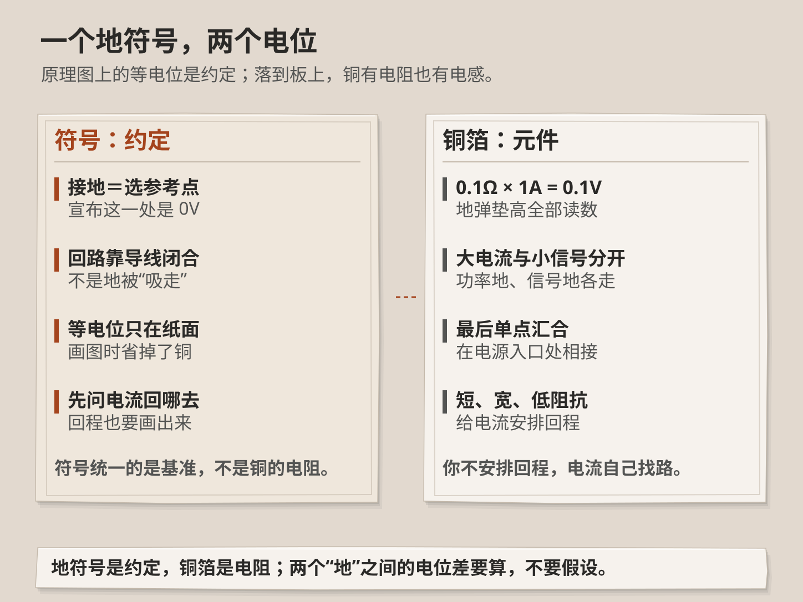
<figcaption>左栏是纸面约定：黑表笔落在哪，哪就是 0V；右栏把同一个接地画成一段有电阻的铜，1A 回流在 0.1Ω 上垫出 0.1V。功率地与信号地分开走，最后只在电源入口单点相接——回程不安排，电流就自己找路。</figcaption>
</figure>

<!-- slot:lab -->
<a id="sec-0-5"></a>
### 0.5 三个思维习惯

1. **量电压，先问"相对谁"**：电压永远是两点之差，悬空说"这点 5V"没有意义。
2. **看电路，先追"电流回路"**：从电源正极出发，跟着电流走一圈回家。沿途谁分压、谁储能、谁开关，电路就懂了。
3. **先直流，后交流**：先把电容当开路、电感当短路的"静态"算明白（这就是第 3 章"工作点"），再谈信号（交流）。顺序反了必乱。

直流工作点若已饱和，交流传递函数便失去适用前提。先确认工作点，再算交流。

照三条逐项做：记黑表笔落点；通电前画出回路；先手算静态工作点，再看交流指标。

<a id="sec-0-6"></a>
### 0.6 恒压源与恒流源：电源的两种性格

<figure>
<figcaption>横轴是电流 I，纵轴是电压 V。水平线是恒压，竖线是恒流；真实源斜率的绝对值对应输出阻抗。</figcaption>
</figure>

[动画演示 5.78](#demo78)

看 **V-I 曲线**的形状，一眼分清两种源。先看坐标：本节横轴是输出电流 I，纵轴是端电压 V；不要脱离坐标背“横线、竖线”。

**表 0-2　恒压源与恒流源的两种性格**

| | 理想曲线 | 性格 | 灾难 | 常态 |
|---|---|---|---|---|
| **恒压源** | **水平线**（I 怎么变，V 不动） | 内阻趋近 0 | 短路 | 开路 |
| **恒流源** | **竖线**（V 怎么变，I 不动） | 输出阻抗趋近 ∞ | 开路 | 短路 |

**算一笔**，看内阻怎么毁掉「恒压」。实际电源的 V-I 是一条**向右下方倾斜的线**：负载电流增大，端电压下降。斜率是负的，输出阻抗取压降与电流增量之比，也就是斜率的绝对值。

- 实验室电源 $Z_{out}\approx1m\Omega$：$\Delta V = 5A\times1m\Omega = 5mV$（0.1%）→ 当恒压源够用
- 劣质适配器 $Z_{out}\approx100m\Omega$：$\Delta V = 2A\times100m\Omega = 200mV$（4%）→ 负载一重电压就塌
- 反过来说：**恒流源要的正是「大输出阻抗」**。以 1 mA 输出电流为例，$R_o=10M\Omega$ 时，负载电压从 0 变到 10V，电流只掉 1 µA，即 0.1%

**两个必须记住的推论**：

1. **唯一「天生的」源是恒压源**（电池、电源适配器都是）。恒流源全是拿恒压源 + 负反馈**做出来**的。
   做法有射极负反馈、电流镜、运放+采样电阻、Howland 电流泵，见 [13.5 恒流源家族](#ch13)。
2. **负载怎么接，取决于源的性子**：

    - 恒压源 → 负载**并联**在它两端（各自独立取电流；如多路 LED **各自**串一个限流电阻）
    - 恒流源 → 负载**串联**在同一回路里（同一个电流穿过所有负载；如多颗 LED **串联**做恒流驱动）

> **补充想法**：回头看一眼 [0.3 分压器](#ch0)：它「带载就塌」的根因，正是**分压器的输出阻抗**（$R_1\parallel R_2$）太大。
> 用这一节的眼光看，它是「一个不合格的恒压源」。

**算一笔**：不拆电源，两次测量估内阻。先量空载 $V_0$，再接已知负载 $R_L$ 量 $V_1$，$R_s=R_L(V_0-V_1)/V_1$。空载 12.10V、接 100Ω 掉到 11.90V ⇒ $R_s=100\times0.20/11.90\approx1.7\,\Omega$，2A 下塌 3.4V。负载选“让电压掉 1%~5%”最合适；这是 0.3 节带载塌陷的逆运算。

<figure>
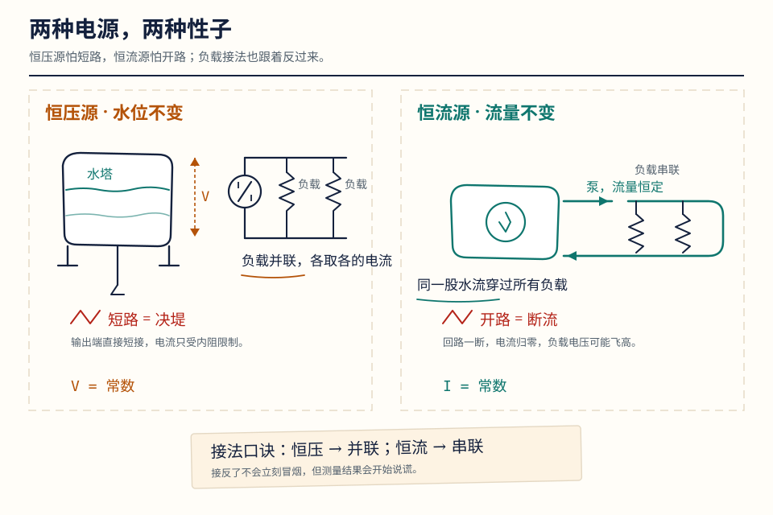
<figcaption>恒压源与恒流源的两种性格：水塔靠水位差供水，水泵靠流量推水；短路是恒压源的灾难，开路是恒流源的灾难。接法也随性格定——恒压并联，恒流串联。</figcaption>
</figure>

<a id="sec-0-7"></a>
### 0.7 量纲、数量级与工程记号

#### 5V 不是绝对高度，是两点水位差

电压的本质是电势差。说"这一点是 5V"，完整说法是"这一点比参考点高 5V"。参考点换了，读数就换；两点之间的差值不变。万用表的黑表笔就是参考点。把黑表笔从 0V 挪到 3V 节点，同一个 5V 节点会读成 2V。电路没变，变的只是参考点。

这也是第 0.4 节"地是参考点"的延伸。地不是宇宙中的绝对零电位，只是我们共同约定的一把尺子的零刻度。真正驱动电流的，是两点之间的差值。

#### 单位不是装饰，是公式的一部分

国际单位制有七个基本量：长度（米，m）、质量（千克，kg）、时间（秒，s）、电流（安培，A）。温度（开尔文，K）、物质的量（摩尔，mol）、发光强度（坎德拉，cd）是其余三个。本书常用的电压（伏特，V）、电阻（欧姆，Ω）、电容（法拉，F）、电感（亨利，H）、功率（瓦特，W）都是导出单位。

公式往往记得没错，错在**单位混着用**：mA 代进 A 的公式，kΩ 代进 Ω 的公式，结果差一千倍还找不到原因。写算式前，先把所有量换成基本单位（V、A、Ω、F、s），算完再换回好读的工程单位，能消掉一大半低级错误。

**表 0-3　本书常用 SI 词头**

| 词头 | 符号 | 倍数 | 例子 |
|---|---|---|---|
| 皮 | p | $10^{-12}$ | 1 pF 寄生电容 |
| 纳 | n | $10^{-9}$ | 100 nF 去耦电容 |
| 微 | µ | $10^{-6}$ | 2.2 µF 滤波电容 |
| 毫 | m | $10^{-3}$ | 10 mA 静态电流 |
| 千 | k | $10^{3}$ | 4.7 kΩ 上拉电阻 |
| 兆 | M | $10^{6}$ | 1 MΩ 探头输入 |
| 吉 | G | $10^{9}$ | 1 GΩ 绝缘电阻 |

#### 工程记号：给数字换一件合身的衣服

工程记号把数量级塞进词头，零不再靠数：

- $0.0000047\,\text{F}$ → **4.7 µF**
- $0.0000001\,\text{F}$ → **100 nF**
- $4\,700\,\Omega$ → **4.7 kΩ**
- $0.0005\,\text{A}$ → **0.5 mA**

书写时数字与单位之间留一个空格（4.7 kΩ，不是 4.7kΩ）；微用希腊字母 µ。把数字挪到 1–999 再挂词头，是估数量级的前置动作；大小写不是排版讲究，读错一个字母就错三个数量级。

<figure>
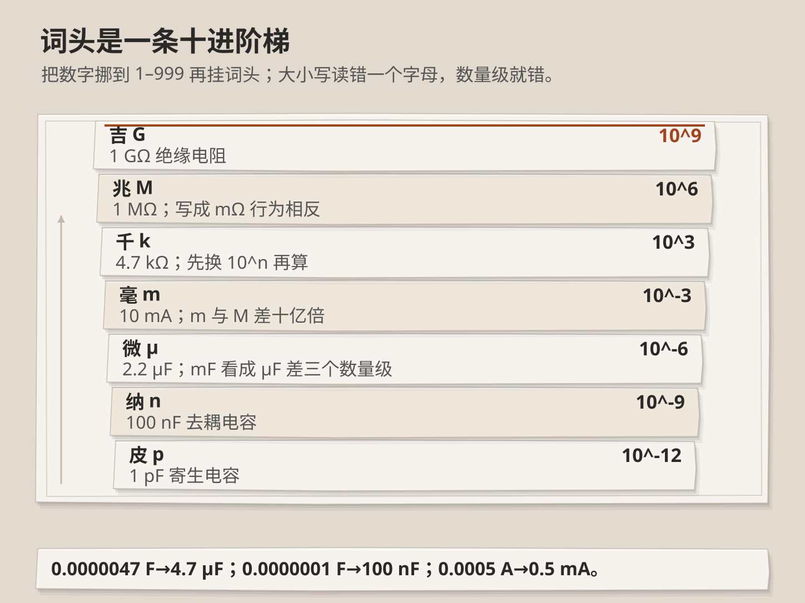
<figcaption>七层词头从 p 到 G，每层只差 10³；每档挂一个真实元件值，数量级才有手感。三张错读卡并进阶梯：m 与 M 差十亿倍，4.7 mF 看成 µF 差一千倍，1MΩ 写成 1mΩ 行为相反。</figcaption>
</figure>

#### 量纲检查：单位不对一定错，单位对不一定对

量纲是必要条件，不是充分条件；它只能证伪，不能证明。看三个例子：

- $V=IR$：$[\text{A}]\times[\Omega]=[\text{A}]\times[\text{V}/\text{A}]=[\text{V}]$，两边一致。
- $P=VI$：$[\text{V}]\times[\text{A}]=[\text{W}]$，一致。
- $\tau=RC$：$[\Omega]\times[\text{F}]=(\text{V}/\text{A})\times(\text{C}/\text{V})=\text{C}/\text{A}=\text{s}$，一致。

<figure>
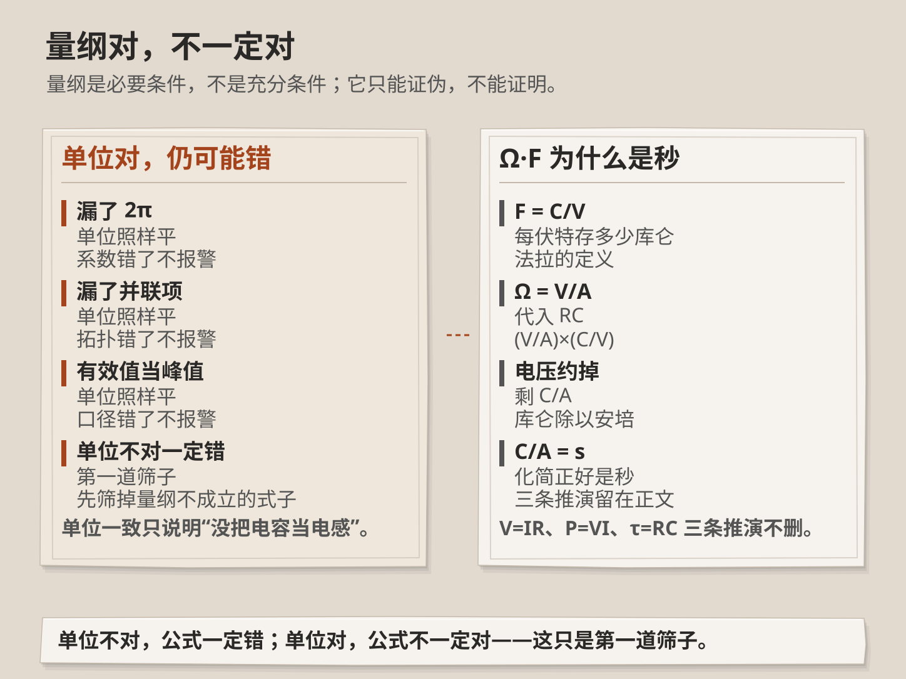
<figcaption>左栏三张错例都“单位对、结果错”：漏 2π、漏并联项、把有效值当峰值；右栏是 Ω·F 的化简链——法拉是每伏特存多少库仑，代进 RC 后电压约掉，只剩 C/A。单位不对一定错，单位对只是过了第一道筛子。</figcaption>
</figure>

#### 数量级直觉：先估，再算

动手前先花十秒估数量级：1mA 流过 10kΩ 是 10V 量级；10kΩ 配 100nF 是 1ms 量级。估完再按计算器，立刻能发现“算出 1 秒”或“1 纳秒”这类荒唐结果。

去耦够不够、上拉慢不慢、散热压不压得住，都是量级问题；先钉数量级，再谈精度。

数量级是工程师的通用汇率：一句“约 100kHz”，时基与方向就定。

#### 换算的四个固定动作

四个动作固定下来，换算才不再靠小心：补单位、换十的幂、统一基本单位、再把结果换回好读的词头。

算一遍 10 kΩ 与 100 nF：先换 $10^4\,\Omega$ 与 $10^{-7}\,\text{F}$，相乘得 $10^{-3}\,\text{s}$，即 1ms。误读 100µF 得 1s，误读 10Ω 得 1µs；事先估过毫秒级，错误立刻暴露。

<figure>
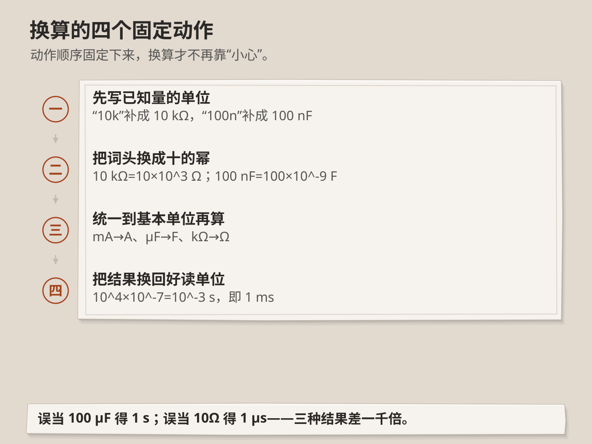
<figcaption>四个动作按顺序走：10k 先补成 10kΩ，换成 10×10³Ω；100n 补成 100nF，换成 100×10⁻⁹F；相乘得 10⁻³s，再换回 1ms。误读 100µF 得 1s，误读 10Ω 得 1µs——同一串数字，三种数量级。</figcaption>
</figure>


<a id="sec-0-8"></a>
### 0.8 受控源与放大器雏形

#### 独立源与受控源

电池、稳压电源、信号发生器是**独立源**：它们的输出由自己决定。电路里其他支路的电压或电流，决定不了它。你怎么接负载，9V 电池仍然想输出 9V（内阻另算）。

**受控源**（controlled source，又叫相关源）不一样：它的输出由**另一条支路的电压或电流**决定。控制量能在电路的另一头，甚至能跨越隔离屏障。受控源是"放大器"的数学骨架：输入一个小信号，用它去指挥一个大电源，输出一个成比例的大信号。

#### 四类受控源

按"控制量是电压还是电流"和"输出是电压还是电流"组合，共有四种：

1. **VCVS，压控电压源**（voltage-controlled voltage source）：输出电压 $V_{out}=\mu V_{in}$。像一只由水位指挥的阀门，输出的是"水位"。理想电压放大器就是它。
2. **VCCS，压控电流源**（voltage-controlled current source）：输出电流 $I_{out}=g_m V_{in}$。像一只由水压控制流量的阀门，输出的是"水流"。场效应管的低频小信号模型、跨导型运放（OTA）都用它。
3. **CCVS，流控电压源**（current-controlled voltage source）：输出电压 $V_{out}=r_m I_{in}$。像水车：水流大小决定它抬起的"水位"。跨阻放大器（TIA）和电流检测放大器都常用这一模型。
4. **CCCS，流控电流源**（current-controlled current source）：输出电流 $I_{out}=\beta I_{in}$。像水流的"复制器"：用小股水流控制大股水流。电流镜、双极型管的放大模型都是它。

<figure>
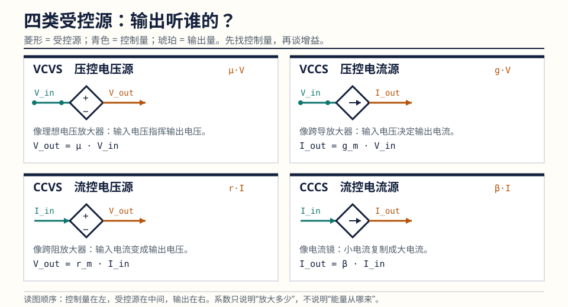
<figcaption>四类受控源：菱形符号表示输出受别的支路控制；箭头指向决定输出是电压还是电流，控制量在另一条支路。先找控制量，再谈增益。</figcaption>
</figure>

图里的菱形是受控源的统一符号，和独立源的圆形符号区分开。菱形旁边标 $+/-$ 表示输出电压，标箭头表示输出电流；控制量则画在另一条支路上。读图顺序永远是：**先找控制量，再看输出类型，最后看系数**。

#### 跨导：把电压变成电流的"汇率"

VCCS 的系数叫**跨导**（transconductance），符号 $g_m$：

$$g_m=\frac{\Delta I_{out}}{\Delta V_{in}}$$

跨导是 V→A 的汇率，单位 A/V 即西门子；输出电压还要再乘一次负载电阻，负载一变输出就变。

#### 放大器的三个参数

一个真实的电压放大器，至少要用三个参数描述：

- **输入电阻 $R_{in}$**：放大器从信号源"偷"走多少电流。$R_{in}$ 越小，信号源内阻上的压降越大，真正送到放大器输入端的信号越少。
- **输出电阻 $R_{out}$**：放大器带负载的能力。$R_{out}$ 越大，接上负载后输出跌得越狠。
- **开路电压增益 $A_{vo}$**：输出开路时，输出与输入之比。

把三个环节乘起来，总增益是：

$$A_v=A_{vo}\times\frac{R_{in}}{R_s+R_{in}}\times\frac{R_L}{R_{out}+R_L}$$

端到端增益是三因子相乘，不是 $A_{vo}$ 一个数：源内阻先分一次，负载再分一次。例：$R_s=10\,\text{k}\Omega$、$R_{in}=10\,\text{k}\Omega$ 只剩一半；$R_{out}=200\,\Omega$、$R_L=1\,\text{k}\Omega$ 再乘 83.3%，端到端 41.7 倍。

**放大不是凭空造能量**。受控源只是用一个小信号去控制电源的能量，输出功率来自供电电源。输入信号负责"指挥"，不负责"出力"。

<figure>
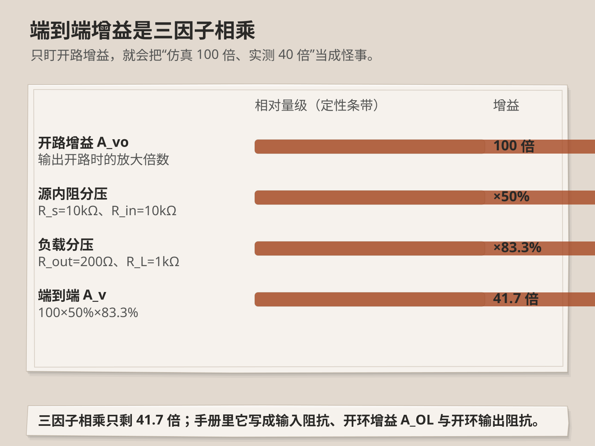
<figcaption>三因子逐项相乘：开路 100 倍，源内阻先把信号砍到 50%，输出电阻再让负载拿走 83.3%，端到端只剩 41.7 倍。条带只比较相对大小，读数以右侧数字为准；“仿真 100、实测 40”就是同一签名。</figcaption>
</figure>

读运放手册时三个参数换了名字：输入阻抗（差模/共模分开）、开环输出阻抗、开环增益 $A_{OL}$（100~140dB）。反馈网络把开环参数换成电阻比决定的闭环参数。

#### 理想运放只是受控源的极限

理想运放是极限受控源：$A_{vo}\to\infty$、$R_{in}\to\infty$、$R_{out}\to0$，外部反馈网络完全决定增益，虚短虚断由此而来。真实运放有有限增益、带宽、压摆率和摆幅，第 6 章拆开讲。**运放不是魔法，是一只被负反馈驯服的受控源**。

<div class="worked-example" markdown="1">

<p class="example-title">例 0-2　受控源等效跨导</p>

**给定**　一只 VCVS 的控制系数 $\mu=40$，输入 $V_{in}=50\,\text{mV}$，输出端串联 $R_{out}=200\,\Omega$，接 $R_L=1\,\text{k}\Omega$ 负载。

**求**　理想开路输出、负载上的电压、输出电流、从输入看进去的等效跨导。

**解**　四步算式：

$$V_{o,open}=40\times50\,\text{mV}=2\,\text{V}$$

$$V_L=2\times\frac{1\text{k}}{200+1\text{k}}=1.667\,\text{V}$$

$$I_L=\frac{1.667\,\text{V}}{1\,\text{k}\Omega}=1.667\,\text{mA}$$

$$G_m=\frac{1.667\,\text{mA}}{50\,\text{mV}}=33.3\,\text{mS}$$

<figure>
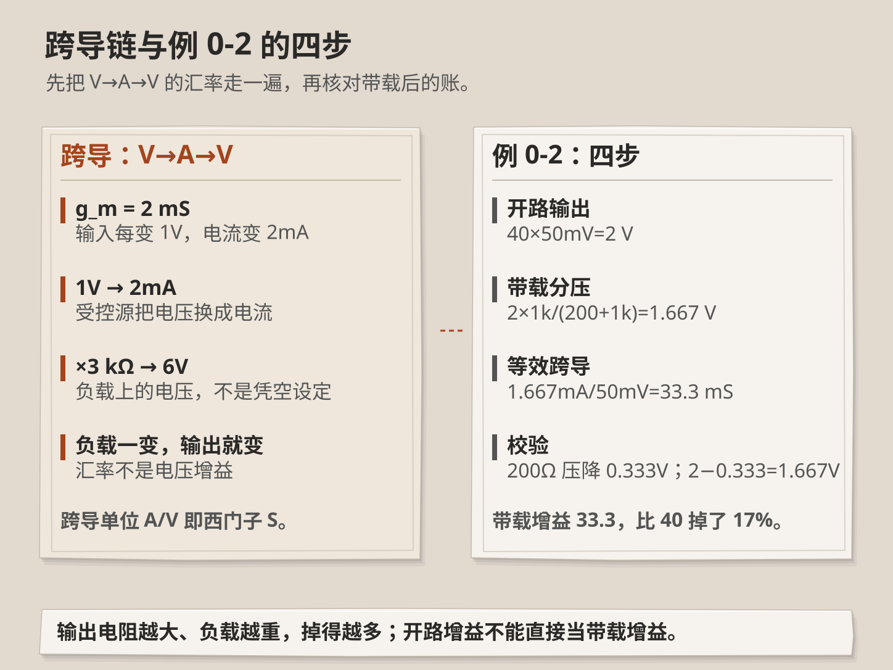
<figcaption>第一栏先把跨导链走通：2mS×1V=2mA，再乘 3kΩ 得 6V；主体四步对应开路、带载、电流与等效跨导；右侧 2V→1.667V 的差值标出带载掉 17%。</figcaption>
</figure>

</div>

<a id="sec-0-9"></a>
### 0.9 功率、能量与符号约定

#### 三个功率公式，各有各的适用范围

$$P=VI,\qquad P=I^2R,\qquad P=\frac{V^2}{R}$$

第一个普适，后两个只对伏安关系为 $V=IR$ 的电阻成立；12V 加在 1kΩ 上，三式都得 0.144W，可互相校验。

#### 关联参考方向：功率记账的规则

先定参考方向：**电流从电压正端流入**记吸收，$P=VI>0$；从正端流出记发出，$P=VI<0$。整张账本必须平衡——发出总功率等于吸收总功率。

**表 0-4　功率记账：谁吸收、谁发出**

| 场景 | 元件 | 电压电流关系 | 功率 | 角色 |
|---|---|---|---|---|
| 12V 电源驱动 1kΩ | 电阻 | 12V / 12mA | 吸收 144mW | 负载 |
| 同上 | 12V 电源 | 电流从正端流出 | 发出 144mW | 源 |
| 9V 电池供 10mA | 电池 | 电流从正端流出 | 发出 90mW | 源 |
| 12V 转 5V，100mA | LDO | 压差 7V / 100mA | 吸收 0.7W | 耗散 |

<figure>
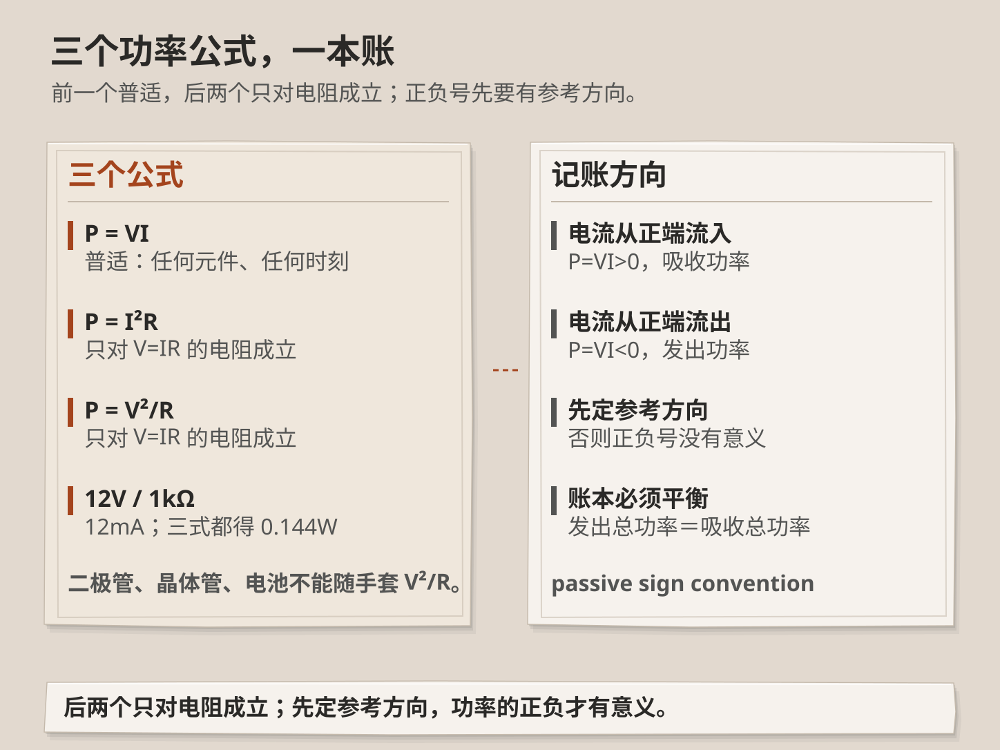
<figcaption>左栏三式对同一只 1kΩ 各算一遍，都落在 0.144W；右栏把功率正负变成记账方向：流进正端是吸收，流出正端是发出。表 0-4 保留角色列，图只负责形状。</figcaption>
</figure>

#### 能量、电池容量与效率

功率是“每秒花多少能量”；电池容量按 Wh 记，效率按输入侧扣。做预算三步：逐路电压电流 → 相加 → 除以预估效率；别漏指示灯、上拉、分压采样与 LDO 静态电流。

能量是功率乘时间：

$$W=Pt$$

电池容量还要乘电压，才从 Ah 得到 Wh：

$$W=V\times Q$$

9V、500mAh 电池是 4.5Wh；供 10mA 理想 50 小时，按 80% 可用约 40 小时。LDO 12V→5V、100mA：负载 0.5W、输入 1.2W，效率 41.7%；90% Buck 输入约 0.556W、46mA。1/4W 的 250mW 按 50% 降到 125mW；1/2W 下 144mW 占 57.6%，余量 42.4%。

#### 额定功率与降额

降额常见规则是只用额定功率的 50%：1/4W 只剩 125mW，144mW 必须换 1/2W 或更大封装。平均功率还要与脉冲功率分开——1ms 的 10W 热点，不会被 99ms 的零电流抹平。

<div class="worked-example" markdown="1">

<p class="example-title">例 0-3　电阻功耗与额定功率</p>

**给定**　12V 直流加在一只 1kΩ、1/4W 的电阻上，环境温度 40°C，按 50% 降额规则选用。

**求**　电流、功耗、1/4W 是否合格、应选多大额定功率。

**解**　电流：

$$I=\frac{12\,\text{V}}{1\,\text{k}\Omega}=12\,\text{mA}$$

功耗：

$$P=VI=12\times0.012=0.144\,\text{W}=144\,\text{mW}$$

1/4W 的 50% 降额限值是 125mW，144mW 超了 19mW，**不合格**。

改用 1/2W：降额限值 250mW，144mW 占 57.6%，合格。若环境温度更高或电阻贴着别的热源，还应继续降额或换更大封装。

**校验**　用 $P=I^2R$：$(0.012)^2\times1000=0.144\,\text{W}$，一致；用 $P=V^2/R$：$144/1000=0.144\,\text{W}$，也一致。

**坑点**　只看"常温摸着不烫"。电阻的温升需要时间，短时间测试摸不出来；长期高温会让阻值漂移、焊点疲劳。额定功率是可靠性参数，不是"冒烟阈值"。

</div>

<figure>
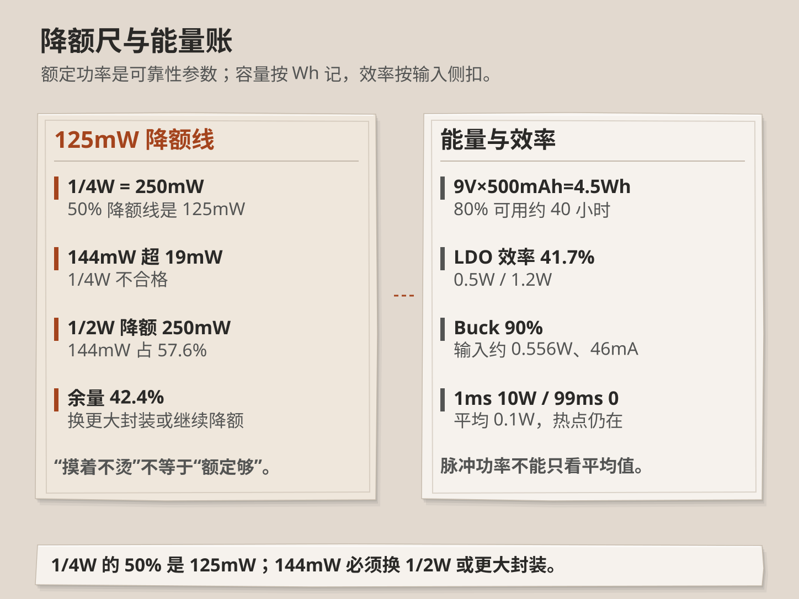
<figcaption>左半把 250mW 额度尺按 50% 画到 125mW，144mW 越线 19mW；换 1/2W，限值 250mW，144mW 占 57.6%。右半是能量账：4.5Wh 按 80% 可用约 40 小时，LDO 41.7%、Buck 90%，1ms 脉冲平均只有 0.1W。</figcaption>
</figure>

<a id="sec-0-10"></a>
### 0.10 十个开局误区

**表 0-5　十个开局误区**

| 误区 | 为什么错 | 正确动作 |
|---|---|---|
| 电压是绝对量 | 电压是两点之差 | 先问参考点在哪 |
| 电流会被电阻"用完" | 串联回路电流处处相等 | 用 KCL 追完整回路 |
| 分压公式永远成立 | 只在空载或后级高阻时成立 | 先算输出电阻 |
| 地是下水道 | 地是参考点，也是回流路径 | 看回流阻抗与面积 |
| 电池是理想恒压源 | 有内阻，大电流会塌 | 查 V-I 斜率或带载测试 |
| 大电阻一定省电 | 功耗还取决于电压或电流 | 用 $P=V^2/R$ 或 $I^2R$ 实算 |
| 电容能瞬间供任意电流 | 有 ESR、ESL，电压不能突变 | 看去耦环路与瞬态电流 |
| 增益越大越好 | 带宽、噪声、稳定性会买单 | 先定信号链预算 |
| 仿真过了就能工作 | 模型常缺寄生与公差 | 仿真只证拓扑与数量级 |
| 公式记住就会设计 | 不知道假设就会用错 | 每条公式旁写适用条件 |

每个误区都有各自的现场签名，认出签名比记住教训有用。

<figure>
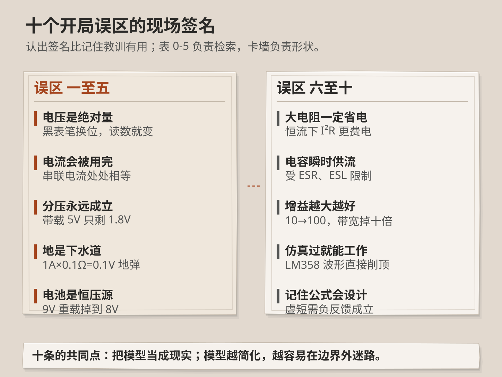
<figcaption>十张卡各留一个可核对的读数：黑表笔换位、串联电流相等、5V 带载剩 1.8V、1A×0.1Ω 地弹、9V 掉到 8V、恒流下 I²R、ESR/ESL、增益 10→100 带宽掉十倍、LM358 削顶、虚短需负反馈。表 0-5 管检索，卡墙管形状。</figcaption>
</figure>

[在线演示：电容的充与放](https://www.falstad.com/circuit/e-cap.html)：拖动电源滑块给电容充放水，看水位（电压）只能慢慢爬、慢慢落——急的永远只是电流那一侧。

这些误区的共同点，是把"模型"当成了"现实"。模型像地图：越简化越易用，也越容易在边界外迷路。

有经验的设计者知道每个模型在哪里会失效，提前备好测量手段。第 14 章的最坏情况分析、第 16 章的排故五步法，说到底都是在给模型补边界。

把这十条贴在工位旁，比背十个公式管用。

十条里若有哪一条读着"这怎么会错"，那正是还没被它咬过的那条。

第一次被分压器坑过，第三条才算真正学会；第一次被地弹坑过，第四条才刻进手里。

误区清单的价值不在读，在踩过之后回来对号。对上的次数越多，直觉越稳。

<!-- slot:selfcheck -->
### 自检

1. 万用表读出某点"5V"，这句话缺了什么信息？
2. 12V 经 10kΩ+10kΩ 分压，接上 10kΩ 负载后输出还剩几伏？为什么？
3. 设计判断：给 ADC 采样前端配分压电阻，取 100kΩ+100kΩ 还是 10kΩ+10kΩ？定之前先问哪两个问题？

### 验收清单
- [ ] 观察：任指一个简单电路，用箭头标出电流回路，说清水从哪来、往哪去、被谁拦。
- [ ] 计算：12V 经 10kΩ+10kΩ 分压带 10kΩ 负载：空载 6V、带载 4V、输出电阻 5kΩ（例 0-1）。
- [ ] 测量：用两次测量法估一台电源的内阻：空载 12.10V、接 100Ω 后 11.90V → 内阻约 1.7Ω（0.6 节）。

### 0.11 本章速查卡与小结

**本章速查卡**

- 电压是两点之差；说"某点电压"前，先问参考点。
- 电流必须成环；串联电流处处相等，分压的是电压。
- 分压器带载会塌；带载能力看输出电阻 $R_1\parallel R_2$。
- 受控源的输出听控制量的；放大不是造能量，是用小信号搬运电源能量。
- 功率会变成热；电阻选型先算功耗，再按 50% 降额。

**小结与下一章**

三个习惯与四块底数到手，下一章理想元件开始“长寄生”。

<figure>
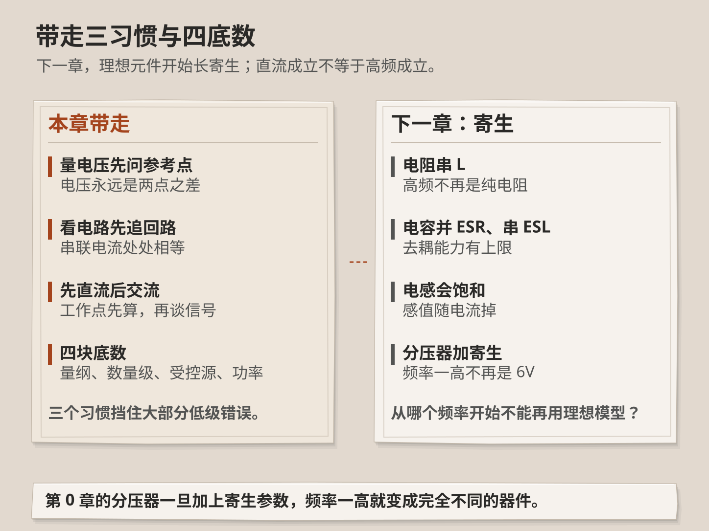
<figcaption>左栏把本章收束成三条动作与四块底数；右栏让电阻、电容、电感各长出一个寄生，分压器的 6V 也随频率塌下去。数量级直觉就是判断“从哪个频率开始不能再用理想模型”的第一把尺。</figcaption>
</figure>

**表 0-6　本章延伸阅读**

| 资料 | 读什么 | 为什么现在读 |
|---|---|---|
| Horowitz & Hill，《The Art of Electronics》第 1 章 | 电压、电流、功率、分压与戴维南直觉 | 用另一套语言巩固本章的概念 |
| MIT 6.002《Circuits and Electronics》公开课 | 集总元件、KCL/KVL、戴维南等效 | 跟着板书把回路分析走一遍 |
| Falstad 在线电路仿真器 | 拖动元件，实时看电流粒子与波形 | 把水路比喻变成可操作的动画 |
| NIST，《SI Brochure》第 9 版 | 七个基本单位与词头定义 | 单位拿不准时查权威原文 |
| All About Circuits，DC 卷 | 电压、电流、电阻、功率的入门章节 | 免费图解，适合快速复习 |
| 本书第 1 章 | 真实电阻、电容、电感的寄生与降额 | 看理想模型如何长出真实边界 |

<!-- slot:citations -->
### 参考与出处

- 本章参数与型号以厂商 datasheet / 应用笔记为权威源（正文注明型号处为准）；教学示意数字均已标「示意」。
- ref-002：Microelectronic Circuits（`analog-book/data/references.yml`，id 可检索）
- ref-013：Encyclopedia of Electronic Components Volume 1（`analog-book/data/references.yml`，id 可检索）
- ref-020：Getting Started in Electronics（`analog-book/data/references.yml`，id 可检索）
- 开源与视觉工具引用见 references.yml 的 OSS 条目（ref-119~ref-124，仅灵感/工具，非参数源）。

> **通关打卡**：你现在有了通用语言（水路八词）、第一电路（分压器带载塌陷的账）。三个思维习惯、一张单位表也已到手，再加受控源与功率记账的底图。**往后的每一章，都在给这套直觉添砖加瓦。**


> **实物照片**：书里的第一只实物——色环电阻。四环读法：前两环是有效数字，第三环是倍率，第四环是误差；黄-紫-红-金 = 4、7、×100、±5%，即 4.7 kΩ。老手扫一眼色环就出数，比翻标签快。五环电阻多一位有效数字，末环常标温度系数；精密场合仍要以 datasheet 的 ppm/°C 为准，色环只作快速核对。

> **配套视频**：[模拟电子技术（4K 降噪）· 上海交大 郑益慧](https://www.bilibili.com/video/BV1qA5DzWEVh/)（B站）：把物理图像讲透。第 0 章的「直觉」部分配它最顺，先建立感觉，再上公式；英文：[RimstarOrg《How to Read a Schematic》](https://www.youtube.com/watch?v=_HZ-EQ8Hc8E)（4:52，最干净的一版读图入门：电源、地、串联并联怎么认）。见 [7.1 视频资源汇总](#part7)。

> **60 秒动画版**：[EP04 接上负载那一刻，5V 就没了](https://www.bilibili.com/video/BV1d8pq6oEYe/)（[全 20 集](#s7-3)）
<a id="ch1"></a>
## 第 1 章 无源元件的真实面目

> **场景**：买电阻只看阻值，买电容只看容量，是新手最常做的两件事。可同一只电阻，频率一高就悄悄“像电感”；一只标称满值的电容，加上直流偏压也会缩水。理想值只是名片，真实脾气要看寄生参数。

> **难度**：L1 入门，12 节，精读约 30 分钟
>
> **白话**：电阻、电容、电感都有“理想值”和“真实脾气”。先看清寄生参数从哪个频率开始说话，再去算它。

> **先修**：[第 0 章水路比喻](#ch0)，本章告诉你"水池也会漏、水管也有惯性"（寄生参数）。

> **学完你应能**：说出 1kΩ 电阻从什么频率开始"不再是电阻"（两个寄生夺权点）；解释 ESR/ESL 与直流偏压降容各自的坑；用戴维南等效算出分压器带载后的真实输出。
>
> **公式速查**：[速查表·无源与频域](#passive) 收齐本章设计式与判据。
>
> **模型边界**：[边界速查·无源三件](#limits-resistor) 收齐本章理想模型的失效点与修正。

> **口诀**：寄生是真实价——元件都"夹带私货"：线有电感、电容有 ESR/ESL——高频下它们才是主角。

> **扩量动画**：本章新增的失效边界与预算账动画：[5.122](#demo122) · [5.123](#demo123) · [5.124](#demo124)（[画廊](#part5)）。

<!-- slot:hook -->
理想元件不存在。理解寄生参数是区分"教科书学习者"和"工程师"的第一道门槛。

> **图问**：一只标称 1kΩ 的电阻，在哪两个频率点被寄生参数夺走主角位？读完 1.1 节，你就能指着曲线回答。

<figure>
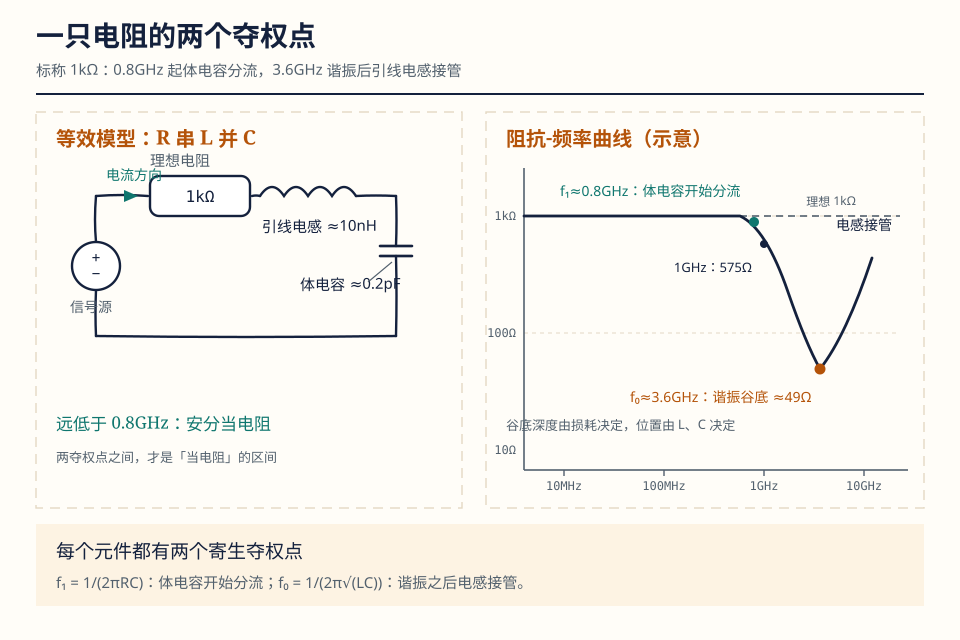
<figcaption>左图：理想 1kΩ 串约 10nH 引线电感、并约 0.2pF 体电容；右图：阻抗-频率曲线上两个夺权点——体电容在 f₁=1/(2πRC)≈0.8GHz 开始分流（1GHz 处只剩约 575Ω），L、C 在 f₀=1/(2π√(LC))≈3.6GHz 谐振、谷底约 49Ω，此后电感接管。两条夺权点之间，才是它「当电阻」的区间（曲线为教学示意，与 1.1 节动画同参数）。</figcaption>
</figure>

<a id="sec-1-1"></a>
### 1.1 真实电阻的等效模型

```
        引线电感 L (~5nH/cm)
理想 R ──/\/\/──mmmm──┬──
      (标称阻值)      │
                    ┌─┴─┐
                    │ C │ 并联寄生电容 (~0.2pF)
                    └─┬─┘
──────────────────────┴──
```

- **碳膜/金属膜电阻**：精度 1%/5%，温度系数 50~200ppm/°C
- **绕线电阻**：功率大但电感大，**绝不能用于高频**
- **贴片 0603/0805**：寄生最小，高频首选
- 失效模式：过功率烧毁（开路）、潮湿导致阻值漂移

电阻的"真实"不止寄生电抗，还有三条随环境与时间松动的参数，选型时要和精度一起看。

- **初始精度**：标称 1% 是出厂时刻的误差，不含焊接热冲击与老化漂移。而分压比、增益这类"比值"参数用的是两只电阻的**相对**漂移——同批次、同温漂方向的电阻，比值稳定性常比绝对精度好看一个量级。
- **温度系数**：金属膜 50~100ppm/°C，意思是每升 10°C 阻值漂 0.05%~0.1%。一只 10.00kΩ、100ppm/°C 的电阻从 25°C 升到 85°C，阻值移动 $10\,\text{k}\Omega\times100\times10^{-6}\times60=60\,\Omega$，已超过 0.5% 的初始精度。**温漂吃掉精度**是精密电路的常态。
- **热噪声**：电阻自己会"发声"，$e_n=\sqrt{4kTR}$，10kΩ 在室温约 13 nV/√Hz。这是任何低噪声设计绕不开的地板，第 11 章会把它写进噪声预算。

三件事各管一头：精度定增益误差，温漂定全温误差，噪声定分辨率下限。

<!-- slot:intuition -->
**为什么几 nH 的引线电感能在高频"夺权"？** 感抗 $X_L=2\pi fL$ 随频率线性增长，而电阻值不变：频率足够高时，电感分走的电压会超过电阻本身。

<!-- slot:quant -->
<p align="center"></p>

[动画演示 5.60](#demo60)

上图把「理想 1kΩ」（灰虚线）与「真实电阻」（蓝线）叠在一起：**远低于拐点（≈0.8GHz）时两条线几乎重合**。
过了拐点体电容 0.2pF 开始分流、阻抗按约 −20dB/dec 下坠，到 1GHz 只剩 **575Ω**。继续往上在 **3.6GHz**
（L 与 C 谐振）探到谷底 **≈49Ω**，之后引线电感接管、阻抗重新爬升，元件又「变回电感」。
**每个元件都有两个寄生夺权点：C 在 $f_1=1/(2\pi RC)$ 开始分流，L 与 C 在 $f_0=1/(2\pi\sqrt{LC})$ 谐振之后由 L 接管。中间才是它「当电阻」的区间。**

**算一笔**：1kΩ 电阻带 10nH 引线电感，在 100MHz 下 $X_L=2\pi\times10^8\times10^{-8}\approx 6.3\Omega$（尚可忽略）；到 3GHz，$X_L\approx 190\Omega$："1kΩ 电阻"已经变成"1kΩ 串 190Ω 感抗"，射频电路里这是两颗元件。所以高频电路用贴片（引线≈0），元件值本身也要按频率特性曲线复核。

还有一条常被忽略的：**额定功率随环境温度降额**。1/4W 的标称值通常只在 70°C 以下成立，超过这条线要按厂商降额曲线线性往下调（常见到 155°C 归零）。

机内 85°C 环境里，同一只电阻能用的功率往往只剩七成。再叠上 [0.9](#ch0) 的 50% 降额规则，一只"1/4W"在严苛机内环境里实际只配按 80~100mW 使唤。**标称值是实验室条件下的名片，不是机内保证书。**

顺手把"怪阻值"也解释了：货架上的 4.7k、2.21k 不是拍脑袋，来自 E24/E96 系列——等比档位配容差窗，任何真实阻值都有档可落（下图）。

<figure>
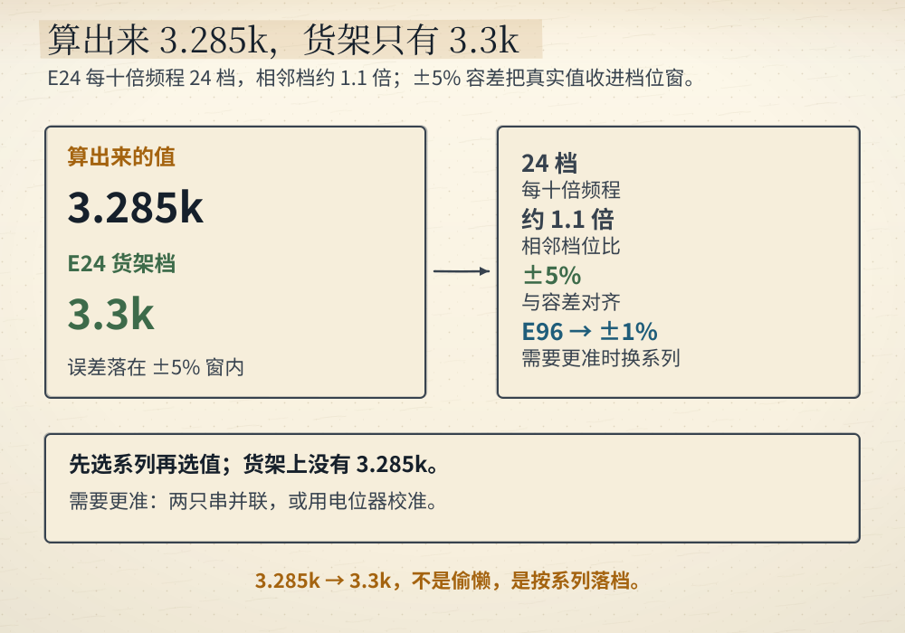
<figcaption>算出来 3.285k，货架只有 3.3k。E24 每十倍频程 24 档，相邻档约 1.1 倍；±5% 容差把真实值收进档位窗</figcaption>
</figure>


**先选系列再选值**：算出来 3.3k 就买 3.3k（E24 档），别幻想货架上有 3.285k。需要更准，用两只串并联凑，或上电位器校准。

还有 **0Ω 电阻**这种"不电阻的电阻"：它不改电路，却能在板上当跳线、当配置开关、当测量断点。单面板时代还用来从别的走线头顶"跨过去"，量产板的 BOM 里它始终有一席之地。

贴片封装的数字本身也是信息：0603、0805 指英制尺寸，即 0.06×0.03、0.08×0.05 英寸。封装越大额定功率越高——0805 典型 1/8W，0603 典型 1/10W，0402 只剩约 1/16W（典型值，以厂商为准）。

封装越小，焊盘与走线的寄生越容易压过元件本身。**高频看寄生，功率看封装，两本账别混在一起算。**

焊接也会改写电阻：回流焊的热冲击可让阻值漂移 0.1%~0.5%（典型量级），精密电阻的 datasheet 会单列"焊接后漂移"一项。精密场合要么选抗焊接漂移的型号，要么把校准放到焊接之后。


> **实物照片**：手焊 0805（2.0×1.25mm）是模拟工程师的成年礼：烙铁尖+镊子+放大镜，一个周末就能练出来。

**元件从货架到板上，每一步都可能动它的值**——"出厂 0.01%"到板上还剩多少，要逐项盘点。

<a id="sec-1-2"></a>
### 1.2 真实电容：ESR 与 ESL

#### 高频下还藏着电阻与电感

电容的完整模型是 **C 串联 ESR（等效串联电阻）再串联 ESL（等效串联电感）**。

- **电解电容**：容量大（µF~mF），ESR 大（0.1~10Ω），寿命随温度指数下降（每升 10°C 寿命减半），反接会爆炸

- **陶瓷电容**：MLCC，ESR 极小（mΩ 级），但 X7R/X5R 有直流偏压效应（标称 10µF 在 5V 偏压下可能只剩 4µF！）
- **薄膜/C0G(NP0)**：性能最好，容量小

**工程铁律**：芯片电源引脚就近放 100nF 陶瓷电容（去耦），距离越近越好。长走线的电感会让高频噪声无处泄放。

<p align="center"></p>

[动画演示 5.43](#demo43)

上图把两种电容的 $|Z|$ 画在同一条对数频率轴上：**100nF MLCC 谷底 0.3Ω @ 22.5MHz，10µF 电解谷底 1Ω @ 356kHz**。
到 100MHz 时电解已经涨回 **13Ω**，而 MLCC 还只有 0.42Ω。**去耦选电容 = 选谷底低、谷底宽的那条**。
所以低频储能交给电解、高频去耦必须用小封装 MLCC，两者不能互相替代。

**为什么去耦电容必须"贴脸放"？** 完整推理链是四步：

1. 芯片瞬时拉电流。
2. 电流路径上有电感（走线每厘米 ≈5nH）。
3. $v=L\cdot di/dt$ 在路径上产生压降。
4. 芯片看到的电源电压塌陷/反弹。

去耦电容的作用是**就近**提供这份瞬时电流，把电流环路的物理尺寸缩到毫米级。环路越小，$L$ 越小，压降越小。电容放 5cm 外，走线电感就把它的好意全废了。

> **为什么**：芯片瞬时抽电流，远处的电源电压先塌一下。长水管里的水有惯性，越急着改流量顶回来越狠，供电上就被压出凹坑。本地水库配短管，管里存的水越少顶得越轻。但水的惯性在质量，走线的在磁场，摸不着却专咬变化快的。

把 ESR、ESL 写进阻抗公式，三段形状就全解释了：$|Z|=\sqrt{ESR^2+(2\pi f\cdot ESL-\frac{1}{2\pi fC})^2}$。低频容抗主导、随频率下降；自谐振点 $f_0=\frac{1}{2\pi\sqrt{ESL\cdot C}}$ 处两项抵消、只剩 ESR，这就是谷底；再往上感抗接管、曲线回升。**谷底深度 = ESR，谷底位置 = 自谐振频率，谷底宽度 ≈ 容值与 ESL 的比值**——选去耦电容，就是选谷底够低、够宽的那条。

按典型值（经验量级）估：100nF 0805 的 ESL 约 1nH，自谐振约 16MHz；换 0603，ESL 降到约 0.6nH，自谐振推到 20MHz 以上。小封装赢的不是容值，是电感。

三段形状画到同一张对数坐标上，"100nF 与大电解谁管哪一段"就一目了然：

<figure>
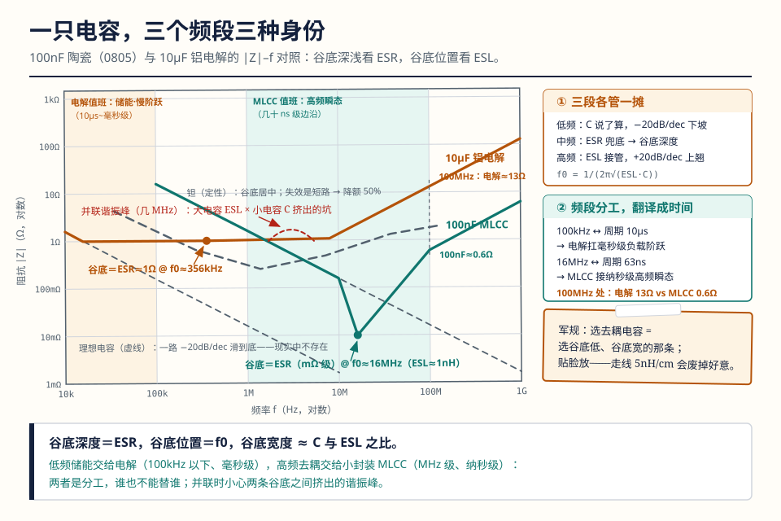
<figcaption>同一张对数坐标上的两条真实曲线：10µF 铝电解谷底约 1Ω @ 356kHz，100nF 0805（ESL≈1nH）谷底 mΩ 级 @ 约 16MHz；100MHz 处两者是 13Ω 对约 0.6Ω。"频段分工"不是口号，是两条谷底各管一段频率、各守一个时间尺度。</figcaption>
</figure>

**读图三步。** 两端 ±20dB/dec 的下坡与上翘分别由 C 和 ESL 签名，中间那截平地就是 ESR；谷底位置由 $f_0$ 决定，小封装赢的正是这一项。最后把频率翻译成时间：100kHz 的周期是 10µs，毫秒级负载阶跃由电解缓冲；16MHz 的周期约 63ns，纳秒级瞬态只有就近的小电容接得住。

图上 100MHz 处的 0.6Ω 与动画里那对样品的 0.42Ω 是不同 ESL 下的同一量级结论：都比电解的 13Ω 低二十倍上下。所以大小电容并联不是"容量相加"，是**频段分工**：10µF 电解管 100kHz 以下的储能与负载阶跃，100nF MLCC 管 MHz 级的高频瞬态。

但并联埋着一个坑。大电容的 ESL 与小电容的 C 会在两条谷底之间挤出一个**并联谐振峰**（图上两条曲线之间那道红色虚线鼓包，经验上常落在几 MHz），峰值频率处阻抗不降反升。

对抗办法有三条：让谷底错开；必要时刻意选带一点 ESR 的电容"压峰"；或改用同一系列多颗等值并联——ESL 与 ESR 同时减半，又不引入新的谐振。

**去耦网络的设计目标是全频段阻抗都低，不是某几个频率阻抗特别低。**

为什么去耦默认 100nF？这是频段折中的结果：它比 1nF 的谷底深，又比 1µF 的自谐振频率高，一颗就罩住主流数字芯片最闹腾的那一段。

但真正该做的是查芯片手册的推荐值与目标频段。高速芯片常在 100nF 旁再并 1nF~10nF 补更高频；LDO 输出则按环路稳定性要求选值（见 [17.1](#ch17) 振荡一行）。**100nF 是起点，不是答案。**

**算一笔（ESR 纹波与容性纹波谁说了算）。** Buck 输出电容承受的纹波有两份：容性纹波 $\Delta V_C=\frac{\Delta I_L}{8f_{sw}C}$ 与 ESR 纹波 $\Delta V_{ESR}=\Delta I_L\times ESR$。

取 $\Delta I_L=0.6\,\text{A}$、$f_{sw}=500\,\text{kHz}$，两种电容结论相反：

- 22µF 陶瓷（ESR 约 3mΩ）：容性纹波约 6.8mV、ESR 纹波仅 1.8mV，**容量说了算**。
- 100µF 电解（ESR 约 200mΩ）：容性纹波降到约 1.5mV，ESR 纹波却冲到 120mV，**ESR 说了算**。

<figure>
<figcaption>两笔纹波预算分别比较：陶瓷的 6.8mV 容性项大于 1.8mV ESR 项，电解的 120mV ESR 项大于 1.5mV 容性项。先判主因，再决定增容还是降 ESR。</figcaption>
</figure>


所以低 ESR 场合加容量才管用，高 ESR 场合先降 ESR。同样一句"纹波大"，两份纹波各开各的药方。

电解电容的极性问题是物理，不是规矩。铝电解靠阳极氧化铝薄膜当介质，反接时薄膜被电化学溶解，漏电流剧增、内部产气。

顶部那道刻痕（防爆阀）就是给这股气压准备的泄压口，它不是功能增强，是拿封装完整性换人身安全。

无极性电解是把两只阳极背靠背做进一个壳里，容量减半、体积翻倍，只在音频耦合这类双向摆动的场合才值得用。

**换电容的顺序：先看耐压余量（≥1.5× 工作电压），再核极性，最后才轮到容量。**

回到[1.8 节的 RC 实验](#rc-study)对照看一眼。实验里那只 10µF 若是铝电解，它的 ESR（零点几欧到几欧）对 10ms 时间常数的影响不足 1%，理想公式照样准。

**RC 实验测不出 ESR，不等于 ESR 不存在**，是它的影响在这个频段被 1kΩ 淹没了。换上 100kHz 的方波再看同一只电容，充放电曲线就会开始变形。

实验与模型的关系从来如此：先想清楚本次测量对哪个参数敏感，再下"测不到"的结论。

<!-- slot:limits -->
### 1.3 真实电感与变压器

- 寄生参数：绕线电阻 DCR、匝间电容 → 存在自谐振频率 SRF，超过 SRF 后电感变成电容！
- 磁芯饱和：电流过大时磁导率骤降，电感量塌缩 → 电源电感选型必须看饱和电流

绕线电阻 DCR 是电感的"内耗"。Buck 里 2A 平均电流流过 20mΩ 的 DCR，直流铜损就有 $2^2\times0.02=0.08\,\text{W}$，电感温升随之抬高，而温度上升又推高铜阻。选型时 DCR 与饱和电流要一起过。

**饱和也不是开关量。** 磁芯磁导率随电流增大逐渐下滑，感量跟着塌。datasheet 的"饱和电流"通常定义为感量跌 10%~30% 的那一点，各家口径不同，必须看曲线，不能只比那一个数。

工作中判断是否饱和，最直接的办法是看电感电流波形：正常是笔直的斜坡，**斜坡尾部上翘，就是磁导率开始塌了**。

**自谐振频率（SRF）是怎么回事？** 电感的绕组一圈挨一圈，匝与匝之间隔着绝缘漆，这就是无数个并联小电容。电感与自己的匝间电容构成 LC 谐振回路：低于 SRF 时感性主导（是个电感），**高于 SRF 时容性主导（变成电容）**。所以射频电感的 datasheet 必标 SRF，工作频率必须留 3 倍以上余量。

**变压器的正职：换电压。** 两个绕组共用一个磁芯，初级电流建立磁通 Φ，磁通穿过次级感应出电压：$V_2/V_1 = N_2/N_1$（变比）。

电流反着来：$I_2/I_1 = N_1/N_2$，升压的地方电流自动减半，**$V_1 I_1 \approx V_2 I_2$，能量原样过**。

初次级之间没有导线相连，只有磁通耦合。这就是「隔离」的物理根源，电源隔离、信号隔离都靠它。
<p align="center"></p>

**看点**：变比 1:2 升压。紫色磁通粒子沿磁芯流动把能量搬过去，红/绿电流粒子同步进出；电压翻倍处电流减半，功率原样过。→ 第五篇 [动画 5.101](#demo101)

真实变压器离"理想"也有三步距离。

- **漏感**：初次级耦合做不到 100%，没交链的那部分磁通等效为串在绕组里的小电感。它不认变比、只捣乱——开关电源里它与开关管结电容谐振出尖峰，是 $V_{DS}$ 过冲与 EMI 的常客。
- **磁芯损耗**：磁通来回翻转，磁滞与涡流都要发热，频率越高越狠。所以工频变压器用硅钢片叠层切断涡流回路，开关电源用铁氧体。
- **同名端**：绕组上的黑点标同相位端，接反了反馈变正反馈、并联变内斗。拿到一只陌生变压器，先用信号发生器加示波器认同名端，再进电路。

变压器选型只看变比和功率是不够的，漏感、磁芯材质、绕向都得问。

电感的"外衣"也分两种。**非屏蔽**（工字磁芯）磁力线散在空气里，便宜、饱和特性软，但磁场会扫进邻近的反馈与采样走线。**屏蔽**（磁胶、闭合磁路）把磁通关在内部，EMI 干净，代价是同体积下饱和电流略低、价格略高。

射频小信号电感又是另一个物种：空芯绕线没有磁芯损耗与饱和，Q 高，但感量小、体积大。

**电感选型和电容一样，先问频段与电流，再问封装。** 只看感量一个数字，和买电容只看容值犯的是同一个错误。

磁芯材料同样是分频段的：硅钢片管 50/60Hz，铁氧体管几十 kHz 到 MHz，铁粉芯靠分布气隙扛直流偏置、适合大电流储能电感，但损耗高。选错材料的典型症状是"电感没饱和却烫手"——磁芯损耗把功率吃掉了。电感 datasheet 若只给感量不给损耗曲线，用在大电流开关场合要格外小心：那份没写出来的损耗，最后都会变成温度写回板上。

**反电动势的直觉。** 电感是"电流的惯性"，它不许电流突变。

继电器线圈断电瞬间，驱动电流被迫从工作值跳向 0，$di/dt$ 极大，电感就"发飙"：$v=-L\frac{di}{dt}$ 感应出数百伏尖峰。尖峰极性与原供电相反，专烧驱动管。

续流二极管的作用是给这股"惯性电流"一条温柔的出路。断电后电流经二极管绕圈慢慢衰减（时间常数 $L/R$），尖峰被钳在 0.7V。

**这不是保护技巧的点缀，是电感物理的必然推论。** 第 13 章 Buck/Boost 的全部工作原理，就是把这只"发飙的电感"驯化成能量搬运工。

续流二极管自己也有选型账：正向压降决定钳位电压（硅管约 0.7V、肖特基约 0.3V），反向耐压要盖住母线加尖峰，恢复速度要跟得上开关频率。慢恢复管在高速开关里会把尖峰变成振铃。

继电器线圈这类低频场景，普通 1N4007 就够用。开关电源的续流位置，肖特基或快恢复才够格。**"并一只二极管"是结论，"并哪一只"才是设计。**

- 继电器/电机断电时的**反电动势** $v = -L\frac{di}{dt}$ 可产生数百伏尖峰 → 必须并联续流二极管

<p align="center"></p>

[动画演示 5.36](#demo36)

**看点**：蓝色 Zc 一路降价、红色 Zl 一路涨价，5kHz 处狭路相逢（LC 谐振）。同一只元件在不同频段，是完全不同的"人"。→ 本节 [1.1-1.3](#ch1)


### 1.4 戴维南与诺顿：把任何网络压成两个元件

<p align="center"></p>

[动画演示 5.79](#demo79)

**任何线性网络**，从任意两个端子看进去，都等价于下面两种形式。

**表 1-1　戴维南与诺顿：同一网络的两种等效形式**

| 等效形式 | 长相 | 两个参数 |
|---|---|---|
| **戴维南（Thévenin）** | 电压源 **串** 一个电阻 | $V_{th}$（开路电压）、$R_{th}$ |
| **诺顿（Norton）** | 电流源 **并** 一个电阻 | $I_N$（短路电流）、$R_N$ |

**求法（两步）**：① $V_{th}$ = 负载拿掉后输出端的开路电压；② $I_N$ = 输出端短路后的电流；
③ $R_{th}=R_N=V_{th}/I_N$（也可把独立源置零后求等效电阻：电压源短路、电流源开路）。

**算一笔**（12V 经 R1=R2=10k 分压，结果见下图蓝框）：$V_{th}=12V\times\dfrac{10k}{10k+10k}=6V$，$I_N=12V/10k=1.2mA$（此时 R2 被短路），$R_{th}=6V/1.2mA=5k\Omega$——与 R1∥R2 两条路算得一致。

**等效之后，带载误差只剩一次分压**：$V_{out}=V_{th}\cdot\dfrac{R_L}{R_{th}+R_L}$（下图绿框）。
**「带不带得动」永远只需比 $R_{th}$ 与 $R_L$ 两个数**。这就是 [0.3 分压器](#ch0)「带载就塌」
与 [0.6 恒压源](#ch0)「内阻决定性格」的共同答案。

**叠加定理**：线性电路里，几个独立源一起作用的结果，等于每个源单独作用的结果相加。单独算一个源时，其余电压源短路、电流源开路——和上面求 $R_{th}$ 时「独立源置零」是同一个动作。它只对线性电路成立；二极管、三极管一旦进入非线性区，叠加就失效。

戴维南等效还能"测"出来：短路电流不好直接测时，改用 [0.6](#ch0) 的两次带载法。**适用边界也要记牢**：它只描述端口外特性，网络内部的功耗分布与热设计，等效之后一概看不见。还有一个常被误会的点：$R_L=R_{th}$ 时负载拿到的是**最大功率**（6V/5kΩ 的源最多送出 $6^2/(4\times5\text{k})=1.8\,\text{mW}$），此时效率只有 50%——射频匹配追求这一条，电源设计反而要躲着它。

它的价值不在炫技，在于**把"换一个负载"从重算整张网变成一次分压**。诺顿形式在并联支路多、电流源多的场合更顺手；两种形式随时互换（$V_{th}=I_NR_N$），用哪个取决于下一步运算是串还是并。

**教学示例（两负载法实测内阻）**：接两个已知负载量电压跌落，分别反推内阻（下图红框）。两组结果不一致，说明端口含偏置电流或保护二极管——**戴维南的"两个数"装不下它**：等效之前，先确认网络真的线性。

<figure>
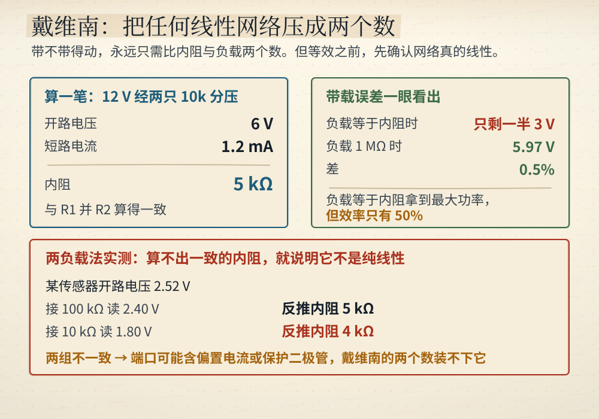
<figcaption>戴维南：把任何线性网络压成两个数。带不带得动，永远只需比内阻与负载两个数。但等效之前，先确认网络真的线性</figcaption>
</figure>


<a id="sec-1-5"></a>
### 1.5 品质因数 Q 与选频网络：从「谐振」到「挑频率」

**谐振回顾**：[1.3](#ch1) 说过电感的 SRF 是它与自己的匝间电容谐振；更一般地，任何 LC 组合都有一个"唱得最响"的频率 $f_0=\dfrac{1}{2\pi\sqrt{LC}}$。这就是选频的起点。

- **串联谐振**（L 与 C 串联）：$f_0$ 处 $X_L=X_C$ 互相抵消，总阻抗 = R（最小）→ **带通**：$f_0$ 附近电流最大
- **并联谐振**（L 与 C 并联）：$f_0$ 处阻抗趋向无穷（理想）→ **带阻**：$f_0$ 附近被"挡住"
- **品质因数** $Q = \dfrac{f_0}{BW}$（BW = 半功率带宽）：**Q 高 = 峰又尖又窄 = 选频锐利；Q 低 = 峰钝 = 宽容**。
  - 串联 RLC：$Q = \dfrac{1}{R}\sqrt{\dfrac{L}{C}}$。R 越小 Q 越高；物理意义是**一个周期内储能与耗能之比**。
- **选频网络 = 会挑频率的"门卫"**：收音机用 LC 谐振选台（调电容改 $f_0$）。中频滤波器用晶体谐振器（Q 上万），电源滤波用 LC（低 Q 宽带宽）。
- 实战提示：**Q 高 ≠ 更好**。选台要高 Q（锐利），电源滤波要低 Q（防振铃过冲）。

Q 也能实测：扫频找到谐振峰 $f_0$，再找到幅度跌到峰值 $1/\sqrt{2}$（−3dB）的两个频率 $f_1$、$f_2$，$Q=f_0/(f_2-f_1)$。实测的 Q 常比算出来的低，元凶几乎总是**元件损耗**：电感的 DCR 与磁芯损耗、电容的 ESR 都往回路里塞等效电阻。而电感通常是短板——同样的储能，磁元件的损耗比电容大。并联谐振还有一笔账：理想并联 LC 在 $f_0$ 阻抗无穷大，实际被电感电阻 $r$ 压成 $Z_{max}\approx L/(rC)$。教材算例：$L=10\,\mu\text{H}$、$C=100\,\text{pF}$、$r=1\,\Omega$，$f_0\approx5.0\,\text{MHz}$，峰值阻抗约 $10^{-5}/10^{-10}=100\,\text{k}\Omega$——Q 越高、峰越高，但永远有限。**谐振网络里"谁最差谁定 Q"，想提 Q，先修最差的那个元件。**

<figure>
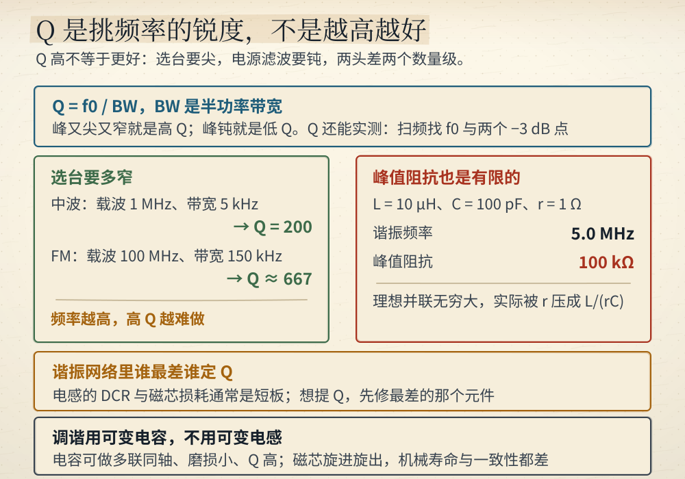
<figcaption>Q 是挑频率的锐度，不是越高越好。Q 高不等于更好：选台要尖，电源滤波要钝，两头差两个数量级</figcaption>
</figure>


按 $Q=f_0/BW$：载波 1MHz、半功率带宽 5kHz 得 Q=200；100MHz、150kHz 得 Q≈667。这是给定带宽下单谐振回路的算例，不能直接代替实际接收机的多级选频设计。但 $f_0$ 的稳定性要求苛刻——这就是调谐电容要做成精密空气介质的原因。到了 GHz 级，分立 LC 的 Q 撑死几十，选频就交给声表面波、介质谐振器这些专物专用的器件了。

串联与并联两种谐振的用途，按"想让信号过还是挡"来记。串联谐振在 $f_0$ 处阻抗最小：串在通路里就是带通，并在节点与地之间就是**陷波**（把 $f_0$ 短路到地）；并联谐振在 $f_0$ 处阻抗最大，串在通路里就是带阻，并在节点上就是**选频负载**（放大器在 $f_0$ 处增益最高）。收音机选台用并联谐振做可调负载，晶体滤波器靠的是石英谐振器极高的 Q——同一对 L 与 C，串并联位置一换，性格整个反过来。

收音机例子里还有一个操作细节：调谐用可变电容而不是可变电感，因为电容可以做成多联同轴、磨损小、Q 高；可调电感要靠磁芯旋进旋出，机械寿命与一致性都差。**"哪个元件可调"看似结构问题，实则是稳定性问题**——选频网络里，可调件永远先选最不容易漂的那一类。

> **精髓**：Q 是"谐振的持久度"。Q=10 的回路像敲一下响很久的钟（带宽窄、选频锐），Q≈0.7 像沙袋（带宽宽、不振荡）。**先想清楚要"挑得多尖"，再定 Q。**（谐振峰见 [1.3](#ch1) impedance-freq 动画的 5kHz 相逢处）

> **为什么**：电源一开一关，输出冲过头还要来回摆几下。能量在池与水车之间来回倒，阻力越小倒的拍数越多，Q 量的就是拍数。所以滤波宁可低 Q，压住它别冒过冲。水池水位高不过上游，谐振时元件电压却远高于电源，比喻到此让位。

[在线演示：RLC 阻尼振荡](https://www.falstad.com/circuit/e-lrc.html)：拖动电阻滑块加大阻尼，看电压冲过头之后的那几摆是被一点点耗掉，还是干脆不再回摆。

<a id="sec-1-6"></a>
### 1.6 动态分析：LC 谐振的一个周期（四拍拆解）

> 电路：串联回路 $R=1\Omega$、$L=1mH$、$C=10\mu F$，谐振频率 $f_0=\dfrac{1}{2\pi\sqrt{LC}}\approx1592Hz$。把频率从低到高扫一遍，看每一拍**谁说了算、电流怎么变**。

**拍 ① 低频区（$f\ll f_0$）**：容抗 $X_C=\dfrac{1}{2\pi fC}$ 巨大、感抗 $X_L=2\pi fL$ 微小 → **电容说了算**，回路呈容性，电流超前电压。低频信号被电容"拦住过不去"。

**拍 ② 逼近谐振（$f\to f_0$）**：$X_C$ 一路降、$X_L$ 一路升，两者越靠越近。阻抗 $|Z|=\sqrt{R^2+(X_L-X_C)^2}$ 里的 $(X_L-X_C)$ 迅速缩小 → **总阻抗从几千欧一路跌向 $R$**，电流同步上涨。

<p align="center"></p>

**拍 ③ 谐振点（$f=f_0$）**：$X_L=X_C$ **完全抵消** → 阻抗只剩 $R=1\Omega$（最小）→ 电流冲到峰值 $I=\dfrac{V}{R}$。此时元件两端电压被"放大"了 $Q$ 倍（见算一笔）。**能量在电感（磁场）与电容（电场）之间来回倒，电源只负责补 $R$ 上耗掉的那一点点。**

**拍 ④ 高频区（$f\gg f_0$）**：$X_L$ 变得巨大 → **电感说了算**，回路呈感性，电流滞后电压。高频信号被电感"拦住过不去"。

**一句话记住四拍**：低频电容拦、谐振两清账、高频电感拦。**中间那条"放行"的窄缝就是选频**。

**算一笔**（$R=1\Omega$、$L=1mH$、$C=10\mu F$、$V_{in}=1V$）：

- 谐振频率 $f_0=\dfrac{1}{2\pi\sqrt{1mH\times10\mu F}}=\dfrac{1}{2\pi\times10^{-4}}\approx\mathbf{1592Hz}$
- 谐振时 $X_L=X_C=\sqrt{\dfrac{L}{C}}=\sqrt{\dfrac{1mH}{10\mu F}}=\mathbf{10\Omega}$，阻抗只剩 $R=1\Omega$ → 电流峰 $I=\dfrac{1V}{1\Omega}=\mathbf{1A}$
- **电压放大 $Q$ 倍**：$V_L=V_C=I\cdot X_L=1A\times10\Omega=\mathbf{10V}$。**电源只有 1V，元件上却有 10V！** 谐振时 $V_L=V_C=Q\cdot V_{in}$，这就是品质因数 $Q=\dfrac{X_L}{R}=10$ 的物理含义（见 [1.5](#ch1)）。
- **带宽** $BW=\dfrac{f_0}{Q}=\dfrac{1592}{10}\approx\mathbf{159Hz}$ → 只有约 1500~1670Hz 这段能过（选频锐利）

[动画演示 5.36](#demo36)

**看点**：把 [1.3](#ch1) 那张阻抗曲线当成时间轴重读一遍。蓝线 Zc 一路降价、红线 Zl 一路涨价，两线交叉处就是「拍 ③ 谐振点」。$X_L$ 与 $X_C$ 数值相等、方向相反，彼此抵消，电流冲到最大。**同一张图，频率扫过去就是四拍。**（动画里这对 L/C 在 5kHz 相逢，本节算例是 1.6kHz，道理一样：**交叉点即谐振点**。）→ 本节 [1.6 LC 谐振](#ch1)。

[在线演示：临界阻尼](https://www.falstad.com/circuit/e-lrc-critical.html)：拖动电阻找到临界那一档，看电压一步到位、恰好不回摆——这就是上一节"低 Q 压过冲"的尽头。

<figure>

<figcaption>跟随电场能与磁场能的交换看损耗：R 越小，能量衰减越慢、Q 越高。下一步用容差和信号源内阻检验理想回路能否保留这个 Q。</figcaption>
</figure>

谐振点对元件容差同样敏感：$f_0$ 反比于 $\sqrt{LC}$，电容偏 +20%，$f_0$ 就下移约 9%；再叠上电感容差与温漂，批量产品的谐振点会摊成一片。所以选频网络一旦要求"每块板都准"，II 类陶瓷电容（±20% 还带偏压效应）就出局了，C0G 或薄膜才够格——这也是 [1.7](#ch1) 介质地图里"定时、滤波、谐振"一栏全被 I 类占去的原因。**算完 $f_0$ 和 Q，再问一句"容差会把它摊多宽"，是从解题走向设计的那一步。**

阻尼的工程取舍也顺手记一笔：Q 高意味着响应快、过冲大，Q 低意味着温吞但干净。临界阻尼（Q=0.5）是"最快不过冲"的边界；Butterworth（Q≈0.707）在通带平坦与阶跃过冲（约 4.3%）之间折中。电源与功率电路怕过冲压坏器件，往 Q≤0.5 压；选频与振荡电路要"响得久"，往高 Q 提。**同一个 LC，换一个 R 就换一种性格**——这也是 [12.5](#ch12) 有源滤波器把 Q 当一等公民的原因。

四拍里还藏着一条测量纪律：扫频看谐振时，信号源内阻会串进回路。50Ω 的信号源直接驱动 $R=1\Omega$ 的串联谐振，回路总电阻从 1Ω 变成 51Ω，Q 从 10 被拉到约 0.2，峰直接消失——不是电路没谐振，是源阻把 Q 吃了。测高 Q 回路要用高阻驱动（串大电阻近似电流源）或并弱耦合探测，**测出来的 Q，永远先问一句"测量链贡献了多少 R"**。

<a id="cap-dc-bias"></a>
### 1.7 电容的隐藏参数：直流偏压降容与介质地图

[1.2](#ch1) 讲的是电容在**频率维度**上的真相（ESR / ESL）；还有一条**电压维度**上的真相，比 ESL 更容易让人翻车：

> **注意**：部分标称 10µF 的小封装 II 类陶瓷电容，加上工作偏压后可能只剩几 µF。具体降幅取决于料号，不能由 X5R / X7R 或额定耐压直接推断。

这不是质量差，是 Class II 陶瓷（钛酸钡 $\text{BaTiO}_3$）的**铁电本性**。强直流电场使极化趋向饱和，小信号介电常数下降 → 有效容值下降。**X5R / X7R 描述温度特性，不规定直流降容百分比，也不能据此给不同产品排降容名次。**C0G 属于 I 类，直流偏压效应小到通常忽略不计。原理与测试条件见 [村田：电容量的电压特性](https://article.murata.com/en-us/article/voltage-characteristics-of-electrostatic-capacitance)。

<p align="center"></p>

**怎么看**：横轴为实际偏压，圆点匀速扫压；红线是**假设的教学曲线，不是厂商实测数据**。5V 工作点与曲线共用数据，$C_{eff}=10\mu\text{F}\times26\%=2.6\mu\text{F}$。同样纹波电流、忽略 ESR 时，容性纹波增至 $10/2.6\approx3.85$ 倍。绿色 C0G 线按自身零偏压容量归一化，**不表示存在相同封装的 10µF C0G 产品**。

**表 1-2　电容介质地图：容值密度、偏压降容与失效模式**

| 介质 / 类型 | 容值密度 | 温度特性 | 直流偏压效应 | 压电啸叫 | 失效模式 | 典型用途 |
|---|---|---|---|---|---|---|
| **C0G / NP0**（I 类） | 最低 | ±30ppm/°C | **无** | 无 | 开路 | 定时、滤波、采样保持、谐振 |
| **X7R** | 高 | ±15%，−55~125°C | 可能显著，查具体料号 | 有 | 开路或短路 | 通用去耦、滤波 |
| **X5R** | 高 | ±15%，−55~85°C | 可能显著，查具体料号 | 有 | 开路或短路 | 大容量去耦（**必须查降容曲线**） |
| **Y5V** | 最高 | +22 / −82%（！） | 极大 | 大 | 开路 | 基本别用 |
| **钽（MnO₂）** | 高 | 好 | 无 | 无 | **短路** | 小体积大容量，必须降额 50% |
| **铝电解** | 最高 | 差 | 无 | 无 | 干涸（容值↓ ESR↑） | 低频储能，寿命受温度支配 |
| **薄膜（PP / PET）** | 中 | 很好 | 无 | 无 | 开路 | 高纹波、音频、高可靠 |

**到底还剩多少？** 标称容量有指定的测试频率、交流幅度和偏压条件。查厂商的**具体料号偏压曲线**，例如 Murata SimSurfing、TDK SEAT、Kemet K-SIM。再按实际工作电压、温度和测试条件确认有效容量，必要时带偏压测量。更大封装是候选，但不能代替曲线核对。

**铝电解的寿命账**：厂商给的是「$L_0$ 小时 @ $T_0$」，按 **10°C 翻倍法则**外推，见下式。

$$L = L_0 \times 2^{\frac{T_0 - T}{10}}$$

**算一笔**：一颗 105°C / 2000h 的电解电容，实际工作在 65°C → $L = 2000 \times 2^{4} = 32000\text{h} \approx 3.7$ 年（连续通电）。**这就是为什么开关电源里第一个坏的总是电解电容**：纹波电流的自发热与环境温度，它两样都吃。想长寿：把 $L_0$ 提到 5000~10000h，或换固态 / 聚合物。

<div class="calc" data-calc="electrolyte"></div>

**再算一笔（降容怎么咬人）**：Buck 输出 3.3V / 2A，$f_{sw}=500\text{kHz}$，电感纹波 $\Delta I_L = 0.6\text{A}$。输出电容选了 22µF X5R 0805 / 6.3V。

<figure>
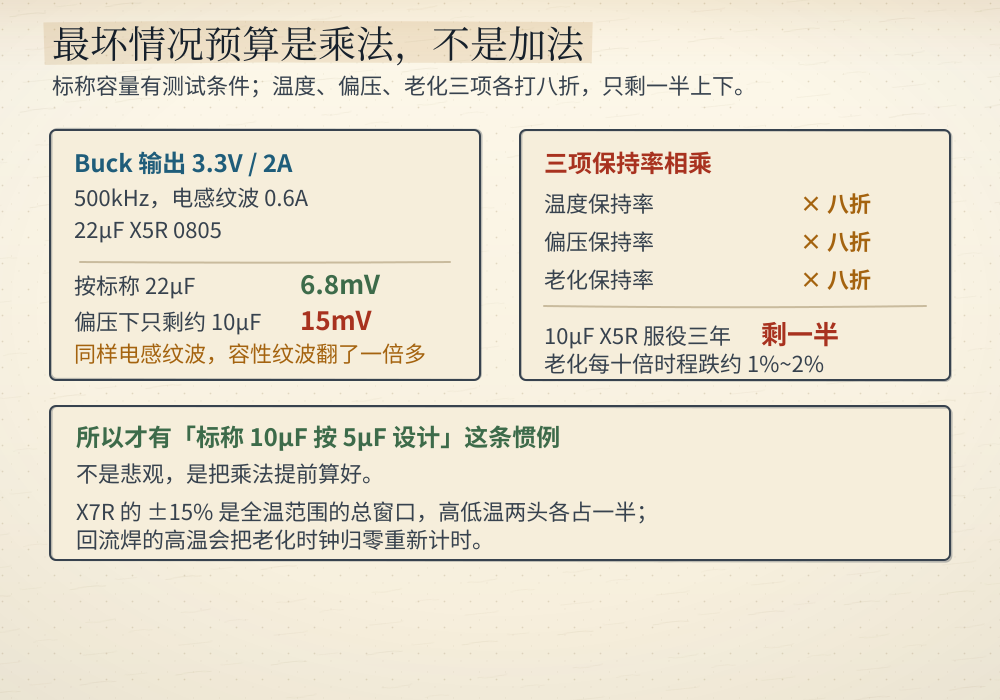
<figcaption>最坏情况预算是乘法，不是加法。标称容量有测试条件；温度、偏压、老化三项各打八折，只剩一半上下</figcaption>
</figure>


- 按标称 22µF：$\Delta V = \dfrac{\Delta I_L}{8 f_{sw} C} = \dfrac{0.6}{8 \times 500k \times 22\mu} \approx 6.8\text{mV}$
- **假设所选料号曲线显示** 3.3V 偏压下只剩约 10µF：$\Delta V \approx 15\text{mV}$，**容性纹波翻了一倍多**（同样电感纹波，忽略 ESR）。有效容量变化也可能改变环路稳定性，需要重新核对补偿。

**三条修法**：① 对比更大封装或更高耐压候选料号的实际偏压曲线，不能只凭封装与耐压判断；② 用**降容后的有效容值**做设计；③ 需要大容量时评估聚合物钽 / 固态电解，同时核对 ESR、纹波额定值及环路稳定性。

温度与老化也要进预算，别只算偏压一项：有效容值 = 标称 × 温度保持率 × 偏压保持率 × 老化保持率，三项各打八折只剩一半上下（降容预算图右栏；老化率是典型值，Y5V 更高）。"标称 10µF 按 5µF 设计"不是悲观，是把乘法提前算好。

铝电解另有一条纹波电流的账：datasheet 给的纹波电流额定值，本质是 **ESR 发热的许可**，$I_{rms}^2\times ESR$ 这份热直接进寿命公式的温度项（下图右栏）。选型顺序因此是：先按纹波电流与温升选系列，再按容量与偏压选值。

<figure>
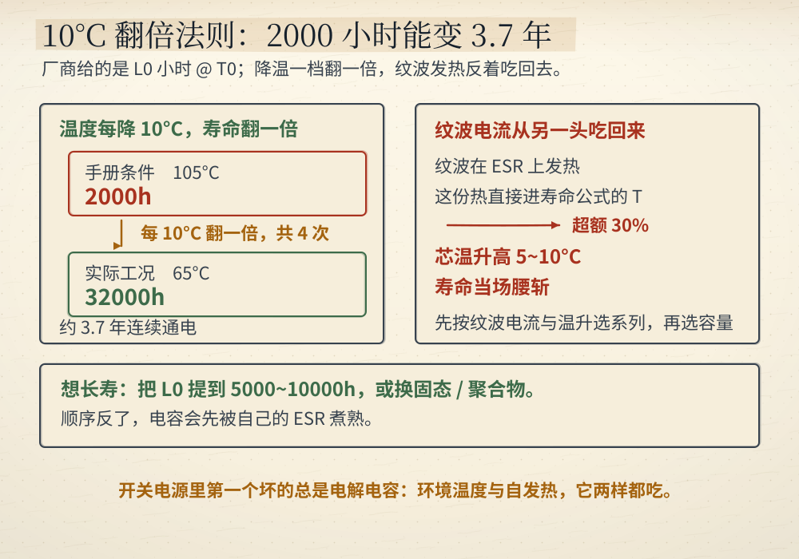
<figcaption>10°C 翻倍法则：2000 小时能变 3.7 年。厂商给的是 L0 小时 @ T0；降温一档翻一倍，纹波发热反着吃回去</figcaption>
</figure>


C0G 也不是万能退路：它的容值密度最低，10nF 以上就很难买到、价格陡增。它守的是"小容量高稳定"一段：定时、采样保持、谐振、积分；大容量位置仍要靠 II 类陶瓷加降容预算，或薄膜、聚合物顶上。选型流程可以固化成四步。先定容量与额定电压（留 ≥1.5× 裕量），再按介质特性圈候选。然后查具体料号的偏压、温度、老化曲线，算有效容值；最后按 ESR 与纹波电流收尾。**每一步只排除一类风险，缺一步就留一类坑。**

介质地图里的"压电啸叫"也值得一行注脚：II 类陶瓷是铁电体，电压变化让它发生微小形变，形变又把板子的振动变回电压。这叫双向换能。开关电源的轻载跳频落进音频段时，MLCC 就成了微型扬声器，啸叫多由此来；反过来，在振动环境里它又成了麦克风，把机械噪声混进信号链。对策是换 C0G 或薄膜、选软端子封装、或把电容挪离应力区。

> **军规**：钽电容的唯一军规——失效模式是**短路**（不是开路），一旦击穿就是给电源对地放火。所以**耐压至少降额到 50%**（5V 轨用 10V 以上），并**串 0.1~1Ω 或加限流**。铝电解是"慢性病"（干涸），钽是"急性病"（击穿）。见 [17 章故障速查总表](#ch17)。

<!-- slot:lab -->
<a id="rc-study"></a>
### 1.8 动手验证：RC 充放电实验

[下载 RC 实验包](assets/labs/rc-lab.zip) · [完整接线、仿真和验收步骤](#lab-rc)

**先记住一句话**：电阻限制充电电流，电容电压逐渐接近电源电压；断开电源后，必须有放电回路，电压才会按预期下降。

<p align="center"></p>

**按阶段看**：① 刚接通，电容电压低，电阻两端压差大；② 电容电压升高，电流减小；③ 对照图中 63.2% 的虚线读出一个时间常数。播放器的秒数是教学慢放时间，实验时间读图上的 ms 标记。

**算一笔**：初始电压为 0，$R=1k\Omega$、$C=10\mu F$、$V_S=5V$，则 $\tau=RC=10ms$。接通瞬间电流 $5V/1k\Omega=5mA$；10ms 时电容约 3.16V；50ms 时约 4.97V。

> **为什么**：电容充电总是开头猛、后面越充越慢。池子水位一涨，进水的净压差就小一分，越满越慢是它自己逼停了自己。于是"多久算充满"判的是残水低到测不出。但水会真的灌进池底，电容里没有电荷穿过介质，只是电场在顶。

<details>
<summary>展开公式与适用条件</summary>

充电：$v_C(t)=V_S+(V_0-V_S)e^{-t/RC}$；经同一电阻放电到地：$v_C(t)=V_0e^{-t/RC}$。以上忽略漏电、ESR、探头负载和电源内阻；信号源内阻不可忽略时要计入 R。电容电压接近终值需要时间，5τ 表示完成约 99.3%，不是数学上完全充满。

</details>

<figure class="study-photo">
<div class="study-photo-frame">
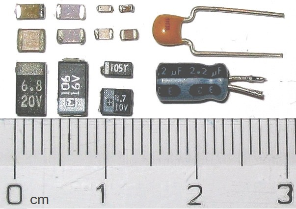
<span class="study-marker" style="left:24%;top:18%" aria-hidden="true">①</span>
<span class="study-marker" style="left:64%;top:41%" aria-hidden="true">②</span>
<span class="study-marker" style="left:64%;top:81%" aria-hidden="true">③</span>
</div>
<figcaption>① 看外形，不能凭颜色猜容值；② 铝电解先核对负极条纹和额定电压；③ 用尺读尺寸。照片中的器件用于识别，不表示都为本实验的 10µF。照片：Shaddack，公有领域；本站加编号。</figcaption>
</figure>

[照片来源与授权](https://commons.wikimedia.org/wiki/File:Photo-SMDcapacitors.jpg)。选用明确标称的 10µF 电容；若使用有极性的铝电解，正极接 RC 节点，负极接地，额定电压须高于 5V。

```text
5V ── 开关 ── 1kΩ ──●── C 正极
                     │
                  CH1 探头
GND ─────────────────── C 负极、探头地夹
```

**动手核对**：只用低压、共地的 5V 实验电源。示波器 DC 耦合、×10 探头测 RC 节点，时基从 10ms/格开始，以电压上升沿单次触发。放电前断开 5V，把电阻输入端改接地，观察下降曲线；重新充电前确认电容已放电。万用表适合确认终值，通常看不清这次 10ms 的变化。

<a data-study-video href="https://www.youtube.com/watch?v=5hFC9ugTGLs">National MagLab：How Capacitors Work · 电容如何储存电荷</a>

**观看任务**：找出视频里的两片导体与绝缘层。再回到动画，解释为什么外部串联电阻会改变充电速度。视频讲电容原理，不是本实验的实测录像。

<details>
<summary>自测：电阻改为 2kΩ，充到 3.16V 需要多久？最终电压变不变？</summary>

约 20ms，时间常数翻倍；理想空载情况下终值仍为 5V。若终值明显变低，应检查负载、漏电和供电，而不是把它归因于“电阻充不进去”。

</details>

<!-- slot:selfcheck -->
### 自检

1. 100nF MLCC 与 10µF 铝电解的去耦谷底各在什么频率、由什么参数决定？为什么两者不能互相替代？
2. 12V 经 R1=R2=10k 分压，接上 10kΩ 负载后输出多少伏？先写出戴维南等效的两个数再算。
3. 设计判断：Buck 输出纹波实测偏大，手头有 22µF X5R 和 100µF 电解两种候选，先查哪个参数再决定加谁？

### 验收清单
- [ ] 观察：对照 1.2 节两条阻抗曲线，说出 100nF 与 10µF 各自的谷底位置，以及 100MHz 处两者的阻抗差（约 0.6Ω 对 13Ω）。
- [ ] 计算：R=1kΩ、C=10µF、VS=5V：τ=10ms，接通瞬间电流 5mA，50ms 时电容约 4.97V。
- [ ] 测量：按 1.8 节接线，示波器 DC 耦合读出充电到 63.2% 的时间，应在 10ms 量级（元件标称容差内允许偏差）。

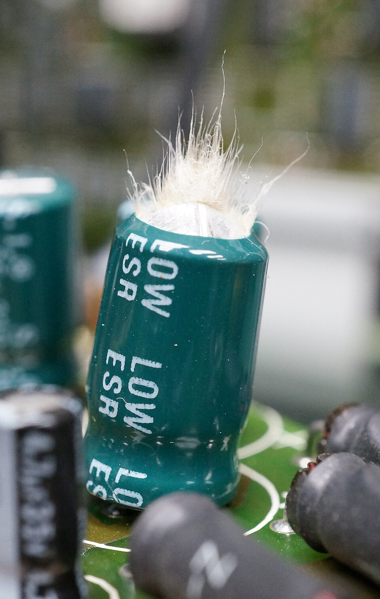

> **实物照片**：反接或过压的电解电容：顶部防爆阀（刻痕）应声炸开，电解液喷溅。"反接会爆炸"不是修辞——防爆阀是拿封装完整性换人身安全。换电容先看耐压余量（≥1.5× 工作电压），再看极性（回看 [1.2](#sec-1-2)）。

> **精髓**：用工作频段判断寄生参数，用 $f_0$ 与 $Q$ 判断选频；选电容还要核对直流偏压下的有效容量。

<!-- slot:citations -->
### 参考与出处

- 本章参数与型号以厂商 datasheet / 应用笔记为权威源（正文注明型号处为准）；教学示意数字均已标「示意」。
- ref-002：Microelectronic Circuits（`analog-book/data/references.yml`，id 可检索）
- ref-013：Encyclopedia of Electronic Components Volume 1（`analog-book/data/references.yml`，id 可检索）
- ref-024：Thermal Agitation of Electric Charge in Conductors（`analog-book/data/references.yml`，id 可检索）
- 开源与视觉工具引用见 references.yml 的 OSS 条目（ref-119~ref-124，仅灵感/工具，非参数源）。

> **通关打卡**：完成一次带载分压计算、一次 RC 测量和一次电容选型核查；用测量结果说明模型在当前频段是否适用。

### 配套视频

<p>
<a data-study-video href="https://www.youtube.com/watch?v=BcJ6UdDx1vg">▶ EEVblog #859 去耦电容教程</a>
<a data-study-video href="https://www.youtube.com/watch?v=1xicZF9glH0">▶ EEVblog #1085 去耦电容可视化</a>
</p>

> **EEVblog #859 / #1085**（Dave Jones）：去耦电容为什么用、怎么放、封装的影响。视频先用阻抗分析仪实测验证理论，再可视化给你看。与本章 1.2 节 + 第 15 章"贴脸放"军规绝配。

> **配套视频**：想系统跟一门课：[模拟电子技术基础（56 讲全）· 清华 华成英](https://www.bilibili.com/video/BV19s411a7KL/)（B站）。无源元件与 RLC 谐振、Q 值在系统课里逐节推导，与 1.3~1.6 对应；英文：[Afrotechmods《Inductor basics》](https://www.youtube.com/watch?v=NgwXkUt3XxQ)（3:53，电感的"惯性"四分钟讲完）；[GreatScott!《Electronic Basics #16: Resistors》](https://www.youtube.com/watch?v=7w5I-KbJ1Sg)（6:06，电阻的功率与串并联，配 1.1 节）。更多见 [7.1 视频资源汇总](#part7)。

> **60 秒动画版**：[EP08 去耦电容不是滤波，是本地水库](https://www.bilibili.com/video/BV178pq6oE3o/) · [EP09 开关电源里第一个坏的总是它](https://www.bilibili.com/video/BV1L8pq6oERf/)（[全 20 集](#s7-3)）

---
<a id="ch2"></a>
## 第 2 章 二极管：单向导电的物理本质

> **场景**：墙上的交流电每时每刻都在掉头，手机却要平稳的直流。中间那四只二极管像四扇单向旋转门，把来回摇摆的电流整成一个方向。可它们一开一合，电压和波形就都变了样。

> **难度**：L1 入门，17 节，精读约 40 分钟
>
> **白话**：二极管像一扇单向阀：正向开、反向关。但开启电压和反向击穿是两条边界，越过去就不是理想模型了。

> **先修**：[第 0 章单向阀比喻](#ch0) + [第 1 章寄生参数](#ch1)。

> **学完你应能**：解释 0.7 V 从哪来、什么条件下它不成立；算出桥式整流＋电容滤波的输出与纹波数量级；为板外引脚配上 TVS＋限流＋钳位并说清各自拦什么；拿到一只发烫或炸裂的二极管，能按“方向、压降、散热”三条线查出原因。
>
> **公式速查**：[速查表·二极管](#diode) 收齐本章设计式与判据。
>
> **模型边界**：[边界速查·二极管](#limits-diode) 收齐本章理想模型的失效点与修正。

二极管是模拟电路里最像“单向阀”的元件，也最容易被“0.7 V”这一个数字骗住。很多人背下了“正向导通 0.7 V、反向截止”，却在第一次做整流电源时发现，输出比理论低了两伏。第一次接电机时发现，续流管比驱动管先炸。第一次做接口防护时发现，TVS 装了还是烧芯片。问题不在公式，而在把二极管当成了一个只有“开/关”两态的开关。

这一章我们分三层看它：第一层是 PN 结的物理图像，解释单向导电从哪来；第二层是工程模型，告诉你 0.7 V、0.3 V、理想开关分别在什么场合够用；第三层是真实边界，温度、击穿、浪涌、结温如何把一只“合格”的二极管推向失效。读完之后，选型时至少要同时管住方向、压降和散热这三件事，只挑一只“能过流”的管子远远不够。

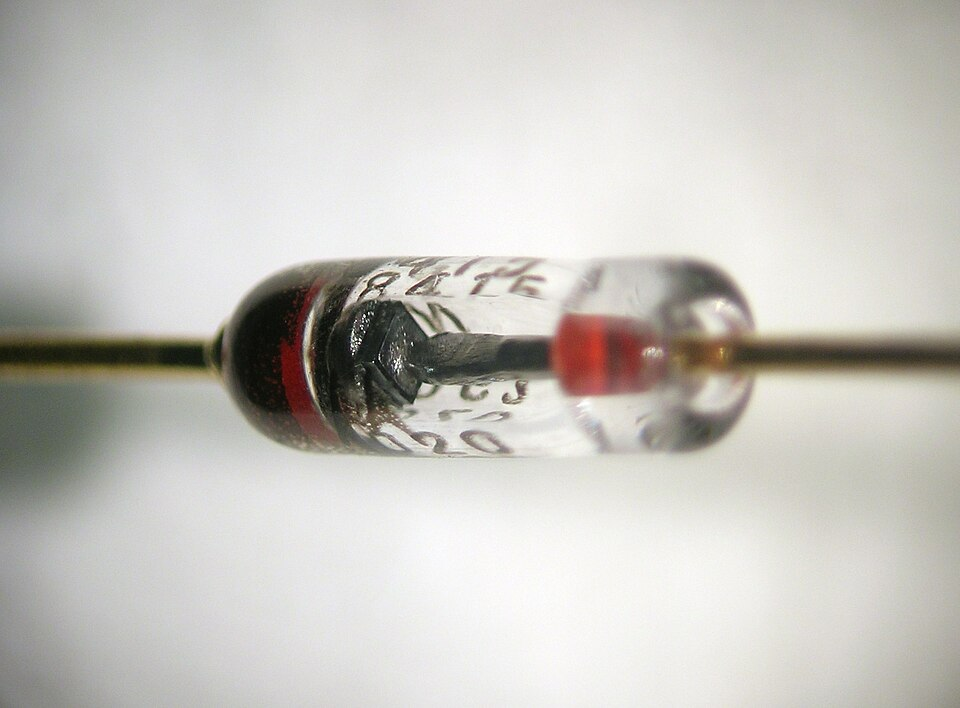

> **实物照片**：二极管实物：玻璃壳里那截极小的 PN 结。阳极进、阴极出，阴极一端有色环标记。接反了，轻则不工作，重则放烟花。

<!-- slot:hook -->
<a id="sec-2-1"></a>
> **口诀**：0.7 V 是门票——二极管导通要买 0.7 V 的票；想省钱？肖特基半价。

> **扩量动画**：本章新增的失效边界与预算账动画：[5.125](#demo125) · [5.126](#demo126)（[画廊](#part5)）。

### 2.1 PN 结的形成

P 型半导体（空穴多）与 N 型半导体（电子多）接触时，会发生三件事。

1. 交界处电子与空穴复合，形成**耗尽层**（几乎没有可移动载流子）。
2. 耗尽层留下不能移动的离子，建立**内建电场**（硅约 0.6~0.9 V，常被简称为 0.7 V）。
3. 正向加压抵消内建电场，耗尽层变薄，导通；反向加压加宽耗尽层，截止。

- **为什么会复合？** 浓度差驱动扩散：N 侧电子浓度高、P 侧空穴浓度高，交界处电子“掉”进空穴里两两湮灭。这与一滴墨水滴入清水会散开，是同一个统计规律。
- **为什么扩散会自己停下来？** 电子跑掉后，N 侧留下带正电的施主离子。P 侧留下带负电的受主离子，它们不能移动，在交界处排成一堵“电荷墙”。这堵墙的电场，恰好把后续电子往回推。扩散多一分，墙就厚一分、推力大一分。**最终推力恰好抵消扩散冲动，达成动态平衡。**这堵墙就是耗尽层，对应的电势差即内建电势。
- **正向导通的本质**：外加正压把内建电势“垫高抵消”一部分，墙变薄，扩散重新启动，电流迅速增长。所以二极管并没有“过 0.7 V 突然开”的开关动作：导通是**外加电压与内建电势的拔河**——指数曲线就是拔河的比分牌。

> **一句话**：PN 结没有装弹簧的门：它是一堵会自己长高、自己调整厚度的电荷墙。正向电压把墙压薄，反向电压把墙加厚。

<!-- slot:intuition -->
> **图问**：这堵“电荷墙”为什么能自己调厚度——正向和反向加压时，墙各往哪边变？

<figure>
<figcaption>PN 结的三步：扩散留下电荷墙，电荷墙的电场把后来的载流子推回去，最终达到动态平衡。耗尽层里仍有电荷，缺的只是可移动的载流子。</figcaption>
</figure>

[动画演示 5.56](#demo56)

上图把三步画成一条线：扩散想散开，载流子往里跑；跑掉的地方留下不能动的离子，形成电荷墙；墙的电场把后来的往回推。三步的平衡点，就是内建电势：硅管约 0.6~0.9 V，这就是“0.7 V 门票”的物理出处。

<!-- slot:quant -->
<a id="sec-2-2"></a>
### 2.2 伏安特性与数学模型

$$I_D = I_S\left(e^{\frac{V_D}{nV_T}} - 1\right), \quad V_T = \frac{kT}{q} \approx 26\text{ mV @ 300 K}$$

- $I_S$：反向饱和电流（nA~µA 级，随温度剧烈变化）。
- $n$：理想因子（1~2，工艺越理想越接近 1）。
- $V_T$：热电压，室温约 26 mV。

**温度这条线要特别小心**：同样电流下 $V_D$ 随温度下降，是“负温度系数”；但如果你用恒压源直接驱动，温度升高会让电流指数上升，形成“温度升→电流增→更热”的正反馈。LED、二极管并联、大功率整流管的热失控，根子都在这里。第 2.9 节会把这条线讲透。

<figure>
<figcaption>25 °C 与 60 °C 两条伏安曲线：同样电流下，温度升高让曲线左移；同样电压下，温度升高却让电流暴涨。前者是温度传感器的原理，后者是热失控的根。</figcaption>
</figure>

[动画演示 5.46](#demo46)

上图把 25 °C 与 60 °C 两条曲线画在一起。这张图用的是简化模型（$I_S=1\text{ nA}$、$n=1$），所以 1 mA 对应 0.36 V；真实 1N4148 在 1 mA 下约 0.6 V，1N4007 约 0.8 V。**数值会变，规律不变**：

- 电压每增加约 $n\times 60$ mV，电流翻十倍（$n=1$ 时 60 mV/十倍，$n=2$ 时约 120 mV/十倍）。
- 同样电流下，温度每升 1 °C，$V_D$ 约降 2 mV；升 35 °C 就降 70 mV。
- 动态电阻不是常数：$r_d = nV_T/I_D$，1 mA 处约 26 Ω（$n=1$），10 mA 处只有 2.6 Ω。

**工程近似模型**（三种精度，按场景选用）：

1. **理想开关**：导通 0 V 压降。只算拓扑、判断方向时用。
2. **恒压降**：硅管 0.7 V、肖特基 0.3~0.5 V、LED 1.8~3.4 V。手算最快，误差最大。
3. **恒压降＋体电阻**：$V_F = V_{F0} + I_F R_S$。大电流、需要算功耗和结温时用。

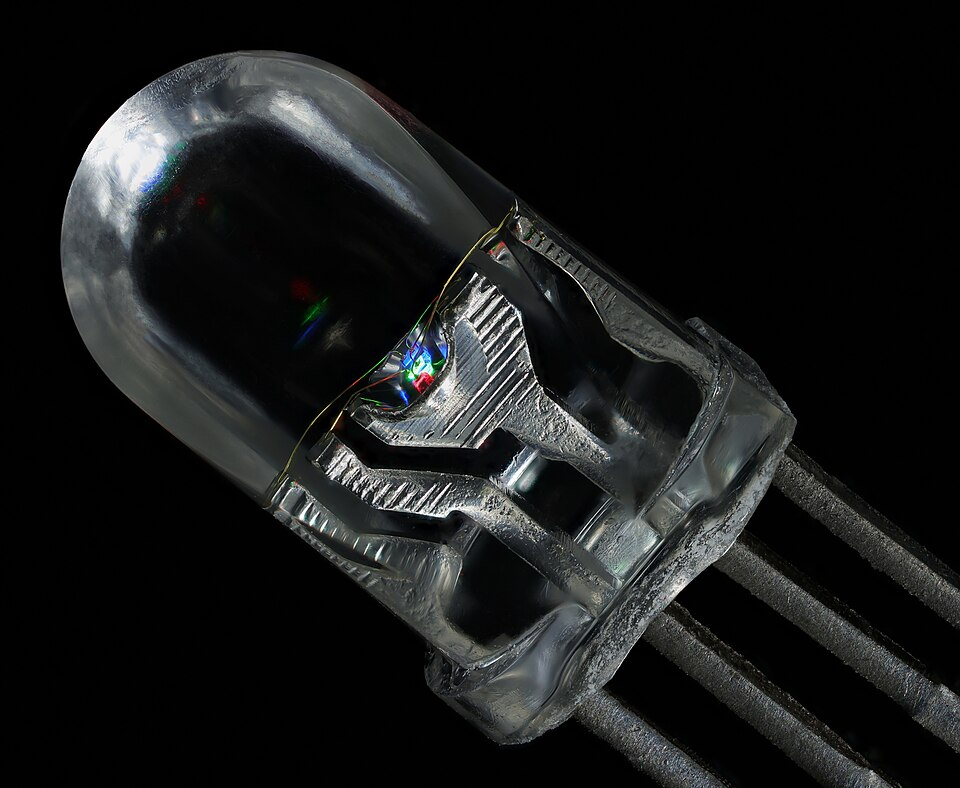

> **实物照片**：同为 5 mm LED，颜色由半导体材料的带隙决定，正向压降跟着变——红光约 1.8 V，绿光 2 V 上下，蓝光/白光 3 V 往上。所以上面写的"LED 1.8~3.4 V"是一个范围，不是一个数；拿红光 LED 的压降去算白光 LED 的限流电阻，电流会差出一倍。

**0.7 V 什么时候最骗人？**

- **小电流**：1 µA 时硅管可能只有 0.3~0.4 V，用 0.7 V 会把电流算小一个数量级。
- **大电流**：1 A 时 1N4007 的 $V_F$ 接近 0.9~1.0 V，0.7 V 会把功耗算少 30%。
- **高温**：同样电流下 $V_F$ 可能降 100 mV 以上。
- **肖特基**：0.3~0.5 V，不是 0.7 V。
- **反向**：漏电流（不是 0 V），肖特基高温下漏得更凶。

> **为什么**：电流翻好多倍，压降却只挪一小格。因为这扇单向阀的开度随压差指数涨，水位高一点，闸门就宽一大截。所以"0.7 V"只是水位牌上标的一档，得按实际电流去查曲线。但水阀关死就不漏，这扇阀反向关着还在渗水，越热渗得越凶。

[在线演示：二极管伏安曲线](https://www.falstad.com/circuit/e-diodecurve.html)：把电压从反向一点点拖向正向，看电流先趴在底下不动、越过门槛后沿指数曲线起飞。

> **精髓**：0.7 V 描述的是“某只硅管、某个电流、某个温度”下的一个工作点，它本身并不是二极管的属性。把它当常数，就像把人的体温当 37 °C 去判断所有病情——大方向没错，细节全丢。

<a id="sec-2-3"></a>
### 2.3 整流原理：把交流“翻”成单向

先看桥式整流的两条电流路径：同一个负载，为什么正半周和负半周都有电流、而且方向不变？

<figure>
<figcaption>桥式整流的两条导通路径：正半周 D1/D4，负半周 D2/D3。负载上的电流方向始终不变，代价是每半个周期都有两只二极管串联导通。</figcaption>
</figure>

[动画演示 5.2](#demo2)

**半波整流**：只用半个周期，输出脉动大、效率低。它只用一只二极管，适合小电流、对纹波不敏感的场合。

**桥式全波整流**（4 只二极管）：

- 正半周：D1、D4 导通；负半周：D2、D3 导通。
- 任意时刻电流都同向流过负载，但**损失两个管压降**（约 1.2~1.8 V，视电流而定）。
- 加滤波电容后：电容在峰值附近充电、其余时间放电，输出变成带纹波的直流。

纹波估算：

$$\Delta V \approx \frac{I_{load}}{f_{ripple} \cdot C}$$

全波整流后 $f_{ripple}=2f_{AC}$；50 Hz 市电对应 100 Hz 纹波。**为什么是两倍？** 因为正半周和负半周都往负载送电。每个市电周期里电容被“补两次”，所以纹波周期是市电周期的一半。


**电容到底在干什么？** 电压高时存电荷，电压低时放电荷；所谓“滤波”，说的是这件事的结果。电容越大，同样负载电流下电压掉得越慢，纹波越小；但电容越大，上电瞬间的充电电流也越猛。这是第 2.12 节浪涌问题的源头。

[在线演示：全波整流加滤波](https://www.falstad.com/circuit/e-fullrectf.html)：看两只"补水闸门"如何轮流在峰顶开闸给电容灌水，负载越重、电容越小，谷位掉得越深、纹波越宽。

<a id="sec-2-4"></a>
### 2.4 特殊二极管家族

普通二极管只是这一家族的“长子”。表 2-1 先认全成员；三个选型问题决定你怎么挑；地图解释它们为什么这样分工。

<figure>
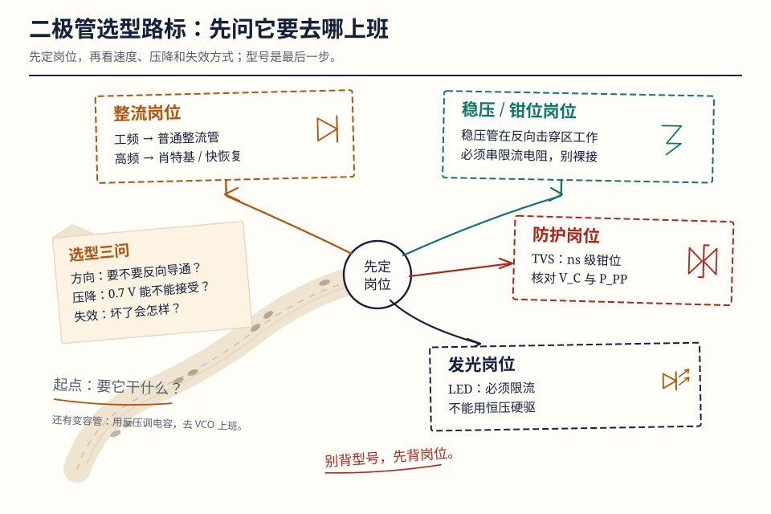
<figcaption>二极管选型路标：先定岗位——整流、稳压/钳位、防护、发光，再问方向、压降与失效方式，最后才看型号。岗位错了，参数再漂亮也白搭。</figcaption>
</figure>

**表 2-1　二极管家族速查**

| 类型 | 原理要点 | 典型应用 | 选型第一问 |
|---|---|---|---|
| 普通整流管 | PN 结，耐压高、恢复慢 | 50/60 Hz 整流、防反接 | 平均电流、浪涌电流够不够？ |
| 快恢复二极管 | 缩短反向恢复时间 | 开关电源续流、高频整流 | 恢复时间、反向恢复损耗 |
| 肖特基二极管 | 金属-半导体结，无少子存储 | 高频整流、低压大电流、防反接 | 反向漏电、耐压（通常 ≤100 V） |
| 稳压二极管 | 反向击穿区工作，动态电阻小 | 简易基准、过压钳位 | 稳压值、功耗、温度系数 |
| TVS | 大面积结，ns 级钳位 | ESD/浪涌防护 | 关断电压、钳位电压、峰值功率 |
| LED | 直接带隙材料复合发光 | 指示/照明 | 必须限流，不能用恒压硬驱 |
| 变容二极管 | 耗尽层宽度随反压变化 | VCO、调谐 | 电容范围、线性度 |

**选型先问三件事**：

1. **方向**：只允许电流单向流，还是需要反向也导通（双向 TVS）？
2. **压降**：0.7 V 能不能接受？不能就考虑肖特基或同步整流。
3. **坏的时候会怎样**：短路、开路、漏电变大？安全相关场合要选“失效开路”或加冗余。

把几个关键成员按**特征电压**和**速度**摆开，分工就一目了然。

<figure>
<figcaption>二极管家族的速度—压降地图：肖特基快而低压降，TVS 用大面积换浪涌能力，LED 压降大但会发光。选型先问“要快还是要省压降”。</figcaption>
</figure>

[动画演示 5.61](#demo61)

图中位置概括特征电压与速度的取舍，不能替代耐压、漏电和脉冲额定值。0.3 V 只是肖特基的典型工作点；最终仍按表 2-1 的岗位选型。

> **注意**：三个常见误解：稳压管要串限流电阻、保证最小工作电流才稳得住，不是万用基准；LED 必须限流，接上 3 V 不会自己亮；TVS 装上去不等于安全，钳位电压、峰值功率和地回路都要匹配。

<a id="sec-2-5"></a>
### 2.5 故障模式与排故

**表 2-2　二极管故障速查**

| 故障现象 | 可能原因 | 一分钟验证 |
|---|---|---|
| 整流输出低、纹波频率变成 50 Hz | 某桥臂开路，全波变半波 | 示波器看纹波频率；二极管档逐只测 |
| 输出纹波突然增大 | 滤波电容干涸、ESR 暴增 | 看纹波形状；测电容温度；有 ESR 表直接测 |
| 二极管发烫 | 电流超额定、散热不足、反向漏电大 | 测正向压降与电流；红外测温；查降额曲线 |
| 肖特基电路“莫名”耗电 | 高温下反向漏流大 | 热风枪局部加热，看漏电是否指数上升 |
| 继电器驱动管反复击穿 | 忘接续流二极管，或续流管失效/接反 | 示波器抓关断尖峰；查续流管方向与额定电流 |
| TVS 正常工作时微导通 | $V_{RWM}$ 选低，或信号摆幅超预期 | 测漏电；看信号峰值与 TVS 规格 |

排故的顺序是看波形、测直流、拆器件，一层一层往下走。波形告诉你“是半波还是全波、尖峰多高、纹波多大”；直流告诉你“压降对不对、电流够不够”；拆器件只是在两者都指向同一只管子时才做的事。

<a id="sec-2-6"></a>
### 2.6 动态分析：整流滤波电源的一个周期（四拍拆解）

> 电路：变压器 → 桥式整流 → 4700 µF 滤波电容 → 1 A 负载。跟着时间走一遍，看每一拍**谁导通、电流走哪、电压怎么变**。

**初始态**（上电前）：电容完全放空，$v_C=0$；副边正弦刚刚爬升。

**扰动**（第一次过峰）：$|v_{AC}|$ 超过 $v_C+2V_F$（两只二极管压降），D1/D4 导通。

**中间态**（浪涌！）：空电容近似瞬时短路，充电电流只受绕组电阻、二极管动态电阻和 ESR 限制，**首冲电流可达几十安**。这就是上电“啪”一声的来源，也是保险丝要选**慢断型**（T 型）的原因：它得扛过这几毫秒的合法浪涌。

**稳态**（峰值充电、谷值放电的无限循环）。

- **导通角通常只有几十度**（占半周期的 10%~30%）：电容电压紧贴正弦峰顶，二极管只在 $|v_{AC}| > v_C+2V_F$ 的峰顶小窗口导通。
- **峰值电流是负载电流的 3~10 倍**：整个周期负载消耗的电荷，全在很短的窗口内补回。导通角越窄，倍数越大。
- **放电段**：二极管全关，电容独自供负载，近似线性放电 $\Delta V = I_{load}\cdot\Delta t/C$。

<figure>
<figcaption>整流滤波的四个节拍：空电容、浪涌充电、峰值充电、谷值放电。稳态下二极管只在峰顶很窄的窗口导通，峰值电流远大于平均电流。</figcaption>
</figure>

**算一笔**：1 A 负载、4700 µF、全波 100 Hz：

$$\Delta V = \frac{1\text{ A}\times 10\text{ ms}}{4700\ \mu\text{F}} \approx 2.1\text{ V}$$

如果导通窗口约 3 ms，先用电荷守恒求窗口内的平均电流：

$$I_{on,avg}\approx I_{load}\times\frac{T}{\Delta t_{on}} = 1\text{ A}\times\frac{10\text{ ms}}{3\text{ ms}}\approx 3.3\text{ A}$$

峰值至少等于 3.3 A，具体取决于脉冲形状与源阻；$I_{peak}\times ESR$ 是电压，不能加到电流上。1N4007 的 1 A 是平均值，桥式每管平均 0.5 A 仍需查重复峰值 $I_{FRM}$ 和热降额。常见的 30 A 则是单次 8.3 ms 半正弦浪涌，不能当重复额定。

> **导通窗口**：一周期消耗的电荷要在峰顶附近补回；选管同时核对重复峰值与结温。


[动画演示 5.83](#demo83)

**看点**：四拍拆解从空电容到稳态纹波。初始态电容放空、浪涌充电几十安、稳态峰值充电、谷值放电电容独供负载。

> **注意**：电容 ESR 会额外制造纹波：$\Delta V_{ESR}\approx I_{peak}\times ESR$。一只 4700 µF 电解的 ESR 若有 50 mΩ，3 A 峰值就会多出 0.15 V 纹波；ESR 还随温度和寿命变化。纹波突然变大，先怀疑电容，而不是先换二极管。

<a id="sec-2-7"></a>
### 2.7 限幅与钳位：二极管的“整形”手艺

整流只是二极管的第一份工作。凭“过 0.7 V 才导通”这一条，它还能干两种波形整形活。

**限幅（Clipper）：削掉超过门槛的部分**

```
输入 ──[R]──┬── 输出（被削顶）
           ┌┴┐
           │D│ 接偏置 V_ref（或双管接 ±电源轨）
           └┬┘
           GND / V_ref
```

输出电压想越过 $V_{ref}+0.7\text{ V}$，二极管立刻导通。多余部分被“泄”掉，波形顶部削平在门槛上。**头号应用是保护**：MCU 的 ADC 引脚怕负压/过压，两只二极管一只接 VCC、一只接地（“轨到轨钳位”）。输入超出 $-0.7\text{ V}\sim V_{CC}+0.7\text{ V}$ 就被旁路，[13.6](#ch13) ADC 前端几乎必配。注意电阻 R 是限流命根：泄放电流全经它，缺失时二极管和信号源对烧。

**钳位（Clamper）：把整个波形“抬”起来**

```
输入 ──[C]──┬── 输出（整体抬高 ≈V_峰值）
           ┌┴┐
           │D│（阳极地、阴极朝节点）
           └┬┘
           GND
```

负半周峰值处二极管导通，电容充电到约“峰值 − 0.7 V”；此后二极管常关，电容像一块“串联电池”把波形整体垫高。原本 ±5 V 摆动的正弦，出来变成约 −0.7~9.3 V 摆动，**直流分量被恢复了**。老式电视机的“直流恢复器”、倍压整流（多级钳位级联，[13.3 电荷泵](#ch13) 的亲兄弟）都是它。

**算一笔**：±3 V 输入在负峰值时，输出钳在 −0.7 V；电容右端比左端高 **2.3 V**（右正左负）。若放电足够慢，随后 $v_{out}=v_{in}+2.3\text{ V}$，输出为 −0.7~5.3 V；负载太重时会产生下垂。

<figure>
<figcaption>限幅与钳位的区别：限幅削掉超过门槛的顶部，改变幅度；钳位用电容把整条波形垫高，改变直流分量而保留形状。</figcaption>
</figure>

[动画演示 5.31](#demo31)

**看点**：左限幅，绿输出想冲过 ±2.7 V 虚线（基准 ±2 V＋0.7 V），红粒子经二极管闸门泄走，顶底削平。右钳位，负半周绿粒子给 C 充到峰值，此后 C 变“串联电池”把整条波形垫高到 −0.7~5.3 V。

> **精髓**：限幅动“幅度”（削顶）、钳位动“直流”（垫高）——同一个 0.7 V，一个当闸门，一个当垫脚石。看到波形缺了顶或被抬了底，先想二极管。

<a id="sec28"></a>
### 2.8 接口保护三件套：TVS + 限流电阻 + 钳位二极管

每个伸到板外的引脚（USB、按键、传感器线、RS-485、电源入口）都是一条**挨打的通道**：人体一摸就是几千伏，纳秒级前沿、安培级峰值（下图红框）。芯片内部的 ESD 二极管只扛得住“出厂后不再挨打”的量级，扛不住现场反复放电。

**三件套各司其职**：

- **泄放大能量：TVS / ESD 阵列。** 把 kV 级脉冲钳到十几伏，能量走地。四个数都要看：$V_{RWM}$ 要求正常工作不导通，且 ≥ 信号最高电平；$V_{BR}$ 是击穿电压；$V_C$ 是钳位电压，必须与后级绝对最大值配合；$P_{PP}$ 是峰值功率。
- **限流：串联电阻 / PTC。** 让钳位器件不必独自吃掉全部能量；$R \ge (V_{surge}-V_C)/I_{max}$，同时不能破坏信号带宽（$R$ 与后级 $C_{in}$ 构成低通）。
- **兜底：钳位二极管到电源轨。** 把残余过冲引到轨上；优先用芯片内部 ESD 二极管＋外部限流电阻；外加分立肖特基要防止往电源轨灌电流。

<figure>
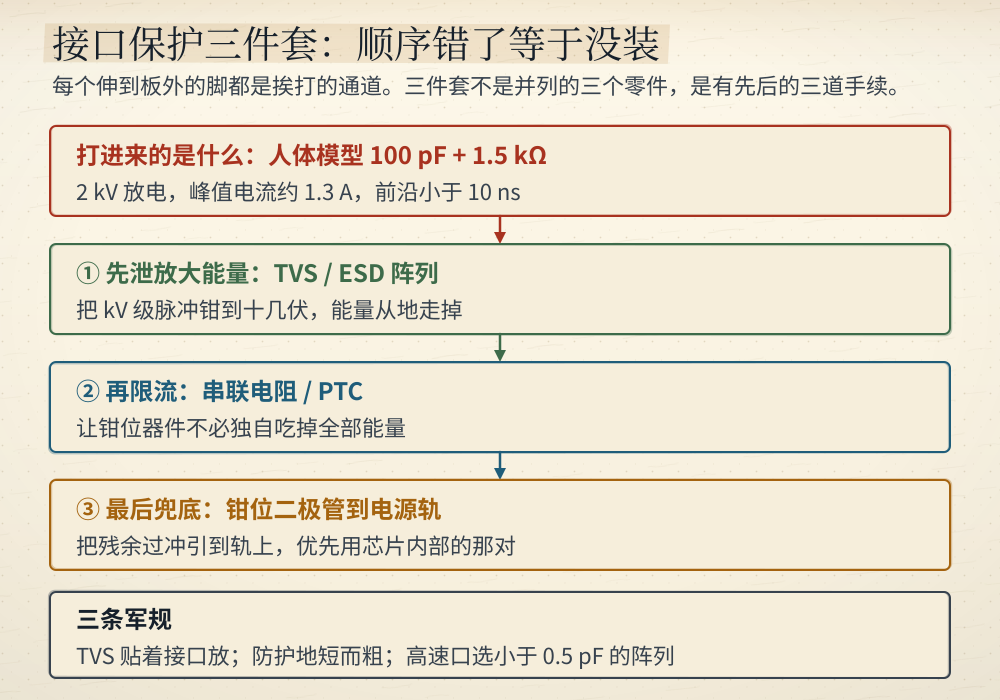
<figcaption>接口保护三件套：顺序错了等于没装。每个伸到板外的脚都是挨打的通道。三件套不是并列的三个零件，是有先后的三道手续</figcaption>
</figure>


> **注意**：钳位二极管往电源轨灌电流是最隐蔽的坑：外部信号高于 $V_{CC}$ 时，电流经二极管灌进电源轨。若电源吸不进去（轻载/LDO 不能倒灌），$V_{CC}$ 就会被抬高，整板芯片过压，甚至 latch-up。**要么在轨上并一颗稳压/TVS 吸收，要么确认电源能吸收这部分电流。**

**四条布局军规**：

1. TVS 必须**贴着接口放**，先于滤波/串阻：它的地回到**机壳/PE 或接口地**，不要绕到数字地深处。
2. 防护地回路短而粗，寄生电感会让钳位电压在 ns 级尖峰上翻倍（1 nH 在 1 A/ns 下就是 1 V）。
3. 高速口（USB3/HDMI）选 **小于 0.5 pF** 的专用 ESD 阵列，普通 TVS 的 50~200 pF 会把眼图闭死。
4. 防护器件要放在**共模扼流圈/磁珠的外侧**（先泄放再滤波），顺序反了等于让浪涌先穿过滤波器。

**常见翻车**：TVS 离接口 8 cm（寄生电感让它形同虚设）；用稳压管当 TVS（响应 µs 级，ESD 是 ns 级）；TVS 地接到细长走线；只保护信号不保护电源入口；忘记 $V_{RWM}$ 选低了导致正常工作时 TVS 微导通、漏电毁精度。

完整的 5 V 接口算例见 [2.11 例 2-2](#sec-2-11)，这一节会把“TVS 先泄放、电阻再限流”的账算到毫安级。

> **精髓**：保护的本质是**给浪涌一条比芯片更轻松的路**。顺序是先泄放（TVS）、再限流（电阻）、最后钳位（二极管）。三者缺一件，能量就会挑最脆弱的那条路走。

<!-- slot:limits -->
<a id="sec-2-9"></a>
### 2.9 温度、击穿与安全工作区

二极管最容易被当成理想开关，第二容易被当成 0.7 V 电池。两个假设在 25 °C、小电流、散热良好的条件下勉强成立；一旦温度、电压或浪涌越界，二极管会用发热、漏电或炸裂提醒你。

<a id="sec-2-9-1"></a>
#### 2.9.1 温度怎样改写伏安特性

肖克利方程里的 $I_S$ 对温度极其敏感。硅管的反向饱和电流大致每升 10 °C 翻一倍（不同工艺、不同模型差别很大），而热电压 $V_T=kT/q$ 又随温度线性上升。两股力量合在一起，在**恒定电流**下表现为：

$$V_F(T) \approx V_F(25^\circ\text{C}) - 2\text{ mV/}^\circ\text{C}\times(T-25^\circ\text{C})$$

温度升 60 °C，$V_F$ 降约 120 mV。这一数字不是精确值，典型范围 −1.8~−2.4 mV/°C；但它足够用来判断趋势。

**同样电流下 $V_F$ 下降，听起来是好事？** 在大电流、恒压驱动的场合，恰恰相反：温度升高 → $V_F$ 降低 → 如果电压不变，电流会指数上升 → 功耗增加 → 更热。这就是**热失控**。LED 用恒压驱动容易烧，就是因为这条正反馈；正确做法是恒流驱动或串限流电阻。

**并联均流为什么难？** 两只二极管的正向特性不可能完全一致，负温度系数会让电流大的那只越抢越多、越来越热（下图）；所以二极管和 BJT 并联常常要加均流电阻、热耦合或降额。

<figure>
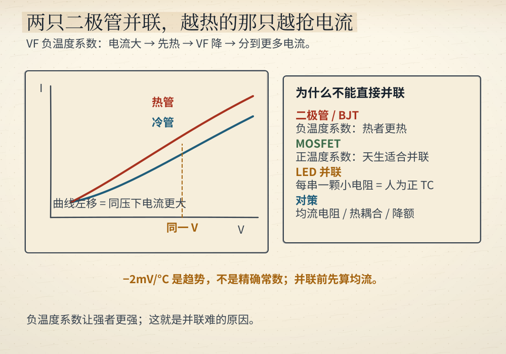
<figcaption>两只二极管并联，越热的那只越抢电流。VF 负温度系数：电流大 → 先热 → VF 降 → 分到更多电流</figcaption>
</figure>


**温度传感器**：几乎所有的数字温度传感器内部都有一颗 PN 结，靠的就是 −2 mV/°C。但它需要**恒流偏置**和**校准**，不能拿万用表随便测一下就说“室温 25.0 °C”。二极管温度传感器的精度，取决于偏置电流的稳定度和个体校准。

<a id="sec-2-9-2"></a>
#### 2.9.2 击穿：齐纳与雪崩不是“坏了”

反向电压加到一定程度，反向电流会突然增大，这叫**击穿**。击穿分两类：

- **齐纳击穿**：低反压（一般小于 5 V），隧道效应，载流子直接“穿墙”。温度系数为负。
- **雪崩击穿**：高反压（一般大于 7 V），碰撞电离，载流子加速后撞出更多电子-空穴对，像雪崩一样倍增。温度系数为正。
- 5~7 V 之间是混合区，温度系数比较接近零。这就是为什么**5.6~6.2 V 的稳压管**常被用作基准：不为别的，只因它的温度系数恰好接近零。

**击穿是可逆的，但前提是限流。** 只要外部电路把反向电流限制在安全值、功耗不超限，撤掉电压后 PN 结能恢复；一旦电流过大，局部热点会把结烧成永久短路。所以“稳压管击穿区工作”和“二极管被击穿损坏”是同一物理过程的两面：**限流是生死线**。

> **为什么**：同样叫击穿，稳压管稳得住，普通管一击就坏。墙塌放行本身不伤人，电流在热点上积热才烧死结。限流电阻管的就是这股泄洪冲多猛、冲多久。安全阀越压越开得温和，齐纳塌下来近乎短路，全靠电阻收着。

**稳压管设计的一个速算**：输入 12 V ±10%，输出 5.1 V，负载 0~20 mA，稳压管最小工作电流 5 mA。

<figure>
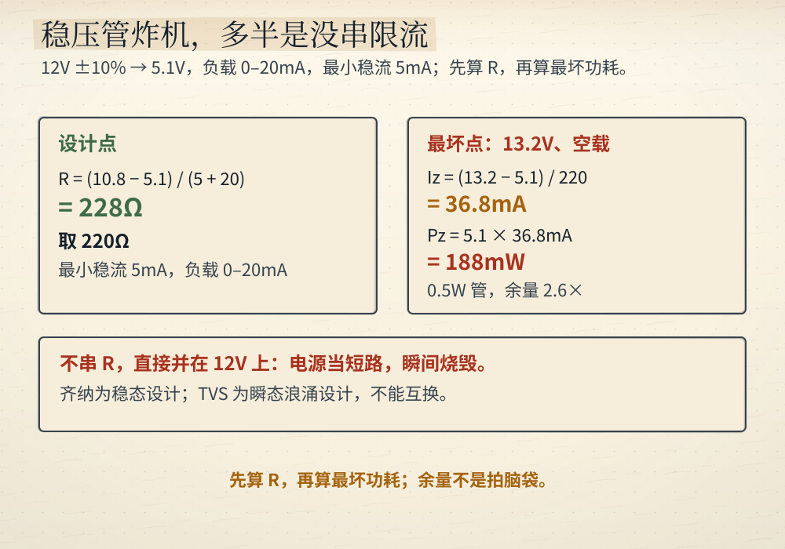
<figcaption>稳压管炸机，多半是没串限流。12V ±10% → 5.1V，负载 0–20mA，最小稳流 5mA；先算 R，再算最坏功耗</figcaption>
</figure>


$$R=\frac{V_{in,min}-V_Z}{I_{Z,min}+I_{L,max}}
=\frac{10.8-5.1}{5\text{ mA}+20\text{ mA}}=228\ \Omega$$

取 220 Ω。最坏情况在最高输入、空载：

$$I_Z=\frac{13.2-5.1}{220}=36.8\text{ mA},\quad
P_Z=5.1\times36.8\text{ mA}=188\text{ mW}$$

选管余量按上图右栏的最坏功耗留。不串限流电阻直接并在电源上，稳压管会被当短路、瞬间烧毁——这是最常见的“稳压管炸机”原因。

**齐纳 vs TVS**：齐纳管为**稳态**稳压设计，结面积小、动态电阻和温度系数有讲究；TVS 为**瞬态**浪涌设计，结面积大、能扛几百瓦到几千瓦的窄脉冲，但稳态精度和漏电不如齐纳。拿齐纳当 TVS，响应速度和浪涌能力都不够；拿 TVS 当稳压管，漏电和电压容差会让你失望。

#### 2.9.3 安全工作区：四条边界围出的地盘

二极管的“额定电流”只是一个数，实际边界是**安全工作区（SOA）**：

1. **最大反向电压** $V_{RRM}$：超过就可能击穿；瞬态还要看雪崩耐量。
2. **最大正向电流** $I_F$：平均值、重复峰值、单次浪涌是三回事。
3. **最大功耗** $P_D$：由结温上限和热阻决定，$P_D=(T_{j,max}-T_a)/R_{\theta JA}$。
4. **最大结温** $T_{j,max}$：硅管常见 125~175 °C；超过后漏电、恢复时间、可靠性一起恶化。

<figure>
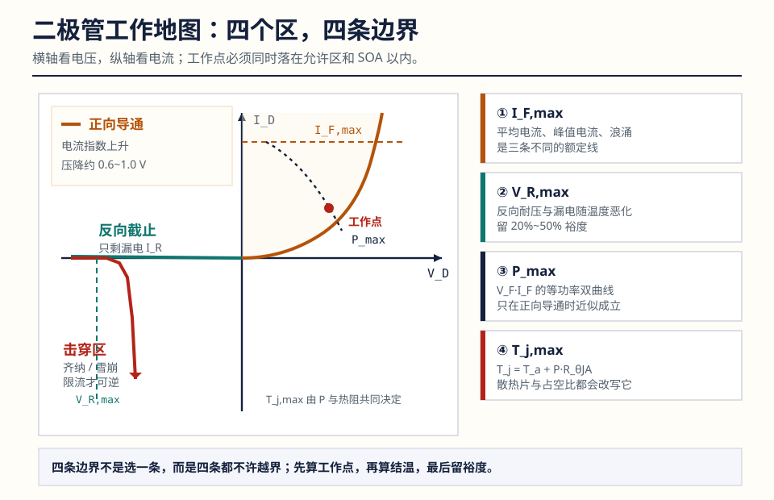
<figcaption>先看工作在哪个象限，再谈参数。正向区看压降与电流，反向区看漏电与耐压，击穿区看限流与功率，SOA 看四条边界是否同时满足。</figcaption>
</figure>

**脉冲越窄，允许的峰值功率越高**，这是 SOA 曲线的核心。手册上的“峰值功率”一定附带脉冲宽度和占空比。把 8.3 ms 的单次浪涌值当成每周期都能来的重复值，是选型里最常见的错误之一。雪崩能量 $E_{AS}$ 也一样：它只在规定的电感、电流、温度条件下可重复，不是“无限吸收”。

**结温速算**：

$$T_j=T_a+P\times R_{\theta JA}$$

例如一只二极管以 1 A 持续导通、$V_F=0.9\text{ V}$、$R_{\theta JA}=80^\circ\text{C/W}$、环境 50 °C：

$$T_j=50+0.9\times80=122^\circ\text{C}$$

结温余量已经没了：环境再高一点、电流再大一点就超限（下图）。正确动作是降额到 0.6 A、换低 $V_F$ 的肖特基、加散热片，或者改用同步整流。

<figure>

<figcaption>结温只剩 3°C，设计只做了一半。1A × 0.9V × 80°C/W，环境 50°C：Tj = 122°C，离 125°C 上限只差 3°C</figcaption>
</figure>


> **边界**：平均结温合格仍不等于安全；反压、重复峰值和单次浪涌必须分别核对。

<a id="sec-2-10"></a>
### 2.10 整流与纹波设计

整流电路看着简单，实际设计要同时管住四件事：输出电压、纹波、二极管峰值电流、电容浪涌电流。只算前两个，后两个会在量产时找你。

#### 2.10.1 三种整流的取舍

**表 2-3　整流方案对比**

| 拓扑 | 二极管数 | 导通压降 | 纹波频率 | 二极管反压 | 变压器要求 | 典型场景 |
|---|---|---|---|---|---|---|
| 半波 | 1 | $V_F$ | $f$ | $V_{pk}$ | 简单 | 小电流、低成本、对纹波不敏感 |
| 全波（中心抽头） | 2 | $V_F$ | $2f$ | $2V_{pk}$ | 双绕组带中心抽头 | 低压大电流、想省一只管压降 |
| 桥式 | 4 | $2V_F$ | $2f$ | $V_{pk}$ | 单绕组 | 通用、市电整流 |
| 同步整流 | 4 只 MOSFET | $I\times R_{DS(on)}$ | $2f$ | $V_{pk}$ | 单绕组 | 高效率、低压大电流 |

低于 5 V 的输出可考虑中心抽头全波，以绕组复杂度换少一个管压降；表中 $V_{pk}$ 指半绕组峰值。同步整流还须控制死区和轻载反向电流。半波若接电容输入滤波，反压可能接近 $2V_{pk}$，不能沿用纯阻性负载的 $V_{pk}$。

<a id="sec-2-10-2"></a>
#### 2.10.2 纹波公式从哪来

电容在放电段近似恒流放电：

$$I=C\frac{dV}{dt}\quad\Rightarrow\quad \Delta V\approx\frac{I_{load}\Delta t}{C}$$

全波整流的放电时间约等于纹波周期 $T_{ripple}=1/(2f)$ 减去导通时间；导通时间很短时，近似为：

$$\Delta V\approx\frac{I_{load}}{2fC}$$

这就是“1 A、100 Hz、1 V 纹波 → 10,000 µF”的来源。它是**数量级公式**，假设负载电流恒定、电容理想、导通时间可忽略；实际还要加 ESR 压降和导通角修正。

<figure>

<figcaption>五步推导：Q = I·Δt → ΔV = Q/C → ΔV = I·Δt/C → 全波每周期补两次（Δt = 1/2f）→ 代入 1A、50Hz、4700µF 得 2.1V。公式里每个量都有出处，不是背下来的。</figcaption>
</figure>

[动画演示 5.110](#demo110)

#### 2.10.3 电容选择的四步

1. **定负载电流**：取最大持续电流，不是典型值。
2. **定允许纹波**：由后级决定。若后面接 LDO，纹波不能低到 LDO 的 dropout 以下。若直接供负载，按负载的纹波容忍度定。
3. **算电容**：$C\ge I_{load}/(2f\Delta V)$，向上取标准值。
4. **复核三件事**：耐压（至少 1.5×峰值，工程上常取 2×）、ESR 与纹波电流额定值、上电浪涌与保险丝配合。

**耐压怎么选？** 12 Vrms 的峰值是 17 V，空载时电容可能充到 15~16 V。25 V 耐压只留 1.5 倍余量，长期高温下电解电容寿命会明显缩短；35 V 更稳。耐压每升一档，同容量体积和价格都上升，这是设计取舍。

#### 2.10.4 例 2-1：12 Vrms 桥式整流的输出与纹波

<div class="worked-example" markdown="1">

<p class="example-title">例 2-1　桥式整流的输出、纹波与电容</p>

**给定**　变压器副边 12 Vrms、50 Hz；桥式整流；每只二极管在 1 A 时 $V_F\approx0.9\text{ V}$；负载 1 A；现有滤波电容 4700 µF。


**求**　空载输出、带载平均输出、纹波、把纹波压到 1 V 所需电容、电容耐压。

**解**　副边峰值：

$$V_{pk}=12\times\sqrt{2}=17.0\text{ V}$$

空载时二极管电流很小，$V_F$ 约 0.6~0.7 V，两只串联约 1.3 V：

$$V_{out,open}\approx17.0-1.3=15.7\text{ V}$$

带载 1 A 时，$V_F$ 升到 0.9 V，两只串联 1.8 V；纹波：

$$\Delta V=\frac{1}{2\times50\times4700\times10^{-6}}=2.13\text{ V}$$

平均输出近似为峰值减去二极管压降再减去半个纹波：

$$V_{out,avg}\approx17.0-1.8-\frac{2.13}{2}=14.1\text{ V}$$

把纹波压到 1 V：

$$C=\frac{1}{2\times50\times1}=10{,}000\ \mu\text{F}$$

<figure>

<figcaption>桥式整流：峰值到手里还剩多少。12 Vrms 不是 12 V 直流。峰值先扣两只管压降，再扣半个纹波，剩下的才归负载</figcaption>
</figure>

**校验**　电容耐压至少 25 V（上图琥珀框），考虑长期可靠性和高温寿命，选 35 V 更稳，代价是体积。纹波电流额定值要大于实际值（约 1~2 A，取决于 ESR 和导通角），否则电容发热、寿命骤降。

**坑点**　上电时空电容面对 17 V 峰值，浪涌仅受绕组电阻、管子动态电阻和 ESR 限制，可能达几十安。保险丝、桥堆、走线都须承受这几毫秒。

</div>

#### 2.10.5 峰值电流与导通角

1 A 负载在 100 Hz 纹波的 10 ms 周期内消耗 $Q=I_{load}T=10\text{ mC}$，桥堆须在导通窗口内补回这些电荷。电流面积确定，峰值却还取决于脉形：

$$I_{on,avg}\approx I_{load}\times\frac{T_{ripple}}{\Delta t_{on}},\qquad I_{peak}\ge I_{on,avg}$$

例如导通 3 ms，若按矩形脉冲示意：

$$I_{on,avg}\approx1\times\frac{10}{3}=3.3\text{ A}$$

若同样宽度与电荷改用三角脉冲示意，$I_{peak}=2Q/\Delta t_{on}\approx6.7\text{ A}$。两者只是几何模型，不是实际整流电路的预测波形；实际峰值须由源阻、二极管特性、电容及 ESR 联合仿真或测量，再核对重复峰值电流和结温。

<figure>

<figcaption>阴影面积守住每周期电荷，脉冲形状决定峰值。矩形与三角形为教学示意；实际峰值须查仿真或实测波形。</figcaption>
</figure>

#### 2.10.6 桥堆损耗与肖特基桥

桥式整流的总平均损耗近似为：

$$P_{bridge}\approx2V_F I_{load}$$

任一导通路径串联两只二极管。对称全波桥中，每只管子的全周期平均电流为负载的一半；四只相加仍是 $2V_F I_{load}$，不能再给总损耗乘一次 0.5。对 1 A、$V_F=0.9\text{ V}$：

$$P_{bridge}\approx2\times0.9\times1=1.8\text{ W}$$

如果换成 $V_F=0.45\text{ V}$ 的肖特基桥，损耗降到约 0.9 W，但反向漏电会随温度显著上升，高压场合还要考虑耐压上限。同步整流用 MOSFET，损耗是 $I^2R_{DS(on)}$，在低压大电流下优势明显；代价是驱动和死区控制。

**仿真复核**：`assets/spice/ch02/rectifier.cir` 用 10 V 峰值、50 Hz、1000 µF、200 Ω 的缩尺电路，方便观察稳态纹波。理想二极管手算给出 $V_{avg}\approx8.5\text{ V}$、$\Delta V\approx0.43\text{ V}$；把两只二极管约 0.65 V 的正向压降、导通角与 1 Ω 源内阻算进去，简化模型预计 $V_{avg}\approx8.0\text{ V}$、$\Delta V\approx0.7\text{ V}$、峰值电流约 0.5 A。`assert.json` 用容差覆盖这组估算差异，CI 的 ngspice 环境复核拓扑与量级，不代替实测。把参数换成例 2-1 的 12 Vrms/1 A/4700 µF，方法完全相同。

#### 2.10.7 整流设计检查清单

- 输出电压：峰值减去导通压降，再减去半个纹波。
- 纹波：$I/(2fC)$，再加 ESR 贡献。
- 二极管：平均电流、重复峰值、反压、结温四项都过。
- 电容：耐压、ESR、纹波电流、浪涌电流四项都过。
- 保险丝：额定电流降额、慢断特性、分断能力与浪涌配合。
- 布局：整流回路面积小，电容靠近桥堆，地线粗短。

<a id="sec-2-11"></a>
### 2.11 TVS/ESD 与接口保护选型

第 2.8 节讲了三件套的分工，这一节把 TVS 选型的账算细。先分清两种“静电”：

- **HBM（人体模型）**：100 pF、1.5 kΩ，上升沿约 10 ns，峰值电流几安。它是**器件级**测试模型，芯片手册里的“±2 kV HBM”说的是芯片自己能扛。
- **IEC 61000-4-2**：150 pF、330 Ω，上升沿小于 1 ns，接触放电 ±8 kV、空气放电 ±15 kV 是常见等级。它是**系统级**测试，板子装成整机后挨的枪。

两者不是一回事。芯片内部 ESD 二极管按 HBM 设计，不等于整机接口能过 IEC 8 kV；反过来，整机过了 IEC，也不代表芯片在装配线上不会被 HBM 打坏。接口防护要按**系统级**波形选 TVS，再按芯片的绝对最大值校验残压。

#### 2.11.1 TVS 的六个参数

TVS 选型常被简化成“找一个 5 V 的管子”，真正要同时满足的是下面六条。极性与布局同样要查，见下表。

<figure>

<figcaption>沿信号路径检查各级的条件：正常信号不触发保护，脉冲到来时先泄放、再限流、最后钳位。各级额定值须在相同测试波形下比较。</figcaption>
</figure>

**表 2-4　TVS 选型检查表**

| 参数/检查项 | 含义 | 要求 | 常见错误 |
|---|---|---|---|
| $V_{RWM}$ | 关断电压，正常工作时允许的最大连续电压 | $V_{RWM}\ge V_{signal,max}$（含公差） | 5 V 信号选 5.0 V TVS，边缘就微导通 |
| $V_{BR}$ | 击穿电压，开始明显导通 | $V_{BR}>V_{RWM}$，留 10%~20% | 把 $V_{BR}$ 当钳位电压 |
| $V_C$ | 在指定 $I_{PP}$ 下的钳位电压 | 与芯片绝对最大值、限流电阻联合校验 | 以为 $V_C$ 一定低于 6.5 V |
| $I_{PP}$ | 指定波形下能承受的峰值电流 | 大于实际浪涌电流 | 把 8/20 µs 值套到 ESD 上 |
| $P_{PP}$ | 峰值脉冲功率，通常为 $V_C\times I_{PP}$ | 大于实际峰值功率并按温度降额 | 忽略脉冲宽度和温度降额 |
| $C_j$ | 结电容 | 高速口小于 0.5 pF，普通 GPIO 可放宽 | 用 100 pF 的 TVS 保护 USB3 |
| 极性 | 单向或双向 | 单极信号用单向，双极/交流用双向 | 双向 TVS 用在高速差分线上，电容翻倍 |
| 布局与协调 | 位置、地回路、与电阻/钳位的配合 | 贴着接口；TVS＋电阻＋钳位一起算 | TVS 离连接器 8 cm；只装 TVS 不算残压 |


#### 2.11.2 单向还是双向

单向 TVS 像一个反向击穿的稳压管：正向导通约 0.7 V，反向击穿时钳位，适合单极性信号（0~5 V、0~3.3 V）。双向 TVS 由两只反向串联的结组成，正负都能钳位，适合**双极性**信号（RS-485、音频、±12 V 模拟输入）。

单极性信号也可能被负压冲击，例如长线感应、电源反接。这时单向 TVS 的负向只有约 −0.7 V 的钳位，可能把信号削掉。要么用双向 TVS，要么加一只反向并联的肖特基到地。选型时先问：**正常信号会不会低于地？会不会高于电源？**

#### 2.11.3 例 2-2：5 V 接口的 TVS 与限流电阻

<div class="worked-example" markdown="1">

<p class="example-title">例 2-2　TVS 钳位与限流电阻的联合设计</p>

**给定**　5 V 系统 GPIO，绝对最大输入 6.5 V；信号经 1 m 排线外接按键；IEC 61000-4-2 接触放电 8 kV（330 Ω/150 pF）；选 $V_{RWM}=5.5\text{ V}$、$V_C=9.2\text{ V}$（在 24 A 下）的 TVS；前级串 100 Ω。

<figure>

<figcaption>8kV 简化源：先分流，再限流。330Ω/150pF 近似为 24.2A、223W，不代替 IEC 校准波形；100Ω 后仍注入 35mA。</figcaption>
</figure>


**求**　TVS 承受的峰值电流与功率；残压灌入 GPIO 的电流；把注入电流压到 10 mA 需要多大电阻；这么大的电阻对按键信号有没有影响。

**解**　先用 330 Ω/150 pF 简化 RC 源估量级，TVS 钳位按 9.2 V 固定：

$$I_{PP}=\frac{8000-9.2}{330}\approx24.2\text{ A}$$

TVS 峰值功率：

$$P_{PP}=V_C\times I_{PP}=9.2\times24.2\approx223\text{ W}$$

这组 24.2 A、223 W 只用于简化电路估算，不能代替 IEC 61000-4-2 的校准电流波形与实测钳位。TVS 的动态电阻、测试夹具和回路寄生都会改变峰值。

选**标称 IEC 61000-4-2 ±8 kV 接触放电**的 ESD 阵列，不能只拿“400 W 8/20 µs”的浪涌额定值来套 ESD 波形；两者脉冲宽度差三个数量级。

残压经 100 Ω 灌入 GPIO，假设芯片内部钳位在 5.7 V：

$$I_{inj}=\frac{9.2-5.7}{100}=35\text{ mA}$$

这仍可能超过 GPIO 的绝对最大注入电流（常见 ±20 mA 或更小）。要压到 10 mA：

$$R\ge\frac{9.2-5.7}{0.01}=350\ \Omega$$

向上选 470 Ω，注入电流约 7.45 mA；330 Ω 低于 350 Ω 下限，会得到约 10.6 mA，不能满足 10 mA 目标。470 Ω 与 10 pF 输入电容的时间常数为 4.7 ns，单极点带宽约 33.9 MHz，适合本例按键信号；高速口还须核对边沿、寄生电容和信号完整性，必要时降低 TVS 钳位电压或增加缓冲。

**校验**　100 Ω 在 TVS 之后，按残差 3.5 V 算功率约 $3.5^2/100\approx0.12\text{ W}$；仍须查脉冲耐量。若前移，在本例简化模型中总源阻变为 430 Ω，电流 $(8000-9.2)/430\approx18.6\text{ A}$，电阻瞬时功率约 34.6 kW，不能沿用未串阻时的 24 A。地回路若为 1 nH、上升率 24 A/ns，附加压降约 24 V；优先在接口泄放，芯片前限流，回路短而直接。

**坑点**　“TVS 的 $V_C$ 必须小于芯片绝对最大值”是一句不完整的话。真实的 5 V TVS 在 24 A 下往往钳到 9~15 V，远高于 6.5 V；**TVS 负责泄放大能量，电阻和芯片内部钳位负责把残压限到毫安级**。只装 TVS、不串电阻，芯片还是可能被打死。

</div>

<figure>

<figcaption>先看浪涌走哪条路，再看正常信号被谁影响。红色是浪涌泄放路径，青色是正常信号路径，虚线是地弹回路；TVS 先泄放，电阻再限流。</figcaption>
</figure>

#### 2.11.4 布局与协调

- **TVS 在连接器旁**，先于滤波、先于串阻；它的地回到接口地/机壳地，不要绕到数字地深处。
- **限流电阻在 TVS 之后、芯片之前**；电阻越靠近芯片，被保护的范围越大，但电阻与输入电容的低通效应也越强。
- **钳位二极管到电源轨**只作为兜底；要确认电源能吸收灌入电流，或加轨间 TVS/稳压管。
- **高速信号**优先选低电容 ESD 阵列，必要时用共模扼流圈，但顺序是“先泄放、再滤波”。
- **电源入口**单独防护：保险丝、压敏电阻/TVS、共模电感、X/Y 电容按安规要求配合，不能拿信号口的 TVS 凑合。

> **精髓**：TVS 选型没有"找一只 5 V 的管子"这回事——要做的是**用三级网络把浪涌能量逐级削减**。TVS 把 kV 降到十伏级，电阻把十伏级降到毫安级，芯片内部钳位再兜最后一道。每一级都要算，缺一级就有一条更脆弱的路。

<a id="sec-2-12"></a>
### 2.12 桥堆、保险丝与浪涌

#### 2.12.1 桥堆不是四只二极管的简单相加

桥堆把四只二极管封在一个壳里，优点是接线简单、热耦合好；缺点是四只管子互相加热。热阻和电流额定值要按封装整体看，不能拿单只二极管的参数直接乘四。

**选桥堆看四个数**：

1. **$V_{RRM}$**：本例按至少 2× 峰值反压留余量。12 Vrms 的峰值 17 V，选 100 V 桥堆很常见；市电 230 Vrms 的峰值 325 V，按此余量选 800~1000 V，另核对市电上偏和浪涌。
2. **$I_{F(AV)}$**：按实际负载电流和壳温降额。桥堆的额定电流通常指定壳温（例如 100 °C），装在封闭壳里、没有散热片时，必须查降额曲线。
3. **$I_{FSM}$**：单次浪涌电流，决定能不能扛住上电充电。它是 8.3 ms 半正弦的单次值，不是每周期都能来。
4. **热阻与封装**：$R_{\theta JC}$、$R_{\theta JA}$，有没有绝缘垫片，是否需要散热片。

**桥堆损耗**：对称换向、1 A 负载、恒定 $V_F=0.9\text{ V}$ 时，每管平均 0.5 A、0.45 W，四管合计 1.8 W。正半周 D1/D4 导通，负半周 D2/D3 导通；下图用连续电流示意路径。电容输入整流实际为窄脉冲，应积分 $v_F(t)i(t)$，再按桥堆整体降额曲线校核。

<figure>

<figcaption>两对二极管轮换导通，负载方向相同。每管平均损耗算完后加四只，已包含半周轮换，不再给总量打对折。</figcaption>
</figure>

#### 2.12.2 浪涌、保险丝与 NTC

上电瞬间，空电容对峰值电压近似短路，浪涌电流可能几十安。限制浪涌的常用手段：

- **NTC 热敏电阻**：冷态电阻高，限制上电电流；热了以后电阻降下来，减少正常工作损耗。缺点是热态仍有一定电阻，重启时如果还没冷却，限流效果变差。
- **继电器/MOSFET 旁路**：上电时串 NTC 或电阻，延时后用继电器/ MOSFET 短接，兼顾限流和效率。缺点是增加成本和复杂度。
- **主动式浪涌控制**：用可控硅/ MOSFET 做软启动，按设定斜率给电容充电。适合大功率电源。
- **保险丝**：慢断型（T 型）能扛住合法的浪涌；快断型（F 型）保护更快，但容易误断。额定电流要按最高环境温度降额（常见 75% 或更低），分断能力要大于预期的短路电流。

**保险丝与二极管的配合**：浪涌期间，保险丝和桥堆一起承受电流；保险丝的 $I^2t$ 要小于桥堆的浪涌耐受，才能在故障时先断，保护桥堆。但保险丝太敏感又会误断，所以要按“正常浪涌不熔断、故障短路先熔断”两条线选。

**表 2-5　桥堆、保险丝与浪涌抑制**

| 器件 | 关键参数 | 选型要点 | 常见错误 |
|---|---|---|---|
| 桥堆 | $V_{RRM}$、$I_{F(AV)}$、$I_{FSM}$、热阻 | 反压 2× 峰值；电流按壳温降额；浪涌按单次值 | 只看 1 A 标称，不看壳温和散热 |
| 保险丝 | 额定电流、慢断/快断、$I^2t$、分断能力 | 正常浪涌不熔断；故障时先于二极管熔断 | 用快断型，开机就断 |
| NTC | 冷态电阻、热态电阻、最大稳态电流 | 冷态限流，热态损耗可接受 | 忘记 NTC 热态仍串在电路里 |
| 旁路继电器/MOSFET | 触点电流、导通电阻、延时 | 上电后短接 NTC，降低稳态损耗 | 延时太短，浪涌还没完就旁路 |
| 压敏电阻/TVS | 压敏电压、能量、钳位电压 | 与保险丝配合，防止 MOV 老化短路 | 只装 MOV，不配保险丝 |

<a id="sec-2-12-3"></a>
#### 2.12.3 例 2-3：二极管功耗与结温

<div class="worked-example" markdown="1">

<p class="example-title">例 2-3　1 A 整流管的结温与降额</p>

**给定**　一只轴向二极管以 1 A 平均电流持续导通，$V_F=0.9\text{ V}$，$R_{\theta JA}=80^\circ\text{C/W}$，环境温度 50 °C，$T_{j,max}=125^\circ\text{C}$。

**求**　结温；若降到 0.6 A，结温多少；若换 $V_F=0.5\text{ V}$ 的肖特基，结温多少；桥式电路里每只管子平均电流是多少。

**解**　单只二极管持续 1 A：

$$P=V_F I=0.9\times1=0.9\text{ W}$$

$$T_j=T_a+P R_{\theta JA}=50+0.9\times80=122^\circ\text{C}$$

距离 125 °C 只剩 3 °C，几乎没有余量。降到 0.6 A。

$$P=0.9\times0.6=0.54\text{ W},\quad T_j=50+0.54\times80=93^\circ\text{C}$$

<figure>

<figcaption>桥堆按封装算四管总损耗；右栏的 122 °C 只对应单管连续 1 A、环境 50 °C 的条件。两种热账不能混用。</figcaption>
</figure>

换肖特基 $V_F=0.5\text{ V}$、仍 1 A。

$$P=0.5\text{ W},\quad T_j=50+0.5\times80=90^\circ\text{C}$$

**桥式里每只管子平均电流只有负载的一半**：1 A 负载时每只平均 0.5 A，四只各耗 0.45 W，合计 1.8 W。热耦合须按桥堆整体热阻和降额曲线校核，不能套单只管子的 $R_{\theta JA}$。


**校验**　如果环境升到 60 °C，1 A 单管结温变成 132 °C，已经超限；这说明“25 °C 下的 1 A 额定”在机箱里根本不成立。正确动作是降额、换低 $V_F$ 器件、加散热片，或者改用同步整流。

**坑点**　把“平均电流”和“峰值电流”混为一谈；把“单只二极管的热阻”套到四只管子封在一起的桥堆上；忽略环境温度和机箱温升。热设计算错，电气参数再漂亮也会烧。

</div>

#### 2.12.4 上电“啪”一声从哪来

可能是线圈/外壳受磁场与机械应力振动、电容卷绕结构位移、保险丝瞬时受热，或继电器触点电弧。声音本身不能定故障；若每次都响且偶发熔断、桥堆发烫，应抓上电电流波形，核对浪涌与保险丝配合。

<!-- slot:lab -->
<a id="sec-2-13"></a>
### 2.13 二极管故障案例

下面五条都用“现象 → 可能原因 → 一分钟验证”的结构，写的是常见现象的教学归纳，不是编出来的客户故事；具体到一台设备，仍要按第 16 章的排故五步法走。

| 案例与现象 | 候选原因 | 验证动作 |
|---|---|---|
| 桥式输出低，纹波由 100 Hz 变 50 Hz | 桥臂开路、虚焊或断脚 | 看纹波频率；断电测四个结，必要时断开一端，排除在路并联路径 |
| 使用两年后纹波由 2 V 变 4 V，电容温热 | 干涸、ESR 上升；纹波变成锯齿加台阶 | 测温、测 ESR 或换同规格新电容对比；电容档不能排除 ESR 故障 |
| 烤机后待机电流从微安升至毫安 | 肖特基反向漏电随温度上升 | 控温局部加热，回对 $I_R$–$T$ 曲线；换低漏电型号或降温 |
| 继电器/电机驱动管反复击穿 | 续流管漏装、接反或电流/恢复速度不足 | 抓关断 $V_{CE}$/$V_{DS}$ 尖峰；阴极应接电源正，阳极接集电极/漏极；核对电流与重复频率 |
| 高温模拟输入漂移或摆幅变小 | $V_{RWM}$ 低于含公差、纹波、过冲的信号峰值；或结电容过大 | 比较峰值与规格，测温漂漏电；断开 TVS 对照，高速口检查眼图和上升沿 |


**把五个案例压成一句话**：排故按方向、压降、散热三步走，顺序不能反（下图），大多数故障不用猜。

<figure>

<figcaption>二极管排故：先方向，再压降，最后散热。五个现象，一条顺序：先查方向，再查压降，最后查散热</figcaption>
</figure>


<!-- slot:selfcheck -->
<a id="sec-2-14"></a>
### 自检

1. 用 −2 mV/°C 解释 LED 恒压驱动的热正反馈，说明恒流如何抑制它。
2. 1 A 负载、100 Hz 全波整流，要把纹波压到 1 V，电容取多大？还要顺手复核哪两件事？
3. 设计判断：5 V GPIO 经 1 m 排线外引，TVS 选 $V_{RWM}$=5.5 V、$V_C$=9.2 V，只装 TVS 不串电阻行不行？用例 2-2 的注入电流说话。

### 验收清单
- [ ] 观察：桥式整流某臂开路时，纹波频率从 100 Hz 掉到 50 Hz——在示波器上认出这个特征（2.5 节）。
- [ ] 计算：1 A、4700 µF、全波 100 Hz：ΔV≈2.1 V；导通 3 ms 时窗口平均电流约 3.3 A，峰值不低于它（2.6 节）。
- [ ] 测量：二极管档逐只测桥堆四个结，正常应一正一反；对发烫的管子按 $T_j=T_a+P\cdot R_{\theta JA}$ 核算是否超限（例 2-3）。

### 2.14 本章速查卡与小结

**本章速查卡**

- 整流：$\Delta V\approx I_{load}/(2fC)$；桥式损耗 $2V_FI_{load}$。核对 ESR、重复峰值与耐压，电容至少留 1.5×峰值余量。
- 防护：$V_{RWM}$ 不误动作，$V_C$ 与后级限流配合；$P_{PP}/I_{PP}$ 必须带测试波形。
- 热与浪涌：$T_j=T_a+PR_{\theta JA}$；区分平均、重复峰值、单次浪涌；保险丝 $I^2t$ 与桥堆配合。

PN 二极管只有一个结；下一章用两个结通过薄基区的耦合解释 BJT 放大。

**延伸阅读**：IEC 61000-4-2；厂商整流、TVS 应用笔记；本书第 9、13 章。

<!-- slot:citations -->
### 参考与出处

- 本章参数与型号以厂商 datasheet / 应用笔记为权威源（正文注明型号处为准）；教学示意数字均已标「示意」。
- ref-002：Microelectronic Circuits（`analog-book/data/references.yml`，id 可检索）
- ref-010：Solid state electronic devices（`analog-book/data/references.yml`，id 可检索）
- ref-018："Microelectronics: Circuit Analysis and Design"（`analog-book/data/references.yml`，id 可检索）
- 开源与视觉工具引用见 references.yml 的 OSS 条目（ref-119~ref-124，仅灵感/工具，非参数源）。

> **配套视频**：[清华华成英《模拟电子技术基础》](https://www.bilibili.com/video/BV19s411a7KL/)；[Diodes Explained](https://www.youtube.com/watch?v=Fwj_d3uO5g8)；[PN Junction](https://www.youtube.com/watch?v=btOIDQeMrMg)。其余资源见 [7.1](#part7)。

> **60 秒动画版**：[EP10 继电器断电瞬间，数百伏反冲](https://www.bilibili.com/video/BV1pBpm6wEkj/)（[全 20 集](#s7-3)）

---
<a id="ch3"></a>
## 第 3 章 BJT 三极管：完整概念体系

> **场景**：照着书上的电路驱动继电器，继电器吸合了，三极管却烫得不敢碰。放大倍数算对了，问题却出在“它到底工作在哪个区”。三个工作区没分清，BJT 就会从开关变成一只小暖炉。

> **难度**：L1 入门，13 节，精读约 40 分钟
>
> **白话**：BJT 是电流控制的三端器件。先分清截止、放大、饱和三个区域，再谈放大倍数。

> **先修**：[第 2 章 PN 结](#ch2)：BJT 的两个结通过薄基区耦合，不能用两只分立二极管替代；[0.3 分压器](#ch0) 是偏置的基础。

> **学完你应能**：看两个 PN 结的偏置判断 BJT 处在哪个工作区；算出分压偏置的 Q 点，并解释固定偏置为什么必然漂移；为继电器选好基极电阻，说明热失控怎么防。
>
> **公式速查**：[速查表·BJT](#bjt) 收齐本章设计式与判据。
>
> **模型边界**：[边界速查·BJT](#limits-bjt) 收齐本章理想模型的失效点与修正。

> **口诀**：Q 点居中——放大先摆工作点：Q 点居中，信号骑在平衡木上前后都不撞轨

> **扩量动画**：本章新增的失效边界与预算账动画：[5.127](#demo127) · [5.128](#demo128)（[画廊](#part5)）。

<!-- slot:hook -->
### 3.1 结构与载流子输运原理


NPN 管 = 两块 N 型夹一块**极薄**的 P 型基区。

```
   集电极 C                    发射极 E
      │                          │
   ┌──┴──┐    基区 P(薄)      ┌──┴──┐
   │  N  ├───┬─────────────┬──┤ N+ │  ← 发射区重掺杂
   └──┬──┘   │    B        │  └──┬──┘
      └──PN结(集电结)────PN结(发射结)──┘
```

**放大原理（放大区的物理图像）**：

1. 发射结正偏 → 发射区向基区大量注入电子
2. 基区**极薄且轻掺杂** → 99% 电子来不及复合，直接扩散到集电结边缘
3. 集电结反偏 → 强电场把电子扫入集电极，形成 $I_C$
4. 只有 ~1% 电子与基区空穴复合，形成小电流 $I_B$
5. 结果：$I_C = \beta \cdot I_B$，小电流控制大电流

<!-- slot:intuition -->
> **图问**：发射极注入的电子约 99% 到达集电极——剩下的 1% 去了哪，为什么恰恰是它决定 β？

<p align="center"></p>

[动画演示 5.66](#demo66)

图中 99%/1% 是输运示意：$I_C=0.99I_E$、$I_B=0.01I_E$ 时，$\beta=I_C/I_B\approx99$。实际基流还包含反向注入等成分，不能把 β 简化成固定的“漏网比例倒数”。同型号 β 可分散在 50~300，并随电流和温度改变，设计须验证整个范围。

**β 的离散**来自基区宽度、掺杂、载流子寿命与注入效率。基区越薄，复合通常越少，但不能把“薄一倍”直接换算成“β 翻倍”。例如某些 2N2222A 手册在 $I_C=10$ mA 给出 hFE 100~300；BC547 常分 A 110~220、B 200~450、C 420~800 档。采购时还要核对厂商与测试条件，同型号差 2~3 倍不一定是次品。

**β–电流曲线**常呈中间高、两端低：小电流时复合占比增加，大电流时出现高注入效应；峰值可能在几十至几百毫安。不能用 1 mA 的 hFE 读数保证 1 A 的开关性能。


**温度也会移动 Q 点**：β 的温度系数经验量级可为 +0.5%~1%/°C，具体以曲线为准；$V_{BE}$ 约 −2 mV/°C。固定偏置下二者都可能增加电流、抬高温升。$I_C=\beta I_B$ 只适用于放大区，且 β 必须对应实际电流与温度；3.4 节比较两种偏置的灵敏度。

**三区掺杂的分工**，决定了这只管子的一切性格：

- 发射区**重掺杂**（N+），保证注入基区的几乎全是电子，注入效率高，β 才大。
- 基区**极薄且轻掺杂**，把复合概率压到 1% 量级。
- 集电区**轻掺杂但体积大**：轻掺杂换来集电结的反向耐压（耗尽层主要往轻掺杂一侧伸展），大体积负责把功耗热量导出去。

所以 BJT 天生不对称——这就是 [3.2](#ch3) 节"C、E 反接后 β 只剩个位数"的结构根源。

**放大区里 $I_C$ 其实不完全平**：$V_{CE}$ 增大时集电结耗尽层变宽，有效基区被挤得更薄，复合更少，β 微微上升。这叫**厄利效应**（基区宽度调制）。

输出特性曲线因此微微上翘，向左延长近似交于负半轴一点——厄利电压 $V_A$（下图）。

它给出放大区的输出阻抗 $r_o\approx V_A/I_C$：1 mA、$V_A=100$ V 时 $r_o\approx100$ kΩ。日常开关和低频放大可以当它无穷大；做电流源、有源负载时，$r_o$ 就是精度的天花板。

<figure>

<figcaption>输出特性不是水平线，是微微上翘。VCE 升 → 集电结耗尽层变宽 → 有效基区变薄 → β 微升</figcaption>
</figure>


**同一颗芯，不同封装，脾气不同**：2N2222A 的 TO-92 塑封版功耗定额 625 mW，金属壳 TO-18 版散热更好、耐温更高；贴片 SOT-23 版（MMBT2222A）定额降到 250~350 mW 量级。**型号相同不代表功耗定额相同，替换封装必须重查 $P_{tot}$ 与热阻**。

选型时先按用途分家族：小信号放大看 β 档位与噪声，小开关看 $V_{CE(sat)}$ 与速度，功率开关直接翻 MOSFET 章节。

上方照片里的 2N2222A 属于"小信号通用开关/放大"两用型：继电器、LED、小信号放大它都扛，功率输出它不接。

**配对看一致性**：差分对、电流镜关心两管的 $V_{BE}$ 与 β 匹配。分立管可在相同电流和温度下配对，例如先筛 hFE，再核对 $V_{BE}$ 差是否满足 2 mV 的设计目标；同批次不保证匹配。BCM847 等双管也须查实际匹配保证，不能把“双芯封装”直接当成精密对管。

<!-- slot:quant -->
<a id="sec-3-2"></a>
### 3.2 三个工作区（判断方法是看两个 PN 结的偏置）

**表 3-1　三极管三个工作区的偏置判据**

| 工作区 | 发射结 | 集电结 | 特征 | 用途 |
|---|---|---|---|---|
| **截止** | 反偏/零偏 | 反偏 | $I_C≈0$，相当于断开开关 | 开关"关"态 |
| **放大** | 正偏 | 反偏 | $I_C=\beta I_B$，$V_{CE}$ 可变 | 模拟放大 |
| **饱和** | 正偏 | **正偏** | $V_{CE}≈0.2V$，相当于闭合开关 | 开关"开"态 |

**临界记忆值**：$V_{BE}≈0.7V$（导通）、$V_{CE(sat)}≈0.2V$（饱和压降）

**0.7 V 本身也是粗略记忆值**：它是 $I_C$ 毫安级的典型读数。发射结是 PN 结，服从指数律——$I_C$ 每翻十倍，$V_{BE}$ 只涨约 60 mV（[2.2](#ch2)）。所以微安级小信号管的 $V_{BE}$ 可能只有 0.55 V，而 1 A 功率管能到 0.85~1 V；深饱和时基流陡增，$V_{BE(sat)}$ 常见 0.8~1 V。判区、设计偏置时套 0.7 V 没问题；做精密电流源、带隙基准时，必须把实际电流下的 $V_{BE}$ 查准。**把 0.7 V 当物理常数，是 BJT 设计误差的第一大来源。**

<p align="center"></p>

[动画演示 5.40](#demo40)

**算一笔**（图中那只管子）：$V_{CC}=12V$、$R_C=2k$、$R_B=300k$、$β=100$ → $I_B=(12-0.7)/300k≈38µA$，
$I_C=βI_B≈3.8mA$，负载线 $I_C=(12-V_{CE})/2k$ 与 3.8mA 水平线交于 **$V_{CE}≈4.4V$**（图上紫色圆点 Q）。
**信号在负载线上来回扫**：往左扫进饱和区（$V_{CE}$ 掉到 0.2V，β 说了不算），往右扫进截止区（$I_C$ 只剩 nA）。
这就是"设计时必须先用负载线把放大区框死"的含义：框得太窄，一摆就削顶。

[在线演示：NPN 工作点](https://www.falstad.com/circuit/e-npn.html)：拖基极与集电极电压滑块，看工作点沿输出特性滑动，集电电压被拉低就当场跨进饱和。

**判区的三条量化边界**：

1. 放大区与饱和区的分界在**集电结零偏**（$V_{CB}=0$，即 $V_{CE}\approx V_{BE}\approx0.7$ V）。$V_{CE}$ 从 5 V 降到 0.7 V 这一路都还算放大区；0.7~0.2 V 之间是"准饱和"，$I_C$ 已不完全听 $I_B$ 指挥；再往下才是数据手册标 $V_{CE(sat)}$ 的深饱和区。
2. **饱和深度的量度是强制 β**：$\beta_{forced}=I_C/I_B$。只有 $\beta_{forced}$ 远小于该电流下的直流 β，才算真正饱和。开关设计取 $\beta_{forced}=10$，就是把饱和余量直接写进电路参数，而不是祈祷管子"给面子"。
3. **别把击穿区当成第四个工作区**：$V_{CE}$ 超过 $BV_{CEO}$（2N2222A 为 40 V）后集电结雪崩，$I_C$ 不再受 $I_B$ 控制。雪崩不是可逆的"工作状态"，反复雪崩会让 β 永久劣化——它是失效边界，不是设计空间。

**还有一个隐藏区域——反向放大区**：把 C、E 反接、两个结互换角色，管子居然也能“导通放大”，只是反向 β 和发射结反向耐压 $BV_{EBO}$ 都掉到个位数量级（下图）。插反管脚时电路“半死不活”，先量 $V_{BE}$、核脚序，再怀疑人生。

<figure>

<figcaption>C、E 插反，β 只剩个位数。发射区重掺杂、集电区轻掺杂：结构不对称，反过来用就露底</figcaption>
</figure>


**PNP 是 NPN 的镜像，不是另一种学问**：所有偏置极性反转。发射结要 $V_B$ 比 $V_E$ 低 0.7 V 才开，集电极接向负电源或地，电流从发射极流入、集电极流出。判区方法一字不改，只看电压方向反过来。设计上 PNP 的主场是高边开关与互补推挽；学的时候把 NPN 三章内容整体取反即可，不必另起炉灶。**常见翻车点只有一个：拿 NPN 的直觉给 PNP 量电压，忘了所有极性都要反过来读。**

**在线判区流程**：量 $V_{BE}$ 与 $V_{CE}$，再结合负载和驱动判断。$V_{BE}=0$ V 只说明未正向偏置，可能是驱动断开、B-E 短路或参考点错误；不能据此断定发射结开路。深饱和的 $V_{BE}$ 常高于 0.7 V。

**截止也不是绝对的断**：集电结反偏漏流 $I_{CBO}$（基极开路时折算为 $I_{CEO}$，约放大 β 倍）常温下 nA~µA 级。但它和 PN 结漏流一样**每升 8~10 °C 翻一倍**（[2.2](#ch2) 的指数律）。常温下忽略不计的管子，85 °C 机箱里可能漏出几十微安——高阻负载（光耦输入、长延时定时器）场合这足以造成误触发。**判据：截止态下负载上还能量到明显压降，先算温升，再怀疑管子。**

<figure>

<figcaption>三区判读：不拆焊，先量两个电压。判区看两个 PN 结的偏置：量出 VBE 与 VCE，工作区自己会报名字</figcaption>
</figure>


**饱和的代价是关断慢**：基区存储电荷必须在关断前释放。固定 $I_C$ 下，$I_B=I_C/\beta_{forced}$；强制 β 从 10 改为 2，基流增加 5 倍，过驱动与存储时间可能增加；改为 50，基流减为五分之一，饱和余量反而降低。应按手册给出的 $I_C/I_B$ 测试条件验证 $V_{CE(sat)}$，10 是常用起点，并非所有器件的保证值。

**输出特性的读法**：横轴 $V_{CE}$、纵轴 $I_C$，每条曲线对应一档 $I_B$。在相同 $\Delta I_B$ 下，曲线纵向差给出 $\Delta I_C$，其比值反映电流增益；曲线斜率给出有限输出电阻。负载线 $I_C=(V_{CC}-V_{CE})/R_C$ 连接 $(V_{CC},0)$ 与 $(0,V_{CC}/R_C)$，交点就是 Q 点。信号推动 Q 点移动，触及饱和或截止便削波。

### 3.3 三种组态对比

**表 3-2　共射、共集、共基三种组态对比**

| 组态 | 输入/输出 | 电压增益 | 电流增益 | 输入阻抗 | 输出阻抗 | 相位 | 典型用途 |
|---|---|---|---|---|---|---|---|
| 共射 CE | B进C出 | **高**（$-g_mR_C$） | 高（β） | 中 | 中 | **反相** | 主放大级 |
| 共集 CC（射随） | B进E出 | ≈1 | 高 | **高** | **低** | 同相 | 缓冲、阻抗变换 |
| 共基 CB | E进C出 | 高 | ≈1 | **极低** | 高 | 同相 | 高频、电流缓冲 |

> 三种组态的**图形化对照**见 [11.1 节的组态图](#ch11)：增益/阻抗/相位/用途四行并排，还有级联心法。
> 那里还讲了「射随器为什么叫跟随」的电流账。

<p align="center"></p>

[动画演示 5.64](#demo64)

**三种组态怎么选？一笔阻抗账就够**：

- 要电压增益 → 共射。增益 $|A_v|=g_mR_C$，而 $g_m=I_C/V_T=I_C/26$ mV：$I_C=1$ mA 时 $g_m\approx38$ mS，挂 2 kΩ 负载就有约 76 倍。代价是输入阻抗只有 $\beta r_e$ 量级（1 mA、β=100 时约 2.6 kΩ），会实实在在拖累前级信号源。
- 要阻抗变换 → 共集（射随器）。忽略 $r_o$，从发射极看进晶体管的阻抗为 $(R_s+r_\pi)/(\beta+1)\approx r_e+R_s/(\beta+1)$，两式等价，不能再额外加一次 $r_e$。10 kΩ 源、β=100、$I_E=1$ mA、$r_\pi\approx2.6$ kΩ，约为 125 Ω；若有 $R_E$，端口输出阻抗还须与它并联。
- 要高频 → 共基。基极交流接地，输入回路与输出回路就此隔开。集电结电容不再被米勒效应放大（[11.5](#ch11)），高频上限比共射高出 β 倍量级。代价是输入阻抗低到只剩 $r_e$（几十欧），只适合电流源式的前级。

> **精髓**：三种组态不是三种电路，是同一只管子的三种"看进去的方向"。从发射极看，阻抗除以 $(\beta+1)$；从基极看，阻抗乘以 $(\beta+1)$——三种组态的所有阻抗公式，都是这一条折算律的推论。背公式之前，先把这条律想清楚。

<figure>

<figcaption>三种组态，是同一条折算律的三个方向。从发射极看，阻抗除以 (β+1)；从基极看，阻抗乘以 (β+1)</figcaption>
</figure>


**射随器有个隐蔽的带载陷阱**：电压增益 ≈1 不等于"能带任何负载"。发射极电阻 $R_E$ 到地，静态电流 $I_E$ 是它能向下"拉"的全部本钱：负半周输出要靠 $R_E$ 把负载电压往下拽，最大负向摆幅被 $I_E\times R_{load}$ 锁死。**算一笔**：$V_E=5$ V、$R_E=1$ kΩ（静态 $I_E=5$ mA），挂 100 Ω 负载——负向最多输出 $5\text{ mA}\times100\ \Omega=0.5$ V，再低发射结就截止、波形削底。想推 8 Ω 喇叭？静态电流得奔着几百毫安去，小信号管直接出局。所以射随器的经典位置是**高内阻信号源与重负载之间的缓冲级**，不是功率输出级；真要推喇叭，请翻到推挽与功放章节。

**级联常识**：共射冲增益，共集扛负载。真实放大器几乎都是"共射+共集"的接力：第一级把电压放大几十倍，末级射随器把输出阻抗压到几十欧，再交给负载。共基则常坐在共射头顶组成"共射-共基"（cascode），把米勒效应隔掉换高频。组态表背不下来没关系，记住分工：**共射出增益、共集出电流、共基出频率。**

**共基的两个真实岗位**，帮你记住这个最陌生的组态。一是射频前级：天线是 50~75 Ω 的电流型信源，与共基几十欧的输入阻抗天然匹配；二是电平移位/电流缓冲——把一股电流从低电压域"搬"到高电压域，电流几乎不损耗（增益 ≈1），电压却自由抬升。数字电平转换、恒流源里都能看到它的身影。

<!-- slot:limits -->
<a id="sec-3-4"></a>
### 3.4 偏置电路：用分压反馈降低 β 灵敏度

<p align="center"></p>

[动画演示 5.3](#demo3)

固定偏置从电源经 $R_B$ 向基极供电，$I_B=(V_{CC}-V_{BE})/R_B$、$I_C=\beta I_B$（放大区）。它简单，却直接受 β 离散影响。

**固定偏置算例**：$V_{CC}=12$ V、$R_C=2$ kΩ、$R_B=1.13$ MΩ（约 1.1 MΩ）、$V_{BE}=0.7$ V，基流为 10 µA。β=100、300、400 时，$I_C$ 分别为 1、3、4 mA，$V_{CE}$ 分别为 10、6、4 V。β=600 的线性预测是 6 mA，但若取 $V_{CE(sat)}=0.2$ V，负载只能通过 $(12-0.2)/2\text{ k}\Omega=5.9$ mA，管子进入饱和。

β=100 时，两端余量 2 V/9.8 V，近似削波界 4 Vpp。升温 40 °C，$V_{BE}$ 约降 80 mV，单此一项使基流增加约 0.07 µA，β=300 时集电极约漂 20 µA；β 温漂另计。

**分压偏置**（工程标准做法）：

1. R1、R2 分压固定基极电位 $V_B \approx V_{CC}\frac{R_2}{R_1+R_2}$：分压电流 ≫ $I_B$，基流扰动可忽略。
2. 发射极串电阻 $R_E$：$V_E = V_B - 0.7$，$I_E = V_E/R_E$，**在基极加载可忽略的近似下，对 β 不敏感**。
3. 负反馈稳定机制：温度↑→$I_C$↑→$V_E$↑→$V_{BE}$↓→$I_C$↓，自动抑制漂移

设计经验法则：$V_E$ 取 1~2V，分压电流取 $I_B$ 的 10 倍以上。

**反馈路径**：温度或 β 扰动使 $I_E$ 上升 → $R_E$ 压降增加 → $V_{BE}=V_B-I_E R_E$ 减小 → 电流回落。分压器输出阻抗有限，基极电位并非绝对固定；下方精确式保留其加载项。$R_E$ 采样电流，分压器提供偏置，构成 [电流串联负反馈](#ch12)。

> **边界**：分压偏置降低 β 灵敏度，仍须核对温漂、电阻公差与输出摆幅。

**目标**：12 V 供电，$I_C=1$ mA；先取 $V_E=1.2$ V、$V_B=1.9$ V，再按实际标准阻值与基极加载重算。

**分压偏置五步设计法**（12 V、目标 $I_C=1$ mA，全程可复算）：

1. **定 $V_E$**：取电源的 10% 左右，1.2 V。$R_E=1.2\text{ V}/1\text{ mA}=1.2$ kΩ（E12 标称正好有）。
2. **定 $V_B$**：$V_B=V_E+0.7=1.9$ V。
3. **定分压器电流**：取最坏 β（100）下 $I_B$ 的 20 倍：$I_B=1\text{ mA}/100=10$ µA，分压电流取 200 µA。
4. **算分压电阻**：$R_2=1.9\text{ V}/200\text{ µA}=9.5$ kΩ，取 9.1 kΩ；$R_1=(12-1.9)\text{ V}/200\text{ µA}\approx50.5$ kΩ，取 51 kΩ。
5. **校核**：空载戴维南电压 $V_{TH}=12\times9.1/(51+9.1)\approx1.82$ V；分压器输出电阻 $R_B=R_1\parallel R_2=51\parallel9.1\approx7.7$ kΩ。


**计入分压器加载**：令 $R_{TH}=R_1\parallel R_2\approx7.7$ kΩ，
$$I_E=\frac{V_{TH}-V_{BE}}{R_E+R_{TH}/(\beta+1)},\qquad I_C=\frac{\beta}{\beta+1}I_E.$$
<figure>

<figcaption>两种偏置共用电流刻度；饱和限流、分压器加载和温漂分别处理。</figcaption>
</figure>

β=100 时分母约 $1200+7700/101=1276$ Ω，$I_E\approx0.88$ mA；β=300 时约 $1200+7700/301=1226$ Ω，$I_E\approx0.91$ mA。用未取整阻值复算 $I_C$：β=100、300、600 分别为 0.866、0.908、0.919 mA；100→300 增加约 4.8%（粗算约 4%），低于 5%。分压电流增大能降低 $R_{TH}$，代价是功耗，本例约 $12\text{ V}\times200\text{ µA}=2.4$ mW。


**温度另算**：按 $V_{BE}$ 约 −2 mV/°C，升温 40 °C 产生 −80 mV，$\Delta I_E\approx80\text{ mV}/1.2\text{ k}\Omega=67$ µA，约 +7%；25→85 °C 的 60 °C 温差对应 −120 mV、约 +100 µA（+11%）。这些是忽略加载变化的估计，是否可接受取决于指标。把 $V_E$ 提到 2 V，同样 80 mV 只占 4%，但每多留 1 V 就少一份输出余量。

**旁路与误设计对照**：

| 选择 | 量化结果与边界 |
|---|---|
| $R_E$ 并旁路电容 | 增益由约 $R_C/R_E$ 回到 $R_C/r_e$；失去部分交流负反馈。电容看到 $R_E\parallel[r_e+R_s/(\beta+1)]$，$R_s$ 为基极等效源阻 |
| 基极源阻很低，$I_C=1$ mA | $r_e\approx26$ Ω，近似按 $f=1/(2\pi r_e C)$：20 Hz 对应约 300 µF，可选 470 µF；多极点级联仍需整体校核 |
| 同条件仅并 1 µF | 极点约 6 kHz，低频增益下降；不能只用 $R_E$ 算 |
| $V_E$ 只留 0.2 V | 80 mV 温漂占 40%，偏置灵敏 |
| 分压器两只 1 MΩ，β≈100 | $R_{TH}/(\beta+1)$ 约 5 kΩ，加载不可忽略，也更怕潮湿漏电 |

**$R_C$ 与摆幅校核**：按目标 1 mA、$R_C=4.7$ kΩ，$V_C=12-4.7=7.3$ V；下行余量 $7.3-1.4=5.9$ V，上行余量 $12-7.3=4.7$ V，近似削波界为 $2\times4.7=9.4$ Vpp。按小信号增益 180 外推得输入约 52 mVpp，但非线性失真可能更早出现。增大 $R_C$ 会抬高增益并降低 Q 点的 $V_C$：上行到截止余量增大，下行到饱和余量减小。最终须用实际电流重算。

**其他偏置**：集电极反馈利用输出压降减少基流；双电源可把 $R_E$ 接到负电源；集成电路常用电流镜。按精度、功耗与摆幅选择。

<!-- slot:lab -->
### 3.5 BJT 作开关：驱动 LED/继电器

```
Vcc ──┬──────────────┐
      │              │
   [继电器线圈]      │
      │           [续流二极管1N4148]
      C              │
MCU ──[Rb]── B  Q1(NPN 2N2222/8050)
      │              
      E ──────────── GND
```

基极电阻计算：以继电器 5V/70mA 线圈为例。

1. 按器件条件试取**强制 β=10**：$I_B = 70mA/10 = 7mA$，再验证压降。
2. $R_B = \frac{V_{MCU}-V_{BE}}{I_B} = \frac{3.3-0.7}{7mA} ≈ 371Ω$ → 就近取标称 **360Ω**


**设计比值**：70 mA 负载、强制 β=10/2/50，对应基流 7/35/1.4 mA。“10”不保证所有器件饱和；减小它增加过驱动，增大它减少余量。感性关断的 $L\,di/dt$ 尖峰可达上百伏，须安排续流或钳位。

<figure>

<figcaption>固定负载后，强制 β 与基流成反比。静态压降、驱动能力和关断时间都要核对。</figcaption>
</figure>

**开关设计的四步核对清单**（接着上面 5 V/70 mA 的例子往下走）：

1. **驱动能力**：$I_B=(3.3-0.7)/360\approx7.2$ mA。先查 MCU 单个 GPIO 的额定拉电流，常见 8~20 mA，7.2 mA 已经在边缘。一块板驱动多路继电器时还要核对"全部 IO 合计电流"那一项。推不动有三条出路：换 β 更高档的管子、上达林顿、或者干脆换逻辑电平 MOSFET（[第 4 章](#ch4)）。
2. **饱和深度**：$\beta_{forced}=70/7.2\approx9.7<10$，合格。管压降 $V_{CE(sat)}\approx0.2$ V，线圈实得 4.8 V，高于继电器 75% 额定电压（3.75 V）的吸合保证线，余量充足。
3. **导通功耗**：$P=0.2\text{ V}\times70\text{ mA}=14$ mW，TO-92 无散热温升不到 3 °C，不必考虑散热。
4. **关断保护**：按线圈电流、反向耐压、重复脉冲能量选续流器件。70 mA 线圈可核对 1N4148（200 mA 量级）的实际手册；1N4007（1 A）也须查脉冲条件，不能因电流额定更大就当成快恢复管。SS34 等肖特基压降低，常使线圈释放更慢；需要快释放时可用二极管加齐纳或 TVS，并核对驱动管耐压。

<figure>

<figcaption>基极电阻拍脑袋，继电器就不吸合。5V/70mA 线圈：强制 β=10，IB=7mA，RB≈371Ω，就近取 360Ω</figcaption>
</figure>


**续流路径**：导通时线圈电流向下，二极管反偏；关断时电流不能突变，线圈下端升过电源轨，二极管导通，能量由回路耗散。没有钳位，$V=L\,di/dt$ 尖峰可能超过 2N2222A 的 40 V 耐压。二极管接反则会在开通时短接线圈支路，形成过流。

**反例：基极电阻拍脑袋取 10 kΩ 会怎样？**

10 kΩ 把基流压到零点几毫安，吸合所需的 β 恰好顶在 2N2222A 规格书上限（上图右栏）；来一只 β=100 的普通管子，集电极电流就远远不够了。

继电器根本不吸合，线圈压降 $26\text{ mA}\times71\ \Omega\approx1.8$ V，$V_{CE}\approx3.2$ V，管耗约 83 mW。

同样的错误搬到 12 V/240 mA 的大继电器上更凶：$I_C$ 被 β 卡在 39 mA（β=150），$V_{CE}\approx10$ V，$P\approx0.39$ W。TO-92 自由空气热阻约 200 °C/W，结温直冲 100 °C。

**章首那只"烫得不敢碰"的三极管就是这么来的**：放大倍数明明"算对了"，错在拿标称 β 当饱和保证。

**两个容易漏的细节**：

- **基极加一只 10 kΩ 下拉**：MCU 上电复位期间 GPIO 是高阻态。基极悬空时漏电流和干扰都足以把管子半开，继电器"哒"地误跳一下。下拉电阻把这个时间窗口焊死，代价只是正常驱动时多分流 0.07 mA。
- **饱和的代价是关断慢**：深饱和在基区存下大量电荷，关断前要先"排空"，这就是存储时间，小信号管典型 100~300 ns，功率管更长。驱动继电器、蜂鸣器无所谓。做 100 kHz 级 PWM 就必须换 MOSFET，或给 BJT 加防饱和措施——贝克箝位用一只肖特基二极管从基极钳到集电极，让集电结始终进不了正偏，代价是 $V_{CE(sat)}$ 升高到 0.4~0.5 V。

**小负载示例**：20 mA LED 若经手册与实测确认可用强制 β=20，需 $I_B=1$ mA；$R_B=(3.3-0.7)/1\text{ mA}=2.6$ kΩ，可取 2.2 kΩ 后复核驱动电流。LED 限流电阻另算。负载小不自动保证能放宽强制 β。

**为什么是低边开关。** 负载挂在集电极、发射极接地，驱动参考点就是地，基极门槛轻松够到（下图左电路）。

把 NPN 挪到高边（发射极接负载），基极电压必须抬到"负载压降+0.7 V"，3.3 V GPIO 驱动 12 V 负载根本够不着。

<figure>

<figcaption>低边开关踩在地上，高边开关浮在电源上。NPN 低边：基极只要 0.7V；NPN 高边：基极要到负载压降 + 0.7V</figcaption>
</figure>


高边开关的正确解法是 PNP（或 P 沟 MOSFET）：发射极接电源，基极电流往地里拉才导通。但 PNP 基极回路会尝到电源全压，3.3 V 逻辑直推 12 V 系统的 PNP 一样关不断，需要再加一级小 NPN 做电平转换。

新手期记住结论即可：**低边用 NPN，高边用 PNP＋一级 NPN 预驱；分不清高低边之前，一律低边。**

**继电器本身的三个参数也要核对**，驱动电路设计得再对也救不了选错的继电器：

- **线圈电流从电阻反推**：规格书写"5 V/70 mA"，实测线圈电阻约 71 Ω——低温铜阻更小，冷态启动电流更大，驱动余量按电阻下限算。
- **吸合/释放电压不对称**：若手册标最大吸合电压 75% 额定，则 5 V 线圈加到 3.75 V 应能吸合；最小释放电压 5% 表示从吸合态往下降，降到 0.25 V 或更低应已释放，不是“0.25 V 以上保证释放”。0.2 V 管压降和漏流都须代入最坏条件；PWM 保持另验。
- **触点容量 ≠ 线圈容量**：触点标"10 A/250 VAC"指阻性负载。驱动电机、电容性负载时冲击电流数倍于稳态，触点寿命按负载类型打折。**线圈侧设计对了、触点侧烧粘，是继电器电路最冤的死法。**

**布板**：70 mA 线圈的供电、开关和续流回路应短且紧凑，避免与 MCU、ADC 共用有明显压降的回流路径。按板层与电流分布安排汇合，别为追求“单点地”割裂完整参考平面。参见 [14.3 电源树](#ch14)。

<p align="center"></p>

[动画演示 5.67](#demo67)

### 3.6 达林顿管

两级 NPN 级联：$β_{total} = β_1 × β_2$（可达 10000），代价：$V_{BE}$ 翻倍（1.4V）、$V_{CE(sat)}$ 升高（约 0.9V，第二级无法深度饱和）、速度慢。

<p align="center"></p>

[动画演示 5.70](#demo70)

**算一笔**（β 相乘的机理）：$I_{C2}=\beta_2 I_{B2}=\beta_2 I_{E1}=\beta_2(1+\beta_1)I_{B1}$ → $\beta_{total}\approx\beta_1\beta_2$（可达 10000+）。

三笔代价跟着来：

1. **$V_{BE}$ 翻倍到 1.4V**，3.3V 系统里不可忽略。
2. **$V_{CE(sat)}$ 升到约 0.9V**：Q2 无法深度饱和，1A 时白烧 0.9W。
3. **速度慢**：Q2 基区电荷要多绕一圈泄放。

集成件 **ULN2003**（7 路达林顿阵列+续流二极管）是驱动继电器/步进电机的经典芯片。

**用 ULN2003 的三条军规**：

- **COM 脚必须接线圈电源正端**。它是内部 7 只续流二极管的公共阴极，COM 悬空等于没接续流管——和 [3.5](#ch3) 节少画那只二极管同罪，关断尖峰直接打在输出级上。
- **单路 500 mA 是峰值定额，不是常态**。7 路同时导通受封装总功耗限制，每路长期电流要打折。经验做法：7 路全开按每路 150~200 mA 以内估算，并核算总功耗；单路不够可以两路并联（输入、输出分别短接），电流近似翻倍。
- **$V_{CE(sat)}\approx0.9$ V 必须进损耗账**：5 路各带 200 mA，导通压降功耗就是 $5\times0.9\text{ V}\times0.2\text{ A}=0.9$ W。DIP-16 自由空气热阻约 70 °C/W 量级，温升 60 °C 开外，封闭机箱里已经超标。**负载一上安培级，达林顿路线就该让位给 MOSFET**，这也是第 4 章存在的理由之一。

**为什么第二级永远进不了深饱和。** 第二级的集电极与第一级集电极并在一起，而第二级基极接在第一级发射极上。第二级集电结的电压被钳在 $V_{BE2}-V_{CE1(sat)}\approx0.7-0.2=0.5$ V 的正偏边缘之前，根本无法再低。

所以达林顿的 $V_{CE(sat)}$ 地板就是 $V_{CE1(sat)}+V_{BE2}\approx0.9$ V。这是结构决定的，换型号也没用。

**算一笔**：TIP120 驱动 2 A 负载，仅导通压降就耗 $0.9\times2=1.8$ W，必须上散热器。同场景换一只 $R_{DS(on)}=50$ mΩ 的 MOSFET 只耗 0.2 W。达林顿输在压降是"电压型"的，MOSFET 赢在压降是"电阻型"的。

既然 β 能白乘到上万，为什么不是所有开关都上达林顿？下面这张图把这笔账摊开：左边是 β 相乘的电流链，右边是躲不掉的三张账单。

<figure>

<figcaption>图 3-2　达林顿的得与付：β_total=β1×β2（可达 10000+）是真的，1.4V 门槛、0.9V 饱和地板、µs 级关断也是真的。</figcaption>
</figure>

读这张图从左下的结论框开始：$\beta_{total}\approx\beta_1\beta_2$ 不是近似口号，是 $I_{C2}=\beta_2(1+\beta_1)I_{B1}$ 推出来的。

然后看右中那张卡片。0.9V 不是某颗料的不良，是 $V_{CE1(sat)}+V_{BE2}$ 的结构地板。

所以底部对比条里 2A 负载下 TIP120 烧 1.8W、MOSFET 只烧 0.2W，差距整整 9 倍。这就是"负载一上安培级就换 MOSFET"的定量理由。

集成达林顿还内置了泄放电阻（TIP120 的 B-E 间约 8 kΩ/12 kΩ 两只），作用有两条：给第二级基区存的电荷一条泄放回路，并吸收第一级的漏电流防止误导通。

**这也带来一个使用细节：泄放电阻会分流驱动电流，驱动电压低于约 1 V 时达林顿可能开不起来。** 拿它当"电压探头式"开关行不通。

**速度是第三笔代价的定量版。** 第二级的基区电荷要靠第一级的射流回路绕行泄放，关断延迟比单管长一个量级，ULN2003 数据手册的传播延迟在 µs 级。

驱动继电器（动作本身要毫秒）、步进电机（几 kHz 脉冲）毫无压力。拿去跑几十 kHz 的 PWM 调光就会出现明显的占空比失真，两边沿都不对称。

**判据很简单：开关频率上 10 kHz，先算边沿延迟占周期的比例，超过 5% 就换 MOSFET。**

<a id="sec-3-7"></a>
### 3.7 热失控（BJT 特有死因）

正反馈死亡螺旋。
$$\text{温度↑} \;\Rightarrow\; V_{BE}\text{↓（}-2\text{mV/°C）} \;\Rightarrow\; I_C\text{↑} \;\Rightarrow\; \text{功耗↑} \;\Rightarrow\; \text{温度↑↑}$$

<p align="center"></p>

[动画演示 5.41](#demo41)

图中的正反馈会在回路增益足够大时放大温升。发射极电阻把电流增量变成 $V_{BE}$ 的减量：$I_C↑\to V_E↑\to V_{BE}↓$；散热器降低温升。恒流偏置或热耦合补偿也可减小漂移，仍须校核整个热环路。

**把热设计落成数字**（以 2N2222A 为例）：

- 数据手册给 $P_{tot}=625$ mW（$T_a=25$ °C），高于 25 °C 按约 5 mW/°C 降额——60 °C 环境里只剩约 450 mW。
- 反推结温：TO-92 自由空气热阻 $R_{\theta JA}\approx200$ °C/W（手册量级），$T_J=T_a+P\times R_{\theta JA}$。耗 200 mW 时结温比环境高 40 °C；夏天机箱内 50 °C，结温已到 90 °C——离 150 °C 上限尚有距离，但 β、漏流全都明显漂移了。
- **经验降额**：长期工作功耗按定额的 50% 以内取，结温留 25 °C 以上余量。这条不是公式，是拿返修率换回来的工程惯例。

**温漂灵敏度**：同样 −2 mV/°C，相对 $V_E=0.2$ V 的扰动比 1.2 V 时大 6 倍。用 $R_E$ 稳流时常把 $V_E$ 留到 1 V 以上；达不到则考虑恒流偏置或温度补偿，最终按热环路和摆幅校核。

**把环路写成一行判据**：升温 1 °C，$V_{BE}$ 降 2 mV，若全部落在 $R_E$ 上，$I_E$ 上升 $2\text{ mV}/R_E$；这股增量电流产生的额外功耗 $\Delta P=V_{CE}\times2\text{ mV}/R_E$，再乘热阻 $R_{\theta JA}$ 得到额外温升 $\Delta T$。**若 $\Delta T<1$ °C，环路收敛；若 $\Delta T>1$ °C，每圈循环都在放大——这就是热失控的数学定义**。代入功率管场景：$V_{CE}=30$ V、$R_E=0.5$ Ω、$R_{\theta JA}=2$ °C/W（大散热器），$\Delta T=30\times0.004\times2=0.24$ °C < 1，收敛；同管无散热器 $R_{\theta JA}=50$ °C/W 时 $\Delta T=6$ °C > 1，发散。**热失控不是"太热"的同义词，是环路增益大于 1 的判据。**

**二次击穿：BJT 独有的 SOA 陷阱**。数据手册的 SOA（安全工作区）图上，直流边界不是一条单纯的恒功率双曲线——高 $V_{CE}$、大电流区间会再向内折一段。物理原因是芯片上电流分布不均：某个局部热点抢先过热，正反馈在毫秒级内把它烧穿，**哪怕平均功耗远小于 $P_{tot}$ 定额**。两条教训：高压与大电流不要同时顶满；线性稳压、甲类功放这类"长期泡在有源区"的用法，必须拿直流 SOA 曲线逐点校核，而不是只看功耗定额。

**判断要不要散热器的流程**：算最坏功耗 $P=V_{CE}\times I_C$ → 查封装 $R_{\theta JA}$ → 算 $T_J$ → 超过降额线就换大封装或加散热器。散热器热阻的完整算法（$R_{\theta JA}=R_{\theta JC}+R_{\theta CS}+R_{\theta SA}$ 三级串联）见 [14.5 热设计](#ch14)。这里先记住结论：**TO-92 没有散热器可装，功耗预算天生只有几百毫瓦；要散热，先换 TO-126/TO-220 封装。**


> **实物照片**：左起是一级级放大的散热预算。SOT-23 贴片靠焊盘散热，TO-92（2N3906）自由空气热阻约 200 °C/W、没有散热器可装，几百毫瓦就到头；TO-126 背面那块金属片带耳孔，能锁一小块散热片；最右的 TO-3 金属帽（PHILIPS BUx83）整个法兰就是外壳，两颗螺栓加硅脂把热直接送进机箱或大型散热器，热阻能压到个位数 °C/W。判断要不要散热器的流程走到「查封装热阻」这一步，一半答案已经写在封装上了。

**功率级的实战做法是"热耦合补偿"**：甲类、甲乙类功放的偏置管（或偏置二极管串）必须和功率管**贴在同一块散热器上**。功率管升温 → 散热器升温 → 偏置元件的 $V_{BE}$（或二极管压降）同步下降 → 偏置电流被按比例拉回来。这条热反馈和 $R_E$ 的电反馈是双保险：一个管直流工作点，一个管温度慢漂移。音响里"开机半小时后偏流越跑越大"的经典毛病，八成是偏置管没和散热器热耦合，或者导热硅脂干涸。**排故判据**：冷机、热机各测一次静态电流，漂移超过 30% 就先查偏置的热耦合，再怀疑管子。

**事故示意**：冷机静态电流 50 mA；十分钟后散热器升到 60 °C，$V_{BE}$ 约降 70 mV，电流可能爬到 90 mA；若正反馈继续，半小时到 150 mA，局部热点可导致 C-E 短路和保险丝熔断。这是说明反馈累积的示例时间线，不能用来预测任意器件的热响应。

<figure>

<figcaption>图 3-3　热失控的算术：左边四步把一圈的 ΔT 算出来，判据只有一条——大于 1 °C 就发散；右上同一只管子两种结局（0.24 °C 收敛、6 °C 发散），右下是二次击穿的 SOA 提醒；底部热阻尺从 TO-92 的 ≈200 °C/W 排到大散热器的 2 °C/W，尺下是 2N2222A 的定额、结温、降额三笔账。</figcaption>
</figure>

**读图**：热阻由 2 °C/W 变为 50 °C/W，一圈的增温由 0.24 °C 变为 6 °C，增大 25 倍；这是固定 $V_{CE}$ 和线性温漂近似下的局部稳定性判断。平均结温之外，还须核对 SOA 与局部热点。

### 3.8 BJT 故障模式速查

**表 3-3　BJT 故障模式速查**

| 故障 | 特征 | 快速判断 |
|---|---|---|
| 发射结击穿 | B-E 短路 | 断电测 B-E 电阻≈0 |
| 集电结开路 | $I_C=0$ 但 $V_{BE}=0.7V$ 正常 | 在线测三个电极电压 |
| 软击穿（漏电） | 截止时 $I_C$ 异常大 | 测漏流，换管验证 |
| β 严重衰减 | 放大倍数远低于规格 | 晶体管图示仪/换管对比 |
| 过热 | 管壳烫手、参数漂移 | 核算功耗 $P=V_{CE}·I_C$ vs 散热 |

<p align="center"></p>

[动画演示 5.74](#demo74)

**在线速判口诀**（NPN，放大态）：$V_B≈0.7V$、$V_E≈0V$（直耦）或 $V_E=V_B-0.7$、$V_C$ 明显高于 $V_B$。三个电压一量，哪个不对查哪个回路。

**算一笔**：两条判据联合使用。

- $V_{BE}=0.7V$ 但 $V_C≈+12V$（高挂电源）→ **有基极电流、没有集电极电流** → 查集电极回路（R_C 虚焊/集电结开路）
- $V_{BE}=0.7V$ 但 $V_C≈0.2V$ → **管子已饱和** → 基极电流给太大，或负载短路
- $V_{BE}=0V$ → 发射结没开 → 查基极回路（R_B 焊点/驱动端有没有电平）

**为什么先量电压、不先拆管子？** 拆焊一次就有损伤风险，多层板尤其明显；三个电压在线 30 秒就能测完。**能定向到"哪个回路"，再动手**。

**测量误判对照**：

| 测量条件 | 读数的边界 | 下一步 |
|---|---|---|
| hFE 档，$I_C$ 常约 1~2 mA、$V_{CE}$ 几伏 | 这是放大区 β，与大电流下可差 2~3 倍 | 用于分档配对；开关按手册的 $I_C/I_B$ 验证 |
| 断电在线测 B-E | 并联电阻、电容会改变读数，几十欧不证明短路 | 焊开基极一脚复测 |
| 二极管档读数缓慢爬升 | 可能在给偏置电容充电 | 等 2~3 秒稳定后再判 |
| 老式锗管正向 0.2~0.3 V | 不适用硅管约 0.7 V 的判据 | 先查型号与结构 |

**C/E 反接：最隐蔽的装配故障**。维修或贴片时把 C、E 焊反，电路常常"还能响"——反向 β 还有 2~10，小信号勉强通过，但增益、失真、噪声指标全面报废；更糟的是发射结反压一旦超过 $BV_{EBO}$（5~7 V 量级）就悄然雪崩，β 永久性衰减。**症状是"电路能工作但指标全无"，最容易被误判成电容老化。**排故先核对脚序：同为 TO-92，2N2222A、PN2222A 与 BC547 的脚序可能不同，且随厂商和完整料号变化；必须按实际手册的视图核对，不能仅凭封装外形套 E-B-C 或 C-B-E。

**β 衰减的症状链**：受过热冲击、长期超流的管子常表现为 β 缓慢下滑——放大器增益逐年变低、开关管驱动逐渐"吃不饱"、饱和压降变大发热加剧。这类管子断电测 PN 结方向全都正常，只有对比 hFE 档读数与规格才露馅。**判据：hFE 读数低于规格下限的一半，直接更换，不要再调偏置迁就它**——β 衰减是不可逆的物理损伤，不是电路问题。

**间歇性故障先怀疑焊点**："拍一拍就好"的机器，故障点在焊点的概率远大于在管子——反复热循环让焊点产生发丝裂纹，冷缩时接触、热胀时断开。三极管电路尤其敏感：基极回路焊点裂纹会让 Q 点"跳变"，示波器上增益突变的瞬间就是裂纹开合的瞬间。判据：热风或冷冻喷雾局部作用时故障随温度冲击复现，方向即嫌疑区；**先补焊，再换管**。

**还有一个"不是故障的故障"——自激**：放大器莫名输出高频振荡，万用表量三个电压全部正常。管子没坏：出问题的是布线、电源去耦或级间相位裕度（[12.7](#ch12) 的稳定性账）。判据：示波器在输出端看到高频毛刺状振荡，握一下输入线、或在电源脚并一只 100 nF 去耦电容就有变化——先按自激处理，别拆管子。


**三个电压判法的边界**：这套流程默认电路是硅管、单管、直耦。遇到锗管（$V_{BE}\approx0.2$ V）、达林顿（$V_{BE}\approx1.4$ V）、级间电容耦合（各级 Q 点独立，要逐级量）、以及开关电源里的脉冲工作状态（万用表直流档读到的是平均值，不是瞬时工作区），判据都要先换参考系再用。**判据依附于电路结构，脱离结构套数值是误诊的第一来源。**


**断电后的离板检测流程**（管子已拆下，万用表二极管档）：

1. B-E 正向：0.5~0.75 V；反向：溢出（OL）。双向都通 = 发射结击穿，报废。
2. B-C 正向：0.5~0.75 V；反向：OL。双向都通 = 集电结击穿，报废。
3. C-E 任意方向：都应为 OL；稳定导通读数提示漏电、击穿或内部附加器件，先核对完整型号。
4. 都正常再补一枪 hFE 档：在相同测试电流、电压与温度下对照规格；通过这里只能排除部分明显故障。

这套流程 30 秒一只管，比通电盲调快得多。**注意它只能判死刑，不能判健康**——β 衰减、软击穿、噪声劣化都可能四项全过却不好用，最终裁判仍是上机实测。

### 3.9 动态分析：信号一个周期里的共射放大器（四拍拆解）

> 电路：12V 单电源、分压偏置共射、$R_C=2kΩ$、Q 点 $I_C=3mA$、$V_{CE}≈4.2V$（$V_C=6V$、$V_E=1.8V$）。输入 10 mVpp 正弦，跟着信号走一圈。

**初始态**：Q 点安静，$V_B≈2.5V$、$V_E≈1.8V$、$V_C=6V$。所有电压都叠在这层"地基"上。

**扰动**：正半周输入上升（10 mVpp 对应 5 mV 峰值） → $v_{BE}$ 微升。

**中间态**：$i_B$ 微增 → $i_C=\beta i_B$ 放大百倍地增 → $R_C$ 压降增大 → $v_C = 12V - i_C R_C$ **下降**。输入升、输出降，**"反相"不是公式结论**。它是这条电流路径的必然：晶体管把电源能量"按输入的指挥"多放到 $R_C$ 上，留给自己的就少了。负半周镜像：$i_C$ 减、$v_C$ 升。

**边界**：摆幅推过头会怎样？

- 正半周推太猛：$i_C$ 过大 → $v_{CE}$ 撞 **0.2V 饱和压降** → 输出底部削平（饱和失真）
- 负半周推太猛：$i_B$ 被拉到 0 → 管子截止 → 输出顶部削平（截止失真）

**算一笔**：上行到截止、下行到饱和，线性外推的削波摆幅 = 2×两份余量中更小的那份（下图绿框）；增益 $|A_v|=R_C/r_e$（$r_e$ 对应 26 mV 热电压），摆幅除以小信号增益只是输入幅度的线性估计，不能保证低失真（下图琥珀框）。**摆幅由更小的那份余量决定**，Q 点偏置的任务就是把这两份余量尽量平分。

[在线演示：共射放大](https://www.falstad.com/circuit/e-ceamp.html)：看输出波形与输入反相；幅度推过头，上下两头各削一片——那就是撞饱和与撞截止的现场。

<p align="center"></p>

[动画演示 5.81](#demo81)

**看点**：蓝色输入与红色输出**反相**；右侧 6V/4V 两根余量箭头就是 8.0Vpp 摆幅上限的来历：红色波形此刻只用了 2.3Vpp，离削波还很远（→ 本节 [3.9](#ch3)）。

**把这只放大器当产品过一遍验收**：

1. **Q 点验收**：上电先量 $V_E$，落在 1.7~1.9 V 之间为合格（覆盖 $V_{BE}$ 离散与电阻 ±5%）；再量 $V_C$，应在 5.5~6.5 V。直流不合格，带上信号看到的一切失真都不算数。
2. **增益验收**：$|A_v|=R_C/r_e=2000/8.7\approx230$。送 10 mVpp 正弦，输出应得约 2.3 Vpp——正是上面动画里红色波形的幅度。实测偏差 20% 以内算正常：$r_e$ 跟着实际 $I_E$ 走，β 只影响输入阻抗，不进这个增益式（$R_E$ 已旁路）。
3. **输入阻抗与耦合电容**：输入阻抗为 $R_1\parallel R_2\parallel\beta r_e$。分压器等效约 8 kΩ、β=100 时 $\beta r_e\approx870$ Ω，并联后约 780 Ω。耦合电容与它构成高通，要 20 Hz 下限需 $C\ge1/(2\pi\times20\times780)\approx10$ µF。**整机低音发闷，先查耦合电容，别先怀疑管子。**
4. **削波方向即诊断**：输出**底部**削平 = $i_C$ 摆进饱和 = Q 点偏高（$V_E$ 或 $R_C$ 取值偏大）；**顶部**削平 = 摆进截止 = Q 点偏低。示波器看一眼波形缺哪头，就知道该把 $V_B$ 往哪边挪——方向先行，不必重算。

<figure>

<figcaption>摆幅由更小的那份余量决定。12 V 供电、Q 点 6 V：上行余量 6 V、下行余量 4 V，近似削波界 8.0 Vpp；低失真范围须另验</figcaption>
</figure>


> **军规**：模拟调修先静后动。直流 Q 点没站回窗口之前，一切波形分析都是白费；三个电压合格之后，再用信号说话。

**接上负载**：交流负载变为 $R_C\parallel R_L$。本例挂 1 kΩ，增益约 $(2000\parallel1000)/8.7\approx77$；挂 8 Ω 仅约 1。输出阻抗约为 2 kΩ 的共射级不适合直接带重负载，可加射随器缓冲。

**高频端**：典型 $C_{bc}=3$–$5$ pF 被米勒效应放大。本例 230 倍增益、4 pF 得约 900 pF；若其驱动等效源阻为 10 kΩ，截止约 17 kHz。还须把偏置网络和晶体管输入电阻计入实际源阻。降源阻、分配级间增益或用共基可减轻影响，见 [11.5](#ch11)。

**维修台上的五种典型症状，各对应一条回路**：

- **增益全无、$V_C$ 钉在电源**：发射结没开或 $R_C$ 开路——先量 $V_{BE}$。
- **增益全无、$V_C$ 贴地**：管子饱和或 C-E 击穿——断电测 C-E 电阻分辨。
- **增益腰斩、不失真**：旁路电容干涸（容量缩水，$R_E$ 重新串进交流回路）——这是电解电容老化，不是管子的错。
- **波形上下对称地"圆顶"**：输入过大，$i_B$ 的非线性显现——减输入或加射极负反馈，不是换管。
- **随温度慢慢漂移的增益**：偏置热设计问题，回到 [3.4](#ch3)、[3.7](#ch3) 两节重算。

**为什么没撞轨也会失真**：小信号式只在 Q 点附近线性化。固定 $V_E$、忽略厄利效应的示意模型为 $I_C=3\text{ mA}\,e^{v_{BE}/26\text{ mV}}$、$V_C=12-6e^{v_{BE}/26\text{ mV}}$；饱和时把下限截在 $V_E+0.2=2$ V。10 mVpp 输入已存在不对称；35 mVpp 时下沿先碰到 2 V，不能拿线性外推的 8 Vpp 当成失真保证。

<figure>

<figcaption>虚线为线性化，实线为指数模型；两幅波形使用相同刻度。</figcaption>
</figure>

**仿真验证**：扫 β、温度（例如 −40~+85 °C）与电阻容差，记录 $V_C$ 是否留在允许窗口。可先用 12 次抽样观察分布，再扩大样本；“一伏以内”等标准须来自本电路摆幅预算。仿真用于暴露边界，仍须实测。

**输出耦合电容**：它看到两侧戴维南电阻之和。本级 2 kΩ、下一级 10 kΩ，共约 12 kΩ；20 Hz 下限需 $C\ge1/(2\pi\times20\times12\text{ k}\Omega)\approx0.66$ µF，可选 1 µF。输入侧约 780 Ω 时却需约 10 µF；先求等效阻抗，再算高通。

**下一章**：本例 3 mA 静态电流、2.3 Vpp 输出说明了 BJT 的偏置与驱动代价；MOSFET 将改用栅极电荷账。


<!-- slot:selfcheck -->
### 自检

1. 三个工作区怎么用两只 PN 结的偏置判断？放大区里 $I_C=\beta I_B$ 为什么不能当常数用（β 离散、厄利效应）？
2. 固定偏置为什么被分压偏置取代？用 β 从 100 漂到 600 的漂移带说一说（ch03-bias-sweep-v2 图）。
3. 设计判断：继电器驱动管为什么必须并一只续流二极管？漏装或接反会发生什么？

### 验收清单
- [ ] 观察：用万用表二极管档量 B-E、B-C 两个结，认出 NPN 里的两只"二极管"（3.1 节）。
- [ ] 计算：按 3.4 节步骤给 2N2222A 摆分压偏置 Q 点，用手册最小 β 复核不饱和。
- [ ] 测量：搭 3.5 节的继电器开关，量 $V_{CE(sat)}$ 与关断瞬间的尖峰。

### 配套视频

- [模拟电子技术基础（华成英，56 讲全）](https://www.bilibili.com/video/BV19s411a7KL/)：第 10~20 讲正是 BJT 放大，配合本章食用。

> **配套视频**：中文整门课见 [7.1 B 站清单](#s7-1)；英文：[w2aew #366《Basics of the Bipolar Transistor》](https://www.youtube.com/watch?v=IrAUC4ZoNYY)（23:29，工作点、放大区、饱和区用示波器当场验）。

> **60 秒动画版**：[EP06 BJT 最常见的死法：自己烧自己](https://www.bilibili.com/video/BV1j8pq6oEiw/)（[全 20 集](#s7-3)）

<!-- slot:citations -->
### 参考与出处

- 本章参数与型号以厂商 datasheet / 应用笔记为权威源（正文注明型号处为准）；教学示意数字均已标「示意」。
- ref-002：Microelectronic Circuits（`analog-book/data/references.yml`，id 可检索）
- ref-018："Microelectronics: Circuit Analysis and Design"（`analog-book/data/references.yml`，id 可检索）
- ref-033："The Transistor, A Semi-Conductor Triode"（`analog-book/data/references.yml`，id 可检索）
- 开源与视觉工具引用见 references.yml 的 OSS 条目（ref-119~ref-124，仅灵感/工具，非参数源）。

> **通关打卡**：β 离散再也坑不到你——分压偏置闭眼能算，三个电压一量就知道管子活没活。

---
<a id="ch4"></a>
## 第 4 章 MOSFET：电压控制的开关王者

> **场景**：电机一停，MOSFET 先坏——很多人第一次做电机驱动就遇到这事。开关看似只有“通”和“断”，可栅极要充电、沟道要建立、体二极管还会在关断瞬间导通。电压控制的阀门，脾气并不简单。

> **难度**：L1 入门，10 节，精读约 30 分钟
>
> **白话**：MOSFET 靠栅极电压控制沟道。先把它当开关看，再补上导通电阻、栅极电荷和寄生电容。

> **先修**：[第 3 章 BJT](#ch3)，对照"电流阀门"理解"电压阀门"。

> **学完你应能**：用实际驱动电压下的导通电阻估算发热；用栅极电荷解释开关速度与米勒平台落在哪个工作区；说明体二极管为什么能续流、栅极为什么要防静电。建议先看 4.6 四拍动画，再回看 4.1～4.3。
>
> **公式速查**：[速查表·MOSFET](#mos) 收齐本章设计式与判据。
>
> **模型边界**：[边界速查·MOSFET](#limits-mosfet) 收齐本章理想模型的失效点与修正。

> **口诀**：米勒平台——开关绕不开米勒电容——栅压爬那条平路时，管子最烫

> **扩量动画**：本章新增的失效边界与预算账动画：[5.129](#demo129)（[画廊](#part5)）。

<!-- slot:hook -->
### 4.1 沟道形成原理（N 沟道增强型）

<!-- slot:intuition -->
> **图问**：栅极隔着二氧化硅根本不接触沟道，沟道电流凭什么听栅压指挥？

<p align="center"></p>

[动画演示 5.92](#demo92)


1. P 型衬底上两个 N+ 区（源 S、漏 D），中间隔栅氧层+栅极 G
2. $V_{GS}=0$：增强型沟道关闭；分立功率管的体区常与源极短接，体二极管是否导通须另看源漏极性
3. $V_{GS} > V_{TH}$：栅极电场把电子吸引到氧化层下方 → 形成 N 型**反型层沟道**，S-D 导通
4. 沟道电阻受 $V_{GS}$ 连续控制

**"反型层"三个字拆开看**：栅氧层厚度随工艺与额定栅压变化，不能统一按几纳米估计（常见绝缘层为 SiO₂），它隔开栅极与 P 型衬底，构成一只平板电容。$V_{GS}$ 从零增大时，电场先把表层空穴**推走**留下耗尽层，超过阈值 $V_{TH}$ 后强到把少数派电子**拉**到氧化层正下方，P 型材料的表面被硬生生"反"成了 N 型——两个 N+ 区之间凭空出现一条 N 型走廊，源漏导通；$V_{GS}$ 越大走廊越厚，$R_{DS(on)}$ 随之连续下降（下图三步剖面）。所以"栅极不取电流"只在静态成立：开关瞬间要给这只栅电容充放电（$Q_g$ 参数，[4.6](#ch4) 详拆），驱动电路的峰值电流能力决定开关速度。

<figure>

<figcaption>沟道形成三步：电场把 P 型表面改成 N 型。栅极隔着氧化层不碰沟道：它靠电场把电子拉到表面，铺出一条 N 型走廊</figcaption>
</figure>


**栅电容与电荷**：$C_{iss}=C_{gs}+C_{gd}$，$C_{oss}=C_{ds}+C_{gd}$，$C_{rss}=C_{gd}$。$C_{gd}$ 随电压显著变化，低 $V_{DS}$ 时可比高压时大一个数量级；不能用单一电容乘电压代替全摆幅电荷。$Q_g$ 曲线按具体电压、电流与测试条件给出电荷；$Q/I$ 只在近似恒定驱动电流下直接给时间。

**图底三条账的来历**：SiO₂ 的击穿场强约 10 MV/cm，折算下来约 1 V/nm，几十纳米厚的栅氧只值几十伏；扣掉缺陷、过冲与寿命降额，栅源额定常见 ±20 V，于是驱动回路上几伏的振铃尖峰直接啃食这份余量。$V_{TH}$ 随结温升高而下降，典型 −2~−5 mV/°C，热起来的管子更容易被 $dv/dt$ 误导通，4.3 与 4.5 的余量核对都要按最高结温做。$R_{DS(on)}$ 在 $V_{GS}=10$ V 标定，逻辑电平管才给 4.5 V 甚至 2.5 V 档；$V_{TH}$ 规格只是 $I_D=250$ µA 下的栅压，3.3 V GPIO 直驱要查输出曲线在你的负载电流下是否压进低阻区，否则管子可能高耗散。选型优先采用对应栅压下有保证的 $R_{DS(on)}$，典型曲线只能辅助估计。

**还有一种"常通"的兄弟**：耗尽型 MOSFET 的 $V_{TH}$ 为负，$V_{GS}=0$ 时沟道已经存在，要加负压才关断。它默认导通，若用作主开关须额外设计可靠关断，但在启动电路、恒流源、过压保护里有独门位置。市面默认说的"MOSFET"指增强型，看到耗尽型符号要多看一眼。

> **注意**：栅极悬空的代价不止是 ESD。悬空的栅极经寄生电容拾取空间电荷，可能把管子卡在半开通状态：$V_{DS}$ 与 $I_D$ 同时很大，几瓦功耗散在几平方毫米的芯片上，几分钟就能烧毁。常见做法是栅源之间并一只 10 kΩ 量级的电阻，给悬空态一条直流泄放路径，让未驱动的管子默认停在关断。

> **驱动边界**：稳态栅漏电很小，开关时仍须搬运栅电荷；默认关断靠栅源泄放，高速关断靠驱动器的瞬态灌电流能力。

**阈值不是一堵墙**：$V_{GS}$ 略低于 $V_{TH}$ 时，沟道没有完全形成，但仍有按指数变化的**亚阈值电流**。低功耗电路故意把管子偏在这个区做微安级放大；做开关时，它就是关不断的漏电来源，温度越高越明显。

**与 BJT 的本质区别**：MOSFET 是**电压控制**器件，稳态栅极只有漏电流，开关瞬间却要按安培级给栅电容充放电。导通电阻的正温度系数有利于静态均流，但并联仍要核对器件差异、栅极驱动与走线。

**N/P 沟道取舍**：硅中电子迁移率约为空穴的 2–3 倍，N 沟道常能用较小芯片取得低阻。P 沟道可简化高侧驱动，但成本、导通电阻仍须按实际器件比较。

<figure class="study-photo">
<div class="study-photo-frame">

<span class="study-marker" style="left:48%;top:18%" aria-hidden="true">①</span>
<span class="study-marker" style="left:63%;top:18%" aria-hidden="true">②</span>
<span class="study-marker" style="left:56%;top:89%" aria-hidden="true">③</span>
</div>
<figcaption>① 读型号；② 找散热结构；③ 对照引脚与封装。编号只指识别位置，不表示 G/D/S。照片：Mister rf，CC BY-SA 4.0；本站加编号。</figcaption>
</figure>

[照片来源](https://commons.wikimedia.org/wiki/File:MOSFET_transistors.jpg) · [CC BY-SA 4.0](https://creativecommons.org/licenses/by-sa/4.0/)

> **怎么看这张实物图**：先看壳体、引脚和散热结构，再读器件丝印。封装大小只能帮助识别外形，不能直接确定允许电流、逻辑电平驱动能力或 G/D/S 脚序；这些都要对应具体型号的数据手册。

**表 4-1　实物认管：封装、引脚与原理图对照**

| 实物检查位置 | 对照原理图 | 下一步操作 |
|---|---|---|
| 壳体正面丝印、缺口或定位标记 | 确认型号和看图方向 | 用该型号引脚图确定 G、D、S，不套用其他封装的脚序 |
| 栅极驱动线与源极回路 | 测量 G 对 S 的电压 | 低侧共地电路中，探头尖端接 G，地夹接 S 所在的地节点 |
| 漏极与负载连接处 | 开通时观察漏源电压下降 | 低压、低侧共地实验中，另一通道测 D 对 S；两通道地夹接同一地节点 |

**测量边界**：上述接法不用于高侧或浮地节点；普通接地示波器的地夹不能任意夹到开关节点。照片用于识别封装，不代表某一型号的接线图。

```text
低压电源正端 ── 负载 ── D
驱动输出 ── 栅极电阻 ── G   CH1 测 G，CH2 测 D
共地节点 ──────────── S   两通道地夹均接这里
```

<!-- slot:quant -->
### 4.2 输出特性与数学模型

线性区（$V_{DS}$ 小）：$I_D = \mu_n C_{ox}\frac{W}{L}\left[(V_{GS}-V_{TH})V_{DS} - \frac{V_{DS}^2}{2}\right]$，像可变电阻。

饱和区（$V_{DS} \ge V_{GS}-V_{TH}$）：$I_D = \frac{1}{2}\mu_n C_{ox}\frac{W}{L}(V_{GS}-V_{TH})^2$，放大工作区，跨导 $g_m = \frac{\partial I_D}{\partial V_{GS}}$。

**平方律有边界**：以上是长沟道模型。沟道很短时，载流子在强电场下速度封顶，$I_D$ 不再随 $(V_{GS}-V_{TH})^2$ 涨，而是近似线性——这叫**速度饱和**。短沟道器件的 datasheet 曲线会明显变平，照平方律算跨导会偏大。

<p align="center"></p>

[动画演示 5.57](#demo57)

上图四条曲线，每条对应一个 $V_{GS}$；**红色虚线是夹断点** $V_{DS}=V_{GS}-V_{TH}$，它把平面切成左右两区，曲线高度 ∝ $(V_{GS}-V_{TH})^2$，这条平方关系就是跨导 $g_m$ 的来源。

[在线演示：n-MOS 转移与输出特性](https://www.falstad.com/circuit/e-nmosfet.html)：拖栅压、漏压两个滑块，过阈之后再加漏压、流量不再上抬，恒流源与可变电阻的分界就摸得到。

**两个区的物理图像**：沟道像一条河流。$V_{DS}$ 小的时候，河水从源平缓流到漏，$I_D$ 随 $V_{DS}$ 近似线性，管子是受 $V_{GS}$ 控制的**可变电阻**，模拟开关、可变衰减都工作在这一区。$V_{DS}$ 增大到 $V_{GS}-V_{TH}$，漏端的沟道被夹断，电子到达夹断点后被强电场直接"甩"进漏极，再加大 $V_{DS}$ 也不再增流：**恒流特性**正是放大要用的那一区。

**$R_{DS(on)}$ 拆开看**：功率管的导通电阻是沟道、积累层、JFET 夹持区、外延漂移区、衬底与封装引线好几段串联。低压沟槽管（100 V 以下）沟道占大头，把 $W/L$ 做大就能压低它；高压平面管（400 V 以上）漂移区占九成以上，而它随耐压按平方以上增长，这就是"耐压翻倍、$R_{DS(on)}$ 涨好几倍"的根源。超结（superjunction）靠交替 P/N 柱的电荷平衡把漂移区做得又薄又重掺杂，专门打破这条高压定律，600 V 档的现代管子几乎全是它。

**$R_{DS(on)}$ 随温度涨**：导通电阻是正温度系数，25 °C 到 125 °C 大约升到 1.4–1.8 倍（手册有归一化曲线）。发热估算必须按热态电阻做：拿 25 °C 规格值算损耗会系统性偏低，散热器因此被选小一档。这个系数对并联的静态均流有利——热的那只电阻变大、让出电流；动态不均流它管不着。

**线性区的电阻公式**：$V_{DS}$ 很小时忽略平方项，线性区式退化为
$$I_D \approx \mu_n C_{ox}\frac{W}{L}(V_{GS}-V_{TH})V_{DS}$$
即 $R_{DS} \approx 1/[\mu_n C_{ox}\frac{W}{L}(V_{GS}-V_{TH})]$：$\mu_n C_{ox}$ 单位 A/V²，乘过驱动电压得 A/V，取倒数正是 Ω。教学值 $\mu_n C_{ox}=200$ µA/V²、$W/L=10^4$、过驱动 3 V 代入得 0.17 Ω，就是本节输出图原点斜率的倒数——功率管把芯片面积几乎全用来堆 $W/L$，压的就是这一项。

<figure>

<figcaption>切线描述 Q 点附近的变化，不能直接当成从阈值起算的割线。</figcaption>
</figure>

**跨导示意**：另取 $I_D=5(V_{GS}-2)^2$（电流 A、电压 V）的长沟道模型，Q 点为 3 V/5 A，局部导数 $g_m=10$ S；切线外推的横轴截距是 2.5 V，实际阈值仍为 2 V。这与前面过驱动 3 V 的输出特性是两个不同参数的算例，不能混代。

**输出图刻度**：电流从 0 A 起，过驱动 3 V 时原点斜率为 6 A/V。亚阈值斜率常以 60–100 mV/十倍电流描述，受温度与器件结构影响，不是十倍频程。

**饱和区也不是理想恒流源**：漏压再涨，夹断点往源端回缩，等效沟道变短，$I_D$ 随 $V_{DS}$ 缓慢上爬。这叫沟道长度调制，等效于给恒流源并一只有限的输出电阻 $r_o$，是镜像电流源与有源负载的增益误差来源。

**亚阈值的温度账**：$V_{GS} \lt V_{TH}$ 时电流按指数走，斜率随温度升高变缓，同样"关断"偏置下 125 °C 的漏电比 25 °C 高几个数量级——电池供电设备里"关着的"功率管就是待机电流来源。

**跨导的一手数值**：对饱和区式求导得 $g_m=\mu_n C_{ox}\frac{W}{L}(V_{GS}-V_{TH})=2I_D/(V_{GS}-V_{TH})$；$I_D=5$ A、过驱动 1 V 时 $g_m=10$ S（本节跨导动画），4.3 估平台高度要用它。

**读同一张输出图**：每条曲线对应固定栅压，夹断点由 $V_{DS}=V_{GS}-V_{TH}$ 给出；低漏压端近似电阻，饱和段近似恒流。

<figure>

<figcaption>过驱动 1/2/3 V 的曲线使用同一模型，饱和电流分别为 1/4/9 A。原点斜率的倒数才是小漏压导通电阻。</figcaption>
</figure>

**读图指引**：过驱动 3 V 的夹断点在漏压 3 V；对应饱和电流 9 A。小漏压端的斜率给电阻；沿栅压方向的局部导数才给跨导。图中三条曲线均已超过阈值，截止须另取低于阈值的栅压，不能把横轴上的零电流点当成截止区。

**温度不只动电阻**：迁移率随温度升高而下降，同栅压下的饱和电流与 $g_m$ 都随温度走低。这与 $V_{TH}$ 下降（同样栅压下电流变大）方向相反。

两股作用一大一小，交出一个零温度系数点：转移曲线上低电流区温度系数为正、大电流区为负，交点附近偏置的电流最稳。

做电流检测或线性偏置时，值得先查一眼自己管子的转移曲线族，看这个点落在哪。

**怎么从 datasheet 曲线读出参数**：输出特性曲线上某点的割线斜率倒数，就是该工况的表观 $R_{DS}$。线性区那一段的斜率，直接给导通电阻。转移曲线（$I_D$ 对 $V_{GS}$）的斜率就是 $g_m$，曲线越陡跨导越大。

读图先看测试条件：结温 25 °C 还是 125 °C、脉冲还是直流。同一只管子在两张图上的 $R_{DS(on)}$ 可以差出近一倍，那正是温度系数在说话。

> **模型边界**：平方律与上面的电阻式都是长沟道近似。短沟道、强电场、大电流下，载流子速度饱和与自热都会让 $g_m$、$R_{DS(on)}$ 偏离手算值；做线性区设计（热插拔、缓启动、电子负载）时以 datasheet 的实测输出曲线为准，手算只负责估计量级。

> **命名提醒**：MOSFET 饱和区适合放大，欧姆区适合低损耗开关；与 BJT 的“饱和开关闭合”用词不同。

[在线演示：共源放大](https://www.falstad.com/circuit/e-mosfetamp.html)：拖输入幅度滑块，看输出反相放大；幅度一过波形发弯——管子开始挪出恒流区的信号。

<a id="sec-4-3"></a>
### 4.3 米勒平台：驱动波形的秘密

MOSFET 栅极充电时 $V_{GS}$ 波形出现的"平台"：此时 $V_{DS}$ 正在下降，驱动电流主要用于搬运漏压变化所对应的 $C_{gd}$（米勒电容）电荷。以感性负载硬开通为例，平台的大部分时间满足 $V_{DS}\ge V_{GS}-V_{TH}$，按 4.2 节定义属于**饱和/有源区**；当漏压降到边界附近才转向欧姆区。功率器件资料常把高耗散的放大工作称为 **linear mode**，它不等同于课本中低漏压的“线性/欧姆区”。电压、电流在转换中重叠，产生开关损耗；不能只凭出现平台就给整个过程贴同一个工作区标签。栅极电阻越小→平台越短→损耗越小→但 EMI 越大，这是电源工程师的经典权衡。

<p align="center"></p>

[动画演示 5.44](#demo44)

上图采用 4.6 节的教学时间戳：20 V/5 A、10 mA 恒流驱动，假定 $Q_{gd}=1.6$ nC，则平台 160 ns；电流上升与漏压下降合计 150→560 ns，即 410 ns。若按分段三角形近似，这次开通能量约 20.5 µJ，100 kHz 下开通部分约 2.05 W；总开关损耗还须加关断能量。这些教学参数不冒充某一 AO3400 的整组保证值。

**积分系数来自波形**：若电流先在恒定母线电压下上升，再由恒定负载电流下的电压下降接替，两段功率近似三角形，$E_{on}\approx\tfrac12 V_{bus}I_{load}(t_{i,r}+t_{v,f})$。若同一窗口内电压下降、电流上升均为线性斜坡，则归一化积分是 $\int_0^1x(1-x)\,dx=1/6$。两者是不同模型，不能不看波形就选系数。总损耗为 $(E_{on}+E_{off})f_{sw}$。

**平台高度由负载电流对应的转移特性决定**。若采用长沟道平方律，$g_m=2I_D/(V_{GS}-V_{TH})$，所以 $V_{plateau}\approx V_{TH}+2I_D/g_m$。$V_{TH}=2$ V、$I_D=5$ A、$g_m=10$ S 给出约 3 V；不能把局部切线的斜率当成从阈值起算的割线而得到 2.5 V。真实功率管应查相同负载、母线和温度下的栅电荷或转移曲线。

**平台有多长**：$t_{plateau}=Q_{gd}/I_{drv}$，分子随母线电压走：$V_{DS}$ 摆幅越大，$C_{gd}$ 要搬运的电荷越多。在器件额定耐压范围内，母线从 20 V 提到 400 V 的比较必须使用能覆盖该电压的器件与相应曲线；不能把低压管直接搬到高压。$Q_{gd}$ 随电压改变，但增长倍数不是通用常数。

<figure>

<figcaption>固定电容 RC 先积累、后放电；跨过阈值后的真实波形须用完整器件模型复核。</figcaption>
</figure>

**驱动峰值电流怎么摊**：平台期的驱动电流由整条回路的电阻决定：
$$I_{drv}\approx\frac{V_{DRV}-V_{plateau}}{R_{g,ext}+R_{g,int}+R_{drv}}$$
例：12 V 驱动、平台 4 V、外串 10 Ω、管内栅阻 1 Ω、驱动器输出电阻约 1 Ω，则 $I_{drv}\approx(12-4)/12\approx0.67$ A。想再快，换更低输出阻抗的驱动器或减小外串电阻；但 $dv/dt$、$di/dt$ 同步变陡，振铃与 EMI 变差，栅阻不能无限小。

**栅极振铃是 LC 谐振**：驱动回路的引线电感与 $C_{iss}$ 构成谐振回路，栅阻同时是它的阻尼。阻值过小，$V_{GS}$ 波形出现过冲与振铃，峰顶可能顶到栅氧额定；阻值过大，平台拉长、损耗上升。常见做法是先按损耗目标选阻值，再用示波器核对过冲与振铃是否在额定之内——两端都碰线时，改布局缩小回路面积比改阻值更有效。

**关断是开通的倒放**：$V_{GS}$ 先降到平台 → 平台期 $V_{DS}$ 上升（此时驱动器主要**抽出** $Q_{gd}$，下拉阻抗决定关断速度）→ $I_D$ 下降 → $V_{GS}$ 归零。关断损耗同样集中在平台与电流下降的重叠区。上拉强、下拉弱的驱动器会让电路"开得痛快、关得拖拉"，总损耗并不省。

**$dv/dt$ 误导通**：位移电流为 $i=C_{rss}\,dv/dt$。用固定 $C_{gd}=50$ pF、$C_{gs}=1000$ pF 的示意模型，400 V 在 20 ns 内上升（20 V/ns），注入电流为 1 A。关断电阻 10 Ω 时，$iR=10$ V 是持续斜坡下的渐近值；完全悬空的电容分压给 $400\times50/(50+1000)\approx19$ V。这些是两种边界，实际响应须解 RC 充放电，且跨过阈值后沟道导通会改变模型。$C_{rss}$ 随漏压变化，不能用单点电容保证真实峰值。

<figure>

<figcaption>半桥直通：栅极是被 dv/dt 灌开的。上管开通把开关节点拉向母线，下管的 Cgd 把位移电流灌进自己的栅极</figcaption>
</figure>


**RC 响应补算**：总电容 $C_\Sigma=1050$ pF，10 Ω 下 $\tau=10.5$ ns；斜坡期间 $V_G=iR(1-e^{-t/\tau})$，20 ns 时约 8.5 V，斜坡停止后指数放电。改为 1 Ω，$\tau=1.05$ ns，峰值约 1 V。动画显示到 50 ns；上述条件仅用于说明注入与泄放，不能替代非线性仿真。

**还有一笔电容能量账**：每次硬开通，输出电容储的能量都耗在沟道里，$P_{oss}=E_{oss}(V_{bus})\times f_{sw}$，量级约 $\tfrac{1}{2}C_{oss}V^2$，精确值查手册曲线。20 V、100 kHz 时它是毫瓦级；母线几百伏、几百 kHz 时涨到与导通损耗同级——轻载效率往下掉，常客就是它。

**软开关为什么省电**：上面的账全是硬开关——电压电流在转换中实打实地重叠。零电压开关（ZVS）让 $V_{DS}$ 在电流换向前先降到近零，重叠区被结构性消除，频率才敢往 MHz 走。LLC、移相全桥这些拓扑的全部价值，都可以从"绕开米勒平台期的 VI 重叠"这一个角度读懂。

**示波器上怎么认平台**：$V_{GS}$ 上那段平顶对应的正是 $V_{DS}$ 的下降段，两条探头一对照就看得见。平台缺失通常有三种解释：负载太轻、驱动太强、或者管子的 $C_{rss}$ 真的很小（这是好事）。平台长度随母线电压与负载电流的变化趋势与 $Q_{gd}$ 曲线一致，实测核一遍是验证设计余量的快速手段。

**米勒平台与 [11.5 米勒效应](#ch11) 是同一只物理**：$C_{gd}$ 两端承受全部漏压摆幅，$i=C\cdot dv/dt$ 把驱动电流全部抽去给它充电，$V_{GS}$ 原地踏步。平台长短 = $Q_{gd}$ ÷ 驱动电流，所以 datasheet 上 $Q_{gd}$ 比 $C_{rss}$ 更直接告诉你"这管子开关有多肉"；平台期 $V_{DS}$ 与 $I_D$ 同时不为零，$P=VI$ 的面积就是开关损耗，频率一升就线性放大（[4.6 四拍](#ch4) 有完整拆解）。

> **为什么**：栅压爬到中途被钉住：驱动的水全被栅漏间旁路水箱截走，主箱水位不涨。可这只箱比看着能吃：漏压整段摆幅全压在它身上，灌满前栅压休想再涨。所以栅阻越小平台越短，管的是灌水马力：越猛收场越快，水锤越响。

> [TI SLUA618A §2.3、§3.1](https://www.ti.com/lit/ml/slua618a/slua618a.pdf)：栅极平台电压、开通过程与功率器件 linear operation 的定义。

<!-- slot:limits -->
<a id="sec-4-4"></a>
### 4.4 体二极管与栅极保护

<p align="center"></p>

[动画演示 5.68](#demo68)

- 体二极管是结构天然寄生的 S-D 二极管，能做续流，也让单只 MOS 挡不住反向电压；栅氧耐压通常 ±20 V，ESD 极易击穿 → 未用的栅极不得悬空，驱动回路串 10~100 Ω 抑制振铃

**阻断取决于方向**：单只关断 MOSFET 只能阻断体二极管反偏的方向。恰当朝向配合控制器，可以实现单向理想二极管或防反接；若要求关断时双向隔离，则使用背靠背两管。同步整流省的是沟道压降，体二极管负责死区换流，并不等于理想二极管控制功能。

**背靠背为什么能挡住。** 两只共源串联时，关断状态下两只体二极管方向相反、互为阻断，正向反向都截流。导通时两沟道同时打开，总电阻约 $2R_{DS(on)}$，压降仍远小于二极管方案。

这就是负载开关与理想二极管控制器的标准骨架。

顺带一句：高侧使用 N 沟道时，栅压要抬到源极（也就是母线）之上，所以需要自举或隔离驱动。这是"便宜高效的 N 管"在高侧要付的驱动税。

**反向沟道导通**：同步整流时电流可由源流向漏，开启沟道后的压降按 $I_D R_{DS(on)}$ 估计。例如 5 A、30 mΩ 得 0.15 V，低于示例体二极管的 0.8 V。效率还要计驱动、死区与恢复损耗，不能只比压降。


**死区瞬时功率**：0.8 V × 5 A = 4 W。

**死区算例**：示意两次各 50 ns，每周期两段死区合计 100 ns，100 kHz 对应周期 10 µs。$E_{dt}=0.8\text{ V}\times5\text{ A}\times100\text{ ns}=0.4$ µJ；$P_{dt}=0.04$ W，即 40 mW，不是 0.4 W。

<figure>

<figcaption>两次换流的死区合计 100 ns，一周期只计一次；0.4 µJ × 100 kHz = 40 mW。</figcaption>
</figure>

**反向恢复是体二极管的隐藏账单。** 体二极管导通期间，PN 结里存了少数载流子电荷 $Q_{rr}$。

对管开通把它强行关断时，这些电荷必须先被抽走，器件才能恢复阻断。抽走的过程表现为一支反向电流尖峰 $I_{rr}$，与正在上升的 $V_{DS}$ 重叠产生额外损耗。

工程上常用量级估算 $P_{rr}\approx Q_{rr}\times V_{bus}\times f_{sw}$：代入 $Q_{rr}=50$ nC、母线 20 V、100 kHz，得 $P_{rr}\approx0.1$ W。

反向恢复会增加对管开通电流，也可能在二极管及寄生回路耗能；总能量的分配取决于换流波形，不能全算到某一管而重复计入。

$Q_{rr}$ 随结温和电流增大。低压大电流硬开关拓扑选管时必须看这一项，不能只看 $R_{DS(on)}$。

**死区时间也在烧钱。** 死区里电流只能走体二极管，$V_{SD}$ 典型 0.7–1.2 V，远高于沟道压降；损耗按 $P_{dt}\approx V_{SD}\times I_D\times(t_{d,on}+t_{d,off})\times f_{sw}$ 付，算例见上图。控制器把死区压到几十纳秒，但不能压到零：重叠导通就是直通（4.5 表"炸管"行）。

> **军规**：下方栅极保护图列出三条电压带、栅源下拉电阻与开尔文源脚，照着核对即可。图上添不了的是这一笔：源极引线上的 $L\cdot di/dt$ 直接叠加进 $V_{GS}$，5 nH 引线电感在 1 A/ns 下就是 5 V 驱动误差，足以决定误导通是否发生。

<figure>

<figcaption>栅极保护是一扇电压窗。钳位要高于驱动、低于栅氧额定；窗口外面不是余量，是击穿</figcaption>
</figure>


**顺带一句技术路线。** GaN HEMT 没有 PN 结体二极管，第三象限靠沟道反向导通，压降更高但完全没有反向恢复电荷。本章关于 $Q_{rr}$ 的账在 GaN 上不成立，换技术路线时整套损耗模型都要重核。

<!-- slot:lab -->
### 4.5 故障模式速查

**表 4-2　MOS 电路故障模式速查**

| 故障 | 原因 | 对策 |
|---|---|---|
| 栅氧击穿 | ESD、驱动电压超限 | 栅源并联稳压管、防静电手环 |
| 雪崩击穿 | 感性负载关断尖峰超过 $V_{DS}$ 额定 | TVS/RC 吸收、选雪崩额定器件 |
| 误导通 | $dv/dt$ 经 $C_{gd}$ 耦合抬升栅压 | 低阻关断驱动、米勒钳位；10 kΩ 仅提供静态泄放 |
| 半桥直通 | 上下管同时导通 → 炸管 | 死区时间控制 |
| 热失效 | 只看 $R_{DS(on)}$ 没算动态损耗 | 分清管内导通/开关损耗与驱动回路损耗，分别算热 |

<figure>

<figcaption>死区不是零成本，是一笔明账。体二极管顶班期间，压降从 0.15 V 变 0.8 V；损耗按占空比照付</figcaption>
</figure>

**热设计先分边界**：经壳体和散热器的主要热路径可近似为 $T_J=T_A+P(R_{\theta JC}+R_{\theta CS}+R_{\theta SA})$；PCB 散热通常采用对应板型下的 $R_{\theta JA}$ 或更完整热网络。教学预算若指定管内导通 0.75 W、开关 3.5 W，共 4.25 W，以 60 °C/W 估计的稳态温升为 255 °C，显然不能据此工况连续运行。150/175 °C 额定不能弥补散热不足。

**短脉冲与重复脉冲**：同一热边界下，孤立短脉冲的 $Z_\theta(t)$ 小于稳态热阻，直接用稳态值会高估该脉冲温升；长脉冲逐渐趋向稳态。重复脉冲必须累计尚未散去的热，不能每次都假定从冷机开始。用手册的脉宽、占空比和边界条件核算，不凭“脉冲很短”判断安全。

**SOA 是四条线的交集。** 正向安全工作区由四条边围成：键合线电流限、功率耗散限（允许温升除以热阻）、电压额定限，以及最容易被忽略的**热奔限**。

现代高密度沟槽管在"高 $V_{DS}$、大电流、长时间"的线性工作下，会出现电流向局部热点集中的正反馈，常称 Spirito 效应：局部温度升 → 该处 $V_{TH}$ 更低 → 更多电流涌入 → 更热。datasheet 的 SOA 图在高压段那条下折的斜线，画的就是它。

所以做热插拔、缓启动、电子负载这类线性应用，必须按实际 $V_{DS}$、$I_D$、持续时间逐点核对直流 SOA。绝不能凭"$R_{DS(on)}$ 很小"就推断线性区也强。

**雪崩不是免费保险**：关断尖峰由 $L\cdot di/dt$ 决定，叠在母线上，下方热阻链图给出 100 nH × 0.5 A/ns = 50 V 的算例。雪崩额定器件给的是单次脉冲能量 $E_{AS}$（UIS 测试条件），重复雪崩要按手册降额；靠器件反复吃雪崩代替 TVS/RC 吸收，是把制造离散性与长期可靠性当赌注——原型"好像没事"，量产的离散性会替你上课（经验）。

<figure>

<figcaption>同一热边界下比较持续发热、孤立脉冲与重复脉冲；时间按热时间常数归一化。</figcaption>
</figure>

**栅氧击穿的失效特征**：击穿后栅源呈低阻，拆下来量只剩几欧到几十欧，基本可确诊；也可能留下"半击穿"，几星期后暴毙。人体静电可达数千伏，栅氧场强余量按 1 V/nm 量级计，防静电手环与包装不是形式主义。

**测量环节也会骗你。** 下方热阻链图的琥珀框列出四种测量偏差：长地线探头、电流探头延迟、万用表电阻挡、比错基准。四条对策跟着图记：换接地弹簧短针重测，"神奇消失"的那部分是伪影；双脉冲前先做通道 deskew；在规定 $V_{GS}$ 下通已知电流、四线测 $V_{DS}$ 再相除；误导通核对的是 $V_{GS}$ 相对热态阈值；耐压核对的是 $V_{DS}$ 峰值，二者不能混用。


**量温度也有折算**：红外热像仪或热电偶量到的是壳温，结温要按 $T_J=T_C+P\times R_{\theta JC}$ 反推——小功率下只差几度，大功率下可以差几十度。拿热像仪读数直接当结温，是系统性的低估；热像仪本身的发射率设置也会让塑料封装与金属 tab 的读数差出一截（经验：贴一小块哑光胶带再测，读数更可比）。

**降额是纪律，不是保守癖。** 下方热阻链图蓝框的两条降额示例——持续结温压在 125 °C 以下、$V_{DS}$ 工作峰值压在额定的 80% 以内——后面还有半句：具体余量按器件、工作周期和可靠性要求确定，不能保证温度每降一点寿命就翻倍。记住**额定值是"不死线"，不是"推荐工作点"。**


<figure>

<figcaption>热失效：先把热阻链的账算清。导通 0.75 W 加开关 3.5 W 共 4.25 W。靠 PCB 敷铜散热，温升算出来 255 °C</figcaption>
</figure>

**示意热模型**：用单极点阶跃响应 $Z_\theta(t)/R_\theta=1-e^{-t/\tau}$ 解释趋势。脉宽取 $0.5\tau$、周期 $2\tau$，观察至 $6\tau$；每个脉冲的加热响应减去结束后的阶跃响应，再把各次脉冲相加。实际手册通常包含多时间常数，JC 与 JA 边界不能互换。

**并联不是除以二。** 静态均流靠 $R_{DS(on)}$ 的正温度系数兜底，动态均流却看两件事：$V_{TH}$ 匹配，栅极回路对称。

阈值低的那只先导通、后关断，开关损耗的大头全压在它身上。热了以后 $V_{TH}$ 更低，电流更往它身上挤——**这个方向的反馈是正反馈**。

常见做法：同批次同型号，每管串独立栅阻（几欧级），源极功率走线严格对称。即使全做到，电流定额也要打折，不能按 $N\times I_D$ 满打满算。

> **军规**：换管核对清单，按顺序过一遍再下单。
>
> 1. **$V_{DS}$ 额定**相对"母线加尖峰"留余量，常见做法 20%–50%。
> 2. **$R_{DS(on)}$** 必须在相同 $V_{GS}$ 档位下对比。10 V 档的管子换成只给 4.5 V 档数据的，要重新核算。
> 3. **$Q_g$、$Q_{gd}$** 决定驱动负担与开关损耗。硬开关高频场合，它比 $R_{DS(on)}$ 更敏感。
> 4. **封装与脚序**——G/D/S 排列在不同封装间并不统一。
> 5. **体二极管 $Q_{rr}$ 与 $V_{SD}$**，硬换向拓扑必看。
> 6. **SOA 与雪崩额定**，线性或感性场景必看。
> 7. **$R_{\theta JC}$ 与封装允许耗散**，热链每一环都按新管重算。

<a id="sec-4-6"></a>
### 4.6 动态分析：MOSFET 开通的四个阶段与 Miller 平台（四拍拆解）

> 电路：20V 母线、5A 负载、驱动 10mA。开通瞬间不是"啪"一下就通，是四个阶段连放的微型电影。

**初始态**：$V_{GS}=0$，沟道关闭，$V_{DS}$=20V 母线全压。

**扰动**：驱动电压阶跃加到栅极。

**中间态**：四个阶段。
① **延时区**：驱动电流给 $C_{GS}$ 充电，$V_{GS}$ 从 0 爬到 $V_{th}$。沟道还没开，$I_D=0$，纯等待。
② **电流上升区**：$V_{GS}>V_{th}$，$I_D$ 从 0 升到 5A，但 $V_{DS}$ 仍是 20V。**电压电流重叠，损耗最大区。**
③ **Miller 平台**：$V_{DS}$ 开始迅速下降，$C_{GD}$ 把变化"反馈"回栅极，$V_{GS}$ 被钉在平台电压上一动不动。理想平台上驱动电流主要搬运 $C_{GD}$ 的电荷；真实栅压可有斜率。这就是 datasheet 里 $Q_{gd}$（Miller 电荷）的物理现场。
④ **完全增强**：平台结束，$V_{GS}$ 继续爬到驱动电压，$R_{DS(on)}$ 接近该驱动电压与结温下的值。

**稳态**：$P_{cond} = I^2 R_{DS(on)} = 25\times 0.03Ω = 0.75W$。

四拍用文字读是四个状态，画到同一根时间轴上才看得出**损耗的位置**。把 4.3 节那套时间戳搬进来：150ns 过阈、漏压 560ns 到底，重叠区 410ns；平台占其中 160ns，所以电流上升段是 410−160=250ns（150→400ns）；全程约 700ns：

<figure>

<figcaption>开通重叠为 150–560 ns；700 ns 是总栅极充电时间。开通、关断和导通损耗分别记账。</figcaption>
</figure>

**四轴读法**：栅压平台与漏压下降对齐；电流上升、漏压下降两段分别形成能量面积。重叠窗口 410 ns 的三角形估算为 $E_{on}\approx\tfrac12\times20\times5\times410\text{ ns}=20.5$ µJ，100 kHz 下为约 2.05 W，仅是开通部分；按图中 0.15 V 残压精确积分，该窗口约 20.56 µJ。导通态仍有 $I^2R$ 损耗，不是窗口外功率全部为零。

**时间不能混用**：教学条件 $Q_g=7$ nC、恒流驱动 10 mA 给出总充电时间 700 ns；$Q_{gd}=1.6$ nC 对应平台 160 ns。700 ns 包含不重叠的阶段，不能直接当成开关损耗积分时间。若人为把它全当三角重叠，得到 3.5 W，只是该假设的结果，不是对实际器件的保证上界。图中平台 2.9 V 是独立教学设定；4.3 的平方律示例为 3 V，两者不宣称同一器件参数。

**驱动账**：固定教学值 $Q_g=7$ nC、$V_{DRV}=10$ V、100 kHz，平均供电 $Q_gf=0.7$ mA、驱动功率 $Q_gV_{DRV}f=7$ mW。初始栅压为零、总回路 10 Ω 时，电流初始估计为 1 A，之后随栅压改变。驱动器常标 2 A/4 A 是峰值能力；供电还要算静态消耗，不能只凭 0.7 mA 选电源。电荷由紧贴驱动器的去耦电容提供，供电在开关间隙补回。

<figure>

<figcaption>同一组教学参数分别算电荷、平均电流、初始峰值和驱动功率；热量按实际回路分配。</figcaption>
</figure>

**损耗归属**：驱动的 7 mW 分布在驱动器、外串电阻与内部栅阻。不能把导通 0.75 W、假设开关 3.5 W、驱动 7 mW 合计的 4.26 W 全当成 MOSFET 管内功耗。热预算分别计算各器件，再核对总输入功耗。

**实测与选型**：

| 项目 | 使用方法与边界 |
|---|---|
| 手册 $E_{on}$、$E_{off}$ | $P_{sw}=(E_{on}+E_{off})f$；对齐母线、电流、结温、驱动与布局条件。4.7 Ω 和 10 Ω 下测得的能量不能直接比较 |
| 栅阻起点 | 可从手册测试值开始；相同电阻也不保证不同驱动器、布局下能量相同。逐档检查尖峰与振铃 |
| 双脉冲 | 第一脉冲建立电感电流，第二脉冲测换流；通道 deskew 后积分 $v(t)i(t)$，同时量化夹具寄生 |
| 加快驱动 | 在同电荷近似下，10→40 mA 令平台 160→40 ns；$dv/dt$ 同时约增四倍，须复核误导通与 EMI |
| 布局 | 压缩功率与栅极回路，远离开关节点；散热铜与过孔按板型热模型核算，过孔数不能直接等同散热器热阻 |
| 关断 | 栅压降到平台→漏压上升→电流下降→栅压归零。能量、恢复和尖峰不必与开通镜像相等，须分别测量 |

降频会增大磁性件与电容；低 $Q_{gd}$ 器件改变成本和导通电阻；加快驱动增加寄生激励。选择取决于损耗、体积、成本和 EMI 的共同预算。

<a id="mosfet-study"></a>

[下载 MOSFET 实验包](assets/labs/mosfet-lab.zip) · [电阻负载接线、仿真和验收步骤](#lab-mosfet)


**停下来观察**：点击“③ 米勒平台”，确认蓝色栅压近似不变、红色漏压下降、绿色电流已上升。再切到“④ 完全增强”，对照漏压与功耗。图中 700ns 是教学算例，不能把总栅极充电时间直接当成具体电路的电压、电流重叠时间；损耗应按实际波形积分，实物接线也应按具体型号核对。

[动画演示 5.82](#demo82)

**看点**：对齐栅压、漏压与电流。700 ns 是总栅极充电时间，平台电荷与转换能量分别核算；按图中文字读数时保留教学模型边界。


<!-- slot:selfcheck -->
### 自检

1. 米勒平台为什么"平"——平台期栅极电流去哪了？
2. 开关损耗集中在哪个时间段（开通能量图的 150~560ns 重叠区）？往哪个方向压它？
3. 设计判断：3.3V GPIO 能不能直接推 10V 驱动的管子？$V_{th}$、$R_{DS(on)}$、$Q_g$ 三个参数先看哪个？

### 验收清单
- [ ] 观察：示波器看栅压波形上的米勒平台，读出平台时长（4.3 节）。
- [ ] 计算：过驱动 3V 的教学曲线上，线性段斜率的倒数给 $R_{DS}\approx0.17\Omega$（ch04-output-regions 图）。
- [ ] 测量：同时抓 $V_{GS}$ 与 $V_{DS}$，标出电压电流重叠的损耗区并与 150~560ns 对照（4.6 节）。

### 配套视频

<a data-study-video href="https://www.youtube.com/watch?v=Te5YYVZiOKs">Afrotechmods：MOSFET 教程 · 在 YouTube 打开</a>

<p align="center"></p>

**观看任务**：对照实物找出 G、D、S，解释栅极下拉的作用。再回到动画，暂停在第三阶段，指出此时正在下降的电压。

<details>
<summary>自测：超过 VGS(th) 就能按最低导通电阻计算发热吗？</summary>

不能。阈值电压表示开始导通的测试条件；要按实际栅极驱动电压和结温，查对应的导通电阻规格。

</details>

> **Afrotechmods《Transistor / MOSFET tutorial》**：N 沟 MOSFET 开关实战入门最佳短片，面包板实拍，看完就能点亮第一个 LED 负载。别忘了他说的：栅极对地接 100k，默认保持关断。

> **配套视频**：中文整门课见 [7.1 B 站清单](#s7-1)；英文：[GreatScott!《Electronic Basics #23: Transistor (MOSFET) as a Switch》](https://www.youtube.com/watch?v=o4_NeqlJgOs)（6:22，先当开关用，再谈米勒平台）。

> **60 秒动画版**：[EP01 你 MOSFET 发烫的原因，藏在这几百纳秒](https://www.bilibili.com/video/BV1L8pq6oErR/)（[全 20 集](#s7-3)）

<!-- slot:citations -->
### 参考与出处

- 本章参数与型号以厂商 datasheet / 应用笔记为权威源（正文注明型号处为准）；教学示意数字均已标「示意」。
- ref-002：Microelectronic Circuits（`analog-book/data/references.yml`，id 可检索）
- ref-007：Design of Analog CMOS Integrated Circuits（`analog-book/data/references.yml`，id 可检索）
- ref-010：Solid state electronic devices（`analog-book/data/references.yml`，id 可检索）
- 开源与视觉工具引用见 references.yml 的 OSS 条目（ref-119~ref-124，仅灵感/工具，非参数源）。

> **通关打卡**：MOSFET 在你手里是"电压阀门"——选型会同时看 $V_{th}$、$R_{DS(on)}$、$Q_g$ 三项，不会再让 3.3V GPIO 硬推 10V 驱动的管子。

---
<a id="ch5"></a>
## 第 5 章 输出结构彻底讲透：推挽、开漏、上拉下拉

> **场景**：两块板子对接，一块输出高电平，一块输出低电平，中间没有电阻。一瞬间，两个输出级互相“顶牛”，电流从电源直灌到地。推挽、开漏、上拉下拉，就是避免这种事故的三套接口规则。

> **难度**：L1 入门，9 节，精读约 35 分钟
>
> **白话**：输出级决定谁来“推”负载。推挽、开漏、上拉下拉，先问电流从哪来、往哪去。

> **先修**：[第 3 章](#ch3)/[第 4 章](#ch4) 开关行为 + [0.2 电压降世界观](#ch0)。

> **学完你应能**：解释上拉/下拉电阻为什么必须存在、浮空输入为什么会出事；为 I2C 估算上拉电阻的取值区间；判断一个接口该用推挽还是开漏，并说出理由。
>
> **公式速查**：[速查表·输出级](#outstage) 收齐本章设计式与判据。
>
> **模型边界**：[边界速查·输出级](#limits-switch) 收齐本章理想模型的失效点与修正。

> 这是数字与模拟交界处**最容易翻车**的概念群。I2C 不通、GPIO 烧毁、总线冲突，十有八九源于此。

> **口诀**：线与要上拉——开漏输出缺上拉就是废物；I2C 那 4.7k 不是随便选的

> **扩量动画**：本章新增的失效边界与预算账动画：[5.130](#demo130) · [5.131](#demo131)（[画廊](#part5)）。

<!-- slot:hook -->
<a id="sec-5-1"></a>
### 5.1 推挽输出（Push-Pull / 图腾柱）

```
        VDD
         │
      ┌──┴──┐
      │ PMOS│  ← 上管：导通时把输出"推"向高电平
      └──┬──┘
         ├────── OUT
      ┌──┴──┐
      │ NMOS│  ← 下管：导通时把输出"拉"向低电平
      └──┬──┘
         │
        GND
```

**工作原理**：两个互补管轮流导通，**两个方向都能主动驱动大电流**：

- 输出高：上管导通，主动供流（source current）
- 输出低：下管导通，主动吸流（sink current）

**优点**：驱动能力强、上升/下降沿都快、静态功耗低
**致命禁忌**：**两个推挽输出直连且电平相反 = 短路**（一个推高一个推低，电流仅受管阻限制，可烧毁 IO）。所以：

- 多个输出可能同时驱动同一根线时，应采用开漏，或有互斥使能的三态输出
- 上下管切换瞬间存在微小共同导通窗口 → 直通电流（shoot-through），CMOS 芯片动态功耗和电源毛刺的来源之一


<!-- slot:intuition -->
> **图问**：上下两管轮流值班，为什么最怕它们同时上岗——那半微秒里发生了什么？

<p align="center"></p>

[动画演示 5.53](#demo53)

**算一笔**（两推挽直连有多狠）：5V 供电、上下管各 25Ω →
$I=\dfrac{5V}{25\Omega+25\Omega}=100mA$。这股电流不经过负载，**纯粹在两只管子之间烧掉**。
同一电平下也不能随意并联输出：切换延迟、供电顺序或软件状态可能让它们相反。I²C 的 SDA/SCL 按开漏工作；并行总线可由三态使能保证每次只有一个驱动器。

上下管转换时的共同导通还会产生直通电流，但它只是 CMOS 动态功耗的一部分；另一部分来自给负载电容反复充放电。不要把两者混成同一笔损耗。

[在线演示：CMOS 反相器](https://www.falstad.com/circuit/e-cmosinverter.html)：改变输入，观察低电平由下管吸流、高电平由上管供流；转换期间还须核对短路电流。

**典型应用**：MCU GPIO 默认模式、74HC 逻辑输出、B 类/AB 类音频功放的输出级。

输出级用 NPN+PNP 互补对管，会有**交越失真**：两管都未导通的死区造成波形过零畸变，AB 类用二极管偏置消除。

**输出电平要带负载读**：$V_{OH}/I_{OH}$、$V_{OL}/I_{OL}$ 成对规定。$V_{OL}=0.2$ V 只在指定灌电流、供电和温度下成立；它不是空载测一次即可保证的值。小电流范围可用输出阻抗估计压降，3.3 V GPIO 的 20–50 Ω、5 V 74HC 的约 50 Ω 都只是量级，不能替代保证值。供电从 5 V 降到 3 V 时驱动能力也会改变。

**TTL 与 CMOS 输出级不是一回事**：74 系列老 TTL 的图腾柱由 NPN+NPN 构成，上管经限流电阻与射极跟随输出。它的拉电流能力只有 0.4mA 级，灌电流却有 16mA，严重不对称。

这就是"老 TTL 板上 LED 一律低电平点亮"的原因：灌电流路径强。CMOS 推挽上下对称，拉灌能力接近。

两代逻辑对接时这条不对称最咬人：TTL 输出高电平最低只有 2.4V，直接推 4000 系列 CMOS（$V_{IH}$=3.5V）不合格。两条出路——要么选输入阈值按 TTL 修低的 74HCT，要么给 TTL 输出加一个上拉电阻把高电平顶上去。

**边沿速度与串阻**：1–2 ns 的沿遇到 10 cm 走线就应评估传输线效应。源端串阻按 $R_{out}+R_s\approx Z_0$ 起步，22–33 Ω 只能作试配值；用实际波形检查反射、串扰和时序。直流负载还会在串阻上产生压降，必须计入 $V_{OH}/V_{OL}$ 预算。

<figure>

<figcaption>同一条能量轴上追踪供能、储能和耗散；频率按完整充放电周期计。</figcaption>
</figure>

**电容负载的能量**：一次完整充放电周期，电源提供 $C_LV_{DD}^2$。充电后电容存有一半能量，另一半耗在充电路径；放电时储能再耗在放电路径。这里 $f$ 指完整充放电周期频率，若用总边沿率，须另计活动率。

20 pF、5 V、10 MHz 对应每周期 0.5 nJ、平均 5 mW；64 根线都按此频率翻转约 320 mW。电压改为 3.3 V 得 2.178 mW（约 2.2 mW），下降约 56%，但仍需另外算直通、漏电及负载直流功率。

输入 RC 会拖慢接收端输入沿，可能增大**接收芯片**的直通电流。必须满足接收端允许的输入转换时间，或选合适的施密特输入。

<div class="calc" data-calc="swcap"></div>

**常见误设计**：

1. 两颗不同电压域的推挽 GPIO 直连。5 V 输出可能超过 3 V 芯片引脚额定、经钳位灌电或损坏；查容限与掉电隔离，必要时加电平转换。开漏本身不保证耐压。
2. 推挽输出直接驱动 LED 不加串阻，把 $I_{OL}$ 上限当持续功率用。
3. 用万用表直流档判断输出"正常"。10MΩ 输入阻抗看不出输出阻抗已劣化，应带一个已知负载（如 1kΩ 对地）再看电平掉不掉。


> **实物照片**：分立输出级的主角——TO-220 封装的 N 沟道 MOSFET。图中器件采用绝缘封装，不能由外形推断散热面带电；裸露金属 tab 是否接漏极、是否须加绝缘垫片，都查具体型号。第 4 章的门极电荷、开关损耗，全都藏在这三根脚里。

**GPIO 能否驱动 MOSFET**：先查实际栅压下保证的 $R_{DS(on)}$，再按 $Q_g$、峰值电流和开关频率算时间及损耗。几十 nC 的栅电荷配几十 Ω 输出阻抗可能导致慢沿，但时间须按栅电荷曲线核算。$Q_gV_{DD}f$ 是整条栅驱动回路的功耗，分布在 GPIO、外串阻与内部栅阻，不能全归给 GPIO。

若 $V_{GS(th)}$ 可达 4 V，3.3 V 不能保证导通；即便低于 3.3 V，也仍要查导通电阻保证。需要 1–2 A 峰值的场合用专用驱动器，并检查布局、误导通和两管互锁。

**上电瞬间的默认态**：芯片上电初期 GPIO 大多处于高阻，真正决定系统行为的常常是挂在引脚上的上下拉，GPIO 自己说了不算。

BOOT/模式脚要在规定采样窗口内达到有效电平。上下拉、供电与复位时序一起核对，不能笼统假定都在电源上升沿采样。

**选择输出结构**：点对点且始终只有一个驱动源可用推挽；需线与时用开漏；双向分时驱动可用三态。跨电压域再查输入容限、输出电平与掉电隔离。

**未知输出的初步判别**：先确认引脚允许电压和负载；分别在使能与禁用状态接已知轻载，例如 1 kΩ 对地或 10 kΩ 弱偏置，观察电平变化。强推挽、弱上拉与高阻通常有不同表现，但电阻值和总线其他器件会改变结果，最终以手册和隔离测量确认；不能靠一次带载试验定案。

**"8mA 驱动"的 GPIO 档位是干什么用的**：不少 MCU 的 IO 可以配 2/4/8/20mA 驱动档，本质是换输出管的尺寸（宽长比）。档位越高，输出阻抗越低、沿越陡、直通与地弹也越大。

配档的依据不是"越强越好"：低速信号配低档，EMI 和地弹都小；只有时钟、长线、大容性负载才值得配高档。

<figure>

<figcaption>地弹由电流斜率产生，电流恒定时理想电感压降归零。</figcaption>
</figure>

**地弹看变化率**：示意 8 路各 20 mA，总回流从零升到 160 mA；若用时 2 ns，共用电感 5 nH，则 $L\,di/dt=0.4$ V。只有一路时为 0.05 V。电流停止变化后，理想电感压降回到零；真实回路还会因寄生电容而振铃。分散翻转、缩短回流与合理降低沿速都能减轻它。

[动画演示 5.117](#demo117)——8 路同翻的 160mA 瞬时电流怎样把"地"弹起来，安静输出又怎样跟着抖。

<!-- slot:quant -->
<a id="sec-5-2"></a>
### 5.2 开漏输出（Open-Drain）

<p align="center"></p>

[动画演示 5.5](#demo5)

> **精髓**：推挽是"两个人抢着开车"——独享时最快，共享时互撞。开漏+上拉是"大家都能踩刹车"，慢，但永不冲突。I2C 用速度换来了多主仲裁的能力。

**开漏的"线与"为什么安全？** 开漏管只能往下拉（导通灌电流到地），或放手（高阻），永远不会主动往上推。

多个开漏输出并在一根线上：任何一家说"低"，线就是低；所有家都放手，上拉电阻才把线"请"回高。没有推挽上管，就不存在"一个推高一个拉低"的电源短路路径。

**代价全在上升沿**：放手后线上电压靠 $R_p$ 对总线电容 $C_{bus}$ 充电，$\tau=R_p C_{bus}$。$R_p$ 小了快但静态费电，大了省电但慢。

100 kHz 用 4.7 kΩ、400 kHz 用 1–2 kΩ 只是常见起点，实际还取决于电容和灌电流保证（[15.x 高速设计](#ch15) 还会遇到它）。


```
                    VDD
                     │
                  [上拉电阻 Rp]  ← 必须外接（或内部使能）
                     │
OUT ────────────────┤
                     │
                  ┌──┴──┐
                  │ NMOS│  ← 只有下管
                  └──┬──┘
                     │
                    GND
```

**工作原理**：只有 NMOS 下管，漏极悬空：

- 管子导通 → 输出**主动拉低**
- 管子截止 → 输出**浮空**，靠上拉电阻拉到高电平

**三大不可替代用途**：

**① 线与（Wired-AND）总线：I2C 的物理基础**
多个开漏输出接同一根线：**任何一个拉低，全线为低**；全部释放才是高。这天然实现了：

- 多主机仲裁（I2C 逐位仲裁：发 1 时监听总线，发现被拉低就认输退出）
- 时钟延展（从机拉低 SCL 强制主机等待）
- 这就是为什么 **I2C 规范强制要求开漏 + 上拉电阻**

**② 电平转换**
上拉电阻接到目标电压：只有开漏引脚明确允许 5 V、且供电和掉电条件均满足时，才可把 3.3 V 器件的输出上拉至 5 V。双向电平转换芯片（如 PCA9306）内部靠的同样是这一原理。

**③ 共享中断/复位线**
多个芯片的 INT 输出挂在同一根线上，低有效。任何一个都能拉低请求中断，互不冲突。

<figure>

<figcaption>下限大于上限时没有可用电阻；须改变电容、速率或灌电流能力。</figcaption>
</figure>

**上拉先求可行区间**：

- 驱动下限：$R_{p,min}=(V_{DD}-V_{OL,max})/I_{OL}$。3.3 V、0.4 V、3 mA 得 967 Ω；5 V 同条件得约 1.53 kΩ。
- 速度上限：$R_{p,max}=t_{r,max}/(0.8473C_b)$。快速模式 300 ns、100 pF 得约 3.54 kΩ（3541 Ω）；400 pF 只剩约 885 Ω，低于前述 967 Ω，区间为空，不能直接选 820 Ω。
- 漏电上限：$R_p\le(V_{DD}-V_{IH})/I_{leak}$。3.3 V、$V_{IH}=2.31$ V、总漏电 10 µA 得 99 kΩ；本例由速度先限制。器件漏电常为 1–10 µA 量级，须按高温保证值累计。

区间为空时降低电容、改变速率或选择满足所需灌电流的器件，再重新求交集。2.2–4.7 kΩ 不是通用答案，长线增加电容，也未必容许更大电阻。

**0.8473 的含义**：对 $V(t)=V_{DD}(1-e^{-t/RC})$，到 30% 与 70% 分别需 $0.357RC$、$1.204RC$，差为 $0.8473RC$。它是 30%→70% 的上升时间，不是从零到 70% 的时间；10%→90% 则为 $2.197RC$。

下降沿由开漏器件的非线性灌电流、总线电容与上拉共同决定。通常比上升沿快，但不能说与 $R_p$ 完全无关。

<figure>

<figcaption>一个上拉提供的电流由下拉支路分担；并联上拉才增加供流。</figcaption>
</figure>

**多个器件同时拉低**：同一只上拉只提供一份总电流，几个下拉分担它，不按主机数翻倍。示意 3.3 V、1 kΩ、每个下拉等效 25 Ω：一只导通为 3.22 mA、总线 0.0805 V；两只导通共 3.26 mA，各 1.63 mA，总线 0.0407 V。若再并一只 1 kΩ 上拉，才变为约 6.44 mA。真实器件不保证均分，每个输出都须能够独自拉低整条总线。

**总线电容怎么估**：$C_b$=每个器件的引脚电容（5~10pF）+走线电容（经验值约 1pF/cm，排线与过孔密时更高）。

四颗器件、20cm 走线约 60pF，离 400pF 上限还远。但排线长的背板轻松超过 200pF。设计顺序是先数器件、估走线，算出 Rp 区间，再用示波器实测验证。

反推同样成立：实测 $t_r$ 除以 0.847 再除以 Rp，就是总线电容的测量值。这是拿"测得准的量"倒推"测不准的量"的常用手法。

**上拉与电平转换**：同一电压域多块板各装上拉，会并联降低等效阻值；不同电压域直接接上拉还可能互灌。经合适的双向转换器分隔后，两侧可以各用本域上拉。

离散 MOS 电平转换中，某些拉低方向先由体二极管引导，随后沟道导通；导通后的压降主要由电流和导通电阻决定，并非永远串着一个二极管压降。PCA9306 等器件须按它自己的参考偏置、使能、负载与供电条件连接，不能把开启条件一概写成两端相差 0.3 V，也不能推断所有无方向转换器都只支持开漏。

**仲裁为什么只有在开漏上才成立**：I²C 多主仲裁的规则是逐位比拼——主机每发一位，发完立刻读回总线。

发出 1 的主机已经松手（开漏的高阻），此时读回 0，说明有别的低电平在：对方发的 0 赢了，自己退出。整个过程没有任何一方受损，赢家继续通信，输家等总线空了重来。

这套仲裁依赖“发 1 时释放”。推挽冲突后的电压由两个输出能力决定，既不保证读回自己的电平，也不保证不会损坏。常用双向 I²C 的 SDA、SCL 都须遵守相应的开漏与时钟延展规则。

**快速模式+**：示意 1 Mbit/s、120 ns、550 pF，按同式得到 $R_p\le257$ Ω，已是三位数阻值。3.3 V、低电平近零时电流约 13 mA、电阻功率约 42 mW，电流不是功率。Fm+ 的灌电流条件可达 20 mA，须按具体器件核对。是否需要缓冲取决于电容、拓扑与能力，不由模式名称直接决定。

**实测判据**：测上升沿要按规范定义取 30%→70%，不是示波器默认的 10%→90%。两者差一倍多，拿错定义会误判合格。

探头用 10×档，×1 档的探针电容近百 pF，直接把小总线测"坏"。

合格线并非"看着陡"：要把 $t_r$ 与模式等级的要求对表。边缘情况多测几台设备、测满温箱温度，因为漏电流与阈值都随温度动。

**复核取值**：3.3 V、100 pF、快速模式、3 mA 灌电流、0.4 V 低电平上限、10 µA 总漏电时，可行区间约 967 Ω–3.54 kΩ。取 2.2 kΩ 给 $t_r=186$ ns；在假定低电平近零时吸流约 1.5 mA。换速率、电容或器件后重新求交集。

下面用 600 ns 观察窗比较三种阻值的充电曲线，并在 2.2 kΩ 曲线上标出 30% 和 70% 两个测量点。

<figure>

<figcaption>为什么实板常见 2.2kΩ？1 kΩ、2.2 kΩ、4.7 kΩ 的 30%→70% 时间约 85、186、398 ns；最后一种超过 300 ns。1 kΩ 是否满足低电平，按保证的 VOL/IOL 判断，不能把理想零伏时的 3.3 mA 当成违规证据。</figcaption>
</figure>

**读图边界**：低电平由下拉器件与上拉共同决定，不会自动等于零。三条曲线若从零开始，70% 交点是 $1.204RC$；图注列出的 $0.8473RC$ 必须在 30% 和 70% 两点之间量取。

**上拉电阻自己的额定功率别漏算**：低电平时 $P_R=(V_{DD}-V_{OL})^2/R_p$；$V_{OL}$ 可忽略才近似 $V_{DD}^2/R_p$。

3.3V、1kΩ 是 11mW，0603 电阻随便扛。但 5V、100Ω 这种强上拉就是 250mW，0402 封装已超 1/16W 额定。设计强上拉时顺手核一下封装功率，别让电阻成为新的发热点。

<figure>

<figcaption>上拉电阻自己也会发热。3.3² V² / 1 kΩ ≈ 11 mW；5² V² / 100 Ω = 250 mW，超过示例 1/16 W 电阻额定</figcaption>
</figure>


间歇拉低时还要查电阻脉冲负荷、平均功率和温度降额，不能只算占空比。

**开集输出同样需要上拉**：LM393 等比较器采用集电极开路，仍按低电平保证、总线电容与所需上升时间选电阻。16 mA 量级的能力不能脱离型号、供电与 VOL 条件当作保证；响应延迟也不能固定认作 0.4 µs。

100 kΩ 上拉可能令输出上升需几 µs。若噪声叠在慢沿上，普通 CMOS 输入可能多次翻转；施密特输入可用迟滞抑制这种情况，但仍要检查迟滞宽度与输入转换限制。需要滤波时按 RC 和迟滞一起设计，不能无条件给输出加电容。

<a id="sec-5-3"></a>
### 5.3 上拉电阻与下拉电阻

**为什么需要**：逻辑输入端不能浮空（高阻态）。浮空引脚像天线，随机感应高低电平，导致误触发、功耗异常。原因是 CMOS 输入停在半电平时，内部两管同时微导通，形成直通电流。

**表 5-1　上拉与下拉电阻：接法与默认电平**

| 类型 | 接法 | 默认电平 | 典型场景 |
|---|---|---|---|
| 上拉 | 信号线→电阻→VDD | 高 | 低有效按键、开漏总线、EN 引脚默认使能 |
| 下拉 | 信号线→电阻→GND | 低 | 高有效按键、未用 MOS 栅极防误导通 |

**取值原则**：

- 太弱（阻值大）→ 抗干扰差、翻转慢；太强（阻值小）→ 浪费功耗、驱动器拉不动
- 经验范围：**1kΩ~100kΩ**，常用 10kΩ
- MCU 内部上拉通常 30~50kΩ，属弱上拉，仅供防浮空，**不能**当 I2C 上拉用。

**按键与 EN 引脚的取值账**：按键场景，上拉决定两件事：按下时灌 $V_{DD}/R_p$（10kΩ、3.3V 即 0.33mA，电池设备要评估按键常被按住的概率），以及断开时的抗扰门限——阻值越大，引脚越容易被邻近走线耦合出假边沿。经验/常见做法：面板手按按键用 10kΩ；长走线或强干扰环境用 4.7kΩ；引脚自带内部上拉且只求防浮空时可以省掉外部电阻。EN/BOOT 类配置引脚的上下拉同样取 4.7~10kΩ：太大挡不住漏电与干扰，太小则在跳线动作时白白耗流。

**抖动与消抖**：机械按键闭合与断开伴随 1~20ms 的弹跳，示波器单次触发能看到一串毛刺。硬件消抖用 RC 加施密特输入：10kΩ 上拉配 1µF 对地，时间常数 10ms 量级，弹跳被积分抹平；RC 太小等于没消，太大则松手后恢复慢、连击会被吞掉。软件消抖（连续 20ms 读到同一电平才认）是更省料的常见替代，两者取一即可，不必叠加。

**上下拉与漏电流的竞赛**：任何上下拉都要赢过输入端漏电流。手册给 $I_{IL}/I_{IH}$（室温 ±1µA 量级，高温翻几倍），上拉电流至少比总漏电大一个数量级，电平才稳。这是"上拉不能无限大"的第二条物理理由：100kΩ 只提供 33µA，几路漏电一叠加，高电平就沉到 $V_{IL}$ 附近——现场现象是"常温好好的，整机烘到 60℃ 就误触发"。

<figure>

<figcaption>信号线可经钳位给掉电轨充电；核对器件的掉电隔离规格。</figcaption>
</figure>

**掉电反灌**：本芯片断电而外部上拉仍带电时，输入钳位可能给芯片电源轨充电。示意 3.3 V 经 10 kΩ、0.3 V 二极管连接到掉电轨，轨上并 1 µF 和 10 kΩ 等效负载：终值为 1.5 V，时间常数 5 ms。它解释了为何“未供电”不等于“电气隔离”，不代表实际芯片钳位参数。

选择明确规定掉电高阻或 $I_{off}$ 的器件，或使用适当隔离开关。输入过压容限、掉电隔离和 RS-485 的空闲接收 fail-safe 是不同规格，名称相似也不能替代。普通下拉更不能自动解决反灌。

**未用引脚**：没有第二用途的 GPIO，要么配成输出并固定电平，要么输入配上/下拉，唯独不能浮空——浮空输入反复翻转不仅误触发，还推高整机静态电流。模拟部分的未用引脚按手册推荐接地或接参考，别照搬数字引脚的习惯。

**浮空判据**：拿到"输入乱跳"的板子，先用示波器高阻探头看引脚：电平在中间徘徊、随手指靠近而移动，是浮空或上拉太弱；电平稳但逻辑错，才是真干扰或真信号。两种病的药方完全不同，判据先分清。

**内部上拉的边界**：实现可能是电阻或受控晶体管，不能一概称为 PMOS。常见 30–50 kΩ 只是范围，须查最大/最小值、伏安特性、温度和掉电行为；定时敏感的总线不能靠标称值计算。内部上拉通常太弱，但是否可用仍由实际电容、漏电和模式约束决定。

**上下拉复查**：每个输入有确定默认电平；上拉区间同时满足电容、低电平和漏电；供电顺序不造成反灌；未用引脚按手册处理。按键接地配上拉、按键接电源配下拉，两者都只在闭合时耗流，休眠还须确认唤醒引脚所在电源域。禁用内部上拉后若无其他偏置，输入可能重新浮空。

<p align="center"></p>

[动画演示 5.62](#demo62)

两条硬约束互相拉扯：**上升沿 $t_r\approx0.8473\cdot R_p\cdot C$（R 越大越慢）**、
**低电平吸流 $I_{low}=V/R_p$（R 越小越费电）**。3.3V/100pF 下：
1kΩ→85ns/3.3mA、**4.7kΩ→400ns/0.70mA（经典值）**、10kΩ→847ns/0.33mA、47kΩ→4µs（快速模式直接不合格）。
I²C 标准模式（100kHz）要求 $t_r<1000ns$ → $R_p\le11.8kΩ$；快速模式（400kHz）要求 ≤3.5kΩ，所以实板常见 2.2k。

### 5.4 三态（Tri-State）与高阻态

<p align="center"></p>

[动画演示 5.51](#demo51)

第三种输出状态：上下管**都关断** → 高阻（Hi-Z），相当于与总线断开。配合片选信号，多个三态器件可共享并行总线，这就是内存总线的原理。三态总线必须有机制保证**同一时刻只有一个器件驱动**，否则回到推挽冲突的地狱。

**高阻后的数据不再有效**：20 pF 配 10 kΩ 上拉，$RC=0.2$ µs；驱动器释放后总线从当时电压向上拉电压变化。空档可以比这个时间长，只要协议规定该段不采样、下一次采样前满足建立时间。没有偏置时，漂移由总漏电与电容决定，不能直接套同一个 RC。

**Bus keeper** 用弱反馈保持最后状态，真正的驱动器须能覆盖它。它不保证上电初始值，也不能代替复位线的确定偏置。多个器件的高阻漏电须累计，±10 µA 只是示例，实际用手册边界。

**交接时序不是自觉，是设计出来的。** 三态总线靠时序保证同一时刻只有一个驱动器：

1. 控制器先释放上一个驱动器；
2. 等它真正进入高阻——手册给的禁用时间 $t_{DIS}$，典型 10~30ns；
3. 再使能下一个，花掉使能时间 $t_{EN}$。

<figure>

<figcaption>三态交接：先闭嘴，再转身，后开口。释放到高阻要 tDIS，使能要 tEN；窗口重叠 10 ns 就是一次微型对撞</figcaption>
</figure>


**交接要算最坏时间**：旧驱动器禁用命令在零时刻发出，$t_{DIS,max}=30$ ns；新驱动器最早在使能后 $t_{EN,min}=10$ ns 驱动。若新命令只晚 5 ns，它可在 15 ns 开始、与旧驱动重叠 15 ns；命令晚 30 ns 则最早 40 ns 接管，留 10 ns 空档。实际还须加入控制器偏差、走线和手册时序不确定性。

低有效 OE 要用**上拉**保持默认禁用，高有效使能才用下拉；同时核对器件上电行为。切 74LVC245 的 DIR 前先禁用，待输出高阻后换方向、再使能，不照抄固定的“几十纳秒”。

经典 8051 的 P0 在普通 GPIO 模式为开漏，输出高需外接上拉；作为外部地址/数据总线时部分经典实现会启用内部驱动，必须区分工作模式和兼容型号，不能一概要求 10 kΩ 排阻。

<figure>

<figcaption>命令间隔与实际驱动间隔不同，须合并传播延迟及其偏差。</figcaption>
</figure>

**检查是否高阻**：确认额定后，用 10 kΩ 弱偏置尝试改变已禁用总线的电平。若无法改变，可能有其他驱动或低阻通路；5 V/10 kΩ 也只有 2.5 mW，不能以“电阻发热”为判据。示波器同时测 OE、总线和供电电流，才能核实重叠；孤立毛刺并不唯一指向驱动冲突。

下一节的三栏对照图把驱动方式与典型故障放在一起，按电平、边沿、冲突分别排查。


<!-- slot:limits -->
### 5.5 故障案例

**表 5-2　数字电路故障案例**

| 故障 | 根因 | 教训 |
|---|---|---|
| I2C 总线全高、无应答 | 主机未发起、地址不符、从机未上电等；无上拉时可能浮空 | 同时查 SCL 活动、地址、供电和上拉 |
| I2C 波形上升沿"爬坡"缓慢 | 上拉过大/总线电容过大 | 减小 Rp 或降速 |
| GPIO 烧坏 | 两个推挽输出直连冲突 | 共享线改开漏，或串联电阻限流 |
| 按键随机误触发 | 输入浮空未加上下拉 | 10kΩ 上拉/下拉 |
| 复位异常、上电乱码 | NRST 线多个推挽源互怼 | 复位线统一改开漏+上拉 |
| 电池设备待机电流 mA 级 | 开漏总线被拉低后上拉电阻持续耗电 | 休眠前释放总线/加大上拉 |

<figure>

<figcaption>三栏对照：推挽两个方向都主动（输出阻抗 20~50Ω），但一推一拉对撞就是 100mA；开漏靠上拉出高电平，上升沿 tr≈0.847·Rp·Cb（4.7kΩ×100pF→400ns），换的是天然线与；三态使能时同推挽、关闭即高阻，共享资格靠 tDIS 10~30ns 的交接时序换。</figcaption>
</figure>

**排查顺序**：先测供电和静态电平，再测 SCL/SDA 活动与上升时间，最后检查输出使能是否冲突。总线全高并不能证明漏装上拉；断电后可量上拉阻值，但并联器件会影响结果。

卡低时分段隔离输出、焊接短路与掉电钳位路径，不能认定一定有从机主动拉低。SDA 卡低且 SCL 能释放时，可按器件与协议执行最多 9 个时钟的 bus-clear，再发 STOP；SCL 本身卡低或硬件故障时，这不是通用复位法。

IO 对电源的二极管挡读数可以和正常引脚比较，约 0.5 V 的结压降本身不等于损坏。确认失效前隔离并联负载，查掉电反灌和推挽冲突。NRST 也应逐个查输出结构，不能只凭“复位”名称就并在一起。

反推总线电容 $C_b=t_r/(0.8473R_p)$ 时，把探头输入电容也计入。长地线主要引入寄生振铃和测量误差，不能简单称作电容充电变慢。待机超标可逐路检查上拉电流，再确认休眠后的总线状态和供电顺序。

<!-- slot:lab -->
<a id="sec-5-6"></a>
### 5.6 动态分析：推挽输出级的一个周期（四拍拆解）

> 电路：±12V 双电源、互补射极跟随器（Q1 NPN 上、Q2 PNP 下）、负载 8Ω。跟着信号从负到正走一圈。

**拍 ① 正半周，NPN 上岗**：输入升过 $+V_{BE}$ → Q1 导通、Q2 截止，电流从 +12V 经 Q1 灌进负载。输出跟随输入**减去一个 $V_{BE}$**，这就是"跟随器"名字的由来。

**拍 ② 交越区，两只管子都够不着**：输入在 0V 附近 ±0.6V 之间时，两只管子的 $V_{BE}$ 都没到导通门限 → 都截止。输出出现一段**平肩**：听感"发干"，看波形"断腰"。这是乙类推挽的先天病。

**拍 ③ 负半周，PNP 上岗**：输入降过 $-V_{BE}$ → Q2 导通、Q1 截止，电流方向整个掉头（负载改从 −12V 抽电流）。**一只管子只管半周，合起来才是一个完整正弦。**

<figure>

<figcaption>先区分受控 AB 偏置与异常贯通；故障回路的等效电阻算例只给量级，不给保证值。</figcaption>
</figure>

**拍 ④ 检查异常贯通**：B 类正常半周分工；AB 类则允许受控的静态重叠电流来减小交越失真。只有偏置过大、热补偿失效或驱动异常导致失控电流时，才是要防止的贯通故障。

±12 V、8 Ω 的理想输出峰值 12 V 给 $I_{pk}=1.5$ A、$P_{out,max}=9$ W，理想 B 类满幅效率为 78.5%；真实摆幅还要扣驱动及器件压降。

另作短路量级示意：若两管和回路合计等效 1 Ω，24 V 给 24 A，总功率 576 W；假定两管各占 0.5 Ω，则各 288 W。BJT 不能普遍用固定饱和电阻建模，实际电流由基极驱动、器件输出特性、限流和寄生共同决定；封装名称不规定统一的 60 W 额定，也不能据此断言损坏时间。


**交越区的时间与占比**：硬门限示意 $V_{BE}=0.6$ V，输入 $V_p\sin(\omega t)$。一次过零的精确无驱动时间为 $\Delta t=2\arcsin(V_{BE}/V_p)/\omega$；只有 $V_{BE}\ll V_p$ 才近似 $2V_{BE}/(\omega V_p)$。1 V 峰、10 kHz 得约 20.5 µs，线性近似约 19.1 µs。固定幅度时，频率升高使绝对时间缩短，但占周期的比例不变；小幅度更容易显出交越，实际高频还会叠加驱动带宽问题。

**AB 偏置与热耦合**：$V_{bias}=V_{BE}(1+R_2/R_1)$。对本节两只单结射随器，静态偏置约为两只 $V_{BE}$ 加射极电阻压降；例如各 0.6 V、20 mA、各 0.33 Ω，合计约 1.213 V。不能直接把电阻比取 3、得到 2.4 V 后施加到这个两结结构；达林顿等多结结构另算。

倍增管需与功率器件热耦合，约 −2 mV/°C 的 $V_{BE}$ 温漂只是量级。20–50 mA/管是设计示例，须实测冷热静态电流、失真和热稳定性。每管串 0.22–0.47 Ω 射极电阻可提供局部反馈与检测电流；0.33 Ω 对 8 Ω 负载约损失 4% 摆幅，但它单独不能保护输出短路。

<figure>

<figcaption>偏置按实际结数和静态电流计算；散热按整段输出幅度中的最大管耗计算。</figcaption>
</figure>


**管耗不在满幅最大**：理想 B 类、纯电阻负载，每管平均耗散
$$P_T(V_p)=\frac{V_{CC}V_p}{\pi R_L}-\frac{V_p^2}{4R_L}.$$
在 $V_p=2V_{CC}/\pi=7.64$ V 达最大值，$P_{T,max}=V_{CC}^2/(\pi^2R_L)=1.824$ W，约为**最大负载功率** 9 W 的 0.2026 倍，不能写成任意工作点输出功率的 0.2 倍。满幅 12 V 时每管约 1.23 W。

教学热阻 65 °C/W 给最大温升 118.6 °C，25 °C 环境时结温约 143.6 °C；若允许结温 105 °C、环境 40 °C，所需总热阻不超过 35.6 °C/W。散热器还要扣除结壳、接触界面与共用散热器的温升，不能仅凭“小型散热器”判断合格。

**β 预算与复合管**：1.5A 峰值负载电流，功率管 β=50 时基极要灌 30mA。推动级必须给得出，否则输出在峰值处提前限幅，症状是"大信号才削顶"。

两种复合接法各有代价：

- **达林顿**的电流增益近似为两管 β 的乘积、推动电流降到毫安级，代价是两个 $V_{BE}$ 串联（交越死区翻倍）与更深的饱和压降（效率下降）。
- **Sziklai 复合**（NPN+PNP 交叉接）保留单结压降又拿到高 β，是集成电路内部更偏爱的组合。

分立设计选哪种，本质是在"推动级电流能力"与"死区宽度"之间做交易。

<figure>

<figcaption>最大管耗发生在中间输出幅度；不能只按满幅负载功率验散热。</figcaption>
</figure>

**别混用音频偏置与开关死区**：线性 AB 用受控重叠改善交越；功率 MOS 半桥则用互锁与死区避免贯通。0.2–1 µs 只能是某些系统的范围，实际按最大关断延迟、驱动差和寄生量确定，不能固定乘 3–5 倍。死区过长增加体二极管损耗，也可能引入调制失真。

**过流保护怎么接**：经典限流是在输出管射极串小电阻，压降达到一个 $V_{BE}$（约 0.6V）时保护管导通、把驱动电流分流掉。限流点即 $I_{lim}\approx0.6V/R_E$：0.33Ω 给约 1.8A，正好卡在 1.5A 负载峰值之上。

设定要核对两件事：

1. 比正常峰值高 20% 以上。否则正常音乐信号反复触发保护，听感"喘气"。
2. 落在管子安全工作区（SOA）之内。短路瞬间管子既要扛限流值又要扛几乎全部电源电压，SOA 图上这是一条最苛刻的工况线。

**换 MOSFET 仍要核对 SOA**：充分增强区的导通电阻正温度系数有利于静态均流，但线性音频输出不等同于低阻开关状态。阈值温漂与局部热不稳定仍可能存在，不能宣称没有热失控或自动均流。栅电荷、偏置、驱动摆幅和容性负载稳定性都要重新设计。

**实测判据**：三件事各有各的测法。

- **交越失真**：小信号（峰峰值 1V 以下）、低频（1kHz），示波器放大过零点。B 类会有清晰平肩，AB 类应只剩轻微弯曲；一眼看不出时接失真仪或声卡做 THD。
- **静态电流**：断开负载、输入接地，串万用表电流档量电源电流。减去前级消耗就是输出级静态电流，落在设计的 20~50mA/管即偏置正常。
- **直通电流**：空载、无输入，用示波器电流探头看电源线。切换测试时区分正常电容充电电流与贯通电流；尖峰须结合两管驱动和负载判断，不能单凭出现尖峰就判死区不足。

**负载从 8Ω 换成 4Ω 意味着什么**：扬声器阻抗减半，同摆幅下峰值电流翻倍（1.5A→3A），β 预算、射极电阻压降、线损全部跟着翻。

若供电和理想摆幅不变，4 Ω 的最大负载功率变为 18 W，每管最大平均耗散也由 1.824 W 变为 3.648 W。电源下垂后按实际电压重算。扬声器还含电抗，电流与电压有相位差；验证应覆盖实际负载阻抗和 SOA，纯电阻正弦测试不能代表全部工况。

**输出级的地线与去耦是性能的一部分**：1.5A 峰值电流从电源经上管、负载回到电源地，这条大电流回路必须短而粗，且不能与小信号地共用一段走线。共用的那几毫米铜箔上，1.5A 电流产生毫伏级压降，直接串进前级输入，症状是"输出一大波形就抖"。

去耦电容（470µF 电解并 100nF 陶瓷）要贴着输出级供电脚放。扬声器的瞬态电流取自这颗电容，不是远处的电源；否则引线电感让峰值供电塌陷，听感"软脚"。

分立功放的布线检查顺序：先大电流回路，再散热，最后才是信号走向。

<p align="center"></p>

[动画演示 5.53](#demo53)

**看点**：两只管子各管半周，在零点交接。这张图把"交越失真"与"直通电流"这两个推挽的孪生问题放在一起看。→ 本节 [5.1 推挽](#sec-5-1)、[11.4 推挽输出级](#ch11)

> **边界**：B 类半周分工，AB 类允许受控重叠；开关半桥的死区另按传播延迟设计。不要把三个模型混用。

<!-- slot:selfcheck -->
### 自检

1. I2C 为什么必须开漏加外部上拉？把一只推挽输出挂上总线会发生什么？
2. 上拉取值在权衡哪两件事？用上升时间图中 1k/2.2k/4.7k 三条曲线说一说。
3. 设计判断：两颗 MCU 的 GPIO 直连互传电平，谁推谁、什么条件下会打架？

### 验收清单
- [ ] 观察：在推挽四拍动画里指出"直通电流"出现的那一拍（5.6 节）。
- [ ] 计算：3.3V、100pF 总线配 4.7kΩ 上拉，时间常数 $RC\approx470\text{ ns}$，换算 30%→70% 上升时间约 398 ns，再与 300 ns 上限比较（5.3 节）。
- [ ] 测量：测开漏口的上升沿，按 30%→70% 规范读数并与模式等级对表（5.2 节实测判据）。

<!-- slot:citations -->
### 参考与出处

- 本章参数与型号以厂商 datasheet / 应用笔记为权威源（正文注明型号处为准）；教学示意数字均已标「示意」。
- ref-002：Microelectronic Circuits（`analog-book/data/references.yml`，id 可检索）
- ref-109：ULN2003 数据手册（`analog-book/data/references.yml`，id 可检索）
- ref-111："Electronic Circuits: Handbook for Design and Application"（`analog-book/data/references.yml`，id 可检索）
- 开源与视觉工具引用见 references.yml 的 OSS 条目（ref-119~ref-124，仅灵感/工具，非参数源）。

> **通关打卡**：算出上拉的可行区间，解释线与及掉电反灌；区分 B 类交越、AB 类静态偏置和开关半桥死区。

> **配套视频**：[硬件工程师入门教程](https://www.bilibili.com/video/BV1gHSyY3E6q/)（B站），讲解上拉与总线冲突；英文：[CircuitBread《Open-Collector Outputs Explained》](https://www.youtube.com/watch?v=_v4q2H6ZOPM)（4:54，开漏为什么必须上拉）；[w2aew #356《the Emitter Follower》](https://www.youtube.com/watch?v=8f-nhjQ1jMk)（21:33，射随器/推挽那半边的输出阻抗）。见 [7.1 视频资源汇总](#part7)。

> **60 秒动画版**：[EP07 开漏输出没上拉 = 没输出](https://www.bilibili.com/video/BV1j8pq6oEvm/)（[全 20 集](#s7-3)）


---
<a id="ch6"></a>
## 第 6 章 运算放大器：从内部结构到参数字典

> **场景**：你把运放接成跟随器，输入一个稍快的正弦波，输出却变成了三角波。公式说增益是 1，电源也没接错——运放“想”跟上，但它的压摆率不允许。黑盒里面，藏着一整套脾气。

> **难度**：L2 进阶，11 节，精读约 30 分钟
>
> **白话**：运放不是“永远虚短”。先看内部结构，再记参数，最后确认负反馈到底成不成立。

> **先修**：[第 3 章 BJT](#ch3)，本章先用双极型运放解释内部结构；现代器件也常用 CMOS。本章出现差分对/电流镜，详解见 [第 11 章](#ch11)。

> **学完你应能**：在适用条件下用虚短虚断推出基本运放电路的关系；按 GBW、压摆率与输入输出摆幅判断一颗运放能不能用在你的供电和频率下；搭出 LM358 跟随器并解释输出为什么"跟不上"。
>
> **公式速查**：[速查表·运放](#opamp) 收齐本章设计式与判据。
>
> **模型边界**：[边界速查·运放](#limits-opamp) 收齐本章理想模型的失效点与修正。

> **口诀**：虚短虚断，两天花板——先查模型条件再用金律；GBW 与压摆率决定运放身手

> **推导动画**：[5.112 负反馈增益](#demo112)：在稳定、线性及深反馈条件下，由开环方程求闭环近似。

> **扩量动画**：本章新增的失效边界与预算账动画：[5.132](#demo132) · [5.133](#demo133)（[画廊](#part5)）。

<!-- slot:hook -->
### 6.1 解剖一只 741：运放内部四大模块

运放不是黑盒。以 µA741 为例，内部约 20 只晶体管，可按三个信号级加一个偏置网络理解：

```
IN+ ──┐   ┌─────────┐   ┌──────────┐   ┌────────┐
      ├─→ │ ①差分输入 │ → │ ②中间增益级 │ → │ ③输出级 │ → OUT
IN- ──┘   │ (长尾对)  │   │ (共射+密勒) │   │(互补推挽)│
           └────┬────┘   └──────────┘   └────────┘
                │ ④偏置电路：电流镜网络，给全芯片供稳定偏流
```

**① 差分输入级**：长尾对 + 电流镜负载。

- 两只输入管构成差分对 → 主要放大**差模**信号 $V_{IN+}-V_{IN-}$，抑制共模。这正是 CMRR 的物理来源。
- 恒流源"长尾"提供稳定射极电流
- 输入级决定了 $V_{OS}$、$I_B$、输入阻抗

**② 中间增益级**：提供主要电压增益。补偿电容降低高频环路增益，以带宽和大信号速度换取稳定余量。

<figure>

<figcaption>三个信号级共同完成放大，偏置网络从旁供给工作电流；方框用于理解主要约束。</figcaption>
</figure>


> **为什么**：大阶跃时，可用电流来不及给补偿电容充电，输出先按最大斜率爬升；接近目标后才回到线性收敛。带宽和压摆率描述的是这两个工作区。

**③ 输出级**：互补推挽（见第 5 章），提供带载能力；AB 类偏置减轻交越失真；内含过流保护。

**AB 类偏置**：可以用二极管连接的晶体管、$V_{BE}$ 倍增器等结构设定静态电流。需要的偏置电压取决于输出拓扑，不能统一写成 $1.5\sim2V_{BE}$；温度跟踪也要结合芯片布局和热耦合验证。

**④ 偏置网络**：电流镜阵列。电流镜原理：两只匹配管 $V_{BE}$ 相同 → $I_C$ 相同 → 一路基准电流被"复制"到全芯片各处。

**差分对怎么分配电流。** 尾电流近似固定时，两输入相等，两支路各分一半；差分电压使一侧电流增加、另一侧减少。两输入一起变化才叫共模。有限的尾电流源输出电阻、器件失配与工作范围限制 CMRR；电源变化造成的误差归 PSRR，不能混称为共模。

**电流镜负载怎样转单端。** 看输出节点的带符号增量：一支路增大注入电流，另一支路减小抽走电流，两项差模作用同向叠加。并非把两个静态集电极电流直接相加；是否获得两倍信号，必须说明比较的负载和输出取法。有源负载提高输出电阻，让有限跨导获得较大电压增益。

**补偿的三项约束。** 简化两级模型中，跨接中间级的 $C_c$ 通过密勒效应降低主极点，近似 $f_p\approx1/(2\pi R A_2 C_c)$。以 $A_0=200000$、GBW=1MHz 的单主极点教学模型算，$f_p\approx5Hz$，不是把 10Hz、20 万倍和 1MHz 同时当作精确值。主极点后约 −20dB/十倍频滚降，但其他极点、零点和负载仍会改变相位裕度。

固定有效跨导 $g_{m1}=188.5\mu S$、充电电流 $I_{charge}=15\mu A$ 时，$\mathrm{GBW}\approx g_{m1}/(2\pi C_c)$，$\mathrm{SR}\approx I_{charge}/C_c$。30pF 给出约 1MHz 和 0.5V/µs；改成 60pF，分别为 0.5MHz 和 0.25V/µs。充电电流是否等于尾电流取决于架构，不能从这个算例反推所有运放的输入级。

<figure>

<figcaption>补偿电容同时约束带宽与斜率。固定跨导与可用充电电流；简化两级模型，不代表任意运放。</figcaption>
</figure>

**输出级的自保。** 741 的限流可由检流电阻上的压降触发。以约 25Ω、一个 $V_{BE}$ 的门槛估算，电流约 25mA。实际短路电流随供电、温度和极性变化；保护不等于允许无限期重载，仍须核对功耗与结温。

输出短路不再烧片，代价是重载时保护管微导通、最大输出电流受限。这就是老运放"带不动低阻负载"的另一个原因：不是增益不够，是保护电路先出手了。

741 的价值在于结构和限制容易观察：输入级影响精度，中间级与补偿影响速度，输出级影响摆幅和负载能力。现代高速、轨到轨器件可能采用不同架构，不能把这张教学框图当作通用晶体管原理图。

<!-- slot:intuition -->
> **图问**：虚短虚断这两条金律，靠运放内部哪几级才撑得起来？

<p align="center"></p>

[动画演示 5.37](#demo37)

**看点**：沿信号路径区分输入、中间与输出级，再找供给各级工作电流的偏置网络。总开环增益来自各级共同作用，并非中间一级独自提供全部 20 万倍。

读手册时，把参数映射到主要物理来源即可：失调和偏流先看输入级；GBW 与 SR 先看补偿及内部电流；输出摆幅先看负载与输出结构。CMRR、PSRR、噪声都可能受多个内部级影响，不能一项只认一个“所属模块”。


<a id="lm358-study"></a>
### 6.2 LM358：从实物认脚，到搭一个跟随器

[下载 LM358 实验包](assets/labs/lm358-lab.zip) · [完整接线、参考模型和验收步骤](#lab-lm358)

**先记住三件事**：一个封装有两路运放；输入允许接近负电源，但不覆盖正电源；输出也不是轨到轨。下面以 TI 经典 LM358 为参数例子，不能把 LM358B、其他厂商或后缀型号的参数混在一起。

<figure class="study-photo">
<div class="study-photo-frame">

<span class="study-marker" style="left:13%;top:49%" aria-hidden="true">①</span>
<span class="study-marker" style="left:23%;top:65%" aria-hidden="true">②</span>
<span class="study-marker" style="left:68%;top:60%" aria-hidden="true">③</span>
</div>
<figcaption>① 定缺口；② 定 1 脚；③ 核对型号。照片缺口朝左，下图将缺口转到上方后读脚号。照片：Mister rf，CC BY-SA 4.0；本站加编号。</figcaption>
</figure>

[照片来源](https://commons.wikimedia.org/wiki/File:LM358N.jpg) · [CC BY-SA 4.0](https://creativecommons.org/licenses/by-sa/4.0/)

```text
         顶视：缺口朝上
           ┌──∪──┐
 OUT1    1 │     │ 8    V+
 IN1−    2 │     │ 7    OUT2
 IN1+    3 │     │ 6    IN2−
 V−      4 │     │ 5    IN2+
           └─────┘
```

引脚依据：[TI LM358 数据手册](https://www.ti.com/lit/ds/symlink/lm358.pdf) §4，8 脚封装顶视图。4 脚是 V−，**单电源实验时才接 GND**；底视图方向相反，不可直接照抄。

**读脚号**：先找缺口与 1 脚标记，再按顶视图逆时针数。核对 4、8 脚供电极性，以及 1、2、3 脚和 5、6、7 脚各属同一路。反馈跨错两路会失效；上电前检查焊点与通断。

<p align="center"></p>

**按阶段看**：① 对照 1、7 脚找到两路输出；② 把“输入允许到哪里”和“供电是多少”分开；③ 观察输出与正电源之间的余量；④ 同时检查小信号带宽和大信号速度。[动画演示 5.63](#demo63)

**表 6-1　LM358 datasheet 参数与设计用法对照**

| 要核对的参数 | TI 经典 LM358 的例子 | 设计时怎么用 |
|---|---|---|
| 输入共模范围 | 25°C 时从 V− 到 V+−1.5V；0～70°C 范围内上限需留 2V（手册 §5.7） | 5V 单电源时，不把接近 5V 的信号直接送入跟随器 |
| 输出摆幅 | 随负载、电源和温度变化；图中 3.5V 只是说明正轨余量 | 按手册输出规格及负载曲线核对，不能一律减 1.5V |
| GBW / SR | 典型 0.7MHz / 0.3V/µs（§5.7） | 小信号看 GBW，大信号再检查压摆率；典型值不是保证下限 |

741 的参数仅作架构对照，不能移用到这组 LM358 实验条件。

<figure>

<figcaption>运放选型的工作条件。图中数值与工作条件一起使用。</figcaption>
</figure>

**搭一个 1V 跟随器**：8 脚接 +5V，4 脚接地，在 8/4 脚附近放 100nF 去耦；3 脚接与电路共地的 1V 信号，1 脚直接接 2 脚形成负反馈。测 1 脚对地，输出应接近 1V，误差包含失调与输入偏流。另一半不用时，可把 5 脚接该 1V 参考、6/7 脚短接为跟随器，不让输入悬空，也不把输出直接短到地。

**算一笔**：输入为 $1V+0.1V\sin(2\pi\cdot100Hz\cdot t)$，理想输出为 0.9～1.1V。所需斜率 $2\pi fV_p≈0.000063V/\mu s$，远低于上述典型 SR；这适合观察跟随关系。两通道地夹都接 4 脚所在的地节点，CH1 测 3 脚、CH2 测 1 脚，先确认直流供电再接信号。

**先按现象排查**：贴轨时查供电、共模范围、负载和反馈；只剩半波时查直流偏置；高频振荡时查容性负载和去耦；慢漂时查输入是否悬空。单凭一种波形不能唯一判断原因，完整顺序见 6.6。

**测量条件**：100nF 陶瓷去耦放在供电引脚附近，重点是缩短高频电流回路，并非只满足“一厘米内”。优先用 ×10 探头及短地弹簧；×1 档可能带来约 100pF 负载，探头本身也会改变输出稳定性。


**误差预算先定符号**：示意 $V_{OS}=+3mV$，20nA 偏流流入正端。1kΩ 源阻产生 −20µV，100kΩ 产生 −2mV。跟随器若 $A_{OL}=100000$，1V 信号还有约 −10µV 有限增益误差；本例会部分抵消，不能说每颗 LM358 必有 5mV 误差。最坏预算则用失调、偏流和温漂的保证界限相加，正负号未知时不依赖抵消。经典 LM358 的 PNP 输入偏流方向须查其手册；此图方向只是便于演算的约定。

<figure>

<figcaption>跟随器误差先定符号再相加。示意 Vos 为正、偏流流入正端；典型幅值不是误差保证。</figcaption>
</figure>

**本实验的范围**：先用 0.5～3V 的慢信号观察跟随与误差，再按手册逐步接近边界。不要把以地为中心的正弦直接送入单电源电路，也不要把输出离轨固定成 1.5V；摆幅取决于负载和温度。输出接近地时的能力同样要看输出级的工作区。高速阶跃可以用于观察限制，但其结果不能按理想跟随器解释。

<a data-study-video href="https://www.youtube.com/watch?v=K03Rom3Cs28">w2aew #75：理解运放电路 · 负反馈与跟随关系</a>

**观看任务**：找到输出返回反相输入的路径，画出本实验的 1→2 脚反馈线。视频讲运放通用分析方法，LM358 的引脚和允许电压仍按上面的手册核对。

<details markdown="1">
<summary>自测：5V 供电，能否用这个跟随器可靠输出 4.8V？</summary>

不能据此保证。4.8V 输入超出了上述经典 LM358 的共模范围，输出也不能保证到达该电压。需要同时满足输入范围、输出摆幅与负载条件的器件；“单电源”不等于“轨到轨”。

</details>

<!-- slot:quant -->
<a id="sec-6-3"></a>
### 6.3 Datasheet 参数逐项解析

<p align="center"></p>

[动画演示 5.71](#demo71)

上图给出参数入口。先按供电与输入输出范围排除不可用器件，再核对误差、带宽、压摆率和稳定性。

**① 输入失调电压 $V_{OS}$（Input Offset Voltage）**

- 定义：输出为零时，需要在输入端补偿的微小差分电压，源于输入对管的失配。
- 典型值：TI 经典 LM358 = 3mV（25°C 最大 7mV，见 §6.2 手册）；精密运放 OP07 = 75µV；零漂运放（斩波型）< 1µV
- 为什么重要：噪声增益 100 倍时，3mV 失调 → 输出端约 300mV 误差！这就是**直流精度电路的第一杀手**。
- 温漂：µV/°C 级，精密应用必须看

**典型值不是概率承诺**：手册写失调典型 3mV，并不表示有符号失调的均值、峰值概率或每颗器件都在 +3mV 附近。25°C 最大 7mV 的适用条件也要一并读取。温漂示意 5µV/℃，25→60℃ 增加的失调幅度界为 175µV，噪声增益 100 后为 17.5mV；完整预算还要考虑初始失调和全温规格。

**零漂运放的代价**：内部调制与校正压低失调和低频漂移，也可能引入输入电流尖峰、斩波纹波及高频混叠。高源阻抗会放大开关电荷的影响。选型同时查偏流、输入滤波与宽带噪声，不能只按“零漂”二字替换原器件。

**② 输入偏置电流 $I_B$ 与失调电流 $I_{OS}$**

- 定义：两个输入端所需的偏置电流，可能流入也可能流出；FET 输入室温可低至 pA 级，高温漏电另查
- TI 经典 LM358：典型幅值 20nA；JFET 输入 TL072 的 30pA 例子与它相差约 670 倍；对比时须核对温度和型号。
- 危害路径：$I_B$ 流过源阻抗产生压降 → 变成额外失调。高源阻抗（如 >100kΩ）先核算偏流与电流噪声，再选输入类型

**平衡电阻法**：直流源置零后，使两输入端看见的等效电阻相同。相关偏流造成的压降可抵消；残余由失调电流、阻值误差和温度跟踪决定。$R_3=R_1\parallel R_2$ 只是无额外源阻的常见情况，新增电阻还会带来热噪声。

<figure>

<figcaption>偏置电流的账，先看源阻抗。20nA 流过 1kΩ 只有 20µV；流过 100kΩ 就是 2mV</figcaption>
</figure>


反相结构令 Rin=10kΩ、Rf=90kΩ，噪声增益为 10。正端直接接地时，负端 20nA 造成 +1.8mV；正端串 9kΩ 且偏流相等时相抵。若正端变为 22nA、负端仍为 20nA，输出残余 −0.18mV。电流符号反过来，误差也随之反向。


**③ 开环增益 $A_{OL}$**

- 常见直流值在 100dB（10 万倍）量级；单主极点区约 −20dB/十倍频滚降

**有限增益误差**：稳定且环路增益足够大时，相对闭环增益误差约为噪声增益/$A_{OL}$。10 万倍开环配 100 倍噪声增益，误差约 0.1%，大于 16bit 的一个量化台阶（约 0.0015%）。$A_{OL}$ 随频率、输出工作点和负载变化；直流校准不能自动补偿动态误差。

偏流抵消只处理直流输入电流造成的误差，不消除器件本身的失调电压。

<figure>

<figcaption>平衡电阻抵消的是相关偏流。电流流入输入端为正；Rin 10 kΩ、Rf 90 kΩ、噪声增益 10。</figcaption>
</figure>

**④ 增益带宽积 GBW（Gain-Bandwidth Product）**

- 定义：开环增益降到 1（0dB）的频率；**噪声增益 × 闭环带宽 ≈ GBW**，限单主极点、近似恒定噪声增益模型
- TI 经典 LM358：典型 0.7MHz → 噪声增益 100 时带宽约 7kHz，不能平坦覆盖 20kHz 音频
- 选型公式：GBW ≥ 噪声增益 × 信号最高频率 × 10（单极点下约留到 0.5% 幅值误差，实际按允许误差计算）

**单位增益稳定有条件**：它说明器件在手册指定的供电、反馈与负载条件下可以用作跟随器，不保证任意容性负载都稳。去补偿型号如 OP37 标有最小稳定增益 5；低于规定条件没有稳定性保证，不能把它随意接成跟随器。稳定性看频率相关的噪声增益；反相增益 −1 的纯电阻电路，噪声增益为 2。

**带宽也要连着阶跃响应看**：增益峰化、振铃可能来自相位裕度不足，也可能受负载或额外零点影响。过冲可作排查线索，只有先约定近似二阶模型，才能估算阻尼与相位裕度；不能凭几个振铃周期就断定低于 45°。

**⑤ 压摆率 SR（Slew Rate）**

- 定义：输出大信号的最大变化速率 V/µs，受内部补偿电容充电电流限制
- **全功率带宽**：$f_{max} = \frac{SR}{2\pi V_p}$。例：SR=0.5V/µs 输出 5V 峰值正弦 → $f_{max}≈16$kHz，再高就畸变成三角波
- 小信号看 GBW，**大信号看 SR**。两个都要验算。

**SR 的内部边界**：简化式 $\mathrm{SR}=I_{charge}/C_c$ 中，电流是补偿节点实际可用电流，未必等于输入尾电流。动态增强、前馈等结构也会影响速度，因此 SR 提高 10 倍不意味着静态电流必增 10 倍。按所需极性、负载、温度和输出摆幅查手册，不用任意 ±20% 当作保证。

**过载恢复另算**：严重差分过载、输出饱和或保护动作后，回到线性工作可能需要额外时间。多路复用采样前端应同时检查建立时间与 Overload recovery；正常压摆过程也不能一律称为晶体管饱和。

<div class="calc" data-calc="opamp"></div>

**算一笔独立教学参数**：GBW=0.7MHz、噪声增益 100、SR=0.5V/µs，不是经典 LM358 的整组规格。单极点闭环带宽 7kHz，10kHz 增益 $100/\sqrt{1+(10/7)^2}\approx57.35$，低了约 4.83dB。若要求输出 10Vpp（5V 峰值），斜率界为 $SR/(2\pi V_p)\approx15.9kHz$；这是另一个约束，不表示幅频衰减自动消失。按十倍带宽裕量选需 10MHz，约为 0.7MHz 的 14.3 倍。实际还要有足够供电与带载摆幅。

<figure>

<figcaption>小信号幅频与大信号斜率分别核算。独立教学参数 GBW 0.7 MHz、NG 100、SR 0.5 V/µs、Vp 5 V。</figcaption>
</figure>

**⑥ 共模抑制比 CMRR 与电源抑制比 PSRR**

CMRR 衡量共模电压变化引起的输入折算失调；PSRR 衡量电源变化引起的输入折算失调。常见直流抑制比在 80～120dB 量级，高频可能明显下降，具体转折频率与曲线看型号。若手册用 µV/V 表示电源灵敏度，其数字方向和 dB 抑制比相反。

**按扰动频率核算**：示意在 10kHz 处 CMRR=40dB，1V 共模扰动先折算为 10mV 输入误差。另设 PSRR=40dB，50mV 电源纹波折算为 0.5mV。再乘该频率的噪声增益；NG=1 时输出才分别为 10mV、0.5mV，NG=10 时是 100mV、5mV。不能遗漏这一步，也不能把线性 CMRR 有限直接判作某一阶谐波失真。

**电源噪声预算**：3.3V 满量程的 12bit 系统，一个台阶约 0.8mV。若纹波位于 100kHz～MHz，而该处 PSRR 仅 30～40dB，必须按完整传递链计算；适当滤波、低噪声稳压与就近去耦分别处理不同频段。滤波器也需验证谐振和负载瞬态，不能把去耦当作无条件增加 PSRR 的常数。

<figure>

<figcaption>抑制比先折算输入误差，再乘噪声增益。扰动频率处 CMRR、PSRR 均示意为 40 dB；先核对手册定义。</figcaption>
</figure>


**⑦ 输入共模范围与输出摆幅**

- 共模范围：LM358 含地不含正轨；轨到轨输入写作 RRI；RRO 指输出，RRIO 表示二者兼具，均须核对手册条件。
- 输出摆幅：普通运放距轨 1~2V；轨到轨输出（RRO）贴到 mV 级，但带载后变差。
- **单电源设计必查项**：超出共模范围可能出现误差、饱和或**相位反转**（见故障节）。

**轨到轨输入有不同架构**：互补差分对可分别覆盖高低共模区，交接处可能改变失调、跨导和偏流方向；并非每颗器件都在距正轨 1V 处交接，也不是必然出现某种固定失真。单输入对配电荷泵等方案可避免这种交接，但仍有其噪声与供电约束。精密应用应查整个共模范围内的误差曲线。

**摆幅要按负载查**：5kΩ 条件的输出规格不能直接用于 2kΩ。源电流、灌电流能力随输出电压变化，不能把 LM358 一律概括成“灌强拉弱”。先确定负载、电流方向与所需电压，再看相应曲线和全温保证。

**⑧ 噪声**

- 电压噪声密度 $e_n$（nV/√Hz）：LM358 40、NE5532 5（音频经典）、OPA627 4.5
- 低频还可能有 1/f 与爆米花噪声；白噪声用密度 × √等效噪声带宽

**积分用实际传递函数**：只算 40nV/√Hz 白电压噪声，矩形带宽 20kHz 得 $40n\sqrt{20000}=5.66\mu V_{RMS}$。一阶低通的等效噪声带宽为 $\mathrm{ENBW}=\pi f_c/2$；同为 −3dB 截止 20kHz，ENBW 约 31.42kHz，结果是 7.09µV。图中累积功率来自 $\int_0^F |H(f)|^2df=f_c\arctan(F/f_c)$，高频尾部仍贡献噪声。

<figure>

<figcaption>噪声积分不能把截止频率当砖墙。仅算 40 nV/√Hz 白电压噪声；另计 1/f、电流噪声与电阻。</figcaption>
</figure>

**电阻也有预算**：室温 1MΩ 的热噪声幅密度 $\sqrt{4kTR}$ 约 128nV/√Hz，矩形 20kHz 内约 18µV；幅密度随 $\sqrt R$ 增长，不随 R 线性增长。反馈电阻、输入电压噪声和电流噪声各有传递函数，换算到同一输出端后，互不相关项按平方和开根号合成。1/f 区则按曲线积分，不能套固定宽带密度。

### 6.4 常用运放选型速查

**表 6-2　常用运放选型速查（GBW / 失调 / 场景）**

| 型号 | 类型 | GBW | $V_{OS}$ | 特点 | 场景 |
|---|---|---|---|---|---|
| µA741 | 双极 | 1MHz | 2mV | 教科书化石，仅学习用 | 教学 |
| TI 经典 LM358 | 双极双运放 | 0.7MHz | 3mV | 单电源 | 低速信号链，典型值见 §6.2 |
| TL072 | JFET 输入 | 3MHz | 3mV | 低 $I_B$、低噪 | 音频前级 |
| NE5532 | 双极低噪 | 10MHz | 0.5mV | $e_n$=5nV/√Hz | 音频黄金标准 |
| OP07 | 精密 | 0.6MHz | 75µV | 低失调 | 直流测量 |
| OPA2188 零漂类 | 斩波 | 2MHz | 1µV | 近零漂移 | 称重/热电偶 |
| MCP6001 | CMOS RRIO | 1MHz | 4.5mV | 轨到轨、低压 | 电池设备 |

<p align="center"></p>

[动画演示 5.72](#demo72)

上图把它们放进**「速度（横轴 GBW）× 直流精度（纵轴 $V_{OS}$）」**的坐标里。右上角是最贵的地盘，又快又准；
图只帮助初筛；带宽按噪声增益核算，失调输出误差也用噪声增益折算。
别忘了 $I_B$：高源阻抗下先算 $I_B R_S$ 的误差预算，再决定是否需要 FET 输入；例如 100kΩ 配 20nA 已有 2mV 误差。还要核对高温漏电，不能只看室温典型值。

**选型顺序**：① 供电、输入范围、输出与负载；② 失调、偏流和噪声预算；③ GBW 与 SR；④ 最小稳定增益及容性负载；⑤ 温度档、封装、通道数与供货。0～70℃ 与 −40～125℃ 代表不同使用范围，价格不能替代全温验证。

**速查表只是入口**：核对具体厂商、后缀、典型值和保证值，再查噪声曲线、失调温漂、双通道串扰与输出负载能力。参数表上“典型与最大差得多”不能直接换算量产不良率。

**未用通道**：若型号允许单位增益使用，把输出接反相输入，同相输入接合法的固定共模电平；$V_{DD}/2$ 也要核对是否在允许范围。不要笼统“输入输出全短接”，也不要把输出硬短到参考地。去补偿运放应按最小稳定增益配置。

### 6.5 经典应用电路原理

<p align="center"></p>

[动画演示 5.93](#demo93)


**先核对模型条件，再用两条近似：**

- **虚短**（$V_+\approx V_-$）：负反馈稳定、输入输出都在线性范围且环路增益足够大时成立。理想无失调模型中 $V_+-V_-=V_{out}/A_{OL}$；开环增益 $10^5$～$10^6$、输出 10V 时，差分为 10～100µV。实际还叠加 $V_{OS}$，因此毫伏级输入压差也可能对应正常工作。开环比较器不能使用这一近似，见 [第 7 章](#ch7)。
- **虚断**：输入电流相对外围电流足够小时才可忽略。BJT 输入端需要基极电流，FET 输入也有漏电和动态电流；高阻源要把它们放回计算。

> **为什么**：负反馈使输出朝减小差分误差的方向变化。较大的环路增益能降低误差，却不能突破供电、输入范围、输出电流或内部充电速度的限制。

[在线演示：负反馈如何把输出咬住](https://www.falstad.com/circuit/e-opampfeedback.html) —— 拖右侧同相端输入滑块，看输出死死跟住它、两端压差只剩一丝，浮球阀真的在动。

**公理如何变成公式**：以反相放大为例走一遍。同相端接地 → 虚短说反相端也是 0V（"虚地"）。虚断说反相端不吸流 → 流过 $R_{in}$ 的电流无处可去，只能全部拐进 $R_f$（基尔霍夫电流定律）→ $V_{in}/R_{in} = -V_{out}/R_f$ → $A_v=-R_f/R_{in}$。**每一步都有出处，没有一步需要背**——这就是 12.1 方法论说"两条公理推演一切"的含义。


[在线演示：反相放大器](https://www.falstad.com/circuit/e-amp-invert.html) —— 改反馈电阻看增益跟着变、反相端却始终钉在零伏：虚地是被反馈顶出来的，不是接了地。

- **反相放大**：$A_v = -R_f/R_{in}$；虚地：同相端接地，反相端被反馈强制为虚地。
- **同相放大**：$A_v = 1 + R_f/R_g$；输入阻抗极高
- **电压跟随器**：增益=1 的缓冲器，阻抗变换
- **仪用放大器**（三运放结构）：前级双同相放大器提供高输入阻抗和差分增益，后级减法器转单端。一个 $R_G$ 调增益，高 CMRR 依赖匹配和工作范围 → 桥式传感器标配。
- **有源滤波器**：Sallen-Key 二阶低通，$f_0 = \frac{1}{2\pi RC}$（等阻等容），Q 值与增益有关；$f_0$ 不总是 −3dB 截止频率

**电阻取值要兼顾负载与精度**：1k～100kΩ 是常见起点。太小会加重输出电流，太大则增加偏流误差、热噪声及寄生电容效应。偏流误差随 R，热噪声幅密度随 $\sqrt R$。反相结构的输入阻抗约为 $R_{in}$；如果信号源要求高输入阻抗，可先缓冲或改用同相结构。

<figure>

<figcaption>有限增益模型给出 Af=A/(1+Aβ)，深负反馈时近似 1/β。方块图沿净输入、放大、输出与反馈采样逐步联立。</figcaption>
</figure>

**要衰减时先算源阻**：纯电阻同相结构 $A_v=1+R_f/R_g\ge1$。分压后跟随可以减轻后级对分压器的负载，却不能消除信号源内阻对分压比的影响；需计入源阻，或先缓冲再分压。反相结构可取 $R_f<R_{in}$ 得到小于 1 的信号增益，但仍须按噪声增益检查带宽与稳定性。

**单电源交流放大**：单 5V 供电时，输入若绕地正负摆动，负半周可能越界。可隔直耦合后偏置到合法参考电平，再围绕该参考设置增益网络；$V_{DD}/2$ 只是常见起点。参考源阻抗会随信号电流引入误差，须去耦或缓冲。输入共模与输出摆幅分别检查，“含地输入”并不保证完整交流波形。

**等阻等容 Sallen-Key**：$Q=1/(3-K)$，K 是同相级增益。K=1 时 Q=0.5，是临界阻尼；二阶 Bessel 的 Q 约 0.577，不能混称。K≈1.586 时 Q≈0.707，为 Butterworth，才有 $f_0$ 等于 −3dB 截止频率。K 接近 3 时对容差和运放非理想特性很敏感，不宜仅凭理想公式设计高 Q。

**仪用放大的增益分配**：前级增益能降低后级误差折算到输入端后的影响，常先尝试前级 10～100 倍、后级 1～10 倍。也要检查前级两个输出在共模和差模叠加后是否饱和；CMRR 还受减法器电阻匹配影响，不能只靠增加前级增益保证。

**微分器必须限带**：理想增益随频率上升，会放大高频噪声。输入电容串 R、反馈电阻并 C 后，传递函数增加两个高频极点：中间可能有近似恒定增益区，足够高频时最终按 $1/f$ 衰减。实际环路稳定性仍须检查，不能同时声称它“最终固定增益”又“最终积分”。

<!-- slot:limits -->
### 6.6 运放故障案例

**表 6-3　运放故障案例**

| 故障 | 根因 | 解法 |
|---|---|---|
| 输出锁定在电源轨 | 输入超出共模范围 / 反相端反馈开路 | 查共模范围、查反馈回路焊接 |
| 相位反转（输出跳到相反轨） | 老式运放输入超共模时内部结正偏 | 选带相位反转保护的型号/限幅输入 |
| 高频自激振荡 | 驱动容性负载（长电缆）破坏相位裕度 | 输出串 10~100Ω 隔离电阻 |
| 输出三角波化 | SR 不足 | 降幅度或换高速运放 |
| 直流误差超标 | $V_{OS}$×增益；$I_B$×源阻抗 | 换精密运放/降低源阻抗 |
| 微音效应/杂音 | 高增益电路受振动（陶瓷电容压电效应） | C0G 电容、减振布局 |

> **为什么**：驱动容性负载时输出自己振起来。长电缆像反馈管路里多挂一只大水箱，水位绕回输入端要花时间，回来时恰好反着推。负反馈于是变成正反馈，隔离电阻就是管路里的节流阀。但水锤会被管壁磨掉，环路只认相位。

<p align="center"></p>

[动画演示 5.75](#demo75)

**诊断先查工作范围**：测各路供电、输出直流、两输入对地电压及两端压差，再核对共模范围、输出负载与反馈连通性。大压差说明理想虚短不适用，原因可能是反馈开路、饱和、压摆或输入越界；小压差也不能单独证明闭环稳定。

**自激与外来干扰分开查**：1～50MHz 毛刺只是可能的现象，不是容性振荡的专属指纹。换短探头地线、查电源、改变已知负载，再确认波形随电路条件的变化。驱动电容负载可按手册尝试 10～100Ω 输出隔离（如 50Ω），并验证负载阶跃与压降。若反馈取在串阻外侧，必须重新设计补偿；换号称能驱电容的器件也仍需实测。

**去耦布局**：供电脚附近放 100nF 陶瓷，尽量在约 5mm 内形成短回路；板上用约 10µF 储能电容承接较慢变化。铁氧体磁珠不是必装件，加入后要检查与电容的谐振。面包板长跳线增加寄生电感，电源脚和输出同步出现毛刺可作为线索，但还需排除测量拾取。

**相位反转**：部分器件输入越过共模边界时，内部路径改变，输出可能朝相反方向跳变；是否迟滞、怎样恢复取决于型号。此时不能假定虚短仍成立。记录两个输入对电源轨的位置、输出方向及恢复条件，并查 No phase reversal 规格；单凭压差无法区分它与反馈断路。

**输入压差是证据之一**：正常差分包含失调和有限开环增益误差；数字万用表也可能漏掉高频振荡。不要用“几 µV 正常、几百 mV 一定断反馈”的统一门槛，需与手册、工作频率和输出状态一起判断。

**先排测量拾取**：长地夹形成环路，可拾取 50Hz 或 100kHz 等干扰。改用短地弹簧、固定探头，再比较电源与信号节点。共地示波器的地夹只能接允许的公共参考，不能夹到两个输入脚做差分；使用差分探头或两通道对同一地测量后相减。高增益链路中，1mV 参考地误差经 1000 倍可成为 1V 假信号，接地也属于误差预算。

**一个故障算例**：另用 ±12V 供电、轻负载同相级，增益 10，合法输入 0.8V，应输出约 8.0V。这与 6.2 的 5V 实验是不同条件。若输出贴正轨、反相端为 0.0V，先停机查反馈电阻与接线；发现 $R_f$ 虚焊后补焊，重新上电验证摆幅、直流误差与稳定性。仅凭 0.8V 压差还不能先断言根因。

<figure>

<figcaption>先查边界再诊断反馈。图中数值与工作条件一起使用。</figcaption>
</figure>

### 配套视频

<a data-study-video href="https://www.youtube.com/watch?v=K03Rom3Cs28">▶ w2aew #75 运放电路理解法</a>

> **w2aew #75《Basics of Opamp circuits》**：用"运放会拼命让两个输入相等"一句话讲透所有运放电路的分析法。78 万播放的 9 分钟，胜过教材一章。
> B 站中文字幕平替：[上海交大 郑益慧 模电（4K）](https://www.bilibili.com/video/BV1qA5DzWEVh/)。运放章节的物理图像讲得极好。

> **配套视频**：中文整门课见 [7.1 B 站清单](#s7-1)；英文：[EEVblog #600《OpAmps Tutorial》](https://www.youtube.com/watch?v=7FYHt5XviKc)（49:31，虚短虚断从哪来、什么时候不成立）。

> **60 秒动画版**：[EP02 运放电路不用背！虚短·虚断四个字通杀](https://www.bilibili.com/video/BV1j8pq6oEJN/)（[全 20 集](#s7-3)）

<!-- slot:lab -->
<a id="sec-6-7"></a>
### 6.7 动态分析：运放阶跃响应——压摆率与建立时间（四拍拆解）

> 教学模型：跟随器输入 0→1V 阶跃，闭环极点 1MHz、SR=0.5V/µs；假定供电、输入范围与负载都有余量。该一阶模型用于理解交接，不是某颗 741 的保证响应。

**初始态**：输出为 0，输入阶跃后误差突增。内部电流转向使补偿节点可用电流达到上限，输出先受 SR 限制；这不必意味着输入晶体管进入物理饱和，反馈连线也没有断开。

**两段怎样交接**：用 $dy/dt=\min[SR,(1-y)/\tau]$，其中 $\tau=1/(2\pi f_{cl})=0.159\mu s$。斜坡与指数的导数相等时，剩余误差 $e_1=SR\tau=0.0796V$，输出约 0.9204V，交接时刻 $t_1=(1-e_1)/SR=1.841\mu s$。之后 $e(t)=e_1\exp[-(t-t_1)/\tau]$，不能先爬完整 2µs 再重新加一段完整指数响应。

<figure>

<figcaption>压摆斜坡与指数尾部必须连续交接。1 V 阶跃；一阶闭环极点 1 MHz、SR 0.5 V/µs，不含过冲。</figcaption>
</figure>

**建立时间**：输出进入指定误差带并保持在内所需的时间。此模型到 0.1% 误差带用 $t_1+\tau\ln(e_1/0.001V)=2.537\mu s$；全程线性则是 $\tau\ln1000=1.099\mu s$。12bit 一个 LSB 对满量程阶跃是 $1/4096$，纯线性约 $8.3\tau=1.324\mu s$；带限速时应从交接剩余误差继续算，不能直接把它加到完整斜坡上。

**正弦另有斜率限制**：全功率带宽 $f_{max}=SR/(2\pi V_p)$。以 10Vpp（$V_p=5V$）比较典型 SR，0.5V/µs 对应约 16kHz，9V/µs 对应约 286kHz；前者常用于 741 教学，后者是 NE5532 的常见典型例子。它们不代表实际可用闭环带宽，仍要核对噪声增益、供电、负载和失真要求。

<figure>

<figcaption>限速一阶响应的连续交接。图中数值与工作条件一起使用。</figcaption>
</figure>

图示时间窗口为 0～3µs，曲线由同一组模型方程生成。

**怎么测**：小阶跃先看线性带宽与振铃，再用实际幅度检查建立时间。报告需包括阶跃幅度、误差带、供电、负载、增益和探头条件。要测 0.1% 残差，应确认示波器动态范围、噪声和探头负载足够；小阶跃拟合出的时间常数不能替代大阶跃实测。过载恢复、失调底限与多极点振铃都可能使一阶预测失效。

过冲可以提示阻尼不足，但不能唯一反推相位裕度；60°、45°、30° 的换算必须限定环路模型。压摆期间的增量增益受限，也不能一概写成环路增益归零。设计时分别核算线性闭环响应与大信号限制，再用完整波形验证。

<!-- slot:selfcheck -->
### 自检

1. 虚短虚断成立的前提是什么？开环增益掉下来时哪一条先失灵？
2. datasheet 二十几个参数里，先看哪五个？各自卡住电路的哪件事？
3. 设计判断：LM358 的输出为什么够不到电源轨？问题出在内部哪一级（ch06-opamp-stages 图）？

### 验收清单
- [ ] 观察：按 6.2 节搭 LM358 跟随器，量出输出摆幅离电源轨的余量。
- [ ] 计算：用虚短虚断三行推出反相放大器增益 $=-R_f/R_{in}$（6.5 节）。
- [ ] 测量：看电源脚上的毛刺是否成镜像，判断去耦是否到位（6.6 节去耦布局）。

<!-- slot:citations -->
### 参考与出处

- 本章参数与型号以厂商 datasheet / 应用笔记为权威源（正文注明型号处为准）；教学示意数字均已标「示意」。
- ref-003：Bipolar and MOS analog integrated circuit design（`analog-book/data/references.yml`，id 可检索）
- ref-007：Design of Analog CMOS Integrated Circuits（`analog-book/data/references.yml`，id 可检索）
- ref-011：Op Amps for Everyone（`analog-book/data/references.yml`，id 可检索）
- 开源与视觉工具引用见 references.yml 的 OSS 条目（ref-119~ref-124，仅灵感/工具，非参数源）。

> **通关打卡**：虚短虚断已成直觉，datasheet 二十几个参数里你知道先看哪五个：GBW、$V_{OS}$、$I_B$、压摆率、轨到轨。

---
<a id="ch7"></a>
## 第 7 章 比较器：专为"判决"而生

> **场景**：比较器盯着电池电压，低于阈值就该报警。可报警灯在阈值附近疯狂闪烁：不是电池坏了，是比较器把噪声也当成了“越线”。加一点迟滞，它才学会干脆地进、干脆地出。

> **难度**：L1 入门，8 节，精读约 40 分钟
>
> **白话**：比较器把输入电压差放大成两种输出状态。加一点迟滞，才能让输出在噪声里不发抖。

> **先修**：[第 6 章运放](#ch6) + [0.3 分压器](#ch0)（阈值就是它设的）。

> **学完你应能**：说出比较器与运放的本质差异；用 R1/R2 算出迟滞窗口宽度并按噪声幅值留余量；解释一个毛刺进入迟滞比较器后的命运。
>
> **公式速查**：[速查表·比较器](#cmp) 收齐本章设计式与判据。
>
> **模型边界**：[边界速查·比较器](#limits-comparator) 收齐本章理想模型的失效点与修正。


> **实物照片**：TI LM393 双比较器的管芯显微照，die 只有 704×748 µm。表 7-1 的两处关键差异都写在这颗管芯上：不按线性负反馈稳定的要求补偿，速度仍取决于型号和负载；输出级是开集电极，要外接上拉电阻才出得了高电平。比较器不为线性而生，只为判决。

> **口诀**：迟滞免抖——噪声在门限附近抖？给比较器一对分离的门槛，判决立刻干净

> **扩量动画**：本章新增的失效边界与预算账动画：[5.134](#demo134) · [5.135](#demo135)（[画廊](#part5)）。

<!-- slot:hook -->
<a id="sec-7-1"></a>
### 7.1 比较器 vs 运放：为什么不能混用

**表 7-1　比较器与运放：不能混用的维度对照**

| 维度 | 运放 | 比较器 |
|---|---|---|
| 设计目标 | 线性放大（闭环工作） | 快速判决（开环工作） |
| 内部补偿 | 有密勒电容 → SR 受限 | 通常不按单位增益线性稳定设计；速度有快有慢 |
| 输出级 | 推挽线性输出 | 常为**开集电极**（LM393） |
| 饱和恢复 | 可能较慢；过载恢复未必给保证 | 针对判决应用规定测试条件 |

<!-- slot:intuition -->
> **图问**：内部判决已经完成，开集电极输出是否就立刻达到后级的高电平门限？

<p align="center"></p>

[动画演示 5.47](#demo47)

**先分开三件事**：内部输出级改变状态、引脚电压到达某个门限、后级逻辑识别。以 SR=0.5V/µs 的独立教学模型，输出变化 2V 至少需要 4µs 斜坡；它不是经典 LM358 的保证响应。开集电极的上升还依赖外部 R、C：10kΩ 与 100nF 给出 $\tau=1ms$，10%→90% 时间约 $\ln9\cdot RC=2.197ms$。更快的比较器也不能消除这条充电路径。

> **为什么**：运放可能在开环过载后需要恢复；比较器通常针对判决过程优化。但“运放慢、比较器快”不能代替具体条件：微功耗比较器也可能很慢，开集电极的上升速度还受负载限制。

**把账算细：运放代替比较器的三条硬伤。**

第一条是**过载恢复**。线性运放输出长期贴轨后，内部工作点恢复可能增加延迟；是否给规格、恢复多久取决于型号、过驱动和负载。不能把一次实验中“几十微秒”的结果当作该家族最坏保证，也不能简单归因于“电容饱和”。

第二条是**逻辑电平**。非轨到轨运放输出的高低电平随负载改变，不能固定用 V+−1.5V 保证兼容。开集电极可上拉到 3.3V、5V 等独立逻辑电源，但需核对输出耐压、灌电流、漏电及掉电状态。输出上拉到 12V 不代表后级输入也耐受 12V。

第三条是**输入允许条件**。一些运放有输入间保护二极管，较大差模可能产生电流；比较器也必须遵守输入对地范围、差模、输入电流和供电条件。经典 LM393 的 ±36V 差模是绝对最大额定，不能作为正常比较的工作范围，更不能承诺任意越界“都不会坏”。

**过驱动影响延迟**。TI 手册 SLCS005AH（2025-04）§5.11：经典 LM393 在 5V、25°C、5.1kΩ 上拉和 15pF 负载下，对 100mV 输入阶跃、5mV 过驱动的响应时间典型 1.3µs；TTL 级阶跃典型 0.3µs。过驱动减小时可能更慢，须查对应曲线和保证值。迟滞有助于稳定状态转换，但不能把外部 RC 上升沿变成无限快。

**测量终点必须读脚注**：这份经典 LM393 手册把响应时间定义为输入阶跃到输出越过 **1.4V**，并非通用的 50% 点。该值已包含测试负载对输出跨越门限的影响，不能再加一整个 10%→90% 沿。“1.3µs + 0.3µs = 1.6µs”缺乏统一起终点，不能当作保证延迟。

<figure>

<figcaption>响应时间的终点，先看手册怎样定义。独立 RC 示意：5 V、4.7 kΩ、50 pF，1 µs 时输出管释放。</figcaption>
</figure>

**能否临时用运放判决**：先查厂家是否允许开环使用、输入差模是否限流、输出逻辑是否兼容、过载恢复是否满足时限。慢信号本身不是充分条件；保护、计数和中断应用还需保证最坏延迟与脉宽。未给上限时，不能靠典型值乘 3 或实测最大乘 2 创造器件保证。

**速度取决于架构和功耗**：比较器无需像线性运放那样保证任意允许闭环增益下的线性响应，可采用再生结构、快速输出级等。TLV3501 一类高速推挽器件有纳秒级典型延迟，也有为低功耗而牺牲速度的比较器。开集电极便于线与及电平转换；推挽通常能主动拉高，仍须按具体规格选型。

**独立 RC 算例**：设输出管在输入阶跃后 1µs 释放，5V 经 4.7kΩ 给 50pF 充电，$V_o=5[1-e^{-(t-1\mu s)/RC}]$。跨过 1.4V、50%、70% 的时刻分别约 1.077µs、1.163µs、1.283µs；10%→90% 的区间长度为 0.516µs。这些都从同一波形读出。1µs 释放延迟是教学假设，不能从手册 1.3µs 减掉 RC 后直接认定为内部保证。

<figure>

<figcaption>响应时间的测量终点。数值与图示的条件一起使用。</figcaption>
</figure>

**选型五问**：最小脉宽与允许延迟是多少；输出要开集电极还是推挽；输入共模、差模和供电能否满足；静态与翻转功耗是否可接受；失调和温漂是否在预算内。LM393/LM339 分别是常见双路/四路家族名称，换后缀、厂商或温度档都要重新核对。

**验证要覆盖工况**：按最小过驱动、最短脉宽、供电、温度和负载测完整链路。典型响应可以帮助估算，无法代替最大时限；特性曲线也不自动保证曲线外的工况。比较器一般不能直接接成线性跟随器，是否支持特殊线性使用只能按厂商资料判断。

<a id="sec-7-2"></a>
### 7.2 解剖 LM393

内部主要信号链：PNP 差分输入级 → 增益级 → **开集电极输出管**（输出端只有一只 NPN 对地开关）。

**输出必须接上拉电阻**（回顾第 5.2 节）。这不是缺点，是特性：

- 上拉可接与供电不同的电压。但须满足输出端额定值和灌电流限制 → 可用于电平转换。
- 多路比较器输出可线与（窗口检测器）

<p align="center"></p>

[动画演示 5.54](#demo54)

**看结构**：经典 LM393 用 PNP 输入、NPN 开集电极输出。前者可处理接近负电源的输入，后者需要外部上拉才能建立可靠高电平。输入范围、输出能力和负载仍各自有条件。

**TI 经典 LM393（无 A/B 后缀）的参数例子**，按 [SLCS005AH §5.1、5.2、5.8、5.11](https://www.ti.com/lit/ds/symlink/lm393.pdf)：

| 参数 | 条件与数值 |
|---|---|
| 推荐供电 | 2～30V；36V 是绝对最大，不能当推荐上限 |
| 输入失调 | 25°C 典型 2mV、最大 5mV；全温最大 9mV |
| 输入偏流 | 25°C 典型 −25nA、幅值最大 250nA；全温幅值最大 400nA |
| 共模范围 | 25°C 为 0～VCC−1.5V；全温按 0～VCC−2V |
| 输出低电平 | 4mA、VID=−1V：25°C 最大 0.4V，全温最大 0.7V |
| 输出灌电流 | 25°C、VOL=1.5V、VID=−1V 时最小 6mA；不是 6mA 下保证逻辑低 |
| 静态电流 | 5V、25°C、无负载时整片典型 0.45mA、最大 1mA |
| 响应时间 | 典型 1.3µs，测试条件和 1.4V 终点见 7.1；该行无最大值 |

经典输出管是 NPN，称**开集电极**；MOS 输出才称开漏。上拉与反馈需要的电流不能漏出整机功耗预算。

**偏流先定方向**：PNP 输入的经典 LM393 偏流通常从引脚流出，手册以负号表示；两输入源阻不同时形成附加差分误差。近似相等偏流下，误差幅值可估为：

$$\Delta V_{OS} \approx I_B \times \left| R_{S+} - R_{S-} \right|$$

算例：100kΩ/100kΩ 基准分压的等效源阻为 50kΩ，另一端源阻 1kΩ；用典型 25nA 得 $25nA\times49kΩ=1.225mV$。这是量级例子，最坏情况还需两端偏流及失调电流的保证界限。配平可减小相关偏流误差；CMOS 输入也有温度相关漏电，不是这一项必然为零。

**分压容差要算输出电压**：5V 精确电源、两只 100kΩ 的 1% 电阻反向到极限，$5\times101/(99+101)=2.525V$，反向为 2.475V。相对 2.5V 的误差是 ±25mV，即 ±1%；电阻比约 ±2% 不能原样套到半压基准。25mV 与 25°C 最大 5mV 失调相差五倍，另加电源、温漂和偏流的相应界限。

<figure>

<figcaption>电阻比差 2%，分压电压不一定差 2%。5 V 精确供电；100 kΩ 等值分压，两电阻反向取容差极限。</figcaption>
</figure>

**工作范围与耐压分开**：全温先按 0～VCC−2V 检查。经典手册 §5.8 脚注还允许一输入留在有效范围、另一输入升到指定最高输入电平时保持正确状态；这是特定型号的例外，不代表两个输入都越过上限仍能比较。设计采用该例外前，需逐项核对供电、输入电平及具体型号。供电下限往往更不利，不是只查最高供电。

**负输入别用绝对最大当余量**：−0.3V 是绝对最大表中的边界，并非保证正常判决到 −0.3V。经典 LM393 推荐共模下限是负电源，输入越过它可能引入寄生电流和错误输出。双电源时仍按总推荐供电 2～30V 与输入相对负轨的范围核算；交流过零输入可通过偏置、限流和钳位保持合法。

**上拉电阻是一笔三账。** 开集电极的上拉 $R$ 同时出现在三本账上：

- **速度账**：10%→90% 上升时间约 $\ln9\cdot RC$，总电容包括探头、走线和后级。
- **电流账**：低电平时 $I_{OL}=(V_{PU}-V_{OL})/R$。必须按后级允许的低电平核对 VOL，而非只看绝对最大输出电流。
- **功耗与耦合**：R 小则电流和功耗增加；高电平时阻抗较低通常减小电容耦合引起的电压扰动，也会增加反馈网络负载。

<figure>

<figcaption>上拉电阻的可行区间。数值与图示的条件一起使用。</figcaption>
</figure>

**上拉设计示例**：5V、50pF，10%→90% 要小于 1µs，$R\le1\mu s/(\ln9\cdot50pF)\approx9.10kΩ$。若另把灌电流限制为不超过 2mA，按最小 VOL=0 作保守下限 $R\ge2.5kΩ$。选 4.7kΩ 得 0.516µs、最大约 1.064mA；再查手册是否保证所需低电平。330Ω 上拉到 12V，按 VOL=0 估 36.4mA，已超过经典器件 20mA 绝对最大，不属于可试用的逻辑驱动条件。

**窗口比较器先接对极性**：电池经 100kΩ/100kΩ 减半。欠压路 A 的**正端接被测分压、负端接 1.5V**，电池低于 3.0V 时拉低；过压路 B 的**正端接 1.8V、负端接被测分压**，高于 3.6V 时拉低。两路开集电极共用一个上拉，只有都松手时输出高，因此窗口内高、越界低。基准须独立稳定，两个边界都要留误差与迟滞余量。

<figure>

<figcaption>窗口内放行，要先接对两路比较极性。电池减半分压；理想门限 3.0 / 3.6 V，等于门限时不保证状态。</figcaption>
</figure>

分别代入 2.8V、3.2V、3.8V：分压点 1.4V、1.6V、1.9V，依次由 A 拉低、两路松手、B 拉低。比较器在 $V_+<V_-$ 时拉低；输入正负端接反会反转真值表，不能靠图注纠正接线。等于门限的状态受失调、噪声与前态影响。

**电平转换例子**：12V 信号经 100kΩ/33kΩ 变为约 2.98V，5V 供电时已接近全温 3V 共模上限，必须算电阻和电源容差；1.5V 基准对应原端约 6.045V。输出上拉到 3.3V 可接兼容逻辑。误接 24V 会使分压点约 5.95V：是否仍正确涉及手册的一输入越界例外与绝对额定，不能一概说“坏的是数据，不是芯片”。接口保护还要核对持续电压、浪涌和功耗。

**低边过流保护**：0.1Ω 检流电阻在 1A 时为 100mV、耗 0.1W。5V 经 100kΩ/1kΩ 得约 49.5mV，对应约 0.495A；失调 5mV 已对应 50mA，精度预算不可省。若需要越流输出低，基准进正端、检流电压进负端；若检流进正端则越流时输出释放，后级须按此极性设计。0.25W 只是额定起点，还要看温升、脉冲和开尔文取样。

**整机电流不能漏项**：经典 LM393 的整片典型静态电流约 0.45mA。以 200mAh 容量作粗估，仅此项为 $200/0.45\approx444h$，还未计上拉、基准和电池实际放电特性。微功耗型号或间歇供电可降低平均功耗，但要验证上电稳定时间和掉电输入条件。

**手册三层**：典型值用于估算，min/max 在列明条件下才是保证；曲线帮助理解趋势，不能自动外推全温上限。需要确定保护时限时，优先选有适用最大延迟规格的器件，再覆盖系统额外误差。

<figure>

<figcaption>窗口比较器极性与线与。数值与图示的条件一起使用。</figcaption>
</figure>

**温度预算逐项算**：输入失调、偏流、参考源、电阻比和输出高低电平都可能移动门限。不能从某种 BJT 的趋势断定所有比较器偏流随温度下降。两只不同温漂的分压电阻应从比值重算；只有实际转移关系确定后，才能把 ppm/℃ 换成门限电压漂移。

**未用通道给确定差分**：两输入均接合法共模内的电平，并留一个超过噪声与失调的差值，使输出保持已知状态；例如在允许条件下正端接稳定 1V、负端接地，输出可不接。两输入都接地虽然不悬空，却可能停在判决平衡点，不能承诺不翻转。

**校准要有可调路径**：电位器、DAC 或可调基准能改变实际阈值，测量翻转点后可校准这台设备的固定偏差。MCU 只存一个软件系数，不能移动固定电阻比较器的硬件动作门限。单点校准也不能自动消除温漂、噪声和后续老化。

**家族后缀**：此处经典 LM393 为 0～70°C；LM2903、LM393B、LM339 等须另查供电、温度和电气规格。

**跨域输入**：共地后仍须核对各输入工作范围、掉电输入与保护电流，差模耐压只是一项约束。

<figure>

<figcaption>分压容差与偏流误差。数值与图示的条件一起使用。</figcaption>
</figure>

**输出以逻辑负载为主**：LED 加限流电阻可以作轻载指示，例如 5V、约 2V LED、示意 VOL=0.2V、1kΩ 得约 2.8mA，实际亮度和 VOL 另查。20mA 级继电器线圈应交给驱动晶体管并配置续流路径，不能拿“6mA 最小灌电流”当作可靠线圈驱动保证。

**多阈值监控**：四路比较器可配电阻串提供多个基准，但各输入偏流会加载抽头，各路迟滞也会通过共同基准产生耦合。档位间距、门限容差与迟滞回差需一起核算。

**去耦与参考回路**：供电引脚附近放 100nF 陶瓷，基准按带宽需要滤波；1µF 是可能的起点，不能一概规定。输入长线和输出回流应避免共用敏感参考路径。参考滤波的上电时间也会改变启动判决。

> **军规**：上电先查上拉，超窗先分压，源阻先配平，闲置先钉死。

<!-- slot:quant -->
<a id="sec-7-3"></a>
### 7.3 迟滞（Hysteresis）：噪声免疫的数学

<p align="center"></p>

无迟滞比较器在阈值附近遇到噪声 → 输出多次抖动（见第五篇 [迟滞动画](#demo4)）。

**为什么会抖**：慢信号叠加噪声后反复穿越单一门限，输出可能多次翻转。传播延迟、最小脉宽与噪声幅度共同决定实际响应，不是任意无限短的过零都能输出一个脉冲。

**迟滞保存前态**：正反馈让翻转后的返回门限离开当前输入值。输入落在两门限之间时，输出依赖历史。窗口大于有限噪声峰峰值有助于避免重复穿越，但不保证靠近门限的任意毛刺都不产生第一次翻转；还要看当前输入离门限的距离。

**先分清拓扑**。同相接法：信号经 $R_1$ 进正端，输出经 $R_2$ 回正端，负端固定为 $V_{REF}$。忽略输入电流并把输出电平当已知，正端 KCL 给出：

$$V_{TH+}=V_{REF}(1+R_1/R_2)-(R_1/R_2)V_{OL},\quad
V_{TH-}=V_{REF}(1+R_1/R_2)-(R_1/R_2)V_{OH}$$

窗口 $\Delta V=(R_1/R_2)(V_{OH}-V_{OL})$，输入上行到上门限后，输出变高。

**设计起点**：可先让窗口达到实测噪声峰峰值的约 2 倍，再检查允许动作误差、延迟与最坏噪声。R2/R1=100 时窗口约为输出摆幅的 1%，只是小窗口的一个例子，不是通用选型。

**反相接法**：信号直接进负端，正端经 $R_1$ 接基准、经 $R_2$ 接输出。此时正端电压就是输入翻转阈值：

$$V_{TH+}=\frac{R_2V_{REF}+R_1V_{OH}}{R_1+R_2},\quad
V_{TH-}=\frac{R_2V_{REF}+R_1V_{OL}}{R_1+R_2}$$

窗口为 $R_1(V_{OH}-V_{OL})/(R_1+R_2)$。输入上行时初态输出高，到上门限后翻低，下次必须跌破下门限才返回高。这才是 7.5 的接法。同相与反相公式不是同一拓扑的一精一粗；只是在 $R_2\gg R_1$ 时窗口数值接近。10:1 比值对应 0.50V 与 0.4545V，相差约 9.1%；100:1 只差约 1%。

**开集电极反馈要算加载**：反相接法设上拉 Rp、反馈 Rf、基准支路 Rref，则高态电流满足 $ (V_{PU}-V_{OH})/Rp=(V_{OH}-V_{REF})/(Rf+Rref)$。5V 上拉、2.5V 理想基准、Rf=100kΩ、Rref=10kΩ，Rp=4.7kΩ 时 VOH≈4.898V、上阈≈2.718V；Rp=47kΩ 时为 4.252V、2.659V。另设 VOL=0.2V，下阈为 2.291V。高态下若还接了别的负载，也要加入 KCL。

<figure>

<figcaption>开集电极的高电平也会被反馈网络拉低。5 V 上拉，2.5 V 理想基准，Rref 10 kΩ、Rf 100 kΩ、VOL 0.2 V。</figcaption>
</figure>

**迟滞设计五步**（把"算一笔"推广成流程）：

1. **量噪声**：示波器探头点在比较器输入脚上，看信号穿越阈值那段区间的噪声峰峰值 $V_n$——是穿越区间的噪声，不是全局噪声。
2. **定窗口**：可先取 $\Delta V \ge 2V_n$ 作工程余量，再验证当前门限距离和允许误差；这个经验倍数不是概率保证。
3. **定比值**：同相接法 $R_1/R_2 = \Delta V/(V_{OH}-V_{OL})$；反相接法用 $R_1/(R_1+R_2)$。
4. **定阻抗量级**：$R_1$、$R_2$ 常见取几十 kΩ 到 MΩ 级——太大，偏流在等效电阻上的压降侵蚀窗口；太小，基准源与输出的负载变重。核对 $I_B \times (R_1 \parallel R_2)$ 远小于窗口（经验做法：小于窗口的 5%）。
5. **回代验阈值**：把两个阈值算出来，对照输入信号的实际摆幅——**阈值必须落在信号真能达到的区间里**，并给慢爬留够过驱动。

**同相算例用独立参考**：12V 电源、低阻被测信号，R1=10kΩ、R2=390kΩ，先假定 VOH=12V、VOL=0.1V、独立 VREF=6V。$k=0.02564$，上阈 6.151V、下阈 5.846V，窗口约 305mV，约为示意噪声 120mVpp 的 2.5 倍。若要求中心精确为 6.000V，参考应按 $[6+k(VOH+VOL)/2]/(1+k)$ 求得约 6.00125V，再选择可实现值。开集电极实际 VOH、偏流及源阻都要代回。

被测若就是这路电池，把参考也取为电池的一半，会让门限随被测同步变化，不能据此实现固定的 6.15V 过充报警。绝对电压检测需要独立基准或其他确定参考。25nA 流过 $10kΩ\parallel390kΩ≈9.75kΩ$ 约为 0.24mV，只是典型量级；基准源阻也参与输入误差。

<figure>

<figcaption>同相迟滞回环的独立参考。数值与图示的条件一起使用。</figcaption>
</figure>

**窗口与多档判决**：迟滞是上行与下行的不同动作点，不等同于测量分辨率。阈值间隔 200mV、各路窗口 100mV 可作初始分配，再检查容差后是否交叠及各灯状态。重叠可能造成历史依赖，并不必然“两灯齐闪”；若需要互斥档位，可用明确的窗口逻辑或编码器。

**反相接法也完整走一遍**（理想 VOH=5V、VOL=0V，在 2.5V 附近判决，噪声 80mVpp）：窗口取 ≥160 mV。$\dfrac{R_1}{R_1+R_2} = \dfrac{0.16}{5} = 0.032$ → $R_2 \approx 30R_1$，取 $R_1=10\,\text{k}\Omega$、$R_2=300\,\text{k}\Omega$。

回代：$\Delta V = \dfrac{10}{310}\times 5\,\text{V} = 161\,\text{mV}$ ✓；$V_{TH+} = \dfrac{2.5\times300 + 5\times10}{310} = 2.581\,\text{V}$，$V_{TH-} = \dfrac{2.5\times300}{310} = 2.419\,\text{V}$。

注意这组阈值恰好绕 2.5 V 对称，因为 $V_{REF}$ 正好是输出摆幅的中点。若把基准挪到 1.8 V，回代得阈值 1.742 V/1.903 V，中心 1.823 V 而不再是 1.8 V。

**反相接法的阈值中心由基准与输出摆幅共同决定**，大窗口设计里这个偏移要一并回代，别默认阈值带以基准为中心。

> **注意**：迟滞改变两个方向的动作点。精确过零或电平测量应把它引入的阈值与时间偏差纳入预算；窗口大小由抗扰要求和允许动作误差共同决定。

**非对称窗口需把二极管算进去**：给 R2 并一条二极管串 R3，可让高低态反馈强度不同。输出高时若支路由输出向正端导通，必须在 KCL 中使用 $V_{OH}-V_F$，不能把它直接当 R2∥R3。以上 12V/6V、R1=10kΩ、R2=390kΩ、R3=39kΩ、VF=0.6V 为示意，下行阈值为 $6+(10/390)(6-12)+(10/39)(6-12+0.6)≈4.462V$；上行仍约 6.151V，窗口约 1.690V。输出加载、VF 电流温度变化也会改变结果。

**大窗口不自动等于可靠锁存**：若某个返回门限越出正常信号范围，可能形成保持状态，但启动状态、故障解除、掉电与复位仍需定义。保护用锁存应有明确复位通路，不能随意把输入短到可能越界的电源轨。

<p align="center"></p>

[动画演示 5.35](#demo35)

**看点**：迟滞配 RC 可形成弛张振荡。若理想推挽输出为 0/VCC、门限为 VCC/4 与 3VCC/4，两半周期各 RC ln3，$T=2RC\ln3$；RC=1ms 时约 2.197ms、455Hz。不同阈值比例对应不同对数项，不能把这个公式直接用于任意迟滞网络。

> **为什么**：本该稳住的判决点自己吐出方波。电容像一根拧紧又松开的弹簧：顶到上卡榫就脱扣，回头再绷到下卡榫。于是那根电阻电容定的不是幅度，是弹簧来回一趟的时间。但弹簧行程由材料定死，卡榫位置却能挪。

[在线演示：弛张振荡器](https://www.falstad.com/circuit/e-relaxosc.html) —— 把模拟速度调慢，看电容电压在两档卡榫之间被弹回来、方波自己维持节奏。

**传播等待期间电容仍在动**：上述对称模型中，每次越过门限后延迟 d 才翻转。电容实际低点为 $V_{CC}e^{-d/RC}/4$，高点为其对电源的镜像，故周期：

$$T=2\{d+RC\ln[4-e^{-d/RC}]\}$$

RC=10µs（10kΩ×1nF）、d=1.3µs 时，理想周期 21.972µs，完整模型 25.369µs、约 39.418kHz；只加 2d 得 24.572µs，会漏掉越阈后多走的电压路程。RC=1ms 时延迟影响较小，仍非严格只加 2d。图中的 1.3µs 是固定延迟假设，不从 LM393 的输出跨 1.4V 典型响应反推。

<figure>

<figcaption>传播等待期间，电容还在继续充放电。理想推挽；阈值为四分之一、四分之三电源，RC=10 µs，双向延迟 1.3 µs。</figcaption>
</figure>

**振荡频率的适用边界**：理想输出幅度与门限同比随供电变化时，RC 对数项可与电源幅值无关；实际输出不贴轨、非对称传播、开集电极上拉加载、基准漂移都会破坏这一点。定时电容优先考虑 C0G 或薄膜并核对容差，不能泛称所有高频振荡器都只比理想频率低。

**常见误设计三则**：

- **基准源太软**：反相结构中，100kΩ/100kΩ 基准分压的 50kΩ 源阻与 R1=10kΩ 串联；理想输出 0/5V、Rf=100kΩ 时窗口由 0.4545V 增至 $60/(60+100)\times5=1.875V$。中心是否移动取决于基准与输出摆幅；在 2.5V 对称条件下仍居中。实际开集电极另算加载。
- **迟滞与滤波分工**：RC 按频率衰减波形，迟滞按状态和门限判决，不能简单称前者只管高频、后者只管低频。滤波也引入幅度衰减和延迟，应按有用信号频谱及保护时限设计；“截止频率是变化率十倍”量纲并不成立。
- **窗口过大**：返回门限可能超出信号可达范围，输出停留在某态。检查两个实际门限及启动条件，不能只看窗口宽度一个数。

**写完后做两件验证再投板。**

一是**量纲核对**：阈值公式右边每一项都该是伏特。$V_{REF}$ 是伏特、$(R_1/R_2)V_{OH}$ 是无量纲比乘伏特还是伏特；若哪一步算出电阻或时间，就是抄串了拓扑。

二是**仿真或实测扫一遍转移特性**：输入接慢速三角波（比如 1 Hz、幅度覆盖整个窗口），示波器 X-Y 模式或双踪抓输入输出，应看到清晰的长方形回环。上行翻转点、下行翻转点各读一次，与包含器件、参考和测量误差的预算比较。

回环斜边或圆角可能受输入源阻、节点电容、扫描速度或示波器设置影响，回到第 4 步检查阻抗量级。

**算一笔**：现场噪声峰峰 20mV → 迟滞窗口要 ≥40mV。取 $V_{OH}-V_{OL}=10V$、$R_2/R_1=100$：$\Delta V = \frac{1}{100}\times10V = 100mV$，是 40mV 初始目标的 2.5 倍。若现场噪声到 100mV：换 $R_2/R_1=50$ 得 200mV——**先量噪声，再定电阻。**

<div class="calc" data-calc="hysteresis"></div>

<!-- slot:limits -->
### 7.4 比较器故障案例

**表 7-2　比较器故障案例**

| 故障 | 根因 | 解法 |
|---|---|---|
| 输出无可靠高电平 | 可能忘接上拉电阻 | 输出到 Vcc 接 4.7kΩ |
| 阈值附近连发误触发 | 无迟滞+输入噪声 | 加正反馈迟滞、输入端并小电容 |
| 高频自激 | 输出线耦合回输入（布线寄生） | 输入输出走线远离、地平面隔离 |
| 判决点偏移 | 输入源阻抗过高，$I_B$ 压降 | 降低源阻抗/补偿对称电阻 |
| 上电瞬间误输出 | 电源爬升期内部状态未定 | 加 RC 延时/选带 POR 的型号 |

<p align="center"></p>

[动画演示 5.76](#demo76)

上图列出常见检查入口；缺上拉会让高态悬空，其他问题也可能来自共模、参考、供电与布局，不能全部归因于输出结构。

开集电极 = 一只对地开关，**没有上拉就没有可靠的高电平**。高电平的值由"上拉接到哪"决定，于是可用于电平转换；多个开集电极还能并联成**线与**。还需核对低电平与高电平负载。

上拉取值要算：$t_r\approx0.8473\cdot R\cdot C$（见 [5.3](#ch5)）；100pF、30%→70% 需 1µs 时才得到 $R\le11.8k\Omega$，不同总线电容不能照抄。

**五个坑的测量判据**（表里给根因，这里给"怎么确认是它"）：

- **忘接上拉**：低态能拉低、高态悬空或随探头改变；断电核对输出到实际逻辑上拉电源的电阻。上拉未必接比较器 VCC，不能只量到 VCC 就判缺失。
- **门限抖动**：同时测两输入的差分与输出，确认噪声确实反复跨越门限。把输入偏离门限后现象消失是线索，100mV 不是通用诊断值。
- **高频振荡**：先排探头拾取，再查输入输出耦合、回流和电源。×10 探头约 10pF 也可能改变状态。迟滞可能有帮助，却不能保证修好任意自激；输入滤波电容还可能拖慢正反馈节点，须检查接法。
- **门限偏移**：改变已知源阻并比较变化，可检验偏流影响；参考、失调、泄漏和测量负载也须分别排查。
- **上电误输出**：抓取供电、参考和输出全过程。按系统要求用屏蔽、使能或电源监控保证启动；输出 RC 可能制造慢沿，不能代替明确的有效信号。

**表外第六坑：长走线把现场噪声直接送进输入脚。** 传感器到板子几米导线，既是天线又是浪涌通道。

常见做法：输入先经串联电阻（1 kΩ~10 kΩ）再进比较器，配合对地小电容构成一级防护性低通。有静电浪涌等级要求的场合再加钳位，[第 2 章](#ch2) 的接口保护三件套（TVS + 限流 + 钳位）同样适用于比较器输入。

**表外第七坑：两输入接反。** 对调信号与参考会反转报警极性；反馈若因此进入负端，还可能形成线性中间态或振荡，不能只改软件极性。

投板前逐项验证输入高、输入低、上电与断电状态。给定明确越过门限的合法输入，检查输出极性与预期真值表是否一致。

<p align="center"></p>

**表外第八坑：地弹挪阈值。** 输出级灌电流突变（驱动 LED、继电器线圈时尤其狠）在共享地线上产生瞬时压降，输入侧的"地"跟着晃，等于阈值在晃。

比较器判的是两个输入的电压差；共用回流造成的压降可能不等量进入两端，也可能导致共模越界。输出电流回路应远离参考与敏感输入，具体接地方式结合地平面和回流路径设计，见 [第 15 章](#ch15)。

**排故顺序一句话**：先量输出直流电平（上拉在不在），再量两输入直流电位（共模在不在窗内、阈值算没算错），最后上示波器看动态（抖动、自激、沿）。多数"比较器坏了"在前两步就已经现形。

**修完不算完，三个拉偏过一遍。** 室温单点正常不代表排故完成。

1. 温度拉偏：热风枪或冷冻喷剂局部吹。
2. 电源拉偏：±10%。
3. 负载拉偏：最轻与最重。

各工况下都要满足绝对门限、窗口、延迟和逻辑电平预算；“漂移小于窗口一半”只能作额外工程余量，不能替代应用要求。温度与电源拉偏也不得越过器件额定。

**输出端还有两类低级事故，贵在后知后觉。**

一是**输出脚误短到上拉电源**。输出管导通时若输出被短到 Vcc，灌电流不再受上拉限制，只受走线与输出管本身限制，功耗瞬间超限。症状是该路输出从此卡死在某一态，芯片局部温升。

二是**大电容负载**。100nF 与 4.7kΩ 给出约 1.033ms 的 10%→90% 沿。10kHz、50% 占空的信号只有 50µs 高态；若每次由近 0V 起充到 5V，最高约 $5(1-e^{-50/470})=0.505V$，后级根本收不到有效高电平。

判据：空载正常、带载沿崩，就是上拉—电容这笔账。修法是长电缆前加一级推挽缓冲，或干脆换成推挽输出的比较器。

<!-- slot:lab -->
<a id="sec-7-5"></a>
### 7.5 动态分析：一个噪声毛刺的命运（四拍拆解）

> 电路：**反相**比较器，输入接负端；正端由 R1=10kΩ 接 2.5V 基准、R2=100kΩ 接输出。先用理想 VOH=5V、VOL=0V 解释状态记忆；实际开集电极须按 7.3 重算加载。

**拍① 初态为高**：输入 2.4V，上阈值 $V_{TH+}=2.727V$。200mV 毛刺顶到 2.6V，比上门限低 127mV，理想模型保持高；无迟滞 2.5V 比较器则可能被触发。

**拍② 余量变小**：同一基线叠加 300mV 到 2.7V，还差 27mV；需要核对失调、容差和实际噪声后，才能判断这点余量是否够用。

**拍③ 真正越阈**：400mV 毛刺到 2.8V，超过上门限，输出翻低，返回门限随之降到 $V_{TH-}=2.273V$。毛刺结束回到 2.4V 仍保持低，因为尚未跌破下门限。

**拍④ 返回**：输入降到 2.2V 后才回高。窗口为 $5\times10/(10+100)=0.4545V$，但不能说幅度小于窗口的毛刺一律免疫：若基线已靠近上门限，远小于窗口的毛刺也可能触发。起始输出与当前门限距离都要给定。

<figure>

<figcaption>毛刺会不会触发，要看离当前门限多远。反相迟滞理想状态模型；上阈 2.727 V、下阈 2.273 V，初始高。</figcaption>
</figure>

**上电状态先定义**：输入位于两门限之间时，理想模型允许高低两种状态，不能仅上电后量到 2.273V 就断定接线正确。用确定低于下门限或高于上门限的输入先设定状态，再量正端对应阈值，并记录启动与恢复过程。

**正反馈能稳定翻转**：输出变化后门限离开当前输入，增加了保持新状态的差分余量。但开集电极高态建立仍受 RC 限制，不能承诺正反馈让物理输出沿立刻变陡。慢信号通常需要适量迟滞，大小仍由允许动作误差决定。

**输入停在门限附近**：无迟滞时噪声和失调可能主导输出；有迟滞且输入位于窗口内部时可保持前态。正好停在实际转换门限，仍不能承诺对任意扰动免疫。

**正反馈节点也有时间常数**：理想低阻输出下，$10kΩ\parallel100kΩ≈9.1kΩ$ 与 20pF 给出约 0.182µs。若节点电容到 1nF，则约 9.1µs，足以影响动态窗口。输出上拉、反馈加载和输入电容相互耦合，不能只凭此时间常数比典型传播延迟小就判安全。

**测量判据**：4.7kΩ 与 50pF 的理想 10%→90% 上升约 0.516µs，实测还需计入探头与输出管。出现慢沿、台阶或回读抖动时检查上拉、负载、过驱动和反馈极性；把正反馈误接负端可能造成中间态或振荡，不能只凭某一种波形判定。

<figure>

<figcaption>相同毛刺不同门限距离。数值与图示的条件一起使用。</figcaption>
</figure>

**时间代价要说明比较起点**：输入以 1mV/s 从 2.3V 上升，过 2.5V 的时刻为 200s，过 2.727V 为约 427.3s。相对单门限 2.5V 的推迟是 227.3s，对称窗口只跨一半；只有从下门限比到上门限，才是整个 0.4545V 对应的 454.5s。保护场景也按 $(V_{TH+}-V_{nom})/(dV/dt)$ 计算，再叠加独立传播与滤波延迟。前级放大也会放大输入噪声，并增加自身误差，不能保证靠增益解决所有小信号抗扰问题。

**后级需要有效电平和边沿**：普通 CMOS 输入慢沿可能增加直通电流与抖动。施密特输入可改善此问题，仍须满足电平、最大上升时间及电流条件；查后级数据手册，不以“有迟滞就放心接”替代验证。必要时减小上拉或增加合适的缓冲级。

**窄脉冲也可能是信号**：计数或事件捕获应先规定最小幅度、脉宽和死区，再选比较器与展宽/锁存电路。是否采用迟滞由阈值噪声和重触发要求决定，不能一律指定零迟滞。

[动画演示 5.4](#demo4)

**对照看**：先核对两图的输入与初始状态，再数门限附近的输出翻转。迟滞可抑制返回穿越；离当前门限太近时仍会首次触发，见 [7.3](#sec-7-3)。

> **精髓**：迟滞给上行和下行设置不同动作点，窗口内保存前态；抗扰能力取决于门限距离、误差预算和动态条件。

<figure>

<figcaption>相对中点的延时，只跨半个对称窗口。初态输出高；输入由 2.3 V 以 1 mV/s 上行，忽略传播与 RC 延迟。</figcaption>
</figure>

<!-- slot:selfcheck -->
### 自检

1. 运放当比较器用会出哪两类问题？（提示：饱和恢复速度与输出级结构。）
2. 迟滞窗口怎么算？上下门限公式里电阻符号为什么必须同向（CONTRIBUTING 铁律 11）？
3. 设计判断：电池 3.0~3.6V 窗口监控（ch07-window-comparator 图）的两路输出为什么做线与？

### 验收清单
- [ ] 观察：示波器上认出迟滞回环与"免疫区"（7.3 节 comparator-hysteresis 动画）。
- [ ] 计算：给定窗口与输入斜率，算相对指定参考门限的推迟量 = 方向性门限差 ÷ 输入斜率（7.5 节）。
- [ ] 测量：修完做三个拉偏（温度、电源 ±10%、负载），核对绝对门限、窗口与延迟预算（7.4 节）。

<!-- slot:citations -->
### 参考与出处

- TI LM393/LM393B 手册 SLCS005AH（2025-04），本章经典 LM393 数据取 §5.1、5.2、5.8、5.11；不混用 B 版典型值。
- 本章参数与型号以厂商 datasheet / 应用笔记为权威源（正文注明型号处为准）；教学示意数字均已标「示意」。
- ref-011：Op Amps for Everyone（`analog-book/data/references.yml`，id 可检索）
- ref-028：Linear Circuit Design Handbook（`analog-book/data/references.yml`，id 可检索）
- ref-072：Design with Operational Amplifiers and Analog Integrated Circuits（`analog-book/data/references.yml`，id 可检索）
- 开源与视觉工具引用见 references.yml 的 OSS 条目（ref-119~ref-124，仅灵感/工具，非参数源）。

> **通关打卡**：能根据实际输出高低电平算两个门限，说明毛刺何时触发、何时保持，并验证误差与延迟预算。

> **配套视频**：[模电 4K 高清重制版（189P）· 华成英](https://www.bilibili.com/video/BV1Vp411f71S/)（B站）。比较器与迟滞在运放章节里讲，带完整目录，可按节跳看；英文：[Texas Instruments《Comparator noise problems with hysteresis》](https://www.youtube.com/watch?v=c59My7goiAE)（11:25，厂商视角讲迟滞怎么定窗）。见 [7.1 视频资源汇总](#part7)。

> **60 秒动画版**：[EP03 输出疯成毛刺？真凶不是芯片](https://www.bilibili.com/video/BV1j8pq6oEJF/)（[全 20 集](#s7-3)）

---
<a id="ch8"></a>
## 第 8 章 模拟开关与多路复用器：CMOS 传输门

> **场景**：用模拟开关切换两路传感器信号，平时一切正常；接到高阻抗的 ADC 上，读数却慢慢往下掉。开关不是理想导线：它有导通电阻，还会在开合时把电荷悄悄塞进采样电容。

> **难度**：L1 入门，9 节，精读约 60 分钟
>
> **白话**：模拟开关是 CMOS 传输门。导通电阻、电荷注入和关断隔离，决定它能不能放进你的信号链。

> **先修**：[第 4 章 MOSFET](#ch4)。传输门 = NMOS+PMOS 互补。

> **学完你应能**：解释传输门为什么必须 NMOS＋PMOS 并联；说出导通电阻、电荷注入、droop 各自怎么毁掉采样精度；为 ADC 前级估算采样保持的误差预算。
>
> **公式速查**：[速查表·模拟开关](#switch) 收齐本章设计式与判据。
>
> **模型边界**：[边界速查·模拟开关](#limits-switch) 收齐本章理想模型的失效点与修正。

> **口诀**：传输门并联，电荷会踢人——模拟开关 NMOS+PMOS 并联才轨到轨；关断那一脚"踢"污染采样

> **扩量动画**：本章新增的失效边界与预算账动画：[5.136](#demo136) · [5.137](#demo137)（[画廊](#part5)）。

<!-- slot:hook -->
<a id="sec-8-1"></a>
### 8.1 传输门原理：为什么必须 NMOS+PMOS 并联

模拟开关的核心是**传输门**（Transmission Gate）：

```
        ┌── NMOS ──┐
IN ─────┤          ├───── OUT
        └── PMOS ──┘
         栅极接互补控制信号 EN / EN̅
```

- **单 NMOS 开关的缺陷**：传输高电平时，当 $V_{IN}$ 接近 $V_{DD}-V_{TH}$，栅源电压不足。所以高电平传不干净（"阈值损失"）。
- **单 PMOS 相反**：低电平传不干净
<!-- slot:intuition -->
> **图问**：单只 NMOS 传不了高电平、单只 PMOS 传不了低电平——并联之后为什么就轨到轨了？

<p align="center"></p>

[动画演示 5.50](#demo50)

- **并联互补**：NMOS 负责传输低电平、PMOS 负责传输高电平 → 全摆幅无损导通

**算一笔**（图上那条曲线）：设 $V_{DD}=5V$、$V_{TH}=1V$、两管 $k$ 相同，则
$R_{on,N}=\dfrac{R_0}{V_{DD}-V_{IN}-V_{TH}}$、$R_{on,P}=\dfrac{R_0}{V_{IN}-V_{TH}}$（$R_0=80\Omega\cdot V$）。

- $V_{IN}=0V$：N 管 $R_{on}=20\Omega$，P 管 $\to\infty$（$V_{IN}<V_{TH}$ 没导通）
- $V_{IN}=4V$：N 管 $\to\infty$（**这就是阈值损失**），P 管 $80\Omega\cdot V/(4V-1V)\approx26.7\Omega$
- 并联后：$20\Omega \to 26.7\Omega \to 20\Omega$，**全程平坦**：谁行谁上，接力覆盖。

**这条"谁行谁上"的接力曲线画出来是什么样？** 把 $V_{IN}=0V$、$4V$ 两个端点的账铺到整个 $0\sim5V$ 摆幅上：两管各自的 $R_{on}$ 曲线、并联后的包络、以及 $4V$ 处那道阈值损失的"悬崖"，全在下图：

<figure>

<figcaption>为什么必须 NMOS+PMOS 并联？单 N管在 $V_{IN}\to4V$（$V_{DD}-V_{TH}$）时 $R_{on}\to\infty$——这就是阈值损失；单 P管在 $V_{IN}<1V$ 没导通。并联之后谁行谁上：$1\sim4V$ 区间两管电导之和近似常数，包络恒为 $26.7\Omega$，全程 $20\to26.7\to20\Omega$。</figcaption>
</figure>

**读图指引**：横轴 $V_{IN}$、纵轴 $R_{on}$，三条线对照看。深蓝 N管曲线在 $V_{IN}=4V$ 处冲过网格顶直往无穷（红色虚线即阈值损失点，体效应把单管上限再压到 $3.5V$）；琥珀 P管曲线在 $V_{IN}=1V$ 以下没导通；青色包络是两管并联的结果：$0V$ 端 $20\Omega$、中段平台 $26.7\Omega$、$5V$ 端回到 $20\Omega$。右上小图回扣传输门结构（栅极互补控制、源漏对称所以双向），右下数字卡把全图取值对齐到本节的账目。包括 P管 W/L 取 N管 $2\sim3$ 倍的配比，以及自举驱动把 $V_{GS}$ 钉在 $5V$ 后 $16\Omega$ 处处成立的进阶手段。

N 管传高到 $V_{DD}-V_{TH}$ 就停：5V 供电、1V 阈值只能到 4V；下游 CMOS 门限 2.5V 看着够用，轨到轨 ADC 就不够。体效应把上限再压到 3.5V（4V 信号时阈值再抬 0.55V），迁移率不等让中段鼓包；定量按手册 $R_{ON}$–$V_{IN}$ 曲线峰值算，全温再乘 1.3~1.5。源漏对称所以双向：4051 可当 8 选 1，也可当 1 分 8。

<figure>

<figcaption>缺口深度等于 $V_{TH}$，体效应再加深；4V 够不够由下游门限决定，单管只在 I²C 电平转换与音频分流这类岗位够用。</figcaption>
</figure>

**控制脚的三条军规。** ① 互补控制由芯片内部反相器生成，外部只需一路逻辑——但这路必须是干净的全摆幅逻辑电平；拿缓慢变化的模拟电压驱 EN，两管会在切换区同时半开，$R_{ON}$ 出现一段不确定的平台。② 控制脚是 CMOS 高阻输入，悬空时漂到任意电平，通道随机半导通——**EN 永不悬空**，默认态用上拉或下拉电阻钉死。③ 控制电压不许超出电源轨：栅氧的额定以供电为界，5 V 供电的芯片不能吃 12 V 逻辑。

> **为什么**：单只管开关传高电平，末端差着一截水位。开阀的压差是栅源那一段：输入水位越涨，压差越窄，窄到只剩阈值就顶不开阀，进水自己停。于是「必须互补并联」管的是谁在压差耗尽时接着供水。但水压对地比，栅压只对源极比。

[在线演示：CMOS 传输门](https://www.falstad.com/circuit/e-cmostransgate.html) —— 把开关输入切高切低，再拖信号频率，看导通时信号整条穿过去、关断时被切断，切换沿上还带出一小步跳变。

**什么时候单管反而够用？** 下游门限远低于 $V_{DD}-V_{TH}$ 时，阈值损失无关紧要——I²C 电平转换那只分立 NMOS 就是正经岗位。**分流开关**不串在路径里，而把信号短到地：音频静音用它，残余直接泄掉。器件选型没有“必须”，只有“够不够”。

**把 $R_{ON}$ 折成增益误差。** 74HC4066 的 120Ω 配 100kΩ 负载：120/100120≈0.12%，2.048V/12 位下约 5 个 LSB，可校准；平坦度 ±30Ω 贡献 0.03%，随信号摆动，校准吃不掉。全温乘 1.4 后涨到 0.17%（约 7 个 LSB），平坦度 0.04% 开始真伤 12 位。**校准管固定项，全温核算管漂移项，非线性只能抬负载或换器件。**

开关热噪声 $\sqrt{4kTR\Delta f}$：100Ω、1MHz 约 1.3µV，远低于 500µV 的 LSB。真正记账的是 $\sqrt{kT/C}$：10pF 约 20µV、1nF 约 2µV、10nF 约 0.64µV。加大 $C_{hold}$ 一举三得，代价是采集时间线性变长。

<figure>

<figcaption>固定项、漂移项与噪声分三列记账；校准吃不掉信号相关的 0.03%，也压不住全温后的 0.04%。</figcaption>
</figure>

**互补抵消的边界条件。** NMOS 与 PMOS 的沟道电荷只在某个特定信号幅度上严格相等，其余位置留有残差；手册的"低注入"通常指典型条件与指定测试电路下的残余值。你的信号摆幅、源阻、控制沿速率都会改变沟道电荷在两侧的分配比例，实际注入可能比手册值高也可能低。**设计按手册值的 2~3 倍兜底，再用 8.3 的实测方法验证**（经验/常见做法）。想让注入确定地小，出路不在挑芯片碰运气，在把电路条件钉死：源阻压低、控制沿做干净、保持电容加大。分配比例一旦被低源阻固定，注入误差从"随信号随机晃"变成"小而可复算"，后级校准才治得了它。

**开关摆在链路哪个位置也有讲究。** 同一只开关，放在低阻缓冲器之后（面对高阻负载）几乎无感；放在高阻传感器与采样电容之间，$R_{ON}$ 的平坦度直接调制误差。**通用排序：先缓冲、后开关**，让开关面对的阻抗尽量极端——源侧低阻、负载侧高阻。差分链路里两路开关还要配对：$R_{ON}$ 失配会把共模误差转成差模，这种应用看的是通道间匹配指标（$\Delta R_{ON}$），不是绝对值；两路走线对称、控制同源同沿，把动态失配也压下去。

**关断不是断开：隔离随频率塌方。** 关断的开关仍带着 1 pF 量级的极间电容，隔离度要按容抗与节点阻抗的分压算。负载节点对地 10 kΩ、寄生 1 pF，1 MHz 时容抗约 159 kΩ，泄漏比 $10\,\text{k}\Omega/169\,\text{k}\Omega \approx 0.06$，即 −24 dB；同一电路在 100 kHz 只漏 −44 dB。手册的关断隔离都在低阻测试电路里量，拿到高阻节点上要自己重算：**节点阻抗每高十倍，隔离崩塌频率就低十倍**。这也回头解释了 8.2"未用通道别悬空"与"高阻源先缓冲"：把关键节点的阻抗压低，隔离与串扰两条预算同时松动。

**控制沿的电流去哪了。** 控制脚经 5 pF 量级的栅容充电，5 V、5 ns 的控制沿对应瞬时电流 $C \cdot dV/dt = 5\,\text{pF} \times 1\,\text{V/ns} = 5\,\text{mA}$——单次沿就是一个 5 mA 的窄脉冲打进芯片的地。每次开合搬运的电荷 $Q = CV = 25\,\text{pC}$，10 kHz 切换率下平均电流只有 0.5 µA，**平均账好算，瞬时账要靠去耦电容就地结清**。100 nF 就近去耦时，电源弹跳约 $25\,\text{pC}/100\,\text{nF} = 0.25\,\text{mV}$，没有去耦就全部变成地弹，经共地阻抗窜进同一块板上的模拟前端。开关芯片的去耦不是数字电路的专利，切换越频繁越要认真。

**岗位不同，扣分项不同。** 斩波看注入与馈通，开关电容看注入的确定性。三代差距不是好与坏，是误差表哪一格先撞线：CD4066 百Ω级、pC 级、采集毫秒级；74HC4066 三十Ω级、注入仍 pC；专用低阻 Ω 级、亚 pC、pA 漏流。ADC 允许外部源阻 10kΩ 时，串一只 4066 的 250Ω，只剩 9.7kΩ 余量。

<figure>

<figcaption>慢速 12 位用 4066 白省的钱就是赚的；外接开关不改变 ADC 的源阻判据，只消耗余量。</figcaption>
</figure>

**自举把 $V_{GS}$ 钉住。** 本地电容驮着栅极跟随源极：$V_{GS}=5\,\text{V}$、$R_0=80\,\Omega\cdot\text{V}$ 时 $R_{ON}=80/5=16\,\Omega$ 处处成立，注入也随之恒定；代价是一只电容与本地驱动，16 位以上才值得付。缺口推导同样三行：$V_{GS}>V_{TH}$，源极涨到 $V_{DD}-V_{TH}$ 压差清零；判据 $V_{DD}-V_{in,max}>V_{TH}+V_{SB,eff}$，余量不足就回互补并联。

**仿真怎么替你把这条曲线画出来。** 用教材级 MOSFET 模型搭传输门，栅接互补方波、输入扫直流、测导通态的 $I/V$ 斜率，就得到本章开头那条 $R_{ON}$–$V_{IN}$ 曲线；把衬底接轨（有体效应）与衬底随源（无体效应）各跑一遍，两条曲线的差就是体效应的账。**仿真在这种"扫参数看趋势"的场合比实测量得干净**，因为衬底、温度、尺寸都可以单独动。注意教材模型的阈值与迁移率参数与真实工艺有出入，曲线形状可信、绝对值按手册校准（B 级证据：自建 deck 的仿真方法，结论用于趋势判断）。

<figure>

<figcaption>普通开关中段鼓包，自举开关 16Ω 一条水平线；平坦度不达标时，先让 $V_{GS}$ 别动。</figcaption>
</figure>

**并联配比不是对半开，PMOS 要宽 2~3 倍。** 空穴迁移率约为电子的 $1/2$ 到 $1/3$，同样的 W/L 下 P 管 $R_{ON}$ 更大。想让两条沟道在摆幅中段"接力"得更平（互补电流相等的点落在中间），P 管的 W/L 要取 N 管的 2~3 倍。集成电路里设计者已经配好，**分立搭建或看 die 版图时这条配比解释了为什么 P 管总是"胖"的那只**。配比失当的后果不是不导通，是平坦度曲线的谷偏移：谷点移向信号高侧或低侧，包络变宽，8.3 的平坦度账直接变差。

**控制沿的质量决定注入台阶的"锐度"。** 沟道电荷是在沟道从导通到夹断的窗口里释放的：控制沿越慢，这个窗口越宽，注入期间的沟道电阻是缓变的：部分电荷经导通着的沟道流回源（好事），剩下的才进 $C_{hold}$；沿越快，夹断越接近瞬时，释放的电荷越接近全量、方向越确定。**慢沿与快沿各有利弊，但"确定性"比"大小"更值钱**：注入可标定的前提是它可重复；抖动的控制沿让同一通道每次注入不同。这就是控制脚用施密特缓冲整形、走线远离信号线的原因（控制沿质量是电路参数，不是布局小事）。

**超轨**：端子对轨的 ESD 二极管在 0.6V 导通；5V 轨来 6V 毛刺已超 1V，判据是峰值加压降仍留余量，对策串限流或前端钳位。**半导通**：3.3V 驱 5V 的 4066（高电平下限约 3.5V）或边沿过缓，$R_{ON}$ 大几个量级且随温度漂；判据是有效跃迁远快于导通窗口，静态电平落在 $V_{IL}/V_{IH}$ 外。

<figure>

<figcaption>一个信号跑出货轨，一个控制脚没站稳；都在报错数，却都不像坏了。</figcaption>
</figure>

**传输门对称：方向随你用。** 源漏在结构上无区别，互换后 $R_{ON}$、带宽、注入性质不变。信号可从右往左（4053 反馈网络正是靠这一点），同一只开关可复用，一张参数表管两个方向。

<a id="sec-8-2"></a>
### 8.2 经典芯片：CD4066 与 CD4051

**表 8-1　CD4066 与 CD4051：结构与用途**

| 芯片 | 结构 | 用途 |
|---|---|---|
| **CD4066** | 4 路独立双向开关 | 信号通断、斩波 |
| **CD4051** | 8 选 1 多路复用器（3 位地址） | 多传感器共用一个 ADC |
| **CD4052** | 双 4 选 1 | 差分信号切换 |
| **CD4053** | 三路 2 选 1 | 信号路由 |
| **74HC4051** | 高速版 4051 | 较高速信号 |

<p align="center"></p>

[动画演示 5.69](#demo69)

上图是 4051 的典型用法：**8 路传感器各自接 Y0~Y7，由 3 位地址（A0/A1/A2）选通一路接到 COM**，
COM 再送 ADC，**省掉 7 个 ADC 通道**。两个要点：① 通道是**双向**的（COM 也能当输入做信号分配）；
② 切换瞬间有**电荷注入与 $R_{on}$ 变化**，别在 ADC 转换中途切通道（机理见 [8.6](#ch8)）。

地址线只决定选哪一只门，INH 决定整片是否放行，两者分开才允许软件先把 COM 与所有 Y 断开。改地址前拉 INH，改完等译码稳定再放行；顺序反过来，中间态的毛刺会直接进 ADC 的采样窗。

动画看的是切换动作，结构本身也值得停下来看一眼：八路开关在片内是怎样排布、三根地址线和一根 INH 各管什么，一张静态图能把整棵树摊开，顺手把选型时最先翻的那几行手册数字钉在旁边：

<figure>

<figcaption>CD4051 的一片之内：8 只双向传输门挂在一条 COM 总线上，3 位地址译码后同一时刻只放通一路，INH 是总闸。通道双向，COM 也能当输入做 1 分 8 分配；两片 INH 互反即拼 16 选 1。右侧数字卡全部取自本节与 8.3 的正文。</figcaption>
</figure>

**读图指引**：先看左边树。Y0~Y7 每一路都串着一只和 8.1 同款的双向传输门，所以每一路的 $R_{ON}$、注入、带宽账都原样成立。

再看总线：8 路关断管的漏流与寄生电容全都并在这一个 COM 节点上，这就是后文"COM 寄生账"的物理来源。

底部的译码器是控制侧。A0/A1/A2 三位地址决定开哪只门，但多位同时翻转会途经中间态，所以 INH 才成了时序里的总闸——先拉 INH 全断、改地址、再放行。

右侧数字卡按选型顺序排。先定电压家族：3~15 V 的 CD4000 还是 2~6 V 的 74HC。再挑 $R_{ON}$ 档位。最后核两个常被漏查的坑——5 V 供电时控制高电平下限约 3.5 V；4066 没有 VEE 脚，双极性应用别选错型号。

**电压家族决定性格。** CD4000 系列供电 3~15 V（绝对额定 20 V），74HC 系列 2~6 V（绝对额定 7 V）。

同一颗 4066，15 V 供电时 $R_{ON}$ 大降、摆幅阔绰，代价是功耗与电平兼容。74HC4066 快且阻低，但 6 V 封顶，信号同样不许超轨。

**先按信号摆幅选电压家族，再在家族里选型号**，顺序反了会在打板后重画。

还有一个常被漏查的接口细节：5 V 供电的 4066，控制脚高电平下限约 3.5 V，3.3 V 逻辑直驱落在灰色地带。两条出路——选 HCT 档（输入阈值按 TTL 电平设计），或确认控制源的输出高电平余量。

**INH 脚是最便宜的扩展口。** 4051 的 INH 拉高时全部通道关断（高阻）。

两片 4051 拼 16 选 1：两片的三位地址并联，第 4 位地址直接驱一片的 INH、经反相器驱另一片。一片使能时另一片必然全断，**芯片间天然先断后合**。

COM 短接在一起送 ADC，代价是关断一侧的 8 路漏流与寄生电容全部并到 COM 上。

**地址切换本身也有毛刺。** 三位地址若多位同时变化（011→100 会途经 111 或 000 等中间态），中间态可能瞬时选中错误通道。先断后合只管通道电极，不管地址毛刺。稳妥的软件序列三步走：**先拉 INH 全断 → 改地址 → 再放开 INH**。

**切完通道，等够再转。** 新通道接通后，信号源要经 $(R_{source}+R_{ON})$ 把下游电容充到新值。

判据：切换后至少等 $10\tau$ 再启动转换，残差 $e^{-10} \approx 0.005\%$，够 14 位精度。

例：源阻 10 kΩ、$R_{ON}=250\,\Omega$、下游电容 100 pF → $\tau \approx 1.0\,\text{µs}$，等 10 µs。

若源是高阻传感器（1 MΩ 级 NTC 直进 4051），$\tau$ 变成 100 µs，每通道等 1 ms，8 通道轮询一遍 8 ms。**整帧刷新率被钉死在 125 Hz**，这笔账先算，再承诺"8 路各 1 kHz"。

常见救法：高阻源后先加一级运放跟随器（[第 6 章](#ch6)）再进 mux，源阻从 MΩ 级压到 Ω 级，这个 τ 直接消失。

**COM 上的寄生也要记账。** 8 路关断管的寄生电容（每路 pF~十几 pF 量级）全部挂在 COM 上，合计几十 pF。

它与源阻构成低通：1 MΩ 源阻 × 50 pF → $f_c \approx 3.2\,\text{kHz}$。NTC 慢信号无所谓，音频就完了。

通道越多的 mux，这条越先撞墙——16 选 1 器件的 COM 寄生比 8 选 1 更大。


> **实物照片**：面包板是验证电路的好伙伴，也是寄生电容的批发商——相邻插孔条之间就有几 pF，一条长走线十几 pF。8.4 节那笔"几十 pF 的 COM 寄生账"，在面包板上根本守不住；注入、馈通实验的能量化结论，以上 PCB 为准。

**反向用法：分配器。** COM 进、Y 出，4051 就变成 1 分 8 的分配开关——一路标准校准信号轮播到 8 路前端做在线自校准，省掉 7 个继电器。注意此时串扰方向反转：要防的是 COM 上的大信号经关断通道的寄生电容渗进闲置通道的输入端。

**什么时候离开 4000 系列。** 出现任何一条硬指标：$R_{ON}$ 要 <10 Ω、注入要远低于 pC 级、信号是 ±15 V 双极性、要求闩锁免疫——就轮到专用工艺的模拟开关/多路器（介质隔离或沟槽隔离）。4066/4051 是 CMOS 逻辑工艺客串模拟，便宜与宽压是它的全部本钱。

**CD4051 的 VEE 脚：单电源系统切双极性信号的正解。** 4000 家族的 4051/4052/4053 带 VEE 引脚。

按 $V_{DD}=+5\,\text{V}$、$V_{SS}=0\,\text{V}$、$V_{EE}=-5\,\text{V}$ 供电时，模拟通道摆幅可以到 −5~+5 V，而控制逻辑阈值仍以 $V_{SS}/V_{DD}$ 为参考，5 V 或 3.3 V 逻辑照常驱动。

三个注意：

1. 4066 没有 VEE，双极性应用别选错型号。
2. 74HC 版没有 VEE，模拟范围仍限 $0\sim V_{CC}$。
3. 接上负轨后，导通电阻、漏流、逻辑阈值都要按手册的双电源条件曲线重读，不能拿单电源数据硬套。

**负轨也不是免费的。** VEE 要真的供得出信号电流，双电源的负载能力按最大信号电流加全通道漏流核算。只为一片 mux 新增一路负电源，通常不如先在 mux 前把信号搬进单轨（直流偏置或真差分），除非系统里本来就有负轨。

**16 选 1：时间与漏流。** 切换全程 = 软件 1µs + 百 ns 级导通延时 + 建立时间。

10kΩ＋250Ω、40pF → τ≈410ns，8.3τ≈3.4µs。单通道约 5µs，16 通道一帧 80µs，上限 12.5kHz。换 74HC4051 只省零点几微秒；缓冲源阻，τ 才塌。

漏流是另一笔：15 路关断，25°C 每路 1nA，每 10°C 翻倍，85°C 约 64nA，合计约 1µA。打进 10kΩ 是 10mV，约 20 个 LSB。预算按最高温、全关断数、手册最大值做。

<figure>

<figcaption>吞吐率的大头永远是建立时间；漏流预算按最高温、全关断通道数、手册最大值三条件做。</figcaption>
</figure>

**不用通道别悬空。** 关断通道的源极悬空时，电位由寄生电容拾取环境噪声，可能漂出电源轨，经关断管的 ESD 二极管向衬底注入电流。轻则漏流与串扰变大，重则诱发闩锁（见 8.5）。

常见做法：未用通道接轨内固定电位（地或中点轨），或者与在用通道并接同一路信号。

这个习惯从 4051 时代延续下来，在专用 mux 上同样成立。多出来的代价是那一路的对地电容仍挂在 COM 上，带宽预算里要算它。

**串扰看源阻。** 0.5pF 耦合的泄漏比约 $2\pi fRC_{xtalk}$：10kΩ、100kHz 时约 3×10⁻³，即 −50dB，1V 漏 3mV。缓冲到 600Ω 压到 −65dB 以下。频率每十倍频涨 20dB。

差分场合换一笔账：4052 的 10Ω 失配配 10kΩ 得 10⁻³，2V 共模折成 2mV、约 4 个 LSB，CMRR 60dB。抬源阻没用，正解是降失配或降源阻。

再往上扩：64 选 1 树形两级，250Ω×2=500Ω、60pF → τ=30ns，12 位建立 0.25µs。但漏流与电容逐层累加，极限不在 $R_{ON}$。

<figure>

<figcaption>串扰预算最可控的变量是源阻；树形扩展的极限在每层挂上总线的漏流与电容。</figcaption>
</figure>

**每片 mux 都要有自己的去耦与回流路径。** 上一节算过：每次开合约 25 pC 的控制电荷与沟道电荷在电源与地之间倒手。

8 片 4051 同时切换的瞬间（地址总线一致翻转），峰值电流是单片的 8 倍。

去耦电容放每片旁边而不是整板一处，模拟地与控制电流的回流分开走线，是几十块钱成本换掉的几毫伏地弹。**多路系统的"鬼影"误差（某通道读数随别的通道动作而跳）多半从这里来**，排查顺序是先看去耦，再谈器件。

**串扰有两半：器件一半，布线一半。** 上面的可复算例只算了器件内耦合。

两路信号线并行 10 cm、间距 1 mm 的布线耦合可以再贡献同等量级。经验上相邻走线的耦合电容每厘米 0.1~0.5 pF 量级（随层叠结构变），10 cm 并行走线就是 1~5 pF，比器件的 0.5 pF 还大。

**布线侧的对策全是几何**：拉大间距、插地线、缩短并行段、两层信号换层夹地。

器件侧把源阻做低之后，布线往往变成新的主导项。排查鬼影时先改走线再换芯片，常常一改就好。

**音频路由案例。** ±2V 双极性、20kHz、16 位，四条预算逐项落地：

1. 双极性：4051 加 VEE=±5V，或先偏置到单轨。
2. 平坦度：16 位要求比 12 位紧 16 倍，600Ω 以下每路先缓冲。
3. 串扰预算 −80dB，走线插地线。
4. 插入损耗：50Ω 对 600Ω 源是 0.08V/V，固定值，可标定。

4053 切的是结构，不是信号：反馈电阻 ×1/×10、差分 A/B、积分器启停。断开档 1nA×1MΩ=1mV，导通档 250Ω/100kΩ=0.25%，逐档核。

<figure>

<figcaption>案例的价值不在答案，在顺序：每条指标先折成预算行，再决定动电路还是动布线。</figcaption>
</figure>

**和继电器比一比，才知道 CMOS 开关的边界。** 干簧/信号继电器的长处是：接触电阻 mΩ 级且平坦、关断是物理断开（隔离近乎无限）、可切 ±15 V 以上的大信号、漏流为零。代价是毫秒级动作、寿命十万到亿次量级、线圈功耗、触点抖动与价格。CMOS 开关反过来。

**选型判据浓缩成三问：要切多大信号？要多少次切换？要多快？** 信号超轨、切换以小时计、精度以 6 位半计，用继电器；切换以 kHz 计、信号在轨内，用 CMOS。

两者混用也常见：量程切换用继电器（每秒不到一次），通道选择用 4051（每秒千次）。

**4016 与 4066 的一字之差是手册里的真改进。** 老款 CD4016 与 CD4066 引脚兼容，但 4016 的 $R_{ON}$ 典型数百 Ω 且随信号变化更陡，4066 是改进的低阻版（手册量级：5 V 供电典型百 Ω 级对 300 Ω 级）。

买散件或拆机件时认清后缀与丝印，**套料单上写 4016 还是 4066，误差表差一档**。这类"差一个字母"的家族成员（4016/4066、4051/4051A）是手册对照阅读的必修课（A 级证据：厂商数据手册）。

**通道切换的三种软件节奏，时序账各不相同。**

1. **轮询采集**：每通道按"切开关→等建立→采样"排队，周期 = 建立时间（8.3 前文算的 8.3τ 量级）加 ADC 转换时间。8 路 5 µs 建立加 10 µs 转换 → 120 µs 一轮 ≈ 8.3 kSa/s 每通道。
2. **事件触发**：某一通道的过零/阈值事件切换到该通道，建立时间直接吃掉响应延迟，**事件到有效数据的延迟下限就是 8.3τ**。
3. **突发采集**：同一通道连采 N 点再切换，切换次数最少、通道间时间对齐最差。

三种节奏没有优劣，**按"通道间同时性"要求选**：要相关分析（两通道相位差）用突发外加补救，要轮转监测用轮询。

**负轨的时序与绝对额定，比负轨本身更爱出事。**

$V_{DD} - V_{EE} \le 20\,\text{V}$ 是绝对额定。±10 V 双轨正好压线，任何瞬态（电源纹波、浪涌）都往超限方向顶，工程余量要留——±5 V 或 +10/−2 V 这类非满摆配置更稳。

上电顺序上，信号源若先于开关电源建立，开关内部 ESD 结构会替你"导通"一次不存在的供电。**输入端接对地钳位、或保证开关电源先上**，二选一写进硬件需求。

负轨电流很小（静态 µA 级），用 charge pump 小模块生成即可，不必为它配一路线性电源。这是 4051 双极性应用最常见的省法（经验/常见做法）。

**地址跳变有路过通道。** 011→100 三位不同时翻转，中间态 111/010 让无关通道先导通几十 ns。对策：先拉 INH、格雷码只动一位、采样窗错开 ≥t_ON。

**16 通道：星形对树形。** 星形一片 16 路的账是：一次选址、一条 $R_{ON}$、总漏流 16 路之和。树形两片加一级则是 250Ω×2=500Ω、多一级节点电容，但每片只 8 路漏流。

时序上 10pF、500Ω → τ=5ns，代价可忽略。漏流上 85°C 时星形 16×64nA≈1µA，树形 8×64nA×2 片也≈1µA，打平。

**16 以内星形，32 以上树形。**

<figure>

<figcaption>两种接法的漏流在 85°C 打平；分界看通道数，不看单颗芯片的价格。</figcaption>
</figure>

**切换动作的动态电流要给去耦记账。** 每次开关动作，栅极驱动与沟道充放电从 $V_{DD}$ 抽一包电荷，量级与注入同源（每通道每次数十 pC）。

算一笔：8 通道 × 100 kSa/s × 25 pC ≈ 20 µA 的平均动态电流，叠加在静态 µA 级上。

电流虽小，但它是**脉冲式的**。共享电源轨时会在轨上留下台阶，直接耦合进同一轨上的基准与偏置。

去耦按"每片 100 nF 就近 + 轨上整体 10 µF"配，脉冲电流就地消化。判据：开关动作时轨上台阶 < 数 mV，示波器交流耦合看轨即可量。模拟开关静态省电、动态毛糙，去耦按动态配。

**min/typ/max 三列的分工：设计用 max，验证用 typ。** 手册的典型值是分布的众数，最大/最小值才是设计承诺。

走一遍本章已有例子的最坏情况版：分压例里 $R_{ON}$ 若取手册最大值（设为典型的 2 倍），$\frac{R_{ON}}{R_{ON}+R_S}$ 的误差同步翻倍。±0.5% 变 ±1%，12 位系统里从约 20 LSB 变约 40 LSB，**结论是否成立直接取决于你用哪一列**。

规则：误差预算逐项用 max（最坏情况合成），器件验收测 typ 附近即可。只有当 max 列让方案不成立时，才考虑用筛选或闭环标定把分布收窄，这个次序别颠倒。

**控制信号的隔离通道也是误差路径。** 高压/隔离系统里，控制命令经光耦或数字隔离器才到开关控制脚。

隔离器的输出沿速率与摆率决定 8.1 说的"控制沿质量"：慢隔离器（普通光耦，沿 µs 级）会让开关在阈区停留过久，半导通问题原样复发。

判据沿 8.1 的结论倒推：隔离器输出沿应达到 100 ns 量级（快速光耦或数字隔离器），且隔离器两侧的地不能偷懒共连。**隔离的意义在信号路径与控制路径同时成立**，控制地搭桥一次，整条隔离链的耐压等于桥。

选隔离器时把"输出沿时间"当主要参数读，别只看耐压。

**全断状态是一种时刻表资源。** INH 拉高让 8 路全断，这个状态在时序表里专用于两件事。

一是地址切换的缓冲，即 8.2 前文路过通道对策的第一招。二是"谁都不该导通"的检查窗：每轮扫描开头强制全断一个死区，若公共节点电压在全断期明显漂离地/中位，说明有通道漏流异常或节点悬空，**一次全断窗兼做在线自检**。

代价是每轮多几十 µs，对 kHz 级扫描可忽略。把全断从"没选到任何通道"升级为"主动排进去的状态"，是复用软件时序查硬件健康的省法（经验/常见做法）。

<!-- slot:quant -->
<a id="sec-8-3"></a>
### 8.3 关键参数解析

<p align="center"></p>

[动画演示 5.94](#demo94)

> **精髓**：模拟开关不是理想开关——关断瞬间沟道里攒的电荷"无家可归"，被挤进保持电容。ΔV=Q/C，这是采样电路里最隐蔽的误差源，数据手册里叫 Charge Injection。


**① 导通电阻 $R_{ON}$**

- CD4066：典型 80~250Ω（随电源电压升高而降低）；74HC4066：约 30Ω；专用低阻开关 <1Ω
- **$R_{ON}$ 平坦度**：$R_{ON}$ 随输入电压变化的幅度，造成**信号失真**（THD 元凶）。
- 后接高阻负载（如运放输入）时 $R_{ON}$ 影响极小；接低阻负载就是分压器

**② 电荷注入（Charge Injection）与时钟馈通**

- 开关关断瞬间，沟道电荷被"挤"进信号路径 → 采样保持电路的保持电压跳变
- 典型几 pC；对策：增大保持电容、选低注入型号（如 MAX319）、差分结构抵消

**③ 漏电流**

- 关断态漏流 nA 级，高温下指数增长 → 高阻源/长保持时间应用的关键误差源

**④ 带宽与串扰**

- -3dB 带宽：CD4066 约 40MHz；通道间串扰随频率恶化

**⑤ 先断后合（Break-Before-Make）**

- 多路复用器切换时先断开旧通道再接通新通道。目的是防止两路信号源短路互怼（对比推挽冲突！）

**每个参数都要会量、会核。** 手册给的数都带测试条件，下面是五个参数的"自己量一遍"与"换算成误差"方法。

**① $R_{ON}$ 怎么变成误差。** 导通电阻与负载构成分压：增益误差 $= R_{ON}/(R_{ON}+R_{load})$。250 Ω 配 1 kΩ 负载 → 20%（灾难）；配 1 MΩ ADC 输入 → 0.025%（淹没）。判据：$R_{ON}$ 比负载小 100 倍起步、1000 倍安心。

**平坦度怎么变成失真。** $R_{ON}$ 随信号电压起伏，分压比跟着信号晃，信号相关的增益误差就是非线性。250 Ω ±20% 配 10 kΩ 负载，分压比摆动约 ±0.5%，折合 −40 dB 量级的失真分量（教学估算）；负载抬到 1 MΩ 同样淹没。

**模拟开关只配高阻负载，要驱动低阻就后接缓冲**，这条比任何平坦度指标都重要。

自己量：开关串一只精密取样电阻灌已知电流，量压降反推 $R_{ON}$，扫一遍输入电压即得平坦度曲线。

同片多通道之间的匹配（$\Delta R_{ON}$，典型 Ω 级）是另一项：差分与多通道一致性应用看匹配值，不看绝对值。

**② 电荷注入怎么测、怎么留余量。** 保持电容加高阻缓冲，控制脚给干净方波，量关断瞬间保持电压的跳变。手册的注入值都在指定测试电路下给出，实际分配取决于两侧阻抗与沿速率：你的电路里 0.2 pC 可能变成 0.1 或 0.4 pC，兜底判据与源阻分流见下图。

时钟馈通是同族亲戚：栅压跳变经栅源/栅漏电容直接串进信号路径，幅度正比于控制沿摆幅。控制逻辑摆幅越低，馈通越小。

这包电荷关断瞬间怎么分、折成多少个 LSB，下图把"去向"和"数目"画在同一张纸上：

<figure>

<figcaption>电荷注入的分账：Q_ch 在关断瞬间有两个出口，源侧阻抗越低，挤进 $C_{hold}$ 的份额越少。"一半注入"只是对称理想，设计按 ×2 兜底；右侧误差账全部取自本节正文。</figcaption>
</figure>

**读图指引**：先看中间那包琥珀色的电荷。开关一断，它无家可归，两条出路的粗细由两侧阻抗决定——源阻够低，大部分经源侧泄掉，$C_{hold}$ 只收零头；高阻源直采就按全额记账。这就是"注入误差可以差一个数量级"的几何解释。

再看右侧误差账的两次除法。2 pC 落到 10 nF 上是 0.2 mV、0.4 个 LSB，预算之内。

但注入随信号从 2 pC 变到 1.6 pC，那 0.4 pC 的峰谷差在 10 nF 上是 40 µV 的信号相关分量，约 −94 dB 无感；换 1 nF 就变成 0.4 mV、−74 dB，贴着 12 位噪声底。同一条注入曲线，电容大小决定它是台阶还是谐波。

**③ 漏流怎么核。** 经验规律每升 8~10 °C 翻一倍（经验/常见做法，以手册高温数据为准）：25 °C 的 1 nA，到 85 °C 按 ×64~×100 估，即 100 nA 级。高阻源上直接显影：1 MΩ × 100 nA = 100 mV。**高温、高阻源、长保持时间三条占两条，就别用 4066 家族**——换低漏专用开关，或者干脆上继电器。

**④ 带宽与串扰怎么换算。** −3 dB 带宽由 $R_{ON}$ 与负载电容决定：250 Ω × 50 pF → $f_c = 1/(2\pi RC) \approx 12.7\,\text{MHz}$，与手册的 40 MHz 标称同量级。

标称值在指定小负载下测。用 50 Ω 系统测开关时，$R_{ON}$ 的分压插损本身就很显眼，读带宽先看测试负载。

串扰按 dB 翻译：−40 dB = 1% 电压泄漏，1 V 信号在"关断"通道上漏出 10 mV。串扰随频率恶化约 20 dB/十倍频。音频切换富富有余，MHz 级信号逐条查手册曲线。

**⑤ 先断后合怎么验证。** 双踪分别看新旧通道的导通状态，切换沿之间应有一段"全断"间隙（几十 ns~µs 级）。若两通道同时为低阻的重叠区，两路信号源经开关互怼，冲击电流只受 $R_{ON}$ 与源阻限制。

**把四条沿对齐到同一根时间轴，先断后合立刻从口号变成可以查的图。** 旧通道沿、新通道沿、INH 沿、地址跳变沿各自落在哪一格，死区有没有盖住 $t_{OFF}$，路过通道的几十 ns 落在哪个窗口里——一目了然：

<figure>

<figcaption>一次安全的通道切换要排几个沿？INH 拉高全断 → 地址翻转（途经 111/010 几十 ns）→ 死区 500 ns 盖住 t_OFF（几百 ns）→ INH 放开、新通道导通 → 再等 8.3τ ≈ 3.4 µs 建立。任何一条沿抢跑，都落到下方的短路反例里。</figcaption>
</figure>

**读图指引**：从上到下四条波形对齐同一时刻，按三步看。

先看 INH 的高电平是否完全罩住地址跳变窗口。罩住了，011→100 途经 111/010 的那几十 ns 就无人导通、无电荷可泄。

再看旧通道关断沿到新通道导通沿之间的死区：500 ns 相对 5 µs 采集窗只占 10%，账要记但付得起。

最后看新通道导通沿之后那段 8.3τ ≈ 3.4 µs 的建立时间，才是 16 通道轮询一帧 80 µs、帧率上限 12.5 kHz 的真正大头。

下方红框反例对应上一段的双踪验证法：新旧通道同时低阻的重叠区里，两路信号源经开关互怼，冲击电流只受 $R_{ON}$ 与源阻限制。

**⑥ 导通/关断时间与建立时间分开记。** 手册的 $t_{ON}/t_{OFF}$（几十 ns 量级）只描述开关自身动作，不含信号经 $R_{ON}$ 给负载电容充电的建立过程，而后者通常大两个数量级。

时序预算的正确拼法：**切换周期 = 建立时间（按 $8.3\tau$ 算到位数）+ 控制延时（$t_{ON}$ 级，用来排先后与先断后合间隙）**。

拿 $t_{ON}$ 直接当切换速度去承诺采样率，是这一章最常见的预算翻车点。手册的 t_ON 在波形图上只占一格，建立时间在示波器上占满整屏。

**读表先读测试条件。** 同一指标在不同条件下可差 5 倍：$R_{ON}$ 随供电与幅度变（5V 与 15V 两根曲线），漏流 25°C 标典型、85°C 才是设计值，带宽与串扰各有测试负载。

先问**负载、温度、信号幅度**三问，对不上就换算或自测。

三角矛盾也要摆明：大沟道降 $R_{ON}$，却抬注入与电容；小沟道反过来。4066 百Ω级，专用低阻 Ω 级但电容更大。

<figure>

<figcaption>没有三项全优的开关，只有与误差预算匹配的平衡点；先算允许注入与最慢建立，再反推沟道档位。</figcaption>
</figure>

三角矛盾的三个顶点互相拉扯，预算表把它落成可加的数字：先固定负载、温度与信号幅度，再逐格填账，否则比较的是不同工况。

**五参数预算表。** 条件：12 位、2.048V（1LSB=500µV）、保持 1ms。五行账逐项填：

1. 导通分压：50Ω 接 1MΩ → 0.005%≈0.2LSB。
2. 通道匹配：±10Ω → 0.04LSB。
3. 电荷注入：2pC÷10nF=0.2mV=0.4LSB。
4. 漏流下垂：1nA÷10nF×1ms=0.1mV=0.2LSB。
5. kT/C（10nF）0.64µV 忽略。

合成 RSS≈0.5LSB。速度那一侧：回路 750Ω×10nF→τ=7.5µs，8.3τ≈62µs，上限 16kSa/s。

注入的信号相关性单独记：2pC→1.6pC 时，10nF 上 40µV≈−94dB；1nF 上 0.4mV≈−74dB。**同一条曲线，电容大小决定它是台阶还是谐波。**

<figure>

<figcaption>预算表同时告诉你钱能省在哪、速度会慢在哪；注入的信号相关性由电容决定是台阶还是谐波。</figcaption>
</figure>

**自己搭一个注入与漏流实验台。** 不需要昂贵仪器，三件事就能量全：

1. 保持电容接缓冲器进示波器，控制脚给 1 kHz 干净方波，切换沿上的台阶高度 × 电容 = 注入电荷。
2. 把输入分别钉在满量程的几个点上，台阶随输入的变化就是信号相关性。
3. 通道关断后输出电压每秒下移量 × 电容 = 漏流，再进温箱复测两个温度点，翻倍规律自己长出来。

这套两小时的实验比任何纸面预算都硬（经验/常见做法）。第 8 章所有"兜底 ×2"的系数都可以用它换成你自己电路上的实测值。

**从预算反推型号的五步走查。**

1. 信号摆幅定电压家族：单/双极性、4066 还是 4051 带 VEE。
2. 负载阻抗定 $R_{ON}$ 档位，分压误差 ≤0.1 LSB。
3. 保持电容下限由注入预算定：$C \ge Q_{inj}/0.5\,\text{LSB}$。
4. 采集时间上限由采样率定（$\tau \le t_{acq}/8.3$），电容上限由此反推。
5. 漏流与温度定家族去留：高阻、高温、长保持三条占两条就升级器件。

五步走完，型号自动收窄到两三颗，再比价格与封装。**走查的每一步都是本章出现过的判据，这条清单只是把它们排成执行顺序**。

**逻辑接口这一栏常被排在最后，出事却排在最先。**

$V_{IH}$ 与供电绑死：5 V 的 4066 要求控制高电平 ≥3.5 V，而 3.3 V 逻辑的高电平分布 3.0~3.3 V，整批落在阈值之下。开关"看似导通"，实际两管都在半开区，$R_{ON}$ 翻倍且不确定。参数表上这叫 $V_{IH}$，现场叫"通道时好时坏"。

三个解法按代价排：换 HCT/4050 档输入、给控制线加电平移位、或选 2 V 供电下就保证阈值的宽压器件。

**把 $V_{IH}$ 这一行放进走查单的第 0 步**，它在原理图阶段就能查出来，成本为零。

**隔离与串扰的自测方法。** 没有网络分析仪也能量个八九成。

关断通道的输入接 1 kHz~10 MHz 扫频正弦（信号发生器 + 手动换点即可），输出接示波器读幅度，各频点画成曲线就是隔离-频率特性。

换算时记住示波器探头 1 MΩ 输入本身是高阻节点：被测电路要按真实工作阻抗端接后再量，否则测出来的是探头的世界。串扰同理，受扰通道配置成最接近实际电路的源阻。

**自测曲线与手册曲线的差值，就是你的电路与手册测试条件的差值**，这一句是读所有模拟器件手册的通用心法。

**供电一改，三行重算。** 5V 时百Ω级、15V 时几十Ω级，绝对额定 20V；控制阈值与下游耐压同步复查。

把开关拆成元件看：导通态是 $R_{ON}$ 串源漏，两端 $C_{out}$ 几十 pF；关断态是 $C_{ds}$ 1pF 级、$C_{in}$ 耦合控制沿。

三条账各有归属：带宽 $1/(2\pi R_{ON}C_{out})$，隔离崩塌 $1/(2\pi R_{node}C_{ds})$，馈通比 $C_{in}/(C_{in}+C_{node})$。

摆幅 ±2V 时包络 ±0.5%，缩到 ±0.2V 是 ±0.05%。误差与信号同比例缩，比值不变。

<figure>

<figcaption>每个“魔法参数”都能指回一只元件；供电是影响最大的单一参数，一改牵三行。</figcaption>
</figure>

**参数表怎么读成"我的工况"。** 手册参数都在指定测试条件下给出：$R_{ON}$ 标的是指定供电、指定信号幅度下的典型值，开关时间标的是指定负载电容与驱动沿。

读表的动作是把"指定工况"逐项换成"我的工况"：供电不同查曲线、幅度不同按平坦度账折算、负载不同按 τ 重算时间、温度不同按系数放大。

**参数表的价值不在数字本身，在数字脚注里的测试条件。** 这句在 8.3 开头出现过，这里是它的完整操作版——五项条件、五个换算动作，一个不多一个不少。

**通道切换的空窗时间预算。** 多路轮流采样时，前通道断开与后通道导通之间要留死区。

先断后合是原则（防两通道短接），死区时长 ≥ t_OFF（断开真正完成）再加布线余量。4066 级 t_OFF 几百 ns，配 5 µs 建立时间，死区占空比可忽略。

**真正要记账的是"断开后的放电"**：前一通道在公共节点上留下的电荷经谁的阻抗泄掉？若无低阻泄放路径，公共节点悬空漂移，下一通道导通时先经历一段"清旧账"的建立，这就是鬼影的时序版。

判据两条：公共节点对地有泄放（下一通道源阻、或一只对地大电阻）；建立时间预算按"从旧值清零"而不是"从零开始"计。

**切换功耗与自热，多数场合一行带过但要会算。**

导通损耗 $I^2 R_{ON}$：采样网络峰值 4 mA、导通占空比 10% → 平均 $ (4\,\text{mA})^2 \times 250\,\Omega \times 0.1 = 0.4\,\text{mW}$，温升可忽略。

开关期间的损耗在电荷层面（对负载电容充放电，$E = CV^2$ 每次切换）：10 pF × 5 V² × 100 kSa/s = 12.5 µW，同样可忽略。

**会算的意义在于知道何时该抬头。** 大电容保持网络（100 nF 级）高频切换时 $CV^2f$ 上到 mW 级，加上缓冲器驱动电流，自热才真正进入误差预算（温度系数是 8.6 第五拍的输入）。

**时域建立与频域带宽说的是同一件事。** 建立时间 8.3τ 换算成带宽：单极点系统 $f_{-3dB} = 1/(2\pi\tau)$，8.4 例里 τ = 7.5 µs → 21 kHz。**12 位精度建立到 8.3τ，等效于让信号先过一个 21 kHz 的低通。**

这个视角两处有用。

其一，快信号（如 50 kHz 分量）在这个前端里建立不满 12 位，采样率上限之前先撞上带宽墙。复算一遍"信号最高频率 × 建立精度"比只看 Sa/s 更早暴露问题。

其二，ADC 手册的"输入带宽"与"建立时间"两个参数由此统一：带宽决定小信号跟随，建立决定满摆阶跃。两者不等价，别用一个替另一个。

<a id="sec-8-4"></a>
### 8.4 采样保持：模拟开关最重要的差事

<p align="center"></p>

[动画演示 5.22](#demo22)

模拟开关出场率最高的岗位要数 ADC 前端的**采样保持**，"切换信号"反倒排在后面。开关闭合时 $C_{hold}$ 充电追踪输入（采样相），断开瞬间电容"记住"最后一刻的电压（保持相）。[13.6](#ch13) SAR 的四拍问答全靠这份"冻结"。两个非理想效应决定保持精度：**droop** 是开关漏电与缓冲器偏流让保持电压斜坡下垂（$dV/dt=I_{leak}/C_{hold}$）；**电荷注入**是开关断开瞬间沟道电荷踢进 $C_{hold}$。[8.1](#ch8) 的 CMOS 传输门用 NMOS+PMOS 互补，就是为了让它俩的注入互相抵消。

> **为什么**：开关一断，采样值就慢慢往下掉。保持电容是只关了进水阀的水箱，漏流与偏流就是箱底那道细缝。于是那条判据管的是水位下掉的斜率，箱底越大越钝。但水箱漏得越慢水位差越小，电容的漏流几乎恒定，下垂是一条直线。

[在线演示：采样保持](https://www.falstad.com/circuit/e-samplenhold.html) —— 把模拟速度调慢，看开关导通那一段电容跟着输入走、关断那一段只剩把那一刻的电压平着端出去。

**采集时间。** 信号源经 $R_{source}+R_{ON}$ 给 $C_{hold}$ 充电：$t=\tau\ln2^{N}\approx0.69N\tau$，12 位约 8.3τ、16 位约 11.1τ，半 LSB 口径要 9τ。500Ω+250Ω、1nF → τ=750ns、6.2µs；加延时按 7µs，上限 140kSa/s，留 30% 后承诺 100kSa/s。**分母是源阻加 $R_{ON}$**；高阻源先缓冲比换低阻开关管用。

<figure>

<figcaption>采集时间的分母是源阻加 $R_{ON}$；高阻源卡脖子时，先缓冲比换低阻开关管用。</figcaption>
</figure>

**droop 的完整账。** 保持相的漏有三股：开关关断漏流（4066 家族 25 °C 典型 1 nA）、后级缓冲器偏流（FET 输入 10 pA 级）、电容自身漏流与介质吸收。合成 $dV/dt = I_{leak}/C_{hold}$：1 nA ÷ 1 nF = 1 V/s。SAR 的 10 µs 转换期内只掉 10 µV，忽略不计；数据记录仪保持 100 ms 就掉 100 mV——约 200 个 LSB，灾难。判据：**保持期内 droop ≤ 0.5 LSB**，反推总漏流上限 $I < 0.5\,\text{LSB}\times C_{hold}/t_{hold}$。100 ms、1 nF、250 µV → 2.5 pA，4066 家族给不出。出路只有三条——缩短保持时间、加大电容、换低漏开关或继电器；三条都不行，说明该应用不属于采样保持，属于该换架构。

**电荷注入定 $C_{hold}$ 的下限。** 注入预算同样从 0.5 LSB 起算：2.048 V/12 位 → 250 µV；注入按 2 pC 兜底 → $C_{hold} \ge 8\,\text{nF}$。它与采集速度顶头：$C_{hold}=10\,\text{nF}$、回路电阻 750 Ω → 8.3τ ≈ 62 µs。**注入定电容下限，采集速度定上限，中间是你的工作窗口**；窗口挤没了（既要快又要准），答案不在电容上——换低注入开关或上差分抵消，回 8.6 的补偿拍找办法。

采集时间、droop、注入这三笔账刚才是分开算的，但它们其实挤在同一个周期的不同时间窗里：建立误差属于采样相，注入台阶属于关断那一瞬，下垂属于保持相。把时间轴拉开，每个误差项什么时候进场、量级多大、由谁决定，一张图就能排开：

<figure>

<figcaption>一周期误差分解：采样相要等 8.3τ≈62µs 才到 12 位（τ=750Ω×10nF=7.5µs，采样率上限 16kSa/s）；关断瞬间注入 2pC 打下 0.2mV 台阶（0.4 LSB）；保持相按 0.1V/s 下垂，1ms 掉 0.1mV（0.2 LSB）。全周期 RSS≈0.5 LSB，12 位够用。</figcaption>
</figure>

读图时把眼睛分两路：一路看电压轨迹的三种形状——指数逼近、垂直台阶、缓慢斜坡，对应三种完全不同的物理；另一路看每段标注的"由谁定"——建立时间由回路电阻与电容定，台阶由注入电荷与电容定，斜坡由漏流与电容定。注意 $C_{hold}$ 在三段里都出场且方向相反：加大它能压台阶和下垂，却拉长建立。所以采样保持设计本质是给电容找一个三方都过得去的取值，§8.3 的五步走查就是按这个顺序收敛的。

**介质吸收：长保持的第二杀手。** 电容被充到某值再快速转保持后，有一部分电荷按长指数缓变"记忆"回来。表现为保持电压刚断开时准，几十毫秒到几分钟后重新读就偏了。几十毫秒到几分钟后重新读就偏了。介质选型的经验排序如下。聚丙烯/聚苯乙烯薄膜最低（经验量级 0.01%~0.1%），C0G/NP0 陶瓷次之且温度电压稳定。X7R 高一到两个数量级，且随温度电压变；Y5V/Z5U 不进采样链（均为经验量级，精确值查介质资料并实测）。**采样保持电容首选 C0G 或薄膜**。这是少数由介质、不由容值决定的选型场合：容值由注入与 droop 预算定，介质由 DA 定，两笔账分开算，别混在"挑个大电容"里。

**保持相的馈通与孔径抖动。** 关断管的极间电容（1 pF 量级）仍把输入变化耦合到保持节点，馈通比约为 $C_{ds}/C_{hold}$ 量级。1 pF 对 10 nF 是 −80 dB，1 V、100 kHz 的干扰只渗 0.1 mV，多数场合安全。干扰在 MHz 级且保持电容偏小时要重算。孔径抖动是采样瞬间的不确定：电压误差 ≈ 信号压摆率 × 抖动 $= 2\pi f A t_j$。10 kHz、2.5 V 峰值正弦配 1 ns 抖动 → 约 157 µV，0.3 LSB，可忽略；同样的抖动放到 1 MHz 正弦上就是 15.7 mV = 31 个 LSB。**模拟开关加软件定时只伺候慢信号；快信号的采样钟必须走低抖动硬件路径**，这不是开关的错，是定时方式的错。

**1kSa/s 记录仪：五步走查。** 需求 0~2V、12 位、间隔 1ms：① 5V 单电源家族；② ADC 输入 1MΩ，50Ω 分压 0.005%，过；③ 2pC 兜底、0.5LSB=250µV → $C_{hold}\ge8$nF，取 10nF C0G；④ 1kΩ+250Ω×10nF → τ=12.5µs，8.3τ≈104µs≪1ms，过；⑤ 2nA → 0.2V/s，1ms 掉 0.2mV=0.4LSB，过。缓冲器偏流 pA 级、容性负载稳定、压摆率 2~3 倍覆盖，采样相与保持相各挑一遍取交集。

<figure>

<figcaption>五步全用便宜器件收口；预算表的使用方式就是逐格写“过”。</figcaption>
</figure>

**开关的另一种摆法：虚地采样。** 把开关放在运放求和点（虚地）而不是信号串臂里：$R_{ON}$ 两端电压近乎为零，分压、平坦度、失真三项同时消失，误差只剩注入与漏流。这是积分型采样保持（反相积分器加复位开关）的经典理由。代价：注入电荷现在打进虚地，被积分电容原样记住（$\Delta V = Q_{inj}/C_{int}$），且运放输出要在采样相里同时供充电电流。**串臂采样怕 $R_{ON}$，虚地采样怕注入**，两难时看你的误差表哪一项更紧。

**上电与第一次采样。** 上电瞬间 $C_{hold}$ 的初值未知，可能停在任意电位；第一次"保持"读数若直接进 ADC，会得到一个毫无意义的值。常见做法：上电后先做一次"冲洗采样"。把开关导通足够长（≥10τ，本例 125 µs，保险起见给 1 ms），让电容真追上输入，再开始正常时序；控制脚的上电默认态用下拉电阻钉在"断开"，避免上电途中出现半导通窗口。这两件小事在固件里各占一行代码，省掉的是上电头几个点的整批坏数据（经验/常见做法）。

**闭合尖峰与背靠背。** 源侧 100pF 对 $C_{hold}$、压差 1V：闭合尖峰约 10mV，按 $\tau=R_{total}C_{total}$ 衰减；低阻源几百 ns 就平，高阻源挂在采集窗尾部。判据：采集 ≥10τ 再断开，残余 $e^{-10}\approx0.005\%$。背靠背两只串联，先断外侧、再断内侧，中间节点吸收电荷；代价是两相控制与 $R_{ON}$ 翻倍。

<figure>

<figcaption>闭合看 10τ，断开看两相先后；都是把不需要的电荷挡在 $C_{hold}$ 之外。</figcaption>
</figure>

**同一需求抬到 16 位，预算表怎么变。** 2.048 V/16 位 → 1 LSB = 31.25 µV，所有"0.5 LSB"判据收紧 16 倍。注入 2 pC 兜底 → $C_{hold} \ge 2\,\text{pC}/15.6\,\text{µV} \approx 128\,\text{nF}$（取 150 nF），τ = 回路 1.25 kΩ × 150 nF = 187 µs，采集 8.3τ ≈ 1.6 ms；droop 判据 15.6 µV、1 ms 保持 → 总漏流 ≤ 2.3 pA——4066 家族 1 nA 起步，差三个数量级。**结论：16 位采样保持没有一行是 4066 能满足的**。器件必须换（pA 级漏流的专用开关或 JFET/继电器输入方案），电容与采集时间也全部重排。预算表的价值在这里最刺眼：它不告诉你"换哪颗"，它确定地告诉你"这颗不行"。

**孔径时间与孔径抖动别混为一谈。** 孔径抖动（上一段算过的 $t_j$）是采样时刻的随机不确定，造成信号相关的随机误差；孔径时间（aperture time）是"断开命令"到"沟道真正截止"之间的固定延迟加过渡。它造成的是固定的时间偏移，可以标掉。**慢速系统里两者都被 8.3τ 建立时间淹没；快系统里抖动进噪声底、延迟进系统标定**，两张账分开记。判据写法：抖动按噪声 RSS 进预算，孔径延迟按固定偏移进标定表——混在一行里，快系统标定永远差一个常数。

**什么时候还需要外置 S/H。** 只有三条成立才出场：多路复用共用一个 ADC、输入快于内置采样器、保持时长超出 ADC 结构。加大 $C_{hold}$ 要查充电电流：100nF、1V、1µs 理想 100mA 扛不住，真实峰值被 $R_{ON}$ 限到 1V/250Ω=4mA。droop 两次读数：100ms 掉 200µV → 2mV/s×1nF=2pA，比手册 1nA 小两个量级，大头在板面与缓冲偏流。换三个温度点复测即验证翻倍规律。

<figure>

<figcaption>外置 S/H 只在三个条件之一成立时出场；实测反差不只是数字，是排查结论。</figcaption>
</figure>

**两相不重叠时钟，分立也能做出来。** 先断后合的原则落到时序上就是两相：φ₁ 关闭旧开关、死区、φ₂ 打开新开关，死区要盖住 t_OFF（几百 ns）加裕量。分立做法：一片双 D 触发器接成两相移位，或单片机两个 GPIO 加固件延时——死区 500 ns，占 5 µs 采集窗的 10%，账要记；**死区不是浪费，是"公共节点上两只开关绝不同时导通"的物理保险**。与其事后查两通道短接的怪象，不如把死区写进固件常量。集成 S/H 与 mux 的内部时序已替你做好，分立方案里这件事归你。

<!-- slot:limits -->
<a id="sec-8-5"></a>
### 8.5 故障案例

**表 8-2　模拟开关故障案例**

| 故障 | 根因 | 解法 |
|---|---|---|
| 芯片发烫烧毁 | 输入信号超出电源轨 → 寄生可控硅**闩锁（Latch-up）** | 输入串限流电阻、信号先入后上电 |
| 采样值漂移 | 电荷注入+保持电容过小 | 加大电容/选低注入开关 |
| 关断后仍有信号 | 高频串扰、漏流 | 换高隔离度型号、屏蔽布线 |
| 多路切换瞬间短路 | 用了先合后断（make-before-break）型号接了两个电源 | 确认 BBM 特性 |

**闩锁的四道防线与一笔限流账。** CMOS 引脚到电源轨各有寄生二极管，信号过冲超出轨 0.5 V 以上、注入电流够大就会触发寄生可控硅：电源被短接、芯片发烫，断电才解。

1. **串限流电阻**，把故障电流压进手册允许值（常按 20 mA 量级记账，以手册"注入电流"指标为准）。±15 V 故障信号、5 V 轨：$R \ge (15-5-0.7)\,\text{V}/20\,\text{mA} \approx 465\,\text{Ω}$，取 1 kΩ 常规值。正常信号下这只电阻只多一点噪声与建立时间，故障来时它是保命符。
2. **先上电、后加信号**，断电时先撤信号源。多电源系统（含 VEE 负轨）按手册的上电顺序执行。
3. **板外或长线输入加轨到轨钳位二极管与 RC**，把浪涌就地泄掉。
4. **感性与线缆场合把限流电阻放在最外端**，别让钳位二极管先扛。

**闩锁的现场签名：静态电流从 µA 级跳到 mA 级、芯片烫手、断电重启才恢复**。抢救靠断电，预防全在上电顺序与限流电阻里。

**四种故障的显影方法。** 表 8-2 给了根因与解法，现场还要会量：

- **发烫/闩锁**：量电源电流与静态值的偏差，偏差一个量级即中招。
- **采样漂移**：固定输入连续读数。droop 是斜坡、电荷注入是切换瞬间的台阶、温漂随环境温度走；三种形状对应三种根因，先分形状再查参数。
- **关断泄漏**：通道关断、输入加已知直流，量输出残留并除以等效源阻，再按每 10 °C 翻倍外推到工作高温。
- **切换短路**：双踪示波器看切换沿之间的全断间隙，间隙消失即先合后断或地址毛刺。

**先给误差分类（固定偏移/信号相关/温度相关/时间斜坡），再回参数表对号**，比"换一颗芯片试试"省一个下午。

四种故障的量法、签名、根因与防线摆到一张图上，差别一眼可见——先看该量哪个量，再看签名落在哪一栏：

<figure markdown="1">

<figcaption>四种故障的签名分诊：闩锁看静态电流跳一个量级，漂移先分斜坡/台阶/温漂三种形状，泄漏先除以源阻再按每 10 °C 翻倍外推，短路盯全断间隙是否消失。图上的数字都出自 8.5 节正文。</figcaption>
</figure>

看图的方法是自上而下走那条判据链，而不是从左往右扫四栏。先问"我手上有什么现象"，再定"该量哪一个量"，然后才认形状。

闩锁这一栏只有一个数：静态电流，µA 跳到 mA 且断电才复位，就没有第二种可能。

漂移这一栏的三个形状则要先分清，droop 是斜坡、注入是切换瞬间的台阶、温漂跟着环境温度走。形状认错，后面加多大电容都是白搭。

两个数字值得记住：465 Ω 是 (15−5−0.7)V÷20mA 算出来的下限、取 1 kΩ 常规值；0.2 mV 是 2 pC÷10 nF 的台阶，正好 0.4 LSB。台阶落在切换瞬间，斜坡落在保持期间，时间轴上就能分开。

**修复后的验证动作。** 每改一处（加限流电阻、改上电顺序、换型号），复跑同一个最小复现：原故障条件加判据量具。

- 限流电阻的验证是"故障电压下电源电流仍远低于闩锁维持电流"。
- 上电顺序的验证是"任意上电次序下静态电流都正常"。
- 换低注入开关的验证是"关断瞬间跳变量除以 √(新旧电容比) 后仍小于 0.5 LSB"。

**没有复现条件的修复不是修复，是祈祷**。这个判据在 8.6 的四拍框架里逐拍都能落成数字。

**1 nA 级的漏，一半可能不在芯片里。** 算出来总漏流超标、换芯片无效时，先怀疑 PCB：助焊剂残留与吸潮会让表面漏阻掉到 10⁹ Ω 量级，2 V 信号下就是 2 nA，比 4066 的管子漏得还多。

对策三件套：焊后彻底清洗；高阻节点用保护环（与节点同电位的铜环把表面漏流引走）；关键节点架空或用聚四氟乙烯支架。

**保护环接对电位才有用**：接到地等于把信号直接漏掉，要由低阻缓冲器驱到与被保护节点相同的电位。

判据也简单：吹干加热再量漏流，数值明显变小就是表面漏，不变才是器件（经验/常见做法）。

**ESD 与闩锁：一对常被混谈的近亲。** ESD 是瞬态过应力，当场或延迟损坏，症状是通道永久失效、漏流异常或彻底无输出，断电救不回。闩锁是过应力触发寄生可控硅持续导通，芯片本体往往没坏，断电就复位。

现场区分就是上一段的电源电流签名。

防护手段共用（限流、钳位、先上电后加信号），但验收判据不同：ESD 防护看接触放电等级，闩锁防护看过冲电流预算。**两份判据别互相顶替**。

**带电插线排查。** 0.1mA 跳到 12mA、断电复位 → 闩锁；带电插必现、断电插无事故；插拔尖峰数十伏。加 1kΩ 限流与对地钳位后，复现 50 次无一触发。

慢性故障把偶现变条件复现：温度按每 10°C 翻倍外推、批次看参数落在分布哪段、布局把走线长度与地线位置记进版本。

记录三行：现象、根因、防线。鬼影 1MΩ×64nA=64mV，对应"mux 后节点阻抗≤100kΩ"进 check-8.1。

<figure>

<figcaption>记录里最值钱的是第一现场的物理量；三行记录的复利在下一个项目。</figcaption>
</figure>

<!-- slot:selfcheck -->
### 自检

1. 单只 NMOS 为什么传不了靠近 $V_{DD}$ 的电平？PMOS 补的是哪一段？
2. 电荷注入与时钟馈通怎么区分？8.6 节用哪两次测量把它们拆开？
3. 设计判断：加大保持电容有哪三个好处、一个代价（8.4 节）？

### 验收清单
- [ ] 观察：在 ch08-ron-complementary 图上读出并联包络 20→26.7→20Ω 的平坦段。
- [ ] 计算：电荷注入台阶 $\Delta V=Q/C$——2pC 落到 10nF 上是 0.2mV（8.3 节 ch08-charge-injection 图）。
- [ ] 测量：按 8.4 节端到端设计例复核采样保持的 τ 与 droop 两笔预算。

<!-- slot:citations -->
### 参考与出处

- 本章参数与型号以厂商 datasheet / 应用笔记为权威源（正文注明型号处为准）；教学示意数字均已标「示意」。
- ref-004：ADG1611 模拟开关数据手册（`analog-book/data/references.yml`，id 可检索）
- ref-007：Design of Analog CMOS Integrated Circuits（`analog-book/data/references.yml`，id 可检索）
- ref-036：Digital integrated circuits（`analog-book/data/references.yml`，id 可检索）
- 开源与视觉工具引用见 references.yml 的 OSS 条目（ref-119~ref-124，仅灵感/工具，非参数源）。

> **通关打卡**：电荷注入、$R_{ON}$ 平坦度、先断后合。采样电路的坑，你提前知道它们藏在哪。

---

<!-- slot:lab -->
### 8.6 动态分析：模拟开关开合的一个周期（四拍拆解）

电路：$V_{DD}=5V$ 传输门、$C_h=10pF$、输入 2.000V；EN=0 时两管全关，$C_h$ 留着旧值；EN 跳高，两管同时导通。

<figure>

<figcaption>先看清台子怎么搭，四拍才有落点；探头电容也算进误差。</figcaption>
</figure>

**中间态（四拍）**：

① **开**：栅极驱动经栅极电阻给 $C_{gs}$ 充电，$R_{on}$ 从 ∞ 在几十 ns 内落到 **45Ω**（N/P 并联值）。这一段的速度由栅极驱动能力决定，不是由管子本身决定。

② **通**：导通期间沟道里存着一份电荷 $Q_{ch}$。$Q_{ch}=C_{ox}WL(V_{GS}-V_{TH})$。**注意它和信号电压有关**，所以误差也随信号变化，不是固定偏移。

③ **关**：EN 拉低，两管同时关断。$Q_{ch}$ 无处可去，一半注入 $C_h$：$\Delta V=\dfrac{Q_{ch}}{2C_h}=\dfrac{0.2pC}{2\times10pF}=10mV$。对 2.048V/12 位的 ADC，**1 LSB = 500µV，这 10mV 就是 20 个 LSB**。

④ **补偿**：① 加一只**半尺寸 dummy 管**（沟道面积减半、栅极接反相时钟）注入反向电荷抵消；② 加大 $C_h$ 摊薄 $\Delta V$；③ 差分结构让两侧注入量相等再作差。

**稳态**：EN 保持低，$C_h$ 记住电压——但记住的是**被注入电荷推偏过的**电压。

**算一笔**：$\Delta V=Q_{ch}/2C_h$，误差反比于 $C_h$。把 $C_h$ 从 10pF 加到 100pF，$\Delta V$ 从 10mV 降到 1mV，代价是**采样时间要长 10 倍**（$\tau=R_{on}C_h$ 同样放大 10 倍）。**精度与速度的取舍，在模拟开关这一级就已经定了。**

<div class="calc" data-calc="samplehold"></div>

> **为什么**：关阀那一下挤进水箱的水随信号变，误差不是固定偏移。沟道里蓄多少水看阀开多大：栅压超过源极越多，管里越满。于是补偿与加大电容都只在摊薄这一挤，不是校正定值。但水不会自己分流，电荷会。

<p align="center"></p>

[动画演示 5.84](#demo84)

**看点**：四拍把一次采样钉在四个状态：① 栅极驱动开启、$R_{on}$ 落到 45Ω；② 沟道存下 $Q_{ch}=0.2pC$；③ 关断瞬间一半电荷注入 $C_h$，$\Delta V=10mV$（=20 个 LSB）；④ dummy 半尺寸管反向抵消。→ 本节 [8.6](#ch8)。


**拍③的另一半：电荷去了哪一侧。** "一半注入 $C_h$"是两侧阻抗相当时的理想分配。开关断开的时间尺度是 ns 级，源侧阻抗若够低（缓冲器输出几十 Ω），大部分沟道电荷经源侧泄掉，$C_h$ 只收零头；高阻传感器直采时则按全额记账。**低源阻不仅是建立速度的解，也是注入抑制的解**——同一只开关，前面加不加缓冲，注入误差可以差一个数量级。反过来这也解释了为什么 8.3 强调"注入手册值必须连测试电路一起读"。手册电路里的源阻与你的电路不同，同一个芯片就有两个注入。

**把四拍折成一帧 SAR 的账。** 沿用 8.4 的数：$R_{ON}$ 250 Ω、源阻 500 Ω、$C_h=10\,\text{nF}$，算得 τ = 7.5 µs。采集 8.3τ ≈ 62 µs，转换 10 µs，一帧 72 µs，采样率上限约 14 kSa/s。若把 $C_h$ 降到 1 nF 提速：注入 2 pC ÷ 1 nF = 2 mV，即 4 个 LSB，超预算。除非换注入 0.2 pC 的开关（0.2 mV，0.4 LSB，回到预算内）。**四拍的每一拍都能折成"时间"与"误差"两列数字**。动态分析的价值就在把两列同时摆上桌：提速省下的时间对得起多付的器件钱吗？这笔账在换器件之前就该算完。

**dummy 管为什么只在芯片里见得到。** 分立器件（4066、4051）的注入是出厂属性，用户手上只有三招：加大 $C_h$、压低源阻、差分抵消；dummy 半尺寸管是 IC 设计师的手艺：在 ADC 采样网络与开关电容电路内部用它把注入压到 LSB 以下。此外还有底极板采样、定时重叠注入等更精细的做法。**买芯片看注入指标，画芯片才轮到 dummy 管**——两个世界别互相指望。分立用户抱怨"为什么不做补偿"没有意义；芯片用户也别指望外挂电路能补偿到片内水平。

**第五拍：温度。** 全温三处要动：$R_{ON}$ 乘 1.3~1.5（建立同比例变长）、漏流每 10°C 翻倍（droop 变陡）、注入随 $V_{TH}$ 漂移偏高。逐拍乘系数再 RSS，预算才从单点正确变全温正确。回路 750Ω×10nF → 21kHz；热噪声按此带宽积分恰等于 $\sqrt{kT/C}$，电阻压窄带宽少收噪声，两效应抵消，只剩 C 与 T。

<figure>

<figcaption>换低阻开关买不来更低的采样噪声；加大 $C_{hold}$ 才是正路。</figcaption>
</figure>


**别把注入误差当固定偏移去校准。** 校准的适用对象是不随信号、不随温度变的误差（分压比、固定增益偏差）；注入既随信号变（$Q_{ch}$ 里有 $V_{GS}$）又随温度漂（$V_{TH}$ 漂移），软件里减一个常数只会把"看得见的台阶"换成"看不见的残余"。**先用输入钉几个直流点量一圈，确认误差的形状**：形状平（各点误差一致）才允许进校准；形状斜（随输入变）必须回硬件解决——加大电容、压低源阻、换低注入器件，三条路在 8.3、8.4 都有现成判据。"看起来对、其实错"的坑，这一条是采样链里最常踩的。

**馈通是容性分压。** $C_{gd}$ 1pF 对 $C_h$ 10nF：5V 控制沿上约 $5\times1/10001\approx0.5$mV，3.3V 时 0.33mV。它落在拍①③的沿上，与注入叠加。只改控制摆幅重测：注入基本不动、馈通线性变，两次测量拆开。示波器预期（非实测）：拍①指数爬、拍③沿上窄台阶、平直段 droop；时基 100ms/div，斜率×电容=总漏流。τ 与斜率差一倍，先查板面、探头与缓冲偏流。

<figure>

<figcaption>四拍不是抽象模型，是屏面上四个可指认的区段；波形为预期描述，非本书实测。</figcaption>
</figure>

**通道数一放大，四拍的杠杆一起变长。** 以 64 通道为例逐拍放大。泄漏 ×64：85 °C 下 64 × 64 nA ≈ 4 µA，落在 10 kΩ 公共节点上是 40 mV，12 位系统里 80 LSB。**这一拍单独就把方案否了**，公共节点必须换缓冲器直连或逐通道缓冲；注入不随通道数变（每次只有导通的那只在开关），但"哪只注入"在轮换。注入误差变成通道间的固定图案而非统一偏移，校准从标量变向量；建立时间仍按单回路算（τ 不变），但时序调度（8.2 的轮询账）按 64 路重排。**放大设计的纪律：四拍逐拍问"这一拍与 N 的关系"，答案是 ×N、不变还是重排**。64 路系统 80 LSB 的泄漏台阶，就是这个问题替你提前抓出来的。

**把本章折成一张一页纸的走查。** 信号摆幅与极性定电压家族（8.2 的 VEE 与 74HC 分界）；负载阻抗与 $R_{ON}$ 定分压误差（8.1、8.3 的分压与平坦度账）；注入预算定 $C_{hold}$ 下限（8.6 拍③）；droop 预算定漏流上限与保持时长（8.4）；采集时间定采样率上限（8.4 的 8.3τ）；温度系数逐项放大做全温复算（8.6 第五拍）；最后按 8.5 的实验台与显影方法逐项验证。**每一格都有公式、有判据、有验证动作**。模拟开关这一级的设计工作，本质上就是把这七个格子填满，然后把数字誊进系统误差预算的总表。

**这一级往上的两处伏笔。** 其一：本章把采样按"开关 + 电容"拆成四拍，第 13 章的 SAR ADC 把同一套时序做进芯片。你在 8.6 走查里算的采集窗、注入、建立，正是 SAR 手册里"采样时间可编程"背后的可编程内容。届时读手册，按本章的账核对。其二：多路复用与采样保持的组合在反馈系统里还有一个身份——可编程增益/滤波网络里的"开关电阻"（8.2 的 4053 段）。它与运放反馈的相互作用，是第 9~11 章稳定性分析的现成案例：**开关在反馈臂里就是一个随控制字切换的电阻，极点随增益档移动**。看到那种"只有某档增益自激"的怪象，回来翻 8.2 的账就有答案。

> **通关打卡**：你会算传输门的 $R_{on}$；知道电荷注入与时钟馈通是采样误差的两大来源；也记住了「加大采样电容降误差但要付出速度代价」。SAR ADC 前端的账，从这里开始算。

> **配套视频**：[硬件工程师入门教程](https://www.bilibili.com/video/BV1gHSyY3E6q/)（B站）。模拟开关与多路复用属于「接口器件」，工程课程里配着实际电路讲更直观；英文：[Jordan Edmunds《Transmission Gates Explained》](https://www.youtube.com/watch?v=Jb-0XEFydos)（8:17，NMOS+PMOS 并联成双向开关）。见 [7.1 视频资源汇总](#part7)。
<a id="ch9"></a>
## 第 9 章 电压基准与稳压器：系统的"定盘星"

> **场景**：同一块 7805，空载时输出稳稳的 5 V，接上负载就掉一截；换只 LDO，纹波又冒出来。稳压器不是“电压钉子”，它会发热、会抖动，也会被负载拖着走。

> **难度**：L2 进阶，8 节，精读约 30 分钟
>
> **白话**：基准和稳压器是系统的“定盘星”。把初始误差、温漂、噪声、负载与动态条件分别算清。

> **先修**：[第 2 章齐纳](#ch2) + [第 6 章负反馈](#ch6)。LDO = 基准+误差放大+调整管。

> **学完你应能**：区分齐纳与带隙基准的原理、温漂和适用场景；画出 LDO 的基准＋误差放大＋调整管，解释 dropout 与 PSRR；按手册条件分析 AMS1117 的一类失效。
>
> **公式速查**：[速查表·基准与稳压](#ref) 收齐本章设计式与判据。
>
> **模型边界**：[边界速查·电源与基准](#limits-source) 收齐本章理想模型的失效点与修正。

> **口诀**：基准是定盘星——系统精度的上限由基准定——它飘一步，全链路跟着飘

> **扩量动画**：本章新增的失效边界与预算账动画：[5.138](#demo138) · [5.139](#demo139)（[画廊](#part5)）。

<!-- slot:hook -->
<a id="sec-9-1"></a>
### 9.1 齐纳 vs 带隙：先看补偿机制，再做误差预算

**普通稳压二极管**利用反向击穿。低击穿电压下隧穿机制较强，温度系数常为负；较高电压下雪崩机制较强，温度系数常为正。约 5～6 V 的某些器件在规定电流附近能部分抵消，但“5.6 V 必然零漂”不成立。低于 3 V 的稳压管也可以反向击穿，不能统称正向工作的“假齐纳”。噪声、动态阻抗、初始容差和温度曲线都要按型号与工作点查；埋入齐纳等精密结构也能做高性能基准，不能把所有齐纳排在带隙之下。

<!-- slot:intuition -->
> **图问**：两只晶体管的电流密度比 N 如何进入温度斜率？把两条斜率配平后，是否就有全温零漂保证？

带隙把随温度下降的 $V_{BE}$ 与随绝对温度上升的 $\Delta V_{BE}$ 相加：

$$V_{REF}=V_{BE}+K\Delta V_{BE},\qquad \Delta V_{BE}=\frac{kT}{q}\ln N$$

其中 $k/q≈86.17\,\mu V/K$；$N$ 是电流密度比，可以由面积比与电流比共同决定。不能把 $kT/q$ 的斜率直接当作 $\Delta V_{BE}$ 的斜率，后者还乘 $\ln N$。示意取 $N=8$、25°C 时 $V_{BE}=0.65V$、斜率 −2mV/°C，补偿系数 $K≈11.16$，得到约 1.2463V。一阶模型可配平；实际还会有曲率、失配、修调误差、热应力和长期漂移。

<figure>

<figcaption>带隙的一阶补偿，要把电流密度比算进去。线性示意：25°C 的 VBE 为 0.65 V，斜率 −2 mV/°C，N=8。</figcaption>
</figure>

**读补偿图**：实线 CTAT 项下降，虚线加权 PTAT 项上升，和线平直只是所列线性模型的结果。传统用 26mV、0.085mV/°C 近似会算出 K≈11.3、总值约 1.26V；这是舍入与所设 VBE 的组合，不能拿它当所有芯片的固定输出。3ppm/°C 或 1ppm/°C 必须来自具体型号、温度档和计算定义，也不代表某个局部斜率永远不变。教材中的 [带隙动画](#demo20) 与 [基准路线对照](#demo55) 可用于复习补偿思路，数值条件以本节为准。

**启动与曲率**：有些自偏置带隙核心还存在零电流平衡点，需要启动支路把它带入正常状态；不是每种架构都用同一套启动电路。一阶抵消后剩余曲率可能由高阶补偿减小，不能用某个宽泛的“0.3%～1%”代替器件全温规格。0.1～10Hz 低频噪声、宽带噪声和长期漂移分别影响短时分辨能力与长期准确度，必须分栏预算，不能把温漂都称作噪声。

**齐纳动态阻抗只在给定工作点有效**。Vishay 85816 rev 2.7（2024-11-07）的 1N4733A 标称 5.1V，测试电流 49mA，动态阻抗上限 7Ω。它是该工作点附近的小信号指标，不能直接断言电流从 5mA 到 15mA 时电压必变 70mV。低电流区还需看膝点与实测曲线，5.1V 的容差也不自动覆盖所有电流。

<figure>

<figcaption>分流器两个最坏角。按图内条件回代，示意不作器件保证。</figcaption>
</figure>

**分流稳压的设计账**：先用理想恒定 5.1V 模型估算，输入 12V±10%，负载 0～10mA，另规定分流器至少留 5mA。输入最低 10.8V、负载最重时要求 $R≤(10.8-5.1)/(5+10)mA=380Ω$，取 360Ω 得 $I_Z≈5.83mA$。这个“5mA”是教学设计条件，不等于 1N4733A 在此电流仍保证 5.1V；落到实物须用电压—电流曲线与容差重新求解。

输入最高 13.2V、空载时，分流电流 22.5mA，齐纳约耗 115mW，电阻约耗 182mW。选 0.5W 电阻可作起点，仍要看环境温度、封装与实际降额。齐纳标称 1W 的测试可能约束引线温度或安装条件，不能随口按环境 70°C“打七折”。实际回查还包括电阻容差、齐纳电压上下限与短路工况；恒压模型只帮助辨认最坏组合在哪个角。

<figure>

<figcaption>分流稳压，最小电流和最大功耗不在同一角。示意恒定 5.1 V 分流器，R=360 Ω，输入 10.8–13.2 V，负载 0–10 mA。</figcaption>
</figure>

**分流与串联是供电结构，带隙与齐纳是参考机制**。两种分类不能互相替代。分流基准在负载旁吸收电流，限流电阻要同时保证重载时有调节余量、空载时不超功耗。TL431 带独立 REF 端，也不是所有分流器都只有两个端子。串联基准由输入端向负载供电，另查静态电流、压差、允许吸收/输出电流与容性负载稳定性。两者接反或过压都有可能损坏，不能宣称“接错只是不工作”。

**用误差预算选基准**：先定义准确度、温区、校准方法、采样带宽、负载和供电，再比较初始误差、温漂、噪声、长期漂移与负载调整。12 位 ADC 也可能需要精密基准；高位数 ADC 在比例式测量中对绝对参考精度的要求反而可能较低。价格、功耗和精度没有统一的逐级十倍关系，不能靠一张型号阶梯替代系统预算。图中给出的是误差分栏的方法，不把不同测试条件的“最好参数”排成保证榜。

<figure>

<figcaption>基准误差预算。按图内条件回代，示意不作器件保证。</figcaption>
</figure>

**12 位的量化例子**：3.3V 满量程时 $1LSB=3.3/4096≈0.806mV$。若系统把基准引起的误差分配为约 0.2mV，则相对预算约 60.6ppm；这是设计分配，不是 ADC 位数自带的要求。若把这整份预算留给 80°C 温区的温漂，对应约 0.758ppm/°C；其余误差仍需另留额度，不能在同一份 0.2mV 上重复支出。初始误差若可校准，不应再把它和不可校准的漂移等同处理；温度偏移也不等于“低位噪声化”。

基准误差对测量的作用还取决于输入位置：理想单端 ADC 有 $Code∝V_{IN}/V_{REF}$，参考相对误差主要表现为增益误差，在满量程附近贡献最大。电阻桥等比例式测量若激励与参考同源，可抵消部分共同变化，但仍需检查两条路径的延迟、负载和滤波差异。稳压电源轨能否直接作参考，最终由系统误差与动态预算决定。

**SAR 参考端会抽取电荷**：每次转换所需电荷、脉冲频谱与允许的驱动阻抗取决于 ADC 架构和码型。参考电容就近供瞬时电荷，缓冲器在两次事件之间补回。只看基准芯片“能输出几 mA”不够，还要查稳定性、建立时间和参考输入推荐网络。

<figure>

<figcaption>参考脉冲电荷与补电。按图内条件回代，示意不作器件保证。</figcaption>
</figure>

**补电例子**：理想脉冲每 10µs 抽走 1nC，C=1µF，缓冲等效 R=10Ω。一次抽取造成 $\Delta V=Q/C=1mV$，补电时间常数 $RC=10µs$，到下次事件只剩原下降量的 $e^{-1}$。重复后最大下降量为 $\frac{Q/C}{1-e^{-T/RC}}≈1.582mV$，最小约 0.582mV；平均补电电流为 $Q/T=100µA$。这是线性 RC 加理想电荷脉冲的示意模型，不是某颗 ADC 的保证需求。

走线和缓冲也进预算：若有 1Ω 串联阻抗、瞬时电流 10mA，电阻项就是 10mV；实际还叠加电感、去耦与驱动响应。缓冲运放的失调、噪声与容性负载稳定性须一起核算。抽电荷大小还可能随输入码型变化。不能简单给所有参考脚并同一个 1～10µF，尤其 TL431 阴极还受稳定性边界约束。

<figure>

<figcaption>基准电容反复取走电荷，补电不完会累积偏差。示意每 10 µs 抽取 1 nC；缓冲等效 R=10 Ω、C=1 µF。</figcaption>
</figure>

**精密布局中的慢误差**：异种金属结的热电势与实际材料、温差方向有关；对称走线、减少温度梯度、远离热源有助于减小误差。5V 的 0.01% 预算是 500µV，但不能在不知道热电系数时把两个焊点固定算成 50µV。焊接应力、吸潮、预热与老化会改变输出，校准应在指定安装和热稳定条件下做。需要恒温埋入齐纳时再评估预热与功耗，不把某类器件简单限定为“台表专用”。[齐纳稳压动画](#demo25) 和[交互电路](https://www.falstad.com/circuit/e-zenerreffollow.html)可用于检查电流分配，实际参数仍回到手册。

<!-- slot:quant -->
<a id="sec-9-2"></a>
### 9.2 TL431：把参考端、阴极电流与补偿一起设计

TL431 的三个端子为阴极 K、阳极 A、参考 REF。在线性调节状态，内部放大器改变阴极吸收电流，使 REF 相对阳极接近参考值；电流不足、超出调节范围或环路不稳定时，不能继续强制使用“虚短”。TI SLVS543S（2024-05）经典 TL431C 的表格给出参考电压典型 2.495V；常写 2.5V 是简化。型号、精度档、温度档和封装会改变保证界限。

设 R1 从输出 K 接 REF、R2 从 REF 接阳极，参考端电流 $I_{REF}$ 流入芯片。REF 节点 KCL 为：

$$\frac{V_{KA}-V_{REF}}{R_1}=\frac{V_{REF}}{R_2}+I_{REF}$$

因此 $V_{KA}=V_{REF}(1+R_1/R_2)+I_{REF}R_1$。偏流项是**加号**。忽略偏流时，目标 5V、简化 VREF=2.5V 才得到两电阻相等。参考电压改变、阴极电压对 VREF 的影响、电阻比差和温漂都应按要求加入，不能把这个简化例子当作成品精度保证。

<figure>

<figcaption>TL431 参考偏流符号。按图内条件回代，示意不作器件保证。</figcaption>
</figure>

**回代偏流误差**：规定 VREF=2.5V、IREF=2µA，R1=R2=10kΩ 时，下支路 250µA，上支路 252µA，输出为 **5.020V**。各 100kΩ 时为 **5.200V**，偏移 0.2V。若只将参考改为典型 2.495V，前一组变成 5.010V，仍不是 4.980V。设计时用适用的偏流最大值而非典型值求上电阻上限：允许该项误差 20mV、IREF,max=4µA 时，$R_1≤5kΩ$；分压电流是否为偏流的“100 倍”只是粗略口径，直接算误差更明确。

两只 10kΩ 各承受约 2.5V，单只功耗约 0.625mW，并非笼统“只有几微瓦”。24V 输出时上电阻约承受 21.5V；工作电压额定取决于具体电阻系列，0805 封装不能一律保证 150V。高压被测网络需要串联耐压分配，同时让 TL431 阴极和参考端保持合法，不能让芯片直接承受上百伏。

<figure>

<figcaption>TL431 偏流流入 REF，输出误差是加号。示意 Vref=2.5 V、Iref=2 µA，两电阻相等；忽略其余误差。</figcaption>
</figure>

**阴极电流与功耗**：这份 TI 手册建议 VKA 在 VREF～36V、阴极电流 1～100mA 内；37V、150mA 属于绝对最大表，不能用作调节设计点。TL431C 的最小调节电流典型 0.4mA、最大 1mA，设计要覆盖适用保证。以 12V 输入、约 5V 输出、负载最多 5mA 为例，至少还给阴极留 1mA，电阻上限约 $(12-5)/(5+1)mA=1.17kΩ$；实际还需扣除分压电流并覆盖输入最低和电阻容差。

**动态阻抗与电容**：在表列 VKA=VREF、频率≤1kHz、阴极 1～100mA 条件下，动态阻抗典型 0.2Ω、最大 0.5Ω。分压提高输出电压后，等效输出阻抗及误差关系会改变，不能宣称调整率几乎全由电阻决定。手册图 6-16/6-18 的稳定性边界依阴极电压、电流、封装/变体及负载电容而变，不存在通用“超过 1µF 必振”或“0.01～1µF 都危险”的规则。串阻补偿能否使用也要按具体环路验证。

**串联扩流例子要接对电流路径**：NPN 集电极接原始输入，发射极给负载，基极由输入经电阻供电；TL431 阴极接基极，分压采样发射极输出，阳极接地。TL431 吸走多余基极驱动来控制发射极电压，这是**串联调整**，不是大电流并联稳压。示意目标 12V/400mA、最低输入 13.5V、规定 VBE=0.7V、βmin=40，基极需 10mA，再给 TL431 1mA，基极电阻应≤$(13.5-12.7)/11mA≈72.7Ω$，可先选 68Ω。

最高输入 16.5V、空载时，基极节点约 12.7V，电阻电流约 55.9mA，TL431 耗散约 0.71W，电阻约 0.212W；分压与基极漏电会修正这些近似值。不能仅因电流低于 100mA 就判安全，需按结温和封装热阻回算；功率管还要查 SOA、最小增益、压差与短路保护，扩流不会自动继承 TL431 的保护能力。

**其他用途各有边界**：[TL431 动画](#demo21)展示参考、放大和吸流三部分。光耦反馈叠加 CTR、原边控制器与功率级极点，补偿不能固定照抄一组 RC。阈值器需查关断状态、传播时间和迟滞，不凭典型值承诺保护响应。恒流源先画明确的采样电阻与控制通路，采样电压调到 VREF 后才有 $I≈VREF/R$，另计偏流。SCR 撬棍需核门极驱动极性、熔断协调与故障能量；全温误差按型号逐项取界限，不能把初始误差统一乘二。

<a id="sec-9-3"></a>
### 9.3 LDO：压差、热、效率与稳定性分开算

LDO 是连续工作的负反馈系统，由参考、误差放大器、调整管和取样网络组成；不能描述成固定“每秒纠正几千次”。在线性调节且反馈有余量时，理想输出近似 $V_{OUT}=V_{REF}(1+R_1/R_2)$。NPN、PNP、PMOS、NMOS 等结构的压差与驱动条件不同，具体采用哪种调整管、是否带电荷泵要看芯片设计。[反馈动画](#demo95)用于理解控制方向，数值须服从实际输入、负载与温度条件。

**压差按电流和温度查**：传统 7805 在若干工况需约 2V 余量，1117 家族约 1V 以上是常见量级，但不能把型号名当作固定压差。PMOS 完全导通时可用 $V_{DROP}≈I_{OUT}R_{on}$ 估算：规定 Ron=0.3Ω、0.5A 时为 150mV；实际 Ron 随工艺、温度和驱动电压变化。真正预算还要包含输入源阻、纹波谷值、走线压降及器件最大规格。

<figure>

<figcaption>稳压余量看输入谷值，不只看平均值。准静态示意：目标 3.3 V，负载 0.5 A，Ron=0.3 Ω，输入正弦 1 kHz。</figcaption>
</figure>

**谷值决定是否还能稳压**：准静态示意中，目标 3.3V，输入为 3.5V+0.2V 的 1kHz 正弦，负载 0.5A、Ron=0.3Ω。平均值高于输出，但谷值只有 3.3V，输出当时只能到 3.15V。模型用 $V_o=\min(3.3V,V_i-0.15V)$ 画出进入掉压区的时段；它没有模拟环路带宽、输出电容和动态 PSRR，不能把曲线当实际纹波预测。

3.3V 输出配保证压差 100mV 的器件，需要输入最低至少 3.4V 再加系统余量；这不等于锂电池全部容量都能用尽。若某工况要 1.1V 压差，则需 4.4V 输入，常见单节锂电池连充满 4.2V 也不够，不能描述成只浪费后半段容量。掉压后环路抑制能力通常下降，但 PSRR 不一定处处严格为 0dB，仍受调整管阻抗、频率和电容影响。静态电流是否上升也依架构，不能推广到所有 LDO。

**热设计先算完整功耗**：单路线性稳压器若输入电流为 IOUT+IQ，耗散为

$$P_D=(V_{IN}-V_{OUT})I_{OUT}+V_{IN}I_Q,\qquad T_J≈T_A+P_D\theta_{JA}$$

这里 θJA 对应具体板、铜面积、风速与安装方式，不能把手册测试板数值当封装固有常数。若采用散热片路径，可估算结到壳、界面和散热片到环境的串联热阻，但还要考虑并行散热与实际安装。

<figure>

<figcaption>实际热路径。按图内条件回代，示意不作器件保证。</figcaption>
</figure>

**同一负载，两条热路径**：示意 12→5V、300mA、IQ=5mA，调整损耗 2.1W，加地脚损耗 60mW，共 2.16W。TA=45°C、θ=50°C/W 时 TJ≈153°C；若只在 25°C 看则为 133°C。它们都需要与工作结温限值和设计余量比较，不能把“150°C”一律当成保证热关断线。热保护是故障保护，不能当连续工作点。

若路径改为结到壳 5°C/W、界面 1°C/W、散热片 15°C/W，合计 21°C/W，同一 TA=45°C 时约 90.4°C。以 125°C 为**本例设计上限**，两条路径的允许电流分别约 220mA、536mA；数值只对这些热条件成立。地脚电流也会随工作状态变化。SOT-223、TO-220 都不能凭封装名承诺某电流，散热片接触、铜面积和空气流动必须落实到板子。

<figure>

<figcaption>热预算把地脚电流和环境温度一起算。示意 12→5 V、IQ=5 mA、环境 45°C；热阻 50 或 21°C/W。</figcaption>
</figure>

**效率也用完整输入功率**：$\eta=V_{OUT}I_{OUT}/[V_{IN}(I_{OUT}+I_Q)]$。忽略 IQ 时，12→5V 约 41.7%，5→3.3V 为 66%，3.3→1.8V 为 54.5%；没有附加驱动电源等其他功耗时，这些才是对应的理想比值。示意 5→3.3V、IOUT=10mA、IQ=5mA，实际效率是 44%，不能把另一组电压比混进来算成 37%。

同一负载改为 IQ=50µA，效率约 65.67%；负载到 300mA 时，5mA IQ 的效率约 64.92%，静态损耗占比已小很多。器件的 IQ 可能随负载、掉压、使能状态改变，因此真正电池寿命应按工作状态积分。Buck 的效率也随输入、负载、开关频率与工作模式变化，不能许诺总是 85%～92% 或与压差无关。

<figure>

<figcaption>轻载效率，要用完整输入功率作分母。示意 5→3.3 V；恒定 IQ 分别为 5 mA 和 50 µA，不对应特定型号。</figcaption>
</figure>

**PSRR 与自噪声是不同来源**。PSRR 定义为输入纹波到输出纹波的抑制比，按幅度计算 $V_{r,out}=V_{r,in}/10^{PSRR/20}$。500kHz 处若是 25dB，100mV 输入纹波约剩 5.62mV；这只是该工况传递关系，不含器件自身噪声。环路带宽、压差、负载、输入/输出电容都会改变曲线，高频段也并非只靠一个输出电容。

10Hz～100kHz 的积分噪声与 0.1～10Hz 峰峰噪声不可直接比较。给 ADC **电源端**供电时，还要通过 ADC 的供电抑制折算到输入或输出误差；给**参考端**供电时则按参考传递关系计算。不能拿 3.3V/65536≈50µV 直接判定所有 16 位 ADC 都要求电源噪声低于 10µV。先确定噪声从哪条端口进入，再给频段预算。

**电容选型必须绑定型号**：TI LM1117、SNOS412Q（2023-01）§9.2.2.1.3 明确最低 10µF 钽电容、ESR 0.3～22Ω；可调版加 CADJ 时要求 22µF。这个窗口不是所有 AMS1117、所有 NPN 调整管或所有 LDO 的共同规律。若换成 5mΩ MLCC，就已经不满足这份手册的 ESR 条件，不能继续引用其稳定保证；也不能从这一点断言任何实际板必然振荡。

<figure>

<figcaption>特定 LM1117 的电容条件。按图内条件回代，示意不作器件保证。</figcaption>
</figure>

**容量、ESR 与 ESL 要同时看**：近似零点 $f_z=1/(2\pi ESR\cdot C)$；10µF、0.3Ω 时约 53.1kHz，换成 5mΩ 则约 3.18MHz。但零点只是环路的一部分，不能只凭它的位置计算相位裕度。现代陶瓷稳定器件也有容量范围、最小有效容量与 ESR 上限，仍须遵守手册。

MLCC 要按直流偏压、温度、容差核有效容量；某颗“10µF/16V/0805”到底剩多少由具体料号曲线决定，不能固定剩一半。钽电容的浪涌、纹波与降额按系列要求查，耐压一律减半也不是通则。低温电解 ESR 可能显著升高；混合并联会形成新的阻抗和反谐振，不能认为“大容量加小陶瓷”必然兼容原补偿。

**直流调整与瞬态分开验**：线性调整率描述 VIN 改变引起的稳态 VOUT 变化，可能用 mV/V、%/V 或规定区间总偏差；负载调整率也可能给 mV、% 或 ΔV/ΔI，不能混用单位。两者受有限环路增益、参考供电抑制、输出阻抗和寄生影响，不能都简化为“环路增益的倒数”。扫输入时必须保持在调节范围内；不能把满电 4.2V 到截止 3.0V 的跨度全部代入某颗 3.3V LDO 的线性调整率。


> **实物照片**：铝电解电容的封装和标称容量不能代替 ESR 曲线；需要按温度、频率和寿命核对实际料号。

**选型顺序**：先列输入最低/最高及瞬态、输出容差、峰值和平均负载、温区，再查压差、热、静态电流、PSRR、自噪声、允许电容和保护行为。USB 5V 可能有线损，最低输入用于压差，最高输入用于发热，不能用同一个最小输入算最坏热角。IOUT=150mA 时应查该电流下的压差，不能拿 800mA 的最大值直接宣布器件不合格。大小封装能否使用由板上热计算与实测决定。

<!-- slot:limits -->
<a id="sec-9-4"></a>
### 9.4 7805 / 1117 排故：每个症状都找可验证的条件

**先量输入谷值和输出，再核热，最后检查环路与启动**。这是一条可复用的排查顺序，不代表已知各故障的发生概率。输出偏低可能来自掉压、限流、热保护、反馈网络或参考异常；一个波形不能独断根因。

| 现象 | 首要测量 | 修正后如何验收 |
|---|---|---|
| 负载增加后下垂 | 输入脚谷值、输出电流、压差 | 最低输入、最高温度、最大负载仍满足输出容差 |
| 温热后周期断续 | 功耗、板温/壳温及故障周期 | 换算结温并留工作余量，不能靠反复热保护稳压 |
| 输出振铃或持续波动 | 探头回路、输出电容、输入阻抗 | 按实际料号、电流和温区扫稳定性 |
| 上电过冲 | VIN、VOUT、EN 与负载时序 | 快慢上电、热插拔、反复启动均不越后级限值 |

**100Hz 纹波例子**：整流输入谷值若低于输出加压差，就可能每 10ms 出现一段下垂。估算储能电容 $C≥I\Delta t/\Delta V$；300mA、规定放电 8ms、允许谷深 2V 得至少 1200µF，可从 2200µF 起核算。8ms 是假设，真实导通角、整流器压降、电网最低值、电容容差与老化都要重新带入，不能只看万用表平均值。

<figure>

<figcaption>稳压器排故测量入口。按图内条件回代，示意不作器件保证。</figcaption>
</figure>

**测温不能靠手感判结温**：表面 60°C 并不能证明已经接近热关断，反之封装表面不烫也不能排除局部热点。用合适测温手段，结合功耗、热路径及已知热模型估算结温；短时未热透的读数不能当稳态。出现振荡时先排除长探头地线拾取，再核电容有效值、ESR、接地和输入走线；低温失败还应检查输入电解及源阻，不能只改输出电容。

**三种改热路径**：减小线性级输入差值、改善散热或改用开关转换。12→5V/300mA 的纯调整损耗是 2.1W；先降到 7.5V 再线性稳压为 0.75W，减少约 64.3%，还要加前级损耗。若直接用效率 90% 的 Buck 给同一 1.5W 负载，损耗约 $1.5(1/0.9-1)=0.167W$。这些是规定工况下的对照，不能定成“大于 1W 一律 Buck、小于 0.3W 线性全面更好”。噪声、成本、空间和启动要求也参与选择。

**地脚抬高与外接扩流**：7805 相对地脚保持约 5V，因此抬高地脚 Vlift 后可估算输出为 5V+Vlift；但抬高网络还承受随工况变化的地脚电流，输出误差必须回代。外接功率管可分担电流，却需另查触发电流、SOA、短路保护与热分配，不能假定原稳压器保护会覆盖功率管。两颗稳压器也不能直接并联期望自动均流，需明确的镇流或主动均流设计。


> **实物照片**：TO-220 的安装面便于连接散热器，但界面材料、接触和散热器规格仍需设计；芯片的电流额定不等于这块板可持续输出的电流。

**保护与换料的边界**：输入先掉电、输出由大电容或电池保持时，检查反向电流。输出到输入的保护二极管能否适用，取决于芯片路径、源是否能吸收电流、放电能量及系统要求，不能统一指定“超过 10µF 必加 1N400x”。EN 分压可作欠压控制的前提是阈值、迟滞与额定允许；热关断温度和回差按具体型号查。恒流与折返限流的最大功耗点不同，不一定都在短路时达到峰值。

兼容料必须使用实际厂商和版本的手册，复测压差、稳定性、启动、温度与保护；不能用原厂“保守值”代替另一芯片的要求。热插拔 LC 过冲取决于源阻、线感、电容与阻尼，不固定为额定 1.5～2 倍。12V 端冲到 20V 时，24V 或 36V 器件是否安全应按推荐与绝对最大及持续时间核对，不能反着按耐压高低推断损坏。测试用隔离的低压台架，避免直接在市电整流节点使用共地示波器。

<!-- slot:lab -->
<a id="sec-9-5"></a>
### 9.5 动态分析：由电容电流积分，拆解负载瞬态

**先声明模型**：以下为独立教学模型，标称输出可取 3.3V，负载由 10mA 增到 500mA，ΔI=0.49A；有效 C=10µF、ESR=50mΩ。控制在 5µs 前保持原电流，之后按临界阻尼响应恢复，τ=5µs。它不是 AMS1117 的器件模型，也不据此认可某个 ESR 对 AMS1117 稳定；忽略 ESL、有限负载边沿与压差限制。

**拍① 电容先补缺口**：负载刚增大，电容电流约为 −0.49A，ESR 贡献 $-0.49A×0.05Ω=-24.5mV$。理想电流阶跃可产生瞬时台阶；实际边沿还叠加 ESL 与回路电感，不能称任意示波器首跳都纯由 ESR 决定。

**拍② 电容继续放电**：前 5µs 的电流缺口不变，所以电容电压下降 $\Delta I\Delta t/C=245mV$，此刻输出偏差为 −269.5mV。该区间的电压斜坡来自恒定缺口电流，不能把每颗实际 LDO 都画成固定时长的直线。输出变化通式为 $\Delta V_C=\int i_Cdt/C$，ESR 项为 $ESR\cdot i_C$，两者必须使用同一个时刻的真实电容电流。

<figure>

<figcaption>负载瞬态的电流积分。按图内条件回代，示意不作器件保证。</figcaption>
</figure>

**拍③ 开始接管，不等于缺口立刻清零**：控制恢复后，电容可能仍在放电，最低点会迟于“开始响应”的时刻。本例最深跌落约在 6.944µs，需由完整波形求取。设 $u=t-5\mu s$，对 $u≥0$ 有：

$$e_C(u)=-\frac{\Delta I}{C}\left[d+(1+d/\tau)u\right]e^{-u/\tau},\qquad d=5\mu s$$

再以 $i_C=C\,de_C/dt$、$e_o=e_C+ESR\cdot i_C$ 求输出。该解满足临界阻尼方程 $e_C''+2e_C'/\tau+e_C/\tau^2=0$，并在交接处保持电容电压和电流连续。它只是一个可复算的恢复模型；实际输出是否振铃、需要多久建立，应看稳定性与瞬态测试，不能由“振两下”反推出固定相位裕度。

**拍④ 两个方向分别验收**：负载减小会向电容灌入多余电流，本线性模型对 −ΔI 给出镜像过冲。真实 LDO 若不能吸收电流，减载恢复可能完全不同。3.3V 的 ±5% 窗口，上限是 3.465V、下限是 3.135V；若跌落已经用到 −3%，并不意味着正向过冲只剩 +2%。上下预算各自叠加初始容差、纹波和其他误差。

<figure>

<figcaption>控制开始恢复时，电容仍可能继续放电。示意 ΔI=0.49 A、C=10 µF、ESR=50 mΩ；延迟 5 µs，恢复 τ=5 µs。</figcaption>
</figure>

**按指标反推电容**：若负载阶跃 300mA，允许下降 99mV，将 ESR 项分配 20mV，得 ESR≤66.7mΩ；再把 60mV 分给规定 3µs 内的恒定电流缺口，得 C≥15µF。剩余 19mV 还要覆盖静态偏差、其他寄生和恢复阶段；若 3µs 仅代表控制开始响应，还必须继续积分后续缺口，不能把这两项直接当总最深跌落。选 22µF 也要查有效容量，换耐压、封装或并联后重新验证整个环路。

**别把波形与故障概率混在一起**：示意总偏差超过 3.135V 下限，说明本例不满足该电压窗口；MCU 是否实际复位还取决于 BOR 阈值、脉宽和电源时序。不能仅凭“270mV”断言任何 3.3V 芯片必复位，也不能无统计依据说大多数程序复位都来自这一原因。[四拍演示](#demo85)可作阶段对照，定量判断按本节的电流积分与边界。

**怎么测**：使用电子负载或受控 MOSFET 加电阻产生已知负载沿，报告阶跃前后电流、边沿时间、频率与占空比。探头用短回路在输出电容两端测，按测试目标选择带宽，并比较限带与全带宽结果；不能一律开 1mV 档或从振铃形状直接量相位裕度。输入电源的响应、负载电缆与测量地线都可能进入波形，必要时同时测 VIN、VOUT 和负载电流。

**布局与长期验证**：若回路寄生为 10nH、电流变化率 500mA/µs，则 $Ldi/dt=5mV$，这是给定电感下的示意计算；走线每厘米电感取决于回流几何，不能一律换算。输出电容尽量靠近引脚和负载，输入电容也要提供低阻路径。验证覆盖全输入、全负载、温度、双向阶跃、快慢上电与掉电反灌；热测试等到接近稳态，老化时间由可靠性目标确定，不能统一规定“10 分钟加过夜便合格”。[故障动画](#demo73)用于记检查入口，验收以明确的电压、时限、温度和稳定条件为准。

<figure>

<figcaption>双向瞬态预算。按图内条件回代，示意不作器件保证。</figcaption>
</figure>

<!-- slot:selfcheck -->
### 自检

1. 带隙基准为什么叫"带隙"——它把哪两个方向相反的温漂相加？
2. TL431 怎么接成 2.5V 以上的可调基准？分压比怎么定？
3. 设计判断：把 LDO 输出电容从钽换成 MLCC 之前，必须先查哪一行？（回忆 ch16 案例 A 的教训。）

### 验收清单
- [ ] 观察：在 ch09-load-transient 图上逐段指认负载阶跃后的四段波形（ESR 台阶、电容放电、连续接管、临界阻尼回稳）。
- [ ] 计算：用 $V_{out}=V_{ref}(1+R_1/R_2)+I_{ref}R_1$ 回代两只 10kΩ、2µA 偏流的输出（9.2 节）。
- [ ] 测量：给 7805 加满载，量压差与壳温，核算功耗并对照降额（9.4 节）。

<!-- slot:citations -->
### 参考与出处

- TI TL431：SLVS543S（2024-05），§6.1、6.4、6.5、稳定性图 6-16/6-18、§9.2。
- TI LM1117：SNOS412Q（2023-01），§7.5、9.2.2.1.3；ESR 条件不通用于所有 1117 兼容型号。
- Vishay 1N4728A–1N4761A：文档 85816 rev 2.7（2024-11-07），电气参数表。
- 本章参数与型号以厂商 datasheet / 应用笔记为权威源（正文注明型号处为准）；教学示意数字均已标「示意」。
- ref-021："Voltage References: From Diodes to Precision High-Order Bandgap Circuits"（`analog-book/data/references.yml`，id 可检索）
- ref-028：Linear Circuit Design Handbook（`analog-book/data/references.yml`，id 可检索）
- ref-038："Operational Amplifiers: Theory and Design"（`analog-book/data/references.yml`，id 可检索）
- 开源与视觉工具引用见 references.yml 的 OSS 条目（ref-119~ref-124，仅灵感/工具，非参数源）。

> **通关打卡**：LDO 在你眼里是闭环控制系统，7805 的发热你算得清，换料前会先查"输出电容 ESR"那一行。

> **配套视频**：[电源大师系列（DCDC 拓扑 / PCB layout / EMI）](https://www.bilibili.com/video/BV1ef4y1n7x1/)（B站）；英文：[Lewis Loflin《TL431 Shunt Regulator Circuits》](https://www.youtube.com/watch?v=TAdL8OYliuA)（9:17，并联基准的接法与算例）。见 [7.1 视频资源汇总](#part7)。

> **60 秒动画版**：[EP14 想拿 5V 先喂 7V：7805 的账](https://www.bilibili.com/video/BV1X7pm61E7Q/) · [EP17 1.26V 从哪来？两只管子的吵架](https://www.bilibili.com/video/BV1igpm6nEro/)（[全 20 集](#s7-3)）

---
<a id="ch10"></a>
## 第 10 章 555 定时器：门限、状态与充放电

> **场景**：同一颗八脚 555，既能连续闪灯，也能按一下亮一段时间，还能记住开关状态。先顺着 2、6、7 脚的连接找电流路径，再判断它在哪种模式，通常比只量输出更快。

> **难度**：L1 入门，8 节，精读约 45 分钟
>
> **白话**：电容决定电压变化有多快，比较器判断何时跨门限，锁存器决定此刻充电还是放电。

>
> **先修**：[第 7 章比较器](#ch7)与 [RC 充电动画](assets/svg/rc-charge.svg)。
>
> **学完你应能**：从内部框图解释两道门限；推导单稳态和无稳态时间；把漏电、输出负载、恢复时间与元件容差放进预算。
>
> **公式速查**：[速查表·555](#timer) 收齐本章设计式与判据。
>
> **模型边界**：[边界速查·555](#limits-timer) 收齐本章模型的失效点与修正。


> **口诀**：上阈复位、下阈置位，中间保持；先看 RESET，再看触发。

<!-- slot:hook -->
<a id="sec-10-1"></a>
### 10.1 内部结构：两道门限与一个有记忆的开关

<!-- slot:intuition -->
> **图问**：电容停在两道门限之间时，输出为什么可能高，也可能低？

经典双极 555 的等值分压链把电源分出约 $V_{CC}/3$ 与 $2V_{CC}/3$。阈值比较器接 THRES（6 脚），触发比较器接 TRIG（2 脚）；两者进入锁存器，再控制 OUT（3 脚）和 DISCH（7 脚）放电开关。分压比说明门限的来源，不能据此推断所有 CMOS 版本都用三只 5 kΩ 电阻，也不把“555 名称源于这三只电阻”当作电路事实。

<figure>

<figcaption>555 内部状态路径。按图内条件回代，示意不作器件保证。</figcaption>
</figure>

图中上、下门限是**比较条件，不是电压钳位**。外部把 THRES 强推到电源以上，并不意味着比较器仍能正常工作。TI NE555 的 SLFS022K（2026-03）把 CONT、RESET、THRES、TRIG 的输入绝对最大列到 VCC；这已经是应力边界，不能当成推荐运行点。输入来源可能先上电、过冲或来自不同电压域时，要先设计限幅和电平转换。

默认 CONT 不被外部改变时，状态优先级为 RESET → TRIG → THRES。RESET 有效就强制输出低；RESET 释放后，TRIG 低于下门限会置位，即使 THRES 已高于上门限；只有触发释放，THRES 越上阈才复位。两输入均不要求动作时，锁存器保留上次状态。处在门限附近还要计入偏差、噪声与传播延迟，不能用数学等号指定实物的确定状态。

标准无稳态把 TRIG 与 THRES 接到同一电容。电容从下阈向上走时输出高、放电开关截止；跨上阈后输出低、放电开关导通；降过下阈再置位。由两个分离门限与状态记忆形成回环，不能泛称它比所有外加迟滞都更准。双稳态的两输入分开后，外部命令也可能互相冲突，仍须按优先级设计。

<figure>

<figcaption>RESET、TRIG、THRES 按优先级改变状态。示意 9 V、标称 3/6 V 门限；不在相等边界判定保证状态。</figcaption>
</figure>

接线时逐脚核对，比背器件名字更有用。1 脚 GND、8 脚 VCC；2 脚低有效触发，6 脚高有效结束定时；3 脚推挽输出；7 脚是放电端；4 脚低有效复位；5 脚 CONT 是控制门限节点。这里用八脚封装编号，其他封装须看对应引脚表。RESET 不用时直接接 VCC；需要外部控制时按手册加上拉并核对电流，不能悬空。

DISCH 是开关，既不是恒流源，也不是任意电压的通用开集电极输出。标准接法里它接 RA 与 RB 的中点。导通时，电源仍经 RA 流入 7 脚，同时电容经 RB 放电；两股电流相加。示意 $V_{CC}=9V$、$R_A=1kΩ$、$R_B=6.8kΩ$、$V_C=6V$、放电低点 $V_D=0.15V$，电源支路为 8.85 mA，电容支路约 0.860 mA，合计约 9.710 mA。只用 $V_{CC}/R_B$ 估计，既错了支路，也漏了电源电流。

RA 太小会增加整个低态期间的直通损耗。例如理想 12 V、100 Ω 支路已达 120 mA，还没加电容支路；放电压降与芯片温升会改变时序。最小电阻应由所选型号的放电压降、电流与热条件反推，没有所有电压下统一的“1 kΩ 就安全”。

<figure>

<figcaption>放电脚两条电流支路。按图内条件回代，示意不作器件保证。</figcaption>
</figure>

7 脚可以兼作指示输出，但会改变定时电流。LED 与限流电阻从同一 VCC 接到 DISCH，放电管导通时灯亮；应把 LED 电流也加入上述总电流，检查它对定时节点的影响。若想把 5 V 供电的 555 的 7 脚上拉到 12 V，必须找到该**确切型号**允许的关断电压和电源时序条件；没有这项保证就用外接晶体管完成电平转换，不能一边给跨电源例子、一边又假设它只许到 VCC+0.6 V。

5 脚不接外部驱动时有内部分压链偏置，不是完全浮空的 CMOS 输入。外部噪声、泄漏和布线耦合仍能改变它，常见应用会放 10 nF 到地旁路。这个值是常见接法，是否合适要看控制带宽与启动要求。以理想三只 5 kΩ 估算，该节点等效电阻为 $5kΩ\parallel10kΩ≈3.333kΩ$，配 10 nF 的时间常数约 33.3 µs；不能同时声称它“远大于翻转周期”又“不影响任何电源爬升”。

分压链的比值可以比绝对阻值稳定，因而理想门限与充电目标会随 VCC 一起缩放。但器件的门限误差、脚电流、放电压降和延迟不会全部同比例变化。旧式芯片的扩散电阻、比较器与功率输出集中在同一芯片上，也说明输出大电流和电源噪声为什么可能影响模拟定时。框图只是功能关系；不能把两路 556 说成共用同一条内部分压链，它们各有定时单元，却共享电源、封装与热环境。


<!-- slot:quant -->
<a id="sec-10-2"></a>
### 10.2 三种模式：连续振荡、一次定时与状态保持

模式由外接路径决定。无稳态将 2、6 脚接定时电容，7 脚接两电阻中点，电路自行反复充放电。单稳态把 6、7 脚并到定时电容，2 脚另接触发；平时输出低，触发后产生一个有时限的高电平。双稳态不需要定时电容，2、6 脚分别接受置位与复位命令，输出一直保持到下一条有效命令。

<figure>

<figcaption>三种模式的连接与输出。按图内条件回代，示意不作器件保证。</figcaption>
</figure>

双稳态的默认偏置要让两条命令都无效：TRIG 保持高于下门限，THRES 保持低于上门限。因此常用的是 TRIG 上拉、THRES 下拉，不能把两者都上拉到 VCC。阻值从输入电流、导线拾扰和驱动能力计算。需要确定上电初态时用 RESET 或可靠的电源监控信号；单靠触摸片和一只电容不能保证任意上电斜率下的初态。触摸开关还要评估 ESD、潮湿和误触，不从触摸片面积推导通用可靠性结论。

三种模式的公式各有初始条件。标准无稳态稳态高段为 $(R_A+R_B)C\ln2$，低段为 $R_BC\ln2$；标准单稳态从零充到 $2V_{CC}/3$ 才得到 $RC\ln3≈1.1RC$。双稳态没有这项 RC 定时。对第一拍，若供电已稳定且电容确实从零开始，无稳态高段也是 $(R_A+R_B)C\ln3$，比稳态高段长 $\ln3/\ln2≈1.585$ 倍。慢上电、未放完的电容和门控重启会改变初值，不能说首拍“永远”长这个倍数。

示意 RA=1 kΩ、RB=6.8 kΩ、C=100 nF 时，稳态高段约 540.65 µs，零初值首拍约 856.92 µs。图中两条曲线的目标和上门限相同，差别只在起点；这是检查首拍异常时应先确认的条件。

<figure>

<figcaption>首次从零起充，比稳态高脉冲更长。示意 9 V、RA+RB=7.8 kΩ、C=100 nF；电源已经稳定。</figcaption>
</figure>

标准单稳态不是从每次触发重新计时。高态中再来一个短触发，只是重复置位，没有把定时电容清零；但触发若一直保持有效，可能阻止按时结束。因此“中途触发全被忽略”必须附带及时释放条件。TI LM555 的 SNAS548D §8.1 要求触发在定时结束前至少 10 µs 回高；§8.2.2.2 还指出，触发深拉到地可能带来最长约 10 µs 的下比较器存储时间。这里是该器件的使用说明，不是所有 555 的统一最小触发宽度。

再触发式看门狗可以另加受控放电管，每次事件同时产生有效触发并将定时电容放到已知电位。事件停止后，电容才有机会到上阈。也可选 74HC123 等专用再触发器件，并按其实际手册接线。这个改造须核算放电峰值、电容复位程度与触发极性，不能只画“一只三极管”就视为任意输入均可用。

双极与 CMOS 是实现工艺，不是模式名称。NE555、LM555、TLC555、LMC555 和 ICM7555 不应混成同一参数表。NE556 是双定时器，NE558 等多路器件的功能与引脚不能默认等同于把几只 555 原样并装。低压单节电池应用要直接核对完整料号的推荐电压与温度等级；“CMOS”三个字本身不保证在 1 V 工作。


**应用算例先写接法。** 示意 12 V LED 灯带调光，若用理想二极管把充放路径分开，C=10 nF、100 kΩ 电位器两端各串 22 kΩ，则总定时电阻 144 kΩ，理想频率约 1.002 kHz，占空比约 15.28%–84.72%。二极管压降和输出负载会使实值偏离，须用本章后面的分段式核算。假设功率 MOSFET 在实际栅压与温度下导通电阻为 50 mΩ、灯带电流 2 A，导通损耗上限示意为 0.2 W，另加开关损耗；是否要散热由封装与温升决定。栅极电阻取 100 Ω 只是起点，不能用“555 能输出 200 mA”代替栅电荷与平台区的动态分析。

双音报警可用一路慢节拍调制另一路 CONT。示意 RA=10 kΩ、RB=150 kΩ、C=4.7 µF，理想慢频率约 0.990 Hz；音频路 RA=1 kΩ、RB=91 kΩ、C=10 nF 时约 788.4 Hz。调制源必须经适当网络驱动 CONT，保持有效门限范围；不能用推挽输出直接把控制节点压到两端而不查条件。8 Ω 扬声器在 5 V 直流下电流达 625 mA，超出这类直接驱动预算；功率放大、交流耦合和扬声器额定需要另设计，高阻耳机也不能一概直连。

爆闪灯的示意目标为 2 Hz、20% 高态。理想分离路径下，C=4.7 µF、充电 30 kΩ、放电 120 kΩ 给周期约 0.489 s、2.046 Hz。若充电路径有 0.6 V 压降，12 V 供电下目标变成 11.4 V，达到原上阈所需时间**增加**；门限并未因此缩小。白炽灯冷态浪涌、TIP122 等功率级的饱和压降、基极驱动与热设计要单独核验。间歇雨刮同理：理想 C=47 µF、充电 15 kΩ 得高段约 0.489 s；放电 47–547 kΩ 得低段约 1.531–17.820 s。车辆的电机停位逻辑、浪涌、反接、负载突降和继电器触点必须另满足车载要求，不能靠“串 100 Ω 加电容”视为完整防护。

这些应用共有一条选择顺序：先确定由谁触发，再定允许时间窗、精度和负载，最后才选 RC。若要求长时间高精度、多个可查询状态或复杂启动顺序，比较晶体时钟、计数器和 MCU 的总成本；555 的价值在于简单的硬件路径，而不是保证任意时间尺度都优于数字方案。

<!-- slot:limits -->
<a id="sec-10-3"></a>
### 10.3 参数与故障：把型号、温度和负载写全

TI NE555 SLFS022K §5.3 的推荐供电为 4.5–16 V、NE 温度等级为 0–70°C；18 V 是该型号电源绝对最大，不能当长期工作上限。输出推荐电流可到 ±200 mA，但仍须同时满足输出电平与热条件。其他前缀、封装和厂商分别查表。TI TLC555 SLFS043K（2026-01）的最低推荐供电按等级为 C：2 V、I：3 V、M/Q：5 V，上限均 15 V；不能把全系列写成“2–15 V”。

诊断从测量条件开始。输出常高可能是触发一直有效、THRES 没到门限、接线错误或放电路径故障，单看 OUT 无法判定“放电管击穿”。常低先查供电和 RESET，再查触发。CONT 开路电压以手册范围判断，不要求恰等于 $2V_{CC}/3$。温漂要分别改变芯片和 RC 的温度，排除测量负载；热风一吹频率变 5% 不能唯一锁定电容介质，更不能用这种方法证明芯片没有问题。

<figure>

<figcaption>555 的测量排故入口。按图内条件回代，示意不作器件保证。</figcaption>
</figure>

**带载电平是接口预算的起点。** NE555 §5.5 在 5 V、25°C、源出 100 mA 的表列 VOH 最低为 2.75 V、典型 3.3 V。若后级在当前条件下要求 VIH≥3.5 V，这个工作点的保证裕量是 −0.75 V，不能拿 $V_{CC}-1.4V$ 的典型近似得出“还有 0.1 V”。减轻负载、加合适缓冲或换器件后都要重查。TLC555 输出轻载时可接近电源轨，但源出与灌入能力不同，重载下同样有压降；不能笼统写“CMOS 版全部只有 20 mA”或“换 CMOS 就没有兼容问题”。

继电器线圈能否直驱，由最小电源、线圈吸合电压、输出最坏压降与功耗共同决定。感性负载需续流或其他钳位，按初始电流、脉冲能量、重复率和释放速度选器件；不统一推荐一只 1N4148。外接 TIP122 达林顿等功率管时，不用放大区最小 hFE=1000 直接算饱和基流，应从手册指定 IC/IB 的 VCE(sat) 条件反推。若示意最坏可用驱动电压为 10 V、VBE 为 2 V、要求基流 10 mA，电阻上限为 800 Ω，再核输出电流和功率。换 MOSFET 则改查实际栅压下 RDS(on)、QG 与开关损耗。

LED 限流也按最坏角计算。示意源出端可用高电平 10.6 V、LED 2 V、目标 15 mA，算得约 573 Ω；取 560 Ω 是约 15.36 mA 的标称结果，还须扫电源、VF、输出压降与阻值容差。灌电流接法灭灯时由 VOH 接近电源的程度决定残余电流，**不是低态 VOL 会让灭态微亮**；两种方向不能混用判据。

<figure>

<figcaption>受载输出与逻辑门限。按图内条件回代，示意不作器件保证。</figcaption>
</figure>

功耗要把芯片静态、电阻网络与负载分别列项。NE555 在 5 V、输出低且空载时电源电流典型 3 mA、最大 6 mA；15 V 同条件典型 10 mA、最大 15 mA。外部 RA/RB 的电流随相位变化，不能把它们始终视为一只固定串联分压器。更大的定时电阻可减少耗电，却会放大输入电流和板面漏电的影响。CMOS 芯片本体省下的电流，可能被外部电阻和输出电容反复充放电抵消。

双极输出切换会有瞬态供电电流；具体峰值和持续时间依器件、负载及测量，不使用统一“10 ns、400 mA”作为保证。就近 100 nF 与适当储能电容是常见起点，实际看引脚处波形与回路电感。容性负载电流按 $I=C\,dV/dt$ 估算，串联阻尼电阻可以限峰并减轻耦合，但是否振荡还须测电源、地、TRIG 与 THRES；输出沿变慢本身不等于内部比较器必然反复翻转。

示意负载 0.5 A 流过共用回路 0.1 Ω，产生 50 mV 地电位差。在 5 V 系统，标称下阈为 1.667 V，50 mV 约占其 3%；它是否直接变成定时误差取决于噪声进入哪一节点。布局应让功率回流避开定时与控制节点的参考路径，保持局部供电环路短；不要为了“分地”机械切割完整回流面。556 两路的功耗相加，共电源串扰也要实测，控制引脚编号按 556 表确定，不能都称作“5 脚”。

<figure>

<figcaption>放电低点抬高，放到下门限反而更慢。示意 9 V、RB=6.8 kΩ、C=100 nF；固定放电压降 VD。</figcaption>
</figure>

上图隔离了放电压降的影响。标称 9 V 下电容从 6 V 放到 3 V，若放电目标为 $V_D$，低段是

$$t_L=R_BC\ln\frac{6-V_D}{3-V_D},\qquad V_D<3V.$$

VD 增大使放电电流减小、低段变长，并不是“终点抬高使频率变高”。实际 VD 随电流和温度变化，必要时用器件曲线或仿真积分，不能把这张固定 VD 示意图当保证。板面污染的漏电则要看接到哪里：流向地的漏电减慢充电、可能加快放电；漏向电源可能相反。因此“雨天一定定时变短”也不是普遍规律。清洁、烘干、涂覆和降低阻抗都可减少问题；保护环若要减小漏电，应考虑跟随敏感节点电位，接地铜环可能只是新增漏电路径。

元件预算中，$R_A+2R_B$ 是加权和。两只电阻各 ±1%，最坏同向时这个和仍为 ±1%，不是 ±2%。再乘电容误差，并由周期换算成频率误差；频率上、下界通常不对称。100 ppm/°C 跨 100°C 已是 1%，不能直接忽略。X7R 的温度等级、直流偏压和老化分别核算；C0G/NP0 或适合的薄膜常能减轻漂移，却不能单凭介质名称保证 ±1% 定时。

手册温漂和频率条件也要区分模式。NE555 最新表的单稳态温度系数典型 50 ppm/°C，无稳态典型 150 ppm/°C，测试元件条件见 §5.6；表注说明这些特性由设计或表征确定，并非逐件生产测试。不能拿典型值变成全温保证，也不能把 NE 级扫到其推荐温区外后仍引用正常规格。长期漂移没有“电解每年固定几%”的通用值，应查所选电容寿命、温度与偏压条件。

对照实验可固定 RA=1 kΩ、RB=6.8 kΩ、C=100 nF，在两器件共同推荐的电压、温区内轮换 NE555 与 TLC555，记录空载电流、带载电平、供电脉冲与频率。逐步加重已核算的负载，不直接换 51 Ω 就宣称一个“照常工作”、另一个必塌方。频率、波形、热变化和测试条件一起记录，样品表现用于理解，不冒充全批保证或鉴定假料的充分证据。

<!-- slot:lab -->
<a id="sec-10-4"></a>
### 10.4 无稳态：从两条电流路径推到完整周期

示意电路为 9 V、RA=1 kΩ、RB=6.8 kΩ、C=100 nF，门限取理想的 3 V 与 6 V。稳态从 3 V 充电，放电管截止，目标是 VCC；跨 6 V 后放电管导通，电容只经 RB 向地放电，跨 3 V 再进入高态。电容电压在切换处连续，OUT 可以快速翻转，不能把电容波形画成瞬时跳变。

<figure>

<figcaption>电容连续变化，输出在门限处切换。示意 9 V、RA=1 kΩ、RB=6.8 kΩ、C=100 nF，理想开关。</figcaption>
</figure>

两段分别由指数解得到：

$$t_H=(R_A+R_B)C\ln2≈540.65\,µs,\qquad t_L=R_BC\ln2≈471.34\,µs,$$
$$T=(R_A+2R_B)C\ln2≈1.012\,ms,\quad f≈988.1\,Hz,\quad D_H=\frac{R_A+R_B}{R_A+2R_B}≈53.42\%.$$

通常写成 $f≈1.44/((R_A+2R_B)C)$ 是舍入简式。本章回算采用 ln2，避免把简式与更精确数字混用。高占空比大于 50% 的结论限于正电阻、标准充放接法和这些理想条件；改变路径或受载电平后必须重算。这里的电容轨迹是指数的一段，不是严格线性三角波；若用作 PWM 斜坡源，应接受并计算它的非线性。

**反算 38 kHz。** 先取 C=1 nF、RA=1 kΩ，则 $R_A+2R_B=1/(\ln2·38kHz·1nF)≈37.966kΩ$，所需 RB≈18.483 kΩ。取 18 kΩ 时约 38.992 kHz，高占空比 51.35%；若取 16.9 kΩ+1.5 kΩ=18.4 kΩ，则约 38.167 kHz。接着加入 R/C 容差、器件偏差和温区，再与具体接收头、红外协议的允许载波、突发周期和占空比比较。不能把某个接收头“±2 kHz”或“对占空比不敏感”推广所有红外系统。

<figure>

<figcaption>载波频率反算与回算。按图内条件回代，示意不作器件保证。</figcaption>
</figure>

RA 与 RB 不能只为占空比逼近极限而任意取值。接近 50% 要 RA≪RB，RA 的电源直通电流随之增大；接近 100% 要 RA≫RB，低脉冲可能短到延迟不能忽略。两端都受放电路径、漏电和接收器最小脉宽约束，没有统一“99% 是实用极限”。输入电流对大电阻的上限、寄生电容对小电容的下限，要在实际电压与器件上分别核算。

在 RB 两端并联一只充电方向导通的二极管，可以绕过 RB 的部分压降。理想二极管下，充电由 RA 决定、放电由 RB 决定，等阻值才给 50%。若用恒定 VF 近似，且二极管在整个充电区间保持导通，则

$$t_H=R_AC\ln\frac{V_{CC}-V_F-V_L}{V_{CC}-V_F-V_H},\qquad t_L=R_BC\ln\frac{V_H}{V_L}.$$

门限仍由内部分压链决定；降低的是充电目标。示意 5 V、RA=RB=10 kΩ、C=100 nF、VD=0，VF=0.6 V 时高占空比约 57.58%，不是 50%。还要检查二极管电流始终为正：本接法充电末端要求 $(V_{CC}-V_F-V_H)/R_A≥V_F/R_B$。不满足时，后段回到另一条电阻路径，需要分段求解；肖特基较小的压降也不能代替这个检查。

<figure>

<figcaption>二极管有压降，等电阻也不等于 50%。示意 5 V、RA=RB=10 kΩ、C=100 nF；VD=0、恒定 VF。</figcaption>
</figure>

另一种接法由 OUT 经单只电阻给电容充放电，2、6 脚接电容，7 脚不参与该路径。若输出能理想达到 VCC 和地，两段时间常数相同、门限对称，得到 $f=1/(2RC\ln2)≈0.72135/(RC)$ 和 50% 高占空比。但实际高低电平由负载决定，正确的两段式是

$$t_H=RC\ln\frac{V_{OH}-V_L}{V_{OH}-V_H},\qquad t_L=RC\ln\frac{V_H-V_{OL}}{V_L-V_{OL}}.$$

必须同时有 VOH>VH、VOL<VL。VOH 下滑时高段变长；一旦不能达到上阈，振荡停止。示意 5 V、R=72 kΩ、C=10 nF 的理想双轨输出约 1.002 kHz，而不是任何负载下的精密 1 kHz。更换 CMOS 可减轻轻载摆幅问题，仍需以受载电平与温度范围验收。下图固定 VOL=0.1 V，只扫描 VOH，刻意把两者影响分开。

<figure>

<figcaption>从输出脚充电，负载会改变计时时间。示意 5 V、R=72 kΩ、C=10 nF、VOL=0.1 V；VOH 单独扫描。</figcaption>
</figure>

若需要稳定接近 50% 的连续时钟，可让 D 触发器接成翻转方式，用约两倍频率驱动，每个有效沿翻转一次。输出高低各占一个输入周期；输入周期变化、传播延迟差、丢沿和门控暂停仍会造成偏差，不能承诺无限位数的 50.000%。输入的电平、最小高低脉宽和边沿速率仍须符合触发器要求。

这三条路解决的是不同问题。二极管分离充放路径便于调占空比；单电阻减少定时元件，却把输出级带入定时环；数字分频使对称性主要由连续时钟周期决定。要判断适合哪一条，先写接收器的允许不对称、频偏和启动行为，再核对模型边界，不能只数元件个数。

尤其不要把“0–VCC、50% 方波”直接当作零直流交流源。它相对地的平均电压是 VCC/2。LCD 段电极是否有直流应力要看相对公共电极的**差分电压**，并满足器件指定波形、幅度和偏置；背光 LED 则是另一种负载。原先“单端 555 驱动液晶背光电极、占空比对称就不电解”的说法混淆了两种结构。实际液晶显示宜使用对应驱动器或经过完整验证的交流驱动网络。

<figure>

<figcaption>对称占空比的条件。按图内条件回代，示意不作器件保证。</figcaption>
</figure>

**CONT 调制要从门限重新推导。** 对理想分压关系，上阈为 VC，下阈为 VC/2，标准无稳态有

$$t_H=(R_A+R_B)C\ln\frac{V_{CC}-V_C/2}{V_{CC}-V_C},\qquad t_L=R_BC\ln2.$$

理想放电下低段不因门限同比缩放而改变，高段则明显非线性；VC 越接近 VCC，末端充电越慢。示意同一 9 V、1 kΩ/6.8 kΩ/100 nF 网络，VC=6 V 时回到约 988.1 Hz 的标称点。线性化只在选定工作点附近成立，增益应由导数和允许误差求出，不存在通用“±0.5 V 都线性”的窗口。可用控制范围还受输入共模、驱动阻抗、脚电流与噪声限制，不用 0.45–0.9 VCC 当所有型号保证。

高频端则要回到传播与放电动态。NE555 SLFS022K §6.3.2 建议为减少畸变把无稳态工作频率限制在 100 kHz 或以下，更高频率考虑 TLC555；这不等于任何 NE555 在 500 kHz 都能可靠运行。TLC555 的 MHz 表项有特定 RA、RB、C 与供电测试条件，不能与某个重负载的输出沿直接互换。测到延迟后也不应只把一个固定数加两次：延迟期间电容仍在变化，门限过冲和额外路程也可能进入周期。

<figure>

<figcaption>CTRL 改变门限，频率响应不是直线。示意 9 V、RA=1 kΩ、RB=6.8 kΩ、C=100 nF，理想放电。</figcaption>
</figure>

校准先排除测量引入的变化。示意 1 nF 定时电容并入 100 pF 探头电容，理想频率变为原值的 $1/1.1≈90.91\%$，降约 9.09%，还没计探头电阻。×10 档也有输入电容，应查探头数据并做补偿。频率计读稳态周期，避开首拍；为测启动则专门触发捕获首拍，不能用平均频率掩盖异常。交换 RA 与 RB 后频率可能升或降，取决于两者大小；接错定时电容或把 RB 接到 OUT 后，应重新画节点，不能仅凭接错名称断言恒高或恒低。

低频端的 RC 同样要回算。示意 9 V、RA=100 kΩ、RB=680 kΩ、C=10 µF，理想周期约 10.120 s；充电末端只有 $3V/780kΩ≈3.846µA$。电容漏电、输入电流与板面泄漏都从这项电流中分配，不能默认“小于 1 µA，所以周期仅差 6%”。用实测或保证的泄漏模型分别积分充放两段。长时间需要稳定阈值时，降低频率再加数字分频通常更容易控制容差。

RESET 可产生脉冲群，却不自动提供无毛刺时钟。若异步复位落在高脉冲中间，OUT 会被截短；释放后又取决于电容残压和上电状态。红外引导码由协议编码决定，不能把约 1.585 倍的首拍误当成所需引导脉冲。给计数器或 MCU 作时钟时，需按接收器的 VIH/VIL、最小脉宽、最大输入转换时间与使能时序验收；需要完整脉冲就采用同步门控或专用时钟门控方案。

<figure>

<figcaption>异步门控的短脉冲。按图内条件回代，示意不作器件保证。</figcaption>
</figure>

上电测试至少覆盖快上电、限流慢爬升与接触抖动。零电压初值的推导只适用于供电门限已建立后开始计时；慢爬升时应同时记录 VCC、RESET、VC 与 OUT，不凭“定时电容更大”猜谁先到。掉电也要检查定时电容、CONT 电容与复位电容的残留电荷，短暂断电后的首拍可能与冷启动不同。

无稳态实测记录应包括：实际 R/C；供电与温度；上下转折电压及容差；高、低持续时间；带载输出电平；引脚处电源噪声；启动、门控和恢复后的首拍。比较上下门限是否位于**所选型号允许范围**，而非是否精确等于三分之一与三分之二。输出上升时间也按手册测量区间，例如 NE555 §5.6 是 15 pF 条件下 20%–80%，不能和任意负载的 10%–90% 结果直接判好坏。

<a id="sec-10-5"></a>
### 10.5 单稳态：触发、漏电、恢复和误差必须一起算

标准单稳态的 RA 从 VCC 接到 6/7 脚，C 从该节点接地，2 脚另接触发。静止时输出低，放电开关使 C 接近其低电位；有效触发让输出高、放电开关截止，C 经 RA 充电，触发及时释放后在上阈结束。初值为零、门限为 2VCC/3 且忽略漏电时，$t=R_AC\ln3$。100 kΩ×10 µF 得约 1.099 s；10 kΩ×1 µF 得约 10.986 ms。

**漏电模型要放进微分方程。** 示意恒流泄漏 I 从电容节点流向地，则 $C\,dv/dt=(V_{CC}-v)/R-I$，充电目标变成 $V_\infty=V_{CC}-IR$。从初始 V0 到上阈 VH 的时间为

$$t=RC\ln\frac{V_\infty-V_0}{V_\infty-V_H},\qquad V_\infty>V_H.$$

<figure>

<figcaption>漏电先拉长脉宽，过大时永远达不到上阈。示意 9 V、R=560 kΩ、C=47 µF；恒流漏电流出电容节点。</figcaption>
</figure>

示意 9 V、560 kΩ、47 µF 从零充到 6 V，无漏电约 28.915 s，恒流漏电 1 µA 时约 32.663 s，增长约 12.96%；不能用“压降只有 0.56 V”直接推出误差小于 10%。当总泄漏达到 $(9-6)/560kΩ≈5.357µA$，最终电压不高于上阈，理想模型中永远不能正常结束。真实泄漏可能随电压、温度和时间变化，需要按实际模型积分，不能把这条恒流曲线当特定钽电容或铝电解的规格。

十分钟定时若直接取 10 MΩ 与 47 µF，理想时间其实约 516 s，并非 600 s；在 9 V 的末段只有 0.3 µA 充电电流，泄漏预算已经很紧。更大 R/C 不会自动解决长时间精度。可比较低输入电流 CMOS、适当电容、计数器分频或数字定时器；无论选哪种，初始误差、温漂、湿度和寿命条件都要满足系统窗口。不能划一条“单颗可靠上限几十秒”，也不能宣传手册能做小时就忽略外部元件限制。

30 s 延时灯若沿用 47 µF，理想 R≈581 kΩ，可用 560 kΩ 加小范围修调，但修调只能补标定条件下的偏差。按键长按应转成短触发，灯的功率级核对冷态浪涌和热；不用“200 mA 内可直推小灯”作为通用规则。定时换挡可选固定电阻加可切换电容，切换后先放电并检查开关漏电、接触电阻与残压；小电容可用 C0G，大容量是否适合薄膜要看体积和价格，而不是把容量档次与介质倒置。

<figure>

<figcaption>定时末段的充电电流预算。按图内条件回代，示意不作器件保证。</figcaption>
</figure>

**触发宽度并非无所谓。** 低电平必须在所选型号、供电和温度下越过保证触发条件，持续足够久，又要在定时结束前及时撤走。输入慢沿或长脉冲可用串联电容、上拉电阻形成下降沿脉冲，再按幅度、有效低态宽度与回高时间检查。示意 10 nF×10 kΩ 为 100 µs 时间常数，不能直接等同有效触发宽度；它还取决于信号幅度、源阻抗、初值与输入负载。正沿回弹可能超过 VCC，需适当钳位与限流，不能让整形网络破坏输入绝对最大。

若脉冲不够深，先计算分压与源阻抗，再考虑缓冲或改变 RC；单纯减小微分电容不一定加深脉冲。机械触点、开集输出和逻辑源也不完全相同：接触电阻与上拉构成低态分压；开集输出的上拉不能超过前级耐压；逻辑源的保证 VOH 要高于 555 的最高可能触发门限，保证 VOL 要低于其最低可能门限。不能只比标称 VCC/3。长线、光耦与交流过零接口另验瞬态，市电部分遵循隔离、绝缘与安全设计。

消抖要求完整窗口。若器件和实际按键的最坏抖动为 20 ms、允许连按最短间隔为 100 ms，可考虑约 25 ms 抑制窗；R=22 kΩ、C=1 µF 的理想值却是约 24.17 ms，还须计容差，不能口头取 25 ms 就保证覆盖 20 ms。高态末尾仍保持的低触发可能延长输出，超过窗口的抖动也可能再次触发。应实测按下、长按、释放和连续操作；需要最小计数间隔的机械系统按实际事件频率制定窗口，不用人手速度代替系统要求。

<figure>

<figcaption>单稳态精度的角点预算。按图内条件回代，示意不作器件保证。</figcaption>
</figure>

上图把门限散差当作**明确的示意输入**：上阈比例 α=0.65–0.68、R±1%、C±5%，对应相对标称 $RC\ln3$ 的最短约 89.873%、最长约 109.991%，即 −10.13%/+9.99%。实际 NE555 的输入阈值表不是这个窄区间，且最新版已移除旧初始定时误差表项；不能把演示中的 α 窗口包装成手册保证。用具体手册的定时条件或经过验证的参数界限，避免同时计入已覆盖同一效应的初始定时误差和门限误差。

两级定时串联时先加绝对误差。例如第一段 30 s、第二段 120 s，各自±8%，最坏误差为 2.4+9.6=12 s，总时长150 s的相对误差仍是±8%，不是±16%。若要分别保证“何时启动”和“何时停止”，两个里程碑有不同窗口，应分别验收。级间下降沿可经整形触发下一路，但幅度、最小宽度、复位和电源时序仍须计算，不固定用后级脉宽的十分之一就宣告可靠。

**恢复时间由电流路径决定。** 输出转低后电容不会瞬间清零。假设放电通道等效 rd，RA 仍从电源接到节点，则恢复终值是 $V_f=V_{CC}r_d/(R_A+r_d)$，时间常数是 $(R_A\parallel r_d)C$。在恢复间隔 g 后，残压 $V_0=V_f+(V_H-V_f)e^{-g/\tau_d}$，必须作为下一次充电的初值。这个电阻模型只是可回算示意，真实放电管的压降、电流和存储过程要另查。

<figure>

<figcaption>下一次触发，要继承电容尚未放完的电压。示意 5 V、R=100 kΩ、C=10 µF；放电等效 100 Ω，保留电源馈入。</figcaption>
</figure>

示意 VCC=5 V、RA=100 kΩ、C=10 µF、rd=100 Ω。恢复 1 ms 后残压约 1.228 V，下一拍只有约 0.817 s；恢复 5 ms 后残压约 27.3 mV，下一拍约 1.093 s，相比零初值 1.099 s 已接近，但是否足够仍取决于容差预算。即使无限等候，因电源还在馈电，终值也是约 5 mV 而非严格零伏。不能按“电容大于 10 µF 就统一留百微秒”判断恢复。

触发间隔需要覆盖实际脉宽、允许残压所需的恢复时间和触发电路自身复位时间。较早的触发不一定每次都形成完整第二拍：可能在输出尚高时被忽略，也可能在触发释放与阈值动作相遇时改变尾部。因此应同步记录 2、6、7、3 脚，分别测孤立触发、连续最快触发、长按和临界间隔；比较完整波形，不只数是否“闪了一下”。

用非再触发单稳态做粗分频，需把时宽放在相邻触发周期之间，且给有效的下一次触发留足恢复。示意 $(N-1)T<t<NT$ 可使每 N 个事件产生一次响应，但还要从边界扣掉误差、触发宽度与恢复裕量。每个事件都必须保留的计数器则不能用这种忽略中间事件的办法。50 µs 传感器脉冲展成约 5 ms 供 PLC 识别时，R=4.7 kΩ、C=1 µF 得约 5.163 ms；应以最短脉宽覆盖 PLC 滤波，以最长脉宽加恢复小于最小合法间隔，不能只校标称值。

<figure>

<figcaption>恢复残压与第二拍。按图内条件回代，示意不作器件保证。</figcaption>
</figure>

需要事件不断时持续输出的“脉冲存在”检测，要用真正再触发结构。示意缺脉冲超时 R=110 kΩ、C=10 µF，理想约 1.208 s；若正常间隔最长 1 s，仅有约 0.208 s 标称余量，必须扣掉负向容差、泄漏影响与编码器抖动。换 15 µF 可把标称时间提高到约 1.813 s，却也延后故障报告。应在“不会误报”和“最迟必须报警”两个窗口内选值，而不是只把电容越加越大。

输出若给负载供电，同时又作为某种非标准定时充电源，负载会改变充电目标；通常目标越低，达到同一门限越慢，甚至不再到达。标准单稳态从 VCC 经 RA 充电，可减轻 OUT 压降的直接影响，但供电、地回流和芯片内部耦合仍在。输出口不能当稳定参考源，带负载时同时测 VCC 与定时节点才能区分原因。

**RESET 的 RC 延时不是 RC 本身。** 理想高阻输入、12 V 阶跃、100 kΩ 与4.7 µF 时，常数为0.47 s，越过0.3/0.7/1 V分别只需约11.9/28.3/40.9 ms。NE555 §5.5 给RESET门限0.3–1 V、典型0.7 V，并列出明显的脚电流；直接套理想高阻公式会进一步失准。若必须上电0.5 s后才允许继电器动作，使用有保证的监控器、定时电路或已验证的控制逻辑，不能靠把电阻改成1 MΩ就认为已解决。

RESET 慢沿、掉电放电路径与重复上电也属于时序设计。仅用 RC 在低门限附近缓慢穿越时，要考虑噪声、输入电流和无迟滞条件；外部整形或电源监控可以建立明确的释放沿。RESET 只控制这颗定时器，并不自动保证其他芯片的上电状态。多路级联应明确各级复位顺序及触发屏蔽，只有电源稳定后才接收有效事件。

实验验收可从100 kΩ、10 µF的单稳态起步：先量实际 R/C，记录供电和温度；确认空闲输出低、定时节点接近其规定低点；用已核对幅度和宽度的短脉冲触发，观察平滑充电与门限翻转；加长触发到临界结束区，再缩短两次触发间隔。先复现模型能解释的变化，再逐项加入负载、慢上电和温度。验收容差从设计预算来，不固定写“脉宽落在±10%就合格”。

<figure>

<figcaption>RESET 门限低，RC 常数不是复位保持时间。示意理想高阻 RESET：12 V、100 kΩ、4.7 µF；真实脚电流另计。</figcaption>
</figure>

<!-- slot:selfcheck -->
### 自检

1. RESET 释放、TRIG 低于下阈、THRES 高于上阈时，NE555 输出什么状态？两输入都不动作时呢？
2. RA 与 RB 各±1%，为什么不能把 $R_A+2R_B$ 的误差直接写成±2%？
3. 二极管压降0.6 V时，哪个电压变了，门限为什么没变？等阻值为何不再保证50%？
4. 单稳态第二拍变短时，怎样用电容残压解释，并确定所需恢复间隔？

### 验收清单

- [ ] 观察：指出三模式的2、6、7脚连接、触发来源及状态优先级。
- [ ] 计算：RA=10 kΩ、RB=47 kΩ、C=1 µF，按ln2估算无稳态频率、高占空比，再加入电阻电容容差。
- [ ] 测量：同步记录触发、电容和输出，比较孤立与临界连续触发的脉宽。
- [ ] 边界：核对实际料号的供电、温区、输入、负载与恢复时间，区分示意、典型与保证值。

<!-- slot:citations -->
### 参考与出处

- [TI NE555，SLFS022K，2026-03](https://www.ti.com/lit/ds/symlink/ne555.pdf)：§5.1/5.3推荐与绝对最大，§5.5电气条件，§5.6动态表，§6.3.2无稳态频率建议，§6.4优先级表。
- [TI TLC555，SLFS043K，2026-01](https://www.ti.com/lit/ds/symlink/tlc555.pdf)：§5.3分等级供电，§5.5–5.8输出与动态测试条件，§6.3及§7.2应用边界。
- [TI LM555，SNAS548D，2015-01](https://www.ti.com/lit/ds/symlink/lm555.pdf)：§8.1单稳态触发释放，§8.2.2.2存储与最短定时说明。
- ref-053、ref-055、ref-094：教材与器件出处索引见 `analog-book/data/references.yml`。本文标“示意”的固定压降、漏电、门限和放电电阻用于推导，不作为器件保证。
- 动画中心保留[无稳态](#demo6)、[三种模式](#demo58)、[参数](#demo77)、[四拍](#demo86)、[单稳态](#demo30)以及[预算](#demo140)、[边界](#demo141)入口。

> **配套视频**：[上海交大模拟电子技术](https://www.bilibili.com/video/BV1qA5DzWEVh/)、[GreatScott! 555 Timer IC](https://www.youtube.com/watch?v=fLaexx-NMj8)、[Ben Eater Astable 555 timer](https://www.youtube.com/watch?v=kRlSFm519Bo)。完整资源见[视频汇总](#part7)。

> **60 秒动画版**：[EP12 三电阻两比较器](https://www.bilibili.com/video/BV1hJpm65E2D/)（[全20集](#s7-3)）。

---
<a id="part2"></a>
# 第二篇：经典电路拓扑原理

> 器件是"字"，拓扑是"句"。第一篇把每个字讲透了，这一篇组句：**为什么电路长成这个样子？**——每个拓扑都按同一逻辑讲：它要解决什么问题 → 这一结构凭什么能解决 → 关键设计式 → 经典翻车点。

## 本篇地图

| 章 | 解决什么问题 |
|---|---|
| [第 11 章 放大电路拓扑](#ch11) | 三种组态、差分对、电流镜——分立与 IC 共用的放大积木 |
| [第 12 章 运放应用电路族](#ch12) | 虚短虚断两公理打天下：滤波、积分、TIA、单电源、稳定性 |
| [第 13 章 电源与信号产生](#ch13) | Buck/Boost、恒流、H 桥、振荡器、ADC/DAC 边境线 |

## 怎么读这一篇

- **第 11 章是桥**：它解释第一篇里一闪而过的差分对/电流镜为什么重要。读完再看 [第 6 章内部图](#ch6)，会通透很多。
- **第 12 章能当手册查**：单电源（12.8）、稳定性（12.9）、TIA（12.10）、开关电容（12.12）、输入级选型（12.13）这些高频小节，遇到问题直奔对应节。
- **第 13 章动画密度最高**：每一节都在 [动画中心](#part5) 有可暂停的对应动画，先看图再读式子。

---
<a id="ch11"></a>
## 第 11 章 放大电路拓扑：三种组态与四大积木

> **场景**：同一只三极管，从集电极取输出能放大电压，从发射极取输出则更适合缓冲。把两只管子组成差分对，或接成电流镜，又能完成不同的任务。本章沿着端口、偏置、负载、频率和噪声，检查这些组合何时有效。

> **难度**：L2 进阶，14 节，精读约 35 分钟
>
> **白话**：共射、共集、共基是分析晶体管放大的起点。先确定端口和偏置，再算负载、带宽与噪声。

> **先修**：[第 3 章共射放大](#ch3)。
>
> **学完你应能**：按端口阻抗选择组态，区分单端与差分 CMRR，估算米勒电容和噪声，并把后级负载带回前级预算。
>
> **公式速查**：[速查表·拓扑·噪声·稳定](#topo) 收齐本章设计式与判据。本章数值算例均为注明条件的教学模型，不替代具体型号手册。
>
> **模型边界**：[边界速查·反馈与带宽](#limits-feedback) 收齐本章理想模型的失效点与修正。
>
> **扩量动画**：[5.142](#demo142) · [5.143](#demo143)。旧动画入口保留索引，新正文以本章图中的假设与计算为准。

> **口诀**：先定端口，再闭合偏置；带着负载算增益，带着模型看频率。

<!-- slot:hook -->
<a id="sec-11-1"></a>
### 11.1 共射、共集与共基：先确定交流公共端

“共”指输入和输出共同参考的端子。它可以通过电源去耦或旁路电容成为交流地，不一定直接接直流地。偏置使管子保持放大区，小信号模型才成立；不能只认接线名称，就把增益和阻抗当常数。

> **图问**：下面三种组态各把哪个端子设为交流公共端，负载从哪条路径影响前级？

共射从基极输入、集电极输出，近似 $A_v=-g_mR_L$，其中 $R_L$ 包含集电极电阻、管子 $r_o$ 和后级负载。输入约为 $r_\pi$，再并偏置网络；未旁路的发射极电阻会增加输入阻抗、降低电压增益。它适合提供电压增益，负号表示反相。

共集从基极输入、发射极输出。$V_E=V_B-V_{BE}$，但 $V_{BE}$ 随电流和温度变化，不能当固定 0.7 V。电流关系是 $I_E=(\beta+1)I_B$；电压增益略小于一。高输入、低输出阻抗要在给定源阻、静态电流和负载下核算，尤其不能由低小信号输出电阻直接推断大信号驱动能力。

<figure>

<figcaption>三种组态的端口条件。示意条件见图与正文，器件保证须另查手册。</figcaption>
</figure>

共基从发射极输入、集电极输出，基极交流接地。输入约 $1/g_m$，常比共射低得多；电压输出同相。此时 $C_{bc}$ 接在输出与交流地之间，没有共射那样跨输入输出的米勒放大，但 $C_{be}$、输出电容、器件渡越时间和布线寄生仍限制带宽。“无共射式米勒放大”不等于无限带宽。

MOS 的共源 CS、共漏 CD、共栅 CG 对应这三种端口结构；跨导、偏置、体效应和寄生参数不同。选型先问需要多少输入阻抗、输出电流和电压增益，再决定是否组合，而不是只凭“共基适合高频”替换电路。相关旧入口：[动画 5.64](#demo64)。

<!-- slot:intuition -->
### 11.2 差分对：把差模转换成电流分配

两只匹配管共用尾电流源，构成许多电压反馈运放的输入级；其他输入结构也存在，不能说所有运放都完全相同。传感器两线的电压先分解为 $v_d=v_1-v_2$ 与 $v_{cm}=(v_1+v_2)/2$，输出再按同一端口分别求差模、共模增益。共同的 5 V 干扰能否承受，还取决于输入共模范围，不能只看 CMRR。

以下忽略基流和 Early 效应，把 $I_{tail}$ 定义为两只管子的**集电流之和**。匹配 BJT 在同温下的指数模型给出：

$$I_1=\frac{I_{tail}}2\left[1+\tanh\left(\frac{v_d}{2V_T}\right)\right],\qquad I_2=I_{tail}-I_1$$

因此电流总量守恒，差模改变分配。小信号只在 $|v_d|\ll2V_T$ 时近似线性；过大的差模让一边接近独占尾电流，输出还可能先受集电极电压余量限制。接入仪表前，要检查电源、尾电流源合规电压及各管工作区。

<figure>

<figcaption>差分电压重新分配同一份尾电流。示意匹配 BJT，集电流和 1 mA，VT=26 mV；忽略基流与 Early 效应。</figcaption>
</figure>

理想共模变化只移动共同发射极电位，两个集电流和集电极电压均不变。有限尾阻会使电流同步变化；管子、负载和源阻抗失配又可能把它转换成差分输出。两管共同温漂可部分抵消，但温差、失调漂移、跨导变化和偏置漂移仍在，不能称为“天然免疫”。后文 11.7 用同一组参数检查线性误差，11.9 则固定输出定义计算 CMRR。

[在线差分对实验](https://www.falstad.com/circuit/e-trans-diffamp-cursrc.html)可用来分别施加同相与反相信号。观察时同时记录两个集电极和它们的差值，避免只看差值便漏掉共模范围或单支路饱和。旧入口：[动画 5.8](#demo8)。

<!-- slot:quant -->
<a id="sec-11-3"></a>
### 11.3 电流镜：复制关系先服从参考节点 KCL

基本 BJT 电流镜把参考管的基极与集电极相接，两管共享 $V_{BE}$。若几何尺寸、温度和器件参数匹配，且均处于放大区，集电流相近。它既能分发偏置，也能用作高交流阻抗的有源负载。硅片面积、精度和电压余量共同决定是否值得用镜像替代电阻，并非所有分立电路都需要这样做。

同 β、忽略 Early 效应时，参考源供应的电流不是仅流过参考管集电极：

$$I_{REF}=I_C+2I_B=I_C\left(1+\frac2\beta\right),\qquad \frac{I_{out}}{I_{REF}}=\frac{\beta}{\beta+2}$$

增加输出支路会增加要供应的基流，不能继续套两管式。β 也随电流、温度和批次变化，选定典型 β 只得到一个工作点的估计。输出管接近饱和时，指数模型和恒 β 假设都要重新检查。

<figure>

<figcaption>参考电流还要供给两只管子的基流。示意匹配 β、同 VBE；实线忽略 Early，虚线 VA=100 V、输出 5 V。</figcaption>
</figure>

有 Early 效应时，同 $V_{BE}$ 并不保证同电流。示意两管 $V_A=100\,V$、参考 $V_{CE1}=0.65\,V$，定义 $k=(1+V_{out}/V_A)/(1+V_{CE1}/V_A)$，则匹配 β 模型下：

$$\frac{I_{out}}{I_{REF}}=\frac{k}{1+(1+k)/\beta}$$

这条式子同时保留两份基流和输出电压差；两种误差可能互相抵消，也可能叠加。不能看到某个点“很准”，就推断整个输出范围都准。第三笔误差来自 $I_S$、面积比、接触电阻和温差：同样微小的 $V_{BE}$ 偏差也会经指数关系改变电流。

Wilson 镜通过局部反馈改善某些基流误差和输出电阻；cascode 镜稳定内部节点电压。两者都要重新预算电压余量、启动、频率响应与失配，不能称为消除一切误差。精密镜像常加入发射极退化并使用热耦合，代价是额外压降和噪声。

<figure>

<figcaption>电流镜三项误差账。示意条件见图与正文，器件保证须另查手册。</figcaption>
</figure>

电流镜作有源负载时，其输出阻抗仍有限，并与放大管 $r_o$、后级输入阻抗并联。它能提高单级增益，但不能由“用了电流镜”推出单级超过 100 dB；11.8 会算出保留外负载后的结果。旧入口：[动画 5.13](#demo13)。

### 11.4 达林顿与推挽：电流能力和偏置一起算

达林顿把第一只管的发射极接到第二只管的基极。忽略漏电、都处于放大区时，合并集电流对应的电流增益为 $\beta_1\beta_2+\beta_1+\beta_2$；只有乘积远大于加项时才近似取乘积。两只 β=50 得到 2600，近似式给 2500。输入基流仍要依据实际负载、温度与工作区选择，不能拿放大区 hFE 代替开关饱和驱动条件。

两级 $V_{BE}$ 串联使输入所需电压更高，饱和压降、关断存储和速度也可能成为限制；1.4 V 或 0.9 V 都不是所有达林顿的保证值。ULN2003 一类驱动阵列可作为应用实例，实际输出电流、钳位和封装总耗散以具体手册为准。

互补乙类射随输出级由 NPN 提供正向电流、PNP 提供负向电流。无预偏置时，输入过零附近存在非线性区。下面用固定 $V_{BE}=0.65\,V$ 的分段模型展示缺口；它表达交越机理，不能计算真实静态电流，也没有包括闭环反馈对失真的修正。

<figure>

<figcaption>预偏置逐渐缩小理想推挽死区。示意固定 VBE=0.65 V、输入峰值 1 V；恒压降模型不计算静态电流。</figcaption>
</figure>

甲乙类在两基极之间加入二极管链或 $V_{BE}$ 倍增器，使两支路在过零附近保持少量电流。偏置不足会留下交越失真，过大则增加静态功耗，严重时热失控。实际导通是连续的指数关系，没有一条适用于全部器件和温度的“±0.7 V 硬死区”；动画中 1.3 V 恰好填平，仅是所选恒压降模型的结果。

热设计需要偏置器件与功率管合理热耦合、发射极均流电阻、静态电流测量和限流保护。把偏置管贴到散热器上并不自动保证稳定：热路径和时间常数不同，上电、热浸、快速负载变化都可能暴露问题。还要检查安全工作区、峰值与平均耗散、负载短路和容性负载稳定性；效率较高不表示没有散热要求。

先在限流电源下调静态电流，再测小信号过零波形和大信号削顶。前者暴露交越，后者检查摆幅与驱动，二者不能互相替代。功率输出级的热阻预算见 14.5；相关旧入口：[动画 5.9](#demo9)。

<figure>

<figcaption>散热器解决热量传递的一部分；偏置跟踪、均流和安全工作区仍需分别验证。</figcaption>
</figure>

<a id="sec-11-5"></a>
### 11.5 米勒效应、环路极点与补偿

BJT 的 $C_\pi$ 含结电容和扩散电荷效应，$C_\mu$ 对应基集结；数值随偏置和频率模型变化。MOS 手册中的组合电容也不能简单逐个改名：通常 $C_{iss}=C_{gs}+C_{gd}$、$C_{oss}=C_{ds}+C_{gd}$、$C_{rss}=C_{gd}$，并且这些电容随工作电压显著变化。

先在电压增益近似为实常数 $A_v=-A$ 的频段写跨接电容的电流：

$$i=C\frac{d(v_i-v_o)}{dt}=C(1+A)\frac{dv_i}{dt},\qquad C_{in,M}=(1+A)C$$

示意 $A=100$、$C_{bc}=10\,pF$，输入仅变化 1 mV，输出反相变化 100 mV；跨电容变化 101 mV，电荷变化 1.01 pC。输入等效电容于是为 1.01 nF，而实体电容仍是 10 pF。这样选小摆幅能避免把微分关系误读成真实电路可以输出几十伏。

<figure>

<figcaption>电荷随两端压差变化，电容本身没变。示意 Cbc=10 pF；输入 ±1 mV，输出增益为 −A；低频电压增益近似。</figcaption>
</figure>

若**有效驱动电阻**为 10 kΩ，且忽略其余电容，输入极点约 $1/(2\pi\times10\,k\Omega\times1.01\,nF)=15.76\,kHz$。有效电阻应包含源阻与输入偏置、$r_\pi$ 等支路的并联；$C_\pi$ 还要加进电容预算。高频时 $A_v(s)$ 已带幅相变化，严格米勒等效为 $C[1-A_v(s)]$ 对应的阻抗关系，不能始终当固定大电容。

三个“带宽”要分开：$f_T$ 是指定偏置下短路电流增益幅值为一的频率；单极点电流增益模型中 $f_\beta\approx f_T/\beta_0$，不是放大器实用频率的通用上限。运放的 GBW 与闭环带宽关系则依赖主极点模型和**噪声增益**，不能把任意信号增益机械代入。米勒补偿是主动利用跨级电容调整环路极点，目标是稳定性。

<figure>

<figcaption>米勒电荷与频率定义。示意条件见图与正文，器件保证须另查手册。</figcaption>
</figure>

波特图把幅值和相位对数频率画在一起。一个实左半平面极点高频渐近贡献 −20 dB/dec 和 −90°；在自身拐点贡献 −45°，不是所有频率都已贡献 −90°。在负反馈符号约定下，简单单交越环路于 $|L(j\omega_c)|=1$ 处有 $PM=180^\circ+\arg L(j\omega_c)$。多个交越、右半平面极点或显著延迟时，要用完整 Nyquist 等方法判断，极点数本身不能判定振荡。

为得到可验证的阻尼换算，明确指定 $L(s)=\omega_n^2/[s(s+2\zeta\omega_n)]$，单位反馈后 $T(s)=\omega_n^2/(s^2+2\zeta\omega_ns+\omega_n^2)$。对 $0<\zeta<1$：

$$M_p=e^{-\pi\zeta/\sqrt{1-\zeta^2}},\qquad \zeta=\frac{\sin PM}{2\sqrt{\cos PM}}$$

下图按这个环路比较阶跃。额外零点、延迟和高阶极点都会破坏这条一一对应，实际电路仍需仿真或测量。

<figure>

<figcaption>相位裕度与过冲的换算依赖环路模型。示意单位反馈 L(s)=ωn²/[s(s+2ζωn)]；时间按 ωn 归一化。</figcaption>
</figure>

在上述模型中，PM=45° 对应 ζ≈0.420、过冲≈23.32%；60° 对应 ζ≈0.612、过冲≈8.77%；65° 对应 ζ≈0.697、过冲≈4.72%。Butterworth 的 ζ=1/√2 对应 PM≈65.53°。常以约 60° 为设计起点，是在响应速度与阻尼间折中，不是“所有运放 60° 就有 10% 过冲”的保证。

测阶跃要同时记录负载电阻、电容、闭环增益、输出幅度、供电和测量带宽。大信号压摆、输出限流或饱和恢复也会改变波形，此时不能从过冲单独反推小信号相位裕度。小信号阶跃与环路注入测量应彼此印证；测量探头的电容也属于负载。

补偿的另一代价是建立时间：较低交越频率通常降低闭环速度。选择 Cc 时应同时检验噪声增益、闭环负载、容差与温度范围，而不是只追求漂亮的单次阶跃。表内数值保留其数学模型，避免被当作器件数据引用。

<figure>

<figcaption>指定二阶环路的阻尼换算。示意条件见图与正文，器件保证须另查手册。</figcaption>
</figure>

**两节点补偿模型。** 第一级输出电阻 R1、电容 C1，第二级跨导 gm2、输出电阻 R2、电容 C2；未补偿极点分别为 $1/(R_1C_1)$、$1/(R_2C_2)$，这里用角频率。跨接 Cc 后，分母为 $as^2+bs+c$，其中：

$$a=C_1C_2+C_c(C_1+C_2),\quad b=\frac{C_1}{R_2}+\frac{C_2}{R_1}+C_c\left(\frac1{R_1}+\frac1{R_2}+g_{m2}\right),\quad c=\frac1{R_1R_2}$$

在高增益、极点充分分离且 gm2Cc 主导 b 时，慢极点近似 $\omega_{p1}'=1/(g_{m2}R_1R_2C_c)$，快极点近似 $\omega_{p2}'=g_{m2}C_c/a$。图中直接求二次分母的根，横轴 Cc 用 pF，纵轴频率是 Hz 的对数；换算必须用 $f=\omega/(2\pi)$。示意 R1=R2=100 kΩ、C1=10 pF、C2=100 pF、gm2=1 mS，Cc=10 pF 时得到约 1.411 kHz 与 855.0 kHz。

<figure>

<figcaption>补偿电容改变两个极点的位置。示意 R1=R2=100 kΩ、C1=10 pF、C2=100 pF、gm2=1 mS。</figcaption>
</figure>

此单向跨导模型还引入 $\omega_z=g_{m2}/C_c$ 的右半平面零点，不能只看极点分开就宣布稳定。若 gm1=100 µS、Cc=10 pF，且主极点近似适用，单位增益频率约 $g_{m1}/(2\pi C_c)=1.59\,MHz$；它已高于该例 855 kHz 次极点，需要完整环路检查。若忽略零点、采用积分器加一个次极点，要求 PM=60° 对应 $f_{p2}\approx\sqrt3 f_c$；工程上取更大比例是留余量，不能把 rad/s 与 MHz 相乘比较。

在简单串联消零电阻模型中，$s_z=1/[C_c(1/g_{m2}-R_z)]$。$R_z=1/g_{m2}$ 把零点推到无穷；**大于**该值才移到左半平面。这个改变也会影响其他极点，补偿脚的实际用法须按具体运放手册。旧入口：[5.16](#demo16)、[5.113](#demo113)。

<!-- slot:limits -->
<a id="sec-11-6"></a>
### 11.6 噪声：先统一谱密度、参考点和积分条件

本章采用**单边谱**。幅度谱密度 ASD 的单位是 V/√Hz 或 A/√Hz，功率谱密度 PSD 是其平方。电阻开路或高阻测量的热噪声为 $e_n=\sqrt{4kTR}$；独立载流子的泊松散粒模型为 $i_n=\sqrt{2qI}$，适用频段内近似白噪声。电压噪声和电流噪声不能直接相加，后者须经阻抗和传递函数转到同一参考点。

计算取 SI 精确定义 $k=1.380649\times10^{-23}\,J/K$、$q=1.602176634\times10^{-19}\,C$。器件模型中的 VT=26 mV 则是独立注明的室温近似。

经典电路近似下，300 K 的 1 kΩ 电阻在等效噪声带宽 1 MHz 内有 $\sqrt{4kTRB}=4.070\,\mu V_{rms}$。若前级增益 1000、所计频带内平坦，且忽略放大器自身噪声，输出仅这一项约 4.07 mVrms。1 mA 结电流的散粒 ASD 则约 17.90 pA/√Hz；改变偏置还会改变跨导、带宽和失真，整机噪声不一定只随 $\sqrt I$ 变化。

标准闪烁模型令白噪声地板为 $e_0$、拐角为 fc：

$$S_v(f)=e_0^2(1+f_c/f),\qquad e_n(f)=e_0\sqrt{1+f_c/f}$$

<figure>

<figcaption>1/f 的斜率要分清功率谱与幅度谱。示意共同白噪声地板；实线 fc=100 Hz、虚线 fc=1 kHz，不代表器件排名。</figcaption>
</figure>

频率每升十倍，纯 1/f 项的 PSD 降到 1/10，ASD 降到 $1/\sqrt{10}$；因此 $20\log_{10}(e_n/e_0)$ 在闪烁项占优时渐近 **−10 dB/dec**，不是 −20。fc 处两项功率相等，总 ASD 比白噪声地板高 3.01 dB。图中 100 Hz、1 kHz 只是示意拐角，共用地板也只是方便比较，不能按 BJT/MOS 类别断言哪种低噪。

低频起伏可能包含 1/f、温漂和外部干扰；50 Hz 工频尖峰先查接地、屏蔽和电源耦合。斩波或自稳零可缓解部分低频问题，却要检查开关纹波、输入电流与信号带宽。电阻热噪声随 $\sqrt T$ 变化，制冷同时改变工作点和其他误差，不能只算这一项收益。

滤波须保住所需信号、建立时间和环路稳定性。降低源阻要连同传感器加载与信号幅度重新计算；并联电阻可能让噪声电压变小，也让信号变小。前级增益有助于压低后级折算噪声，但必须避免过载并保留带宽，不能按固定“先带宽、再源阻、最后器件”的顺序处理所有问题。

<figure>

<figcaption>噪声症状与核验路径。示意条件见图与正文，器件保证须另查手册。</figcaption>
</figure>

**完整预算。** 输入参考电压 ASD 为 en(f)，电流 ASD 为 in(f)，后者先乘 $|Z_s(f)|$。各噪声按自己的传递函数 Hk 积分：$V_k^2=\int_{f_L}^{f_U}S_k(f)|H_k(f)|^2df$。上下限须明确；1/f 噪声尤其不能积分到零。只有各项互不相关、同一参考点和相同测量频带下，才有 $V_n=\sqrt{\sum V_k^2}$；相关时应加互谱或协方差交叉项。

示意 1 MΩ 纯电阻源、高阻读出、300 K，三项白噪声经过同一个一阶低通，−3 dB 截止 10 kHz。令 en=10 nV/√Hz、in=1 fA/√Hz，忽略 1/f 和寄生，噪声带宽为 $B_n=(\pi/2)10\,kHz=15.708\,kHz$。源热噪声 16.13 µVrms，电压项 1.253 µVrms，电流项 0.125 µVrms；RSS 约 16.18 µVrms，源电阻约占均方值的 99.4%。下图以均方贡献比较，避免视觉上把 RMS 长度直接相加。

<figure>

<figcaption>输入参考噪声的均方贡献。示意条件见图与正文，器件保证须另查手册。</figcaption>
</figure>

同一输入点若有 **10 mVrms 正弦**，SNR≈55.8 dB。只有它对应 ADC 满幅、忽略谐波和 ADC 自身附加噪声时，才可用 $(55.8-1.76)/6.02\approx9.0$ 位估算前端噪声限制；实际 ENOB 使用 SINAD。若 10 mV 是峰峰值，先除以 $2\sqrt2$，不能沿用该结果。参见 [13.6 ADC 动态指标](#sec136)。

把本例 en 从 10 换成 3 nV/√Hz，其余条件不变，总量约由 16.18 降至 16.14 µVrms，改善很小。换一种源或器件，主要贡献也可能改变。n 只电阻并联只有在**等效电阻变小**时才降低这项热噪声；同温、同等效阻值、同带宽和加载条件下，把同一电阻拆成多只不会白赚收益。四个等量不相关项的总 RMS 是单项两倍，即 +6.02 dB，此时四项均方贡献相等，没有哪项独占预算。

Friis 公式适用于线性级联、各级附加噪声不相关且源/负载参考一致：$F_{tot}=F_1+(F_2-1)/G_1+(F_3-1)/(G_1G_2)+\cdots$。F 是线性噪声因子，$NF=10\log_{10}F$；G 是对应定义的**线性功率增益**，不是电压增益或 dB。F1=2、G1=100、F2=4 得 Ftot=2.03、NF≈3.07 dB，比第一级多约 0.065 dB；这是这组参数的结果。高阻电压链若不满足同一功率参考，直接逐项折算输入噪声更稳妥。

<div class="calc" data-calc="noise"></div>

<a id="sec-11-7"></a>
### 11.7 差分对四拍：理想守恒与实际泄漏

继续采用 Itail=1 mA、Rc=10 kΩ、VT=26 mV 的理想匹配模型。两输入同时增加 1 V 时，若尾源仍在工作范围，电流保持各 0.5 mA，两个集电极电压均不变。原来“电流不变但集电极同步下降”的说法不满足电阻上的电压关系；同步变化只会在尾电流随共模改变等非理想条件下出现。

一升一降各 10 mV 意味着 vd=20 mV。由 tanh 式得到 I1≈0.6834 mA、I2≈0.3166 mA；若差分输出定义为 vo2−vo1，则约 3.667 V。小信号线性估计是 3.846 V，相对精确模型高约 4.88%。这已经能看出曲率，不能称作“完全线性”；两支路集电极还须有足够电源余量容纳摆幅。

<figure>

<figcaption>差分对的守恒与非线性。示意条件见图与正文，器件保证须另查手册。</figcaption>
</figure>

在零差模附近，单管 gm=0.5 mA/26 mV≈19.23 mS，单端差模增益 $A_{d,se}=-g_mR_C/2\approx-96.15$，差分增益 $A_{d,diff}=+g_mR_C\approx192.31$。对称小信号差模使公共发射极节点近似交流静止，因此尾阻对该一阶差模增益影响很小。有限幅度下，该节点存在二阶变化，并非任何输入下都绝对不动。

有限尾阻模型（忽略基流）给出单端共模增益：

$$A_{cm,se}=-\frac{R_C}{2R_{tail}+1/g_m},\qquad CMRR_{se}=\frac{1+2g_mR_{tail}}2$$

Rtail 从 100 kΩ 到 1 MΩ，单端 CMRR 从约 65.69 dB 到 85.68 dB；当 $2g_mR_{tail}\gg1$，尾阻每增十倍约提高 20 dB。尾阻存在寄生电容时，这个改善不一定延伸到高频。差分输出与失配的关系见下图虚线和 11.9，不能套用单端共模增益当分母。

<figure>

<figcaption>同一输出口径内比较差模与共模。示意尾电流 1 mA、Rc=10 kΩ；虚线仅含 Rc 两侧 ±1% 失配。</figcaption>
</figure>

真实电路还要检查尾源合规范围、两管温差、集电极电阻匹配、源阻抗和输入偏置电流。可以先短接两输入测共模响应，再施加等幅反相信号测差模；两次保持同一偏置和输出端口。把单端输出换成两个集电极的差值后，应重新测两种增益，不能只给差模增益乘二。

<a id="sec-11-8"></a>
### 11.8 有源负载与 cascode：增益必须包含外负载

gm=40 mS 时，若只靠电阻得到 1000 倍增益，需要有效负载 25 kΩ；1 mA 流过它就降 25 V，12 V 电源无法满足。有源负载通过高**增量输出电阻**改善这项矛盾，但不是直流短路。电流源实际承受多少电压由偏置点决定，最低合规电压只是保持目标工作区的下限。

<div class="worked-example" markdown="1">
<p class="example-title">例 11-1　保留负载再比较增益</p>

gm=40 mS、放大管 ro=50 kΩ、Rc=2.2 kΩ。空载增益为 $-g_m(R_C\parallel r_o)\approx-84.29$；接 10 kΩ 后约 −69.65。把 Rc 换成另一只 ro=50 kΩ 的电流源，**仍接着这只 10 kΩ**，增益为 $-0.04(50k\parallel50k\parallel10k)\approx-285.71$；只有外部空载才为 −1000。

</div>

<figure>

<figcaption>有源负载的高增益仍会被后级分流。示意 gm=40 mS、两管 ro 各 50 kΩ；电阻方案 Rc=2.2 kΩ。</figcaption>
</figure>

有源负载把大信号工作电压与小信号斜率分开处理。输出上摆受上方负载管的工作区限制，下摆受下方放大管限制；MOS 常用过驱动电压作长沟道近似，BJT 要避免饱和并保留所需线性余量，不能一概写成 0.3–0.5 V。两管同时引入噪声、寄生电容和温漂，增益提高不表示其他预算自动改善。

cascode 在输入管上方增加共基/共栅管，使输入管的集电极/漏极电压变化较小，减弱 Early/沟道长度调制以及跨输入输出的电容反馈。上管不是额外的“电流墙”，它有有限输入阻抗、跨导与输出阻抗；其基极或栅极偏置还须在目标频带内足够稳定。把上管接错或偏置不足，会先失去工作区，再谈不上增阻。

高输出阻抗可提供更高增益，却也可能和输出电容形成更低的输出极点。cascode 主要改善内部节点与反向传输，不能推断“输出极点必比电阻负载更高”。接低阻负载时仍需缓冲或改变电流预算。

<figure>

<figcaption>有源负载与叠管的电压约束。示意条件见图与正文，器件保证须另查手册。</figcaption>
</figure>

在上管基极理想交流接地、下管输入归零的小信号模型中，有限 β 的 BJT cascode 输出电阻近似为：

$$R_{out}=r_{o2}+(1+g_{m2}r_{o2})(r_{o1}\parallel r_{\pi2})$$

两只 ro=100 kΩ、gm2=40 mS、β2=200 时，rπ2=5 kΩ，Rout≈19.15 MΩ。若忽略上管基流才趋向 $g_mr_o^2$ 量级；MOS 没有同样的栅极直流分流，但体效应、偏置阻抗和输出负载仍会改变结果。不要同时把“BJT 约 βro”和“MOS 约 gmro²”当所有工作条件下的等式。

折叠 cascode 把信号电流转到另一支路，方便安排输入共模与输出电平；功耗、噪声、共模范围和电压堆叠取决于具体实现，不能笼统说它一定低压或一定低噪。若源阻抗或输入 rπ 已经限制信号，增加 cascode 不会自动解决该加载问题。

<figure>

<figcaption>BJT 的有限 β 会限制叠管增阻。示意两管 ro=100 kΩ、上管 gm=40 mS；基极理想交流接地。</figcaption>
</figure>

选择这类拓扑前，逐项列出输入范围、输出摆幅、负载阻抗、电容和偏置可实现性。它可以降低米勒反馈，却不是同时消除所有增益、带宽、噪声和电压余量限制的通用方案。相关旧入口：[增益推导 5.111](#demo111)。

<a id="sec-11-9"></a>
### 11.9 CMRR 与 PSRR：定义和频率不可省略

固定 vd=vi1−vi2，定义单端输出 vo1、差分输出 vod=vo2−vo1。CMRR 的分子和分母必须来自同一个输出：$|A_{d,se}/A_{cm,se}|$ 或 $|A_{d,diff}/A_{cm,diff}|$，不能用差分差模增益去除单端共模增益。dB 表示为 $20\log_{10}$ 的幅值比；符号用于追踪极性，抑制比使用绝对值。

只引入负载失配 Rc1=Rc(1+δ)、Rc2=Rc(1−δ)，其余仍理想匹配，则 $A_{cm,diff}=2\delta R_C/(2R_{tail}+1/g_m)$，$A_{d,diff}=g_mR_C$。δ=0 时，对称共模泄漏在差分输出抵消，即使尾阻有限；实际其他失配、寄生与温差会破坏这个结果。

<div class="worked-example" markdown="1">
<p class="example-title">例 11-2　同一输出口径下计算 CMRR</p>

采用 11.7 参数，Rtail=1 MΩ，单端 CMRR≈85.68 dB。若仅有 δ=0.01 的两侧负载失配，差分 CMRR≈125.68 dB。这个高数值只隔离一种误差，不是实物保证，也说明“1% 失配固定得到 60 dB”缺少必要条件。尾阻降低十倍时，两者在这个简化模型中都约下降 20 dB。

</div>

<figure>

<figcaption>一致端口下的共模抑制比。示意条件见图与正文，器件保证须另查手册。</figcaption>
</figure>

测 CMRR 时，两输入施加同一小信号共模并保持在允许范围；检查源阻抗不平衡、探头和负载是否把共模提前转换成差模。DC 指标不能直接代表 50 Hz、60 Hz、10 kHz 或更高频率。测量仪表自身的共模抑制也可能成为结果上限，应先做通道匹配和接线验证。

PSRR 描述电源变化产生的输入等效误差。常用抑制比口径为 $PSRR_+=|\Delta V_{CC}/\Delta V_{in,eq}|$，负电源另算；部分手册以反比的 µV/V 表示灵敏度，读表时不能颠倒好坏。若某频率下为 60 dB，100 mVrms 纹波对应 0.1 mVrms 输入误差。输出纹波还要乘相应噪声增益及频率响应，不能直接等于输入等效误差。

图中人为规定 1 kHz 以下 80 dB、之后每十倍频降 20 dB，只展示为何要读随频率变化的曲线。真实器件的正负电源路径、负载和补偿不同，未必具有同样平台或斜率；验收开关电源纹波时必须在纹波基频和谐波处取值。

<figure>

<figcaption>同样的纹波，抑制比随频率变化。示意电源纹波 100 mVrms；PSRR 在 1 kHz 前 80 dB，随后每十倍频降 20 dB。</figcaption>
</figure>

第 6 章从手册角度讨论这些指标；这里强调其电路来源与测量口径。电源去耦、布局和源阻抗匹配属于系统条件，器件的高 DC CMRR/PSRR 不能替代这些检查。

<a id="sec-11-10"></a>
### 11.10 把频谱积分成 RMS，再谈 SNR

输出噪声除以**对应传递增益**可折回输入；若增益随频率变化，应先对谱密度逐频折算，不能把总输出 RMS 除以任意一个中频增益。白噪声经低通 H(f) 时定义 $B_n=\int_0^\infty|H(f)/H(0)|^2df$。只有一阶低通才有 $B_n=\pi f_H/2$；其他滤波响应、级联级数或不同噪声注入点需各自积分。

对一阶低通，积分到有限上限 F 的归一化噪声功率为 $\arctan(F/f_H)/(\pi/2)$。到 fH 只收齐一半，所以把 fH 当作噪声带宽会低估白噪声 RMS。这个结论说的是积分功率，不是截止频率处的信号幅度；两者恰好都出现一半功率，来源不同。

对平坦通带内的白噪声，可用 $V_n=e_n\sqrt{B_n}$。对含闪烁项、且暂不加额外滤波的区间 [fL,fU]，前述模型给出 $V_n^2=e_0^2[f_U-f_L+f_c\ln(f_U/f_L)]$，必须有 fL>0。真实滤波器则回到 PSD×|H|² 的积分，观测时长与高通响应要说明。

<figure>

<figcaption>截止频率之外的噪声仍在积分。示意白噪声经过一阶低通，fH 为 −3 dB 点；按均方值累计。</figcaption>
</figure>

**算一笔 SNR。** 300 K、10 kΩ 源、高阻读出、只计源热噪声，Bn=1 MHz，输入信号保持 1 mVrms。噪声约 12.87 µVrms，SNR≈37.81 dB。若所需信号均保留，把 Bn 降到 10 kHz 得约 1.287 µVrms、57.81 dB；另从原基准把源阻降到 1 kΩ，得约 4.070 µVrms、47.81 dB。这是两种分别改变一项的比较，不是同时修改后的结果。

高阻读出假设很重要：源阻也参与信号分压和频率响应。降阻方案若改变传感器灵敏度，或压带宽丢失必需的边沿与频率成分，应重新计算同一参考点的信号有效值；不能保持表内 1 mV 不变而忽略实际损失。降低一笔噪声还可能增加另一笔，例如输入电流噪声、偏置噪声或输出级噪声。

归并噪声时先列每项的 PSD、阻抗与传递函数，再积分成同一频带内的均方值。若使用仪器的频谱密度显示，还需确认单边/双边、窗函数等效噪声带宽及 RMS 检波定义。预算与测量对不上时，先检查这些口径，再怀疑模型。

<figure>

<figcaption>同一信号口径下的噪声预算。示意条件见图与正文，器件保证须另查手册。</figcaption>
</figure>

<div class="calc" data-calc="miller"></div>

<!-- slot:lab -->
<a id="sec-11-11"></a>
### 11.11 两级电压放大器：从失败候选到可回算预算

**目标**：输入端到负载的电压增益≥1000（60 dB），高频 −3 dB 截止≥100 kHz，输入电阻≥10 kΩ，输出电阻≤100 Ω，单电源 12 V，100 Ω 交流负载上输出约 ±1 V。源内阻为 10 kΩ；输入端 1 mV 与开路源 1 mV 不是同一指标。“两级”指两级电压放大，允许另加电流缓冲。

原候选按 IC1=0.4 mA、IC2=IC3=1 mA、β=200、Rc1=5.6 kΩ、Rc2=680 Ω、射随 RE3=1 kΩ 估算，却漏掉外部 100 Ω。保留负载后，射随有效发射极负载为 $1k\parallel100=90.91\,\Omega$，输入约 $r_{\pi3}+201\times90.91=23.47\,k\Omega$，从基极到发射极增益约 0.7785。把它带回前级，得到约 $41.04\times25.25\times0.7785=806.7$，已经不达标。

<figure>

<figcaption>输出负载会逐级传回增益预算。原候选：β=200、IC1=0.4 mA、IC2=IC3=1 mA，RE3=1 kΩ。</figcaption>
</figure>

大信号问题更直接：±1 V/100 Ω 需要 ±10 mA，1 mA 静态射随不能维持整个周期放大区。小信号 Rout≈几十欧并不代表它能提供任意电流。原来两只 220 kΩ 分压给第一级设出的 6 V 开路基极电压，也没有与发射极电阻和目标 IC 闭合，不能在最后才说“偏置以后补齐”。

**修订候选的范围。** 用第一级 cascode 减少米勒反馈，第二级共射补增益，末级提高静态电流驱动负载。以下是完整列参的**标称教学模型**，不是可按某型号典型参数直接批产的保证设计：每管 β=200、VBE=0.65 V、VA=100 V；频率模型每管 Cπ=25 pF、Cµ=5 pF。输入和两级之间交流耦合，输出经电容接 100 Ω；前两级发射极电阻在通带理想旁路，上管基极由低阻 2.5 V 偏置源固定。

各分压器、电阻和 DC 节点见下图。电容在直流开路，输出负载不消耗 DC；输出管基流必须由第二级集电极电阻供给。实际耦合/旁路电容的低频截止和偏置源阻抗，须在下一步按目标最低工作频率选择。

<figure>

<figcaption>修订候选的偏置闭合。示意条件见图与正文，器件保证须另查手册。</figcaption>
</figure>

**闭合 DC。** 分压器的戴维南电压 Vth、内阻 Rth，带发射极电阻 RE 时，固定 VBE 模型给出 $I_C=(V_{th}-V_{BE})/[R_E(1+1/\beta)+R_{th}/\beta]$。第一级 1 MΩ/130 kΩ、RE1=1.5 kΩ 得 IC1≈0.3508 mA；上管集电流为 $\alpha I_{C1}$，α=β/(β+1)，所以 RC1=12 kΩ 上方节点约 7.812 V。下管发射极约 0.529 V，中间节点约 1.85 V，仍有放大区余量。

第二级 60 kΩ/12 kΩ、RE2=1.2 kΩ 得 IC2≈1.0748 mA。Rc2=2.2 kΩ，末级 RE3=470 Ω，其发射极电压由 $(12-V_{E3}-0.65)/2200=I_{C2}+V_{E3}/[470(\beta+1)]$ 求得约 8.781 V，IE3≈18.683 mA。输出负峰 −1 V 时，发射极电阻电流约 16.56 mA，再扣负载回灌 10 mA，管子仍需提供约 6.56 mA；正峰总电流约 30.81 mA。该电流与电压范围仍要放进真实器件模型和安全工作区验证。

<figure>

<figcaption>标称通过后，还要重算 β 与偏置。修订候选按正文完整偏置模型，扫共同 β；温度与器件电容未扫描。</figcaption>
</figure>

**通带与参数扫描。** 对上述工作点建立完整 hybrid-π 节点方程，包含每管 rπ=β/gm、ro=VA/IC、gm=IC/VT、Cπ、Cµ，耦合与旁路在通带视为短路。标称输入电阻约 13.13 kΩ，端口到负载增益约 2661，输出电阻约 11.76 Ω。接 10 kΩ 源后，低频输入分压约 0.568，因此源到负载增益约 1511；要得到约 ±1 V 输出，标称端口输入约需 ±0.376 mV；若输入固定为 ±1 mV，还需调整增益并重新验证摆幅。各曲线按自己的低频值归一后，本例源到负载高频截止约 138.3 kHz。

β 改变时必须重新求 DC，而不只是改 rπ。本例 β=100 得输入电阻约 8.76 kΩ，失败；β=300 得约 17.16 kΩ，而截止降到约 110.1 kHz。更高 β 不等于全部指标更好。这里的共同 β 扫描只揭示敏感性，尚未覆盖各管独立散差、温度、实际结电容、偏置源和容性负载，所以不能凭标称通过宣布制造验收通过。

<figure>

<figcaption>端口增益与源到负载增益是两笔账。修订候选 β=200，完整 hybrid-π；实线 Rs=10 kΩ，虚线 Rs=0.1 Ω。</figcaption>
</figure>

**米勒简算与完整网络。** 即使移除输入偏置电阻，源端有效电阻仍包含 $R_s\parallel r_\pi$，不能从 10 kΩ 源直接推导“只剩 75 kHz”。若有独立一阶极点 140 kHz 与 215 kHz，总 −3 dB 条件是 $[1+(f/140k)^2][1+(f/215k)^2]=2$，解约 108.1 kHz；真实耦合网络未必能精确拆成这两个独立极点。

<div class="worked-example" markdown="1">
<p class="example-title">例 11-3　米勒电容的快速估计</p>

示意反相增益幅值 50、Cbc=5 pF，且**有效驱动电阻**为 10 kΩ、忽略其他电容。Cin=255 pF，fp≈62.41 kHz。只把增益降至 30 得 Cin=155 pF、fp≈102.68 kHz；只改驱动电阻则需≤6.241 kΩ，才使这一极点≥100 kHz。其他极点还会继续降低总带宽，所以这个条件仅是单极点预算。cascode 则改变电容反馈路径，仍须重算加载和工作区。

</div>

<figure>

<figcaption>原候选与修订候选的预算。示意条件见图与正文，器件保证须另查手册。</figcaption>
</figure>

**交付前的下一轮。** 给有限耦合/旁路电容选择低频目标，核对电解容差、漏电和极性；用具体器件模型扫描温度、独立 β、VA 与结电容，再测输入阻抗、源到负载增益、输出摆幅、失真和容性负载响应。若改用局部反馈或重新分配增益，要同步重算所有指标。标称教学模型已经闭合，实物保证还需要这些证据；原候选的 807 倍与修订后的标称结果不可混成一张“全部达标”表。

本章的计算以 `scripts/visuals/topology_models.py` 的方程为可复算附录。它只实现图中明确的模型，不声称模拟了未列出的温漂、饱和存储或布线寄生。

<!-- slot:selfcheck -->
### 自检

1. 共基把哪一端设为交流地？为什么仍有高频限制？
2. 差分输入各 ±10 mV 时，vd 是多少？tanh 与线性近似相差多少？
3. 计算 CMRR 时为何不能混用差分增益和单端共模增益？
4. 100 Ω 负载上的 ±1 V 需要多少电流？小信号低 Rout 能否保证做到？

### 验收清单

- [ ] 从共模与差模测量记录分别计算同一输出端口的 CMRR。
- [ ] 用明确的有效源阻复算米勒极点，并列出被忽略的其他电容。
- [ ] 对噪声各项注明 ASD/PSD、参考点、积分带宽与相关性。
- [ ] 将修订候选的 DC KCL、标称 AC 结果和失败角点分开记录。

<!-- slot:citations -->
### 参考与出处

- Sedra & Smith，《Microelectronic Circuits》（ref-002）：BJT 组态、差分对、米勒效应和频率模型。
- 《Bipolar and MOS Analog Integrated Circuit Design》（ref-003）：电流镜、有源负载与 cascode。
- Razavi，《Design of Analog CMOS Integrated Circuits》（ref-007）：两级补偿和器件噪声；公式须使用对应模型条件。
- TI，《Op Amps for Everyone》噪声章节：输入参考噪声、传递函数与带宽预算。
- 引用条目见 `analog-book/data/references.yml`；器件规格以具体厂商手册为准，本章示意参数不作为保证值。

> **配套视频**：[华成英模电系统课](https://www.bilibili.com/video/BV1Vp411f71S/)；[w2aew #114 三种组态](https://www.youtube.com/watch?v=zXh5gMc6kyU)。短片：[EP11 交越失真](https://www.bilibili.com/video/BV1aJpm65EJE/) · [EP15 电流镜](https://www.bilibili.com/video/BV1G7pm62EUJ/) · [EP16 差分输入级](https://www.bilibili.com/video/BV1dgpm6nEvL/)；历史视频标题中的“所有”不作为本章结构保证。

---
<a id="ch12"></a>
## 第 12 章 运放应用电路族：从节点方程到工作边界

> **场景**：传感器接上 ADC 后读数抖动，换运放仍没有改善。先检查信号源加载、输入共模范围、输出驱动与环路稳定性，再判断理想增益公式能否使用。

> **难度**：L2 进阶，30 节，精读约 15 分钟
>
> **白话**：虚短与虚断是两项不同的近似，写出电流路径后，还要检查各自的误差。

>
>
> **先修**：[第 6 章运放](#ch6)。
>
> **学完你应能**：推导反相、同相、加法、差分、积分和 TIA；设计 Sallen-Key 的自然频率与 Q；分析隔离电阻反馈取点；预算单电源偏置、开关电容建立和输入噪声。
>
> **公式速查**：[速查表·运放](#opamp) 收齐本章设计式与判据。
>
> **模型边界**：[边界速查·运放电路族](#limits-opamp) 收齐本章理想模型的失效点与修正。
>
> **口诀**：先画回路，再列节点；增益、摆幅、带宽与稳定性分别验。

<!-- slot:hook -->
<a id="sec-12-1"></a>
### 12.1 虚短与虚断：分别说明近似来自哪里

运放在线性区内满足 $v_o=A(s)(v_+-v_-)$。稳定负反馈且环路增益足够大时，有限输出对应很小的输入压差，这才是**虚短**。**虚断**则指输入电流相对外部支路电流可忽略，来自输入级特性；它本身不以负反馈为前提。实际输入仍有偏置电流、漏电和电容电流。

反相电路将正端接参考地。取 $v_-\approx0$、输入电流可忽略，节点 KCL 给出

$$\frac{v_{in}}{R_{in}}=\frac{-v_o}{R_f},\qquad v_o\approx-\frac{R_f}{R_{in}}v_{in}.$$

同相电路的闭环增益为 $A/(1+A\beta)$。若目标增益 $1/\beta=6$，其相对理想值的误差为 $1/(1+A/6)$。示意 $A=60/600/6000/60000$ 时，误差依次约为 $9.091\%/0.9901\%/0.09990\%/0.01000\%$。这些数只描述无失调的稳定 DC 模型。

> **图问**：开环增益越来越大，输入端压差为什么仍不能直接写成严格的零？

<figure>

<figcaption>虚短的精度由环路增益决定。四拍按图示模型计算，参数与线型见图。</figcaption>
</figure>

看曲线接近零的方式：这里的误差随环路增益下降，输出撞轨、共模越界、压摆受限时却要换模型。饱和运放也不会自动变成合格比较器，恢复时间、输入保护和输出逻辑电平可能都不适用。排故时将输入压差与供电、反馈通断和输出工况合看，参见 [17.2](#ch17)。

<!-- slot:intuition -->
<a id="sec-12-2"></a>
### 12.2 三种基本拓扑：输入口看到的负担不同

| 拓扑 | 理想信号增益 | 输入条件 | 主要检查 |
|---|---|---|---|
| 反相 | $-R_f/R_{in}$ | 端口约见 $R_{in}$ | 源阻分压、输入电流、噪声增益 |
| 同相 | $1+R_f/R_1$ | 由运放输入及偏置网络决定 | 共模范围、输入电容、偏置回路 |
| 跟随器 | $1$ | 同相电路特例 | 单位增益稳定性、输出电流、容性负载 |

反相源若带串联源阻 $R_s$，源到输出的增益变为 $-R_f/(R_s+R_{in})$。提高增益既可减小 $R_{in}$，也可增大 $R_f$，不能断言高增益必然对应小输入电阻。示意两套电阻分别为 $R_{in}/R_f=10k/100k\Omega$ 与 $100k/1M\Omega$，电阻比都是 10；当 $R_s=10k\Omega$，源到输出幅值增益却分别为 5 与约 9.091。

同相接法减少直流加载，但输入电容使高频阻抗下降。跟随器的噪声增益最低，对许多电压反馈运放是较严格的稳定性工况；手册写 unity-gain stable 仍不保证任意容性负载、布局与电源条件均稳定。

**看图前先选一个量**：两套电路的电阻比一样，哪条曲线先因源阻增加而损失增益？

<figure>

<figcaption>增益相同，信号源负担可以不同。四拍按图示模型计算，参数与线型见图。</figcaption>
</figure>

实线在 $R_s=R_{in}$ 处降为五倍。把两只电阻一起放大能减轻加载，却可能增加热噪声、偏置误差和寄生影响；这些代价不在该理想分压曲线中。

<!-- slot:quant -->
<a id="sec-12-3"></a>
### 12.3 加法、差分与仪表放大器

反相加法器将各输入电阻接到同一求和节点。参考端为零且近似成立时，$v_o=-R_f\sum_i v_i/R_i$；各输入源阻须包含在对应支路中。[交互演示](https://www.falstad.com/circuit/e-amp-sum.html)可用正弦与方波观察加权求和。

四电阻差放定义：$V_1$ 经 $R_1$ 到负端，$R_2$ 从输出反馈到负端；$V_2$ 经 $R_3$ 到正端，$R_4$ 从正端到参考地。令 $k_1=R_2/R_1$、$k_2=R_4/R_3$，则

$$V_o=(1+k_1)\frac{k_2}{1+k_2}V_2-k_1V_1.$$

写 $V_2=V_{cm}+v_d/2$、$V_1=V_{cm}-v_d/2$，得到

$$A_{cm}=\frac{k_2-k_1}{1+k_2},\quad A_d=\frac12\left[\frac{(1+k_1)k_2}{1+k_2}+k_1\right],\quad CMRR=20\log_{10}\left|\frac{A_d}{A_{cm}}\right|.$$

只有 $k_1=k_2=k$ 才化为 $V_o=k(V_2-V_1)$。因此电阻的绝对容差、比值匹配、比值温漂是不同指标。看动画时，注意它明确选了哪一个容差角点。

<figure>

<figcaption>电阻绝对容差不等于比值匹配。四拍按图示模型计算，参数与线型见图。</figcaption>
</figure>

示意名义单位增益，四只独立电阻各为 $R(1\pm t)$。取 $R_2,R_3$ 同向偏高、$R_1,R_4$ 同向偏低的相反比值角点，$CMRR=1/(2t)$（线性比值），$t=1\%/0.1\%$ 分别约为 $33.98/53.98\,dB$。这解释了为什么“0.1% 电阻保证 80 dB”不能成立。集成匹配网络要看**比值**规格；实际电路还加上运放自身 CMRR 与源阻失配。

三运放仪放先用两个同相输入级提高输入阻抗并放大差模，再由末级相减。常见对称前级差模增益为 $1+2R/R_G$，末级乘以匹配电阻比。高输入阻抗不等于没有约束：输入共模、前级输出摆幅、参考脚驱动、偏置回流与差模增益共同决定是否饱和。应变片、热电偶、心电应用要按实际传感器和干扰预算选型。[动画演示 5.17](#demo17)

<a id="sec-12-4"></a>
### 12.4 积分器：给直流误差安排去路

理想反相积分器将反馈改为电容，

$$v_o(t)=v_o(0)-\frac1{R_{in}C}\int_0^t v_{in}(u)\,du.$$

恒定输入产生恒定斜率，输入直流分量、失调或偏置误差也会累积，直到真实输出越界。常见连续工作方案是在 $C$ 两端并 $R_f$，但复位开关、DC servo 等也可处理积分漂移，不能规定所有积分器必须用某个 1 MΩ 或 10 MΩ 电阻。

泄放方案的精确理想传函为

$$H(s)=-\frac{R_f/R_{in}}{1+sR_fC},\qquad f_p=\frac1{2\pi R_fC}.$$

在 $f\gg f_p$ 且运放仍有足够环路增益时，才接近 $-1/(sR_{in}C)$。示意 $R_{in}=10k\Omega$、$R_f=1M\Omega$、$C=10nF$：DC 增益为 −100，$f_p\approx15.92Hz$。图中实线何时才逐渐贴近理想积分器的虚线？

<figure>

<figcaption>泄放把无限 DC 增益变成有限平台。四拍按图示模型计算，参数与线型见图。</figcaption>
</figure>

低频平台避免了无限累积，却不保证实际输出不饱和：持续 DC 乘以 −100 后仍可能越轨。选择 $R_f$ 要同时满足允许漂移、最低信号频率、恢复时间、噪声和输出范围。[动画演示 5.33](#demo33)

### 12.4a 带限微分器：先限定“微分”的工作频带

理想微分器 $v_o=-R_fC_i\,dv_{in}/dt$ 的信号增益随频率上升。常用带限接法是在输入电容 $C_i$ 串联 $R_{in}$，反馈 $R_f$ 并联 $C_f$，由 $H=-Z_f/Z_{in}$ 得

$$H(s)=-\frac{sR_fC_i}{(1+sR_{in}C_i)(1+sR_fC_f)}.$$

两个分母时间常数分别限制输入与反馈支路；只有远低于它们对应的极点且高于其他低频限制时，才近似理想微分。示意 $R_{in}=1k\Omega$、$R_f=10k\Omega$、$C_i=10nF$、$C_f=1nF$，两极点都在约 $15.92kHz$，此处幅值为 5，即约 $13.98dB$。

[反相微分演示](https://www.falstad.com/circuit/e-amp-dfdx.html)适合观察斜率与输出的关系。实际稳定性必须另算噪声增益与运放开环响应，不能把限制信号增益直接等同于环路稳定。图中高频端为什么反而下降？

<figure>

<figcaption>微分只在限定的频带内成立。四拍按图示模型计算，参数与线型见图。</figcaption>
</figure>

此时两个极点已经超过分子的一个零点，净斜率成为 −20 dB/dec。积分器也要按自己的输入电容、反馈阻抗和运放模型检查环路；随意“在某个电容上串一个小电阻”没有统一补偿结论。

<a id="sec-12-5"></a>
### 12.5 Sallen-Key：先把电容接法说清楚

一阶 RC 高频渐近斜率为 −20 dB/dec。直接级联无源 RC 会相互加载，除非缓冲或按完整网络设计。Sallen-Key 用有源反馈形成二阶响应，但其公式依赖电容的实际位置。

本章规定：$R_1,R_2$ 由输入串联到运放正端；$C_1$ 从两电阻中点接输出，$C_2$ 从正端接地；运放同相闭环增益为 $K$。其理想传函为

$$H(s)=\frac{K\omega_0^2}{s^2+(\omega_0/Q)s+\omega_0^2},\quad \omega_0=\frac1{\sqrt{R_1R_2C_1C_2}},$$
$$Q=\frac{\sqrt{R_1R_2C_1C_2}}{C_2(R_1+R_2)+R_1C_1(1-K)}.$$

**沿连线读图**：哪只电容跨回输出，哪只接地？

<figure>

<figcaption>Sallen-Key 的电容连接。接线与模型条件见图，数值不作器件保证。</figcaption>
</figure>

当 $K=1$，$1/Q=\sqrt{C_2/C_1}(\sqrt{R_1/R_2}+\sqrt{R_2/R_1})$。等值电阻电容只给 $Q=0.5$；等值电阻、$C_1=2C_2$ 才给 $Q=1/\sqrt2$。取 $C_1=10nF,C_2=5nF$，目标 $f_0=10kHz$ 时 $R=1/(2\pi f_0\sqrt{C_1C_2})\approx2250.79\Omega$；改用 $2.2k\Omega$ 得 $f_0\approx10.23kHz$。[动画演示 5.24](#demo24)

### 12.5a 自然频率、截止频率与阶跃不是同一个指标

对以上二阶低通，以 $x=f/f_0$ 归一化后，$|H/K|^{-2}=(1-x^2)^2+x^2/Q^2$。相对 DC 的 −3 dB 点因此满足

$$\frac{f_{-3dB}}{f_0}=\sqrt{\frac{2-Q^{-2}+\sqrt{(Q^{-2}-2)^2+4}}2}.$$

$Q=0.5$ 时比值约为 0.6436；只有 Butterworth 的 $Q=1/\sqrt2$ 才恰为 1。下表中的 Q 描述二阶节；比较不同逼近的截止速度或阶跃时间，还要统一频率归一化。

| 二阶原型 | Q | 适合比较的性质 |
|---|---|---|
| 临界阻尼 | 0.5 | 阶跃单调；不能脱离时间尺度断言最慢 |
| Bessel | $1/\sqrt3\approx0.577$ | 低频群延迟最大平坦，仍非全频严格线性相位 |
| Butterworth | $1/\sqrt2\approx0.707$ | 幅频通带最大平坦，阶跃约 4.32% 过冲 |
| Chebyshev，0.5 dB | 约 0.864 | 通带等纹波，边缘更陡，时间响应振铃增大 |

**看阶跃而不是名称**：哪条曲线说明“通带平坦”并不等于“没有过冲”？

<figure>

<figcaption>同一自然频率，阶跃形状随 Q 变化。四拍按图示模型计算，参数与线型见图。</figcaption>
</figure>

标准二阶低通阻尼比 $\zeta=1/(2Q)$。欠阻尼时过冲为 $\exp[-\pi\zeta/\sqrt{1-\zeta^2}]$；代入 Butterworth 得约 4.32%。这不是任意带零点滤波器的通用换算。

### 12.5b 元件容差与阶数：分别影响形状和远端斜率

若两只电阻同乘一个比例，或两只电容同乘一个比例，$Q$ 不变、$f_0$ 改变。独立元件误差通常同时改变两者。“1% 电阻配 5% 电容就够”必须由允许的截止、峰化和幅相误差支持。

在 $K=1,R_1=R_2,C_1=10nF$ 条件下，将 $C_2$ 从 $4.75nF$ 扫到 $5.25nF$，$Q$ 约从 0.7255 降到 0.6901。若 $K>1$，上式的分母随 $K$ 改变；接近零阻尼时不能再按稳定滤波器使用。真实运放有限带宽和寄生还会修正传函。

阶数为 $n$ 时，低通高频渐近斜率是 $-20n\,dB/dec$。四**阶**通常由两个二阶节组成，渐近 −80 dB/dec；不是“四个二阶节”。远离截止时，一阶下降 60 dB 约需三个十倍频程，二阶约需一个半，精确衰减仍按完整响应算。串接次序一般先评估各节内部摆幅，低 Q 在前是常见起点，也要兼顾噪声与动态范围。

**这次只动一只电容**：图中 Q 是否保持原值？

<figure>

<figcaption>电容比改变 Q，同向缩放才保持形状。四拍按图示模型计算，参数与线型见图。</figcaption>
</figure>

虚线代表目标 Q，实线显示独立偏差会改变响应形状。制造验证可对电阻、电容、增益和温度做角点或 Monte Carlo 扫描，再按实测可调项校准。

<a id="sec-12-6"></a>
### 12.6 精密整流与峰值保持

普通二极管的正向压降随电流、温度和器件而变，不能统一当作 0.7 V 阈值。把二极管放进运放的有效反馈路径，运放可在允许的电压、电流与速度范围内补偿压降，让几十毫伏小信号也能整流。

关键是**每个半周期都有哪条反馈路径**。最简单的超级二极管在关断半周可能让运放饱和；换向后的饱和恢复、压摆、二极管电荷与负载共同造成误差。“必跨 1.4 V”仅可能描述特定双二极管路径，“全波”也不自动保证不饱和。设计时逐状态画导通路径，再按实际器件检查过零和小信号失真。

峰值检测在整流后加入保持电容和缓冲器。二极管截止期间，若用并联 $R$ 表示泄放、$I_{leak}$ 表示恒定外流，则

$$C\frac{dV_H}{dt}=-\frac{V_H}{R}-I_{leak},\quad V_H(t)=(V_H(0)+I_{leak}R)e^{-t/(RC)}-I_{leak}R.$$

示意 $V_H(0)=1V,C=100nF,R=10M\Omega,I_{leak}=100nA$；初始下降率为 $-2V/s$。图中电压不会一直保持在初始峰值，100 ms 后约为 0.8097 V，而无额外漏流时约为 0.9048 V。

<figure>

<figcaption>保持电容的电压仍在随时间下降。四拍按图示模型计算，参数与线型见图。</figcaption>
</figure>

实线与虚线差异来自额外漏流，曲线只用于二极管关闭且电流模型成立的区间。真实保持误差还包括反向漏电、缓冲偏置、介质吸收与开关注入；捕获速度则受充电电流、串联阻抗和稳定性限制。增大电容减慢下垂，也会增加充电量。C0G 或薄膜常用于低吸收需求，但容量、漏电和温度仍须看器件规格。[动画演示 5.15](#demo15) · [5.27](#demo27)

<a id="sec-12-7"></a>
### 12.7 四种反馈拓扑：把采样量和输入混合分开

输出可采样电压或电流；输入可串联比压或并联比流。它们分别对应电压增益、跨阻、跨导和电流增益。令前向量为 $A$、反馈量为 $\beta$，两者各自可以带单位，但环路乘积 $T=A\beta$ 必须无量纲。

在相应简化单环路模型中，串联混合使输入阻抗乘以 $1+T$，并联混合使其除以 $1+T$；电压采样降低输出阻抗，电流采样提高输出阻抗。应用前必须明确参考端口、源与负载、反馈网络加载。不能把实际多端口电路的任意两点阻抗都按同一个倍率缩放。

示意 DC $A=1000,\beta=0.1$ 时 $1+T=101$。发射极电阻 $R_E$ 采样的是 $I_E$，只有基流可忽略时才近似反映 $I_C$。读图时先找受控的输出量，再追踪误差信号是电压还是电流。

<figure>

<figcaption>反馈的端口与阻抗。接线与模型条件见图，数值不作器件保证。</figcaption>
</figure>

四行的乘除关系帮助判断方向，精确结果仍由电路方程确认。同相放大器可作为电压串联例，TIA 是电压并联例；把名称背熟不能替代端口定义。

### 12.7a 稳定性：相位裕度只在单位环路交越处定义

闭环特征方程是 $1+L(s)=0$。对常见开环稳定、单次增益交越系统，先找 $|L(j\omega_c)|=1$，再定义 $PM=180^\circ+\arg L(j\omega_c)$。45° 或 60° 是常见设计目标，需要由允许过冲、建立时间和鲁棒性决定；多交越、延迟或开环不稳定系统必须检查完整环路或 Nyquist 条件。

原算例在 1 MHz 处取 $|A|=1000,\beta=0.1$，虽然相位为 −120°，但 $|L|=100$，**该点不能给出 60° 相位裕度**。要让同一反馈系数在该频率交越，必须有 $|A|=10$。若此时相位为 −120°，才有 PM=60°；若为 −170°，则为 10°。任意一个频点都不能单独证明整个系统稳定。

**看哪一行能算裕度**：先核对环路幅值，再读相位。

<figure>

<figcaption>相位裕度的正确检查点。接线与模型条件见图，数值不作器件保证。</figcaption>
</figure>

相位到 −180° 且幅值超过一是某些简单环路的重要危险信号，但不能把“任何系统在任何频点满足这个条件”机械等同于持续振荡。小信号不稳定与最终限幅振荡也不是同一项结论。

### 12.7b 用一个完整模型寻找交越

示意 $A(f)=10^5/(1+jf/10Hz)$、$\beta=0.1$，有 $|L|=10^4/\sqrt{1+(f/10Hz)^2}$，因此

$$f_c=10\sqrt{10^8-1}\,Hz\approx100kHz,\quad PM=180^\circ-\arctan(f_c/10Hz)\approx90.006^\circ.$$

动画显示环路幅值越过 0 dB 的位置。这个单主极点模型没有第二极点、传输延迟或负载影响，不能将其 90° 裕度外推给真实器件。也不能仅凭示波器上“振了几次”精确倒推 PM，零点与高阶极点会改变阶跃。

<div class="calc" data-calc="loop"></div>

**沿频率轴找零分贝**：1 kHz、10 kHz、1 MHz 的相位为什么都不是本例 PM 的取点？

<figure>

<figcaption>相位裕度必须在环路交越处读取。四拍按图示模型计算，参数与线型见图。</figcaption>
</figure>

降低交越频率有时能避开额外相移，代价可能是带宽与建立速度。米勒补偿原理见 [11.5](#sec-11-5)，但具体设计仍须包含其零点及电压电流约束。反馈理论出处见 [Black 1934](#sec89)。

<a id="sec-12-8"></a>
### 12.8 单电源偏置：参考电压也是一个电路

单电源交流信号需要合适的 DC 工作点，未必正好是 $V_{CC}/2$。12 V 下两只等值电阻可形成 6 V 中点，但可用摆幅仍受输入共模、输出距轨余量和负载限制，不能声称输出可自由摆到 0–12 V。

分压网络有 $V_{mid}=V_{CC}R_2/(R_1+R_2)$、$R_{th}=R_1\parallel R_2$。外流 $I$ 引起近似误差 $-IR_{th}$；示意两只 $100k\Omega$ 时 $R_{th}=50k\Omega$，20 nA 造成约 1 mV 偏移。它不同于反相端的反馈虚地，原理图宜标为偏置参考而非与电源地混用。

耦合电容与它看到的总等效电阻形成高通，$f_c=1/(2\pi R_{eq}C)$。中点电容可降低交流阻抗，却引入启动时间；示意 $C_{mid}=1\mu F$ 得时间常数 50 ms。图中从零上电的中点何时接近六伏？

<figure>

<figcaption>中点偏置要按阻抗与启动一起算。四拍按图示模型计算，参数与线型见图。</figcaption>
</figure>

分压比会把电源纹波耦合到参考点，去耦、缓冲或独立参考的选择由允许噪声、共享回流、耗电和启动决定，没有通用的“比源阻小十倍”或“必加 1–10 µF”。缓冲器要能吸拉负载电流并在去耦电容下稳定；多级耦合需分别保证偏置回路，避免上电冲击和串扰。[动画演示 5.34](#demo34)

<!-- slot:limits -->
<a id="sec129"></a>
### 12.9 容性负载：隔离电阻与反馈取点是两件事

开环输出阻抗与容性负载会增加环路相移。先用 $R_o$ 近似输出阻抗，则 $R_oC_L$ 给出一个极点；实际 $Z_o$ 也可能随频率变化。示意 $R_o=50\Omega,C_L=100nF$ 的极点约为 31.83 kHz，但判断稳定性要到环路交越处。

把 $R_{iso}$ 串在运放输出 A 与负载 B 之间，反馈从 A 取时，输出加载因子为

$$F_A(s)=\frac{1+sR_{iso}C_L}{1+s(R_o+R_{iso})C_L}.$$

反馈改取 B 时，因子变为 $F_B(s)=1/[1+s(R_o+R_{iso})C_L]$，前者的零点消失。这里 $L=A(s)F$，不要将加载因子误当完整环路。**读接线再看数字**：图中两种回送对应的是同一套元件吗？

<figure>

<figcaption>隔离电阻的两个反馈位置。接线与模型条件见图，数值不作器件保证。</figcaption>
</figure>

反馈取电阻前可隔离容性负载，但负载电流在电阻上的压降留在环外。若要校正负载端 DC 压降，可设计负载端低频反馈与运放端高频反馈；必须给出完整 RC 网络分析，不能仅移动一根反馈线。提高噪声增益也可能降低交越，代价是噪声和带宽，仍需分别算信号与噪声传递。[动画演示 5.145](#demo145)

### 12.9a 同时观察运放端与负载端的阶跃

沿用可下载的教学网表：$A_0=10^5,f_p=10Hz,R_o=50\Omega,C_L=100nF$，输入阶跃 10 mV。原 ngspice 扫频与瞬态算例给出：无隔离电阻 PM≈10.2°、过冲超过 70%；加 $50\Omega$ 并取 A，PM≈88.2°、运放端和负载端过冲均小于 5%；加同一电阻而取 B，PM≈7.2°，振铃更大。

本章动画用同一线性模型的二次特征方程计算，数值模型和[网表](assets/examples/opamp-stability.cir)均不包含额外高频极点、压摆、电源轨或容差。三种模型都最终收敛，低 PM 本身没有证明持续振荡。

**看同一接法的两个节点**：A 端已经稳定时，B 端为什么还没完成建立？

<figure>

<figcaption>隔离电阻前后取反馈，阶跃不同。四拍按图示模型计算，参数与线型见图。</figcaption>
</figure>

负载端的 RC 延迟可以掩盖内部振铃，大信号压摆也能改变观察结果。因此先做小信号环路和阶跃，再查满幅建立、温度、器件差异、电缆与布局。反馈线长度、补偿电容位置和回流改变后需要重测。依据：[TI TIDU032C §2、图 2](https://www.ti.com/lit/ug/tidu032/tidu032.pdf)、[TI《The Signal》§14–15](https://www.ti.com/lit/an/slyt701/slyt701.pdf)。

<a id="sec1210"></a>
### 12.10 TIA：先区分信号跨阻和噪声增益

光电二极管可按光电流源、结电容、并联电阻和暗电流建模。TIA 以反馈阻抗把电流转成输出电压，DC 高环路增益下 $V_o\approx-I_{ph}R_f$；例如 1 nA 经 1 MΩ 得 −1 mV，经 10 MΩ 得 −10 mV。求和节点只近似保持参考电位，有限环路增益时结电容仍有电压变化。反偏可能降低结电容并改善速度，也可能增加暗电流；零偏压不普遍代表最快。

令 $C_{in}$ 包括结电容、运放输入电容与布局寄生，$Z_f=R_f/(1+sR_fC_f)$。忽略并联漏阻时，

$$NG=1+sC_{in}Z_f=\frac{1+sR_f(C_{in}+C_f)}{1+sR_fC_f},\quad L=\frac{A}{NG}.$$

当 $C_f=0$，$1/(2\pi R_fC_{in})$ 是**噪声增益上升拐点**，不是信号带宽，也不是振荡频率。图中哪个交点才对应 $|L|=1$？

<figure>

<figcaption>结电容抬高噪声增益，不直接给信号带宽。四拍按图示模型计算，参数与线型见图。</figcaption>
</figure>

示意 $R_f=1M\Omega,C_{in}=10pF,A_0=10^5,f_p=100Hz$，$f_t\approx10MHz$。无补偿时 NG 拐点约 15.92 kHz，而环路交越约 398.8 kHz。$C_f$ 为 NG 增加一个极点，使高频增益趋向 $1+C_{in}/C_f$，不是“增加零点把曲线压平”。信号跨阻需另算完整 KCL。

### 12.10a 补偿初估要由完整闭环验证

仍取 $R_f=1M\Omega,C_{in}=10pF,A_0=10^5,f_p=100Hz$，从 $C_f=0$ 开始比较补偿。

求和节点 KCL 与 $V_o=-AV_-$ 联立得

$$Z_t(s)=\frac{V_o}{I_{ph}}=-\frac{A(s)Z_f(s)}{1+A(s)+sC_{in}Z_f(s)}.$$

在单主极点、$C_f\ll C_{in}$ 等近似下，$C_f\approx\sqrt{C_{in}/(2\pi R_ff_t)}$ 可作补偿**初估**。以上参数给约 0.399 pF；它不是通用下限，也不能据此规定实装必须 1–2 pF。布局、电阻与焊盘寄生可能与目标同量级，但数值随几何、封装和材料改变，不统一指定为 0.1–0.2 pF。

在该条件下优化补偿，带宽尺度常为 $\sqrt{f_t/(2\pi R_fC_{in})}$；固定 $C_f$ 且其极点主导时，才可能近似按 $1/(R_fC_f)$ 缩放。因此提高 $R_f$ 不总让带宽严格按 $1/R_f$ 下降。图中四个补偿值的阶跃展示了怎样的取舍？

<figure>

<figcaption>反馈电容改变闭环阻尼与速度。四拍按图示模型计算，参数与线型见图。</figcaption>
</figure>

无补偿曲线强烈振铃，平方根初估仍有过冲，更大电容改善阻尼但减慢响应。最终要按允许的建立时间、噪声和裕度选择，并用实际器件扫温度与容差。未包含高阶极点的线性模型不作持续振荡保证。

### 12.10b TIA 的器件、漏电与噪声预算

高值反馈电阻要同时看阻值误差、噪声、电压系数、温漂、漏电及寄生。串联多颗电阻可分配电压，但板级寄生是分布网络，不自动减半。输入偏置、光电暗电流、PCB 漏电均会转成输出误差；1 nA 经 1 MΩ 就是 1 mV，所需输入级由允许误差、频谱、速度及温度共同决定，不能只按 CMOS/FET/BJT 名称下结论。

输入节点宜短、清洁，保护环应按节点电位和驱动稳定性设计。屏蔽、供电滤波与布局隔离按耦合路径和允许噪声决定；LDO 或 π 滤波不是所有 TIA 的必需配置。输入电容增大还会提高电压噪声经 NG 的输出贡献，需要对频谱积分。

**把三笔账一起读**：增加跨阻后，哪两笔还必须重新检查？

<figure>

<figcaption>TIA 三笔预算。接线与模型条件见图，数值不作器件保证。</figcaption>
</figure>

此图只总结本节给定模型。集成器件可对照 [OPT101 数据手册](https://www.ti.com/lit/ds/symlink/opt101.pdf)看反馈网络、光电二极管与带宽如何一起规定，型号选择仍以当版手册保证条件为准。

<!-- slot:lab -->
<a id="sec-12-11"></a>
### 12.11 一个积分周期：幅值与初值一起算

示意反相积分器 $R=10k\Omega,C=10nF,RC=100\mu s$，输入 ±1 V 方波、周期 1 ms。初始 $v_o(0)=0$，前半周期输入 +1 V，则 $i=100\mu A$，斜率 $dv_o/dt=-v_{in}/RC=-10000V/s$，500 µs 后输出为 −5 V。后半周期输入 −1 V，电流反向，输出匀速回升至零。

$$V_{pp}=\frac{V_{in,pk}T}{2RC}=5V.$$

这是 5 Vpp，初值零给出 $0\to-5\to0V$；若调整直流中心为零，则是 ±2.5 V。要得到 ±2 V，即 4 Vpp，应取 $RC=125\mu s$；$RC=250\mu s$ 得到 2 Vpp。输入幅度与 RC 相同，斜率不随频率改变，但半周期持续时间改变，所以峰峰值随频率反比变化。

**沿四拍追踪电荷**：哪一拍改变斜率，哪一项决定整条三角波的 DC 中心？

<figure>

<figcaption>恒流改变斜率，初值决定直流中心。四拍按图示模型计算，参数与线型见图。</figcaption>
</figure>

直线来自近似恒定电流，不同于串联 RC 的指数充电。[积分器教学网表](assets/examples/integrator-amplitude.cir)保留 100/250/125 µs 三组参数，对应 5/2/4 Vpp；模型不含真实供电与压摆。实验前设置足够输出余量和偏置/复位路径，测实际积分电容、输入 DC 分量与完整周期，避免把漂移误当信号幅值。[动画演示 5.144](#demo144)

<a id="sec-12-12"></a>
### 12.12 开关电容：从一包电荷到平均电阻

让电容 $C_1$ 在两路电压之间以非重叠两相切换，每相充分建立且信号变化足够慢时，每周期净搬运 $\Delta Q=C_1(V_1-V_2)$，因此

$$I_{avg}=f_{clk}C_1(V_1-V_2),\qquad R_{eq}=\frac1{f_{clk}C_1}.$$

示意 $C_1=1pF,f_{clk}=100kHz$，平均等效电阻为 10 MΩ；固定 1 V 电压差时，每周期搬运 1 pC、平均电流为 100 nA。与第二只电容 $C_2$ 组成时间常数后，才有 $\tau=C_2/(f_{clk}C_1)$，精度取决于电容**比值**与时钟。绝对 $R_{eq}$ 仍取决于绝对 $C_1$，不能将比值匹配说成绝对电阻精度。

**读两相连接**：同一只电容在两个电平之间切换时，哪一项决定每周期净电荷？

<figure>

<figcaption>电荷搬运与平均电阻。接线与模型条件见图，数值不作器件保证。</figcaption>
</figure>

IC 上的电容比有时比绝对电阻容易控制，但 0.1% 匹配、ppm 时钟都不是所有 SC 电路的保证。开关电阻、寄生、电压依赖和有限建立会修正平均模型。

### 12.12a 平均量与采样过程要同时保留

平均电阻关系只描述低频或慢变输入下的净搬运。图中每十微秒完成一个周期，四周期累计四皮库仑；真实电流脉冲的形状取决于导通电阻、驱动阻抗和建立时间，不能用平均直线代替其峰值电流预算。

SC 电路是采样系统：带外输入、开关噪声与时钟馈通可能折叠到信号带。抗混叠方案按输入频谱、容许误差、采样率和已有带限决定，并非统一要求时钟总是信号带宽的 50–100 倍。某些 SC 滤波器的时钟与截止频率之比是特定结构参数，不能外推给全部采样电路。

**比较阶梯和虚线**：什么时候它们的平均斜率相同，什么时候不能把两者当作相同波形？

<figure>

<figcaption>平均电流来自每周期搬运的电荷。四拍按图示模型计算，参数与线型见图。</figcaption>
</figure>

观察点在完整周期边界时，累计电荷与平均值一致；周期内部存在脉冲与暂态。这也是供电去耦、时钟回流和邻近高阻节点要单独设计的原因，参见[第 8 章开关误差](#ch8)。

### 12.12b 建立精度：一 LSB 和半 LSB 差一个时间常数因子

对满幅一阶阶跃，残差分数为 $e^{-t/\tau}$。N 位一 LSB 是满幅的 $2^{-N}$，半 LSB 是 $2^{-(N+1)}$，因此分别要求

$$t\ge N\ln2\,\tau,\qquad t\ge(N+1)\ln2\,\tau.$$

示意 12 bit 时，一 LSB 约需 $8.318\tau$，半 LSB 约需 $9.011\tau$。实际可用建立时间还需扣除非重叠、转换及其他时序开销；高阶闭环、压摆和开关注入不能统一塞进一个 RC 时间常数。建立残差也只是总误差预算的一部分。

**沿残差曲线读数**：到 $12\ln2$ 时，为什么还没越过半 LSB 的虚线？

<figure>

<figcaption>半 LSB 要比一 LSB 多一个 ln2。四拍按图示模型计算，参数与线型见图。</figcaption>
</figure>

这里的起始幅度是满幅。若实际阶跃较小，允许误差也必须按同一绝对单位换算，不能一边改变输入幅度一边仍套原来的百分比。SAR 采样相关讨论见 [13.6](#sec136)。

### 12.12c 开关注入、热噪声与两类校零

开关断开时的电荷注入可形成 $\Delta V\approx\Delta Q/C$，时钟馈通还与寄生耦合有关；全差分与 dummy 开关有助于抵消，匹配与时序误差仍会留下残差。简单采样电容的热噪声均方值常用 $kT/C$ 模型估算，具体输出噪声还需按网络传递与噪声折叠计算。

Chopper 通过调制、放大、解调，将放大器低频失调和 1/f 噪声移到带外，再按需要滤除，代价包括纹波与开关相关输入电流。Auto-zero 则在校零相采样误差、放大相相减，会引入采样噪声和噪声折叠；两者可组合，但不能视为同一个过程。“mV 压到 µV”只是一些器件的性能量级，实际以手册为准。

**看一个周期容纳几笔账**：哪部分解决建立，哪部分仍会留下输入等效误差？

<figure>

<figcaption>开关电容的误差与建立。接线与模型条件见图，数值不作器件保证。</figcaption>
</figure>

选择 SC 或校零方案时，应同时记录时钟频率、每相有效时间、输入带外频谱与输出误差积分带宽。只算出 $R_{eq}$ 不能保证整个信号链精度。

<a id="sec1213"></a>
### 12.13 输入级选型：先算偏置，再算完整噪声

BJT、CMOS、JFET 描述输入器件结构，不是统一的噪声或温漂排行榜。NE5532、LM358、OP07，TLV9062、OPA365、LMC6482，以及 TL072、OPA2134、AD823 等具体器件的指标应分别查手册；同一家族内部差异可很大，补偿偏置、保护网络和校零结构也会改变输入行为。

对电阻型电压源，输入偏置造成 $V_{err}\approx I_bR_s$。示意 $R_s=1M\Omega$，假设 $I_b=20nA$ 得 20 mV，假设 $I_b=1pA$ 得 1 µV，相差 20000 倍。这里没有将光电二极管直接等效成 1 MΩ 源；其 TIA 误差按前节电流源模型分析。

偏置与漏电的温度曲线必须具体看器件，不能写“所有 BJT 每升 10°C 翻倍”。即便仅作翻倍假设，从 25°C 到 40°C 也应乘 $2^{1.5}$，20 mV 变为约 56.6 mV，而非 80 mV；本章不将此假设作为任何型号的保证。

**看两条误差曲线**：保持输入电流不变，源阻增大十倍会怎样？

<figure>

<figcaption>偏置误差先按电阻源模型计算。四拍按图示模型计算，参数与线型见图。</figcaption>
</figure>

两条曲线都以同样斜率增长。选型还要检查输入失调、失调电流、偏置补偿条件、PCB 漏电与全温范围，不能只比较典型室温 $I_b$。

### 12.13a 噪声预算中的电流项不能因为源阻大就删掉

对互不相关的白噪声与纯电阻源，单边输入参考谱密度满足

$$e_{tot}=\sqrt{4kTR_s+e_n^2+(i_nR_s)^2}.$$

若源阻抗是复数，使用相应传递函数与 $|Z_s|$，并处理可能的相关项。示意 300 K、10 kΩ 电阻的热噪声约为 12.87 nV/√Hz。若暂忽略电流噪声，$e_n=5/20nV/\sqrt{Hz}$ 时总量约为 13.81/23.78 nV/√Hz；但图中明确加入了不同的 $i_n$，所以必须重新比较。

图中两候选假设为 A：$e_n=5nV/\sqrt{Hz},i_n=1pA/\sqrt{Hz}$；B：$e_n=20nV/\sqrt{Hz},i_n=1fA/\sqrt{Hz}$。这些是说明权重变化的参数，不是输入器件家族规格。**源阻升高时，哪一项先使实线超过虚线？**

<figure>

<figcaption>源阻改变电压噪声与电流噪声的权重。四拍按图示模型计算，参数与线型见图。</figcaption>
</figure>

在 1 MΩ 时电阻热噪声约 128.7 nV/√Hz，仍不能忽略 A 候选的 $i_nR_s=1000nV/\sqrt{Hz}$。独立泊松电流模型给 $i_n=\sqrt{2qI}$；20 nA 与 20 pA 分别约为 80.05 与 2.532 fA/√Hz。实际净偏置电流可能由多个电流相抵，不能据测得的净 $I_b$ 直接预测整个器件的电流噪声。最后按信号带宽与滤波响应积分得到 RMS。

### 12.13b 将直流、噪声与动态要求合成选择条件

低源阻时通常更关注 $e_n$，高源阻时 $I_b$、漏电与 $i_n|Z_s|$ 往往更重要，但没有统一的 10 kΩ/100 kΩ 分界。实际信号的频段、允许 DC 误差、建立时间、功耗、输入范围、输出负载与保护条件共同约束选择。

例如同样的 1 µV 误差预算，允许输入电流随源阻反比变化；若源阻受温度或传感器状态改变，最坏条件也要更新。输入 RC 滤波可减小带外噪声，却同时影响建立与偏置路径；补偿两输入端电阻只能在相关的偏置模型下减误差，不能消除随机输入噪声。

**将两张账分开看**：候选的偏置误差更小，是否已经足以证明它是低噪声首选？

<figure>

<figcaption>电阻源的偏置与噪声。接线与模型条件见图，数值不作器件保证。</figcaption>
</figure>

答案必须由完整频谱与动态验证支持。芯片手册的噪声条件通常指定频率、温度、供电和增益，比较时要统一这些条件，也要考虑 1/f 区域、斩波纹波和电流噪声随频率的变化。

### 12.13c RRIO：输入范围与输出摆幅各查一遍

一些轨到轨输入运放以互补输入对覆盖共模范围。两组交接可能引起 $g_m$、失调与失真的变化，但交接不必发生在供电中点，变化也不一定是固定的“凹陷”。不能给所有器件统一指定 THD 从 0.001% 升到 0.01% 或固定的失调台阶。

内部电荷泵可扩展某些输入级的供电，仍需检查开关纹波、带宽和输入电流噪声；它不是唯一真实的轨到轨方案。非轨到轨输入在范围内使用也不自动保证最佳线性。RRIO 中的输出到轨同样受负载电流和电源影响，不能只看名称。

**逐行看实现代价**：哪条曲线或测试能说明你的信号会不会经过输入对交接区？

<figure>

<figcaption>输入结构的条件与代价。接线与模型条件见图，数值不作器件保证。</figcaption>
</figure>

查看 $V_{OS}$ 对 $V_{CM}$、温度与供电的曲线，并按实际共模、差模幅度、频率和负载测 THD 与建立。若打算避开交接区，应使用该器件的实际范围，而非盲目避开中点。

<!-- slot:selfcheck -->
### 自检

1. 写出反相、同相、加法、差分四式，并指出各自何时不能使用虚短或虚断。
2. 四只独立 0.1% 电阻为何不能直接保证 80 dB CMRR？给出参考端口与比值角点。
3. 区分 Sallen-Key 的 $f_0$ 与 $f_{-3dB}$，并解释 Butterworth 的阶跃为什么仍有过冲。
4. 在实际单位交越处读 PM；同时观察 Riso 两端的小信号阶跃，不把低 PM 直接判成持续振荡。
5. 对 TIA 分别计算 DC 跨阻、NG 拐点、单位环路交越与闭环响应，说明补偿公式只是初估。
6. 实测积分器 100/250/125 µs 的 RC 对应 5/2/4 Vpp，记录初始条件与 DC 漂移。
7. 分清 SC 的绝对等效电阻和电容比时间常数；以满幅单位复算半 LSB 建立。

### 验收清单

- [ ] 按网表核对三种反馈接法的交越、阶跃与最终收敛。
- [ ] 区分积分器的初值、峰值与峰峰值，记录真实输出范围。
- [ ] 对所选器件检查输入范围、偏置、完整噪声与建立条件。

<!-- slot:citations -->
### 参考与出处

- 厂商 datasheet 与正文所链应用笔记是具体型号的参数来源；本章动画中的教学假设不构成器件保证。
- ref-005：Handbook of Filter Synthesis；ref-011：Op Amps for Everyone；ref-023：Regeneration Theory，均登记于 `analog-book/data/references.yml`。
- 视觉工具引用为 ref-119～ref-124，仅作工具或灵感来源，不作电路参数来源。
> **配套视频**：[清华华成英课程](https://www.bilibili.com/video/BV19s411a7KL/)；[w2aew #140 求和放大器](https://www.youtube.com/watch?v=juQtVIx1a8g)；[w2aew #172 增益带宽与压摆率](https://www.youtube.com/watch?v=UooUGC7tNRg)。更多见[视频汇总](#part7)。

> **通关打卡**：从端口和节点方程出发，用正确的参考量验证增益、误差、稳定性与动态范围；能说明图中每个数字来自哪个假设，并知道下一步该测什么。

---
<a id="ch13"></a>
## 第 13 章 电源与信号产生电路

> **场景**：一块 12V 输入、5V 输出的板子，空载电压正确，接电机却啸叫、复位。先沿开关周期追能量，再查采样、驱动与保护各自的边界。

> **难度**：L3 深入，39 节，精读约 30 分钟
>
> **白话**：电源负责供能，振荡器负责造波形；两者都要在损耗、反馈和器件极限之间找到可工作的范围。

> **先修**：[第 9 章 LDO](#ch9) + [第 0 章电感与电容](#ch0)。
>
> **学完你应能**：沿 Buck/Boost 的电流路径写伏秒平衡；算恒流合规、电流检测与功放热账；区分采样、量化、建立与抖动；按晶体和光耦的具体条件核算余量。
>
> **公式速查**：[速查表·电源与信号](#power) 收齐本章设计式与判据。
>
> **模型边界**：[边界速查·开关电源](#limits-inductor) 收齐本章理想模型的失效点与修正。
>
> **口诀**：电感守伏秒，电容守电荷；桥臂先关后开，误差逐项入账。

<!-- slot:hook -->
<a id="131-ldo"></a>
### 13.1 分立串联稳压：先给基准留电流

齐纳管钳住 NPN 基极，射随器向负载提供电流。忽略其他压降时
$$V_{out}\approx V_Z-V_{BE},\qquad I_R=\frac{V_{in}-V_Z}{R}=I_Z+I_B,\qquad I_B=\frac{I_E}{\beta+1}$$
这套电路有基准和调整管，却没有现代反馈稳压器中独立比较输出误差的高增益放大环。齐纳电压、动态电阻、负载造成的基流和 $V_{BE}$ 变化都会直接影响输出，不能把它当成完整 LDO 框图。

<!-- slot:intuition -->
> **图问**：负载加大时，串联电阻没有变，哪条支路先失去电流余量？

<figure>

<figcaption>先扣基流，再看齐纳管还能否稳压。</figcaption>
</figure>

示意 $V_{in}=9V$、$R=330\Omega$、$V_Z=5.6V$、$\beta=50$：电阻电流约 10.30mA，负载 100/300/500mA 时，基流约 1.96/5.88/9.80mA。剩余齐纳电流必须高于所选器件在所需精度下的工作下限；齐纳管并非通用的 μA 级基准。设计还需按最小输入、最大负载、最小 β 检查失稳压，按最大输入、轻载检查齐纳与电阻功耗，再核调整管的功耗和安全工作区。

若仅为直流示意取 $V_{BE}=0.7V$，6.2V 齐纳给出 5.5V，5.6V 给出 4.9V。真实 $V_{BE}$ 随电流和温度变化，齐纳的温漂补偿点也依器件与工作电流而异。7805 是传统线性稳压器，并非 LDO；7805、AMS1117 的压差、误差和保护须分别查手册，不能由集成化直接保证同一种精度。

[动画中心·分立稳压 5.65](#demo65) 保留历史编号；模型条件以本节为准。

<!-- slot:quant -->
<a id="sec-13-2"></a>
### 13.2 Buck 降压：两条路径共享一只电感

线性稳压的效率上限是 $V_{out}/V_{in}$：12V→5V 忽略静态电流时只有约 41.7%，压差全部成热耗（[第 9 章 LDO](#ch9) 的公式与完整账）。提高效率的关键，是避免串联调整管持续承受大压差并导通负载电流；开关变换器改用开关与储能元件传递能量。

理想二极管 Buck 的连接是：输入经开关接 SW，电感从 SW 接输出，输出电容与负载并联到地；续流二极管阳极接地、阴极接 SW。开关闭合时 $v_L=V_{in}-V_{out}$，输入同时供负载和电感储能；断开时二极管接管，$v_L=-V_{out}$。电感电流连续，允许变化的是斜率。

<figure>

<figcaption>同一电感电流，开关与二极管轮流接管。</figcaption>
</figure>

示意理想 CCM，12V→5V、$L=22\mu H$、$f_s=150kHz$、负载 1A。周期稳态要求电感伏秒相消：
$$(V_{in}-V_{out})DT-V_{out}(1-D)T=0
\quad\Rightarrow\quad V_{out}=DV_{in}$$
因此 $D=5/12$，导通约 2.778μs、关断约 3.889μs，电感峰谷差
$$\Delta I_L=\frac{(V_{in}-V_{out})D}{Lf_s}=0.88384A$$
平均 1A 时电流约在 0.5581–1.4419A 间变化。续流路径若被断开，电感会产生使电流得以延续的电压尖峰；开关、二极管、吸收与布局必须共同给它可控的路径。

### 13.2a 电容纹波：积正面积与积全周期是两笔账

近似负载电流恒定，$i_C=i_L-I_{out}$。一个周期的净电荷为零，否则输出电压会漂移；从电压谷值到峰值的正电荷面积才是纹波公式中的 $\Delta Q$：
$$\Delta Q=\frac12\cdot\frac{T}{2}\cdot\frac{\Delta I_L}{2}
=\frac{\Delta I_L}{8f_s},\qquad
\Delta V_{C,pp}=\frac{\Delta I_L}{8f_s C}$$

<figure>

<figcaption>纹波看电荷的峰谷差，整周期净电荷为零。</figcaption>
</figure>

沿用 12V→5V、22μH、150kHz 算例，取 $C=100\mu F$，得峰谷电荷约 0.7365μC、理想电容纹波 7.365mV。动画以周期起点作为电荷零点，因此曲线可以为负；实际纹波看最大值减最小值，而非只取正峰值。电感电流上升段和下降段不对称，正电容电流区间的总宽度仍是半周期。

ESR 产生 $i_C\cdot ESR$，ESL 与开关边沿还会带来尖峰。这些波形未必同相，把各自峰峰值直接相加只是保守界。测试时先说明带宽和探头接法，再与理想 7.365mV 对比。电感容差、直流偏置下的有效电容、频率变化也要分别入账。

[动画中心·纹波推导 5.114](#demo114) · [伏秒平衡 5.146](#demo146)。

<div class="calc" data-calc="buck"></div>

### 13.2b 轻载边界：先说明允许不允许负电流

二极管 Buck 在本算例 $I_{out}=\Delta I_L/2\approx0.4419A$ 时谷值触零，对应 $R_L\approx11.31\Omega$。再减负载会出现零电流区间，进入 DCM；同步强制 CCM 的控制方式可能允许电流反向，不能套同一判断。

<figure>

<figcaption>固定占空比进入 DCM 后，输出随负载变化。</figcaption>
</figure>

示意二极管 Buck 固定 $D=5/12$、$V_{in}=12V$、$L=22\mu H$、$f_s=150kHz$，定义 $M=V_{out}/V_{in}$、$K=2Lf_s/R_L$。忽略输出纹波，DCM 由峰值电流和放电时间的三角形面积给出
$$M=\frac{2}{1+\sqrt{1+4K/D^2}}$$
只在 $D+D_2<1$ 时使用，$D_2=D(1-M)/M$；重载仍用 CCM 的 $M=D$。固定 D 下轻载输出升高，闭环会调整 D 或改变调制模式，纹波还随控制策略变化，不能一概说 DCM 必然更差。真实开关有导通、切换和驱动损耗，二极管、电感、电容也有损耗；理想开关不耗功率并不保证整机效率超过 90%。

### 13.2c 从波形落到板子：核峰值和回路

<figure>

<figcaption>Buck 的连接与电流预算。</figcaption>
</figure>

图中仍用 12V→5V、22μH、150kHz、100μF、1A 的同一组条件。选电感看 1.4419A 峰值以及瞬态余量，选开关和二极管看最大输入、尖峰、平均/峰值电流和热耗；不能只按 1A 负载额定值选全部器件。输出电容还承受交流纹波电流，必须核有效容量、ESR 和额定温度。

原型应先用限流电源检查短路，再按轻载、额定负载、阶跃负载测 SW、输出和电感电流。SW 与整流换流回路的高 $dv/dt$、高 $di/dt$ 会耦合到反馈，布局不是把原理图连通就结束。同步整流、二极管仿真和脉冲跳跃模式的波形不同，记录中应注明模式。

### 13.2d 认模块：电感、整流和反馈各在哪里


模块上的电感是储能器件，反馈分压用于设定目标输出；调整电位器后，闭环通过占空比或其他控制方式响应。不同模块可能采用同步整流或二极管，不能仅按外观把所有电感和开关组合认成 Buck。快充电源还可能含隔离变换、整流和协议控制，整机体积变化并非仅靠一套 Buck 拓扑。

> **配套视频**：[Buck 动画讲解](https://www.bilibili.com/video/BV1QJSFBVEHu/)、[EP13 电感与开关电源](https://www.bilibili.com/video/BV1QJpm65E9v/)（[全 20 集](#s7-3)）、[EEVblog #90 线性与开关稳压](https://www.youtube.com/watch?v=cM7t1Mpu7s4)、[EEVblog #110 设计 DC/DC](https://www.youtube.com/watch?v=qGp82xhybs4)。[感性反冲与 RC 吸收演示](https://www.falstad.com/circuit/e-inductkick-snub.html)用于观察断流尖峰；它不替代实际器件的耐压和吸收功耗计算。

<a id="sec-13-3"></a>
### 13.3 Boost 升压：导通储能，关断送能

Boost 的电感接在输入与 SW 之间，开关由 SW 接地，二极管由 SW 接输出。导通时电感承受 $V_{in}$，输出由电容供负载；关断时电流经二极管流向输出，输入与电感共同供能，$v_L=V_{in}-V_{out}<0$。

<figure>

<figcaption>升压的关断阶段才把电感电流送往输出。</figcaption>
</figure>

示意理想 CCM，5V→12V、47μH、100kHz、输出 0.2A。伏秒平衡给出
$$V_{in}D+(V_{in}-V_{out})(1-D)=0,
\qquad V_{out}=\frac{V_{in}}{1-D}$$
本例 $D=7/12$，电感纹波约 0.6206A，平均电流 $I_L=I_{out}/(1-D)=0.48A$，谷值仍大于零。检查输出二极管电流时只积分关断段，不能把电感整周期平均值直接当输出平均电流。关断阶段电感电流下降，并不表示它停止给输出供能。

### 13.3a 高升压比：电压关系之外还欠一笔电流账

<figure>

<figcaption>占空比越接近一，升压电流代价越大。</figcaption>
</figure>

理想功率守恒要求 $V_{in}I_{in}=V_{out}I_{out}$，因此 $I_{in}/I_{out}=1/(1-D)$。图中输出固定 0.2A，D 从 0.2 增到 0.8 时平均电感电流从 0.25A 增到 1A，峰值还要叠加纹波。真实损耗使所需输入功率更高，器件耐压、限流、最小关断时间与控制稳定性会共同限制升压比。

CCM Boost 的理想小信号控制到输出传递函数还含右半平面零点，常见电阻负载模型为 $\omega_{z,RHP}=R_L(1-D)^2/L$。增大占空比后，导通储能阶段先变长，输出短时可能先下降，补偿带宽需为这种响应留余量。该式不是所有控制模式、DCM 或复杂负载下的统一表达式。[Boost 配套视频](https://www.bilibili.com/video/BV1egmQBWE9m/)可用于追踪路径，再回到具体控制器手册验证环路。

### 13.3b 电荷泵：不用磁件，仍受损耗和搬运速率限制

反相电荷泵把飞跨电容先接输入充电，再换接到输出形成负压；倍压泵使用另一种相位连接。理想空载可接近 −1× 或 2×，负载所取电荷必须在每周期补回。慢开关极限下，某些简单拓扑可用 $R_{eq}\sim1/(fC_{fly})$ 估计，比例系数取决于连接与相位。

<figure>

<figcaption>飞跨电容的搬运速率限制带载电压。</figcaption>
</figure>

示意反相泵的输出幅值模型 $|V_o|=5-I_oR_{eq}$，取 $C_{fly}=1\mu F$、$f=10kHz$、$R_{eq}=100\Omega$。0/5/10/20mA 对应 5/4.5/4/3V。这个模型用于看负载压降，不能代替开关电阻、二极管压降、开关损耗和输出电容纹波的完整计算；频率很高时也不能继续按同一式无限降低等效电阻。

ICL7660 是反相电荷泵的经典例子，但“几十 mA”不是所有电荷泵的统一能力。无磁件不等于没有 EMI 或啸叫：开关边沿仍产生传导与辐射干扰，陶瓷电容也可能产生机械声。负载、电压、噪声和启动条件决定能否采用电荷泵。

[动画中心·电荷泵 5.23](#demo23)。

### 13.3c 反相 Buck-Boost：先写清输出的负号

<figure>

<figcaption>反相 Buck-Boost 的极性来自放电连接。</figcaption>
</figure>

理想反相 Buck-Boost 在导通期把能量存入电感，关断期换接到负输出。规定输出相对输入地为负，CCM 关系为
$$V_{out}=-\frac{D}{1-D}V_{in}$$
示意输入 5V，D=0.2/0.4/0.5/0.7，输出约 −1.25/−3.33/−5/−11.67V。大电流负压可以考虑电感方案，小电流偏置可以考虑电荷泵，但这只是选型起点，不保证某拓扑在“几百 mA 到几 A”都能稳定工作。开关耐压通常涉及输入与输出幅值之和，控制、驱动参考地、启动和负载范围都要依具体接法核对。

[动画中心·反相 Buck-Boost 5.28](#demo28)。

### 13.4 文氏桥：选频条件不等于可靠起振

等 R、等 C 的串并联网络反馈系数是
$$\beta(s)=\frac{sRC}{(sRC)^2+3sRC+1},\qquad f_0=\frac1{2\pi RC}$$
在 $f_0$，相位为零且 $|\beta|=1/3$；理想同相放大器增益 3 可补回衰减。

<figure>

<figcaption>文氏桥只在一个频率兼有零相位与三分之一增益。</figcaption>
</figure>

动画扫描 0.1、0.5、1、10 倍 $f_0$，低频相位超前、高频相位滞后。实际放大器自身的相移和增益误差也在环路中。稳态基波的环路幅相条件常用巴克豪森关系描述，但它不是所有非线性振荡器的充分稳定性判据；即使某频点满足等式，也不能据此保证从噪声起振、幅度有限或波形纯净。

### 13.4a 稳幅：让大信号下的有效增益回落

<figure>

<figcaption>起振增长与稳幅是两件事。</figcaption>
</figure>

示意慢包络模型 $dA/dt=0.8A(1-A^2)$，初幅 $A(0)=0.02$、目标幅度归一为 1。小幅度先增长，接近目标后净增长率下降；模型时间单位为秒。这只是把“起振余量”和“幅度限制”分开显示，不是白炽灯泡的热模型，也不预测 THD。严格零初值在无噪声理想方程中不会自行增长。

经典灯泡稳幅把灯泡放在同相放大器负反馈分压的下臂：$K=1+R_f/R_{lamp}$，幅度增大使灯丝温度和电阻上升，K 随之降低。灯泡位置换到别处，作用方向也可能改变。HP200A 是这一思路的历史例子；现代实现还可用 JFET、二极管或 AGC，各自的动态和失真需验证。

[动画中心·文氏桥 5.12](#demo12)。

### 13.4b LC 谐振：高 Q 表示损耗小，不等于频率保证

<figure>

<figcaption>电场能与磁场能交替，理想总能量不变。</figcaption>
</figure>

示意无损自由振荡，$v_C=V_0\cos\omega_0t$、$i_L=V_0\sqrt{C/L}\sin\omega_0t$、$\omega_0=1/\sqrt{LC}$。电容能量 $Cv_C^2/2$ 与电感能量 $Li_L^2/2$ 相加恒定，四分之一周期时储能完全交换。实际串并联损耗使包络衰减，需要有源电路补能才能持续振荡。

LC 和 RC 的频率稳定性要比较容差、温度、Q、负载和有源器件的相位变化；不能由“LC 的 Q 较高”直接保证优于某 RC 方案。谐振选频解决哪个频率容易维持，稳幅解决最终振到多大，两项都要验证。

[动画中心·LC 谐振 5.18](#demo18)。

### 13.5 恒流源：先定义流过哪条支路

| 实现 | 近似关系与限制 | 常见用途 |
|---|---|---|
| 射极负反馈 | $I_E=(V_B-V_{BE})/R_E$，$I_C=\beta I_E/(\beta+1)$ | LED、偏置、传感器激励 |
| 电流镜 | 复制参考，受基流、失配、输出电压影响，见 [11.3](#ch11) | IC 偏置 |
| 运放与调整管 | 环路令采样压降接近基准，须有足够驱动与压差 | 精密电流、充电 |
| Howland 电流泵 | 指定电阻网络须满足比值匹配，源/汇能力受输出与共模范围限制 | 接地负载的双向电流 |

<figure>

<figcaption>恒流源的电压余量。</figcaption>
</figure>

图中的目标 1mA、采样 100Ω（压降 0.1V）、调整管预留 0.7V 是指定预算假设，不是所有 BJT 的最小压差。恒流不是无条件保持：电流镜要留输出压差，运放方案还要留输入共模和输出驱动范围；Howland 必须按实际网络推导跨导及匹配条件，不能把任意“四电阻加运放”视为等价电流源。

<a id="sec-13-5-1"></a>
### 13.5.1 合规电压：供电如何分给负载、采样与调整管

$$V_S\ge IR_L+IR_{sense}+V_{drop}$$
示意目标 1mA、$R_{sense}=100\Omega$、调整管预留 $V_{drop}=0.7V$，供电 2.8/5/12V 对应最大负载 2.0/4.2/11.2kΩ。

<figure>

<figcaption>负载电压用尽余量后，电流再也保持不了。</figcaption>
</figure>

动画用硬限幅近似 $I=\min[1mA,(V_S-0.7)/(R_L+100)]$，展示预算耗尽后的趋势；真实退出恒流区的转折由器件和环路决定。提高供电能增加负载电压余量，但也可能增加低负载时调整管的功耗，应同时核 SOA 和散热。

4–20mA 环路也按同一方法分配电压。示意 20mA 流过 500Ω 线路消耗 10V，250Ω 采样消耗 5V，发射器预留 7V，合计 22V，24V 供电留下 2V。它是一笔预算例，不是工业 24V 标准的唯一由来。延长线路可考虑降低线阻、降低负载压降或采用更低压差发射器；提高供电必须尊重所有设备的工作和故障额定值。

[动画中心·恒流源 5.26](#demo26) · [合规电压 5.80](#demo80)。

<a id="sec136"></a>
### 13.6 ADC/DAC：时间离散与幅度离散分别预算

采样每隔 $T_s$ 记录输入，量化把幅度映射成有限码。带限信号的理想重建要求采样率高于最高频率的两倍；真实抗混叠还要给模拟滤波器留过渡带。12 位、3.3V 满量程的台阶 $q=3.3/4096=0.8057mV$，但固定直流输入完全可以稳定输出一个码，末位跳动还取决于输入噪声、基准、阈值和采样扰动。

<figure>

<figcaption>采样与量化分别预算。</figcaption>
</figure>

| 架构 | 工作方式 | 选型时比较 |
|---|---|---|
| SAR | 保持输入后，DAC 与比较器逐位试探 | 采集时间、驱动、建立、基准及转换吞吐 |
| Σ-Δ | 过采样、噪声整形和数字滤波，可单比特或多比特 | 输出速率、带宽、延迟和滤波器响应 |
| Flash | 多阈值并行比较，理想 N 位需 $2^N-1$ 个比较器 | 速度、功耗、输入带宽和阈值误差 |

这些架构的速度与位数有重叠，不能把 Σ-Δ 一律限定为低于 1ksps，或把 Flash 一律限定为低于 8 位。DAC 的 R-2R、分段电流舵、电容阵列等各有用途，不能把 R-2R 当作所有音频 DAC 的共同结构。PWM 加低通也能得到平均电压，需在纹波、响应速度与参考电源误差间分配预算。

### 13.6a SAR：逐位比较期间，输入必须被保持

<figure>

<figcaption>逐位试探时保持输入不变。</figcaption>
</figure>

示意四位 SAR、满量程归一化、输入 0.63。试探 0.5 保留，0.75 撤回，0.625 保留，0.6875 撤回，最终码 10（二进制 1010）。N 次二进制决策是理想转换过程；实际还有采集、开关、比较和数字处理时序，不能据此把全部器件都视为 N 个完全等长周期。

DAC 匹配和建立时间决定比较基准是否准确，比较器失调/噪声、参考源、采样开关、漏电、时钟和布局同样影响结果。DAC 精度不是 ADC 全部精度。输入若在逐位决策中明显移动，之前的判断就失去共同参照，这正是采样保持的必要性；保持节点也必须在转换期间满足漏电与噪声预算。

### 13.6b 混叠：一千赫兹同频采样会变成什么

<figure>

<figcaption>相干采样把一千赫兹折成相位相关直流。</figcaption>
</figure>

示意 $f_s=1kHz$、输入初相 $\phi=\pi/6$，样本是 $x[n]=\sin(2\pi f_{in}n/f_s+\phi)$。50Hz 能在已带限前提下采集；950Hz 折回低频，1000Hz 恰好每次采到同一相位，得到固定 0.5；1001Hz 才表现为 1Hz 慢拍。更换初相会改变同频采样的直流值，不能统一称为“零附近的漂移”。图中连线只辅助读样本，不是重建原高频波形的证据。

若目标就是 1kHz 音频，需要提高采样率并为过渡带留余量；在前面加 500Hz 低通会削弱目标，不能当成保留该信号的办法。抗混叠滤波器要按带外干扰幅度、允许折叠误差和采样镜像频段计算。截止频率恰放 Nyquist 处不保证足够衰减；一阶 −20dB/dec、二阶 −40dB/dec 是渐近斜率，所需阶数不应一概指定为二阶 Sallen-Key。

### 13.6c 量化噪声、SINAD 与过采样的条件

<figure>

<figcaption>量化是固定台阶，不会凭空产生随机抖动。</figcaption>
</figure>

图用 $q=1/8$ 的舍入台阶示意、避开过载；静态输入落在同一台阶内，输出保持不变。当误差可近似为均匀分布、与信号不相关时，$e_q=q/\sqrt{12}$。满量程正弦 RMS 为 $V_{FS}/(2\sqrt2)$，理想量化 SNR 为
$$SNR\approx6.02N+1.76\ dB,\qquad ENOB=\frac{SINAD-1.76}{6.02}$$
12 位理想 SNR 约 74dB；同样测试条件下实际 SINAD=68dB，ENOB 约 11 位。SINAD（也称 SNDR）包含噪声与谐波，排除了谐波的 SNR 不能单独确定 ENOB，除非失真可忽略。非满幅输入需要幅度归一化，并注明输入频率、采样率和测量带宽，见 [ADI MT-003，第 5–6 页](https://www.analog.com/media/en/training-seminars/tutorials/MT-003.pdf)。分辨率、动态有效位数与直流精度不同。

固定信号带宽、白噪声模型下，OSR 加倍使带内噪声约降 3dB，四倍约换一位；理想二阶噪声整形在适用渐近区每倍 OSR 约改善 15dB。实际 Σ-Δ 还有热噪声、参考误差、调制器过载、闲置音和滤波条件，不能由“24 位输出”保证 24 位有效精度。

### 13.6d 孔径抖动：用 RMS 时间误差算一项上限

<figure>

<figcaption>同样的时间抖动，高频信号付出更多噪声。</figcaption>
</figure>

对正弦和独立的小采样时刻误差，使用 RMS 抖动 $\sigma_t$：
$$SNR_{jitter}\approx-20\log_{10}(2\pi f_{in}\sigma_t)$$
示意 10ps RMS，1MHz 得 84.04dB，10MHz 得 64.04dB。它仅是抖动造成的噪声上限，不保证整机约 14 位或 10 位有效精度；总噪声应按功率合并，SINAD 还包含失真。输入频率升高导致斜率变大，所以同样时间误差产生更大的电压误差。需要把外部时钟和器件孔径抖动按独立性假设合并，而非相加两个峰峰值。

### 13.6e SAR 建立：采集窗口由器件时序决定

<figure>

<figcaption>采集时间固定时，源阻会留下指数残差。</figcaption>
</figure>

示意满幅一阶阶跃、12 位、$C_{in}=20pF$、明确给定采集窗口 $t_{acq}=500ns$。半 LSB 要求
$$e^{-t_{acq}/\tau}\le2^{-(N+1)},\quad t_{acq}\ge(N+1)\ln2\,\tau,
\quad R_{total}\le\frac{t_{acq}}{C_{in}(N+1)\ln2}$$
本例需 9.0109τ，$R_{total,max}\approx2774.4\Omega$；约 55ns/20pF 得到的 2.75kΩ 是保守舍入。总电阻包含源阻、开关导通电阻和驱动输出阻抗。1Msps 并不自动规定一半周期用于采集，必须读具体时序。整 LSB 则只需 $N\ln2\tau\approx8.3178\tau$，两种标准不可混用。

超预算意味着本模型残差超过分配值，不是必然突然“掉码”。可降低源阻、延长采集、减小满幅跳变，或使用能处理回冲并及时建立的驱动器。运放缓冲也需要验证容性负载稳定性、输出摆幅与建立时间，不能把“加运放”当作唯一答案。

<!-- slot:limits -->
<a id="sec-13-7"></a>
### 13.7 H 桥：开关状态先决定电压

<figure>

<figcaption>H 桥的电压极性与制动状态。</figcaption>
</figure>

定义 Q1 左上、Q2 左下、Q3 右上、Q4 右下。Q1+Q4 使左端电压高于右端，Q2+Q3 给相反极性。同臂 Q1+Q2 或 Q3+Q4 同开形成母线直通，死区按传播延迟、关断时间、米勒耦合和驱动条件设计，不存在通用 1–2μs 数字。过大死区也会增加二极管导通、损耗和失真。

全关时已有电感电流先经续流路径延续，可能向母线回灌；后续开路滑行、两低侧短接形成的动态制动、受控再生制动是不同状态。母线能否吸收回灌能量必须检查，不能把“全关”直接等同于安全制动。DRV8833 和双极型 L298 的输出级及保护不同；高侧可采用自举、电荷泵或隔离驱动，自举还受刷新与占空比限制。

### 13.7a 换向瞬间：电感电流仍沿原方向

<figure>

<figcaption>电压可以换向，电感电流必须连续。</figcaption>
</figure>

示意零反电势的 RL 负载，$R=2\Omega$、$L=10mH$，初始左到右电流 +2A，突然施加 −12V：
$$i(t)=-6+8e^{-t/(5ms)}\ A$$
初始电流仍为 +2A，约 $5ms\ln(4/3)=1.438ms$ 后才过零。过零前 $vi<0$，桥侧接收能量，同时电阻仍耗散 $Ri^2$；过零后负向电流建立。真实电机还有反电势、机械惯性和负载转矩，电流翻向不等于转子马上反转。换向试验应同步记录桥电压、电流、母线电压和限流状态。

[动画中心·H 桥 5.29](#demo29)。

<a id="sec138"></a>
### 13.8 电流检测：先选测量路径与量程

| 方案 | 可测什么 | 必须检查的代价 |
|---|---|---|
| 分流电阻 | 直流与带宽内的变化电流 | 插入压降、功耗、温漂、放大器共模与偏置 |
| 霍尔/磁通门 | 依结构可测直流与交流，可实现隔离 | 导体损耗、零点、温漂、带宽和磁场干扰依型号而异 |
| 电流互感器 CT | 变化电流，不能传递稳态 DC | 磁芯饱和、低频截止；带电一次侧时二次侧不可危险开路 |
| MOS 导通电阻 | 已导通器件的电流估计 | $R_{DS(on)}$ 随温度、栅压、器差变化，须校核或标定 |

<figure>

<figcaption>沿分流路径判断故障可见性。</figcaption>
</figure>

低侧分流使负载参考地抬高 $IR_s$，误差是否可接受取决于通信和信号的地预算；其共模近地仍要检查负输入瞬态和放大器允许范围。高侧保持负载地接系统地，但放大器需承受高共模与开关瞬态。低侧漏测的是绕过分流的故障路径，并非所有对地短路；高侧也只能看到流经自己分流的电流。选位置前把正常、短路和回灌路径画出来。

### 13.8a 分流电阻：额定、堵转和布局误差分别算

<figure>

<figcaption>分流功耗与 Kelvin 误差。</figcaption>
</figure>

示意 12V 电机，分流 10mΩ，额定 5A 给出 50mV、0.25W；堵转 20A 则是 200mV、4W。功率按 $P=I^2R$，还要结合脉冲持续时间、PCB 散热、降额和热时间常数，不能只凭“1W、2512”保证承受堵转。50–100mV 是一些设计的折中范围，并非强制标准；温漂和四端封装也要由误差预算决定。

Kelvin 引线从规定的电压取样点独立引出，示意额外 50μΩ 对 10mΩ 就是 0.5% 误差。成对走线应减小拾取环路并远离 SW，屏蔽和回流按场分布设计，不能统一要求包地。若两输入各串 100Ω、100nF 电容跨在两输入间，差模极点为 $1/[2\pi(2R)C_d]\approx7.96kHz$；单端 100Ω/100nF RC 才是约 15.9kHz。滤波元件失配和放大器输入电流也会产生误差。

### 13.8b 共模抑制：总预算不是只看一项 CMRR

<figure>

<figcaption>共模误差预算随抑制比分贝换算。</figcaption>
</figure>

5A 时信号 50mV，若要求 1% 总误差，输入等效总预算是 0.5mV。示意分给共模变化的份额为 0.2mV，若相对标定参考的共模变化为 12V，需要
$$CMRR\ge20\log_{10}\frac{12}{0.0002}=95.56dB$$
其余还要分给失调及漂移、增益、电阻误差、ADC 与噪声；把失调也分 0.2mV 后只剩 0.1mV。图中 70/80/95.56/110dB 是参数比较，不给 LM358 或整个 CSA 家族强加固定数字。DC CMRR 也不能代替 PWM 边沿后的恢复性能。

[INA181](https://www.ti.com/lit/ds/symlink/ina181.pdf) 的共模范围示例为 −0.2–26V，[INA240](https://www.ti.com/lit/ds/symlink/ina240.pdf) 为 −4–80V；实际以所用版本和工作条件为准。[INA219](https://www.ti.com/lit/ds/symlink/ina219.pdf) 提供数字输出。过流保护可采用比较器、迟滞与锁存，启动放行时间和过载阈值按电机及功率器件的脉冲能力决定，“10ms 内允许三倍”只能是特定预算假设。见 [7.3](#ch7)、[14.1](#ch14)。

<a id="139-thd"></a>
<a id="sec139"></a>
### 13.9 音频功放：效率最大值与实际工作点分开

| 类别 | 理想化结构 | 效率与失真边界 |
|---|---|---|
| A | 全周期导通 | 阻性负载最大约 25%，变压器/电感耦合模型可达 50%；不保证失真最低 |
| B | 两支路各导通半周 | 最大不削顶正弦时效率上限 $\pi/4$；过零可能有死区 |
| AB | 过零保留静态偏置 | 可减小交越失真，效率随输出幅度和静流而变 |
| D | 开关输出 | 看具体负载、频率和输出功率的效率曲线，同时处理 EMI |

<figure>

<figcaption>功放摆幅与效率假设。</figcaption>
</figure>

示意 8Ω、10W，$V_{rms}=\sqrt{80}=8.944V$、$I_{rms}=1.118A$、峰值电压 12.649V。电源要留输出级压差，±15V 是一个待核查摆幅的示例，不是所有拓扑的最低要求。设实际效率 60% 时输入功率 16.667W，热耗为 $10(1/0.6-1)=6.667W$；设 D 类效率 90% 时输入功率 11.111W，热耗为 1.111W。这些是假设效率下的热预算，不能从类别直接保证效率、音质或封装尺寸。

### 13.9a B 类热耗曲线：最热未必在最大输出

<figure>

<figcaption>效率与发热必须对应同一输出摆幅。</figcaption>
</figure>

示意理想 B 类、±15V、8Ω、不计静态与驱动损耗：
$$I_{pk}=\sqrt{2P_o/R_L},\quad P_{DC}=\frac{2V_{rail}I_{pk}}\pi,
\quad P_{heat}=P_{DC}-P_o$$
10W 时 $P_{DC}=15.099W$，效率约 66.23%，热耗 5.099W。最大无削顶输出为 $15^2/(2\times8)=14.0625W$，此时效率才达 $\pi/4$。动画虚线仅作固定 90% 效率的 D 类对比；真实曲线还含静态损耗。选散热器应找整个工作范围的最大结温，并按器件热阻、环境与脉冲条件计算。

### 13.9b 偏置与 THD：先确定测量条件

AB 预偏置减小过零死区，但不能保证完全消除交越失真。$V_{BE}$ 倍增器可近似产生 $V_{BE}(1+R_1/R_2)$；实际偏置还受基流、温度和电流影响。温度传感位置须跟随具体输出级的热设计，不能仅以“贴散热器”替代对热延迟和静态电流的验证。

谐波 RMS 幅值定义下
$$THD=\frac{\sqrt{V_2^2+V_3^2+\cdots}}{V_1}\times100\%$$
THD+N 还计噪声，比较时注明带宽、加权、输入幅度/频率和负载；20Hz–20kHz 带宽与 A 加权不是同一概念。听感还受谐波分布、掩蔽、声压和内容影响，不能给 0.01%、0.1%、1%、5% 配通用的可闻阈值。

输出串联 RC 到地的 Zobel 网络提供高频阻性负载，并非简单抵消喇叭线感抗；10Ω/0.1μF 只作示例，按稳定性与功耗选值。直流保护阈值、静音时序及继电器或半导体开关按负载设计；D 类是否需要外部 LC 取决于器件、线长、负载与 EMC 要求。参考 [TPA3116D2](https://www.ti.com/lit/ds/symlink/tpa3116d2.pdf) 的效率、THD+N 与应用条件，而非只看功率标题。

<!-- slot:lab -->
<a id="1310"></a>
<a id="sec1310"></a>
### 13.10 晶体：高 Q、负载频偏和起振是三项指标

石英机械振动经压电效应与电路交换能量，常用动态支路 $R_m,L_m,C_m$ 与静态电容 $C_0$ 并联表示。高 Q 表示每周期损耗相对储能较小；频率准确度还受初始公差、温度、老化、负载和驱动影响，不能由 Q 直接保证 ppm 精度，也不能把所有 RC 时钟一概判作不可用。

<figure>

<figcaption>Pierce 连接与负载电容。</figcaption>
</figure>

Pierce 结构用反相放大器、反馈电阻、晶体与两只对地电容。这里把外部电容记为 $C_a,C_b$，避免与晶体的动态电容 $C_m$ 混淆。近似
$$C_L=\frac{C_aC_b}{C_a+C_b}+C_{stray}$$
示意两只 22pF、总等效寄生 4pF，得到 15pF；它只对应该负载条件，不能说自动适配所有 12–18pF 规格。反馈电阻用于偏置在线性区域，数值与引脚内部结构按芯片建议选；可选串联电阻限制驱动，但也会削弱起振余量。

### 13.10a 负载错配：从十二到十五皮法，频率向下移

<figure>

<figcaption>大步长负载偏移要直接算两个谐振频率。</figcaption>
</figure>

示意无损模型，$C_m=10fF$、$C_0=1.5pF$，以 $C_L=12pF$ 时为参考：
$$f(C_L)=f_s\sqrt{1+\frac{C_m}{C_0+C_L}},\qquad
\delta=\frac{f(15pF)}{f(12pF)}-1\approx-67.29ppm$$
32.768kHz RTC 若仅含这一频偏，每日慢约 $67.29\times10^{-6}\times86400=5.81s$。这里 $f_s$ 表示等效晶体串联谐振频率，实际标称频率可能在指定负载下给出；计算相对比值时 $f_s$ 消去。模型未计损耗、放大器相位和其他拉频机制，结果不是对任意 RTC 的实测预测。

小偏移且 $C_m\ll C_0+C_L$ 时，局部牵引近似 $\Delta f/f\approx-C_m\Delta C_L/[2(C_0+C_L)^2]$。终点 15pF 处斜率约 −18.37ppm/pF，起点 12pF 约 −27.43ppm/pF；用终点斜率乘完整 3pF 会低估频偏。不存在通用的 20ppm/pF 常数。

[动画中心·晶体牵引 5.147](#demo147) 保留旧入口；频偏应按本节修正后的模型计算。

### 13.10b 起振：用负阻的绝对值与损耗比较

<figure>

<figcaption>决定增长速度的是净负阻余量。</figcaption>
</figure>

在线性动态支路模型中，包络满足 $A(t)=A_0\exp[(|R_{neg}|-R_m)t/(2L_m)]$。示意 $R_m=50k\Omega$、$L_m=2400H$、初幅 1μA，$|R_{neg}|=25/50/100/150k\Omega$ 分别表现为衰减、临界、较慢增长、较快增长。该模型只描述小信号起振，不包括稳态限幅或驱动功率。

起振时间与净负阻余量、动态电感、初始扰动和目标幅度的对数共同有关；不能只说与裕度比成反比。$|R_{neg}|\ge5ESR_{max}$ 是一些厂商建议的裕量目标，不是通用法规。温度、供电、工艺、外部电容和附加串阻均会改变裕量，实验方法和合格门槛应依所用 MCU 与晶体的应用说明。

### 13.10c 临界跨导与驱动功率：一个管起振，一个管过驱

<figure>

<figcaption>起振跨导与驱动功率。</figcaption>
</figure>

在适用的简化 Pierce 模型中，临界跨导可估为
$$g_{m,crit}=4ESR(2\pi f_0)^2(C_0+C_L)^2$$
下表都是指定参数的示意计算，不是该频率晶体的统一规格；不能用“MCU 一般几 mA/V”推断具有二十倍裕量。

| $f_0$ | ESR | $C_0$ / $C_L$ | $g_{m,crit}$ |
|---|---|---|---|
| 32.768kHz | 50kΩ | 1.5 / 12.5pF | 1.662μS |
| 4MHz | 200Ω | 3 / 15pF | 0.164mS |
| 8MHz | 80Ω | 3 / 15pF | 0.262mS |
| 16MHz | 50Ω | 3 / 15pF | 0.655mS |
| 25MHz | 40Ω | 3 / 15pF | 1.279mS |

驱动功率 $DL=ESR\,I_{m,rms}^2$ 使用动态支路 RMS 电流，不能把 $C_0$ 或外部负载电容电流也算进来。最大 DL 依晶体手册，串阻降驱动的同时也损失负阻余量。$C_a=C_b$ 是常见起点而非必要条件；不对称设计须重新验证。布局、地保护环和禁止走线区按芯片建议执行。普通无源探头可能显著加载晶体，优先量缓冲输出或使用已知低电容的测量方法，并把探头电容算入模型。

<a id="sec1311"></a>
### 13.11 光耦与隔离：屏障指标要逐项分开

隔离屏障使两侧没有直流欧姆通路，信号通过光、磁或电场耦合；寄生电容仍能传递位移电流。耐压试验、持续工作电压、绝缘寿命、CMTI、爬电距离和电气间隙是不同指标，不能用“kV 级共模抑制”混写。

<figure>

<figcaption>光耦电流与隔离屏障。</figcaption>
</figure>

晶体管光耦适合按给定电流驱动的传输；带接收电路的高速光耦与普通光晶体管速度不同。数字隔离器的速度、默认状态和供电条件依器件，绝缘也有寿命要求；隔离放大器或隔离 Σ-Δ 调制器还需核增益误差、噪声和延迟。ADuM1201、ISO7721、Si8620、PC817、6N137、HCPL-7840、AMC1301 代表不同实现，不能凭类别统一承诺百 Mbps、永不衰减或固定模拟精度。

### 13.11a CTR：百分数先换比例，再核输出低电平

<figure>

<figcaption>降额后的 CTR 还要能拉动输出负载。</figcaption>
</figure>

定义 $CTR=(I_C/I_F)\times100\%$，另记比例 $\kappa=I_C/I_F$，50% 对应 κ=0.5。
$$I_F\approx\frac{V_{in}-V_F}{R_{in}},\qquad I_C\approx\kappa I_F$$
第二式只在规定输入电流、$V_{CE}$、温度与有源区条件下估算。示意输入 3.3V、$V_F=1.2V$，输出 4.7kΩ 上拉到 3.3V，要求 $V_{OL}\le0.3V$，需 $I_C\ge(3.3-0.3)/4700=0.6383mA$。Rin=1kΩ 给 2.1mA，κ=0.5/0.25 时可用电流约 1.05/0.525mA；470Ω 给 4.468mA，κ=0.25 时约 1.117mA。

这说明降额如何吃掉余量，并不证明 470Ω 对某 PC817 已合格。若 CTR 保证值在 $V_{CE}=5V$ 测得，还须查低 $V_{CE}$ 下的饱和/转移条件才能保证 VOL。输入 IO 的供电、驱动能力、VF 范围和电阻容差也要入账。按具体分档最小 CTR、温度和寿命数据降额，不能统一规定“十年减半”“两倍余量”或“低于 1mA 都失效”。

### 13.11b 隔离供电与快速共模：没有连地也要查回流

<figure>

<figcaption>无直流通路仍会有跨屏障位移电流。</figcaption>
</figure>

示意寄生隔离电容 $C_{iso}=1pF$，在恒定边沿斜率期间 $i=C_{iso}dv/dt$；1/10/50/100kV/μs 分别产生 1/10/50/100mA 短暂位移电流。电流大小还受整个网络的电容、阻抗与边沿持续时间影响，不能把它当作持续直流。屏障附近回流路径会影响误触发和 EMC，CMTI 的测试条件应与实际共模边沿比较。

隔离侧可用隔离 DC/DC、独立绕组或独立电池供电，不应接回原边地形成导电旁路。先调制再隔离能避开直接利用 CTR 传模拟幅度，但 ADC、基准、模拟前端和解调滤波的误差仍存在。爬电与间隙按适用标准、工作/冲击电压、污染度、材料组和海拔计算；250V 不对应统一的 5mm 要求，开槽也不自动解决空间间隙。选好器件封装后还要验证板上真实距离和屏障两侧的所有连接。

<!-- slot:selfcheck -->
### 自检

1. 在同一 Buck 周期中分别积分 $v_L$ 与 $i_C$：为什么两个整周期积分都为零，而输出纹波不是零？
2. 给 H 桥施加反压时，为什么初始电流方向不变？全关、短路制动和再生有何区别？
3. 12 位 ADC 的量化台阶、半 LSB 建立、SINAD 与直流准确度分别说明什么？
4. 把晶体负载从 12pF 改成 15pF，为什么不能拿终点牵引斜率直接乘 3pF？

### 验收清单

- [ ] 观察：指出 Buck 的两条电流路径、零电流边界，以及 H 桥换向后的连续电流。
- [ ] 计算：12V→5V 的 ΔIL≈0.88384A、理想电容纹波≈7.365mV，并注明 CCM 与寄生限制。
- [ ] 测量：按晶体标称负载反算 Ca/Cb，独立验证负阻裕量、驱动与测量加载。
- [ ] 判断：光耦的有源区 CTR 电流预算通过后，仍能列出保证 VOL 所需的饱和条件。

<!-- slot:citations -->
### 参考与出处

- 器件的范围与保证值以所用版本 datasheet / 应用说明为准；本章教学扫描和假设效率不作器件规格。
- ref-001：Switching power supply design；ref-006：Introduction to modern power electronics；ref-008：Design of CMOS Phase-Locked Loops（均见 `analog-book/data/references.yml`）。
- ADC 动态指标见正文链接的 ADI MT-003；电流检测和功放见正文 TI 手册。[官方资料索引](docs/p6-03-s6-3.md)可继续检索。
- [变压器耦合演示](https://www.falstad.com/circuit/e-transformer.html)辅助理解磁耦合；隔离合格与否仍按器件、结构和适用标准验证。
- 开源视觉工具记录见 references.yml 的 ref-119–124；模型计算和四拍状态记录见本章视觉审阅，不将绘图工具作为器件参数来源。

> **通关打卡**：用伏秒、电荷和功率守恒检查电源；按具体误差模型选采样与隔离器件；把理想关系、器件保证条件和原型测量结果分别记录。
<a id="part3"></a>
# 第三篇：电路设计要点与 PCB 实战

> 会分析电路离"能做出产品"还差两步：一套从指标到打样的设计流程，和一块不给自己埋雷的 PCB。

## 本篇地图

| 章 | 解决什么问题 |
|---|---|
| [第 14 章 设计方法论](#ch14) | 六步流程、十条军规、电源树、热设计、LTspice 五种分析、DFM/DFT |
| [第 15 章 PCB 注意事项](#ch15) | 布局、接地、布线、回流路径与 EMC——决定 80% 成败的物理层 |

## 怎么读这一篇

- **先流程后物理**：第 14 章回答"做什么、按什么顺序"，第 15 章回答"落到板上要注意什么"；两章互相引用，第二遍对照着读。
- **带着自己的板子读**：每读完一节，把军规/规则逐条套在自己正在画的板上打勾。
- **配套动手**：[8.3 里程碑项目](docs/p8-03-s8-3.md) 里的实验包可与 14.6 LTspice 方法论一起练。

---
<a id="ch14"></a>
## 第 14 章 电路设计方法论

> **场景**：指标写着“测温精度 0.1 °C”，你选了高分辨率 ADC，觉得稳了；打样回来一测，误差却大出好几倍。问题不在 ADC，而在传感器、基准、走线和温漂的误差没人分配。设计的第一课是把误差算清楚，挑最贵的器件顶替不了它。

> **难度**：L2 进阶，16 节，精读约 20 分钟
>
> **白话**：设计不是找唯一答案。把指标翻译成拓扑，再把假设、余量和验证记录清楚。

> **先修**：第一篇器件任选三章以上。方法论要落在具体器件上才有感。

> **学完你应能**：按六步流程把一份指标变成可打样的设计；从允许结温倒推散热器并给器件留降额余量；在 LTspice 里用五种分析回答一个具体设计问题。
>
> **公式速查**：[速查表·设计与可靠性](#design) 收齐本章设计式与判据。
>
> **模型边界**：[边界速查·热与降额](#limits-thermal) 收齐本章理想模型的失效点与修正。

> **口诀**：先分块，再动手——复杂电路拆成"功能块+接口"，每块单独验证，集成才不抓瞎

> **扩量动画**：本章新增的失效边界与预算账动画：[5.148](#demo148)（[画廊](#part5)）。

<!-- slot:hook -->
<a id="sec-14-1"></a>
### 14.1 设计流程：从需求到打样（六步）

```
需求指标 → 拓扑选择 → 器件选型 → 仿真验证 → 降额与保护 → 打样测试
```

这六步前后咬合，每一步都以上一步的结果为依据，也为下一步准备输入。需求指标写不清，拓扑选择就失去参照；拓扑没定，器件选型只能凭手感；仿真没跑极限，降额表就是自我安慰。顺序走对了，错误会暴露在成本最低的阶段。改一张纸上的拓扑，总比改一块已经打回来的板子便宜。

容易被忽略的是回环：仿真或测试不过，别急着"再试一次"，而要带着数据回到具体环节。到底是拓扑不对，还是选型余量不够，或者降额没算到最坏情况。回到哪一步越明确，下一轮改得越快；只会笼统地"重新设计"，往往就是反复打样、反复猜。

<!-- slot:intuition -->
> **图问**：六步流程的回炉回环挂在哪一步——哪一步回头代价最小、收益最大？

<figure>

<figcaption>从需求到打样的六步流程：每一步都有可检查的交付物；仿真或测试不过，沿橙色回环回到拓扑或选型。</figcaption>
</figure>

**看点**：六步一链，粒子从头走到尾；仿真不过，沿橙色回环回炉改选型/降额。**流程是螺旋不是直线——指标逐条对照再进下一步。** → 第五篇 [动画 5.98](#demo98)

1. **需求指标先行**：把"好用"翻译成数字：精度多少 mV？带宽多少 Hz？功耗多少 mA？温度范围？指标不清，后面的选择只能凭感觉。
2. **拓扑选择**：先选架构再选器件。差分还是单端？LDO 还是 DCDC？反馈还是开环？
3. **器件选型**：读 datasheet 的绝对最大额定值（Absolute Maximum）→ 电特性表 → 典型特性曲线
4. **仿真验证**：LTspice 跑 DC 工作点 + 瞬态 + AC + 温度扫描
5. **降额设计（Derating）**：按军工/工业惯例，电容耐压用 50%~80%、电阻功率用 50%、半导体电流用 60%~80%。**额定值是器件允许的极限，不是能长期停留的工作点**。
6. **打样测试**：首件先测电源轨与静态工作点，再测功能、精度和环境；测试结果回填误差预算与降额表（[14.11](#sec-14-11)）。没有测试数据，所谓"设计完成"还只是假设。

<a id="sec-14-2"></a>
### 14.2 十条设计军规

**表 14-1　十条设计军规与反面教材**

<figure>

<figcaption>结温每升 10 °C，失效率约翻倍。热设计不是先挑散热片，是从允许结温倒推</figcaption>
</figure>


| # | 军规 | 反面教材 |
|---|---|---|
| 1 | 先保证 DC 工作点，再谈交流性能 | 偏置错了，增益公式全是白算 |
| 2 | 每个 IC 电源脚就近 100nF 去耦 + 板级 10~100µF 储能 | 省电容 → 莫名其妙振荡 |
| 3 | 不依赖 β、$V_{TH}$ 等离散参数的绝对值 | 固定偏置电路换管就漂移 |
| 4 | 用负反馈换取稳定性和精度 | 开环增益不可控 |
| 5 | 感性负载必须配续流/吸收回路 | 继电器烧驱动管 |
| 6 | 所有输入端有确定电平（上拉/下拉） | 浮空引脚随机触发 |
| 7 | 上电/掉电时序要推演 | 信号先于电源 → 闩锁 |
| 8 | 留测试点：关键节点引出焊盘 | 调试时飞线毁板 |
| 9 | 保护器件预算不省：TVS、保险、限流 | 一次 ESD 回到解放前 |
| 10 | 最坏情况分析（WCCA）：参数全取极限值仍要工作 | 常温正常，-20°C 罢工 |

降额是一组有具体数字的设计规则，不是一句"留点余量"。下表列出工业与汽车电子里最常见的降额线；具体项目以公司规范为准，但方向一致：把工作点压在降额线以内，别让器件顶到额定极限。

**表 14-2　常用降额线（工业/汽车电子惯例）**

<figure>

<figcaption>降额不是口号：把工作点压进绿区。表 14-2 的建议工作上限；横轴是额定值的百分比，100% 不是工作点</figcaption>
</figure>


| 器件/参数 | 额定值怎么用 | 建议工作上限 | 为什么 |
|---|---|---|---|
| 电阻功率 | 按 100% 额定 | ≤50%~60% | 温升会让阻值漂、寿命降 |
| 陶瓷电容电压 | 按 100% 额定 | ≤50%~80% | 直流偏压会掉容值，X5R/X7R 尤其明显 |
| 电解电容 | 电压/纹波电流 | 电压 ≤80%，纹波 ≤80% | 电解液干涸是寿命主因 |
| 二极管/整流器 | 反向电压 | ≤70%~80% | 浪涌与反向恢复会顶到极限 |
| MOSFET/BJT | 电流、$V_{DS}$/$V_{CE}$ | 电流 ≤60%~80%，电压 ≤80% | 热与安全工作区（SOA） |
| 稳压器 | 输出电流、结温 | 电流 ≤70%~80%，$T_J$≤125°C | 150°C 额定不等于 150°C 可长期工作 |
| 连接器 | 每针电流 | ≤50%~70% | 接触电阻与温升 |
| 隔离器件 | 隔离电压 | ≤70% | 长期偏压会加速绝缘老化 |

<!-- slot:quant -->
### 14.3 电源设计要点

- **树状供电**：输入 → 板级储能 → 各功能模块 LDO/DCDC → 每芯片去耦，逐级净化
- **去耦电容的物理意义**：芯片开关瞬间需要瞬态电流，电源远端来不及供，因为走线电感挡着。本地电容充当"微型水库"。100nF 管高频、10µF 管中频、大电解管低频。
- **LDO vs DCDC 决策**：压差小/电流小/噪声敏感 → LDO；压差大/电流大 → DCDC（效率优先）+ 后级 LDO（净化噪声）

> **为什么**：芯片纳秒级抽走一包电荷，电源脚上却先冒尖。走线电感是水管里水的惯性：管子越长、抽得越急，顶得越狠，所以「小电容管高频」管的是这段管路的惯性，不是水库的容积。但水不会凭空少，电容的水位一抽就落，补得慢就是压降。

把这三条落成一张电源树预算表，14.3 才算做完。每条轨至少写清四件事：电压与容差、典型/峰值电流、上游来源、纹波与保护。例如 5V 模拟轨取 4.9~5.1V、80mA 典型/120mA 峰值，由 12V 经 LDO 得到，纹波 <1mV，入口加磁珠和 TVS；3.3V 数字轨取 3.2~3.4V、150mA 典型/300mA 峰值，由 Buck 得到，纹波 <20mV，加 π 滤波。表填满之后，谁给谁供电、哪条轨先顶不住、保护该放在哪，都能在表上直接看出来，不用开会争。

还有两个常见的坑。并联不同容值的电容，会在某段频率形成并联谐振，阻抗反而出现尖峰；选型要看封装与 ESL，必要时加阻尼，堆容值解决不了。磁珠与去耦电容也会构成 LC 谐振，轻载时可能把噪声放大；用之前先核对阻抗-频率曲线和额定电流。

> **为什么**：大小电容一并联，阻抗反而在某个频点冒尖。每只电容都带引线电感，两只容积不同的水箱经管道互联，水位一动就互相灌，赶上节拍越荡越大。「必要时加阻尼」管的是这场对荡有没有人踩刹车。两箱水自己会晃平，LC 却能越荡越凶，把噪声顶起来。

<figure>

<figcaption>树状供电逐级净化：输入先经板级储能扛住毫秒级脉冲，再分流到 LDO/DCDC，最后每颗芯片就近 100nF 去耦——一级替一级挡脏。</figcaption>
</figure>

[动画演示 5.88](#demo88)

**看图**：输入 12V 先经板级储能，大电解扛住脉冲。再分流到各模块稳压器：模拟走 LDO、数字走 DCDC。最后每颗芯片就近 100nF 去耦，**一级替一级挡脏**。→ 本节 [14.3](#ch14)


<a id="sec-14-4"></a>
### 14.4 信号链设计实例：PT100 温度采集全链复盘

把前五篇的零件串成一台真机器——PT100 铂电阻测温（0.1°C 分辨），看每一环怎么选、为什么。

读图之前，先把三个边界条件写在纸上：**量程** 0~100°C、**目标分辨力** 0.1°C、**单电源** 5V。这三条会收窄后面所有的选择：量程决定激励与增益的上限，分辨力决定 ADC 位数与滤波带宽。单电源决定共模电平和是否需要轨到轨。信号链出错，常见的原因是一开始没把边界写清楚。运放选型讨论了两天，最后发现是量程定义没对齐。

边界之外，还要接受一个现实：**每一环都会给下一环添误差**。激励的温漂、仪放的失调、滤波的群延迟、ADC 的量化，没有哪一环是"透明"的。读这张图时不妨同时看两条线：信号怎么走，误差怎么攒。14.9 的预算表，就是把这些误差逐项折算、加总。

<figure>

<figcaption>PT100 信号链：1mA 恒流把 0~100°C 的 38.5mV 变化送到仪放，增益 40 后落在 ADC 满量程的 75%。</figcaption>
</figure>

[动画演示 5.42](#demo42)

```
PT100 ──恒流激励──> 仪放 ──> 低通滤波 ──> ADC ──> MCU
(传感器)  (13.5)  (12.3)    (12.5)    (13.6)
```

**先把账算平（下面每一环的数字都从这条账推出来）**：量程取 **0~100°C** → $ΔR=100×0.385=38.5Ω$ →
1mA 恒流下输出 **38.5mV**。ADC 满量程取 2.048V（12 位），**留 25% 余量** → 目标信号 1.54V →
**增益 = 1.54V ÷ 38.5mV = 40**。注意推导方向：**从后往前推**（ADC 满量程 → 增益分配 → 噪声预算），
这个线性增量模型用于练习；真实0.1°C设计要使用PT100的CVD曲线、校准和引线补偿。

**第一环：激励**。PT100 是电阻（100Ω@0°C，0.385Ω/°C）。电阻要变电压，得喂**恒流**（[13.5](#ch13)）：取1mA，100Ω处自热功率为0.1mW；温升须除以探头在实际介质中的耗散系数，不能直接保证小于0.05°C。电流越大信号越大，但自热越狠，这是传感器激励的永恒权衡。0.1°C 对应电压 $1mA\times0.0385\Omega=38.5\mu V$，是个**微伏级信号**，需要据共模、源阻和噪声预算选择仪放或带PGA的ADC。


> **实物照片**：一只三线制 PT100 探头。三根引线就是「三线」接法的实物：14.9 会算给你看，多出来的那根专门用来抵消引线电阻——0.1°C 只对应 38.5mΩ，引线比直觉里重得多。

[在线演示：I/V 变换](https://www.falstad.com/circuit/e-itov.html)：改变输入电流，输出节点电压立刻经反馈电阻按比例跟上去——"把电流变成可读的电压"就是这只电路。

**第二环：先扣零点，再放大增量。** 1mA 激励下，100Ω 的零点已有 100mV；直接乘40会得到4–5.54V，并非0–1.54V。须用差分基准或桥式接法扣除这100mV，再以40倍放大38.5mV变化量。理想增量范围为0–1.54V，灵敏度15.4mV/°C；实际加基线偏置，核对仪放输入共模、输出摆幅和ADC端点余量。CMRR须在实际增益与50Hz处核对，不能只看DC标称。

**第三环：滤波与采样共同设计。** 100sps 对应奈奎斯特频率50Hz。二阶 Butterworth 低通取fc=10Hz时，50Hz增益为 $-10\log_{10}[1+(50/10)^4]\approx-28dB$；是否足够仍取决于带外干扰预算。100sps下两点平均仅对严格50Hz有零点，工频偏移会留下残差。

**第四环：分辨力不等于准确度。** 12位、2.048V ADC 的1 LSB为2.048V/4096=500µV；除以40得12.5µV，按385µV/°C折算为0.03247°C/码。扣零点后的38.5mV增量若乘100，仍会达3.85V而超量程。16位Σ-Δ（如[ADS1115](#part6)；见6.2）的量程、有效位数和滤波延迟须按配置核对。

<figure>

<figcaption>两行使用相同0–6V电压轴；只有扣除零点的增量才落入目标量程，真实器件还需共模和摆幅余量。</figcaption>
</figure>

**全链失败模式自查**（设计评审清单）：

- 恒流源温漂直接进信号 → 基准选带隙（[9.1](#ch9)），不选齐纳
- 仪放电阻不匹配 → CMRR 崩（[12.3](#ch12) 血坑）→ 用 0.1% 电阻或集成仪放。
- 滤波器运放 GBW 不够 → fc 处增益虚高 → GBW ≥ 100×fc×增益（[11.5](#ch11)）
- 长导线 antenna → 屏蔽+双绞（[15.6 EMC](#ch15)），否则滤波器再努力也白搭

> **精髓**：信号链的成败由最弱一环决定。38.5µV 的信号在激励、放大、滤波、转换任何一处丢掉信噪比，后面都补不回来。设计从后往前推（ADC 分辨率 → 增益分配 → 噪声预算），调试从前往后查（激励 → 放大 → 滤波 → 转换）。

<!-- slot:limits -->
<a id="sec145"></a>
### 14.5 热设计：从结温倒推散热器

**热设计从允许结温倒推。** “每升10°C失效率翻倍”只是特定失效机制和温区下的经验，不适用于所有器件。电气过应力、瞬态热和稳态温升都需分别核对。

**热阻串联模型：把"热"当"电"算。**

热量从芯片内部（结）流向环境，一路上串着三个"热阻"，就像电流流过三个串联电阻。这条链被正反馈锁死的极端，见 [动画 5.41 热失控](#demo41)。

```
P (热流, W) →  θ_JC  →  θ_CS  →  θ_SA  →  T_A (环境)
```

$$T_J = T_A + P \times (\theta_{JC} + \theta_{CS} + \theta_{SA})$$

**表 14-3　热阻链符号表：θJC、θCS、θSA 与 θJA**

| 符号 | 含义 | 典型值 | 谁决定 |
|---|---|---|---|
| $\theta_{JC}$ | 结→壳 | TO-220 约 1~3 °C/W；DPAK 约 3~10 | 封装厂（datasheet） |
| $\theta_{CS}$ | 壳→散热器 | 涂硅脂+绝缘片 0.5~1.5；不涂硅脂可到 5+ | 你的装配 |
| $\theta_{SA}$ | 散热器→空气 | 小铝片 10~20；大鳍片 1~5（自然对流 vs 强制风冷） | 散热器选型 |
| $\theta_{JA}$ | 结→环境（**不加散热器时**） | SOT-23 约 250；DPAK 约 50 | 封装 + **PCB 铜皮面积** |

**关键：$\theta_{JA}$ 只在"不加散热器"时有意义**，且它极度依赖 PCB 铜皮：同一个 SOT-23，铺 1cm² 铜与铺 10cm² 铜，$\theta_{JA}$ 能差一倍。datasheet 的 $\theta_{JA}$ 通常标注 JEDEC 标准测试板，脱离条件谈它没有意义。


> **实物照片**：一只给 TO-3 配的小散热器。表 14-3 里 θSA 那行「散热器选型」买的就是这块铝：鳍片面积与安装朝向定 θSA；壳贴上铝面还得垫硅脂，那是 θCS 的一笔。

<div class="worked-example" markdown="1">

<p class="example-title">例 14-1　LDO 的热阻预算</p>

**给定**　一颗线性稳压器把 12V 降到 5V、供 1A 负载；TO-220 封装，$\theta_{JC}=2$°C/W；涂硅脂加云母片，$\theta_{CS}=1$°C/W；环境 $T_A=40$°C，要求 $T_J\le125$°C。

**求**　允许的散热器热阻 $\theta_{SA}$；若换成效率 90% 的 DCDC，还需要散热器吗。

**解**　先算功耗：

$$P=(12-5)\times1=7\text{W}$$

这 7W 全部变成热。LDO 的本质是"可调电阻"，压差全烧在自己身上。允许的总热阻：

$$\theta_{total}=\frac{T_J-T_A}{P}=\frac{125-40}{7}=12.1°C/W$$

散热器预算：

$$\theta_{SA}\le12.1-2-1=9.1°C/W$$

一块巴掌大的自然对流铝片（约 8°C/W）刚好够。

**换DCDC**：示意效率90%，总损耗 $P=5\times1/0.9-5\approx0.56W$；若保守地全算在同一热节点，允许结到环境热阻约152°C/W。损耗实际分布在IC、电感等处，仍须按器件和板级散热核对，不能仅凭SOT-23-6封装断言不需散热措施（见[13.2 Buck](#ch13)）。

</div>

**散热器选型三步**：① 算出 $P$；② 定 $T_J$ 上限（一般留 20~30°C 余量，如 150°C 器件按 125°C 设计）；③ $\theta_{SA} \le (T_J - T_A)/P - \theta_{JC} - \theta_{CS}$，再按此规格挑散热器。

**不加散热器的三条路**（现代 SMD 设计主流）：

1. **铺铜散热**：功率焊盘下铺大铜皮 + **热过孔阵列**。热从顶层导到内层/底层地平面，过孔阵列热阻可低至 5~10 °C/W。
2. **多器件分摊**：两只管子并联，各自功耗减半
3. **降额**：让器件工作在额定功率的 50% 以下（[14.1 降额](#ch14)）

**常见坑**：

- **只看 $\theta_{JA}$ 不看铜皮**：datasheet 的 $\theta_{JA}$ 是理想测试板，你的板子可能只有一半铜 → 实际温度比算的高 30°C
- **散热器与外壳短路**：TO-220 金属背板通常连到漏极/集电极，必须用绝缘片 + 绝缘套管，否则一装就短路
- **硅脂涂太厚**：硅脂只是"填缝剂"，刚好填平微观凹凸，越薄越好。涂成"厚饼"反而增大热阻。
- **忽略瞬态热阻**：脉冲功率（浪涌、短路）看的是**瞬态热阻曲线**（$Z_{th}$），不是稳态 $\theta$。单次 10ms 脉冲允许的峰值功率能到稳态的几十倍。
- **热耦合**：两个发热器件贴在一起会互相加热，$\theta$ 计算要留余量

> **精髓**：热设计就是**一条热阻串联链**：$T_J = T_A + P\times\sum\theta$。先用"允许温升 ÷ 功耗"算出总预算，再逐项扣掉封装、界面和散热器的热阻，剩下的配额才轮到散热器。先算功耗，再选散热器，顺序反了会白忙一场。

<figure>

<figcaption>7 W 压在 LDO 上：散热器只剩 9.1 °C/W。12 V→5 V、1 A；θJC=2、θCS=1、TA=40°C、TJ≤125°C</figcaption>
</figure>


<!-- slot:lab -->
<a id="sec146"></a>
### 14.6 LTspice 实操方法论：五种分析打天下

仿真的用处，是在动手焊之前把没把握的问题先问清楚。LTspice 免费、无节点限制、模型库全，是模拟电路仿真的常用选择。下面这五种分析，能覆盖大多数日常设计问题。

仿真之前先写清楚三件事：① **要回答什么问题**（工作点 / 波形 / 裕度 / 极限 / 数据）；② **哪个模型可信**（理想模型只能做定性判断，厂商模型才能看 GBW、压摆率、输出限幅）；③ **判据是什么**（数值加容差，"看起来差不多"不算判据）。问题不清楚，仿真很容易给出一张漂亮但没用的波形。

**五种分析，按"问什么问题"选**：

**表 14-4　LTspice 五种分析：指令、回答的问题与时机**

| 分析 | 指令示例 | 回答什么问题 | 何时用 |
|---|---|---|---|
| **DC 工作点** | `.op` | 各节点直流电压/电流是多少？管子在线性区吗？ | **永远第一步**——偏置错了，后面全白算 |
| **直流扫描** | `.dc V1 0 5 0.1` | 输入从 0 扫到 5V，输出怎么变？ | 传输特性、阈值、线性范围、负载线 |
| **瞬态** | `.tran 10m` | 波形随时间怎么变？过冲？振铃？纹波？ | 开关电路、振荡、稳定性（方波测试）、启动 |
| **交流扫描** | `.ac dec 100 1 100Meg` | 幅频/相频特性？增益、带宽、相位裕度？ | 滤波器、放大器频响、**环路稳定性** |
| **参数扫描** | `.step param R 1k 10k 1k` | 电阻从 1k 到 10k 各跑一遍，谁最优？ | 选值、蒙特卡洛、温度扫描（`.step temp`） |

**四个必备指令**：

- `.param`：把设计参数提出来（`.param Rf=10k`），改一处全图变。仿真的意义在于"改参数看结果"，硬编码阻值等于没仿真。
- `.meas`：自动测量（`.meas tran vmax MAX V(out) FROM 4m TO 5m`、`.meas ac f3db WHEN mag(V(out))=0.707`）。**把"看图"变成"读数"**，才做得出 `.step` 批量对比。
- `.model` / 器件模型：二极管、BJT、MOS 必须带模型才有意义；运放用厂商 SPICE 模型（LTspice 内置 LT/ADI 全系，TI 的从官网下 `.lib` 用 `.include` 引入）
- `.include` / `.lib`：引入外部模型文件

**标准工作流（四步，别跳步）**：

1. **`.op` 先看工作点**：确认每只管子有合适的 $I_C$/$I_D$、$V_{CE}$/$V_{DS}$ 落在放大区。偏置错 → 回去改，别急着跑瞬态。
2. **`.tran` 看时域**：给一个真实激励（阶跃、正弦、方波），看波形是否符合预期
3. **`.ac` 看频域**：增益带宽、相位裕度；方波过冲与 AC 相位裕度要能互相印证（[12.9 稳定性](#ch12)）。
4. **`.step` / 温度扫描**：把参数推到极限（`.step temp -40 85 25`），看是否仍满足指标。这一步就是"最坏情况分析"（[14.2 军规 10](#ch14)）的仿真版。

<figure>

<figcaption>五种分析，按问题选。先写清问题、模型可信度与判据，再跑仿真</figcaption>
</figure>


**仿真先核模型和观测窗口。** 电源、地、工作点与器件引脚映射出错，会得到形式正确的曲线；理想运放不包含真实摆幅、限流和稳定性边界。小时间步不自动等于可信结果，须检查收敛、初始条件与参数角点。

示例假设阶跃发生于4ms之前，最终稳态已在4.9–5ms建立：

```spice
.tran 0 5m 0 1u
.meas tran vmax MAX V(out) FROM 4m TO 5m
.meas tran vfinal AVG V(out) FROM 4.9m TO 5m
.meas tran overshoot PARAM vmax-vfinal
```

窗口和最大步长须按实际边沿修改。若测百分比过冲，还需明确初值与阶跃幅值。`.ac`只对工作点线性化；启动、饱和与限流用`.tran`验证。仿真失败也可能是模型或数值问题，应定位后再判电路。

**保留可复现的仿真设置。** 例如LT1012、OPA192须用对应厂商模型，并核模型是否含GBW、压摆率和限流。`Time step too small`时先查浮空节点、理想器件与初始条件，再按物理寄生加阻尼，不能靠放松容差掩盖问题。`.tran 0 10m 0 100n`示范限制最大步长，`.options plotwinsize=0`关闭波形压缩，两者作用不同。若补偿电容值写为`{Cf}`，可用`.step param Cf 1p 10p 1p`扫描10组；上例输出的是伏特过冲，百分比需除以阶跃幅值。

<figure>

<figcaption>峰值、稳态和建立时间各有观测条件；指定时间窗才能让 .step 的比较可复现。</figcaption>
</figure>

<a id="sec-14-7"></a>
### 14.7 动态分析：电源树逐级净化（四拍拆解）

> 电路：12V 输入 → 板级储能 → 模拟 LDO(5V) / 数字 Buck(3.3V) → 每芯片 100nF 去耦。跟着一个负载阶跃走一遍，看纹波与尖峰被哪一级拦下。

**拍 ① 板级储能扛脉冲（毫秒级）**：负载突然多要 500mA。远端电源（走线电感 + 电源适配器）来不及响应，**大电解（100µF）先顶上**。它像一个"大水库"，把毫秒级的电流缺口补上。若没它，12V 会先塌下去再被开关电源拉回，整条树都跟着抖。

**拍 ② 开关电源拦纹波（几十 kHz）**：数字 Buck 把 12V 斩成 3.3V，自身产生 100~500kHz 的开关纹波与尖峰。**这是它"制造的脏"，必须由它自己的输出滤波（LC + 陶瓷）先吃掉大部分**，再交给后级。

**拍 ③ LDO 净化噪声（MHz 以下）**：模拟 5V 走 LDO。LDO 的电源抑制比（PSRR）在低频可达 60~80dB，把 Buck 残留的开关纹波再压两个数量级。**"Buck 效率高 + LDO 噪声低"的组合就是为了这一拍**。代价是 LDO 上的压差功耗（[14.5 热设计](#ch14)）。

**拍 ④ 芯片去耦接最后一棒（ns~µs 级）**：芯片内部逻辑翻转在**纳秒级**抽走瞬态电流，此时连 LDO 都来不及。它的环路带宽只有几十 kHz~MHz，走线电感也挡在前面。**唯一能响应的是贴在引脚旁的 100nF**：它是"微型水库"，把纳秒级的缺口填上。100nF 管高频、10µF 管中频、大电解管低频，**三级各管一个频段**。

**算一笔**：一个 74HC 门翻转时瞬态电流约 10mA、上升时间 2ns → 需要的电荷 $\Delta Q=I\cdot t\approx10mA\times2ns=20pC$。若去耦电容离芯片 1cm（走线电感 ≈ 10nH），在 2ns 内电感阻抗 $Z=2\pi f L$（$f\approx0.35/2ns\approx175MHz$）→ $Z\approx11\Omega$ → 压降 $11\Omega\times10mA=110mV$！

把四拍落到示波器上，各自的"指纹"完全不同：拍①看 12V 轨在负载阶跃后的**慢跌与恢复**（毫秒级、几十 mV）；拍②看 Buck 输出上的**开关纹波**（几百 kHz、几 mV~几十 mV，带宽限制到 20MHz）；拍③看 LDO 输出的残余纹波（通常再小一个数量级，但高频段 PSRR 会变差）；拍④只能靠**近场探头或专用电源探头**，看芯片电源脚的高频尖峰。普通探头的地线环会先把它淹掉。**同一块板，四拍要用四种带宽和四种探头位置去测；用一种设置测到底，必然漏掉其中一拍。**

还有一个常被忽略的细节：**负载阶跃的斜率决定了激励到哪一拍**。用电子负载做 10%~90% 阶跃，如果斜率只有 1A/µs，拍④的纳秒成分根本没被激励出来；想验证 100nF，得用 MOSFET + 栅极驱动做 ns 级 di/dt，或者直接按芯片手册的测试条件复现。**测试条件不对，波形"很干净"也不代表去耦有效。**

<figure>

<figcaption>同一棵电源树上的四个时间尺度：大电解管毫秒、Buck 管几十 kHz、LDO 管 MHz、100nF 管纳秒；每一级只负责一段。</figcaption>
</figure>

[动画演示 5.88](#demo88)

**看图**：四条波形叠在同一棵电源树上。从左到右，时间尺度越来越短；每一级只处理自己那一段。少一级就会漏一段：没有 100nF，纳秒尖峰直接打在芯片电源脚上。去耦电容必须紧贴电源脚，原因也在这道算术里：缺的不是电容容量，是电感的响应速度。→ 本节 [14.3 电源设计要点](#ch14)、[15.2 接地](#ch15)

<a id="sec148"></a>
### 14.8 原型到量产：可制造性与可测试性（DFM / DFT）

前面七节都在回答"这块板子能不能工作"。但**原型机只有一块，量产后是一万块**。同一张原理图，面对的不再是一个确定的值，而是一堆**概率分布**。原型上"刚好合格"的设计，量产时可能一半掉在规格之外。这一节讲的就是：怎么把"能工作"变成"块块都能工作"。

**第一件事：容差叠加（误差预算 error budget）。** 每个元件都偏一点，问题是它们**加起来**偏多少。两种算法，性格完全不同：

**表 14-5　容差叠加三种算法的性格对比**

| 算法 | 做法 | 性格 |
|---|---|---|
| **最坏情况 WC**（worst-case） | 所有元件同时往**同一方向**偏到极限 | 保守、悲观——但概率极低 |
| **均方根 RSS**（root-sum-square） | 各项独立随机，按 $\sigma$ 平方和开根 | 接近真实，用来估良率 |

以最常见的 **Buck 反馈分压** $V_{out}=V_{ref}(1+R_1/R_2)$ 为例（$R_1=R_2$）：

**表 14-6　Buck 反馈分压误差预算示例**

| 误差源 | 单项极限 | WC 贡献 | $1\sigma$ 贡献 |
|---|---|---|---|
| 两只反馈电阻各±1% | 各自灵敏度±1/2 | 一阶±1.0% | ±0.2357% |
| $V_{ref}$ 初始精度 | ±1% | ±1.0% | ±0.3333% |
| $V_{ref}$ 温漂（50ppm/°C × 40°C） | ±0.2% | ±0.2% | ±0.0667% |
| 负载调整率 | ±0.5% | ±0.5% | ±0.1667% |
| **合计** | — | **±2.7%** | **±0.4460%（$1\sigma$）→ ±1.3379%（$3\sigma$）** |

**本表是分布假设示例。** 当R1=R2时，一阶灵敏度为 $\delta V=\delta V_{ref}+(\delta R_1-\delta R_2)/2$。假定每项独立、零均值，且表中限值代表3σ，两只电阻合成贡献为 $\sqrt2\times(1\%/3)/2\approx0.2357\%$；合成σ约0.4460%，3σ约1.3379%。这是假设，不是datasheet极限可自动除以3的规则。

一阶WC约2.7%；真实电阻比非线性及相关项另算。只有在正态近似成立、均值居中且模型覆盖全部误差时，才能用 $2\Phi(a/\sigma)-1$ 估良率：±1%窗口约97.5%，±2%窗口高于99.7%。每1000块约25块超规只是该模型的期望，不是批次保证。选择WC、统计良率或两者结合，由风险与适用标准决定，不能按“消费/车规”一刀切。

<figure>

<figcaption>柱宽按1σ贡献成比例；WC、分布、偏置和相关性必须分别记录，预算结果才有含义。</figcaption>
</figure>

**第二件事：可测试性（DFT，design for test）。** 没有测试点，坏板就只能靠"整机能不能用"判断。**坏在哪一层完全靠猜**。

- 关键节点必须留 TP：**每条电源轨、基准、每级放大输出、通信线（SCL/SDA）、复位、时钟**。
- 机械要求示例：TP直径1mm、间距2.54mm，实际按探针座、定位公差和表面处理确认。
- ICT可测连接及部分器件参数；FCT补充功能和时序，覆盖率须由具体测试程序验证，不保证90%以上。
- 焊盘与测试过孔都有寄生；100MHz仅作检查提示，高速节点须评估专用探测结构或BIST。


**测量也会引入误差。** 示意200mV纹波可能含长地夹环路拾取；确认参考电位后用短地弹簧复测，高共模节点用额定范围合适的差分测量，见[16.3](#ch16)。不要把同一器件的两种接法差异直接归因于电源。

<figure>

<figcaption>测试点：把“坏在哪”变成“量哪”。每条电源轨、基准、放大输出、通信线、复位、时钟都要留 TP</figcaption>
</figure>

**小批先验证分布和可制造性。** 取50–100块初查批次、热耦合与工艺；不能据此证明极低失效率。并联LDO或二极管须先核厂家是否允许及均流/热设计，不能统一加电阻了事。DFM核对线宽间距、焊盘、极性、Mark、工艺边与钢网；缩开口也须按器件和焊接工艺验证。

[动画演示5.107](#demo107) · [5.108](#demo108)

<a id="sec-14-9"></a>
### 14.9 指标分解与误差预算：把"0.1°C"拆成六份

**0.1°C是系统指标。** 先说明它是分辨力、重复性还是带条件的绝对误差，再给传感、激励、放大、滤波、ADC和参考路径分配预算。

先分清两个词：**分辨力**是"能看见多小的变化"，**精度**是"读数离真值多远"。12 位 ADC 在 2.048V 满量程下的 1 LSB 是 500µV，折回 PT100 端约 0.032°C，分辨力足够；但如果 PT100 本身有 0.35°C 的公差，精度就是另一回事。**分辨力靠 ADC，精度靠校准和预算。**

预算的第一步是统一单位。两种折算法：

- **输入折合**：把每一级的输出误差除以该级增益，折回传感器端，用 °C 或 Ω 表示。适合"从传感器一路往前查"。
- **输出折合**：把输入误差乘总增益，折到 ADC 输入端，用 mV 或 LSB 表示。适合"从 ADC 往回推量程"。

本书用输入折合，因为读者最关心"这个误差到底对应多少度"。

**表 14-7　PT100 采集链的六项预算**

| 环节 | 主要误差源 | 折算到温度的方法 | 本例 1σ 预算 |
|---|---|---|---|
| 传感 | PT100 公差、自热、引线电阻 | $\Delta R/(0.385\Omega/°C)$ | 0.03°C |
| 激励 | 恒流绝对误差、温漂、与基准的失配 | 比率测量可约掉大部分，剩失配 | 0.04°C |
| 放大 | 增益误差、失调、CMRR 有限 | 输出误差 ÷ 灵敏度 | 0.05°C |
| 滤波 | 带宽不足、群延迟 | 直流测量可忽略；动态另算 | 0.005°C |
| ADC | 量化、INL、基准 | 码台阶 ÷ 灵敏度 | 0.01°C |
| 参考路径残差 | 共同项抵消后的独立残差 | 按灵敏度折算到读数，先核相关性 | 0.04°C |

**比率测量先合并共同项。** 理想 $I=V_{ref}/R_{set}$、$V_{PT}=I R_{PT}$，ADC归一化码为 $V_{PT}/V_{ref}=R_{PT}/R_{set}$。共同参考的初始误差和温漂因子均可约掉；设定电阻、引线、自热、失调、带宽差及参考缓冲残差仍需预算。

同一参考误差不能既作为激励误差又作为独立基准误差重复RSS。下表两项0.04°C分别是假设独立的激励链残差与参考路径残差，必须用实测证明这种分解。[电桥演示](https://www.falstad.com/circuit/e-wheatstone.html)可观察比值关系，但不能代替整机误差验证。

<figure>

<figcaption>共同因子在代数式中抵消；独立残差另列，不能将相同温漂重复算入两行。</figcaption>
</figure>


<div class="worked-example" markdown="1">

<p class="example-title">例 14-2　PT100 的 0.1°C 误差预算</p>

**给定**　量程 0~100°C；PT100 按 Class A 选型，两点校准后残差 0.03°C；1mA 激励与 ADC 基准同源，比率测量残差 0.04°C；仪放增益误差 0.05%（校准后），折合 0.05°C；独立参考链残差示意10ppm/°C、40°C温升，按100°C读数折合0.04°C；滤波残差 0.005°C；12 位 ADC 量化折合 0.01°C。

**求**　RSS 与 WC 各是多少；0.1°C 预算是否够用；最该先压哪一项。

**解**　把六项都折成 °C 后，先算 RSS（1σ）：

$$e_{RSS}=\sqrt{0.03^2+0.04^2+0.05^2+0.005^2+0.01^2+0.04^2}\approx0.082°C$$

若另将同一组数值解释为各项误差上限，才可计算另一套假设下的WC：

$$e_{WC}=0.03+0.04+0.05+0.005+0.01+0.04=0.175°C$$

按独立1σ解释，RSS约0.082006°C，3σ约0.246018°C；**不能因1σ小于0.1°C就宣称绝对误差满足±0.1°C**。0.175°C只是在各数值另作误差界限时的WC，不能把1σ直接当上限。若用正态分布，则没有有限的绝对最坏界限。

放大0.05、激励残差0.04、参考路径残差0.04合占方差约85%；优先检查这三项的来源和相关性。分辨力由码台阶决定，重复性还取决于所选时间尺度和噪声；逐台校准也不能自动消除温漂、自热和非线性。

</div>

**表 14-8　PT100 演示预算（0~100°C，独立1σ假设）**

| 误差源 | 假设 | 折算到 °C |
|---|---|---|
| PT100 公差 | Class A，两点校准后残差 0.03°C | 0.030 |
| 激励电流失配 | 比率测量，残余失配 0.04% | 0.040 |
| 独立参考链残差 | 示例10ppm/°C × 40°C，非共同Vref温漂 | 0.040 |
| 仪放增益/失调 | 增益 0.05% + 失调温漂，折合 | 0.050 |
| 滤波残差 | fc=10Hz，直流测量 | 0.005 |
| ADC 量化/INL | 12 位，2.048V，100sps | 0.010 |
| **RSS** | $\sqrt{\sum e_i^2}$ | **0.082** |
| **另作上限时的WC** | 另换假设，$\sum e_i$；不是1σ上限 | **0.175** |

**一个必须说清的边界**：Class A 在 100°C 的公差是 $\pm(0.15+0.002\times100)=\pm0.35°C$，单靠传感器就超过 0.1°C。上表的 0.03°C 是"两点校准后的残差"假设，不是器件手册的保证值。**不校准就谈 0.1°C，是把传感器的公差当成了零。**

**校准处理可重复误差。** 0°C冰水与100°C干体炉两点校准可估计零点和增益，但不能自动消除温漂、非线性、自热或标准器不确定度。校准残差必须实测并保留溯源记录。

**改进按方差份额排序。** 在独立小信号模型下，某项占方差40%，把它减半，总标准差变为原来的 $\sqrt{0.6+0.4\times0.25}=\sqrt{0.7}\approx0.84$，改善约16%；占1%的项即使归零，整体改善也很小。先确认误差的灵敏度、统计单位与相关性，再按图中的贡献排序。

<figure>

<figcaption>同一组演示数字的两种解释必须分开；柱长给出单项大小，不能用RSS小于规格代替覆盖率验收。</figcaption>
</figure>

<a id="sec-14-10"></a>
### 14.10 最坏情况、容差与 Monte Carlo：三种算法

**问题**：同一组 ±1% 电阻，为什么有人算出 ±3%，有人算出 ±1%，还有人跑一万次仿真得出 ±2.9%？谁对？

**答案**：都对。他们用的不是同一种"概率假设"。WC 假设所有项同时往同一方向偏到极限；RSS 假设各项独立随机、按标准差平方和开根；Monte Carlo 直接按分布抽样。**选哪种，取决于你要回答"最坏会不会坏"还是"良率有多少"。**

**WC（worst case）**：每一项都取对输出最不利的极限，方向一致。它回答"倒霉到极点会不会超规"，不回答"概率多大"。适合安全相关、不可返修、车规/医疗。

**RSS（root-sum-square）**：每一项看作独立随机变量，总标准差 $\sigma_{total}=\sqrt{\sum\sigma_i^2}$。它回答"大多数产品会落在哪"，用 3σ 折良率。适合消费类、大批量。

**关键坑：极限不是 σ。** 若某电阻标 ±1%，这 1% 通常是**极限**（均匀分布的半宽 a），不是 1σ。按均匀分布折：

$$\sigma=\frac{a}{\sqrt{3}}=\frac{1\%}{1.732}=0.577\%$$

三项独立的 ±1% 电阻：WC=3%；RSS 的 1σ=$\sqrt{3\times0.577^2}=1.0\%$，3σ=3.0%。若误把 ±1% 当 1σ，RSS 的 3σ 会算成 5.2%，凭空多出 73% 的悲观。这是单位不统一时最常见的算法错误。

<div class="worked-example" markdown="1">

<p class="example-title">例 14-3　三项 ±1% 的 WC 与 RSS</p>

**给定**　三个独立误差项，规格都是 ±1%，按均匀分布；目标规格 ±2%。

**求**　WC、RSS 的 1σ 与 3σ；目标规格是否够用。

**解**　WC：三项同向取极限，$1\%+1\%+1\%=3\%$。

RSS：单项 $\sigma=1\%/\sqrt{3}=0.577\%$，三项 $\sigma_{total}=\sqrt{3}\times0.577\%=1.0\%$，3σ=3.0%。

<figure>

<figcaption>三个 ±1%：WC 3%，3σ 也是 3%。±1% 是均匀分布半宽 a，σ=a/√3=0.577%；三项独立</figcaption>
</figure>


**结论**：WC与3σ尺度均为3%，超过±2%目标；目标改为±4%时两者都通过。仅将一项从±1%降至±0.5%，WC仍为±2.5%，不足以保证±2%。此处相等来自恰有三个独立、等半宽的均匀项，不适用于任意项数。其和不是正态分布，±2%内精确覆盖率为23/24≈95.83%。

</div>

**表 14-9　WC、RSS 与 Monte Carlo 的假设与适用场景**

| 方法 | 假设 | 输出 | 回答的问题 | 适用 |
|---|---|---|---|---|
| WC | 所有项同向取极限 | 极限值 | 最坏会不会超规 | 车规、医疗、安全相关 |
| RSS | 各项独立、已知 σ | 1σ / 3σ | 大多数产品落在哪、良率多少 | 消费类、大批量 |
| Monte Carlo | 每项按分布抽样 | 分布、分位数 | 复杂/非线性系统的良率 | 多变量、强非线性、验证 RSS |

**相关项保留符号与协方差。** 一般形式 $\sigma_y^2=\sum_i c_i^2\sigma_i^2+2\sum_{i<j}c_i c_j\operatorname{Cov}(x_i,x_j)$。共同参考既可能增强也可能抵消，取决于灵敏度方向，不能断言忽略相关性总会低估。

**Monte Carlo步骤**：指定边缘分布和共同随机源；记录种子及模型版本；从N=10,000开始评估均值、标准差与分位数，再按尾部置信区间决定是否增到100,000或更多。换种子后均值变化小于1%不足以证明罕见失效概率已收敛。WC需要搜索完整容差域的最坏点，不只取端点；Monte Carlo擅长分布探索，却不保证找到全局极限。

<figure>

<figcaption>曲线以0%为中心；有界分布的3σ不自动对应99.7%，精确覆盖率、统计估计与最坏界限回答不同问题。</figcaption>
</figure>

<a id="sec-14-11"></a>
### 14.11 测试计划与验证：把"应该行"变成"测过行"

**问题**：板子焊好了，上电灯亮、串口有数。能不能直接说"设计成功"？

**答案**：不能。灯亮只证明"没炸"，串口有数只证明"MCU 活着"。**测试计划的任务，是把每一条规格变成一个有判据、有失败动作的试验**；没有判据的测试，只是围观。

**四层测试，从便宜到贵**：

1. **电源与静态**：每条轨的电压、上电电流、静态工作点、器件温升。**先排除短路、错件、虚焊**，再谈功能。
2. **功能**：激励电流、增益、ADC 码、通信、复位。回答"每个环节动不动"。
3. **精度**：零点、满量程、线性、噪声、温漂。回答"动得准不准"。
4. **环境/EMC**：ESD、浪涌、EFT、温度循环、湿度。回答"恶劣条件下还活不活"。

**表 14-10　PT100 样机测试计划**

| 测试项 | 目的 | 条件与仪器 | 判据 | 失败动作 |
|---|---|---|---|---|
| 上电电流 | 查短路/漏装 | 12V 输入，空载/满载，程控电源 | ≤设计值 +20% | 断电，查电源树 |
| 3.3V/5V 轨 | 查稳压器 | 空载/满载，DMM + 示波器 | ±5%，纹波 <20mV | 查 LDO/Buck、负载 |
| 恒流值 | 查激励 | 25°C，100Ω 标准电阻，6½ 位 DMM | 1.000mA ±0.1% | 查基准、设定电阻 |
| 零点 | 查失调 | 0°C 冰水或100Ω标准电阻（引线补偿后），ADC 读数 | ±0.05°C | 校准/查仪放失调 |
| 满量程 | 查增益 | 100°C 干体炉或 138.5Ω 标准电阻 | ±0.1°C | 校准增益/查电阻 |
| 线性 | 查中点 | 0/25/50/75/100°C，干体炉 | ≤0.05°C | 分段校准/换传感器 |
| 温漂 | 查基准/电阻 | -20/25/85°C，温箱 | ≤0.1°C/40°C | 换低温漂基准/电阻 |
| 噪声 | 查本底 | 输入短接，10Hz 带宽，示波器/FFT | ≤0.02°C RMS | 查带宽、屏蔽、地 |
| ESD | 查接口 | ±4kV 接触，ESD 枪 | 无复位/损坏 | 加 TVS、改地 |
| 浪涌 | 查电源口 | ±1kV 差模，浪涌发生器 | 无损坏 | 加 TVS/保险 |

<figure>

<figcaption>测试计划的四层筛子：先花几分钟排除电源与装配问题，再逐层进入功能、精度和环境试验；每一层失败都回到对应环节，而不是整机重来。</figcaption>
</figure>

**每条测试都要写清五件事**：目的（为什么测）、条件（温度/负载/输入）、仪器（量程/精度）。判据是数字加容差，失败动作要写先查哪、换什么。只写"测试 5V 轨"不叫计划，叫愿望。

**首件、小批、量产**：

- **首件**全测，目的是暴露设计问题，允许失败；
- **小批 50~100 块**统计分布（均值、σ、超规率），目的是暴露工艺与批次问题；
- **量产**抽检 + 校准，目的是守住分布，不是重新设计。

**测试点覆盖率**：每条电源轨、基准、激励、每级放大输出、ADC 输入、通信线、复位、时钟都要有 TP。覆盖率不是"TP 数量 ÷ 节点数量"这么简单。**关键节点没有 TP，等于没有可观测性**。

**测试本身也有不确定度**：6½ 位 DMM 的 0.01% 读数 + 几个字，标准电阻的 0.01%，干体炉的 ±0.05°C。如果判据是 ±0.1°C，测试系统的不确定度就吃掉了大半预算。**判据要留保护带（guard band）**：测试限比设计规格紧一档，别让"测试通过"变成"刚好在悬崖边"。

> **精髓**：测试计划只回答一个问题——**"哪条指标最可能先坏？"** 先测它，先给它留余量，先为它设计失败动作。测试的顺序，应该和风险的大小一致。

<a id="sec-14-12"></a>
### 14.12 完整 PT100 案例：从原理图到可打样

**以下是教学选型窗口，不是投产BOM。** 零点、参考、共模和测试接法落实到具体型号与原理图后，才能发板。

**表 14-11　PT100 采集板 BOM 与关键降额**

| 功能/位号 | 选型要求 | 关键参数 | 降额/布局备注 |
|---|---|---|---|
| PT100 传感器 | Class A，三线或四线，-50~200°C | 100Ω@0°C，0.385Ω/°C | 远离热源；三线需匹配引线电阻 |
| 基准 U1 | 低噪声、低温漂 | 2.048V，10ppm/°C，初始 0.05% | 激励与 ADC 共用；远离 LDO |
| 恒流源 U2 | 低失调、低漂移运放 | 1.000mA ±0.1% | 与 U1 同源；电阻 0.1% |
| 仪放 U3 | 零漂移/低噪声 | 增益 40，CMRR>100dB | 输入对称；0.1% 增益电阻 |
| 滤波 U4 | 低噪声运放 | fc=10Hz，GBW≥1MHz | 远离数字走线 |
| ADC U5 | 12/16 位，差分输入 | 2.048V，100sps | 基准同源；模拟地单点 |
| LDO U6/U7 | 低噪声 | 5V/3.3V，PSRR>60dB@1kHz | 压差与热留 50% |
| TVS D1/D2 | 低电容、双向 | ±15kV ESD | 靠近连接器 |
| 连接器 J1 | 三芯或四芯，屏蔽 | 接触电阻 <50mΩ | 防呆；屏蔽接机壳地 |
| 电阻 R1~R6 | 0.1%，低温漂 | 10ppm/°C | 增益/分压；同批匹配 |
| 电容 C1~C8 | X7R/C0G | 100nF/10µF | 去耦贴电源脚 |
| 磁珠 FB1 | 600Ω@100MHz | 电源入口 | 避免与地环路形成谐振 |

**BOM按预算、封装和替代条件复核。** 0.1%增益电阻要对应40倍增益与校准要求；参考链10ppm/°C先区分共同项和独立残差；保护器件的单体ESD等级不等于整板通过。每一行都应指向14.9预算或14.11试验。

锁定传感器、参考和ADC架构后，再定放大器、电源及被动件。封装会改变热阻、寄生与引脚，不能只写型号。替代料需同时满足电容有效容值、ESR、电感偏置与温漂等条件；成本、供货、追溯和认证也要在采购前核对。

<figure>

<figcaption>图将器件参数连到预算和试验；这里只是选型窗口，实际原理图、型号和板级测量仍不可省。</figcaption>
</figure>


**PCB 五条硬规矩**：

1. **模拟地/数字地单点连接**：连接点放在 ADC 下方，别让数字回流穿过模拟区。
2. **恒流回路面积最小**：激励 → 连接器 → PT100 → 回流的环路越紧越好；长导线用双绞/屏蔽，别让工频磁场在环里感应。
3. **仪放输入对称**：两条输入等长、等宽、靠近走，下面铺安静的地；共模抑制靠匹配，不靠运气。
4. **基准远离热源**：LDO、Buck、功率电阻都是热源；基准的温漂预算只有 0.04°C，别让布局把它吃掉。
5. **关键节点留 TP**：5V、3.3V、IEX、AMP_OUT、ADC_IN、REF、GND 各一个；TP 也怕寄生电容，高速节点改用测试过孔。

三线 PT100 多一根引线，用来抵消引线电阻；四线制更彻底，但连接器多两芯。0.1°C 预算下，**引线电阻的匹配比线材纯度更重要**。

<figure>

<figcaption>PT100 采集板布局示意（非实际尺寸）：恒流回路面积最小、仪放输入对称、基准远离热源、模拟地与数字地在 ADC 下方单点连接。</figcaption>
</figure>

**四个必查的失败模式**：

- **激励开路**：ADC 读到满量程或贴轨 → 先查连接器与恒流源，别急着换 ADC。
- **PT100 短路**：电阻接近0Ω，应判为传感器故障而非0°C → 查探头与线缆。
- **仪放饱和**：输出贴轨、增益异常 → 查共模范围、增益电阻、电源轨。
- **基准漂移**：全量程同向偏、温漂超预算 → 查基准温度、负载调整率、去耦。

**热设计复核**：14.5 的例 14-1 已经算过 LDO 的散热器预算；本案例把 LDO 压在 5V/3.3V、总电流 <100mA，功耗不到 0.7W，铺铜 + 热过孔即可，不需要外加散热器。**但要把 LDO 放在板边、远离基准和仪放**：热不是只有"烧不烧"的问题，还有"漂不漂"的问题。

> **精髓**：设计从后往前推（ADC 满量程 → 增益 → 噪声预算），调试从前往后查（激励 → 放大 → 滤波 → 转换）。BOM 把预算变成器件，PCB 把预算变成走线与间距，测试计划负责判定预算是否兑现。三样对不上，说明预算还停在纸上。

**本章速查卡**

- **六步**：需求 → 拓扑 → 器件 → 仿真 → 降额 → 打样测试；每一步都要有可检查的交付物。
- **误差预算**：先统一单位（输入折合或输出折合），再列六项：传感、激励、放大、滤波、ADC、基准。
- **比率测量**：激励与 ADC 基准同源，能把电流绝对误差和基准初始误差一起约掉。
- **WC**：所有项同向取极限，保守；**RSS**：独立项平方和开根，估良率；相关项先合并再 RSS。
- **均匀分布**：±a 的极限对应 σ=a/√3；别把极限当 σ。
- **3σ**：只有明确分布、偏置和相关性后，才可换算覆盖率。
- **热阻链**：$T_J=T_A+P\sum\theta$；先算功耗，再倒推散热器。
- **测试四层**：电源/静态 → 功能 → 精度 → 环境/EMC；每条都要有判据和失败动作。
- **DFM/DFT**：关键节点留 TP；测试点也是寄生电容；量产看分布，不只看合格。
- **PT100 全链**：恒流激励 → 仪放 → 低通 → ADC；从后往前设计，从前往后调试。

<figure>

<figcaption>比率测量抵消共同参考因子，独立路径残差另计；两项0.04°C不能重复代表同一共同温漂。</figcaption>
</figure>


**延伸阅读**

- Horowitz & Hill，《The Art of Electronics》中关于设计实践、接地与低噪声的章节：讲工程直觉与真实器件参数；适合在纸面计算之后对照。
- TI，《Analog Engineer's Pocket Reference》：运放、ADC、基准与保护电路的速查手册，适合放在调试台上随手翻。
- TI，《Op Amps for Everyone》噪声与稳定性章节：把 $e_n$/$i_n$、噪声带宽、相位裕度讲成可操作的步骤。
- IPC-2221《Generic Standard on Printed Board Design》：线宽/间距、爬电距离与热设计的工程底线，画板前值得读一遍。
- Sergio Franco，《Design with Operational Amplifiers and Analog Integrated Circuits》：从运放拓扑到信号链设计的系统教材，适合配合 14.4 的每一环回查。
- Bob Pease，《Troubleshooting Analog Circuits》：把"为什么量不到、为什么测不准"讲成可复现的排查路径，与 14.11 的测试计划互为表里。
- 本书第 15 章《PCB 与接地》：把本章的布局示意展开成地平面、回流路径与屏蔽的具体做法。
- 本书第 16 章《排故与测量》：把本章的测试计划接到真实波形、探头和故障树。
- LTspice 官方教程与内置示例：`.op`、`.tran`、`.ac`、`.step`、`.meas` 的标准用法，配合 14.6 练手。

### 设计说明作业（精通出口）

**交一份能复核的设计说明。** 五项为指标、选型、极限工况、测试步骤、失败预案，极限工况至少3个corner，覆盖供电、负载、温度或容差组合。测试必须注明仪器接法、判据，以及失败后先测哪个节点。

练习：PT100量程0–100°C、分辨力0.1°C、3.3V供电。交出激励电流与自热核算、零点扣除、增益/ADC量程匹配，以及最紧的两项误差预算。五项齐全并能复现测量，才算完成；题库分数不能替代设计说明。

<figure>

<figcaption>每项交付物都有对应证据；分辨力目标与绝对误差指标需分别写明。</figcaption>
</figure>

<!-- slot:selfcheck -->
### 自检

1. 六步流程每一步的交付物是什么？哪一步最常被跳过、代价最高？
2. 最坏情况（WC）与 RSS 两种算法各自什么时候用（14.10 节）？
3. 设计判断：测试计划里"应该行"与"测过行"差在哪一栏（14.11 节）？

### 验收清单
- [ ] 观察：在 ch14-error-budget 图上指出六项贡献里最紧的一环（14.9 节）。
- [ ] 计算：$T_J=T_A+P\times\sum\theta$——给功耗与热阻链倒推散热器（14.5 节）。
- [ ] 测量：按 14.11 写一条带判据与失败动作的测试项，并用 LTspice 执行（14.6 节）。

<!-- slot:citations -->
### 参考与出处

- 本章参数与型号以厂商 datasheet / 应用笔记为权威源（正文注明型号处为准）；教学示意数字均已标「示意」。
- ref-029：Electromagnetic Compatibility Engineering（`analog-book/data/references.yml`，id 可检索）
- ref-043：The designer's guide to SPICE and Spectre（`analog-book/data/references.yml`，id 可检索）
- ref-111："Electronic Circuits: Handbook for Design and Application"（`analog-book/data/references.yml`，id 可检索）
- 开源与视觉工具引用见 references.yml 的 OSS 条目（ref-119~ref-124，仅灵感/工具，非参数源）。

> **通关打卡**：六步流程能默写并说出每步的交付物；降额表、误差预算、WC/RSS、热阻链、测试四层、DFM/DFT 都能用自己的话讲清；**会算 $T_J = T_A + P\times\sum\theta$ 并倒推散热器；PT100 全链能从 ADC 满量程反推增益，再用误差预算指出最紧的一环；能区分"分辨力"与"绝对精度"，不把 0.1°C 当口号卖；测试计划能写出判据与失败动作，而不是只列测试项。**

> **配套视频**：[硬件工程师零基础入门到精通（114 讲）· 凡亿教育](https://www.bilibili.com/video/BV1bRi9YaE2R/)（B站）。从元器件到实战的完整工程视角，与本章「从需求到打样」的六步流程互补；英文：[Ohmify《How to REALLY Learn Circuit Design》](https://www.youtube.com/watch?v=yMrAk0C4AsU)（2:22，两分钟讲清"先定指标再选拓扑"）。见 [7.1 视频资源汇总](#part7)。

> **60 秒动画版**：[EP20 还没说话，喇叭先嘶](https://www.bilibili.com/video/BV1qMpm6QEgW/)（[全 20 集](#s7-3)）
<a id="ch15"></a>
## 第 15 章 PCB 绘制注意事项

> **场景**：原理图完美，仿真也过，板子一上电就复位。换了芯片、加了电容，问题还在；最后发现是地平面被一条走线开了槽，回流绕了远路。PCB 上的每根线都是电路，只是画在另一张纸上。

> **难度**：L2 进阶，10 节，精读约 45 分钟
>
> **白话**：PCB 上的走线也是电路。地回流、去耦和敏感信号路径，往往比原理图更早决定成败。

> **先修**：[第 1 章寄生参数](#ch1) + [第 14 章设计流程](#ch14)。走线电感是本章主角之一。

> **学完你应能**：解释去耦电容为什么贴脸放、地平面为什么不能开槽；为每条信号画出回流路径，指出开槽后环路面积怎么变；按布局次序排出双层板的元件位置清单。
>
> **公式速查**：[速查表·PCB](#pcb) 收齐本章设计式与判据。
>
> **模型边界**：[边界速查·地与回流](#limits-wire) 收齐本章理想模型的失效点与修正。


> **口诀**：回流短，去耦近——高频电流走最小环路：去耦电容贴引脚、回流路径别开天窗

> **扩量动画**：本章新增的失效边界与预算账动画：[5.149](#demo149) · [5.150](#demo150)（[画廊](#part5)）。

<!-- slot:hook -->
<a id="sec-15-1"></a>
### 15.1 布局（Placement）——决定 80% 的成败

<p align="center"></p>

[动画演示 5.96](#demo96)

> **精髓**：去耦电容不是"滤波"，是**本地水库**——ns 级电流尖峰面前，10cm 走线电感就是断路。所以"100nF 贴脸 &lt;3mm"不是建议，是铁律。


1. **功能分区**：模拟区 / 数字区 / 电源区 / 射频区，物理隔开；**混合信号芯片（ADC）骑跨分界线**，单点连接两地
2. **信号流向直线化**：输入→放大→滤波→ADC 一字排开，避免信号来回穿插
3. **去耦电容贴脸放**：与 IC 电源脚的距离 <3mm，电容→过孔→地平面的回路越短越好。**放远了等于没放**：走线电感抵消高频去耦。
4. **晶振三不**：不走线穿晶振下方、不让晶振靠近板边、外壳接地
5. **热器件布局**：功率器件远离电解电容（烤干）、远离温度传感器（自欺）、考虑气流方向

**布局的五步操作顺序**（每次画板都按这个次序走，比"先随便摆再挪"省一半时间）：

1. **先放接口与结构件**：连接器、按键、安装孔、屏蔽罩的位置由结构和面板决定，没有商量余地，先钉死它们，其余元件才有坐标系。
2. **再放主芯片与骑跨件**：MCU、ADC、运放按信号流向一字排开；混合信号芯片骑在模拟/数字分界线上。
3. **然后放去耦电容**：每个电源脚一颗 100 nF，贴脸；大容量储能电容（10 µF–100 µF）放在电源入口。电容位置定了，芯片位置往往还要微调——以电容能贴脸为准。
4. **再放时钟与敏感件**：晶振离芯片最近、离板边远；模拟前端远离 SW 节点与数字总线。
5. **最后放无源小件**：电阻、电容填空隙。这一步之前不许动布线，布局没定就布线，等于地基没打就砌墙。
<figure>

<figcaption>四区分团：不是画线，是三条约定。模拟、数字、电源、射频各自成团；地平面保持完整，不靠分割地来分区</figcaption>
</figure>


**去耦支路先算阻抗。** 理想串联 LC 的谐振频率为 $f_0=1/(2\pi\sqrt{LC})$。固定 $C=100\,nF$，示意 $L=1/5/8/10\,nH$ 时，$f_0$ 分别约为 **15.92/7.12/5.63/5.03 MHz**。8–10nH 不能沿用 5nH 的 7.1MHz 结果。这里 L 表示整条支路的串联电感，包含安装路径；不能仅按距离或封装断言具体值。

0402 电容自身 ESL 可在 0.5nH 量级，安装路径还会增加寄生；3mm 与 20mm 只是布局比较的尺度，不是通用保证。高于自谐振时支路呈感性，但阻抗仍可能低于供电路径；是否有效要比较目标阻抗、ESR、其他电容与平面的共同响应。

<!-- slot:intuition -->
**图问**：电容相同，回路电感从5nH变为10nH，谐振点会怎样移动？

<figure>

<figcaption>相同电容、不同串联电感：频率按平方根变化。所有长度和频率都是图示模型量，不作为器件或布局保证。</figcaption>
</figure>

**去耦电容的选型细节**（布局定位置，选型定效果）：

- **介质决定有效容值**：100 nF 标称的 Y5V 电容在 5 V 直流偏压下实际容值可能只剩 20%–30%，且温度特性极差。同封装 X7R 在额定电压一半以内偏压下保持 80% 以上。去耦电容只选 X7R/X5R 或 C0G，这一条比封装大小更优先。
- **封装决定 ESL**：0805 的 ESL 约 1 nH，0402 约 0.5 nH，0201 约 0.3 nH。不是因为材料，是电流路径短了。高频去耦（>50 MHz 噪声环境）用 0402 起步。01005 的焊盘可靠性差，消费级产品慎用。
- **多容值并联的真相**：100 nF + 10 nF + 1 nF 并联拓宽频段的说法流传很广，其实未必。三颗电容的 ESL 相近时，反谐振峰会在中频段制造阻抗尖峰，反而更糟——所谓反谐振，是大电容的 ESL 与小电容的 C 在两者之间谐振。现代实践是**同容值多颗并联**优于多容值混搭（Howard Johnson、Eric Bogatin 的教材与演讲中都反复论证）。10 颗 100 nF 并联把 ESL 降到 1/10，全频段阻抗单调下降。那么"电源入口 10 µF + 每脚 100 nF"为什么经典？因为两者容值差两个数量级、各自的自谐振峰错开，中间被平面电容填平。
- **储能电容的估算**：看三个量——负载电流突变 $\Delta I$、允许压降 $\Delta V$、电源响应时间 $\Delta t$（LDO 或 DC-DC 环路响应，典型 10 µs–100 µs）。所需储能 $C\geq \Delta I\,\Delta t/\Delta V$。例：WiFi 模块发射瞬间电流从 50 mA 跳到 350 mA，$\Delta t=20\ \mathrm{µs}$、允许压降 150 mV。代入得 $C\geq0.3\ \mathrm{A}\times20\ \mathrm{µs}/0.15\ \mathrm{V}=40\ \mathrm{µF}$，取 47 µF 或 100 µF，再并一颗 100 nF 管高频。这颗大电容放在模块电源脚旁，不是放在电源入口：它服务的是"本地电荷水库"，离负载远了就只剩稳压作用。

**晶振三不的物理依据**。晶振及其两颗负载电容构成的回路是板上最敏感的高 Q 谐振腔：负载电容到晶振到芯片三点围成的环路面积，直接决定它拾取多少干扰、又向外辐射多少。

走线穿晶振下方，等于把数字噪声容性耦合进一个 Q 值上千的选频网络。晶振贴板边，其引线与外壳对自由空间的辐射效率最高（缺少地平面的镜像屏蔽）。外壳不接地，晶振金属壳自己就是小天线。

实操细化：负载电容贴晶振、晶振贴芯片（总距离 <10 mm，经验值）；三点围成的环路下方完整地平面，环路两侧用地过孔栅栏围一圈；晶振信号线（XI/XO）不走板边、不与任何高速线平行超过 5 mm。

<figure>

<figcaption>晶振“三不”：环路、板边、外壳。晶振是板上 Q 值最高的谐振腔；环路面积决定它拾取和辐射多少</figcaption>
</figure>


**去耦布局的五种常见错误**（都是"放了但没用"）：

1. **电容贴脸但过孔在远方**——电容焊盘走 5 mm 细线才到过孔，回路电感把贴脸的努力清零。正确做法是电容两端焊盘各自直接打过孔，过孔就在焊盘边上。
2. **电容与芯片不在同一面**——隔着板厚（1.6 mm 即 1 nH 以上）再加过孔，环路比同面布局大 3–5 倍。同一面贴脸是底线。
3. **过孔共用**——三个电容共用一对电源/地过孔，电流在公共过孔处交汇，等于三颗电容串联了公共电感。去耦过孔一电容一对，谁也别和谁合。
4. **电容放在电源脚的对侧**——电流要先绕到电容再回到芯片，环路面积由绕行路径决定。电容必须放在电源脚与地脚连线的一侧，让电流路径自然穿过电容焊盘。
5. **只放 100 nF，没有体电容**——100 nF 管 ns 级尖峰，管不了 µs 级的负载跳变（电压下垂）。每片区域还需要 10 µF–100 µF 的体电容，放在区域供电入口。
<figure>

<figcaption>ADC 骑跨：分的是布局，不是地平面。模拟脚在模拟侧，数字脚在数字侧；地平面保持完整</figcaption>
</figure>


这五种错误的共同点：原理图上看不出任何问题——**去耦是物理设计，不是电气连接**。

**功能分区的落地画法**。分区并非在板子上画几条想象中的线，它是三个可执行的约定：

1. **供电分界**——每个分区从电源树自己的支路取电，模拟支路与数字支路在稳压器输出端分开，不共享同一段细走线。
2. **元件归属**——每个元件明确属于某个区，跨区元件（ADC、连接器）单独命名并在布局时优先处理。
3. **走线过境管制**——A 区的信号线不得穿越 B 区上空，哪怕是慢速线。穿区走线的回流会贴着它在平面下走过对方的领土，等于把两区的噪声搅拌在一起。

审查方法：把各层打印出来，用记号笔沿每条穿越分区的走线打叉。能改道的改道，不能改道的问一句"它的回流会不会踩到模拟区"。

**电源走线的压降账**。0.5 mm 宽、1 oz（35 µm）铜厚的走线，电阻率按铜 $\rho=1.7\times10^{-8}\ \Omega\cdot\mathrm{m}$ 计：截面积 $A=0.5\ \mathrm{mm}\times0.035\ \mathrm{mm}=1.75\times10^{-8}\ \mathrm{m^2}$，每厘米电阻 $R=1.7\times10^{-8}\times0.01/(1.75\times10^{-8})\approx0.009714\,\Omega$，即 **9.71 mΩ/cm（0.5 mm 宽、1 oz）**。这是恒温均匀铜线模型，未计过孔和接触电阻。

<figure>

<figcaption>相同路径，电阻压降随电流增大；这是单程恒温模型，回流路径与快速边沿的电感压降另计。</figcaption>
</figure>


一条 8 cm 的 3.3 V 供电走线，总电阻约 77.71 mΩ；300 mA 时压降约 23.31 mV，电流升至 1 A 时电阻压降约 77.71 mV。地回路压降另算，快速瞬态还叠加 $L\,di/dt$，不能只用平均电流判断。

同铜厚把宽度增至 5 mm，单位长度电阻降为约 0.971 mΩ/cm。是否铺铜、用多宽，须一起核对允许压降、温升和换层过孔，不能以“超过 1 A”作为通用分界。

**布局审查的十问**（布局完成后、布线开始前，逐问打勾）：

1. 每个电源脚的 100 nF 是否贴脸、过孔是否就近？
2. 储能电容是否靠近它服务的负载？
3. 晶振及其负载电容的环路是否最小、下方是否无走线？
4. 模拟/数字/电源/射频四区是否各自成团？
5. 发热件与温度敏感件的距离是否交底？
6. 连接器、安装孔、按键是否与结构图核对过（拿结构 DXF 叠图比对，不凭印象）？
7. 每个芯片的朝向是否照顾了走线方向（旋转 180° 常常省掉一打交叉）？
8. 测试点是否每网至少一个、且探针能够得着？
9. 丝印位号是否都在元件外、且元件装上后仍可读？
10. 板边 5 mm 禁布区内是否有遗漏的铜和元件？

<figure>

<figcaption>布局十问：先问路径，再问走线。布完局、布线前逐问打勾；每一问都对应一个可量的距离或回路</figcaption>
</figure>


这十问花半小时，省掉的是一次打样的两周与几百元。

**ADC 骑跨分界的实操**。混合信号芯片的模拟脚（AIN、REF、AVDD）全部布在模拟区一侧，数字脚（SPI、时钟、DVDD）全部布在数字区一侧，芯片本体跨在分区线上——**是分区线，不是地平面分割线**。

地平面保持完整，ADC 的 AGND/DGND 引脚就近下到过孔进平面。芯片内部已经把两地连好（数据手册会注明"AGND 与 DGND 在片内相连"或要求外部单点连接），你要做的只是让数字回流从 DGND 入平面后，自然流向数字电源方向，不经过模拟器件下方。

判断画对了没有：从 DVDD 去耦电容出发，沿数字回流想象走到数字电源。路径上若穿过 AIN/REF 下方，就是布局失败，挪器件。

**再算一笔：热布局的量化依据**。铝电解电容寿命近似服从"10 °C 减半"规则（阿伦尼乌斯经验式）：额定 105 °C、2000 h 的电容，在 75 °C 下约 $2000\times2^3=16000$ h。若紧贴一颗结温 120 °C 的稳压器、实际工作 90 °C，寿命掉回约 5700 h（$2000\times2^{1.5}$）——整机寿命被一颗电容封顶。

同理，温度传感器旁边 5 mm 放一颗耗散 1 W 的器件，FR4 上局部温升可达 5 °C–10 °C（与铜皮面积强相关，经验值），温度测量就成了自欺欺人。

布局阶段把发热件和测温件的相对位置当约束条件写进检查单，比事后挪板便宜得多。

> **为什么**：芯片要的不是稳态电流，是纳秒内赶到的一批电荷。电荷通路上的电感像水管里的水锤：要得越急，顶得越狠。但水会漏，电感不会：它只在电流变化的一瞬间做功。所以「贴脸放」管的是环路电感，不是好焊或好看。

<a id="sec-15-2"></a>
### 15.2 接地——模拟工程师的终极命题

- **地平面优先**：双层板至少保留一整层完整地做地平面，**不要在地平面走线/开槽**（见下方动画）
- **回流路径**：高速信号的回流电流贴着信号线正下方的地平面流。那是最小环路阻抗路径，也就是最小电感路径。地平面一旦开槽，回流就得绕路：环路面积暴增，走线就成了辐射 EMI 的天线。

<p align="center"></p>

[动画演示 5.7](#demo7)

> **读动画**：完整参考面让高频回流集中在信号下方；开槽迫使其绕行。比较的是完整回路的阻抗，不只是 GND 是否导通。

[在线演示：传输线行波](https://www.falstad.com/circuit/e-tl.html)：放慢仿真，观察去程、回程与末端反射。

- **模拟地/数字地**：教科书说分割，现代实践更推荐**完整地平面 + 分区布线**。模拟器件集中布在模拟区，数字回流自然不穿越。必须分割时，在 ADC 下方单点桥接。

**回流为什么是"镜像"**。信号电流与回流构成一对方向相反的电流，两者产生的磁场相互抵消的程度，取决于它们贴得多近。

电磁场理论可以证明：平面上方高度 $h$ 的走线，其回流在平面上最密集的位置恰好在走线正下方，电流密度随横向距离按约 $1/\left(1+(x/h)^2\right)$ 衰减。

代两个值就有画面：走线离地 0.2 mm（四层板信号层典型值），回流集中在正下方约 ±1 mm 内；走线离地 1 mm（双层板典型），回流铺开 ±5 mm。

结论很直白：**介质越薄，回流贴得越紧，环路电感越小**。这也是四层板"信号—地—电源—信号"叠层比双层板干净一个数量级的物理原因，不是多两层铜好看。

**算一笔：环路电感的量级**。一条宽 0.25 mm、离地平面 1 mm 的走线（双层板 FR4），单位长度回路电感约 $L'\approx \mu_0 h/w \times$ 修正系数，量级 300 nH/m–400 nH/m，即 5 cm 走线约 15 nH–20 nH。

若数字信号边沿 2 ns、摆幅 3.3 V，负载按典型 10 pF CMOS 输入电容计，回流电流峰值 $I=C\,dV/dt\approx16.5\ \mathrm{mA}$、$di/dt\approx8.3\ \mathrm{mA/ns}$。回路电感上的压降 $V=L\,di/dt=15\ \mathrm{nH}\times8.3\ \mathrm{mA/ns}\approx125\ \mathrm{mV}$。

看似不大，但它叠在地参考上，且几十条信号同时翻转时电流相加——这就是地弹（ground bounce）。32 位总线同时翻转，共享路径上 1 nH 就足以产生上百 mV 的地参考晃动，足以让慢速比较器误翻转、ADC 低 2 bit 失效。

**地平面的隐形开槽：过孔密集区**。反焊盘（anti-pad）会在地平面上挖洞。单只过孔无妨，但一排过孔挤在一起时，各自的小洞连成一条"奶酪缝"，回流行至此照样被迫绕行。

规则：过孔排之间留出横向铜通道，通道宽度至少等于过孔间距。

BGA 扇出区域尤其要在地平面上检查连通性——EDA 工具的地平面连通性检查（island check）必须跑，地平面被切出的孤岛（island）和细脖子（neck）都是隐患。孤岛若无任何过孔连接，就是一块悬浮铜皮天线，要么接过孔并入平面，要么删掉。

**桥接电容的正确用法**。万不得已要让信号跨分割（例如隔离电源两侧的通信），在跨点正下方并一颗 1000 pF–10 nF 的电容连接两块地，给高频回流一座"小桥"：信号过桥的环路面积从"绕整个分割缝"缩小到"信号与电容之间的距离"。

<figure>

<figcaption>高频回流是镜像电流。它不认识 GND 符号，只认电感最小的路：布线前先问这条信号的回家路通不通</figcaption>
</figure>


注意这是补救措施不是设计方案。电容只对高频有效，低频共模噪声照样穿不过去（对隔离应用这正是目的）：数字边沿携带的谐波靠桥接电容回到对岸，直流与低频靠隔离器本身。

选 Y 电容等级的安规件时，它就是安规回路的一部分，容值受漏电流限制。

**单点、多点与混合接地的频段分工**。三种做法各管一个频段：

- **单点接地（星形）在低频有效**：1 MHz 以下，引线电感的阻抗可忽略，各支路互不干扰。
- **多点接地（平面）在高频有效**：10 MHz 以上，任何"点"的概念都失效，唯一可控的是让每处接地阻抗最小——平面 + 就近过孔。
- **1 MHz–10 MHz 之间是混合区**：电源与大电流回路走单点（防止低频大电流压降污染基准），信号回路走平面（管住高频回流）。

这个分工解释了为什么"一点接地"和"完整地平面"两派各执一词却都对：他们说的是不同频段的事。

工程判据用波长说话：系统最大尺寸 $L$ 与最高关注频率的波长 $\lambda$ 之比 $L/\lambda<1/20$ 时可当集总系统，单点有效；$>1/20$ 进入分布系统，必须用平面思维。

一块 10 cm 的板子在 150 MHz 处 $L/\lambda=1/20$。所以只要板上有几十 MHz 以上的成分（任何数字边沿都有），平面就是必选项，单点只留给低频大电流。

<figure>

<figcaption>频段决定接地策略。「一点接地」与「完整地平面」两派各执一词却都对——说的不是同一个频段</figcaption>
</figure>


**地平面的测量验证**。画完板子怎么知道地平面"够好"？三个可执行的检查：

1. **连通性**。EDA 的 island check 之外，DRC 里查最窄连接宽度：任何两片地之间只靠 <2 mm 细脖子相连的，都是回流瓶颈，加宽或补过孔。
2. **过孔密度**。缝合上下两面铜皮的过孔，板边、晶振周围、接口附近按 5 mm–10 mm 间距打，空旷区可放宽到 20 mm。缝合过孔的作用是让两面铜皮在高频下"等电位"；缺了它们，两面铜皮之间会像平行板电容的两块极板一样各自带电。
3. **首板实测**。上电后用示波器（短地弹簧针）量板上两个相距最远的地测试点之间的交流电压。开关电源工作、数字总线跑满时，若两点间 mV 级以下，地平面临时过关；若出现几十 mV 的尖峰，说明有共享路径电感在作怪，对照版图找大电流回路。

这个"地电位差测量"是 EMC 预检里最便宜的一项，很多"莫名其妙的模拟噪声"都能在这一步现形。

**模拟前端接地的三条细则**：

1. **参考电压的地独立回**。基准源（REF 芯片）的地脚直接走到 ADC 的 AGND 脚下平面，不与运放、数字回路共享任何一段铜。基准电流极小，但它上面的 µV 级压降就是精度本身：16 bit ADC 在 3.3 V 满量程下 1 LSB = 50 µV，一段 10 mΩ 的共享铜皮上流过 5 mA 数字脉冲电流，就是 50 µV 的误差。
2. **输入连接器的地先过滤波再进板**。外部模拟信号的地进板后先接 RC 低通的地端，再接主地，长线带进来的共模噪声在入口处就被泄放。
3. **增益电阻的地回敏感节点**。运放反相端的接地电阻，其地端是高阻节点，直接短到过孔进平面，不与输出电流路径共铜——输出级 10 mA 的电流在共享铜皮上的压降会被增益放大。

<figure>

<figcaption>地弹与精度：一笔一笔可复算的账。回流压在共享路径上的每一毫伏，都会叠在逻辑阈值和 ADC 的最低位上</figcaption>
</figure>


这三条一句话：**模拟接地的颗粒度要到"哪个元件的电流走哪段铜"**。到不了这个颗粒度的"模拟地"都是口号。

**地弹怎么咬逻辑电平**。CMOS 输入的低电平阈值约 $0.3\times V_{DD}$（3.3 V 系统约 1 V）。地弹把芯片本地地相对信号源地抬高 $V_{gb}$，等效于输入电平被抬升。若信号本身只比阈值低 200 mV 余量，200 mV 的地弹就足以造成误触发。

地弹的主要来源是**芯片封装与板级共享路径的电感**：封装引线 2 nH–10 nH（老式 DIP 更高，BGA 最低）。这也是为什么现代高速芯片拼数量给电源/地脚——64 脚芯片给 8 对电源地脚不是浪费，是把封装电感并到 1 nH 以下。

板级对策三条：去耦电容贴脸（给瞬态电流一条不经过平面的短路）、多地过孔（降低平面局部阻抗）、避免多路大电流信号共用一条返回支路。

**多层板叠层的常见方案**（教材与板厂通用做法）：

- **双层板**：只能"一面信号 + 一面尽量完整的地"。
- **四层板**：经典叠层是 信号—地—电源—信号。优缺点分明——两块参考平面各自完整，但两种信号层一种参考地、一种参考电源，跨层信号的回流要经过去耦电容"换平面"。所以四层板的电源/地之间去耦电容同样贴着换层过孔放。
- **六层板**：信号—地—信号—电源—地—信号，给每个信号层都配了相邻参考平面，是高速设计的甜点。

<figure>

<figcaption>叠层与跨分割：参考平面决定一切。信号层与其参考面的距离，决定回流贴得多紧、辐射有多大——比层数本身重要</figcaption>
</figure>


层数不是面子工程：**信号层与其参考平面的距离决定了回流贴得多紧、辐射有多大**，这比"几层板"这个数字本身重要。

**分割地还是整地：怎么判**。判据并非"模拟娇气所以分开"，要看**回流会不会穿区**。

如果布局能做到数字回流全程不经过模拟区下方（模拟器件集中、数字走线不跨区），整地优于分割——分割本身制造缝隙，任何跨缝走线都会制造大环路。

只有当数字噪声源不可控（板上带强 RF 功放、继电器、大电流 PWM）且物理分区做不到时，才分割。分割后**任何信号不许跨缝**，必须跨的用差分或光耦/磁隔离。

半吊子的分割（割了地又让信号乱跨）比不割更糟：回流绕路 + 缝隙天线，双重惩罚。

- **接地环路**：大电流回流与小信号地分开走，汇于星形点。大电流的压降就污染不到小信号基准。

**星形接地的边界**。星形点在频率稍高时开始失效：汇点引线的电感让各支路在高频下重新"看到"彼此的电流，100 kHz 以上星形接地的隔离度快速退化。

因此星形是**低频策略**（电源电流、工频、音频大电流回路）。高频段唯一可靠的策略是完整地平面——平面在任意频率下都给每个回路分配贴着去路的回程。

两套策略的分工：功率级、电池、电机这类安培级回路用星形汇到电源入口；mA 级以下的信号回路全部交给地平面，不要在平面上再刻"模拟地半岛"。

<p align="center"></p>

**看点**：左红「共用地线」：负载地与信号地共用一段 AB，10A×0.01Ω=100mV 压降直接踩进信号基准；右绿「星形一点接地」：各自到汇点，互不污染。**地不是"0V 参考点"，是电流回家的路。** → 第五篇 [动画 5.100](#demo100)。

<!-- slot:quant -->
### 15.3 布线（Routing）规则

**表 15-1　PCB 布线规则：数值、做法与原因**

| 规则 | 数值/做法 | 原因 |
|---|---|---|
| 线宽载流 | 1oz 铜 1mm 宽≈1A（经验值，温升 10°C） | 电源线过细发热甚至烧断 |
| 45° 拐角 | 不用 90° | 90° 尖角蚀刻不均、高频反射（轻度） |
| 过孔寄生 | 每过孔约 1nH+0.5pF | 高速/大电流路径少打孔，电源过孔打多个并联 |
| 差分对 | 等长、等距、紧邻 | 保持差分阻抗与抗共模 |
| 敏感线 | 远离时钟/开关节点，必要时两侧包地 | 串扰耦合 |
| 阻抗控制 | USB 90Ω、RF 50Ω | 与板厂确认叠层参数计算线宽 |

<p align="center"></p>

[动画演示 5.90](#demo90)

**看图**：四条规则一张图：45° 折角让线宽连续、过孔每只带 ≈1nH+0.5pF、差分对等长等距紧邻；敏感线两侧包地。四条规则背后都是「电感与耦合」在说话。→ 本节 [15.3](#ch15)。

**过孔电感要带几何和回流条件。** 常用近似式为

$$L_{via}\approx5.08h[\ln(4h/d)+1]\;nH$$

式中 $h,d$ 均用英寸。$h=1.6mm,d=0.3mm$ 换算后得到约 **1.299nH**，即常说的 1.3nH 量级。该局部经验值不是包含完整回流路径的宽带电磁模型。

若 N 个相同支路均匀分流、每对互感相同，则 $L_{eq}=[L+(N-1)M]/N$。四孔且忽略互感时约 **0.325nH**；示意 $M=L/2$ 时约 **0.812nH**。所以不能把“四个并联必得 0.25nH”当成保证。孔铜厚度、温升和分流决定载流能力，3A 换层也不能只凭孔数验收。

<figure>

<figcaption>并联收益受互感与回流几何限制。四支路仅示意均匀分流，不代表实际孔阵列的提取结果。</figcaption>
</figure>

**线宽载流：别把经验值当物理定律**。"1 oz 铜 1 mm 宽 ≈ 1 A（温升 10 °C）"来自 IPC-2152 的前身 IPC-2221 曲线，它假设外层走线、自然对流。实际载流与铜厚、内层/外层、邻近铜皮散热强相关：同宽内层走线被介质包住，散热差，载流约打七折；旁边铺满铜皮的外层走线则可放宽。工程做法：电源路径按 IPC-2152 计算器或板厂给的表查，留 ≥50% 余量；超过 3 A 的路径优先用铺铜（polygon）而不是加粗走线，并在换层处打一排过孔分摊电流——单只 0.3 mm 过孔按 1 A–1.5 A（温升 10 °C，经验值）计，3 A 换层至少打 3 只。

**串扰的估算**。两条平行走线间的耦合分两路：容性耦合 $\propto C_m\,dV/dt$（电场），感性耦合 $\propto M\,di/dt$（磁场）。

量级经验（FR4、线距 = 线宽、平行走线长 5 cm）：相邻 TTL 电平信号间耦合噪声可达百 mV 级，足以干扰高阻模拟节点。三条对策按性价比排序：

1. **拉开间距**。一般可减小耦合，但量值取决于叠层、平行长度与端接。3W（中心距 ≥3 倍线宽）只作初筛，不保证串扰小于 5%。
2. **缩短平行长度**。垂直交叉的两层走线耦合面积最小，比同层长距离平行干净得多。
3. **敏感线包地**。两侧地线 + 地过孔栅栏（间距 ≤ λ/20，30 MHz 对应 ≤ 50 cm，故板上按 5 mm–10 mm 打一排即可），地线给电场一个就近的归宿。

<figure>

<figcaption>串扰三招：拉开、缩短、包地。平行走线耦合分容性与感性两路；先拉间距，再缩平行长度</figcaption>
</figure>


注意包地地线必须每隔一段打过孔接回平面。悬空的"包地"自己就是天线。

**布线的次序与扇出**。布线顺序影响成败，四步不能乱：

1. **先扇出（fanout）**。把细间距器件（QFP、BGA、SOT-23-6 运放）的引脚各引出一小段并打好过孔，把"出不来"的风险在最早阶段解决。
2. **再布电源与地**。铺铜、加粗、打孔。电源走不通的板子，后面全白忙。
3. **再布关键信号**。时钟、差分、高速总线、敏感模拟都对路径有要求，趁板面空旷时给它们最好的路。
4. **最后布普通信号**。慢速 GPIO、LED、按键，怎么绕都行。

自动布线器只在最后一步有用，前三步必须手工。自动布线器不懂"关键"二字，它对每根网络一视同仁——而板子的成败恰恰取决于那 10% 的关键网络。

**换层的代价**。走线每换一次层，至少付出三样东西：

- 一个过孔的 1 nH 电感；
- 回流路径的一次中断——回流要找到就近的地过孔跟着换层，找不到就绕远；
- 阻抗的一次突变。

所以关键信号（时钟、差分、模拟前端）全程尽量不换层。必须换时，信号过孔旁 2 mm 内放一只地过孔"陪跑"。批量换层（一组总线一起从顶层翻到底层）要在换层区两侧补一排地过孔，把两面铜皮在该区域缝合成连续参考面。

反过来，**普通慢速信号主动换层给关键信号让路**，是成熟布线师的本能：顶层走不下去时，先挪走的是 LED 和按键线，不是时钟。

**传输线筛查先看边沿。** 示意 FR4 传播速度约 15cm/ns；外层微带也常见约 17cm/ns，均应按实际叠层计算。定义 $l_{crit}=v t_r$，当飞行时间 $l/v$ 接近或超过 $t_r/6$，开始用传输线模型检查反射和端接。图中 1ns 与 20ns 边沿对应筛查长度 2.5cm 与 50cm。这是经验筛查，不是其下所有走线都可任意布置；10MHz 时钟同样可能有 1ns 边沿。

<figure>

<figcaption>同样的飞行时间比例，对快边沿意味着更短的走线；端接需求还取决于允许误差和源负载阻抗。</figcaption>
</figure>

**端接按源负载选。** 点对点高阻接收端可用源端串阻，令驱动器输出电阻与串阻之和接近 Z₀；22Ω–47Ω 是候选范围而非通用值。只有相应匹配条件下，初始入射波才约为电源阶跃的一半。串阻紧靠驱动器，1cm 不是适用于所有边沿的硬界限。多负载链路要检查中间节点台阶。

末端并联匹配需核对静态功耗和电平；LVDS 常见 100Ω 跨接端接，USB 则按具体速率、收发器和协议规范处理。

**蛇形绕线的边界**。等长绕蛇形线时，绕线段自身的耦合会让信号"抄近路"：相邻绕行臂间距小于 2 倍线距时，信号经互容互感提前耦合过去，实际延迟增量小于几何长度增量，白绕了。

规则有三条：绕线臂间距 ≥ 4 倍线宽；单段绕行长度别超过边沿临界长度的 1/4；长距离补偿用多段小绕，而不是一处大绕。

另外绕线要绕在**整条走线的同一区段**。在过孔密集或阻抗突变处绕线，补偿了长度却恶化了阻抗连续性。

**拐角优先服从路径。** 45° 或圆弧便于布线，但 90° 拐角的寄生是否重要要看尺寸与边沿。不要为转角好看让时钟多绕 10mm，先保证连续参考面和合理走线长度。

**差分对的三个量化指标**：

1. **等长**。对内两根长度差造成差模到时差，直接转成共模噪声。判据：长度差对应的时间差应远小于信号边沿，经验取 $<1/10$ 边沿时间。USB 全速边沿约 20 ns，FR4 上传播速度约 15 cm/ns，1/10 边沿 = 2 ns ≈ 30 cm，宽松到随便画；USB 高速 480 Mbps 边沿约 500 ps，容差约 50 ps ≈ 7.5 mm，才需要认真绕线。先算边沿，再定公差，不背死数字。
2. **等距紧邻**。间距全程一致保证差分阻抗连续。两根线靠得越近，对外辐射的远场抵消越干净，拾取共模干扰也越少。
3. **过孔成对**。换层时两根线同时换、过孔位置对称，并放一对地过孔给回流换层用——差分对的回流一部分在彼此身上，一部分仍在地平面上。

差分对中间不要横穿其他信号。穿过的一瞬，局部耦合不再对称，共模转换就发生在那里。

**敏感线包地的正确做法**。包地（guard trace）有效的前提是地线本身低阻：两侧地线每隔 5 mm–10 mm 打过孔接回主地平面，地线宽度 ≥ 被保护线宽的 2 倍（经验值）。

常见错误是只在两端接地、中间悬空 5 cm。这条"地线"对高频是高阻，感应到的噪声无处泄放，反而通过容性耦合喂给被保护线——**保护线变成了注入线**。

另一条边界：包地防的是电场耦合（高 $dV/dt$ 邻居），对磁场耦合（大 $di/dt$ 环路，如开关电源）效果有限。磁场耦合的解法是缩小对方环路面积或拉开距离，不是包地。

**阻抗控制先拿到叠层。** 以下微带近似式用于初估，不给固定误差保证：

$$Z_0\approx\frac{87}{\sqrt{\varepsilon_r+1.41}}\ln\!\left(\frac{5.98h}{0.8w+t}\right)\;\Omega$$

$h,w,t$ 使用相同单位。取 $\varepsilon_r=4.2,t=0.035mm$、目标 50Ω，$h=1.6mm$ 得 $w\approx3.022mm$，$h=0.2mm$ 得 $w\approx0.339mm$。双层板也能控制阻抗，只是厚介质需要较宽走线；较薄板、共面结构或不同叠层可改变尺寸，须另求解。USB 差分 90Ω 还取决于线间距、耦合和参考面，不能从这条单端公式直接推出，也不能把“短于 30mm”作为自动合规条件。

<figure>

<figcaption>几何决定所需线宽，不决定某种层数能否做阻抗控制。投产按实际板材、阻焊和制造公差求解并验收。</figcaption>
</figure>

### 15.4 丝印、工艺与 DFM

- **丝印标注**：每个元件位号、电源极性、接口功能、版本号都标出来。半年后调试的你会感谢现在的你。
- **测试点**：电源轨、关键信号留焊盘，示波器探头能搭上
- **拼板与工艺边**：小板 V-cut 或邮票孔拼板；板边 5mm 禁布区
- **DRC 规则检查**：布线完成后必跑；ERC（电气规则）查未连接网络
- **打样前 Gerber 自检**：用 Gerber 查看器逐层核对。丝印镜像、钻孔偏移是经典翻车点。

<figure>

<figcaption>测试点三条规矩：每网有、够大、夹得住。测试点是给未来的自己和产线留的门；夹不进去的测试点等于没有</figcaption>
</figure>


**DFM 的几条量化经验**（常规双面板工艺能力，具体以板厂工艺卡为准）：

- **最小线宽/间距**：消费级板厂常规 0.15 mm/0.15 mm（6 mil/6 mil），低价快板放宽到 0.2 mm 更安全；低于 0.1 mm 进入 HDI 价位，良率与报价一起跳。
- **最小孔径**：机械钻孔 0.3 mm 起步，0.2 mm 以下要激光孔（HDI）。过孔孔径别贴着下限设计：0.3 mm 孔配 0.6 mm 焊盘，环宽 0.15 mm，钻孔偏移才不致破环。
- **阻焊桥**：细间距器件（0.5 mm pitch）焊盘间的阻焊桥宽度已接近工艺极限。板上把 0.5 mm pitch 器件集中放置，并在 Gerber 里逐颗检查阻焊开窗，能有效降低连锡率。
- **丝印规格**：字高 ≥1.0 mm、线宽 ≥0.15 mm 才能保证常规丝印工艺清晰可读；低于此值印出来是一团糊。
- **铜到板边**：≥0.5 mm（V-cut 拼板）或 ≥1 mm（铣边），防止分板时露铜、卷边短路。

<figure>

<figcaption>拼板：V-cut 与邮票孔怎么选。V-cut 便宜但应力大；邮票孔能拼异形，代价是毛刺与板边空间</figcaption>
</figure>


**测试点设计的三条规矩**：①电源轨、复位、时钟、关键模拟节点每网至少一个测试点，直径 ≥1.0 mm（能稳定搭示波器探头钩或测试夹）；②测试点放在元件面，且避开散热器、屏蔽罩的阴影区——夹不进去的测试点等于没有；③地测试点给足，每片区域至少两个，测量时的回流就近走。否则你量到的"噪声"里有一半是探头地线电感贡献的（见 [18.2](#ch18)）。

**Gerber 自检清单**（打样前逐条过，每条都对应过真实翻车）：①逐层开关显示，核对每层的铜、阻焊、丝印是否齐全；②底层丝印**必须镜像查看**——正看全是反字才对，若正看是正的，发出去就是反的；③钻孔文件与外形层对齐，看安装孔是否落在焊盘上；④核对板框尺寸与拼板间距；⑤核对极性丝印（电解电容 +、二极管阴极杠）与封装方向一致——BOM 对而丝印反，是手工焊接批次事故的头号来源。

**热焊盘（thermal relief）的两难**。插件焊盘直连大面积铺铜时，焊接的热量瞬间被铜皮导走，烙铁 350 °C 也焊不动，焊出来全是虚焊。这就是表 15-2 最后一行的机理。解法是给焊盘加"花孔"连接：四条细铜桥连到铜皮，既导电又限热。但细桥同时增加电阻与电感：电源入口、大电流路径上的花孔必须加宽桥或改直连，否则安培级电流压在两座细桥上发热。规则一句话：**手工焊接的板子要热隔离，大电流的节点要热直通，同一个封装库里两类焊盘分开命名**。别指望自动铺铜的连接规则替你分清。

<figure>

<figcaption>热焊盘：手工焊要隔离，大电流要直通。同一块铺铜，两种焊盘；别让自动连接规则替你分</figcaption>
</figure>


**拼板方式的选择**。V-cut：板边两侧各切 1/3 板厚的 V 槽，分板一掰即开，成本最低。代价是拼板边必须是直线，V 槽两侧 0.5 mm 内无铜无元件，而且分板应力大。靠近板边的陶瓷电容（尤其是 0805 以上 MLCC）可能被掰裂。裂纹是隐性的：出厂测试正常，三个月后失效。邮票孔：窄桥上打一排小孔，可拼异形边、应力小，代价是分板后板边毛刺要打磨，桥位占板边空间。规则：有 MLCC 贴板边 3 mm 内、或板子要过跌落/振动场合，选邮票孔；矩形小板拼大批量，选 V-cut 并把元件退离板边。分板方向也要交代给产线：顺 V 槽掰，逆着掰的应力直接作用在最外排元件上。

<!-- slot:limits -->
### 15.5 PCB 常见翻车案例

**表 15-2　PCB 常见翻车案例**

| 事故 | 根因 | 预防 |
|---|---|---|
| ADC 读数跳动大 | 数字回流穿过模拟区/去耦太远 | 分区+完整地平面 |
| 无线模块距离短 | 天线净空区铺了铜 | 天线区全层禁布 |
| 板子上电芯片发烫 | 电源/地网络接反（丝印看错） | Gerber 自检+上电限流 |
| EMC 认证辐射超标 | 地平面开槽/晶振贴板边/电缆无共模扼流圈 | 回流路径审查 |
| 手工焊接虚焊一片 | 焊盘设计过小、散热焊盘无热隔离 | 用封装库标准+热焊盘设计 |

上表是"事后归因"。把每一行倒过来看，就是画板时的**预审清单**——这也是 [18.4 设计评审](#ch18)的方法：把已知死法变成打勾项。

<figure>

<figcaption>翻车案例：症状先分诊，再查根因。表 15-2 的五种死法，倒过来就是画板时的预审清单</figcaption>
</figure>


以下案例展示从症状到验证的路径；同样症状不保证同样根因。

**案例一：ADC 读数跳动 ±20 LSB，软件滤波都压不住**。现象：12 bit ADC 采缓慢直流信号，读数低 5 bit 在跳。

排查顺序：

1. 把 ADC 输入短路到模拟地——跳动消失，提示先查前端与回流，仍需验证基准和采样条件。
2. 输入改接电位器中点——跳动复现，且幅度随电位器阻值变大而变大，指向高阻节点被容性耦合。
3. 示波器（10× 探头、短地弹簧针）看 ADC 输入脚——看到与 MCU 某 GPIO 翻转同步的尖峰。
4. 回版图一查，该输入走线与 MCU 的 PWM 输出平行走线 4 cm，间距仅一个线宽。

根因：耦合电流 $i=C_m\,dV/dt$ 经节点阻抗转换为噪声电压；原式不能将这项直接写成电压。

整改：走线改道、间距拉到 3W、ADC 输入加 1nF。须核源阻与该电容的截止频率、采样建立时间；直流输入也不能免查。示例复测跳动降到 ±2 LSB。


**案例二：板子批量回来，三成上电发烫**。现象：同批板部分电源电流超限。

排查：

1. 发烫板与正常板对照，电流路径用限流电源与热像定位到 LDO 区域。
2. 目检发现发烫板的 LDO 输入电解电容反装，正常板极性正确。两版 Gerber 对比：移动了丝印 + 号，却未复核极性。
3. 再追根源：EDA 封装库里该封装的极性标记本来就不规范。初版碰巧摆对，改版时旋转元件后标记落到了错误侧。

整改分三层：修封装库（根因）、修丝印（本批）、上电流程加限流（保险）。

**教训**：旋转元件后，同时复核封装与极性丝印。

**案例三：无线模块标称 100 m，实测隔一堵墙就断**。现象：2.4 GHz 模块通信距离远低于预期，RSSI 比参考设计低 15 dB。

排查：

1. 换已知良好的模块与天线，问题跟着板子走，排除器件批次。
2. 对照模块厂的应用笔记逐项查布局要求——发现天线净空区（keep-out）被铺了地铜，且天线下方第二层也铺了铜。

2.4 GHz 的 PCB 天线（倒 F、蛇形）靠净空区边缘的地平面作反射面工作。净空区里的铜改变了天线的电流分布与谐振点：天线实测谐振从 2.44 GHz 漂到 2.3 GHz，工作频点上失配损失近 10 dB。

整改：净空区按模块厂图纸全层禁布（所有层，不只是顶层），天线伸出板边或贴板边放置，匹配网络留 π 型焊盘位备用。复测距离恢复。

**教训**：按模块厂参考设计核对净空、板框、叠层和铜形。2.4GHz 的自由空间波长约 12cm，5mm 已是约 λ/24；改板后仍需测量。

**案例四：EMC 摸底测试，88 MHz 频点超标 4 dB**。定位流程（近场探头法，整改现场的标准动作）：

1. 记录 88MHz 超限量、测量距离、极化与工况。
2. 近场扫描找到候选源，本例是晶振到 MCU 的 3cm 走线；峰值位置本身不能独证源头。
3. 电场探头与电缆加磁环的对照实验区分走线和电缆贡献。
4. 按器件条件分别评估源端 33Ω 串阻、地过孔与外壳连接。88MHz 为 8MHz 的第 11 次谐波，但需确认实际源头。

示例同条件下尖峰降低 8dB，原超限 4dB，则剩余裕量为 **4dB**；不是 6dB。整改后仍需完成规定工况的复测。

**教训**：近场扫描用于定位；整改后仍按相同远场条件复测。

<a id="sec156"></a>
### 15.6 EMC / EMI：让板子不干扰别人，也不怕别人

EMC 的三要素永远是一句话：**干扰源 → 耦合路径 → 敏感设备（或天线）**，掐断任意一个即可。模拟工程师能掌控的主要是**路径**和**天线**。

<figure>

<figcaption>固定频率与电流的小环远场比较。面积由 15cm² 降为 0.5cm²，场强约降低 29.54dB；不能替代认证测量。</figcaption>
</figure>


**EMC 链条**：SW 节点、时钟与电机换向是候选源；共阻抗、互容、互感及辐射是耦合路径。电缆与地缝可能参与辐射，但“长度接近 λ/20”只是检查提示，不能断言高效天线。

**十项布局检查**：

1. 信号优先参考完整地平面，不开无关槽。
2. 关键信号不跨分割；隔离边界不得直接加 0.01µF 电容，须按隔离与漏电要求设计。
3. 去耦缩短完整支路；0402 与 0805 的 ESL 按型号和安装条件核对。
4. 接口防护与滤波按放电路径、信号带宽和端接排列，不照搬固定顺序。
5. 有机壳时评估屏蔽层 360° 低电感搭接。
6. 晶振遵循厂商参考布局，3mm 板边距离只作项目起点。
7. Buck 高频换流环路尽量小；增大栅极串阻需同时核开关损耗。
8. 按共模/差模分别选择扼流圈、磁珠或 LC。
9. 敏感输入的 RC 与保护器件须满足带宽、漏电和钳位要求。
10. 预留串阻、阻尼与滤波位，整改后复测。

**三个整改示例**：

**表 15-3　EMC 整改：症状、根因与对策**

| 症状 | 根因 | 整改 |
|---|---|---|
| 30~40MHz 辐射超标 6dB | 地平面被一条无关走线割开，回流绕行形成缝隙天线 | 补铜闭合地平面，该走线改层 |
| 打 8kV 接触放电就复位 | TVS 放在板中央，距接口 8cm，寄生电感使钳位失效 | TVS 移到接口 5mm 内，地直接下机壳 |
| Buck 传导超标 150kHz~1MHz | 输入侧缺 π 型滤波，差模噪声直接回灌电源线 | 输入加 10µF + 磁珠 + 10µF，共模加扼流圈 |

**算一笔：辐射估算的数量级**。小环天线（回路面积 $A$、电流 $I$、频率 $f$、距离 $r$）自由空间远场近似（教材推导）：

$$E\approx 1.316\times10^{-14}\,\frac{A\,f^2\,I}{r}\ \mathrm{V/m}$$

取 $A=15cm^2=1.5\times10^{-3}m^2$、$f=100MHz$、$I=10mA$、$r=3m$，得 **658µV/m**，约写 660µV/m 正确；换算为 **56.36dBµV/m**。面积改为 0.5cm² 且电流不变，得到约 **21.93µV/m、26.82dBµV/m**，降低 **29.54dB**。

模型取电小环、自由空间远场、最大方向，电流与电场使用一致的幅值约定，忽略地面反射、机壳和电缆。40dBµV/m 只能作为示意比较线，56.36−40=16.36dB；具体限值必须核适用标准、频段、距离和检波方式，不能由此宣布 Class B 通过。

**共模与差模先统一参考方向。** 两线电流 $I_1,I_2$ 的正方向都定义为源到负载，则 $I_{cm}=(I_1+I_2)/2$、$I_{dm}=(I_1-I_2)/2$。两线同向穿过同一电流钳，测得代数和 $2I_{cm}$，差模理想抵消。分别测量时需保留相位与时间关系，不能把两次幅值读数直接相减。

差模噪声在线对内闭合，常用跨线电容与串联阻抗处理；共模同向流动，经机壳或寄生电容返回，常用共模扼流圈并设计受控回流路径。实际扼流圈的漏感也可影响差模，不能说差模电感恒为零。市电侧 X/Y 电容、绝缘与漏电流须按适用安规和设备类别核对，Ⅱ类设备不因此自动允许某个固定 Y 电容值。

<figure>

<figcaption>电流钳测的是穿过窗口的代数和。箭头先确定模态，再核对滤波器的阻抗和回流路径。</figcaption>
</figure>

**电缆可能参与辐射。** 板上噪声经接口耦合成共模，电缆在 30–300MHz 的响应取决于长度、端接、机壳与布置，不能仅凭 1m 长度断言高效辐射。对策依次核源头共模、滤波网络、回流与屏蔽连接。

共模扼流圈须同时核差模插损、共模阻抗、偏置及频段；100MHz、100Ω 只作选型例。到机壳的电容或 RC 须符合绝缘与漏电流要求，是否连接电路 0V 取决于系统拓扑。塑料外壳不能靠随意分出一块“干净地”保证泄放。

屏蔽层优先评估低电感的周向搭接。若示意 10cm 辫子电感为 100nH，100MHz 时感抗约 63Ω；实际值须结合几何核对。

**π 型输入滤波先定目标，再验证。** 示例 Buck 开关频率 500kHz，目标在该频点衰减 ≥40dB；候选 C-L-C 取两端电容各 10µF、电感 1µH。理想低源阻时，L 与负载侧电容的 $f_0=1/(2\pi\sqrt{LC})\approx50.33kHz$；若按 50kHz 反求，L 约 1.01µH。

这不是“两级各降 20dB/dec，所以必得 40dB”的保证。插入损耗取决于源与负载阻抗、ESR/ESL、有效容值及电感偏置；谐振可能产生增益峰。闭环 Buck 在调节带宽内可呈负增量输入阻抗，应核对滤波器输出阻抗、转换器输入阻抗与阻尼，必要时加阻尼支路并做启动、扫频及负载跃变测试。

500kHz–5MHz 候选绕线电感，30MHz 以上也可评估磁珠，但以带 DC 偏置的阻抗曲线为准；额定电流留 50% 只是项目余量例，仍要核温升与饱和。

<figure>

<figcaption>C-L-C 的谐振频率只是一项初估；带实际端接检查衰减、峰化与转换器交互，才能判断设计是否达标。</figcaption>
</figure>

**ESD 泄放路径：给它一条路，不然它自己找**。静电枪 8 kV 打在接口外壳上，电荷必须在几 ns 内找到去大地的路。

设计者的任务是预先铺好这条路：接口外壳 → 机壳地/屏蔽层 → 大地，全程低阻（编织带、导电泡棉、簧片，多点搭接）。

若没有这条路，电荷就自己找：通常是穿过最近的缝隙、跳过 0.5 mm 的空气隙、钻进最近的信号线，经芯片的寄生路径下地，沿途打坏什么算什么。

ESD 整改里"复位""死机"类软故障比硬件损坏更多，因为放电电流脉冲在板内产生强瞬变电磁场，耦合进复位线、晶振、程序存储器接口。

对策除了泄放路径，还有**让敏感线远离放电电流的路径**：复位线不沿板边走、不贴接口下方过，晶振远离外壳缝隙。这些在布局阶段全是免费的。

**屏蔽罩什么时候有用**。屏蔽罩（shielding can）把辐射源关在法拉第笼里，对板上开关电源、射频收发、高速处理器有效。两个要点：

1. 罩子必须**多点、低阻地接到地平面**。四周焊盘每隔 10 mm–20 mm 一个接点，稀疏的接点让罩壁电流集中流过少数点，缝隙处照样泄漏。
2. 罩内到罩外的每一根走线都是泄漏天线，穿罩处加馈通滤波或至少串磁珠。

屏蔽罩是整改阶段的兜底手段（预留焊盘见第十条硬规矩），但它贵、占高、不利散热。能用布局解决的辐射，别留给罩子。

**TVS 布局的定量账**。8 kV 接触放电（IEC 61000-4-2），前沿约 0.8 ns、峰值电流 30 A。

TVS 到接口之间 8 cm 走线电感约 50 nH–80 nH，放电电流 $di/dt$ 按 30 A/ns 估算，走线电感上的尖峰 $V=L\,di/dt=50\ \mathrm{nH}\times30\ \mathrm{A/ns}=1500\ \mathrm{V}$。TVS 钳位到几十伏的努力被自己的引线电感彻底架空。

把 TVS 挪到接口 5 mm 内（$L$ 降到约 3 nH–5 nH），串联尖峰降到百伏级，且让放电电流"进门就下地"，不横穿板内地区。

同理，TVS 的地焊盘要直接、多过孔地接到大面积地或机壳。放电回路每多 1 nH，钳位电压就多 30 V。

**接口防护分别核对三条路径。** 放电路径先减少连接寄生，数字接口共模滤波需核信号完整性，Buck 电源差模滤波则按源负载和阻尼验证；不能把同一条 TVS—扼流圈—π 型滤波链套在所有接口。

图中保持 $di/dt=30A/ns$，只比较串联电感压降；它不等于芯片引脚实际残压。TVS 动态钳位、分流与回路耦合仍需按器件和板级测试核对。

<figure>

<figcaption>同一电流变化率下，缩小串联电感可降低附加压降。每条柱从零起，长度与电感成比例。</figcaption>
</figure>

<!-- slot:lab -->
<a id="sec-15-7"></a>
### 15.7 动态分析：回流路径的一个开关周期（四拍拆解）

> 电路：一块数字板，一颗 MCU 驱动 LED 与继电器。信号线与电源线并排走了 5cm，地平面被一条"过孔缝"切成两半。跟着一次开关动作走一遍。

**拍 ① 电流出发（去路）**：MCU 输出高，电流从电源经走线 → 负载 → **看起来"到了地就结束了"**。多数人画图只画这一段，回程路径随手一放。所有地噪声都是这么来的。

**拍 ② 电流回家（回程）：高频走"最小回路面积"**。电流必须回到源头，而**高频电流永远走阻抗最低的路径**：与去路贴得最近的那条。若去路下方是完整地平面，回程就**贴着信号线正下方的地平面流回**。回路面积≈0，辐射小、压降小。若地平面被缝切开，回程被迫绕远 → **回路面积突然变大 → 变成一个环形天线**。

<figure>

<figcaption>双层板没有完整平面，就做地网。网格越小，最近回程越近；网孔 20 mm 是经验上限</figcaption>
</figure>


**拍 ③ 共用一段地（共阻抗耦合）**：LED 的 200mA 与 MCU 的 5mA 共用一段地走线，其电阻 0.05Ω → 走线压降 $200mA\times0.05\Omega=10mV$。这 10mV 叠在 MCU 的地参考上，**大电流踩了小信号的路**：ADC 读数跳、比较器误翻转。解法是[一点接地](#demo100)（星形）或按功能分区。

**拍 ④ 缝隙逼出辐射**：被切开的地平面在开关瞬间，缝隙两侧形成**电位差**（$V=L\,di/dt$）。缝隙就成了**缝隙天线**（slot antenna），辐射效率还特别高。这就是"地平面开槽要命"的物理原因：**不是裂缝本身辐射，是它逼着回流绕路，绕出一个大环。**

**算一笔**：一条 5cm 长、离地 1mm 的信号线，若下方地平面完整，回路面积 $\approx5cm\times1mm=0.5cm^2$。若被切开、回程绕到板边，回路面积变成 $\approx5cm\times3cm=15cm^2$，**面积放大 30 倍**。而辐射场强正比于回路面积与 $di/dt$ 的乘积：同样 $di/dt$ 下，辐射直接**涨 30 倍（约 30dB）**。所以"EMC 整改第一刀"永远是**检查关键信号的回流面是否完整**（[15.6 EMC](#ch15)）。

**面积不能单独决定电感。** 宽导体与相邻回流面在相应近似下可用 $L\approx\mu_0hl/w_{eff}$ 估算，但开槽同时改变场分布和有效回流宽度，不能把面积放大 30 倍直接说成电感同比增加。

图比较的是 $5cm\times1mm=0.5cm^2$ 与 $5cm\times3cm=15cm^2$ 的几何；对固定频率、固定电流的小环，远场幅值相差 30 倍，即约 29.54dB。近场探头读数还依赖位置、方向与耦合，不能把它当远场比例证明。

<figure>

<figcaption>保留回流几何与远场模型的对应关系，不从矩形面积直接推出电感或认证余量。</figcaption>
</figure>

**拍 ④ 的推论：双面板为什么要"地网 + 铺铜"**。双层板没有完整地平面时，退而求其次的做法：地线按网格走（横竖交叉成网，网孔边长 <20 mm），空白处铺铜接地并密集打过孔缝合两面。网孔本身就是一个个小环路，网孔越小，任一信号的最近回程越近，等效环路面积越小。它与完整地平面的差距在数量级上很清楚：完整平面的回路电感由"走线到平面的距离"（约 1 mm）决定，地网的回路电感由"网孔尺寸"（20 mm）决定——差一个数量级的环路电感，就是差 20 dB 的辐射与地弹。所以双面板能工作、四层板更干净，不是玄学，是几何。


**拍 ② 的另一个推论：回流与去路"分家"的高频点**。直流和低频回流走电阻最小路径（最短、最宽），高频回流走电感最小路径（贴着去路），两者的分界大约在几十 kHz–几百 kHz（取决于走线几何，教材推导的经验范围）。这意味着一条既载直流又载高速信号的路径，去程和回程在不同频段走不同路线：直流贴着粗铜皮走，高频贴着信号正下方走。地平面同时满足两者——它既是零电阻参考，又提供逐点贴着去路的高频回程。这就是为什么"先铺完整地平面，再谈别的"是 PCB 的第一性原理。

**回流审查的操作流程**（画图后期逐网执行，每网一分钟）：①在 PCB 编辑器里高亮该网络；②眼睛沿着走线走一遍，同时想象正下方地平面上的回流紧贴着走；③每到换层过孔，问"回流在这里怎么跟着换层"——旁边有没有地过孔陪跑，没有就补；④每到地平面上的隔离带、槽、密集过孔区，问"回流会不会被挤开"——会就改走线或补铜；⑤全程不许有"应该能绕过去吧"的模糊地带，**模糊地带就是辐射源**。时钟、复位、晶振、开关电源 SW 节点、高速总线、对外接口驱动，这几类网络必须过一遍；其余慢速信号可以抽查。

<p align="center"></p>

[动画演示 5.7](#demo7)

**看点**：左图回流绕远、箭头兜一大圈（大环天线）；右图回流紧贴去路正下方（回路面积≈0）。**同一个电路，只差"回程怎么走"。** → 本节 [15.2 接地](#ch15)、[15.3 布线](#ch15)。

> **精髓**：检查完整电流回路，包括去路、回程与参考面的连接；小回路通常有利，但不保证零辐射。

<!-- slot:selfcheck -->
### 自检

1. "布局定 80%"——布局阶段哪三类摆放要先钉死（15.1 节）？
2. 0.1Ω 地线流 1A 就有 0.1V 地弹：星形地/单点汇解决什么、解决不了什么（15.2 节）？
3. 设计判断：为什么图中的 L·di/dt 压降不能直接当作芯片引脚残压？

### 验收清单
- [ ] 观察：在去耦谐振图上指出 5nH 与 10nH 支路的谐振频率。
- [ ] 计算：传输线筛查——以 v=15cm/ns、tr=1ns 算出六分之一边沿的传播长度 2.5cm，再检查端接（15.3 节）。
- [ ] 测量：固定探头位置、方向和激励做近场定位对照，不把读数直接换成远场认证结果（15.7 四拍）。

<figure>

<figcaption>回流审查：每网一分钟。高亮、沿走线、查换层、查槽、不留模糊地带</figcaption>
</figure>

<!-- slot:citations -->
### 参考与出处

- 本章参数与型号以厂商 datasheet / 应用笔记为权威源（正文注明型号处为准）；教学示意数字均已标「示意」。
- ref-009：RF microelectronics（`analog-book/data/references.yml`，id 可检索）
- ref-017：Microwave Engineering（`analog-book/data/references.yml`，id 可检索）
- ref-019：Signal Integrity Issues and Printed Circuit Board Design（`analog-book/data/references.yml`，id 可检索）
- 开源与视觉工具引用见 references.yml 的 OSS 条目（ref-119~ref-124，仅灵感/工具，非参数源）。

> **通关打卡**：能找出完整回流路径，复算寄生参数，并明确每条经验规则的适用条件。

> **配套视频**：[高速 PCB 设计入门（2 小时 · 4 层板）· 嘉立创EDA](https://www.bilibili.com/video/BV1fUrSYmE7d/)（B站），讲布线实战：叠层、阻抗、过孔、差分对。本章 15.3 的规则在这门课里都有实物演示；英文：[Sierra Circuits《Rick Hartley on Grounding》](https://www.youtube.com/watch?v=Po_ykTdfEh4)（11:09，回流路径为什么比走线更早决定成败）；[Altium《How to Achieve Proper Grounding》Rick Hartley 完整讲座](https://www.youtube.com/watch?v=ySuUZEjARPY)（2:19:51，想彻底搞懂地平面就看这场）。见 [7.1 视频资源汇总](#part7)。

> **60 秒动画版**：[EP18 地不是 0V，是电流回家的路](https://www.bilibili.com/video/BV1dgpm6nE99/)（[全 20 集](#s7-3)）

---
<a id="part4"></a>
# 第四篇：故障分析与排故方法论

> 电路迟早会坏。区分工程师水平的不是"修得快"，而是：先问对问题、一次只改一个变量；把每次故障变成一次模型升级。

## 本篇地图

| 章 | 解决什么问题 |
|---|---|
| [第 16 章 排故五步法](#ch16) | 症状确认→假设→验证→收敛→复盘的完整方法论与记录模板 |
| [第 17 章 故障速查表](#ch17) | 按症状对号入座：头号嫌疑＋一分钟验证＋根因修复 |
| [第 18 章 大师智慧](#ch18) | Pease 与 Williams 的心法，和把排故经验前置成评审清单 |

## 怎么读这一篇

- **正读**：第 16 章学方法 → 第 17 章当手册 → 第 18 章提炼心态；[16.5 三个实战案例](#ch16)值得完整走一遍。
- **急救**：板子正坏着，直接进 [17.8 分诊决策树](#ch17) 30 秒定方向，回头再补方法论。
- **排故时**：照 [16.4 记录模板](#ch16) 写，别依赖记忆。

---
<a id="ch16"></a>
## 第 16 章 排故五步法

> **场景**：板子不工作，你一口气换了三个芯片，还是不行。老工程师来了，先量电源，再分割电路，很快锁定一颗虚焊的电阻。排故要让每一步都排除一种可能，猜是猜不准的。

> **难度**：L2 进阶，13 节，精读约 35 分钟
>
> **白话**：排故五步：先观察现象，再分割电路，提出假设，用测量验证，最后回到根因。

> **先修**：[第 14、15 章](#part3) 的设计知识。知道"正确的电路什么样"，才找得出故障。

> **学完你应能**：对真实故障写下一条可验证的假设，并一次只改一个变量地收敛；说明探头负载在什么条件下会改变被测电路；按模板留下一份别人能复用的排故记录。
>
> **公式速查**：[速查表·排故](#debug) 收齐本章设计式与判据。
>
> **模型边界**：[边界速查·测量仪器](#limits-measure) 收齐本章理想模型的失效点与修正。

> **口诀**：一次只改一个变量——排故像做实验：单变量对照，否则永远不知道是谁修好的。

> **扩量动画**：本章新增的失效边界与预算账动画：[5.151](#demo151)（[画廊](#part5)）。

<!-- slot:hook -->


```
① 症状确认 → ② 二分定位 → ③ 假设验证 → ④ 修复 → ⑤ 回归测试
```

> **图问**：五步法为什么能防「自欺」——每一步各挡掉哪种错？

<figure>

<figcaption>五张卡片是五步各自的防自欺规则：先问后拆、对数收敛（6 节点最多 ⌈log₂6⌉=3 刀）、单变量、修根因、回归；右下的天平提醒证据先于动作——证据盘压着动作盘。跳过任何一步，代价都会在返工里讨回来。</figcaption>
</figure>

<!-- slot:intuition -->
<a id="sec-16-1"></a>
### 16.1 五步法详解

**① 症状确认：先看再做，先问再拆**

上手前先问 5 个问题：一直坏还是偶发？温度相关吗？上电瞬间坏还是运行后坏？带载才坏？**最近改过什么？**

- **为什么**：偶发故障 80% 是焊接/连接问题。"最近改过"是最高产线索：故障往往随变更引入
- **案例**：设备偶发复位，空调房里正常、机箱盖合上 10 分钟后出现 → 判定温度相关。热风枪逐区域加热，晶振焊点一吹就复位 → 虚焊，5 分钟收工

<figure>

<figcaption>排故第一问：最近改过什么？。先问变更，再拆机；换料、改版、换环境都比“芯片坏了”更常见</figcaption>
</figure>


**② 二分定位：对数收敛，不要乱枪打鸟**

信号链中点测一下：好 → 故障在后半段；坏 → 在前半段。$n$ 个串联节点，最多 $\lceil\log_2 n\rceil$ 次测量定位。

- **为什么**：6 级放大链只需 3 次测量；随机乱查的期望次数是其 2 倍以上
- **技巧**：不必死守几何中点，从"最可疑 × 最易测"的节点下刀：电源、连接器、最近焊过的地方优先

**算一笔**：$n$ 个串联节点最多 $\lceil\log_2 n\rceil$ 次测量定位：$n=6$ 时 $\lceil\log_2 6\rceil=3$——第一刀把 6 砍成 3+3，第二刀剩 1~2 个嫌疑，第三刀锁定；16 级链的完整二分记录见 [16.7 例 16-2](#sec-16-7)。

**③ 假设验证：一次只改一个变量**

每改一处前记录原始状态：拍照，或记下阻值档位。设计实验时想"什么结果能**证伪**我的假设"，而不是找支持证据。

- **案例**：怀疑运放损坏，换新后故障依旧 → 假设被证伪，及时回头 → 实则是反馈电阻虚焊。很多人换完芯片故障还在，就"再换一颗试试"。这是排故头号时间杀手

**④ 修复：修根因，不是修症状**

保险丝烧了，先找**为什么烧**再换；换件先断电；烙铁 320~350°C，单点加热 &lt;3 秒；贴片件焊完用洗板水清掉助焊剂残留，否则吸潮漏电。

**⑤ 回归测试：修好不算完，跑过才算**

全温：冷冻喷剂+热风枪走一遍；全程：老化 24h；全工况：额定负载上下拉偏。写维修日志：症状/根因/解法/复发率，这是团队最值钱的知识资产。

五步背后是同一条纪律：**让证据走在动作前面**。症状没确认就拆机，拆的是自己想象出来的故障；没做二分就换件，换的是概率不是根因；一次改两处，好了不知道是哪处起的作用，坏了不知道是哪处闯的祸。排故慢的人常常慢在返工——返工的根源，几乎总是跳步。


> **实物照片**：静态电压、通断与二极管档用于核对工作点；读数正常后，仍须用动态测量验证振荡和时序。

<a id="sec-16-2"></a>
### 16.2 思维工具箱：老手的四个暗器

**表 16-1　老手的四个思维暗器**

| 暗器 | 做法 | 什么时候用 |
|---|---|---|
| **内外归因** | 先换"已知好的"电源/线缆/传感器，把故障域切到板内或板外 | 开工第一步，30 秒排除一半嫌疑 |
| **对比法** | 有一块好板就并排同点测量——**差异即线索** | 量产批次不良、玄学故障 |
| **极限法** | 电压拉偏 ±10%、温度吹风/冷冻，把偶发故障**逼成必现** | 偶发故障（不现形就没法测） |
| **隔离法** | 断开疑似负载/后级，看前级是否恢复 | 短路、过载、闩锁定位 |
<figure>

<figcaption>四个暗器各有适用场景：内外归因切故障域，对比法抓差异，极限法把偶发逼成必现，隔离法断开负载看前级。动画里的四色卡片可当作选招顺序：先内外、再对比、极限逼、隔离切。</figcaption>
</figure>

[动画演示 5.99](#demo99)

四个暗器各有边界，用过头就伤板。**内外归因**的"已知好"必须真的好：拿一条同样可疑的线缆来替换，等于没换。**极限法**的拉偏要守住器件绝对最大额定值，±10% 是经验区间，不是护身符；冷冻喷剂别长时间直喷晶振、电解电容这类对温度剧变敏感的器件，热风枪别对着塑料连接器。**对比法**要求两块板的版本、BOM、固件完全一致——差一个批次号，"差异"可能来自改版，而不是故障。**隔离法**断开负载之前，先想清断开后前级会不会过压或振荡：开关电源空载跳频、功放输出开路啸叫，都是隔离出来的新现象，别把它们误记成原故障。

<!-- slot:quant -->
<a id="sec163"></a>
### 16.3 测量本身不破坏电路（Jim Williams 铁律）

<figure>

<figcaption>探头不是旁观者：它把一只电阻和一只电容并到被测节点上。源阻越高、频率越高，这只电容越会改写波形。动画演示 5.49。</figcaption>
</figure>

[动画演示 5.49](#demo49)

测量工具一旦接上，就成了电路的一部分。下面六条是上电前和落探头前的固定动作，照做能挡掉大多数"越测越乱"的事故；探头负载的定量分析放在 [16.6](#sec-16-6)。

**表 16-2　测量前的六道保险**

| 检查项 | 动作 | 为什么 |
|---|---|---|
| 探头负载 | 高阻、高频节点先用 ×10 档，估算源阻与探头电容 | ×1 档的 100pF 会把高阻节点压成低通 |
| 电流档 | 测完电流立刻把表笔插回电压孔 | 电流档内阻接近零，下次并联到电源就是短路 |
| 首次上电 | 低压小板使用可限流电源，按预期负载、启动电流与器件额定值设限；50mA 仅是小负载的试探例 | 限流过低也会造成启动失败，不能据此判板坏；市电设备另按维修规程处理 |
| 地线 | 普通接地探头先核对参考电位，再接地夹、后接探针；拆除顺序相反 | 台式示波器地夹通常接保护地；浮地/市电节点用额定值合适的差分或隔离测量系统，不断开保护地 |
| 量程 | 先用大量程，再逐级换小 | 未知信号先保探头和通道不被过压打坏 |
| 带宽限制 | 看电源纹波先开 20MHz 限制，确认细节时再关 | 限制带宽能滤掉无关高频，也提醒你别把探头噪声当纹波 |

<div class="calc" data-calc="probe"></div>

**算一笔**：一次典型排故的时间账。乱换两颗芯片 ≈ 40 分钟 + 拆焊损伤风险；先花 5 分钟问"最近改过什么"+二分测量，八成 15 分钟内定位。**最贵的是你手上的烙铁，最便宜的是嘴上的问题。**拆焊损伤也不是修辞：吸锡带清理过的焊盘才接得上下一颗芯片。而每拆一次，焊盘和基材都被烙铁多烤一轮，反复几次焊盘就起皮。

图中用示例内阻解释仪表的负担电压：µA 档 100Ω、mA 档 2Ω，100mA 流过 2Ω 产生 0.2V；实际以仪表手册为准。跳变量用手动量程减少等待；待机电流也可测已知小电阻压降，并计入它对工作点的影响。普通台式示波器的各通道通常共地，地夹必须接同一安全参考地，不能用两只地夹连接不同电位。

<figure>

<figcaption>先检查测量链，再相信读数。右栏内阻仅为压降算例，不是所有万用表的规格。</figcaption>
</figure>


<a id="sec164"></a>
### 16.4 一份完整的排故记录模板 + 复盘

> 排故的终点不只是把板子修好，还要让这份经验下次能复用。五步的产出如果只留在脑子里，团队就会反复踩同一个坑。记录本身就是团队的知识资产。

<figure>

<figcaption>排故侦探的笔记本：把症状写成线索，把假设写成可证伪的实验，最后把根因、修复与回归一起归档。三个月后再翻，这一页就是现成的排故手册。</figcaption>
</figure>

**一张能直接抄的表**：每个故障填一行，附件放波形截图/照片。

**表 16-3　排故记录模板：字段、填什么与为什么值钱**

| 字段 | 填什么 | 为什么值钱 |
|---|---|---|
| **编号 / 日期** | F-2026-014 / 10-07 | 便于检索与统计复发率 |
| **症状** | 客观描述 + 复现条件（"带载 1A、机箱盖合上 10 分钟后偶发复位，空载不复现"） | 复现条件是二分定位的起点 |
| **现象波形** | 示波器截图（含时基/量程）+ 测量点 | 波形比文字精确一百倍 |
| **假设链** | 当时的所有怀疑及排序，逐条标"已证伪/已证实" | 证伪过程本身就是知识 |
| **根因** | 一句话说清"物理上到底发生了什么"（如"晶振焊点虚焊，热胀后接触电阻变大导致起振失败"） | 根因 ≠ 症状，必须落到物理机制 |
| **修复** | 具体动作（"补焊 + 改钢网开口"） | 可复制的操作 |
| **验证** | 做了哪些回归（全温/全工况/老化时长）与结论 | 防止"假好" |
| **复发率 / 后续** | 同类故障是否再现、是否已进设计评审清单 | 闭环的最后一环 |

**复盘三问**（团队周会上过一遍）：

1. **根因能归到设计约束吗？** 能 → 写进 [18.4 设计评审清单](#ch18)（如"晶振焊盘加长 + 钢网开口放大"）；不能 → 说明还停在"现象层"。
2. **这次花了多久？瓶颈在哪？** 是"没问最近改过什么"，还是"没做二分"？**记录时间分配，才能优化排故流程本身。**
3. **下次能提前发现吗？** 有没有可加的自检、测试点或上电指示灯？**把一次故障变成一次"防呆设计"。**

复盘还有一条产出容易被漏掉：**给后来人留"下一个该查什么"**。本次故障排除了六条假设才命中根因，剩下五条被证伪的假设并不是垃圾——它们在"症状相似但根因不同"的下一块板上，恰恰是最可疑的前五名。把证伪路径也写进记录，下次同类症状出现，排查顺序可以直接从"上次证伪到哪儿"接着走。团队的整体收敛速度，就是这样一档一档快起来的。

**算一笔**：一个 20 人硬件团队，若每人每年遇 10 个故障、平均每次 2 小时，全年就是 $20\times10\times2=400$ 人时。记录和复盘若能让重复故障减少一半，每年就省出约 200 人时（约 0.1 个全职，够一个人埋头干五周）。肯记笔记的工程师，几年下来会攒出一本别人拿不走的故障手册。

<!-- slot:limits -->
<a id="sec165"></a>
### 16.5 排故实战演练：三个完整案例

方法论讲完了，但方法只有在具体故障上跑一遍才算学会。下面三个案例，一个来自设计、一个来自环境、一个来自工艺。每个都按 [16.1 五步法](#ch16) 走完，并附复盘。三个案例的骨架完全一样，卡壳的地方却往往不在技术，而在没先问对问题。

> **证据等级**：以下三个案例是**教学复盘场景**。现象与数字用于演示五步法，不对应真实客户，也不是仓库实测。真实排故必须用自己的测量记录替换示例数据；文中的"教学板 A/B/C"只是给讨论起的代号。

<figure>

<figcaption>三个案例：缺陷分别藏在设计、环境、工艺。教学复盘，不对应真实客户；数字仅用于演示五步法</figcaption>
</figure>


三个案例的故障类型是故意错开的。案例一的缺陷在**设计**：换料评审漏了环路。案例二在**设计与环境的交界**：布局遇上温升。案例三在**工艺**：焊接窗口失守。真实排故里，三类的比例因团队而异，但有一条共性：**越靠上游的缺陷，触发条件越"无辜"。** 设计缺陷等到低温才发作，工艺缺陷等到振动才发作。于是现场看到的全是"偶发"，根因却在几个月前的评审桌上。

#### 案例一：低温才自激 —— 相位裕度被容差吃掉

**现象**：教学板 A（传感器前端）的 LDO 输出，室温 25°C 全部正常；放进 -20°C 老化箱，假设 10 块里有 3 块输出上出现 ~150kHz 的**持续正弦振荡**。

> **为什么**：换成低 ESR 的电容，输出反而起振。环路里那点 ESR 像进水口的细管阻力，让阀门能提前关小，阻力一没就慢半拍，水位来回晃。但水阀有摩擦会自己停，环路没有，裕度不够就一直晃。所以指定电容类型管的是环路何时开始反应。

**表 16-4　案例一：低温自激的排查步骤**

| 步骤 | 动作与发现 |
|---|---|
| ① 问 | **只在低温出现** → 优先查温度敏感因素，但焊点接触也可能随温度变化，不能排除装配。再问“最近改过什么”——输出电容从 **22µF 钽电容换成了 22µF MLCC**。 |
| ② 看 | 弹簧地针测 LDO 输出：150kHz、约 80mV 的**连续正弦**（不是随机噪声）→ 判定是**环路振荡**，不是外部干扰。 |
| ③ 二分 | 断开后级负载 → 振荡消失；接回 → 复现 → 锁定在 **LDO + 输出电容**这个环路。 |
| ④ 单变量 | 只换回钽电容 → 消失。再测环路相位裕度：**室温 58°，-20°C 只剩 32°**（低于 45° 的工程下限）。 |
| ⑤ 根因 | 教学假设：该 LDO 依赖输出电容 **ESR 零点**补相位，MLCC 的 ESR 为几 mΩ、原钽电容为 200mΩ 级，零点上移；所选电容在该工况下有效容值另降 10~15%。实际必须按型号的 ESR 窗口、偏压和温度曲线验证，不能推广到所有 LDO/MLCC。 |

**修复**：教学方案给输出电容串 **0.15Ω**，须重新验证全负载、温度和容差下的环路；另一方案是选手册明确支持所需陶瓷电容与 ESR 范围的 LDO。
**回归**：10 块板跑 -40~85°C 全温区 48h，无振荡。
**复盘三问**：① 能归到设计约束 → 写进 [18.4 设计评审清单](#ch18)：**"换电容类型前必须重看环路稳定性"**；② 瓶颈是"没先问最近改过什么"，绕了 2 小时才想到换料；③ 防呆：**所有"降成本换料"都要过一遍参数敏感性审查**。


> **实物照片**：示波器用于区分持续振荡和随机尖峰。案例一的频率、幅度与相位裕度必须在真实板上重新测量。

#### 案例二：台架好好的，装进机箱就挂 —— 热 + 耦合

**现象**：教学板 B（24V 电机控制板），实验室裸板连续跑 8 小时无事；装进金属机箱盖好盖子，假设 2 小时内 MCU 复位。**开盖就正常。**

**表 16-5　案例二：装进机箱就挂的排查步骤**

| 步骤 | 动作与发现 |
|---|---|
| ① 问 | 开盖 vs 关盖差在哪？→ **温度 + 屏蔽**。先用红外热像仪量：关盖后 MCU 附近从 45°C 升到 **68°C**。 |
| ② 看 | 抓复位瞬间的电源轨：3.3V 上有 **400mV、20ns 的尖峰**（不是塌陷）→ 是**干扰耦合**，不是供电不足。 |
| ③ 二分 | 给 MCU 电源加 π 滤波 → 尖峰减半但没消；**把晶振用铜箔罩住 → 尖峰消失** → 锁定晶振。 |
| ④ 单变量 | 查走线：晶振线长 12mm，与 MOS 开关节点（SW）**平行走了 6mm**。 |
| ⑤ 根因 | **两个因素缺一不可**：温度升 23°C 让晶振的负阻裕度下降（[13.10 晶体振荡器](#ch13)），起振变得勉强；同时 SW 节点的高 dV/dt 通过平行走线的杂散电容耦合进晶振引脚，把勉强的振荡**打停一拍**——MCU 就跑飞了。 |

**修复**：① 晶振靠近 MCU，本教学布局目标为走线 < 5mm；下方铺铜、禁布和地环遵循 MCU/晶体厂商参考设计，不统一要求挖地；② SW 节点面积最小化，按实测振铃选 RC 缓冲（snubber）；③ 按负阻裕度选择 ESR 合适的晶体。
**复盘三问**：① 写进清单：**"高 dV/dt 节点（SW、栅极、整流）与高阻节点（晶振、反馈、基准）必须物理隔离"**；② 瓶颈是"只怀疑温度"：**热像仪是本案的关键工具**；③ 防呆：**开关节点走线做一次寄生耦合审查**。


#### 案例三：批量"随机"复位 —— 其实是虚焊

**现象**：教学板 C 的小批量试产，假设首批 1000 块里 20 块（2%）偶发复位。**无温度规律、无时间规律**，用户反映"拍一下桌子就好了"。

**表 16-6　案例三：批量随机复位的排查步骤**

| 步骤 | 动作与发现 |
|---|---|
| ① 问 | 复位有规律吗？→ 无规律 + "拍桌子就好" = **强烈的机械问题信号**。 |
| ② 看 | 复位引脚上有 **100ns 的负毛刺** → 确实被拉低过，不是软件跑飞。 |
| ③ 二分 | **敲击 / 扭板能复现** → 机械接触问题。X-Ray 看 BGA：**焊球有空洞、未润湿**。 |
| ④ 单变量 | 同批板重新回流（补焊）→ 20 块全部正常。 |
| ⑤ 根因 | BGA 焊球**虚焊**（冷焊）：钢网开口偏小 + 回流预热不足 → 焊球与焊盘只有**部分连接**，机械应力（热循环、振动）后就断开。 |

**修复**：① 钢网开口按封装、球径、锡膏与贴装厂验证结果设计，焊盘 1:1 仅为可评估方案，不作通则；② 回流预热与峰值遵守器件及锡膏窗口；③ X-Ray 结合电测抽检，空洞本身不等于开路；④ 未用球严格按手册处理，NC/DNU 不得为了机械强度擅自接地。
**复盘三问**：① 写进 DFM 清单：**"BGA 钢网开口与回流曲线必须固化并留档"**；② 瓶颈是"先入为主以为是电气问题"，2 天后才做敲击试验；③ 防呆：**首件必过 X-Ray**，量产抽样加"机械应力 + 复测"。


> **实测记录**：照片中的 MS8215 测一只标称 1kΩ 的 MLT-1 电阻，实读 1.1kΩ，偏离标称 10%。这是独立的仪表照片，不是案例 C 的 BGA 测量；记录档位、量程和读数，才能解释测量结果。

**把案例一填进 [16.4 的模板](#sec164)**：

**表 16-7　把案例一填进 16.4 的模板**

| 项 | 内容 |
|---|---|
| 故障现象 | -20°C 下 LDO 输出 150kHz 自激，10 块 3 块 |
| 复现条件 | 低温 + MLCC 输出电容 |
| 隔离范围 | 断后级 → 消失；换回钽电容 → 消失 |
| 根因 | MLCC ESR 太低 → 环路零点移出 → 相位裕度 58°→32° |
| 修复 | 串 0.15Ω，或换陶瓷稳定型 LDO |
| 回归验证 | 10 块全温区（-40~85°C）48h 无振荡 |
| 防呆 | 换料必须重做环路稳定性评审 |

<!-- slot:lab -->
<a id="sec-16-6"></a>
### 16.6 探头负载与接地：工具也是电路元件

很多人把探头当成听诊器：贴上去，听电路自己说话。可探头有输入电阻、输入电容，还有一根地线，它是并联到节点上的一只小电路。源阻低、信号慢的时候，这只小电路安静得像不存在；源阻高、边沿快的时候，它能把波形改得面目全非。

**探头模型：一只电阻并一只电容**

示波器 ×1 档的典型输入是 $1\text{M}\Omega\parallel100\text{pF}$，×10 档是 $10\text{M}\Omega\parallel10\sim15\text{pF}$。探头挂上节点，等于把这只电阻和电容并在源阻 $R_s$ 与地之间。除了探头本身的电容，探头尖端、转接头和焊在板上的测试针还会再贡献几皮法；高阻节点上，这几皮法有时就是"接上就停振"的最后一根稻草。直流上，探头电阻和源阻分压；交流上，探头电容与源阻构成一阶低通：

$$f_{-3\text{dB}}=\frac{1}{2\pi (R_s\parallel R_p)(C_p+C_{stray})}$$

注意分母里的 $R_s\parallel R_p$，不是单看探头电阻。源阻 100kΩ 时，×1 档的等效电阻只有约 91kΩ，×10 档约 99kΩ；电容却差了十倍。高阻节点上，×10 档的直流分压误差较小、负载电容通常也较低；交流误差仍随源阻与频率变化，不能只凭档位保证百分之一精度。

> **为什么**：探头一挂上高阻节点，边沿立刻变圆。探头电容像一只挂在节点旁的空水箱：箱没灌满，水位抬不起来。但水箱只吃变化量，探头那只电阻还在直流里排水。所以先用 ×10 档，管的是别让工具改写被测电路。

[在线演示：同幅值阻抗对比](https://www.falstad.com/circuit/e-impedance.html)：把信号源频率往高调，看电容那一路的电流跟着变大、电阻那一路不动，探头电容把高阻节点泄成低通的机制就在这条支路里。

<figure>

<figcaption>探头等效模型：源阻与探头电阻先并联，再和探头电容构成低通。×1 档电容大、输入电阻低，高阻节点会被它压出明显的幅度误差和边沿变缓；×10 档把这两项都往安全区推了一截。</figcaption>
</figure>

<div class="worked-example" markdown="1">

<p class="example-title">例 16-1　探头负载误差</p>

**给定**　被测节点源阻 $R_s=100\text{k}\Omega$，信号为 1V 阶跃；×1 探头 $1\text{M}\Omega\parallel100\text{pF}$，×10 探头 $10\text{M}\Omega\parallel10\text{pF}$。

**求**　两种档位的直流分压、10–90% 上升时间与等效带宽。

**解**　先算直流分压。×1 档：

$$V_{out}=1\times\frac{1\text{M}}{1\text{M}+100\text{k}}=0.909\text{V}$$

×10 档：

$$V_{out}=1\times\frac{10\text{M}}{10\text{M}+100\text{k}}=0.990\text{V}$$

幅度误差从 9.1% 降到 1.0%。再看时间常数。×1 档的等效电阻是 $100\text{k}\parallel1\text{M}=90.9\text{k}\Omega$：

$$\tau_1=90.9\text{k}\Omega\times100\text{pF}=9.09\,\mu\text{s}$$

×10 档：

$$\tau_{10}=99.0\text{k}\Omega\times10\text{pF}=0.99\,\mu\text{s}$$

一阶系统的 10–90% 上升时间约为 $2.2\tau$，所以 $t_{r1}\approx20\,\mu\text{s}$，$t_{r10}\approx2.2\,\mu\text{s}$。等效带宽按 $1/(2\pi\tau)$ 估：×1 档约 17.5kHz，×10 档约 161kHz，约差九倍。

**结论**　在这类节点上，×1 档把 1V 阶跃读成 0.909V，还把边沿拖慢到 20µs；×10 档的误差是 1%，边沿快九倍。探头带来的不只是"读数偏一点"，它把被测电路的低通特性也一起改了。

</div>

**表 16-8　探头与节点匹配**

| 节点类型 | 建议档位/探头 | 地怎么接 | 主要风险 |
|---|---|---|---|
| 基准、反馈、传感器高阻节点 | ×10，必要时低电容有源探头 | 弹簧地针就近接地 | 探头电容改变环路或带宽 |
| 电源纹波 | ×10，开 20MHz 带宽限制，AC 耦合注意偏置 | 短地针，别用长鳄鱼夹 | 地环拾取开关磁场，画出假纹波 |
| 高速时钟、开关节点 | 低电容差分或有源探头 | 差分探头或同轴适配器 | 探头电容让边沿变缓甚至停振 |
| 市电、离线电源 | 隔离差分探头 | 不接地夹 | 地夹造成短路或触电 |
| 机柜间、长线 | 差分探头 | 双绞或屏蔽，就近取地 | 地电位差形成环流 |

用已知方波调补偿，三种形状见图。补偿匹配不消除地线电感，也不保证全带宽性能；每次换通道或探头后重新检查。

<figure>

<figcaption>同一方波的三种补偿状态：过补偿先过冲再回落，欠补偿圆钝上升，正确补偿方角平顶。定性示意，不标时间刻度。</figcaption>
</figure>


**地线：最短的那根才像地线**

探头地夹那根十几厘米的导线，电感大约在几十到一百多纳亨。开关节点上电流在几十纳秒里变几个安培时，$V=L\,\mathrm{d}i/\mathrm{d}t$ 足以在地线上堆出伏级尖峰。示波器把这尖峰和真实信号一起画出来，于是你看到"电源纹波 500mV"，电路本身好得很，是地线在报警。

> **为什么**：长地夹一上，电源轨冒出伏级尖峰。那截导线像水管里的水柱：电流猛地换向，水柱跟不上，就在两端砸出压力。但水锤会被管壁磨掉，导线的反冲却原封不动画进波形。所以换短地针管的是别让地线参与被测电流。

- **先用弹簧地针**：把地回路缩到几毫米，假纹波往往立刻缩水。
- **再看是不是共模**：两根地夹接不同点，通道间会互相污染；差分探头能把"两点之差"单独量出来。
- **市电节点核对测量额定值**：接地示波器的地夹不能接火线或任意开关节点。使用满足共模电压、差模电压和测量类别要求的差分探头或隔离测量系统；隔离变压器本身不保证任意接夹安全，更不能断开示波器保护地。
- **地线不是越方便越好**：长鳄鱼夹省事，但它同时是天线和电感。测量结果不对劲时，先把地线换短，再怀疑电路。

差分探头也不是万能的。它有共模电压范围，超出范围要么削顶，要么直接报警；它的共模抑制比随频率下降，高频段的两根输入线稍微不对称，共模就会漏成差模。用差分探头测半桥开关节点之前，先确认它的共模范围覆盖母线电压。两根输入线尽量并在一起走。两根单端探头做数学相减，看起来也能得到"差分"。但两个地夹已经把两个回流路径接在了一起，高频下量到的"差分"往往只是两条地线的电压差。

**带宽要对应被测量。** 示意测量链为一阶低通、带宽为 $B$，正弦频率为 $f$，幅值比 $|H(f)|=1/\sqrt{1+(f/B)^2}$。$B/f=1$ 时为 0.7071；$B/f=5$ 时为 0.9806，幅值误差约 1.94%。这条五倍经验只描述此模型的正弦幅值；探头和示波器级联还会增加误差。边沿测量另核对上升时间，振铃测量要保留相关高频分量；20MHz 限带会隐藏高频尖峰。

落笔前核对量程、换探头/通道复测、比较电路时间常数，并记录测量带宽。

<figure>

<figcaption>五倍带宽规则只在给定模型下估算正弦幅值误差；不能据此保证任意边沿与振铃不失真。</figcaption>
</figure>

[动画演示 5.108 探头地线环](#demo108)

**表 16-9　探头画出来的六种假象**

| 你看到的 | 更可能是什么 | 先做哪个验证 |
|---|---|---|
| 输出上有 200mV 尖刺 | 地夹环路拾取了开关磁场 | 换弹簧地针或差分探头重测 |
| 一接探头就停振 | 探头电容参与了环路 | 换 ×10/低电容探头，比较接与不接 |
| 某点电压总比计算低 9% | ×1 探头 1MΩ 分压 | 换 ×10 档复测 |
| 边沿比手册慢很多 | 探头带宽不足或地线电感太大 | 关带宽限制、缩短地线 |
| 低频缓慢漂移 | 探头或仪器热电势、温漂 | 短接探头看零点漂移 |
| 两个通道互相串扰 | 共地阻抗、地环拾取或回流路径重叠 | 地夹接同一安全参考地并缩短回路，或改用额定值合适的差分测量 |

<a id="sec-16-7"></a>
### 16.7 信号注入与二分：把"猜"变成实验

二分定位有个前提：链路里得有信号可测。如果整条链一声不吭，从头到尾都是零，中点也是零，"好还是坏"就无从判断。这时候要先**注入**一个已知信号，让死链路重新开口说话。

**信号注入：送进去的必须是已知量**

信号注入不是随便拿信号发生器碰一下。注入点的直流工作点、源阻抗、接地参考都会被改变，弄不好电路直接饱和或停振。

> **为什么**：信号一送进去后级就饱和，像是自己造的故障。注入源像往自家水管上硬接一路外来水，水压被顶高，全链路水位一起变。但外接水管永久改压，隔直电容只在变化时放行、稳态关死。所以先看偏置管的是别把工作点顶偏。

[在线演示：跟随器做缓冲](https://www.falstad.com/circuit/e-amp-follower.html)：改信号源的幅度或频率，看运放输出一直贴着输入走、后级挂了东西也改写不了它；先缓冲再测，说的就是这件事。

- **先看偏置**：放大器的输入端通常有直流工作点，直接耦合会把它顶偏。用隔直电容注入交流小信号。还要确认隔直电容与节点阻抗形成的高通转折频率低于测试频率。
- **再看源阻抗**：信号源通常为 50Ω 输出；虚拟地、电流检测点或高阻节点可能需要串联限流电阻，先估算它对注入幅度及工作点的影响。
- **幅度从小到大**：先 10mV 量级，确认链路有响应再加。一上来就送 1V，可能把后级打进饱和，看到的"故障"是自己灌出来的。
- **地要在注入点就近接**：信号发生器的地夹拖得越长，注入回路越大，高频响应越不可信。
- **电流型节点用电流注入**：电流检测、跨阻放大器的输入是"电流说话"的地方。电压源串大电阻近似成电流源，比直接并电压源更接近真实工况。

一次注入实验先确认后级负载安全，再串隔直电容与限流电阻；从 10mV、1kHz 正弦开始，同时记录注入点与下一级输出。逐级后移，对照幅度比、失真与直流工作点，找到变化发生的位置。

**二分：每次测量都要能排除一半**

二分不是"随便找中间量一下"。它要的是每次挑一个能把剩余嫌疑切成两半的点。切法有三种，按可靠性排序：

1. **按信号流切**：传感器 → 放大 → 滤波 → ADC，测两级之间的节点。最直观，也最常用。
2. **按电源域切**：模拟域、数字域、接口域分别供电的，先确认每路电源和地都正常，再谈信号。
3. **按连接器切**：板间、机箱间、探头与夹具之间，连接器是最容易出问题也最容易断开验证的地方。

顺序上记住四个字：**先电源后信号**。电源轨不对，后面的信号测量全是沙上建塔；电源正常，再用信号二分。

<figure>

<figcaption>信号注入与二分：琥珀箭头是把已知信号送进链路，青色箭头是在中点测量。每测一次，嫌疑范围减半；16 个节点最多 4 次测量就能锁定 1 个。先确认电源，再切信号。</figcaption>
</figure>

<div class="worked-example" markdown="1">

<p class="example-title">例 16-2　16 级链路的二分定位</p>

**给定**　一条 16 级信号链（传感器、放大、滤波、ADC 及偏置电路共 16 个可测节点），输出无信号。电源轨已确认正常。每次只能判断"此处信号正常/异常"。

**求**　最少几次测量能锁定故障级；给出一种测量顺序。

**解**　每次二选一，最多区分 $2^n$ 种情况。$2^4=16$，所以最少 4 次。测量按"中点优先"的顺序。

**表 16-10　二分定位记录（示例）**

| 轮次 | 测量点 | 结果 | 排除范围 | 剩余嫌疑 |
|---|---|---|---|---|
| 1 | 第 8 级与第 9 级之间 | 正常 | 第 1–8 级 | 第 9–16 级（8 个） |
| 2 | 第 12 级与第 13 级之间 | 异常 | 第 13–16 级 | 第 9–12 级（4 个） |
| 3 | 第 10 级与第 11 级之间 | 正常 | 第 9–10 级 | 第 11–12 级（2 个） |
| 4 | 第 11 级输出 | 异常 | 第 12 级 | 第 11 级（1 个） |

第 4 次测到第 11 级输出异常，第 10 级与第 11 级之间却正常，故障就落在第 11 级。4 次测量都在剩余范围的中点附近下刀，没有一次是"先换了再说"。

**结论**　二分的前提是测量点本身可信。若第 8 级和第 9 级之间正好是高阻节点，探头一挂就停振，这次"正常"可能是探头造出来的。测量前先按 [16.6](#sec-16-6) 检查负载与地线。

</div>


> **实物照片**：模拟示波器屏上的三角波与方波可帮助辨认波形，但这张照片不是探头补偿状态的实测证据。校准应使用已知方波，并记录探头、通道和档位。

二分还有两个容易踩的坑。**一是把"静态正常"当成"动态正常"**：万用表量到 1.65V 偏置，只说明直流工作点没塌，不说明运放没有自激；该看波形的时候必须看波形。**二是测到异常就停**：异常点只说明"问题在这之前或就在这一点"。还要再往前切一刀，直到异常点与正常点相邻，才能把范围压到一个器件或一段走线。

信号注入也要防"注进去的故障"。曾经有人把信号发生器直接并在运放的反馈节点上。仪器输出级把反馈环路拉偏，运放进入饱和，于是"证实"了运放损坏。拔掉信号源就一切正常。注入前先问三句：该节点允许外加电压吗？注入源会不会改变直流工作点？我的地夹是不是接在了另一个回流路径上？三句都答得上来，再落探头。

二分记录最好当场写。人一忙起来，第三次测了哪个点、结果是"正常"还是"没信号"，过一会儿就记混。用一张纸画下链路，每测一次在节点上打个勾或叉，旁边写轮次；测完四个点，故障范围自然缩成一小段。事后补记也能写，但补记的是"你以为你测了什么"，不是"你实际测了什么"。

除了空间上的链路，二分还能按时间或工况切。偶发故障按"上电后第几分钟出现"切，先判断是热稳定过程还是随机事件；也按"空载/带载""常温/高温""单机/联机"切，把变量的范围一刀刀缩小。空间二分帮你找位置，工况二分帮你找条件，两个方向交替用，通常比只盯信号链更快。

注入信号还有一个常被浪费的用法：**用它先校准测量链本身**。正式注入前，把信号源直接接到示波器上，确认幅度与频率符合预期；再把探头挂到注入点，确认注入点读数与源端一致。两步做完，后面每一次"没测到信号"才能放心记成"链路真断了"，而不是"我这条测量链本来就聋"。排故现场，测量链和被测链一样是怀疑对象——先自证清白，再去指证别人。

<figure>

<figcaption>信号注入 + 二分：把故障范围对半砍。从中点注入已知好信号，用一次测量排除一半链路；重复到最小电路</figcaption>
</figure>

<a id="sec-16-8"></a>
### 16.8 案例复盘：把三次排故压成一张表

三个案例的细节各有各的偶然，复盘要做的是把偶然剥掉，只留下可复用的因果。下面这张表把 [16.5](#sec165) 的三个案例按同一组字段摊开：根因、触发条件、关键证据、修复、回归与防呆。

**表 16-11　三个教学案例的复盘**

| 案例 | 根因（设计/工艺缺陷） | 触发条件 | 关键证据 | 修复 | 回归与防呆 |
|---|---|---|---|---|---|
| A 低温自激 | 换 MLCC 后 ESR 过低，环路零点移出，相位裕度不足 | -20°C 低温，MLCC 容值再降 | 断后级消失、换钽电容消失、相位裕度 58°→32° | 串 0.15Ω 造零点，或换陶瓷稳定型 LDO | -40~85°C 48h；换料必须重做环路评审 |
| B 关盖复位 | 晶振走线与 SW 节点平行，耦合进高阻引脚；负阻裕度本就不足 | 关盖温升 23°C + SW 高 dV/dt | 铜箔屏蔽晶振后尖峰消失；热像仪测得 68°C | 改走线、加地环、SW 加 snubber | 关盖 2h 多样本 + 高低温；布局规则进评审 |
| C 批量复位 | BGA 焊球虚焊：钢网开口偏小 + 回流预热不足 | 热循环、振动、拍桌子 | 敲击/扭板复现；X-Ray 见空洞与未润湿 | 补焊、改钢网开口、调回流曲线 | 首件 X-Ray + 机械应力抽检；DFM 固化 |

**根因和触发条件必须分开写。** 根因是设计或工艺里本来就存在的缺陷；触发条件只是把它暴露出来的那阵风。案例 A 的根因是环路相位裕度不够，低温只是触发条件；把老化温度从 -20°C 改成 0°C，板子"好了"，缺陷还在。案例 B 的根因是晶振走线与开关节点耦合、负阻裕度不足，关盖温升只是触发条件；加个风扇吹冷，问题也会"消失"，但换到夏天或另一批晶体，它还会回来。案例 C 的根因是焊点没真正连上，振动只是触发条件；用胶把 BGA 粘住能撑一阵，但没解决焊接窗口。

<figure>

<figcaption>复盘先把“根因”和“触发条件”分开。根因是本来就存在的缺陷；触发条件只是把它暴露出来的那阵风</figcaption>
</figure>


**如果重来，第一步做什么**

- **案例 A**：先问"最近改过什么"。换料记录一翻，直接对照换料前后的环路相位裕度，能省掉绕的两小时。
- **案例 B**：先做开盖/关盖对比和热像，不要一上来只怀疑温度。热像仪把"温度 + 屏蔽"两个变量同时摆到眼前。
- **案例 C**：先做敲击和扭板试验，把"随机"变成可复现。只要复现率从 2% 提到 50%，后面 X-Ray 才有意义。

复盘追查评审与工艺机制：换料是否核过环路，布局是否检查晶振与 SW 耦合，钢网变更是否留档。把修正落实到规则、测试工况与回归用例，保留责任人与完成日期。

<div class="worked-example" markdown="1">

<p class="example-title">例 16-3　把一份残缺记录补成可复用复盘</p>

**给定**　教学板 B 的排故记录只写了这些：

> 编号 F-2026-021；现象：关盖 2h 复位，开盖正常；测量：3.3V 轨有 400mV/20ns 尖峰，MCU 附近 68°C；假设：电源不足（外供 3.3V 仍复位，已证伪）、晶振受扰（铜箔屏蔽后消失，已证实）；修复：晶振改走线 + 地环 + SW 加 snubber；结论：已修好。

**求**　这份记录缺了哪两类信息；把"根因"和"触发条件"各写成一句；补一条可执行的回归判据。

**解**　记录缺的是**回归条件**与**防呆动作**。"已修好"不是回归结论，它既没说在什么条件下验证，也没说验证了多少样本。可按下面补：

- **根因**：晶振走线与 SW 节点平行 6mm，开关边沿经杂散电容耦合进晶振引脚；晶振负阻裕度本就不足，受扰后停振一拍。
- **触发条件**：关盖后 MCU 附近温升 23°C，负阻裕度进一步下降；同时 SW 节点的高 dV/dt 提供干扰源。两者缺一不可。
- **回归判据**：10 台样机，关盖连续运行 2h，覆盖常温与 60°C 环境各一轮；复位次数为 0；同时用近场探头确认晶振引脚耦合尖峰低于 100mV。
- **防呆**：把"高 dV/dt 节点与高阻节点最小间距"写进布局评审清单；下一版 PCB 评审时逐项打勾。

**结论**　修复动作只回答"这次怎么好的"，回归条件和防呆才回答"下次还会不会坏"。记录里最值钱的两栏，往往就是最容易空着的那两栏。

</div>

复盘表填完，至少还要做三件事。把根因对应到一条设计规则，把触发条件对应到一个测试工况，把修复对应到一条回归用例。三件事都落不下去，说明复盘还停在讲故事。规则进评审清单，工况进测试计划，回归进首件或抽检，下一次同类故障才可能被提前挡住。

**算一笔（这三个案例值多少钱）**：案例三若流到客户手里，2% 的返修率意味着 1000 块要返 20 块。按每块返修 + 物流 200 元算就是 4000 元，还不算品牌损失；而首件 X-Ray 一次只要几十元。**"提前发现"的成本永远比"事后返修"低两个数量级**，这正是 [16.4 复盘三问](#sec164) 里第三问存在的理由。

<a id="sec-16-9"></a>
### 16.9 一页纸排故记录表

记录表是现场证据的索引。按图中“现场—推演—收口”三栏组织，从排故开始就记症状、条件和测量值；交接时让下一位工程师看清哪些假设已证伪、哪些实验还没做。

<figure>

<figcaption>一页纸排故记录表：一张能接上的索引。记录不是给领导看的，是给三个月后的自己；超过一页，通常说明问题还没想清楚</figcaption>
</figure>

**表 16-12　一页纸排故记录表**

| 字段 | 是否必填 | 填写要点 |
|---|---|---|
| 编号 / 日期 / 板号 | 必填 | 编号用于检索；板号精确到序列号或批次 |
| 现象 | 必填 | 客观描述，不写"坏了""不正常"这类结论词 |
| 复现率与条件 | 必填 | 几次出几次；温度、负载、时间、操作步骤 |
| 环境与版本 | 必填 | 电源、固件、BOM/PCB 版本，避免"修的是旧版" |
| 电源与静态测量 | 必填 | 各路电压、电流、关键节点直流值，附量程 |
| 动态测量 | 必填 | 测点、时基、带宽限制、探头档位；波形给附件编号 |
| 假设链 | 必填 | 每条假设标"已证实/已证伪"，证伪的也要留 |
| 单变量实验 | 必填 | 每次只改一项；改了别的要单独记 |
| 根因 | 关闭前必填 | 一句话说清物理机制，不能停在"芯片坏了" |
| 修复 | 必填 | 具体动作、物料批次、工艺参数 |
| 回归 | 必填 | 条件 + 时长 + 样本数 + 判据；"已修好"不算 |
| 防呆 | 可后补 | 设计规则、测试项、工装或评审清单，写负责人和日期 |

**关闭条件**：根因和回归不能空。波形附件编号可注明“稍后补 + 日期”；防呆措施可后补，但须写动作、负责人和期限。

原始波形、X-Ray 照片和供应商回复放附件，索引用编号关联。纸质或电子均可，团队统一字段与编号并保证可检索。交接时从这份证据继续验证，不重复已排除的假设；复杂问题可以增加附件，不以一页纸限制必要证据。


> 这份记录应能让下一位排故者接着验证。

### 设计说明作业（精通出口）

本章作业提交五项证据：

| 块 | 你要交什么 |
|---|---|
| 指标 | 输入/输出范围、带宽或响应、功耗或效率、精度、环境温度 |
| 选型 | 关键器件型号或明确选型窗（含备选与否决理由） |
| 极限工况 | 至少 3 个 corner（温度、负载、供电、容差等）及预期行为 |
| 测试步骤 | 可复现的测量顺序、仪器与合格判据 |
| 失败预案 | 若不合格，优先怀疑点与下一刀测量 |

题目任选：① 传感器前端的 3.3V LDO/Buck 供电；② 案例 A 的 LDO 换料评审。上述五项缺一不可，题库成绩不能替代作业。

<!-- slot:selfcheck -->
### 自检

1. 二分定位为什么比挨个查快？用 6 节点算一次测量次数上限。
2. ×1 探头挂在 100kΩ 源阻节点上，1V 阶跃会读成多少、边沿拖到什么量级？（对照例 16-1。）
3. 设计判断：案例 A 的板子把老化温度改到 0°C 后不振了，这算修复吗？为什么必须重看环路相位裕度？

### 验收清单
- [ ] 观察：在案例 B 的记录里指出哪句是根因、哪句是触发条件（走线耦合 vs 关盖温升）。
- [ ] 计算：6 级放大链最多测 3 次（⌈log₂6⌉=3）；16 节点最多 4 次。
- [ ] 测量：把一个此前 ×1 档读数偏低约 9% 的节点改用 ×10 档加弹簧地针复测，读数应回到计算值附近。

**本章速查卡**

- **五步**：症状 → 二分 → 假设验证 → 修复 → 回归，均留证据。
- **先问再拆**：复现条件与最近变更是什么？
- **单变量**：每次只改一处，保留原态与证伪条件。
- **探头负载**：×1 档 1MΩ∥100pF，×10 档 10MΩ∥10~15pF；源阻 × 探头电容 = 低通。
- **地线**：长地夹 = 电感 + 天线；先换弹簧地针，再怀疑电路。
- **信号注入**：先看偏置、源阻抗、接地；幅度从小到大，别把后级打进饱和。
- **二分**：按信号流、电源域、连接器切；每次测量排除一半；先电源后信号。
- **根因与触发**：分别记录缺陷与暴露条件。
- **记录**：关闭前补齐根因、回归。

<figure>

<figcaption>五步法的每一步都内置了一条防自欺规则：先问后拆、对数收敛、单变量、修根因、回归。动画每 2 秒巡游一步；真实排故不必赶节奏，但顺序不能跳。</figcaption>
</figure>

[动画演示 5.38](#demo38)

**延伸阅读**

- Bob Pease，《Troubleshooting Analog Circuits》：把"为什么量不到、为什么测不准"讲成可复现的排查路径，与本章的五步法互补。
- Jim Williams，《Analog Circuit Design: Art, Science, and Personalities》：书里全是真实测量与排故随笔，适合在遇到"玄学"时翻一翻。
- Horowitz & Hill，《The Art of Electronics》中关于测量、低噪声与接地的章节：把探头、地环路和噪声讲成工程直觉。
- Tektronix，《ABCs of Probes Primer》：探头负载、带宽、地线电感的经典入门资料，选探头前值得读一遍。
- Fluke，《Digital Multimeter Safety》：电流档、量程与市电测量的安全底线，实验室里应当人手一份。
- 本书第 14 章《电路设计方法论》、第 17 章《故障模式速查总表》：把本章的记录表接到设计预算与故障树上。

> **精髓**：症状、假设、测量、修复与回归连成证据链；证伪过的假设也要留下，供下一次排故复核。

<!-- slot:citations -->
### 参考与出处

- 本章参数与型号以厂商 datasheet / 应用笔记为权威源（正文注明型号处为准）；教学示意数字均已标「示意」。
- ref-029：Electromagnetic Compatibility Engineering（`analog-book/data/references.yml`，id 可检索）
- ref-037：The art and science of analog circuit design（`analog-book/data/references.yml`，id 可检索）
- ref-066：Troubleshooting Analog Circuits（`analog-book/data/references.yml`，id 可检索）
- 开源与视觉工具引用见 references.yml 的 OSS 条目（ref-119~ref-124，仅灵感/工具，非参数源）。

> **通关打卡**：先问 5 个问题，能独立走完设计、环境、工艺三类案例，并提交症状 → 隔离 → 根因 → 修复 → 回归的完整记录。

> **配套视频**：[零基础示波器使用入门 · 芯讲坛](https://www.bilibili.com/video/BV1nrjM6NEr8/)（B站），排故实操第一课。第 16 章「五步法」的每一步都要靠示波器落地；英文：[Learn Electronics Repair《Methodical Fault Finding》](https://www.youtube.com/watch?v=wkAp5x3Z_gc)（42:16，五步法在真板子上的走法）。见 [7.1 视频资源汇总](#part7)。

> **60 秒动画版**：[EP05 这条怪波形，可能是探头自己画的](https://www.bilibili.com/video/BV1q8pq6oEK5/) · [EP19 最贵的是烙铁，最便宜的是嘴上的问题](https://www.bilibili.com/video/BV1qMpm6QEhc/)（[全 20 集](#s7-3)）
<a id="ch17"></a>
## 第 17 章 故障模式速查总表

> **场景**：半夜停线，报障只有一句“不工作”。有人从芯片查起，有人从电源查起；前者还在翻原理图，后者已换好鼓包电容。速查表的价值，是先站在概率高的一边。

> **难度**：L1 入门，12 节，精读约 35 分钟
>
> **白话**：故障速查表是索引，不是答案。从症状找到可疑原因，再用测量逐条排除。

> **先修**：[第 16 章五步法](#ch16)。本表是查案手册，配合方法论使用。

> **学完你应能**：用决策树 30 秒定方向，按症状表完成“嫌疑＋验证”两步。
>
> **公式速查**：[速查表·排故](#debug) 收齐本章设计式与判据。
>
> **模型边界**：[边界速查·故障判读](#limits-measure) 收齐本章理想模型的失效点与修正。

> **口诀**：先查电源与时序——故障表第一条永远是电源——近一半故障轮不到芯片背锅。

<!-- slot:intuition -->
> **图问**：症状→嫌疑→验证三列链路里，为什么"验证"一列永远不能空着？

<p align="center"></p>

[动画演示 5.91](#demo91)

**看点**：粒子从症状→嫌疑→验证；**先量电源——近一半故障在电源与连接**（[17.1](#ch17)）。

> **扩量动画**：[5.152](#demo152)（[画廊](#part5)）。

<!-- slot:hook -->
### 17.0 怎么用这张表（30 秒上手）

**表 17-1　故障速查表的五步用法**

| 步骤 | 动作 | 要点 |
|---|---|---|
| ① | **按症状对号入座**：先看四列表的「症状」列，找到最接近的一条（允许模糊匹配） | 症状描述越具体越好："5V 只有 3.1V 且纹波 400mV" 比 "电压不对" 强十倍 |
| ② | **读「头号嫌疑」**：这是统计上命中率最高的原因，不是唯一原因 | 表按**先验概率**排序——同一症状第一行永远比第三行常见 |
| ③ | **做「一分钟验证」**：必须能在断电或单次上电内给出是/否的答案 | 不能证伪的检查不是检查（见 [16.1](#ch16)） |
| ④ | **修根因**：命中后按「根因修复」处理，不要只换件 | 换件不换因 = 故障复发（[16.1 第 ④ 步](#ch16)） |
| ⑤ | **记录**：症状/根因/解法/复发率写进维修日志 | 团队的排故能力 = 日志厚度 |

> **注意**：**先量电源**（近一半故障在电源与连接）、**先静后动**（万用表→示波器）、**一次只改一个变量**；所有“一分钟验证”都默认**测量本身不能改变电路**（[16.3](#sec163)）。

先查**“高概率 × 易验证”**：电源与连接合计接近一半，万用表就能核验；芯片损坏要备料拆焊，查错代价高。

<figure>

<figcaption>按概率和验证成本确定检查次序；四象限为定性示意，不表示统计比例。</figcaption>
</figure>

症状列允许模糊匹配，但匹配后必须回读细节："输出偏低"可能对应"偏低且纹波大"，先确认真实波形再照方抓药。合格症状要能写进记录表：**多少**（数值与单位）、**何时**（上电/带载/温度）、**多常**（必现/偶发）、**改了什么**（换过哪颗电容、改过哪版固件、动过哪根线）。不合格："板子不工作"；合格："5V 轨 3.1V、纹波 400mV/100Hz，空载带载一样"——一条就锁定 17.1 的两行。四个空填满，表就替你干完一半活；填不满就先别碰烙铁，症状是动手前最后一次免费测量。没有变更记录，复发时无法判断是不是同一案。记录写进同一张表，下次分诊直接复用，不要另起一页；这比记住某次“好像是电容坏了”有用得多，也让新同事少走一遍弯路。症状栏永远写实测值，不写猜测。

<figure>

<figcaption>表 17-1 的五步是一个闭环，不是流水线：⑤的维修日志回填让①②的先验概率越用越准。表给出"先查什么"，日志记录"查完是什么"；一年之后你团队自己的速查表会比通用表准得多——它押的是你们的工艺、你们的供应商、你们的设计习惯。这就是第⑤步"记录"的真正用法：不是写总结，是给下一次分诊改概率。</figcaption>
</figure>

<!-- slot:quant -->
<a id="sec-17-1"></a>
### 17.1 电源类（故障占比最高的第一现场）

**表 17-2　电源类故障速查**

| 症状 | 头号嫌疑 | 一分钟验证 | 根因修复 |
|---|---|---|---|
| 输出为 0，输入正常 | 保险丝/保护管开路、调整管击穿、使能脚未拉高 | 断电测输入到输出通断；量 EN 脚电平 | 换保险/管，查使能上拉与上电时序 |
| 输出偏低且纹波大 | 滤波电容干涸（ESR 升高） | 示波器看纹波**频率**：100Hz → 工频整流后电容 | 换低 ESR 电解/并联陶瓷；按 [1.2](#ch1) 算容量 |
| 输出偏高且不可调 | 反馈分压下臂虚焊/开路、反馈脚浮空 | 断电实测分压电阻；量 FB 脚电压（应≈基准） | 补焊/换电阻；FB 走线远离 SW 节点 |
| 芯片反复重启 | 电源带载能力不足，瞬态跌落触发复位 | 负载阶跃时抓电源波形，看跌落深度与恢复 | 加大输出电容、降 ESR、提高电源裕量（[9.5](#ch9)） |
| LDO 输出振荡（几十 kHz~MHz） | 输出电容 ESR 落在稳定区之外 | 并联 1Ω 电阻串电容试；换钽/加 ESR | 按 datasheet 选电容（老 1117 要 22µF 钽） |
| LDO 发烫、输出随负载掉 | 压差过大、功耗 $P=(V_{in}-V_{out})I$ 超封装 | 量 $V_{in}-V_{out}$ 与电流，算功耗 | 换 DC-DC 或加散热/降输入电压 |
| 上电瞬间输出过冲 | 软启动缺失、反馈环路过快 | 单次上电抓 $V_{out}$ 前沿 | 加软启动电容、增大输出电容 |
| 开关电源啸叫（音频段） | 环路不稳/轻载跳周期、电感或陶瓷电容机械共振 | 听音定位 + 看 SW 波形是否跳周期 | 加假负载、调补偿、换电感（[13.2](#ch13)） |
| Buck 效率异常低 | 电感饱和/选型不对、开关损耗大、死区不当 | 量 SW 波形是否有台阶与尖峰；摸电感温度 | 换饱和电流足够的电感、降 $Q_{gd}$、调栅极电阻（[4.6](#ch4)） |
| SW 节点尖峰高、EMI 超标 | 功率环路面积大、缺 RC 吸收 | 探头接地弹簧测 SW（勿用长地线） | 缩小环路、加 RC snubber、缓驱动（[15.6](#ch15)） |

前一半的行是电源自身能坏的部位；后一半开始，故障源移到电源与负载、时序、环境的交界。先按这两层分，再往下读：

<figure>

<figcaption>表 17-2 的两层：左栏先量电源自身的针脚与波形，右栏再查它和负载、时序、环境的交界；右栏故障常伪装成信号或软件问题。</figcaption>
</figure>

**表 17-2（续）　电源类故障速查：系统交界**

| 症状 | 头号嫌疑 | 一分钟验证 | 根因修复 |
|---|---|---|---|
| 多路电源上电顺序错乱 | 时序依赖未设计（如 1.8V 先于 3.3V） | 三通道示波器同时抓各路上升沿 | 加 PG 串联/RC 延时/专用时序芯片 |
| 掉电后重启数据丢失 | 掉电检测太晚、复位阈值偏低 | 慢速降输入，看复位是否在 $V_{cc}$ 失效前触发 | 加 BOR/复位 IC、加大掉电保持电容 |
| 电池设备续航远低于估算 | 静态电流大（LDO 静态电流、分压采样、LED 指示） | 串 µA 表测关机/待机电流 | 换低 $I_q$ LDO、采样分压加 MOS 开关 |
| 电源噪声耦合进 ADC，读数跳 | 数字回流经模拟地、去耦不足 | 短路 ADC 输入看码值跳动（噪声底） | 按 [15.2 接地](#ch15) 分开回流、加 RC/π 滤波 |
| 热插拔/拔插头时板子复位 | 输入无 TVS/大电容，线缆电感尖峰 | 拔插时抓输入电压尖峰 | 加 TVS + 输入大电容 + 缓启动（[2.8](#ch2)） |
| 3.3V 只有 2.9V 且随温度变 | 基准/反馈电阻温漂、走线压降 | 断负载测空载电压；红外看哪颗电阻发烫 | 换低温漂电阻、加宽反馈走线（[9.1](#ch9)） |
| 电源纹波里混有开关频率的整数倍谐波 | 输出滤波不足、地环路拾取 | 对比近端与远端测量（排除探头环路） | 加 LC/磁珠，缩短探头地线（[16.3](#sec163)） |
| 电源输出端并联电容后反而更差 | 电容 ESL 与环路形成谐振峰 | 扫频看阻抗峰（或逐步增减电容试） | 按 [1.2](#ch1) 组合大+小容量、控制走线电感 |

> **为什么**：外壳烫手、输出随负载往下掉。压差乘电流的功率只有变成热这一条路，热积在封装里散不掉，结温一路往上顶。热会自己从高温流向低温，功率却不会自己找路。所以“换 DC-DC 或降输入”管的是生热的总量。

电源在第一现场：**全板器件都是它的负载**，病一分就到处冒症状；**它搬运能量**，出错常是“烧了”而非“不对”；**它跨在板内外交界**，线缆、连接器、电池的应力先到这里。概率高、验证快、伪装性强，所以先量。

表 17-2 里有几行的验证手法值得展开。"输出偏低且纹波大"要求**看纹波的频率，而不是只看幅度**：

<figure>

<figcaption>同样是"纹波大"，三栏的频率户口指认三个不同方向：100Hz（全波）或 50Hz（半波）是整流后的纹波，指向大电解；挂在开关频率及其谐波上的是开关电源固有纹波，看 SW 波形与输出滤波；LDO 输出上的 100Hz 多半是从输入漏进来的，说明压差太小或 PSRR 不够。这正是"一分钟验证"必须设计成"能区分候选假设"的原因——只回答"大不大"的测量等于没做。</figcaption>
</figure>

先问频率，再问幅度——只回答"大不大"的测量等于没做；100Hz 与开关频率指向不同根因。

"输出端并联电容后反而更差"：不同材质电容并联会挤出谐振峰，扫频时阻抗不降反升（[1.2](#ch1)）。**去耦要全频段低阻抗，不是某几个频点特别低**。

> **教学示例**：症状"5V 只有 3.1V，纹波 400mV"。动手之前，先把症状填进四个空格——填不满就先别碰烙铁：

<figure>

<figcaption>症状四空格：偏离多少、从何时开始、发生多常、最后改了什么。四个空格填满，才有资格动手——症状先记录，动手之后这些空格再也没法补；而且"复现"这一格决定你有没有对照组。</figcaption>
</figure>

四个空格填满再动手；动手之后这些空格再也补不回来。复现率决定有没有对照组，偶发故障先逼它半必现。记录顺序也要固定：先写症状，再写假设，最后写动作；事后补记会把结果倒灌进症状。动手前拍照留现场，照片连同读数写进工单，修完才能对照，先记后拆，别嫌麻烦。

整个过程两次测量，没换一颗芯片。换成先拆稳压器的做法，半小时后故障原样等你。

"LDO 输出振荡"：老款 LDO（如 1117）假定输出电容有几百 mΩ ESR，用它造零点补相位；换成几 mΩ 的 MLCC，零点被推出带宽，相位裕度见底。按手册选指定电容，或选支持陶瓷输出的新款；并 1Ω 串电容就是补回 ESR。ESR 还有热面孔：

<figure>

<figcaption>ESR 闭环：纹波电流在 ESR 上生热，热又推高 ESR，ESR 再抬纹波——越热越糟。容量缩到标称三成，根因落定。量 100Hz 纹波幅度就是免费的 ESR 表：先问频率，再问幅度。</figcaption>
</figure>

"多路上电顺序错乱"：1.8V 内核先于 3.3V IO 上电可能闩锁。多通道同抓上升沿；修复按代价排序：EN/PG 级联、RC 延时、专用时序芯片。**时序是设计问题，不是调试问题**（[9.5](#ch9)）。

"续航远低于估算"是静态电流预算：LDO $I_q$、分压采样、LED、保护板、MCU 睡眠，每项几 µA 到几十 µA，合计常比主芯片大一个量级。µA 表串进电池回路，逐个功能区断电——**续航是断出来的**。

### 17.2 放大与信号链类

**表 17-3　放大与信号链类故障速查**

| 症状 | 头号嫌疑 | 一分钟验证 | 根因修复 |
|---|---|---|---|
| 输出顶到电源轨（单侧饱和） | 反馈开路、输入超共模范围 | 量反相端是否≈同相端（虚短检验） | 补焊反馈电阻；确认输入共模在规格内 |
| 输出为零、无任何变化 | 运放没供电/电源脚虚焊、输入悬空 | 量运放电源脚**在引脚上**（不是走线上） | 补焊/加输入偏置路径（[12.8 单电源](#ch12)） |
| 增益远小于设计值 | 反馈电阻虚焊/错值、负载过重（输出电流限流） | 断电实测电阻；量输出电流 | 换对电阻；换能带载的运放或加缓冲 |
| 高频尖叫/自激（MHz） | 容性负载、反馈走线长、$R_f$ 过大 | 输出串 47Ω 试；手靠近看频率变不变 | 隔离电阻 + 反馈取电阻前；负载端取样需另设计补偿（[12.9](#ch12)） |

这张表出场率最高的验证动作是“量两输入端的压差”。它能缩小嫌疑，但不是只看数值大小就能判定运放好坏的合格证：

<figure>

<figcaption>先确认负反馈闭合、供电与输入共模正常、输出未撞轨，再按器件失调、有限开环增益和测量误差估算应有压差。符合预算，只说明静态读数未见明显矛盾，还要核对信号增益和输出响应；偏离预算，再查反馈开路、输出撞轨、供电异常与共模超范围（前提见 <a href="#ch12">12.1</a>）。<strong>读数接近，不等于已经证明闭环正常。</strong></figcaption>
</figure>

读数落在引脚上，而不是走线：走线电压会被中途电流偷走一截。在同一静态工况下用直流档量，输入切零但保留原有直流偏置；带信号时再用示波器核对，避免把万用表平均值当成瞬时差分。表笔先落 V− 再落 V+，两次读数相减。毫伏级也可能来自失调、测量误差或开环工作，不能自动判为“参数病”；输出撞轨或反馈断开时，即便两输入偶然接近，也不能套用虚短近似。差了几十 mV 应查原因，但不存在脱离器件、温度和工况的统一阈值。

<figure>

<figcaption>两次读数 2.500V、2.508V 相差 8mV，这是测量结果，不是通用合格线。先沿图中的反馈路径核通断，再确认供电、共模和输出摆幅；把压差与器件输入失调、有限开环增益及仪器误差对账。只有这些条件合理、输出又能按反馈规律响应，才有继续分析增益与负载的依据；仅凭两端接近，不能排除错料、饱和或振荡。</figcaption>
</figure>

**表 17-3（续）　放大与信号链类故障速查：输出与噪声**

| 症状 | 头号嫌疑 | 一分钟验证 | 根因修复 |
|---|---|---|---|
| 波形顶部/底部被削 | 输出摆幅不足、压摆率不够 | 降输入幅度看是否恢复 | 选轨到轨/高压摆率器件（[6.3](#ch6)） |
| 方波边沿变圆、上升时间变慢 | 带宽不足、探头/线缆电容 | 换 ×10 探头重测；算 $t_r≈0.35/BW$ | 提高 GBW 或降低节点电容 |
| 直流漂移（分钟级缓慢移动） | 温漂、热电势、空气流动 | 吹风/遮挡定位；短接输入看漂移是否消失 | 对称布局、低 $V_{os}$ 器件、等温接点（[11.6](#ch11)） |
| 输出噪声比算出来的大 | 电源噪声串入、地环路、电阻热噪声 | 电池供电对比；短路输入测噪声底 | 加 RC/π 滤波、缩短回路、降低电阻值（[11.6](#ch11)） |

噪声与漂移先分开"仪器在漂"与"电路在漂"：探头短接到地读一次底噪并按功率扣除，再短接输入看零点。**先把测量链的底牌翻开，再评价被测电路**（[16.6](#sec-16-6)）。

<figure>

<figcaption>先扣仪器底噪，再分清电路漂移：短接输入看零点、探头短接读底噪，扣除按功率相减；换电池供电与传感器裸信号，把前端污染和后级噪声分开。</figcaption>
</figure>

**表 17-3（续二）　放大与信号链类故障速查：其余信号链症状**

| 症状 | 头号嫌疑 | 一分钟验证 | 根因修复 |
|---|---|---|---|
| 两路通道增益/相位不一致 | 电阻容差、器件离散 | 交换器件看差异是否跟着走 | 用 0.1% 电阻、配对器件 |
| 差分放大 CMRR 很差 | 电阻匹配度不够、源阻抗不平衡 | 加共模信号看输出变化 | 用仪放/匹配电阻（[12.3](#ch12)） |
| 积分器输出饱和不动 | 输入失调积分到轨、缺泄放电阻 | 短接输入看是否慢慢回中 | 并泄放电阻/加自动复位（[12.4](#ch12)） |
| 采样值总差一个固定偏移 | 运放 $V_{os}$、基准误差、ADC 增益误差 | 输入已知电压做两点校准 | 软件校准或选低 $V_{os}$ 器件（[13.6](#ch13)） |
| ADC 读数跳得厉害 | 噪声、参考不稳、采样保持时间不足 | 短接输入看跳动幅度（噪声底） | 加 RC 抗混叠、加长采样时间、稳压基准 |
| 传感器读数随导线长度变化 | 引线电阻分压（PT100/应变片） | 换短导线/短接导线两端测差值 | 三线/四线制、恒流激励（[14.4](#ch14)） |
| 滤波器截止频率与设计不符 | 元件容差（尤其电容 ±20%）、寄生电容 | 实测电容值；扫频测 -3dB 点 | 用 1% 电容/实测后配值（[12.5](#ch12)） |
| 滤波器通带内有凸峰 | Q 值过高、运放带宽不足引入相移 | 扫频看峰高与位置 | 降 Q、选带宽足够运放（[1.5](#ch1)） |

[在线演示：推挽交越失真](https://www.falstad.com/circuit/e-pushpullxover.html)

增益远低于设计值时看偏差形状：反相增益 $-R_f/R_{in}$，100k 焊成 10k 整齐错十倍，查物料；掉 20%~50% 且无规律，查负载与反馈焊点。**整齐错值指向物料，毛糙偏差指向工艺**。

> **教学示例**：反相放大器设计 −10、实测 −2.1、无削顶。静态下 $V_-$ 比 $V_+$ 低 8mV：先与器件失调、仪器误差对账，再核负反馈通断、输入共模与输出响应，不能凭此排除运放。输出随输入变而增益不对，断电实测 $R_{in}$：标称 10kΩ、实测 47kΩ——错料；换对料，增益回到 −9.98。

<a id="sec-17-3"></a>
### 17.3 数字接口与混合信号类

**表 17-4　数字接口与混合信号类故障速查**

| 症状 | 头号嫌疑 | 一分钟验证 | 根因修复 |
|---|---|---|---|
| I²C 总线一直为低 | 某设备把线拉死、从机挂死、上拉缺失 | 断开从机逐个恢复；量上拉电阻 | 加上拉（4.7k/2.2k）、加总线复位逻辑（[5.2](#ch5)） |
| I²C 通信偶发失败 | 上拉过大导致上升沿太慢、总线电容超规格 | 示波器看上升时间（标准模式 ≤1µs） | 减小上拉电阻或降速（[5.3](#ch5)） |

I²C 标准模式 $t_r≤1µs$，$R_{p,max}=t_r/(0.8473C_b)$；$C_b=400$pF 时上限约 2.9kΩ，10kΩ 提速即出错。上升沿靠电阻充电，下降沿由开漏管拉低——**先核对边沿，再查协议**。

<figure>

<figcaption>在 400pF 处，空心圆是约 2.9kΩ 的上限，叉号标出超限的 10kΩ；曲线来自正文公式，只覆盖上升时间约束。</figcaption>
</figure>

**表 17-4（续）　数字接口与混合信号类故障速查：协议与接口**

| 症状 | 头号嫌疑 | 一分钟验证 | 根因修复 |
|---|---|---|---|
| SPI 读回全 0xFF/0x00 | CS 未接、时钟相位/极性（CPOL/CPHA）配错 | 示波器同屏看 CS/CLK/MOSI | 按从机时序图核对模式（0~3） |
| UART 收到乱码 | 波特率误差、电平不匹配（3.3V↔5V）、共地缺失 | 量波特率周期；量逻辑电平 | 校准时钟、加电平转换、务必共地 |
| GPIO 读电平不对 | 悬空输入、上下拉冲突、线间串扰 | 量引脚实际电平；断开外部看是否恢复 | 配置内部上下拉、加外部上拉（[5.3](#ch5)） |
| 长线按键偶发误触发 | 无滤波、无迟滞、接触抖动 | 示波器看按下瞬间的毛刺 | RC 滤波 + 施密特/软件消抖（[7.3](#ch7)） |
| 多路模拟开关切换后读数未稳定 | 建立时间不足、通道串扰 | 加长切换等待时间看是否改善 | 降低源阻抗、加缓冲、按 $R_{on}C$ 算等待（[8.2](#ch8)） |
| ADC 采样值偶发偏移一个 LSB 级台阶 | 电荷注入、开关瞬态 | 反复采样同一电压看分布 | 加采样电容/互补开关、软件多次平均（[8.4](#ch8)） |
| 通信线一插拔就复位 | ESD/浪涌经接口灌入 | 拔插时抓电源轨与 IO 波形 | 接口 TVS + 限流电阻（[2.8](#ch2)） |
| 板间通信距离一长就错 | 无终端匹配、地电位差 | 量两端地电位差；看波形反射 | 加终端电阻/差分传输、共地或隔离 |
| 时钟信号过冲/振铃 | 走线阻抗不匹配、无源端串阻 | 示波器（接地弹簧）看边沿 | 串 22~33Ω 端接电阻（[15.3](#ch15)） |
| MCU 偶发死机/看门狗复位 | 电源瞬态、堆栈溢出、静电 | 抓复位引脚与电源同屏波形 | 加大去耦、加看门狗、排查中断风暴 |

总线故障按**物理层→协议层→应用层**查：先看电平、边沿、上拉，再解地址、ACK、时序；两层干净才翻固件。反着查的典型：翻三天寄存器，最后发现多挂一颗 10kΩ 上拉。

“UART 乱码”先算波特率：一帧十位累积，两端偏差逼近 4%~5% 就错位；两个 115200 各偏 ±1.5%，各自合格、连起来却是乱码——**分别测两端位周期**。3.3V 与 5V 直连可能当天通、半年后击穿 IO。

GPIO 悬空：CMOS 输入阻抗 GΩ 级，电平在阈值附近随机游走；探头一碰就定住，拔掉又回来——**测量让它消失，就是悬空的确证**。SPI 配错则整体错一位，核对 CPOL/CPHA 0~3。

“板间长线出错”常是地电位差：两段地差几伏，单端参考就漂。差分把参考换成两线之差，共模被减掉——RS-485/CAN 能跑几十米，TTL 单端跑不过一米。单端长线按序：先共地、再降速、最后加驱动。

### 17.4 振荡类（所有"不该振荡却振荡"）

**固定排查顺序**（照做，不要跳）：

<figure>

<figcaption>四层的设计逻辑是"<strong>从外到内、从便宜到贵</strong>"：电源去耦用一块示波器就能验，相位裕度要懂环路才能判，布线寄生要翻 layout，接地环路可能得动板。顺序颠倒的典型代价：改了三天补偿网络，最后发现是开关电源的纹波被放大器"忠实放大"——环路一直很好，病灶在窗外。动手前先分两刀：电池供电试分辨"外来"与"自激"，纹丝不动才是电路自己振；再看振荡频率随不随电源电压、负载、温度变化——<strong>频率的"户口"在哪，嫌疑就在哪</strong>。</figcaption>
</figure>

"接上探头振荡消失"要专门警惕：探头电容替电路补上了相位裕度，**测量动作治好了病**。测量动作本身可能就是病根，先别急着换件；对策只有一条：修电路，不修现象，把相位裕度做到不挂探头也成立（[16.3](#sec163)）。

<figure>

<figcaption>接探头→正常、拔探头→故障、手靠近→振荡，三种“测量依赖型正常”分别指向探头电容、临界稳定与容性耦合；扰动消失不等于故障消失。</figcaption>
</figure>

振荡的根因常在布局：输入/输出走线靠近构成“第二反馈”，地线绕远构成“第三反馈”。**把寄生反馈增益降到安全线以下**，比换补偿参数更断根。

输入/输出/地回流三处要一起看，单改一处常常只是把振荡换个频率。改版时把敏感节点写进评审清单，布局评审要留记录，下一版才可能断根。

"只在带载/低温/高温振荡"对应边界条件卡：**找到边界就找到环路薄弱环节**。扫负载、温度、电源电压，记下起振与停振两个临界点，位置就是相位裕度的粗测。

"振荡频率 ≈ 开关频率的分数"是一条明确的失效边界。先看 SW 波形是否一宽一窄交替，再看纹波谱有没有 $f_{sw}/2$ 分量；频率减半、占空比一过 50% 就振，机理与对策单独看一遍：

<figure>

<figcaption>次谐波振荡机理链：占空比推过 50%，电感电流扰动被逐周期放大——SW 波形一宽一窄交替、周期翻倍，输出纹波出现开关频率一半的分量；对策是给电流环人为叠一个下斜坡，把放大系数压回 1 以下。它的指纹：占空比一过 50% 就振、降到 50% 以下就好——调高输入电压（减小占空比）看振荡是否消失，一分钟判明。</figcaption>
</figure>

**表 17-5　振荡类故障速查**

| 症状 | 头号嫌疑 | 一分钟验证 | 根因修复 |
|---|---|---|---|
| 运放输出 MHz 级正弦 | 容性负载 + 相位裕度不足 | 输出串 47Ω 试；测方波过冲 | 隔离电阻（反馈取电阻前）并验证环路（[12.9](#ch12)） |
| 接上探头振荡消失 | 电路本就在临界稳定，探头电容成了补偿 | 换 ×10 探头/加接地弹簧复测 | 先提高相位裕度 |
| 振荡频率 ≈ 开关频率的分数 | 环路次谐波振荡/占空比超 50% 无斜坡补偿 | 看 SW 波形是否周期跳动 | 加斜坡补偿、降增益 |
| 只在带载时振荡 | 负载引入极点/负载线长 | 换短线/电阻假负载试 | 隔离电阻 + 输出滤波 |
| 只在低温/高温振荡 | 器件参数漂移使裕度变小 | 冷冻喷剂/热风枪局部加热 | 选温度稳定器件、留更大裕度 |
| 数字电路在特定数据模式下"唱歌" | 电源网络谐振、去耦不足 | 变数据模式看是否复现 | 全频段去耦（大+小+更小容量并联） |
| 电源上电后持续啸叫 | 环路不稳/轻载跳周期 | 加假负载看是否消失 | 调补偿或提高最小负载（[13.2](#ch13)） |
| 高阻节点接示波器后读数乱跳 | 探头负载 + 环境噪声拾取 | 用 ×10 档/缩短地线复测 | 加缓冲（电压跟随器）再测 |
| 长电缆驱动时振铃明显 | 阻抗不匹配、无端接 | 换短线试；看振铃周期算长度 | 端接电阻/驱动器匹配 |
| 振荡只在手靠近时出现 | 容性耦合/人体天线效应 | 移开手/加屏蔽罩试 | 加屏蔽、缩小高阻节点面积 |

<!-- slot:limits -->
<a id="sec-17-5"></a>
### 17.5 热与器件失效类

热类故障先定位，再修：**先扫后喷**——先看温度分布，再逐器件降温。

<figure>

<figcaption>先用红外热像仪（或指尖点触）扫出温度分布，异常热点自己站出来；再用冷冻喷剂逐器件降温，看故障何时消失。先喷后扫会把整板喷冷，线索全灭。<strong>温度测量永远先看分布，再看单点</strong>：单个器件热是"它功耗大"，一片区域一起热是"热源在别处"。</figcaption>
</figure>

**表 17-6　热与器件失效类故障速查**

| 症状 | 头号嫌疑 | 一分钟验证 | 根因修复 |
|---|---|---|---|
| 刚上电就烫手 | 短路/闩锁/接反 | 限流电源（50mA）供电并测温 | 查短路点、加防反接（[2.8](#ch2)） |
| 慢慢升温后烫 | 功耗设计不足、散热不够 | 算 $P$ 与 $\theta_{JA}$，估结温 | 加散热铜皮/降功耗/换封装（[17.5.1](#sec1751)） |
| 器件发烫但功能正常 | 静态功耗高、驱动电流大 | 断负载测电流是否显著下降 | 降静态电流、换低功耗器件 |
| 温度一高就失效、冷却恢复 | 参数漂移超出裕度、热应力 | 冷冻喷剂逐器件定位 | 降额使用、加散热、改布局 |

同一张表里混着两种热病：功耗过热与机械热循环。先看故障跟不跟功耗走，再决定修法：

<figure>

<figcaption>限流供电观察：功耗问题仍发烫，热循环问题在恒温小功率下消失；前者降热，后者减应力（软焊料、底部填充、结构固定），方向开反越修越糟。</figcaption>
</figure>

**表 17-6（续）　热与器件失效类故障速查：器件与结构**

| 症状 | 头号嫌疑 | 一分钟验证 | 根因修复 |
|---|---|---|---|
| 三极管/MOS 反复烧 | 感性负载关断尖峰、SOA 超限、驱动不足 | 抓关断瞬间 $V_{DS}$ 尖峰 | 加续流/吸收、栅极驱动加强（[4.5](#ch4)） |
| 焊点附近板子变色 | 长期高温、过流走线太细 | 红外测温度分布 | 加宽走线/加散热过孔 |
| 电容鼓包/漏液 | 纹波电流超限、反接、过压 | 量纹波电流与电压 | 选低 ESR 高纹波电流型号、留电压裕量 |
| 电阻变黑/阻值漂移 | 功率超额定、脉冲过载 | 算实际功率（含脉冲） | 提高功率等级（留 2 倍裕量） |
| 器件"没坏但参数全变了" | 静电损伤（ESD 半伤）、过压应力 | 换新件对比参数 | 加防护、改操作规范（[2.8](#ch2)） |
| 整机温升导致外壳变形 | 无风道/密闭空间 | 测温升曲线 | 开散热孔、导热垫、降功耗 |

> **为什么**：电容鼓包，起点是纹波电流在它内部生热。热积在密封铝壳里散不掉，电解液被蒸干，液少则电阻更大，生热更多，循环自己往上走。可热量传得出金属壳，传不出干掉的芯。所以“选高纹波电流型号”管的是热平衡。

"三极管/MOS 反复烧"要查 SOA：横轴 $V_{DS}$、纵轴 $I_D$，直流、10ms、1ms、100µs 各一条边界，脉冲越短越能扛。开关瞬间轨迹越界不冒烟，而是累积损伤、几周后击穿——**根因在几十纳秒里**，抓关断尖峰，不量静态电流。

"器件没坏但参数全变了"是 ESD 潜伏损伤：只打伤一层栅氧或一个结，器件照常工作，漏电、噪声、耐压却已暗降。半伤器件是定时炸弹，换下后单独标记留作失效分析，别扔回料盒。

电容鼓包还连着 [1.7](#ch1) 的寿命账 $L=L_0\times2^{(T_0-T)/10}$：换电容时顺手把环境温度降下来，比换更大容值收益更大。

热故障的预防端是降额：结温每降 10°C 寿命约翻倍。修好“烫手”不算完——量满载温度分布，越过降额曲线的器件换封装、加散热或降功耗。**排故修“坏”，热设计管“不再坏”**。

[在线演示：电感关断反冲](https://www.falstad.com/circuit/e-inductkick.html)：断开开关，看节点电压尖峰——正是“反复烧管”要抓的关断尖峰。

<a id="sec1751"></a>
#### 17.5.1 三十秒热设计估算（配 [14.5](#ch14)）

$$T_J = T_A + P \times (\theta_{JC} + \theta_{CS} + \theta_{SA})$$

先按三段热阻做数量级估算，再决定换封装、加散热器还是改拓扑；实际器件须核查封装与安装条件。

<figure>

<figcaption>结→壳→散热器→空气的三段热阻相加；235°C 和约 57°C 均为教学算例的模型估算，不是器件实测值。</figcaption>
</figure>

**表 17-7　三十秒热设计估算的符号与数量级**

| 符号 | 含义 | 典型数量级 |
|---|---|---|
| $T_J$ | 结温（目标 ≤ 125°C，**留 20°C 裕量**） | — |
| $T_A$ | 环境温度（机箱内常比室温高 10~20°C） | — |
| $P$ | 器件功耗（LDO：$(V_{in}-V_{out})I$；MOS：$I^2R_{DS(on)}$ + 开关损耗） | — |
| $\theta_{JC}$ | 结到壳（datasheet 给） | TO-220 ≈ 1~3 °C/W |
| $\theta_{CS}$ | 壳到散热器（导热垫 0.5~1 °C/W，不涂硅脂 2~5） | — |
| $\theta_{SA}$ | 散热器到空气 | 小铝片 20~40，大散热器 2~10 |

**算一笔**：AMS1117 12V→5V、500mA，$P=3.5W$。25°C、SOT-223 的 $\theta_{JA}≈60$°C/W ⇒ $T_J=235$°C；TO-220＋大散热器 $3+1+5=9$ ⇒ $T_J≈57$°C。实际须核查封装；3.5W 损耗也提示应考虑 Buck。

> **为什么**：算完结温还要留裕量，因为热要连过三道温差：结到壳、壳到散热器、散热器到空气，最弱一环定上限。机箱空气早被前一颗器件加热过。热自己找路散，硅只认总热阻，裕量管的是这条链的不确定性。

<a id="sec-17-6"></a>
### 17.6 焊接、连接与机械类（真实故障占比最高）

**表 17-8　焊接、连接与机械类故障速查**

| 症状 | 头号嫌疑 | 一分钟验证 | 根因修复 |
|---|---|---|---|
| 时好时坏、按压板子就好 | 虚焊/焊盘裂纹 | 逐个焊点轻拨+通断档测 | 重焊（先加助焊剂） |
| 焊点发灰无光泽 | 冷焊（温度不足/氧化） | 侧光目视 | 重熔，调温 320~350°C |
| 相邻引脚连锡 | 锡桥 | 放大镜/显微镜检查 | 吸锡带清理 |
| 面包板电路随机出错 | 插孔老化接触不良 | 换孔/换排试 | 验证电路改焊接板 |
| 排线/连接器偶发断连 | 端子压接不良、镀层氧化 | 拔插/晃动同时监测信号 | 重新压接、换镀金端子 |
| 元件一碰就变好 | 引脚未穿透焊盘/元件脚氧化 | 轻推元件看是否移动 | 重焊、刮脚重新搪锡 |
| 过孔不通 | 孔壁断裂、电镀不良 | 上下层同点测通断 | 加过孔/换层走线 |

间歇性故障在台上不出现，一切测量都失去靶子。先把它变成半必现，再在复现窗口里测量；三把扳手一次只用一把，修完用复现率验收。

<figure>

<figcaption>间歇故障的逼迫流程：单一应力 → 记录复现率 → 单次/毛刺触发等待 → 拍照后最小改动 → 用复现率下降验收；两种应力一起上，好了也不知道是谁治好的。</figcaption>
</figure>

**表 17-8（续）　焊接、连接与机械类故障速查：板级与结构**

| 症状 | 头号嫌疑 | 一分钟验证 | 根因修复 |
|---|---|---|---|
| 板子弯一下就坏 | BGA/大封装焊点疲劳、板厚不足 | 缓慢施力同时监测 | 加支撑/改拼板/选柔性设计 |
| 清洗后故障（或清洗后变好） | 助焊剂残留吸潮漏电 | 洗板水清洗后复测 | 洗板并烘干，选免清洗工艺 |
| 焊盘被烫掉 | 反复拆焊、温度过高 | 目视 | 飞线补救、降低拆焊次数 |
| 插座接触电阻大导致压降 | 弹片疲劳、额定电流不足 | 带载测插座两端压差 | 换高额定电流连接器 |
| 螺钉/外壳导致短路 | 金属件压到走线、毛刺 | 装配后测对地阻值 | 加绝缘垫、改结构 |
| 线束太长引入噪声 | 无屏蔽/无绞合 | 缩短或绞合试 | 双绞 + 屏蔽层单端接地 |
| 焊锡珠残留造成偶发短路 | 工艺残留 | 翻转板子目视/轻敲 | 清板 + 工艺改进 |

这套“逼迫”流程也有动画：[5.116 间歇故障](#demo116)。

焊点失效很少“焊完就坏”：热循环把裂纹从角推向心，接触电阻从 mΩ 爬到 Ω。**“时好时坏”常是阻值漂移，不是开路**——只量通断会漏，要在晃动与变温中量。拔插几次“好了”只是磨掉氧化膜；面包板/杜邦线插孔也从几十 mΩ 到 Ω 级，不能当“电路没问题”的证据。


> **实物照片**：指针表至今没被淘汰干净，原因就在这一节：接触电阻的缓慢漂移、晃动试验里的抖动，是指针连续摆动一眼可见的趋势；数字表每秒刷新三四次，慢变化全淹在跳字里。老师傅的工具箱里，指针表与数字表并排躺。测微欧用四线法，夹点选在焊点两侧，别把表笔接触电阻算进去；晃动时盯最小值和最大值，不看单次读数；同一位置连测三次，读数连同温度、拔插次数记入工单，漂移才有对照。

目视检查固定手法：侧光斜照暴露裂纹与锡桥；10 倍放大看焊点——良好是内凹“裙边”，冷焊是灰暗圆球，虚焊是一圈细缝。BGA 靠敲击/扭板加 X-Ray。**手法固定，检出率才稳定**。

焊接统计：200 焊点、单点不良率 0.5%，整板至少一个坏点的概率 $1-0.995^{200}\approx63\%$。**“焊工很好”与“批量总有返修”可以同时成立**——良率是每块板的乘法。对策是减少焊点数、再压一个量级，比加强检验有效。

<figure>

<figcaption>一条焊点的寿命曲线：热循环把裂纹从角落推向中心，接触电阻沿 mΩ 级 → 几十 mΩ → Ω 级缓慢爬升，最后才跳成开路；"已漂但仍导通"的阴影窗口正是通断蜂鸣档的盲区。右侧两卡回答两个追问：指针表凭什么看见慢漂（数字表每秒只刷新三四次），以及"焊工很好"为什么仍会批量返修（200 焊点 × 0.5% ⇒ 整板约 63%）。</figcaption>
</figure>

读图指引：阴影窗口里通断档全程照响，要改在晃动与变温中量阻值；数字表刷新慢，指针的连续摆动才看得见慢漂。

### 17.7 上电即挂与保护类

**表 17-9　上电即挂与保护类故障速查**

| 症状 | 头号嫌疑 | 一分钟验证 | 根因修复 |
|---|---|---|---|
| 首次上电就烧器件 | 电源极性反接、电压档位错 | 断电量输入极性与电压 | 加防反接 MOS/二极管（[2.8](#ch2)） |
| 上电瞬间大电流（>安培） | 输入电容浪涌、短路 | 限流电源观察电流曲线 | 加缓启动/NTC/限流电阻（[2.6](#ch2)） |
| 电源一接上就保护跳闸 | 输入短路、电容击穿 | 断电量输入阻抗 | 找短路点，检查电容耐压 |
| 拔掉负载电源就正常 | 负载侧短路/过流 | 串电流表看负载电流 | 修负载，加限流保护 |
| 接口一插就重启 | 浪涌/ESD 灌入 | 拔插时抓电源与 IO | TVS + 限流 + 共模扼流圈（[15.6](#ch15)） |
| 反接后器件"半死" | 内部寄生通路部分损坏 | 换新件对比 | 加防反接，规范接线 |
| 保险丝反复烧 | 未找根因就换保险 | 串灯泡/限流电源测电流 | **先找为什么烧**（[16.1 第 ④ 步](#ch16)） |
| 静电一碰就死 | 无 ESD 防护、操作未接地 | 换件后用防静电手环复现 | 接口防护 + 工位接地（[2.8](#ch2)） |

上电即挂的纪律只有一条：**第一次上电不许用裸电源**。限流电源（或串灯泡）把最坏情况锁在“烧保险丝级别”，才有机会在板子还活着时量到病在哪。**先读电流曲线，再决定下一步**：

<figure>

<figcaption>上电电流的三条签名：① 冲到限流值不再动 → 硬短路，断电找短路点；② 冲一下迅速回落 → 输入电容充电的浪涌，属正常；③ 缓缓爬升后稳住 → 软启动或某个热过程在工作。底部两卡是配套动作：纪律卡（不用裸电源、限流值按最坏电流设定）与测点卡（电流表串入口、单次触发抓上电前沿）。</figcaption>
</figure>

先判形态、后动手，比断电盲量阻抗快；表 17-9 里“上电大电流”与“一接就跳闸”也都是看电流。静态检查见下图，先断电再动手。

"保险丝反复烧"先看选型：慢断靠 $I^2t$ 容忍浪涌；大电容/电机用快断会开机就烧，用慢断又可能放过真过载。

"反接后半死"是灰色地带：参数漂了却还能工作，换下留作失效分析；修复板按 [16.1 第 ⑤ 步](#ch16) 做完整回归。

首次上电前花十分钟做静态检查，把“必然烧”拦在通电之前——通电后才发现短路，已是第二次伤害。

<figure>

<figcaption>首次上电前的五步：目检方向 → 量轨对地阻值 → 核对电压档位 → 核对保险丝类型 → 限流上电；接近 0Ω 就先别上电。</figcaption>
</figure>

<!-- slot:lab -->
<a id="sec-17-8"></a>
### 17.8 分诊决策树（30 秒定方向）

```
上电无反应？
├─ 输入电压在不在？ ── 否 → 17.1 电源类（保险/极性/连接）
└─ 是 → 关键电源轨都对吗？
   ├─ 否 → 17.1（带载跌落 / 纹波 / 使能）
   └─ 是 → 复位/时钟正常吗？
      ├─ 否 → 17.3（复位 IC / 晶振 / 上电时序）
      └─ 是 → 功能异常
         ├─ 完全不动 → 17.3（接口配置 / 固件 / 挂死）
         ├─ 读数不对 → 17.2（反馈 / 校准 / 噪声）
         ├─ 时好时坏 → 17.6（焊接连接）→ 再查 17.4（振荡）
         └─ 发热异常 → 17.5（功耗 / 短路 / 散热）
```

同一棵树画成卡片版，补上文字版装不下的另一半信息——每个判断节点用什么仪器、测哪个点：

<figure>

<figcaption>17.8 决策树的仪器版：输入电压（万用表量入口与保险两端）→ 电源轨（带载量电压、AC 耦合看纹波）→ 复位/时钟（×10 探头看复位脚与晶振）→ 功能四分叉，分别落进 17.1/17.3/17.2/17.6/17.5。底部教学示例走了一遍完整流程：3.3V 只有 1.1V、对地 8Ω，逐断开去耦电容，断到第三颗阻值恢复，电容击穿落定。</figcaption>
</figure>

读图指引：从顶端往下，每个节点只问一个问题，而且这个问题能用一次低成本测量当场回答。答案为“否”就向右出列，落到对应条目表，不再往下走。

注意出口卡的颜色：电源类占了两张。这与 17.0 的统计一致——电源与连接类合计接近一半，所以树的前两问都押在电源上。

它只负责把方向缩到一张表。具体症状、验证动作与修复仍回 17.1–17.6 查，不要在树上找元件编号。

这棵树要会用，先读懂它的三个设计取舍——顺序、颗粒、可改写：

<figure>

<figcaption>顺序：电源 → 复位/时钟 → 功能，每下一层验证成本上一个台阶；颗粒：每个分叉必须一次低成本测量可判；可改写：用维修日志回填，把出厂概率换成自家概率。</figcaption>
</figure>

落地到自家产品，树是模板不是圣旨。按“症状→嫌疑→验证”补进自己的故障，再用日志重排先验——**通用表的第一嫌疑，在你产品上可能不存在**。

日志（[16.4](#sec164)）是数据源，树是压缩算法。

> **教学示例**：控制板“完全无反应”，24V/5V 在、3.3V 只有 1.1V——直接落 17.1“输出偏低”。断电测输出对地 8Ω，逐个断开去耦，第三颗恢复：电容击穿。二十分钟定位，价值在**每一步都跳过十几个分支**。

> **相关链接**：动画 [5.102 排故决策树](#demo102)。

> **精髓**：表的价值不在“全”，而在**顺序**——每格第一行是统计上的头号嫌疑；高手赢在**每次从最高概率处查**，每一步都能被证伪。

<!-- slot:selfcheck -->
### 自检

1. 拿到"上电无反应"，17.8 决策树的第一问是什么？为什么电源永远排第一？
2. 为什么"只量通断"会漏掉蠕变窗口（ch17-contact-resistance-creep 图：mΩ 级爬向 Ω 级）？
3. 200 焊点 0.5% 不良率，整板直通率只剩约 63%——这条统计告诉你抽检该怎么做？

### 验收清单
- [ ] 观察：在 ch17-fault-triage 决策树上走一遍"上电无反应"的四问路径。
- [ ] 计算：0.5% 单点不良 → 200 点全好的概率 $0.995^{200}\approx36.6\%$（17.6 节统计卡）。
- [ ] 测量：按 17.1 电源类条目，用万用表量一遍电源轨并对照标称。

<!-- slot:citations -->
### 参考与出处

- 参数以厂商 datasheet / 应用笔记为准；示意数字均标「示意」。
- ref-053 The art of electronics、ref-055 Practical Electronics for Inventors、ref-066 Troubleshooting Analog Circuits（`analog-book/data/references.yml` 可检索）。
- 开源与视觉工具见 references.yml 的 OSS 条目（ref-119~ref-124）。

> **通关打卡**：四列随身带；先用 [17.8 决策树](#ch17) 定方向，再按表排除。

> **配套视频**：[电源大师系列](https://www.bilibili.com/video/BV1ef4y1n7x1/)；[12 Most Common Faults](https://www.youtube.com/watch?v=NmwSjEGS3R8)。
<a id="ch18"></a>
## 第 18 章 大师的排故智慧

> **场景**：两位模拟大师留下的话，听上去都不像高深技术：“先量电源”，“测量前先预测波形”，“把故障做小”。可正是这些朴素动作，让排故从碰运气变成一门可复现的手艺。

> **难度**：L3 深入，7 节，精读约 40 分钟
>
> **白话**：大师的排故智慧：控制变量、选对参考点、别把假象当结论。最后用设计评审把故障挡在画板前。

> **先修**：[第 16、17 章](#ch16)，大师心法在有基本方法后读，收获最大。

> **学完你应能**：转述 Pease 与 Williams 的核心心法并落到自己的调试动作上；用设计评审清单在画板前拦住第 17 章里的高频故障。
>
> **公式速查**：[速查表·排故](#debug) 收齐本章设计式与判据。
>
> **模型边界**：[边界速查·排故心法](#limits-measure) 收齐本章理想模型的失效点与修正。

<!-- slot:intuition -->
> **图问**：Pease 与 Williams 的心法各不相同——哪一条是两人共用的底线？

<p align="center"></p>

[动画演示 5.97](#demo97)

**看点**：三栏金句三种颜色，粒子沿栏内流动；底部那条橙色横条是三家共通的军规：先量电源 → 预测波形 → 最小化复现 → 示波器复核。**慢观察、快假设、严验证。** → 本节 [18.1 Bob Pease](#sec-18-1)

> **口诀**：仪器比自信可靠——示波器从不说谎：相信测量、怀疑直觉，症状按序记录

> **扩量动画**：本章新增的失效边界与预算账动画：[5.153](#demo153)（[画廊](#part5)）。

<!-- slot:hook -->
<a id="sec-18-1"></a>
### 18.1 Bob Pease：模拟排故的「老中医」

国家半导体（NSC）首席科学家，《Pease Porridge》专栏写了十余年（约 1991–2004），《Troubleshooting Analog Circuits》（1991）是排故方法论的开山之作。他的经验之谈（转述）：

- **"如果电路不工作，先量电源"**。他统计的真实维修记录里，电源问题占近一半。电压不对，后面全是白查
- **"怀疑一切，包括你的仪器"**。万用表电池快没电时读数偏高、示波器探头补偿没调方波就变形。仪器自己先"校准信任"
- **"数字万用表测不出振荡"**。一个"稳定的 2.5V 读数"可能是 ±2V 的 MHz 级振荡被平均了。**模拟节点永远示波器复核**
- **记录一切**：他的工作台上永远有笔记本，每个故障的"症状-假设-结果"都存档。大师和新手差距不在天赋，在数据库

> **为什么**：万用表上纹丝不动的 2.5V，一上示波器竟是 ±2V 的高频振荡。表的平均窗口把正负摆动的波形抵成一个稳定读数，摆得越对称，读数越"安静"。「模拟节点永远示波器复核」管的正是这层平均滤镜。平均值把时间揉成一团，示波器把时间摊开——被揉掉的那段，常常就是故障本身。

<figure>

<figcaption>万用表把振荡平均成 2.5 V。DC 档积分窗口百毫秒，AC 档带宽几十到几百 Hz；1 MHz 振荡两档都看不见</figcaption>
</figure>


另外一层常被忽略：电源是所有测量的隐含参考。运放的偏置、比较器的门限、ADC 的满度，全都以电源轨为基准折算；轨电压偏低 10%，整条信号链的每个判据跟着偏 10%，此时去怀疑运放是冤枉好人。所以排故第一分钟的动作顺序是固定的：各路轨电压带载实测，对照规格书核容差，示波器看纹波，然后才轮到信号。

把「先量电源」落成三个触点的对账。这条军规的执行版远不止看一眼 5 V 在不在，要依次量三处：稳压器输出引脚、芯片电源引脚、去耦电容两端。三处读数只在毫伏级上才允许有差别；差出几十毫伏，说明电压被路径电阻吃掉，病灶在走线不在芯片。

教学示例：某板 LDO 输出脚量得 5.02 V，运放 VCC 脚只有 4.86 V，负载电流 120 mA，160 mV 的差值折合约 1.3 Ω 路径电阻。这个数字并不夸张——1 oz 铜箔的面电阻约 0.5 mΩ/方（经验值），一根 0.2 mm 宽、200 mm 长的供电细线约含 1000 个方，仅走线就有 0.5 Ω，再叠两个过孔和一段接插件，1 Ω 出头毫不稀奇。

<figure>

<figcaption>三处电压，160 mV 的落差。LDO 输出 5.02 V、运放 VCC 4.86 V；负载 120 mA，路径约 1.3 Ω</figcaption>
</figure>


若这段回路还与数字部分共用，情况更糟：数字侧 300 mA 的电流脉冲会在模拟参考地上砸出 0.3 A × 0.5 Ω = 150 mV 的地弹，示波器上那道「纹波」其实是回流路径开出的罚单。

查电源还必须查纹波。示波器打 AC 耦合、开 20 MHz 带宽限制（工程惯例，免得把环境耦合来的宽带噪声算进纹波），探头地线收到最短，读数才前后可比。

[动画演示 5.118](#demo118)——「先量电源」的三触点执行版：5.02V 与 4.86V 之间那 160mV 去了哪里。

> **军规**：轨电压带载量、纹波用示波器核、模拟节点先排除振荡再谈精度——电源这道门不过，后面一切读数不作数。

电源故障有四种形态，判别动作各不相同。

1. **空载正常、带载跌落**。稳压器电流能力或散热不足，或限流点设得过低。判别法是带载点测，别在空载时宣布电源健康。
2. **直流值正常、纹波超标**。输出电容干涸、ESR 爬升。判别法是示波器 AC 耦合看纹波峰峰值。
3. **多路轨时序错乱**。对有闩锁风险的多电源芯片，上电顺序就是生死线。判别法是多通道同屏抓上电过程。
4. **瞬态跌落**。动态负载一来电压就塌一个坑。判别法是给负载挂一个可通断的电阻，示波器盯着瞬态响应看恢复时间与过冲。

<figure>

<figcaption>元件很少“莫名其妙”地坏。每种元件都有自己的失效签名；先认签名，再拆焊</figcaption>
</figure>


教学示例：电解电容的 ESR 随温度降低显著上升，25 °C 时 0.1 Ω 的电容到 −20 °C 可能变成 0.5 Ω（经验量级），同样的纹波电流产生的纹波电压同比放大五倍。夏天勉强过关的电源，冬天就在客户的机房里罢工。接到这种「季节性故障」先别怀疑玄学，去量低温下的 ESR。

平均滤镜的根子在带宽：手持表 DC 档积分窗口是百毫秒量级，AC 档通常只有几十到几百赫兹，廉价表更窄，1 MHz 振荡因此两档都看不见。对策只有一条：凡是稳定得可疑的模拟节点，示波器先用 AC 耦合、毫伏级灵敏度扫一遍，确认没有振荡，再谈直流精度。第 17 章那些「量着都对、就是不工作」的运放与 LDO，一半以上能在这一步现形。

「怀疑仪器」也有操作规程，不是空泛的多疑。示波器探头先用机身 1 kHz 校准方波检查补偿：波形顶角过冲是过补偿，圆角塌陷是欠补偿，调到方角平顶再开工。

探头 ×1 档输入电容约 100 pF，×10 档约 10–15 pF。选档位就是在选择给被测节点并联多大的电容。

教学示例：输出阻抗 100 kΩ 的节点，×1 档的 100 pF 与它构成约 16 kHz 的低通（$f = 1/(2\pi RC)$），20 kHz 的信号在屏幕上被压掉近四成、相位落后约五十度。你以为是电路的滚降，其实是探头的。换 ×10 档，同一节点的拐点抬到约 160 kHz，真相才浮出来。

<figure>

<figcaption>探头一挂，拐点从 16 kHz 掉到 160 kHz。100 kΩ 节点：×1 档约 100 pF，×10 档约 10–15 pF</figcaption>
</figure>


万用表、探头、电源、焊台，每件仪器开工前先用一个已知信号自证清白。这条信任链每断一环，后面的读数全部打折。

信任链还有两处常断的环节。

- **万用表的输入阻抗**。手持表 DC 档约 10 MΩ，量源阻抗 1 MΩ 的节点时，读数会系统性偏低约 9%（$10/(10+1)$）。高阻节点上的「偏低」先算这笔账再下结论。
- **示波器的带宽与档位**。看快速信号，示波器与探头带宽宜取信号最高频率分量的五倍以上（经验值），否则边沿与振铃全被测量系统磨平。探头 ×1/×10 开关拨错档，读数差出整整十倍还毫无提示。

这个经典坑的解法只有一个：每个读数先报档位，再报数值。

Pease 的书按元件逐个列失效模式，核心观点值得记住：元件极少「莫名其妙」地坏，每种元件都有自己的失效签名。电阻烧毁开路、电容短路或漏电、半导体结过压击穿，各有各的典型现场。

还有一类参数漂移型失效。X7R 类 MLCC 在直流偏压下容量缩水，小封装高容值的料在满额定电压下可能只剩标称的一半（经验量级），所以核对容量必须带实际偏压核——离线电桥量出来的标称值会把你骗过去。

怀疑电容失效时有个低压板可用的搭桥试验：断电后用一只已知良好的同值电容并联上去，再上电看故障是否消失。故障消失，嫌犯落网。注意极性，电解反接等于制造第二个故障。

交换法是 Pease 工具箱里的另一件重器：一块好板一块坏板，对半交换可疑部件，看故障跟人走还是跟板走。

<figure>

<figcaption>交换法：让故障跟人走，还是跟板走。交换前拍照，交换中防静电，交换后一次只换一个部件</figcaption>
</figure>


执行纪律有三条：交换前拍照记录原始状态；交换中戴好防静电腕带；交换后每次只换一个部件。一次换三件，故障消失了也说不清是谁的功劳。

这条纪律与控制变量一脉相承：任何一步同时改变两个因素，实验就白做了。

Pease 在《Troubleshooting Analog Circuits》（1991）里还留了一套温度手段：先用手背感知有没有烫得反常的芯片，再用冷却喷剂逐片降温，观察故障何时消失、何时回来。

温敏故障在常温万用表下完全隐身，一喷冷雾就现形。典型的两类是随温度指数上升的结漏电、超温漂的基准。

安全边界必须说死：只有低压、电池或隔离供电的板子允许手触；市电侧与高压电容附近只用喷剂和红外测温，绝不伸手。

「记录一切」值得展开成字段。一份能复用的故障档案至少包含这几项：

- 日期与产品批次；
- 用户语言描述的现象；
- 确切的复现条件（温度、负载、第几次上电）；
- 假设清单，每条假设带一个可检验的预测；
- 逐个实验记录，一次只改一个变量，无效就回退；
- 根因、修复动作、回归验证。

<figure>

<figcaption>一份能复用的故障档案。症状写用户语言，假设带可检验的预测；归档后才能按根因归类</figcaption>
</figure>


档案的复利在于回看：每季度按根因归类，前三名失效模式直接改写成设计评审清单的新条目。18.4 那张表正是这样一版一版长出来的，不是一次写全的。大师与新手的差距，拆开看就是这套数据库的厚度。

军规「先量电源」之前还有半步：先做最笨的检查。保险丝断没断、插座有没有电、电源开关打在哪个档、线序对不对、芯片方向插反没有、跳线帽在不在该在的位置——这张 60 秒目检单看着低级，却能拦下相当比例的「电路不工作」。

接插件是另一个高发区，氧化与松动让接触电阻悄悄爬升。教学示例：触点电阻涨到 1 Ω，1 A 电流下就白白吃掉 1 V，后级电路在 4 V 上「饿得发抖」，而你还在怀疑芯片。

接插件故障的判别动作是拨插复测与四线法量接触电阻，不是反复重上电。

保险丝烧了别急着换。保险丝是证人，不是耗材：它烧断说明下游存在短路或过流，换新的之前必须先找到那个短路，否则只是给故障再送一条命。

<figure>

<figcaption>60 秒目检：先做最笨的检查。保险丝是证人，不是耗材；接插件是另一个高发区</figcaption>
</figure>


查下游的顺序是：断电测负载侧对地电阻，明显偏低就分段断开负载缩小范围。实在要试，串一只限流电阻或可调限流电源再上电，让「第二个保险丝」以毫安级的代价替你把短路找出来。

这个「让证人说话、别急着灭口」的思路，对一切保护器件成立。热保护、过压钳位、ESD 二极管动作过，都先问它为什么动作。

Pease 专栏里最耐看的部分，是读者寄来的真实故障信：症状往往离奇，他的拆解却从不离奇——先问电源，再问测量，再问假设，层层收网。把这些信连起来读，会发现大师的「直觉」全部有出处：都是某年某台设备上栽过的跟头，被记录、被归类、被复习。所谓排故天赋，不过是长期坚持归档之后，模式匹配的速度。

信任链的最后一环是日常自检的制度化。工作台上常备一盒「已知好件」：一条确认无损的电缆、一只补偿调好的探头、一台读数可信的电源、若干转接头。怀疑仪器时，第一步是把可疑件换成已知好件再量，而不是立刻怀疑电路。

万用表表笔本身的线阻约 0.1–0.3 Ω，测小电阻前先短接表笔记录底数，再从读数里扣除。教学示例：表笔底数 0.3 Ω，量一段接地走线读得 0.8 Ω，真实电阻只有约 0.5 Ω。不扣底数，就会把合格的接地误判成接触不良，朝着错误的方向拆半天。

仪器的误差天天都在，区别只在于你有没有一个天天扣它的习惯。

电源过了关，第二轮排查有张固定的「三板斧」顺序卡：复位、时钟、使能。大量「芯片不工作」的真相是复位脚没释放、晶振没起振、使能脚悬空——三脚各量一次，比读十页数据手册更快。

<figure>

<figcaption>芯片不工作：复位、时钟、使能。三脚各量一次，比读十页数据手册快；顺序不能乱</figcaption>
</figure>


教学示例：晶振不起振时，用 ×1 探头去探晶振脚，100 pF 的载入电容常常直接把皮尔斯振荡器压停。这个「一探就停」与 18.3 的「一探就好」是同一枚硬币的两面。正确姿势是 ×10 探头先看，仍怀疑就用频谱法或间接观察芯片时钟输出脚。

三板斧的顺序不能乱：复位没释放，时钟再好也白搭；时钟没起振，使能再对也无济于事。

还要注意军规的时效：「先量电源」量到的是此时此刻。间歇故障里，电源的异常往往只在故障发生的那一瞬间露面，事后量一百遍都正常。所以间歇现场的电源检查要升级成挂机值守——示波器长时记录轨电压，触发设在跌落或毛刺条件上，让仪器替你在故障当下按下快门。

记录还要能检索。故障单的症状描述用一套固定词表（跌压、纹波、误触发、不启动……），不用各人口语；三个月后按词表统计，高频词就是团队的主攻方向。每周例会花五分钟过最近三起故障单，问一句「这周有没有重复的面孔」——重复出现的，已经不是个案，是设计缺陷在敲门。

<figure>

<figcaption>两线法把表笔电阻也算进去。测小电阻先短接表笔记底数；四线法把电流与电压分开</figcaption>
</figure>


<a id="sec-18-2"></a>
### 18.2 Jim Williams：把示波器用成手术刀

Linear Technology 应用笔记之王（AN47 等），以**先想透再动手**闻名：

- **"测量之前，先在脑子里预测波形"**。预测与实测不符的地方，就是理解缺口。没有预测的测量只是"看热闹"
- **测量链不能改变被测对象**：为测 20µV 级信号，他自制低噪声前置放大器；探头地线从 15cm 换成 1cm，振铃立刻现形。**你看到的异常，可能是你的测量方式造成的**
- **把故障做小**：面对复杂系统，他先做"最小可复现电路"，剥掉一切无关部分，让故障在裸骨架上现形

> **为什么**：测 20µV 级信号，他先自制低噪声前置放大器，而不是把示波器灵敏度拧到底。信号在第一段线缆里就会被环境噪声掺脏，掺进去的再也滤不掉——像在泉水边灌满一桶水，和拖过半个工地再装桶的差别；就地先放大，同样的噪声掺进来只是零头。前置放大管的是在污染发生前把信号养大。示波器前端再灵敏，放大出来的也是掺脏的那一份。

<figure>

<figcaption>15 cm 地夹，3.8 V 假振铃。地线约 1 nH/mm；50 mA 在 2 ns 内摆完，V = L·di/dt</figcaption>
</figure>


「先预测再测量」需要一套可执行的仪式，否则必然退化成口号。Williams 式做法可以落成三行便签。下探头之前，先在记录本上写下预期直流电平、预期交流幅度、预期时间尺度（周期或边沿）；量完先对账，再解释。再自定一条对账阈值（工程惯例取 20%）：偏差在阈值内，继续；超阈值，停手改模型，不再往下测——继续测只是在给一个错误的模型收集更多噪声。教学示例：5 V 系统里 100 kΩ 与 1 µF 构成的上电复位，阈值取 2.5 V 时 $t = RC\ln 2 \approx 69$ ms。把 69 ms 先写在纸上，再去抓上电波形；若实测 140 ms，假设空间立刻收窄到两个：电容实际值翻倍（铝电解电容 ±20% 甚至更宽的容差是常态），或阈值根本不是你以为的那个数。一次预测，把漫无目的的翻查变成二选一。

预测的素材从哪来？三个来源。理论计算：RC 时间常数、增益带宽积、压摆率，算出的每个数字都是预测的候选值。数据手册：典型特性曲线和上电时序图是厂商给的「官方预测」，你的预测至少先与它自洽。历史记录：同款电路健康时的波形档案——这正是 18.1 记录习惯的另一重回报，好板波形存了档，坏板的异常才有对照。预测要落在纸面上画成草图，标出幅值、斜率、时间常数；心里「大概有个谱」不算预测，因为模糊的记忆永远能为任何实测结果圆场。

探头地线是测量链上最会撒谎的一环。地夹引线每毫米约 1 nH（经验值），15 cm 就是约 150 nH；面对 2 ns 摆完 50 mA 的快沿，$V = L\,\mathrm{d}i/\mathrm{d}t$ 给出约 3.8 V 的感应尖峰——屏幕上那道夸张的振铃，可能纯属测量装置自己的投影。把 15 cm 地夹换成贴在探针尖端的 1 cm 弹簧地针，电感缩到约 10 nH，同一边沿的假尖峰降到 0.25 V 量级。电路的「病」当场痊愈。这不是玄学，是可复算的电磁学：下次在高速沿上看到振铃，先问地线多长，再问电路多糟。

前置放大的道理可以算成一笔信噪比账。传感器送出 20 µV 信号，线缆路径上环境耦合拾取 200 µV 干扰：直接进示波器，信噪比 0.1，信号被噪声淹没；在信号源头就地放大 100 倍，信号变成 2 mV 再上路，同样的 200 µV 拾取只换来 10:1 的信噪比。抗扰能力提高百倍，代价只是一个低噪声前级。推论同样可执行：前置放大器的等效输入噪声至少要比信号小一个量级，此例应压到 2 µV 以下，否则放大器自己成了噪声源。选在源头放大、而不是在示波器端把灵敏度拧到底，本质是在污染发生之前把信噪比锁死。

<figure>

<figcaption>先放大，再上路：信噪比 0.1 → 10。20 µV 信号、200 µV 环境拾取；在源头放大 100 倍，污染前锁住信噪比</figcaption>
</figure>


低噪声测量还要对付环境。地环路是头号敌人：示波器、信号源、被测板各插一路市电，地线绕成环，工频干扰顺着环路灌进测量；对策是单点接地，必要时前级改用电池供电，把市电回路彻底断开。环境里的开关电源与荧光灯是宽带噪声源，该关的关、该远离的远离；微伏级信号再加一道金属屏蔽盒。微伏级之下还有更隐蔽的热电势：异种金属的每个结点都是一只微型温差电池，每摄氏度温差贡献微伏级的塞贝克电压（经验量级）。精密测量里的「漂移」常常出在焊点两端的温差上，放大器未必不争气。对策是等温布局、减小结点温差，或用斩波（自动校零）放大器把低频漂移调制出去。

「把故障做小」可以写成五步走。第一步，完整记录原始故障现象（波形、条件、出现概率），留作回归对照；第二步，从故障表现点向源头逐级剥离：断开一级负载、拆掉一级链路，每剥一级问一句「故障还在吗」；第三步，剥到仍能复现的最小电路为止——故障在裸骨架上通常更稳定、更容易触发；第四步，在最小电路上做控制变量实验，一次只改一个量；第五步，修复后逐级装回，每装一级复验一次，防止修好这里、碰坏那里。复杂链路再配一招中点注入：在信号链中点灌入一个已知完好的信号，输出正常则故障在前半链，异常则故障在后半链。一次实验把搜索空间砍掉一半，比从头到尾逐点量快得多。

最小可复现还有一条对照纪律：解剖在复制件上进行，原始故障系统保持不动，留作对照组。每剥离一级，回到原系统确认一次现象仍在；万一剥到某级故障消失，你立刻知道嫌犯藏在刚拆掉的那一级里。没有这个对照，「修好了」和「拆没了」无法区分——前者是根因落网，后者只是故障被你一路惊吓躲了起来，迟早卷土重来。

Williams 发表的应用笔记里夹着大量工作台实拍：元件贴着板面、走线短到不能再短、地平面完整连续。那不是摆拍美学，是测量纪律——他深知在高阻抗、微伏级、纳秒级的世界里，实验装置本身就是电路的一部分；布局散漫的面包板会把自己的寄生参数写进每一张波形图。排故做到深处，对手早已超出芯片：是你亲手搭建的整个测量系统。

预测要预测到波形的形状，不只是数值。RC 充电曲线的签名是「先陡后缓」：1 倍时间常数到达 63%，2 倍到达 86%；形状不对与数值不对同样算预测落空。教学示例：100 kΩ 电阻给电容充电到 5 V 的节点，1 倍时间常数时应读到约 3.15 V；实测只有约 2.2 V，且曲线的缓段比预期更平。终值腰斩加时间常数减半，两个线索同时指向节点上并着一只约 100 kΩ 的漏电阻（并联后等效电阻减半、充电终值减半）。对账时对到「形状」，漏电阻这类隐形负载才藏不住。

<figure>

<figcaption>下探头之前，先把波形写在纸上。预测直流、交流、时间尺度；偏差超过 20% 就停手改模型</figcaption>
</figure>


这个案例被画成了对照动画：[动画演示 5.115 预测对实测：对不上的地方才是线索](#demo115)。左边是纸上预测的 69ms，右边是示波器实测的走样曲线，两条线的差就是假设空间收窄的方向。

下探头也有顺序纪律：接的时候先接地、后接信号，拆的时候先拆信号、后拆地。顺序反了，探头信号端可能经被测电路与地之间形成瞬时通路，把电荷或干扰灌进敏感节点。同一逻辑推广到整个工作台：示波器、信号源、被测板插同一个插线板，避免不同插座之间的地电位差；长引线对绞或屏蔽，离开关电源与变压器远一些。这些动作单个看都是小事，合起来就是测量系统的「本底噪声」，本底不干净，一切精测都是空谈。

触发的设置本身就是一份假设书：选哪个通道、哪个沿、哪个电平触发，等于白纸黑字声明你预期的事件长什么样。重复波形用普通自动触发；上电时序、单次复位这类一次性事件用单次触发，先把示波器武装好再上电，让电路只能「演一遍」而你必须一遍抓到。抓不到时先怀疑触发条件设错了——电平卡在噪声带里、沿选反了——再怀疑事件没发生。

预测还可以从单点升级成「波形链」：给信号链每一级都写上预测的增益、带宽与延迟，链上任一级对不上账，故障就锁在该级。教学示例：三级放大链标称增益 10 × 10 × 5 = 500，输入 1 mV 时末级应输出约 0.5 V；实测只有 0.05 V，于是逐级对账。第一级输出应 10 mV，实测约 3 mV；异常从第一级就开始了，嫌疑立刻聚焦到第一级的反馈网络：一枚虚焊的反馈电阻把增益从 10 拉到 3。没有链上预测，你会在末级附近兜圈子；有了链上预测，每一级都是一道关卡，故障插翅难飞。

Williams 的面包板照片里还有一个细节值得抄：成排的测试钩与就近的接地弹簧针。这是把「可测性」做进实验板本身。每个关键节点留钩、留地、留断点（0 Ω 电阻或跳线），将来「把故障做小」时才拆得动、探得进，不必为了一根探针烧毁半天的布线。读他的应用笔记也要读得「斤斤计较」：每张示波器截图的伏每格与秒每格都是信息。对照刻度复算幅值与时间常数，才算把大师的数据读进了自己的数据库，而不是看个热闹。

<figure>

<figcaption>Williams 的工作台：先想透，再动手。预测、短地线、最小电路、源头放大——四件动作都在探头落下之前</figcaption>
</figure>


最后补一句边界：「自制前置放大器」读的是决策过程，不是装备清单。今天商用低噪声前级与差分探头随手可得，不必人人自制；大师示范的是先把噪声预算算出来、再决定仪器够不够格的思维顺序。读大师的方法论，要抄的是「预算先行」，不是照着上世纪的仪器清单置办一套复古装备。

这条信任链有一句收尾判据：测量前后系统行为一致，这次测量才算成立。探针搭上之后板子变乖了、变暴躁了、变沉默了，都说明测量装置已经改写了被测对象——先修测量，再测电路。这个判据成本为零，只要养成「搭探头前后各看一眼」的习惯，大量假性结论会被挡在记录本之外。

<!-- slot:quant -->
<a id="sec-18-3"></a>
### 18.3 共通心法

> **"故障是物理现实与思维模型的差异"**——电路永远是对的，错的是你的模型。每处差异都是一次模型升级的机会。

三位大师的共同点：**慢观察、快假设、严验证**。排故不是体力活，是科学方法：观察→假设→实验→结论，一次循环逼近真相。

「电路永远是对的，错的是你的模型」可以拆成三个层级，各配一把钥匙。

- **参数层**：元件值漂了，比如电阻老化、电解电容干涸、基准超温漂。钥匙是离线测量，或与同型好板交换对比。
- **拓扑层**：你脑内的原理图缺了一条寄生通路，比如漏电流、地弹、杂散耦合。钥匙是给寄生估量级。
- **工作点层**：器件没待在你以为的区间，比如运放输出撞了轨、三极管深饱和、LDO 掉压失稳。钥匙是逐管核对余量，让每个有源器件报一遍「离轨还有多远」。

**教学示例**（拓扑层的寄生估算）：人体与板子之间的耦合电容约几皮法（经验值）。220 V 工频经 1 pF 向 1 MΩ 的高阻节点灌入的电流约 $2\pi fCV \approx 69$ nA，落在节点上就是约 69 mV 的 50 Hz 干扰。「手一靠近波形就变」不是灵异事件，是可复算的电容耦合。

排故卡壳时按三层自问一遍，多半能找到模型缺的那一块。

**慢观察**，是先于一切仪器的观察：目检焊点、丝印方向、电解电容极性；上电后听继电器、闻焦味、（仅限低压板）摸温度。这些做完，才轮到仪器出场。

**快假设**，是假设必须可证伪且带数字。「可能是电源不好」不是假设，「3.3 V 轨带载会跌到 3.0 V 以下」才是，因为它能被一次测量明确地证实或推翻。

**严验证**，是主动试图杀死自己的假设：换一个参考点量，换一块好板对比，把故障件装回去确认故障复现。

三个动作各管一件事：别急着量，别模糊地想，别轻易地信。

假设的质量决定循环的效率。合格假设的标准句式是「若此为真，则某点读数应为某值」，它自带实验设计与判据。

更进一步是假设树：顶层现象向下分出若干分支，每个实验必须能区分至少两个分支。动手前先写「结果为 A 则排除 X，结果为 B 则排除 Y」，写不出这两句，这个实验就不值得做。

<figure>

<figcaption>假设树：一个现象，两条互斥分支。先写“结果为 A 则排除 B”，再下探头；写不出判据就不做实验</figcaption>
</figure>


排故高手与忙乱新手的差别，往往不在仪器操作，而在每次下探头之前有没有这两句话。

控制变量是这套循环的传动轴：一次实验只改一个变量，改了无效就回退原状、再改下一个。同时换探头、换电源，还顺手升级了固件，就算故障消失你也不知道是谁治好的。更糟的是，它下周还会回来。

仪器本身还是一条隐性变量，「一探就好」是最经典的反例。探头搭上振荡中的运放输出，×1 档 100 pF 的输入电容恰好给环路补了相位裕度，振荡当场停止；探头一拿开，故障原样返回。

对策有三：

1. 优先 ×10 档，把载入电容压到约 10 pF；
2. 量供电电流做间接判据，振荡中的运放 Icc 明显偏高；
3. 改探相邻的相关节点，绕开最敏感的那一个点。

参考点选择值得单独说。电压永远是两点之间的差，「选参考点」就是选测量的立足点。

**教学示例**：量运放输出，以电源插座地为参考读得 2.00 V，以传感器信号地为参考读得 1.95 V。50 mV 的差不是误差，是地回路上真实流过的噪声电流砸出来的压降。同一信号、两个参考点各量一次，差值就是地弹的实测。

高阻或浮地场合，优先差分探头或电池供电的手持表，从根上断开「参考点之争」。

假象也有一份常备清单，量出怪读数先逐条对照。

- **混叠**：采样率不足时高频信号折叠成低频假象。改一下时基，波形频率若跟着变，就是混叠不是电路。
- **自动量程**：跳变信号让表在量程间来回切，读数乱跳，改手动量程即恢复。
- **探头档位**：×1/×10 拨错读数差十倍。
- **平均滤镜**：万用表积分窗口抹平振荡，18.1 已专门说过。

这份清单的共同精神是：测量系统的每个「自动」功能都在替你做假设，读数异常时先收回这些代理权。

间歇故障要用统计思维对付。故障平均每两小时出现一次，观察窗口至少开到 20 小时（约十倍平均间隔，经验值）才有底气说「改完不再发」。示波器设成脉宽触发或欠幅触发挂机，配合无限余晖，让仪器替你熬夜。

日志至少四列：时间戳、环境温度、负载状态、供电电压。事后做相关性排查：

- 故障聚在高温段，指向热敏件；
- 聚在搬动或振动之后，指向虚焊（呼应 17.6）；
- 全无规律，多半是软件状态或电源毛刺。

间歇故障不是灵异故障，只是观察样本还不够。

修复必须双向验证。正向：换上好件，故障消失。反向：把故障件装回原板（或同类板），故障应当复现。

<figure>

<figcaption>修复要双向验证。正向证明好件能好，反向证明坏件仍坏；缺一条，故障单不许关</figcaption>
</figure>


不复现，说明根因没抓到，只是被拆装过程暂时吓退。双向都过了，再做全温、全载的回归，最后把整份记录归档。缺了反向验证的「修复」，按 Pease 的标准一律视为未完成。

2011 年 6 月，Williams 与 Pease 在六天内相继离世。Pease 正是在参加完 Williams 追思会的返程路上遭遇车祸。

两位大师互相较劲又互相欣赏，贯穿了模拟集成电路的黄金年代。他们留下的专著、专栏与数百篇应用笔记，至今全部可核对、可复算。

方法论的好处就在于此：经验不必随人走。读大师的正确姿势不是膜拜，是把他们的动作一条一条搬进自己的调试流程，然后用三个月的故障记录来验收。

这套心法在团队里还有三个认知偏差要防。

- **确认偏误**：人一旦有了假设，就只找支持它的读数。对策是每个实验同时写下「支持」与「反对」的判据，读到反对证据不许随手丢掉。
- **锚定**：第一个假设咬住不放，后面所有现象都被强行解释进它的框架。对策是卡壳超过半小时就强制再提两个互斥假设，哪怕觉得离谱。
- **沉没成本**：某条路查了三小时就舍不得放弃。对策是定期回到记录本，按当前证据重新排序假设，而不是按投入排序。

三条对策的共同点是让纸面记录替你把关，因为记忆会悄悄改写证据去迎合期望。

还有一个零成本动作常被忽视：把故障讲给同事听。

讲的过程中必须组织「现象、已排除、当前假设」三段，组织本身就会让漏洞现形。很多「讲一半自己明白了」的经历，本质是口头报告倒逼了慢观察与快假设各重跑一遍。

团队里的两人复核制把这一动作制度化：一人操作一人记录，记录者负责追问「这一步改了什么、预期看到什么」。这与第 16 章五步法里的复述环节是同一味药。

把好板与坏板的同一节点并排记录，比较电压、纹波、波形，优先查差异最大的节点；同一块板也可比较常温与加温，寻找热敏参数。每轮「观察—假设—实验」争取在十五到三十分钟内得到一个可证伪的结论，超时就缩小实验。

下图的双向验证完成后，还须在原条件下多次复测，并把供电拉偏 ±10%、温度推到规格两端、负载拉到额定点。关闭条件是「原条件多次不发＋边界拉偏通过＋故障件装回可复现」，单次正常不能代替回归。

这与第 16 章五步法相接：观察时记现象，定位时列假设，验证时做对照。每轮再记一行「模型错在哪里、怎样修正」，与故障档案一起归档。

<!-- slot:limits -->
<a id="sec-18-4"></a>
### 18.4 设计评审清单：把排故经验前置成预防

> 大师的最后一招比"修得快"更高一层：**让故障不发生**。[第 17 章总表](#ch17)记录的是"坏了怎么查"；把同一批故障**倒推一步**，就是"画板前逐条打勾"的评审清单：**排故经验最好的归宿，是变成设计约束。**


> **实物照片**：评审的对象就是它——板上每个器件的选型、每条走线的路径、每个测试点的有无，都是一次已经写下的设计决策。评审时逐条追问的，是"它坏的时候会怎样"；答不上来的地方，就是下一版原理图要改的地方。

**四道关口**，顺序就是工程节奏：原理图 → 布局 → 首板上电 → 出货回归。

**表 18-1　四道关口的设计评审清单**

| 关口 | 逐条打勾（不通过不往下走） | 不做的后果（对应 [17 章](#ch17)） |
|---|---|---|
| **① 原理图评审** | 每个电源引脚就近 100nF 去耦 + 大容量储能；对外接口都有 ESD/限流/钳位；LDO 压差与结温留 2× 余量；上电有软启动或限流；极性元件（电解/二极管）标注清楚 | 去耦失效 → 数字噪声灌进模拟；上电浪涌烧管（[17.1 电源](#ch17)、[17.7 上电保护](#ch17)） |
| **② 布局评审** | 去耦电容"贴脸"（离引脚 &lt;2mm）；高速回流紧贴去路正下方（回路面积≈0）；大电流路径短而粗；敏感模拟区远离开关电源/晶振；散热铜箔与过孔按热阻算过 | 回流绕远 = 大环天线 → EMI；去耦形同虚设 → 地弹（[17.1 电源](#ch17)、[17.4 振荡](#ch17)） |
| **③ 首板上电前** | 目视查桥连/虚焊/立碑；万用表通断查电源对地是否短路；先限流（50mA）再上电；空载测各路电压、再带载复测 | 短路直接冒烟；虚焊导致偶发复位（[17.6 焊接机械](#ch17)、[17.7 上电保护](#ch17)） |
| **④ 出货回归** | 低温（-20°C）到高温（70°C）全温走一遍；额定负载上下拉偏 ±10%；老化 ≥24h；关键节点示波器抓纹波/过冲/振荡 | 温漂故障流到客户；偶发故障无法复现（[17.5 热与失效](#ch17)、[17.4 振荡](#ch17)） |

**怎么用**：把上表抄进 PR 模板或评审会议纪要。**每条打勾前问一句"如果不做，17 章哪一行会中招"**，评审就从"走过场"变成"排故前置"。这与 [16 章五步法](#ch16)是一枚硬币的两面。五步法是**故障后**的收敛流程，本清单是**故障前**的免疫流程。

表 18-1 按工程节奏分成四道关口；换个视角，把同一批评审项按领域重排，就是一张能打印出来贴在工位上的一页纸。每个领域配一句大师心法，说明这组判据为什么存在：

<figure>
<!-- slot:lab -->

<figcaption>把表 18-1 的四道关口按领域重排成六组勾选卡，每条判据都带可判定的数字：去耦贴脸、LDO 温升 84°C、热插拔浪涌 25A、负载拉偏 ±10%、老化 24h。三张便签给出判据背后的理由：Pease 的“先量电源”解释电源组为何排第一顺位，Williams 的“先预测波形”解释信号链组为何先写预测，1-10-100 法则是整张表存在的理由。</figcaption>
</figure>

读图时对每张卡追问：它防住第 17 章哪种故障？失效后由哪道检测拦截？归哪个关口负责？把约束、检测方法和责任关口写全，故障记录就变成了可执行的评审项。

以三处高频故障为例：

- **去耦**：约束是「每个电源引脚 100 nF 贴脸、回路最短」。检测是首板用示波器在 VCC 引脚处抓动态压降，归布局关口，防的是 17.4 的自激振荡。
- **回流**：约束是「高速信号回流与去路同层紧邻」。检测是评审时逐网络检查换层过孔处有没有伴生地孔，归布局关口，防的是大环天线式 EMI。
- **软启动**：约束是「上电浪涌限制在电源额定之内」。检测是首板用电流探头抓上电包络，归原理图与上电两道关口，防的是 17.7 的烧管。

浪涌一笔可以复算。教学示例：5 V 热插拔，板上 100 µF 储能电容处于未充电状态。线缆、接插件加电容 ESR 的回路电阻约 0.2 Ω，插接瞬间峰值电流约 5 V / 0.2 Ω = 25 A。虽然只持续微秒级、总能量不过约 1.25 mJ（$\frac{1}{2}CV^2$），接插件触点正是在这一次次 25 A 的打火里逐步烧蚀的。评审时多问一句「这个电容第一次充电由谁限流」，就把一类现场失效消灭在画板前。

原理图关口要补一门降额课。器件不按额定值顶格用。钽电容耐压按 50% 降额（经验值），MLCC 按实际直流偏压核容量，电阻功率留两倍余量，半导体结温按功耗乘以热阻复算。

教学示例：12 V 转 5 V 的 LDO 带 200 mA 负载，耗散 (12 − 5) V × 0.2 A = 1.4 W。SOT-223 封装热阻按 60 °C/W 估（经验值，与敷铜面积强相关）。温升 84 °C，室温 25 °C 时结温已到 109 °C，高温环境下直接顶到结温上限。

评审时即须改用开关电源或改善散热。

首板关口多用电流视角。限流电源的电流读数比电压更敏感：电压被限流电路托着看起来「还行」，电流却会把短路、错件、闩锁全抖出来。正常板的上电电流曲线有固定形状——浪涌尖峰之后回落到稳态值；把首板的电流曲线截图存档，后批板逐块对照，形状变了就是警报，不必等到功能失效才发现。

回归关口要讲样本量。一台样机通过全温测试，只证明这一台在这几天没问题；批产的一致性至少要小批验证（经验上五台起步，全温全载各走一轮）。偶发故障的回归时长按 18.3 的统计窗口定：原先平均两小时发一次，改后至少连续观察二十小时未见，才允许关闭故障单。

评审会的开法，决定清单是工具还是废纸。三条纪律：

1. **作者不评审自己的图**。至少一名未参与设计的人到场，新鲜眼睛才问得出蠢问题。
2. **打勾必须凭证据**。计算、截图、仿真或实测均可，「应该没问题」不算证据。
3. **时间盒管理**。中等复杂度的原理图给 60–90 分钟，每棵电源树、每个对外接口、每个时钟网络逐条过；过不完就加开一场，绝不压缩条目。

归档打勾表、带责任人与期限的整改单、复审日期；整改未关闭不得布局。

1-10-100 是修复成本的经验量级：设计期记为 1，量产前为 10，客户现场为 100。原理图改线只需几分钟，布局修改需几小时加重布，首板返工需几周加打样费，出货后则涉及召回、现场差旅与口碑。下图沿三个阶段看，为什么越早发现越省代价？

沿四拍回查：哪道评审能把修复前移？

<figure>

<figcaption>沿三阶段读修复成本：1、10、100 是经验量级，柱高只示意递增。最后一拍回到评审四关，检验哪项约束可以提前发现问题。</figcaption>
</figure>

图中判据回对表 18-1：每个电源引脚 100nF 去耦加储能，LDO 压差与结温留 2× 余量，去耦距离 <2mm，首次限流 50mA，全温 -20~70°C、负载拉偏 ±10%、老化 ≥24h。这里是教学清单，实际限流、温区与余量须按产品规格核定。

现场故障结案后，回查本该拦住它的关口：已有条目就查执行证据，缺少条目就补检查方法并关联故障单。每项指定维护人，设计变更、换料或换供应商时重审；同型号 MLCC 的直流偏压特性、LDO 对输出 ESR 的要求也可能不同。

判据要能测量，例如去耦距离 <2mm、VCC 纹波峰峰值 <50mV。设计决策还要回答：坏成开路还是短路，会否连带损坏下游，能否在十分钟内定位？

布局评审可用「指读法」：从电源脚经去耦电容回到地，完整追踪电流路径，检查去耦回路长度、回流断点和大电流过孔。DRC 能查规则违例，路径是否合理仍需这样逐网复核。

上电关口还有个老派手段值得知道：市电设备检修时串一只白炽灯泡（几十到一百瓦）在输入回路里。存在短路时灯泡全亮、电流被灯丝电阻限住，设备与检修者都多一层保护。低压板不必也不该用这招，用可调限流电源即可；市电场合则必须由熟悉安规的人操作，串灯不代表可以徒手。手段有新旧，思想是同一个：第一次上电，永远假设板上有短路，让限流元件替你去验证这个假设。

打勾表与整改单随图纸版本归档。现场故障应能追溯到当时的条目、证据与整改结果；反复漏过的故障要修订检查方法，长期无用的条目要复核必要性。

评审范围还有一类常见漏区：「看不见的接口」。四类各有各的坑：

- **热接口**：器件与外壳、与环境的散热路径。
- **机械接口**：振动、板弯应力、接插件的插拔寿命。
- **维修接口**：测试点够不够、探针伸不伸得进。
- **固件接口**：上电时序、看门狗与复位的配合。

教学示例：标称插拔寿命几十次的普通排针，被用在需要现场频繁维护的接口上，半年后接触不良的故障单雪片般飞来。这类失效四道电气关口一道也拦不住，只有评审时把热、机械、维修、固件当作附加四张卡逐张过，才兜得住。

<figure>

<figcaption>表 18-1 的立体版：潜在故障从左流入，原理图、布局、首板上电、出货回归四道闸依次削窄流带；闸顶阶梯按 1-10-100 法则爬升——几分钟、几小时加重布、几周加打样费、召回。闸下卡片列出各关的打勾判据（100nF、2× 余量、&lt;2mm、50mA、-20~70°C、±10%、≥24h），以及漏判后落进的 17 章条目。</figcaption>
</figure>

清单尽量控制在一页，二十条能执行的检查胜过两百条无人落实的条目；培训时用每条背后的真实故障解释原因。时间预算可按原理图与布局评审各约一小时、首板检查半天、回归数天安排。维护人负责修订失效条目、审核新故障回写，保证清单随产品更新。

> **精髓**：大师和新手的差距不在"修得快"，而在**设计时就想到了会怎么坏**。把 [17 章](#ch17)的上百种死法倒过来写，就是一份设计约束清单——**排故的终点，是让下一次无故障可排。**

<!-- slot:selfcheck -->
### 自检

1. "先量电源、预测波形再测量"——预测这一步防的是什么？
2. 1-10-100 成本法则怎么读（ch18-four-gates 图：原理图、布局、首板、出货四道闸）？
3. 设计判断：给你 18.4 的评审清单，挑三条你认为"不做就会中 17 章某一行"的，说出对应行号。

### 验收清单
- [ ] 观察：在 ch18-review-checklist 清单板上指出六组勾选卡与你最近一次设计的差距。
- [ ] 计算：按 1-10-100 法则估一笔：原理图阶段改一处的成本 vs 量产后召回的成本。
- [ ] 测量：任选一块自己的板，对照 18.4 清单逐项打勾，记录缺项。

<!-- slot:citations -->
### 参考与出处

- 本章参数与型号以厂商 datasheet / 应用笔记为权威源（正文注明型号处为准）；教学示意数字均已标「示意」。
- ref-037：The art and science of analog circuit design（`analog-book/data/references.yml`，id 可检索）
- ref-066：Troubleshooting Analog Circuits（`analog-book/data/references.yml`，id 可检索）
- 开源与视觉工具引用见 references.yml 的 OSS 条目（ref-119~ref-124，仅灵感/工具，非参数源）。

> **通关打卡**：用本章方法留下一份故障记录，再把经验写回评审清单：明确原理图、布局、上电、回归各关口的判据与证据。

> **配套视频**：[全国电赛培训（立创EDA + 电源）· 唐老师讲电赛](https://www.bilibili.com/video/BV1LKG7zxE2E/)（B站），实战与毕设视角。第 18 章的方法论，看别人怎么在真实项目里用出来；英文：[Bob Dobkin & Jim Williams《The mysteries of analog design》](https://www.youtube.com/watch?v=krWX3jTL3j0)（42:18，两位大师本人在聊设计）；[Computer History Museum《An Analog Life: Remembering Jim Williams》](https://www.youtube.com/watch?v=3S-AS86bj4w)（1:18:11，Jim Williams 的生平与工作方式）。见 [7.1 视频资源汇总](#part7)。

---
<a id="part5"></a>
# 第五篇：动画演示中心

> 全部 SVG 原理动画（SMIL，浏览器直接播放）位于 `assets/svg/` 目录，由 `scripts/generate_svgs.py` 一键产出（数量以生成器输出为准，扩量闸见 `scripts/test_svg_count_floor.py`）（仓库铁律：两者始终同步）；配套 Falstad 在线电路可实时交互。

<details markdown="1">
<summary>动画速查：按章节 —— 全索引（点击展开）</summary>

| 章 | 动画（点击直达） |
|---|---|
| §0 第 0 章 电路直觉学前班：先上车，再赶路 | [5.39](#demo39) · [5.78](#demo78) · [5.87](#demo87) · [5.89](#demo89) · [5.109](#demo109)  · [5.119](#demo119) · [5.120](#demo120) · [5.121](#demo121) |
| §1 第 1 章 无源元件的真实面目 | [5.36](#demo36) · [5.43](#demo43) · [5.60](#demo60) · [5.79](#demo79) · [5.101](#demo101) · [5.103](#demo103)  · [5.122](#demo122) · [5.123](#demo123) · [5.124](#demo124) |
| §2 第 2 章 二极管：单向导电的物理本质 | [5.2](#demo2) · [5.31](#demo31) · [5.46](#demo46) · [5.56](#demo56) · [5.61](#demo61) · [5.83](#demo83) · [5.110](#demo110)  · [5.125](#demo125) · [5.126](#demo126) |
| §3 第 3 章 BJT 三极管：完整概念体系 | [5.3](#demo3) · [5.40](#demo40) · [5.41](#demo41) · [5.66](#demo66) · [5.67](#demo67) · [5.70](#demo70) · [5.74](#demo74) · [5.81](#demo81)  · [5.127](#demo127) · [5.128](#demo128) |
| §4 第 4 章 MOSFET：电压控制的开关王者 | [5.44](#demo44) · [5.57](#demo57) · [5.68](#demo68) · [5.82](#demo82) · [5.92](#demo92)  · [5.129](#demo129) |
| §5 第 5 章 输出结构彻底讲透：推挽、开漏、上拉下拉 | [5.5](#demo5) · [5.51](#demo51) · [5.53](#demo53) · [5.62](#demo62) · [5.117](#demo117)  · [5.130](#demo130) · [5.131](#demo131) |
| §6 第 6 章 运算放大器：从内部结构到参数字典 | [5.37](#demo37) · [5.45](#demo45) · [5.63](#demo63) · [5.71](#demo71) · [5.72](#demo72) · [5.75](#demo75) · [5.93](#demo93) · [5.112](#demo112)  · [5.132](#demo132) · [5.133](#demo133) |
| §7 第 7 章 比较器：专为"判决"而生 | [5.4](#demo4) · [5.35](#demo35) · [5.47](#demo47) · [5.54](#demo54) · [5.76](#demo76)  · [5.134](#demo134) · [5.135](#demo135) |
| §8 第 8 章 模拟开关与多路复用器：CMOS 传输门 | [5.22](#demo22) · [5.50](#demo50) · [5.69](#demo69) · [5.84](#demo84) · [5.94](#demo94)  · [5.136](#demo136) · [5.137](#demo137) |
| §9 第 9 章 电压基准与稳压器：系统的"定盘星" | [5.20](#demo20) · [5.21](#demo21) · [5.25](#demo25) · [5.55](#demo55) · [5.73](#demo73) · [5.85](#demo85) · [5.95](#demo95)  · [5.138](#demo138) · [5.139](#demo139) |
| §10 第 10 章 555 定时器：最经典的混合信号芯片 | [5.1](#demo1) · [5.6](#demo6) · [5.30](#demo30) · [5.58](#demo58) · [5.77](#demo77) · [5.86](#demo86)  · [5.140](#demo140) · [5.141](#demo141) |
| §11 第 11 章 放大电路拓扑：三种组态与四大积木 | [5.8](#demo8) · [5.9](#demo9) · [5.13](#demo13) · [5.16](#demo16) · [5.48](#demo48) · [5.64](#demo64) · [5.111](#demo111) · [5.113](#demo113)  · [5.142](#demo142) · [5.143](#demo143) |
| §12 第 12 章 运放应用电路族：两条公理推演一切 | [5.10](#demo10) · [5.15](#demo15) · [5.17](#demo17) · [5.24](#demo24) · [5.27](#demo27) · [5.32](#demo32) · [5.33](#demo33) · [5.34](#demo34) · [5.52](#demo52) · [5.59](#demo59) · [5.104](#demo104)  · [5.144](#demo144) · [5.145](#demo145) |
| §13 第 13 章 电源与信号产生电路 | [5.11](#demo11) · [5.12](#demo12) · [5.14](#demo14) · [5.18](#demo18) · [5.19](#demo19) · [5.23](#demo23) · [5.26](#demo26) · [5.28](#demo28) · [5.29](#demo29) · [5.65](#demo65) · [5.80](#demo80) · [5.105](#demo105) · [5.106](#demo106) · [5.114](#demo114)  · [5.146](#demo146) · [5.147](#demo147) |
| §14 第 14 章 电路设计方法论 | [5.42](#demo42) · [5.88](#demo88) · [5.98](#demo98) · [5.107](#demo107) · [5.108](#demo108)  · [5.148](#demo148) |
| §15 第 15 章 PCB 绘制注意事项 | [5.7](#demo7) · [5.90](#demo90) · [5.96](#demo96) · [5.100](#demo100)  · [5.149](#demo149) · [5.150](#demo150) |
| §16 第 16 章 排故五步法 | [5.38](#demo38) · [5.49](#demo49) · [5.99](#demo99)  · [5.151](#demo151) |
| §17 第 17 章 故障模式速查总表 | [5.91](#demo91) · [5.102](#demo102) · [5.116](#demo116)  · [5.152](#demo152) |
| §18 第 18 章 大师的排故智慧 | [5.97](#demo97) · [5.115](#demo115) · [5.118](#demo118)  · [5.153](#demo153) |

</details>
## 5.1 RC 充电 <a id="demo1"></a>

<p align="center"></p>


**看点**：电流箭头随充电逐渐变慢（alpha 衰减），即 $i_C=(V_S-v_C)/R$ 随电容电压升高而减小，这正是指数曲线的成因。τ 时刻恰好充到 63.2%。

Falstad 交互：`Circuits → Basics → RC Circuit`

## 5.2 桥式整流与滤波 <a id="demo2"></a>

<p align="center"></p>

**看点**：负半周被"翻转"上来；滤波电容在峰值充电（跟随橙色）、谷值放电（绿色自由衰减）。纹波大小正比于负载电流、反比于电容。

Falstad 交互：`Circuits → Diodes → Full-Wave Rectifier`

## 5.3 共射放大器失真 <a id="demo3"></a>

<p align="center"></p>

**看点**：绿线 Q 点居中，波形完好；红线摆幅过大，顶部被截止区"削平"、底部撞饱和压降。**静态工作点是放大器的第一设计。**

Falstad 交互：`Circuits → Transistors → Common-Emitter Amp`

## 5.4 比较器迟滞 <a id="demo4"></a>

<p align="center"></p>

**看点**：相对中点的延时，只跨半个对称窗口。无迟滞参考门限 2.5 V，输入在 200 s 到达。迟滞上阈值 2.727 V，在约 427.3 s 才翻转。相对 2.5 V 的推迟是 227.3 s，不是 454.5 s。

Falstad 交互：`Circuits → Op-Amps → Comparator → Hysteresis`

## 5.5 推挽 vs 开漏 <a id="demo5"></a>

<p align="center"></p>

**看点**：一只上拉给两个开漏输出供电。第二个下拉导通后总电流约三点二六毫安，由两条相等支路分担；另并一只上拉时总电流才升至约六点四四毫安。

## 5.6 555 无稳态振荡 <a id="demo6"></a>

<p align="center"></p>

**看点**：电容连续变化，输出在门限处切换。稳态从 3 V 起，RA 与 RB 一起给电容充电。约 540.65 µs 到 6 V，输出转低、放电管导通。经 RB 放电约 471.34 µs 后回到 3 V。

Falstad 交互：`Circuits → 555 Timer Chip → Astable Multivibrator`

## 5.7 PCB 回流路径 <a id="demo7"></a>

<p align="center"></p>

**看点**：红色信号粒子向前、绿色回流粒子紧贴其正下方反向回家（环路面积≈0）；地平面开槽后，紫色回流被迫绕到槽底走大圈，阴影区域就是 EMI 天线。


## 5.8 差分对：差模放大、共模抑制 <a id="demo8"></a>

<p align="center"></p>

**看点**：差分电压重新分配同一份尾电流。负差模把电流分给右管，总量仍是 1 mA。零差模时两管各得 0.5 mA。各输入 ±10 mV 对应差模 20 mV，已偏离直线近似。大差模让一边接近独占，不能无限线性放大。→ 正文 [第 11 章](#ch11)

## 5.9 乙类推挽与交越失真 <a id="demo9"></a>

<p align="center"></p>

**看点**：预偏置逐渐缩小理想推挽死区。无预偏置，过零附近两支路都不导通。基极间加 0.6 V，剩余死区缩小。偏置增至 1 V，过零缺口进一步缩小。1.3 V 在此模型中恰好消除死区；实物须测静态电流与温漂。→ 正文 [11.4 推挽输出级](#ch11)

## 5.10 Sallen-Key 二阶低通 <a id="demo10"></a>

<p align="center"></p>

**看点**：同一自然频率，阶跃形状随 Q 变化。临界阻尼单调到达终值。更高 Q 增加振铃；比较响应前须说明频率归一化。→ 正文 [12.5 有源滤波](#ch12)

## 5.11 Buck 降压：伏秒平衡 <a id="demo11"></a>

<p align="center"></p>

**看点**：同一电感电流，开关与二极管轮流接管；导通初段至周期回到谷值。→ 正文 [13.2 Buck](#ch13)

## 5.12 文氏桥振荡器：起振与稳幅 <a id="demo12"></a>

<p align="center"></p>

**看点**：文氏桥只在一个频率兼有零相位与三分之一增益；f=0.1f0至f=10f0。→ 正文 [13.4 文氏桥](#ch13)

## 5.13 电流镜：共用 V_BE 的复印机 <a id="demo13"></a>

<p align="center"></p>

**看点**：参考电流还要供给两只管子的基流。β=20 时，参考支路的基流占比不可忽略。β=50 时，忽略 Early 的复制比约 96.15%。β=100 时，复制比为 100/102。β 增大只缩小基流误差；→ 正文 [11.3 电流镜](#ch11)

## 5.14 Boost 升压：电感叠罗汉 <a id="demo14"></a>

<p align="center"></p>

**看点**：升压的关断阶段才把电感电流送往输出；导通储能至回到周期起点。→ 正文 [13.3 Boost](#ch13)

## 5.15 精密整流：借增益消灭 0.7V <a id="demo15"></a>

<p align="center"></p>

**看点**：±100mV 小信号，普通二极管整流输出一条死线；运放把二极管塞进反馈环，等效死区 0.7V÷10万=7µV，输出半波分毫毕现。→ 正文 [12.6 精密整流](#ch12)

## 5.16 米勒效应：10pF 变身 1nF <a id="demo16"></a>

<p align="center"></p>

**看点**：电荷随两端压差变化，电容本身没变。A=0，电容输出端固定，电荷只随输入变化。A=10，输出反相，电容两端摆幅增加。A=50，同一输入需搬运更多电荷。A=100，等效输入电容为 1.01 nF。示意 Cbc=10 pF；→ 正文 [11.5 频率响应](#ch11)

## 5.17 仪表放大器：三道防线挡共模 <a id="demo17"></a>

<p align="center"></p>

**看点**：差模时 R_G 有电流（红粒子下流）、v1/v2 反向拉大；共模时 R_G 两端同升同降、无电流、前级增益=1，共模在源头就被"放生"，再被减法器剪掉。→ 正文 [12.3 节三运放仪放](#ch12)

## 5.18 LC 谐振：电场磁场荡秋千 <a id="demo18"></a>

<p align="center"></p>

**看点**：电场能与磁场能交替，理想总能量不变；电容全储能至能量返回电容。→ 正文 [13.4 的延伸阅读段](#ch13)

## 5.19 SAR ADC：四位天平 <a id="demo19"></a>

<p align="center"></p>

**看点**：逐位试探时保持输入不变；试 0.5：保留至试 0.6875：撤回。→ 正文 [13.6 ADC](#ch13)

## 5.20 带隙基准：一正一负凑直线 <a id="demo20"></a>

<p align="center"></p>

**看点**：V_BE 随温度线性下降（25°C 约 0.65 V、斜率 −2 mV/°C），ΔV_BE=(kT/q)·lnN 反向爬坡；配好权重令两斜率相消，总电压 1.2463 V 一阶平直。注意一阶平直 ≠ 实际零漂——曲率、修调和应力另计。→ 正文 [9.1 带隙基准](#ch9)

## 5.21 TL431：自带标尺的比较器 <a id="demo21"></a>

<p align="center"></p>

**看点**：别忘偏流 I_ref 流入 REF 节点，输出误差是**加号**：Vout=Vref(1+R1/R2)+I_ref·R1。各 10 kΩ 时输出 5.020 V（不是 4.980 V）；各 100 kΩ 时 5.200 V——阻值上限由误差预算反推，不是越大越好。→ 正文 [9.2 TL431](#ch9)

## 5.22 采样保持：给 SAR 按下暂停键 <a id="demo22"></a>

<p align="center"></p>

**看点**：采样相追踪输入（2.000 V），保持相冻结记忆；漏流按 I/C 匀速下斜（droop），再采样时重新追上。加大 C_hold 能同时摊平注入电荷、压低 kT/C 噪声、减缓 droop——代价是采集时间变长。→ 正文 [8.4 采样保持](#ch8)

## 5.23 电荷泵：电容斗提机 <a id="demo23"></a>

<p align="center"></p>

**看点**：飞跨电容的搬运速率限制带载电压；空载至负载 20 mA。→ 正文 [13.3 电荷泵](#ch13)

## 5.24 一阶 RC 低通与波特图 <a id="demo24"></a>

<p align="center"></p>

**看点**：fc 竖线恰好穿过 −3dB 交点；高频正弦进、缩小且滞后的绿波出，一颗极点的全部人生也就是 −20dB/dec 与最多 −90°。→ 正文 [12.5 有源滤波](#ch12)

## 5.25 齐纳稳压：电压溢流阀 <a id="demo25"></a>

<p align="center"></p>

**看点**：先扣基流，再看齐纳管还能否稳压；空载至负载 500 mA。→ 正文 [9.1 齐纳](#ch9)

## 5.26 恒流源：电压横扫，电流平躺 <a id="demo26"></a>

<p align="center"></p>

**看点**：负载电压用尽余量后，电流再也保持不了；供电 2.8 V至回查输出级边界。→ 正文 [13.5 恒流源](#ch13)

## 5.27 峰值检测：单向记忆 <a id="demo27"></a>

<p align="center"></p>

**看点**：灰波创新高，绿线立刻跳上跟住；灰波回落，绿线平台守住，泄放电阻让它缓缓遗忘。只许上不许下，这就是峰值表和 AGC 的心脏。→ 正文 [12.6 峰值检测](#ch12)

## 5.28 反相 Buck-Boost：正进负出 <a id="demo28"></a>

<p align="center"></p>

**看点**：反相 Buck-Boost 的极性来自放电连接；D=0.2至D=0.7。→ 正文 [13.3 Buck-Boost](#ch13)

## 5.29 H 桥：电流听指挥掉头 <a id="demo29"></a>

<p align="center"></p>

**看点**：电压可以换向，电感电流必须连续；刚换向至负电流逐步建立。→ 正文 [13.7 H 桥](#ch13)

## 5.30 555 单稳态：一触发，亮一拍 <a id="demo30"></a>

<p align="center"></p>

**看点**：漏电先拉长脉宽，过大时永远达不到上阈。无漏电，从零充到 6 V 的脉宽约 28.92 s。漏电 1 µA，目标变为 8.44 V，脉宽约 32.66 s。漏电继续增大，末段充电电流越来越小。→ 正文 [10.5 单稳态](#ch10)

## 5.31 削波与钳位：闸门与垫脚石 <a id="demo31"></a>

<p align="center"></p>

**看点**：左边红粒子从二极管闸门泄流削平顶底，右边绿粒子把 C 充成"串联电池"。同一个 0.7V，限幅动幅度、钳位动直流，一张图分清。→ 正文 [2.7 限幅与钳位](#ch2)

## 5.32 负反馈：十万倍的蛮力，被一根线驯成 6 倍 <a id="demo32"></a>

<p align="center"></p>

**看点**：输出的一小份经反馈线"押"回反相端，把十万倍的开环蛮力驯成稳稳的 6 倍。输入输出波形完全重合，只差幅度。→ 正文 [12.1 方法论](#ch12)

## 5.33 积分器：方波换三角波 <a id="demo33"></a>

<p align="center"></p>

**看点**：恒流改变斜率，初值决定直流中心。正输入产生负的输出斜率。初值零给出零到负五伏；零均值时应为正负二点五伏。→ 正文 [12.4 积分器与微分器](#ch12)

## 5.34 单电源虚地：给信号造一个假地 <a id="demo34"></a>

<p align="center"></p>

**看点**：两枚 10k 电阻分压造出 6V 中点，耦合电容把信号"骑"上 6V。灰信号撞地削平 vs 绿信号全程完好。→ 正文 [12.8 单电源运放](#ch12)

## 5.35 迟滞振荡器：方波自己弹出来 <a id="demo35"></a>

<p align="center"></p>

**看点**：Vc 在 ±3V 门槛间指数弹跳、比较器翻转不停，迟滞比较器加一根 RC，输出方波自动循环。→ 正文 [7.3 迟滞](#ch7)

## 5.36 阻抗随频率：电容降价、电感涨价 <a id="demo36"></a>

<p align="center"></p>

**看点**：橙色扫线从左到右扫频，蓝色 Zc 一路降、红色 Zl 一路升，5kHz 交点就是 LC 谐振；一枚电容的"身份"随频率而变。→ 正文 [1.3 真实电感](#ch1)

## 5.37 运放内部：三级流水线攒出 20 万倍 <a id="demo37"></a>

<p align="center"></p>

**看点**：粒子从 IN 流到 OUT，即 ① 只认差模 ② 扛下全部增益（密勒补偿）③ 输出低阻，④ 偏置镜供水；每个 datasheet 参数都对得上位置。→ 正文 [6.1 解剖一只 741](#ch6)

## 5.38 排故五步法：把玄学拆成实验 <a id="demo38"></a>

<p align="center"></p>

**看点**：橙框巡游五步、粒子沿流程走一圈，先问后拆、二分砍半、单变量、修根因、回归验证。→ 正文 [16.1 五步法详解](#ch16)

## 5.39 分压器：带载就塌的三分之一 <a id="demo39"></a>

<p align="center"></p>

**看点**：空载 6.000 V，挂上 10 kΩ 后跌到 4.000 V（误差 −33.3%）。分压公式只在空载时成立——输出电阻 5 kΩ 与后级输入阻抗分压，后级输入至少高一个数量级才算"没 load 垮"。→ 正文 [0.3 分压器](#ch0)

## 5.40 BJT 三个工作区：负载线切过哪里 <a id="demo40"></a>

<p align="center"></p>

**看点**：紫色圆点沿负载线来回扫，左端饱和（β 失效）、中段放大、右端截止。→ 正文 [3.2 三个工作区](#ch3)

## 5.41 热失控：自己给自己加速的正反馈 <a id="demo41"></a>

<p align="center"></p>

**看点**：红色转圈箭头绕着四个环节越转越快，结点越烧越大。唯一的刹车是射极电阻。→ 正文 [3.7 热失控](#ch3)

## 5.42 PT100 信号链：把信号顶到接近满量程 <a id="demo42"></a>

<p align="center"></p>

**看点**：绿色粒子逐级流过四环，蓝色线代表放大后的 1.54V（满量程 75%）。贴地红线是"不放大就看不见"。→ 正文 [14.4 信号链实例](#ch14)

## 5.43 真实电容阻抗频谱：谷底定去耦 <a id="demo43"></a>

<p align="center"></p>

**看点**：蓝线（100nF MLCC）谷底 0.3Ω@22.5MHz，灰线（10µF 电解）谷底 1Ω@356kHz；过了自谐振，电容就变成了电感。→ 正文 [1.2 真实电容](#ch1)

## 5.44 米勒平台：开通那 700ns 里最贵的 410ns <a id="demo44"></a>

<p align="center"></p>

**看点**：四条波形同屏，$V_{GS}$ 在 2.9V 被钉住 160ns，$V_{DS}$ 猛跌，$P=V·I$ 只在重叠区鼓包。→ 正文 [4.3 米勒平台](#ch4)

## 5.45 运放阶跃：直线爬坡，不是指数 <a id="demo45"></a>

<p align="center"></p>

**看点**：蓝色实线先做 2µs 直线爬坡，把总建立时间从灰色虚线（纯指数）的约 1.1µs 拖到 **2.6µs**。差的这 1.5µs 全是压摆率买的。→ 正文 [6.7 阶跃响应](#ch6)

## 5.46 二极管伏安特性：60mV 换十倍电流 <a id="demo46"></a>

<p align="center"></p>

**看点**：红蓝两条指数曲线，60°C 那条整条左移 70mV。测温、稳压、温度传感全靠这条曲线。→ 正文 [2.2 伏安特性](#ch2)

## 5.47 运放 vs 比较器：快的不一定能用 <a id="demo47"></a>

<p align="center"></p>

**看点**：绿色游标 1.3µs 直接跳变，蓝色 4µs 慢慢爬；真正的坑是开集电极输出的 2.2ms 上升沿。→ 正文 [7.1 为什么不能混用](#ch7)

## 5.48 噪声三税种：不能消灭，只能谈判 <a id="demo48"></a>

<p align="center"></p>

**看点**：BJT 与 MOSFET 的 1/f 拐角差一个量级；1kΩ·1MHz 折算 4.1µV，×1000 后就是 4.1mV。→ 正文 [11.6 噪声](#ch11)

## 5.49 探头是负载：测量本身在改电路 <a id="demo49"></a>

<p align="center"></p>

**看点**：×1 探头在 100kΩ 节点上造成 9% 分压误差并把 f_c 压到 16kHz；另附电流档短路与地夹短路的两个「一按就出事」。→ 正文 [16.3 测量铁律](#ch16)

## 5.50 传输门：一只管子总有一段使不上劲 <a id="demo50"></a>

<p align="center"></p>

**看点**：N 管在 4 V 截止、P 管接管高段，单管总有一段使不上劲；并联包络 20→26.7→20 Ω，1~4 V 平坦平台就是「N 管送低、P 管送高」。末拍对比单 N 管的阈值损失与并联后 0~5 V 满摆幅——下游逻辑门限 2.5 V 下裕量充足。双头箭头表示双向。→ 正文 [8.1 传输门原理](#ch8)

## 5.51 三态总线：谁说话，谁闭嘴 <a id="demo51"></a>

<p align="center"></p>

**看点**：三态驱动条共用纳秒轴。旧器件最晚三十纳秒释放，新器件使能最小十纳秒；指令间隔五纳秒可重叠十五纳秒，间隔三十纳秒则留十纳秒空档。→ 正文 [5.4 三态与高阻](#ch5)

## 5.52 三种基本拓扑：同一只运放的三条路 <a id="demo52"></a>

<p align="center"></p>

**看点**：反相/同相/差分并排，同一组电阻比例都是 10 倍增益。差别只在输入阻抗、共模与服务代价。→ 正文 [12.2 三个基本拓扑](#ch12)

## 5.53 推挽输出级：直通电流从哪来 <a id="demo53"></a>

<p align="center"></p>

**看点**：上管供流/下管吸流两个方向都主动；两个推挽直连 = 100mA 短路，换班瞬间还有直通电流。→ 正文 [5.1 推挽输出](#ch5)

## 5.54 解剖 LM393：开集电极输出的三个红利 <a id="demo54"></a>

<p align="center"></p>

**看点**：粒子从 PNP 输入级流到开集电极输出管；上拉接任意电压 → 电平转换，多路并联 → 线与。→ 正文 [7.2 解剖 LM393](#ch7)

## 5.55 齐纳 vs 带隙：两套温漂账 <a id="demo55"></a>

<p align="center"></p>

**看点**：齐纳的抛物线温漂（5.6V 才触底）对带隙的平直线（3ppm/°C）；配比 K=2/0.177≈11.3 的来龙去脉。→ 正文 [9.1 齐纳 vs 带隙](#ch9)

## 5.56 PN 结：一堵会自己调节高度的墙 <a id="demo56"></a>

<p align="center"></p>

**看点**：载流子扩散进耗尽层、电场把后来的往回推；三步（复合→建墙→平衡）就是内建电势的由来。→ 正文 [2.1 PN 结的形成](#ch2)

## 5.57 MOSFET 输出特性：饱和反而是放大区 <a id="demo57"></a>

<p align="center"></p>

**看点**：四条曲线（四个 V_GS）+ 夹断点虚线；左边可变电阻、右边恒流源，别与 BJT 的"饱和"混淆。→ 正文 [4.2 输出特性](#ch4)

## 5.58 555 三种模式：同一颗芯三副面孔 <a id="demo58"></a>

<p align="center"></p>

**看点**：无稳态连续方波 / 单稳态一个脉冲 / 双稳态保持。差异只在电容接哪只脚。→ 正文 [10.2 三种模式](#ch10)

## 5.59 负反馈四种拓扑：稳定什么就采样什么 <a id="demo59"></a>

<p align="center"></p>

**看点**：2×2 四格卡片把四种拓扑的「钉死的量 / 受控源身份 / 阻抗走向」一次摊开。→ 正文 [12.7 负反馈四种拓扑](#ch12)

## 5.60 真实电阻：高频时它不再是「一个电阻」 <a id="demo60"></a>

<p align="center"></p>

**看点**：理想 1kΩ 与真实电阻在 0.8GHz 前几乎重合、之后下坠到 1GHz 的 575Ω、3.6GHz 探底 ≈49Ω。再被引线电感拉回上升，两个寄生夺权点 f₁/f₂。→ 正文 [1.1 真实电阻](#ch1)

## 5.61 特殊二极管家族：压降与速度的地图 <a id="demo61"></a>

<p align="center"></p>

**看点**：六族按「压降 × 速度」定位，肖特基左上、LED 下方、TVS 右上，位置即岗位。→ 正文 [2.4 特殊二极管](#ch2)

## 5.62 上拉电阻：4.7k 是怎么算出来的 <a id="demo62"></a>

<p align="center"></p>

**看点**：t_r≈0.8473·R·C 与 I=V/R 两条约束交叉出 4.7k；标准/快速模式的上限一目了然。→ 正文 [5.3 上拉与下拉](#ch5)

## 5.63 LM358：单电源双运放的两条边界 <a id="demo63"></a>

<p align="center"></p>

**看点**：输入共模范围包含负轨，输出不是轨到轨；图中 3.5V 为示意，实际摆幅要按型号、负载和温度核对。→ [6.2 LM358 可控样板与实物接线](#lm358-study)

## 5.64 三种组态：一只管子的三种人生 <a id="demo64"></a>

<p align="center"></p>

**看点**：共射/共集/共基并排，增益、阻抗、相位、用途四行对照；级联心法一句话。→ 正文 [11.1 三种组态](#ch11)

## 5.65 分立串联稳压：LDO 的祖爷爷 <a id="demo65"></a>

<p align="center"></p>

**看点**：稳压余量看输入谷值，不只看平均值。输入为 3.5 V 加 0.2 V 正弦，平均值看似足够。最高点 3.7 V，目标输出仍为 3.3 V。输入谷值 3.3 V，扣去 0.15 V 压差只能输出 3.15 V。→ 正文 [13.1 分立串联稳压](#ch13)

## 5.66 BJT 放大原理：99% 的电子成了 I_C <a id="demo66"></a>

<p align="center"></p>

**看点**：电子从发射区注入基区、绝大多数被集电结扫走，只有 1% 复合形成 I_B。这就是 β 的物理来源。→ 正文 [3.1 载流子输运](#ch3)

## 5.67 BJT 开关：Rb 怎么算、二极管为什么不能省 <a id="demo67"></a>

<p align="center"></p>

**看点**：强制 β=10 → I_B=7mA → R_B≈371Ω（就近取 360Ω）三步账；线圈反电动势与续流回路。→ 正文 [3.5 BJT 作开关](#ch3)

## 5.68 体二极管与栅极保护：MOS 的两条命门 <a id="demo68"></a>

<p align="center"></p>

**看点**：体二极管既是死区续流的功臣、也断了「反向阻断」的路；栅氧层 ±20V 的脆弱与防护。→ 正文 [4.4 体二极管](#ch4)

## 5.69 CD4051：八路传感器共用一个 ADC <a id="demo69"></a>

<p align="center"></p>

**看点**：3 位地址选 8 路、通道双向、切换时的电荷注入与 Ron 变化。→ 正文 [8.2 CD4066 与 CD4051](#ch8)

## 5.70 达林顿管：β 相乘与三笔代价 <a id="demo70"></a>

<p align="center"></p>

**看点**：前级发射极电流就是后级基极电流；β≈β₁β₂ 换来的 1.4V / 0.9V / 慢三笔代价。→ 正文 [3.6 达林顿管](#ch3)

## 5.71 Datasheet 六参数优先级 <a id="demo71"></a>

<p align="center"></p>

**看点**：六个参数按「会咬人」排序，每个都标出咬点与选型公式，五十页只读这六行。→ 正文 [6.3 Datasheet 参数](#ch6)

## 5.72 运放选型地图：速度 × 精度 <a id="demo72"></a>

<p align="center"></p>

**看点**：七款常见运放按 GBW 与 V_OS 定位，斩波零漂在最高精度区、741/LM358 在左下角。→ 正文 [6.4 常用运放选型](#ch6)

## 5.73 7805/AMS1117 四种翻车 <a id="demo73"></a>

<p align="center"></p>

**看点**：热账 2.1W、纹波谷值、ESR 振荡、上电过冲，四种死法的账都在图里。→ 正文 [9.4 7805/AMS1117 故障](#ch9)

## 5.74 BJT 在线速判：三个电压定故障 <a id="demo74"></a>

<p align="center"></p>

**看点**：正常态两条判据 + 六种异常读数各自的故障定位与下一步动作。→ 正文 [3.8 BJT 故障速查](#ch3)

## 5.75 运放的六个经典坑 <a id="demo75"></a>

<p align="center"></p>

**看点**：按现场频率排序的六个坑；诊断顺序「输出电平 → 输入端压差 → 最后才怀疑运放」。→ 正文 [6.6 运放故障案例](#ch6)

## 5.76 比较器的五个坑：忘接上拉排第一 <a id="demo76"></a>

<p align="center"></p>

**看点**：开集电极的两个后果（没上拉就没高电平 / 上拉位置决定电平）与三条红利。→ 正文 [7.4 比较器故障案例](#ch7)

## 5.77 555 参数与三个坑 <a id="demo77"></a>

<p align="center"></p>

**看点**：双极版 vs CMOS 版参数对照；5 脚为什么必须接 10nF、容性负载振荡、电源毛刺。→ 正文 [10.3 参数与故障](#ch10)

## 5.78 恒压源与恒流源：看 V-I 曲线认性格 <a id="demo78"></a>

<p align="center"></p>

**看点**：横轴 I、纵轴 V：水平线是恒压源，竖直线是恒流源；真实源的负斜率的绝对值就是输出阻抗——越平越接近理想恒压。恒压源并联、恒流源串联。→ 正文 [0.6 恒压源与恒流源](#ch0)

## 5.79 戴维南与诺顿：两个数定性格 <a id="demo79"></a>

<p align="center"></p>

**看点**：12V/10k/10k 网络 → V_th=6V、I_N=1.2mA、R_th=5kΩ；带载误差只看 R_th 与 R_L 之比。→ 正文 [1.4 戴维南与诺顿](#ch1)

## 5.80 恒流源的合规电压 <a id="demo80"></a>

<p align="center"></p>

**看点**：负载电压用尽余量后，电流再也保持不了；供电 2.8 V至回查输出级边界。→ 正文 [13.5 恒流源家族](#ch13)

## 5.81 共射放大器四拍：输入升、输出降 <a id="demo81"></a>

<p align="center"></p>

**看点**：一个正弦周期拆成四拍；上行余量 6V、下行余量 4V → 对称摆幅 8.0Vpp；Q 点偏置就是「余量分配器」。→ 正文 [3.9 动态分析](#ch3)

## 5.82 MOSFET 开通四拍：栅极电荷如何变成热 <a id="demo82"></a>

<p align="center"></p>

**看点**：① 延时只充 $C_{GS}$；② $I_D$ 上升而 $V_{DS}$ 仍是 20V；③ $Q_{gd}=1.6nC$ 搬出 Miller 平台；④ 完全增强后只剩 0.75W 导通损耗。→ 正文 [4.6 动态分析](#ch4)

## 5.83 整流滤波电源四拍：从空电容到稳态纹波 <a id="demo83"></a>

<p align="center"></p>

**看点**：① 初始态电容放空；② 浪涌充电 10~50A；③ 稳态峰值充电 5~10A、导通角~20%；④ 谷值放电电容独供负载。→ 正文 [2.6 动态分析](#ch2)


## 5.84 模拟开关开合四拍：电荷注入如何毁掉采样精度 <a id="demo84"></a>

<p align="center"></p>

**看点**：① 栅极驱动开启、$R_{on}$→45Ω；② 沟道存 $Q_{ch}=0.2pC$；③ 关断注入 $\Delta V=10mV$（=20 LSB）；④ dummy 管反向抵消。→ 正文 [8.6 动态分析](#ch8)

**怎么看**：沿竖直时间游标同时看蓝色 $V_C$ 与紫色 EN 圆点；EN 在 8ms 变低时，$V_C$ 同时跳低 10mV。下方字幕切到「保持」，此后缓慢下垂是保持期的另一种误差。波形展示未补偿情况，第四张卡片说明 dummy 管的改进思路。

## 5.85 LDO 负载瞬态四拍：一次唤醒为何把 MCU 打到复位 <a id="demo85"></a>

<p align="center"></p>

**看点**：① ESR 瞬跳 25mV；② 电容放电 245mV；③ 环路接管回升；④ 重新锁定（可能过冲）。总跌落 270mV ＞ 3.3V 复位阈值 165mV。→ 正文 [9.5 动态分析](#ch9)

**怎么看**：竖游标上的两点对应同一时刻。5µs 时负载电流跳高，输出先因 ESR 跳低；5–10µs 电容继续供电，10µs 后环路接管，30µs 后进入新的稳态。字幕随这四段切换；恢复曲线用于说明因果，实际过冲与恢复时间要看所选 LDO 和外围参数。

## 5.86 555 无稳态四拍：电容荡秋千，输出跳方波 <a id="demo86"></a>

<p align="center"></p>

**看点**：① 上电 OUT 高；② 充电 541µs（走 R1+R2）；③ 放电 471µs（只走 R2）；④ 循环 → ≈990Hz、占空比 53%。→ 正文 [10.4 动态分析](#ch10)

**怎么看**：竖游标同时指向电容电压和 OUT，充到 6V 的那一刻 OUT 翻低，降回 3V 后下一周期 OUT 翻高。字幕同步显示充电或放电；下方波形是稳态周期，上方第一张卡片单独说明从 0V 开始的首次上电。

## 5.87 水路 = 电路：全书通用比喻 <a id="demo87"></a>

<p align="center"></p>

**看点**：环形水路走一圈，八个词一次记住，电压/电流/电阻/电容/电感/二极管/MOSFET/地。→ 正文 [0.1](#ch0)

## 5.88 树状供电：逐级净化 <a id="demo88"></a>

<p align="center"></p>

**看点**：输入 → 储能 → 稳压 → 去耦，每一级替下一级挡脏；去耦电容就近放。→ 正文 [14.3](#ch14)

## 5.89 电压降：同一股电流，谁 R 大谁分得多 <a id="demo89"></a>

<p align="center"></p>

**看点**：串联 4kΩ+1kΩ 分 5V，各得 4V/1V；右侧电压剖面把「竖降=跨电阻、横走=沿导线」画清楚。→ 正文 [0.2 欧姆定律](#ch0)

## 5.90 PCB 布线四招：45° 拐角 / 过孔 / 差分对 / 包地 <a id="demo90"></a>

<p align="center"></p>

**看点**：90° 尖角 vs 45° 折角、过孔 1nH+0.5pF、差分对等长紧邻、敏感线包地，四条规则的物理来源一屏看懂。→ 正文 [15.3 布线规则](#ch15)


## 5.91 故障速查：症状 → 嫌疑 → 验证 <a id="demo91"></a>

<p align="center"></p>

**看点**：四类故障四条链路，粒子从症状流向头号嫌疑再到验证手段；底部紫色条是「不该振荡却振荡」的固定排查顺序。**先量电源——近一半故障出在电源上。** → 正文 [17.1 电源类](#ch17)

## 5.92 MOSFET 开关：沟道形成与导通 <a id="demo92"></a>

<p align="center"></p>

**看点**：$V_{GS}=0$ 两个背靠背 PN 结挡路；$V_{GS}>V_{TH}$ 栅极电场召唤电子形成 N 型沟道，S-D 导通，沟道电阻随 $V_{GS}$ 连续可调。**电压控制，不取栅流。** → 正文 [4.1 沟道形成原理](#ch4)

## 5.93 反相放大器：虚短虚断 <a id="demo93"></a>

<p align="center"></p>

**看点**：$V_+≈V_-$ 与输入端不取电流，两条公理把五个拓扑变成五个"不用背的形状"。**先讲清公理凭什么成立，再看电路。** → 正文 [6.5 经典应用电路原理](#ch6)

## 5.94 模拟开关：电荷注入 <a id="demo94"></a>

<p align="center"></p>

**看点**：关断瞬间沟道里攒的电荷"无家可归"，被挤进保持电容。$ΔV=Q/C$ 是采样电路里最隐蔽的误差源（Charge Injection）。**别在 ADC 转换中途切通道。** → 正文 [8.3 关键参数解析](#ch8)

## 5.95 LDO 负反馈：闭环控制 <a id="demo95"></a>

<p align="center"></p>

**看点**：LDO 不是"稳压元件"而是闭环控制系统，误差放大器每秒纠正几千次。**输出电容 ESR 为什么能把它逼疯（环路稳定性），一眼看懂。** → 正文 [9.3 LDO 线性稳压器剖析](#ch9)

## 5.96 去耦电容：本地水库 <a id="demo96"></a>

<p align="center"></p>

**看点**：去耦电容不是"滤波"而是**本地水库**。ns 级电流尖峰面前，10cm 走线电感就是断路。**"100nF 贴脸 <3mm"不是建议，是铁律。** → 正文 [15.1 布局](#ch15)

## 5.97 大师的排故智慧：三份心法，一条军规 <a id="demo97"></a>

<p align="center"></p>

**看点**：Pease（先量电源/怀疑仪器）、Williams（预测波形/最小化复现）、共通（慢观察/快假设/严验证）三栏金句；底部军规条粒子链。**排故不是体力活，是科学方法。** → 正文 [18.1 Bob Pease](#ch18)

## 5.98 从需求到打样：六步流程 <a id="demo98"></a>

<p align="center"></p>

**看点**：需求指标 → 拓扑选择 → 器件选型 → 仿真验证 → 降额与保护 → 打样测试六步一链，粒子从头走到尾；仿真不过沿橙色回环回炉。**流程是螺旋不是直线。** → 正文 [14.1 设计流程](#ch14)

## 5.99 思维工具箱：四暗器 <a id="demo99"></a>

<p align="center"></p>

**看点**：内外归因 / 对比法 / 极限法 / 隔离法四色卡片，粒子沿外框环绕；「何时用」一行小字。**先内外、再对比、极限逼、隔离切。** → 正文 [16.2 思维工具箱](#ch16)

## 5.100 一点接地：让大电流别踩小信号的路 <a id="demo100"></a>

<p align="center"></p>

**看点**：左红「共用地线」负载地与信号地共用一段 AB，10A×0.01Ω=100mV 压降踩进信号基准；右绿「星形一点接地」各自到汇点互不污染。**地不是"0V 参考点"，是电流回家的路。** → 正文 [15.2 接地](#ch15)

## 5.101 变压器：电压换电流 <a id="demo101"></a>

<p align="center"></p>

**看点**：变比 1:2 升压，紫色磁通粒子沿磁芯搬能量，红/绿电流粒子同步进出；电压翻倍处电流减半。**初次级只有磁通耦合，没有导线相连。** → 正文 [1.3 真实电感与变压器](#ch1)

## 5.102 排故决策树：从「上电无反应」到具体表项 <a id="demo102"></a>

<p align="center"></p>

**看点**：决策脊柱一路向下，「输入电压？」「电源轨？」「复位/时钟？」每问一个「否」就横向落到一张速查表（17.1/17.3）；四问皆「是」却功能异常，则按表现分四叶，即完全不动→17.3、读数不对→17.2、时好时坏→17.6→17.4、发热异常→17.5。**先定方向、再查细节——顺序本身就是方法论。** → 正文 [17.8 分诊决策树](#ch17)

## 5.103 电容直流偏压：标称容量 ≠ 工作容量 <a id="demo103"></a>

<p align="center"></p>

**看点**：圆点匀速扫过偏压轴，红线和 5V 工作点来自同一组教学数据；假设保持率为 26%，10µF 就变为 2.6µF，同纹波电流且忽略 ESR 时容性纹波增至约 3.85 倍。**曲线不是实测值，X5R/X7R 也不是降容等级**；C0G 仅作归一化参考。→ 正文 [1.7 电容直流偏压降容](#cap-dc-bias)

## 5.104 运放输入级选型：源阻抗决定一切 <a id="demo104"></a>

<p align="center"></p>

**看点**：三张卡片摊开 $I_b$、$e_n$、$i_n$，下面的横轴按**源阻抗**分段，低阻段比的是 $e_n$（BJT 赢 1.7 倍）。高阻段比的是 $I_b\cdot R_s$（1MΩ 下 BJT 20mV vs CMOS 1µV，**差四个数量级**）。**别看"低噪声"三个字，先看源阻抗。** → 正文 [12.13 运放输入级的三种口味](#sec1213)

## 5.105 晶体振荡器：Pierce 拓扑与负阻判据 <a id="demo105"></a>

<p align="center"></p>

**看点**：左边把 Pierce 拓扑的四个元件各司其职画清楚（$R_f$ 偏置、晶体选频、$C_1/C_2$ 定 $C_L$）；右边给出唯一必须算的数 $C_L=C_1C_2/(C_1+C_2)+C_{stray}$，还有**起振判据 $R_{neg}\ge5\times ESR$**。32.768kHz 只要 **1.7 µA/V** 的跨导，这就是 RTC 能把功耗做到 µA 级的根因。→ 正文 [13.10 晶体振荡器](#sec1310)

## 5.106 光耦与隔离：CTR 是设计变量 <a id="demo106"></a>

<p align="center"></p>

**看点**：橙色光粒子穿过 kV 级隔离栅，**信号能过、电流不能过**；右边列出 CTR 的三个坑（同型号分档 50%~600%、随温与时间衰减、小电流非线性）。结论是**按档位最小值 × 2 倍老化余量**反算驱动电流（$R_{in}$ 从 1kΩ 改 470Ω）。→ 正文 [13.11 光耦与隔离](#sec1311)

## 5.107 误差预算：最坏情况 vs 统计叠加 <a id="demo107"></a>

<p align="center"></p>

**看点**：左侧把 Buck 反馈分压的四项误差逐条列成预算表。右侧把 WC 与 3σ 画成两条同心带，**3σ 大约只有 WC 的一半**；再用 $2\Phi(k)-1$ 折良率，即规格 ±1% 时约 **97.5%**，每千块 25 块超规。→ 正文 [14.8 原型到量产 DFM/DFT](#sec148)

## 5.108 探头地线环：量到的纹波可能是假的 <a id="demo108"></a>

<p align="center"></p>

**看点**：左右对照，**长地线夹**在探头与远端地之间围出一个大环路；开关电源的磁场在里面感应出假的 200mV 纹波。换成**弹簧地针**，环路面积缩十倍以上，读数立刻干净。**排故时先怀疑测量，再怀疑电路。** → 正文 [14.8 原型到量产 DFM/DFT](#sec148)

## 5.109 分压公式四步推导：I 先算出来，再乘下臂电阻 <a id="demo109"></a>

<p align="center"></p>

**看点**：左边电路随拍点亮、右边算式逐行推进，游标按拍下框「此刻推到哪一行」。**串联同流 → 欧姆定律 → 代入消去 I → 只剩电阻比**，最后一步代 12V 与两只 10kΩ 验证 6V。**公式不是背下来的，是三步推出来的**；同一个式子换成 R2=5k 就是 4V。→ 正文 [0.3 分压器](#sec-0-3)

## 5.110 纹波公式五步推导：电荷 → 电压 → 整流补几次 <a id="demo110"></a>

<p align="center"></p>

**看点**：$Q=I\cdot\Delta t$ 是账本，$\Delta V=Q/C$ 是水桶，合起来 $\Delta V=I\cdot\Delta t/C$；全波整流每周期补两次水，于是 $\Delta t=1/(2f)$，公式里凭空出现的那个 **2** 就是这么来的。代 1A、50Hz、4700µF 得 2.1V。**每个量都有出处**。→ 正文 [2.3 整流与滤波](#sec-2-3)

## 5.111 共射增益五步推导：gm 变电流，Rc 变回电压 <a id="demo111"></a>

<p align="center"></p>

**看点**：$g_m=\Delta I_c/\Delta V_{be}$ 把输入电压抖成电流，$\Delta V_{out}=-\Delta I_c R_c$ 再把它抖回电压——**负号是「电流涨、Rc 压降涨、输出跌」推出来的**，不是约定。左图输入正弦经 gm 盒、Rc 出来倒过来了，一眼可见。代 38mS×2kΩ ≈ −76（37.6dB）。→ 正文 [11.8 有源负载与共源共栅](#sec-11-8)

## 5.112 负反馈增益六步推导：从 Vout = A·Vd 到 Af ≈ 1/β <a id="demo112"></a>

<p align="center"></p>

**看点**：开环 → 采样 → 净输入 → 联立 → 移项求商，六步落到 $A_f=A/(1+A\beta)$；再让 $A\beta\gg1$，得到 **$A_f\approx1/\beta$**——增益只由电阻比决定，与 A 无关。**这正是「虚短」的定量版本**：A 越大，输入端压差越趋近于零。→ 正文 [6 运算放大器](#ch6)

## 5.113 米勒电容六步推导：10pF 为什么看起来像 1nF <a id="demo113"></a>

<p align="center"></p>

**看点**：Cbc 一头挂输入、一头挂输出，输出反相摆 −A·Δv，于是电容两端往相反方向跑、压差被撬成 $(1+A)\cdot\Delta v$；充同一份电荷，输入源要多搬 (1+A) 倍——**等效电容就这么被放大**。代 10pF 与 A=100 得 1.01nF，与 10kΩ 源阻一配，低通拐点只剩 15.8kHz。**增益换带宽，是同一只电容在收账**。→ 正文 [11.5 频率响应与米勒效应](#sec-11-5)

## 5.114 降压纹波六步推导：那个 8 是三角波的面积 <a id="demo114"></a>

<p align="center"></p>

**看点**：同一电感电流，开关与二极管轮流接管；导通初段至周期回到谷值。→ 正文 [13.2 Buck 降压](#sec-13-2)

## 5.115 预测对实测：对不上的地方才是线索 <a id="demo115"></a>

<p align="center"></p>

**看点**：左蓝右红两条 RC 充电曲线——左边是下探头前写在纸上的预测（100kΩ×1µF，2.5V 阈值 @ 69ms），右边是实测（140ms，或 1τ 只读 2.2V）。终值减半加 τ 减半，两条线索同指节点并着 ~100kΩ 漏电阻。**超 20% 对账线就停手改模型——继续测只是给错误的模型收集噪声。** → 正文 [18.2 Jim Williams](#sec-18-2)

## 5.116 间歇故障：先逼它现身，再在窗口里等它 <a id="demo116"></a>

<p align="center"></p>

**看点**：机械（按压扭转轻敲）、热（冷冻喷剂热风枪）、电（电压拉偏负载阶跃）三把扳手轮流入漏斗，每把单独用、记录哪把改变复现率；复现率从「一天一次」逼到「按一下就坏」后，单次/毛刺/欠幅触发挂着等。**蜂鸣档一声断续，抵得上十分钟盯屏。** → 正文 [17.6 间歇性故障](#sec-17-6)

## 5.117 地弹：8 路同翻，把"地"弹起来 <a id="demo117"></a>

<p align="center"></p>

**看点**：8 路同翻（每路 20 mA、共 160 mA）在 2 ns 内挤过 5 nH 共用地电感，L·di/dt 顶出 0.4 V 地弹（单路折算 0.05 V），没翻转的那路输出照样跟着抖；恒流段理想电感压降为零，尖峰只在边沿。**对策：大电流翻转分散开、地脚多给几只、低速信号别配高档驱动。** → 正文 [5.1 推挽输出](#sec-5-1)

## 5.118 三触点对账：160mV 去了哪里 <a id="demo118"></a>

<p align="center"></p>

**看点**：探头依次点向稳压器输出脚（5.02V）、运放 VCC 脚（4.86V）、去耦电容两端复核——160mV 差值 ÷ 120mA 负载 ≈ 1.3Ω 路径电阻：0.2mm×200mm 细走线约 1000 个方 ≈ 0.5Ω，再叠过孔与接插件。**病灶在走线，不在芯片。** → 正文 [18.1 Bob Pease：模拟排故的「老中医」](#sec-18-1)

## 5.119 Falstad 内置示例地图（全部带动画）

| 主题 | 菜单路径 |
|---|---|
| 欧姆定律/分压 | Circuits → Basics |
| RC/RLC 暂态与谐振 | Circuits → Basics → RLC |
| 二极管整流全家桶 | Circuits → Diodes |
| 晶体管放大器 | Circuits → Transistors |
| 运放全家桶（跟随/反相/积分/滤波） | Circuits → Op-Amps |
| 555 系列 | Circuits → 555 Timer Chip |
| 开关电源 Buck/Boost | Circuits → Power Converters |

---

## 5.119 源的两次测量法：内阻一笔算出（失效边界） <a id="demo119"></a>

<p align="center"></p>

**看点**：空载 6.000V、挂 10kΩ 后 4.000V、误差 −33.3%；输出电阻 5kΩ，后级输入至少高一个数量级→ 正文 [0.6 恒压源与恒流源](#sec-0-6)


## 5.120 单位错档一千倍：数量级先钉死 <a id="demo120"></a>

<p align="center"></p>

**看点**：左侧图元随拍点亮、右侧算式逐行推进；每一步的数字都能回对正文。→ 正文 [0.7 量纲与数量级](#sec-0-7)


## 5.121 额定功率的降额链：标称值怎么缩水 <a id="demo121"></a>

<p align="center"></p>

**看点**：左侧图元随拍点亮、右侧算式逐行推进；每一步的数字都能回对正文。→ 正文 [0.9 功率与降额](#sec-0-9)


## 5.122 纹波的两本账：容性与 ESR 谁说了算 <a id="demo122"></a>

<p align="center"></p>

**看点**：ESR 从 0.1Ω 扫到 3Ω（扫描端点为示意值）——先问纹波频率，再问幅度→ 正文 [1.2 ESR 与纹波](#ch1)


## 5.123 电解电容寿命账：10°C 翻倍（失效边界） <a id="demo123"></a>

<p align="center"></p>

**看点**：左侧图元随拍点亮、右侧算式逐行推进；每一步的数字都能回对正文。→ 正文 [1.7 寿命公式](#cap-dc-bias)


## 5.124 感性负载的关断尖峰：电感物理的必然推论 <a id="demo124"></a>

<p align="center"></p>

**看点**：左侧图元随拍点亮、右侧算式逐行推进；每一步的数字都能回对正文。→ 正文 [1.3 反电动势](#ch1)


## 5.125 导通角与峰值电流：窄窗里的猛冲 <a id="demo125"></a>

<p align="center"></p>

**看点**：相同坐标轴上的三种电流：1 安负载持续 10 毫秒耗电 10 毫库；3 毫秒矩形脉冲平均 3.3 安，三角脉冲峰值 6.7 安，两者补回同一份电荷。示意脉形，不能替代实际整流仿真。→ 正文 [2.6 导通角](#ch2)


## 5.126 接口防护三级削减：TVS → 电阻 → 钳位 <a id="demo126"></a>

<p align="center"></p>

**看点**：左侧图元随拍点亮、右侧算式逐行推进；每一步的数字都能回对正文。→ 正文 [2.11 例 2-2](#ch2)


## 5.127 β 漂移冲击工作点：偏置的失效边界 <a id="demo127"></a>

<p align="center"></p>

**看点**：标称通过后，还要重算 β 与偏置。β=100，输入电阻约 8.76 kΩ，低于目标。β=150 时输入电阻恢复，但还需看其他指标。β=200 标称输入电阻约 13.13 kΩ。β=300 输入电阻更高，带宽却下降；→ 正文 [3.4 分压偏置](#ch3)


## 5.128 热失控：一条闭合的正反馈环（失效边界） <a id="demo128"></a>

<p align="center"></p>

**看点**：左侧图元随拍点亮、右侧算式逐行推进；每一步的数字都能回对正文。→ 正文 [3.7 热失控](#ch3)


## 5.129 米勒平台的栅电荷账：驱动电流是挤压器 <a id="demo129"></a>

<p align="center"></p>

**看点**：每周期七纳库栅电荷，一百千赫时平均供电零点七毫安；十伏、十欧回路初始峰值约一安；平均驱动功率七毫瓦，分布在驱动器及栅极回路中，不全在 MOSFET 内。→ 正文 [4.3 与 4.6 平台与四拍](#ch4)


## 5.130 上拉取值：上升沿与功耗的双边权衡 <a id="demo130"></a>

<p align="center"></p>

**看点**：同一电阻坐标轴上求灌电流下限和上升时间上限的交集。三点三伏、一百皮法可取九百六十七至三千五百四十一欧；四百皮法时上限八百八十五欧，区间为空。→ 正文 [5.3 上拉取值](#ch5)


## 5.131 直通窗口与死区：换向瞬间谁在岗 <a id="demo131"></a>

<p align="center"></p>

**看点**：十微秒周期内两段死区各五十纳秒，体二极管承受零点八伏、五安；每周期零点四微焦，乘一百千赫为零点零四瓦，即四十毫瓦。放大的单次换流图标明独立尺度。→ 正文 [5.1 推挽直通](#ch5)


## 5.132 增益带宽交换：GBW 是一笔守恒的预算 <a id="demo132"></a>

<p align="center"></p>

**看点**：左侧图元随拍点亮、右侧算式逐行推进；每一步的数字都能回对正文。→ 正文 [6.3 GBW](#ch6)


## 5.133 压摆率墙：大信号的失效边界 <a id="demo133"></a>

<p align="center"></p>

**看点**：小信号幅频与大信号斜率分别核算。小信号闭环极点 7 kHz，直流增益 100。10 kHz 增益约 57.35，已经明显衰减。若要求输出仍达 5 V 峰值，另算正弦最大斜率。15.9 kHz 时所需斜率达到 SR；→ 正文 [6.7 压摆率](#ch6)


## 5.134 迟滞窗口：抗噪护城河的宽与窄 <a id="demo134"></a>

<p align="center"></p>

**看点**：相对中点的延时，只跨半个对称窗口。无迟滞参考门限 2.5 V，输入在 200 s 到达。迟滞上阈值 2.727 V，在约 427.3 s 才翻转。相对 2.5 V 的推迟是 227.3 s，不是 454.5 s。→ 正文 [7.3 迟滞](#ch7)


## 5.135 判决延迟预算：运放兼职的代价 <a id="demo135"></a>

<p align="center"></p>

**看点**：响应时间的终点，先看手册怎样定义。输出管在示意的 1 µs 释放，随后才按 RC 上升。越过 1.4 V 约在 1.077 µs；不同于 50% 终点。50% 约 1.163 µs，70% 约 1.283 µs。→ 正文 [7.5 延迟账](#ch7)


## 5.136 电荷注入的信号相关性：从台阶到谐波 <a id="demo136"></a>

<p align="center"></p>

**看点**：沟道电荷 0.2pC 在关断瞬间分成源侧与 Chold 两路；一半落到 10pF 得 10mV，即 2.048V/12 位的 20 个 LSB。→ 正文 [8.3 注入分账](#ch8)


## 5.137 采样保持的 droop 预算：时间维度的税 <a id="demo137"></a>

<p align="center"></p>

**看点**：采样相追踪 2.000V、保持相冻结、漏流按 I/C 下斜、再采样；加大 Chold 同时摊注入、压 kT/C、缓 droop，代价是采集时间。→ 正文 [8.4 端到端例](#ch8)


## 5.138 LDO 换料的隐性账：ESR 零点与稳定（失效边界） <a id="demo138"></a>

<p align="center"></p>

**看点**：左侧图元随拍点亮、右侧算式逐行推进；每一步的数字都能回对正文。→ 正文 [9.3 稳定性](#ch9)


## 5.139 PSRR 随频率滚降：电源抑制是分段防守 <a id="demo139"></a>

<p align="center"></p>

**看点**：同样的纹波，抑制比随频率变化。100 Hz 的 80 dB 抑制把纹波折为 10 µVrms。1 kHz 仍在本例的低频平台。100 kHz 已降到 40 dB，输入等效纹波为 1 mVrms。→ 正文 [9.3 PSRR](#ch9)


## 5.140 单稳态触发链：一触发，亮一拍 <a id="demo140"></a>

<p align="center"></p>

**看点**：漏电先拉长脉宽，过大时永远达不到上阈。无漏电，从零充到 6 V 的脉宽约 28.92 s。漏电 1 µA，目标变为 8.44 V，脉宽约 32.66 s。漏电继续增大，末段充电电流越来越小。→ 正文 [10.5 单稳态](#ch10)


## 5.141 555 占空比：充放两条路各管一段 <a id="demo141"></a>

<p align="center"></p>

**看点**：二极管有压降，等电阻也不等于 50%。理想二极管绕过 RB，等电阻给出对称充放时间。VF=0.3 V 时，充电目标降到 4.7 V，高段变长。VF=0.6 V 时，门限仍不变，充电目标只有 4.4 V。→ 正文 [10.2 三种模式](#ch10)


## 5.142 米勒倍增：一只电容被增益放大 <a id="demo142"></a>

<p align="center"></p>

**看点**：电荷随两端压差变化，电容本身没变。A=0，电容输出端固定，电荷只随输入变化。A=10，输出反相，电容两端摆幅增加。A=50，同一输入需搬运更多电荷。A=100，等效输入电容为 1.01 nF。示意 Cbc=10 pF；→ 正文 [11.5 米勒效应](#ch11)


## 5.143 噪声三税：一张预算表收口 <a id="demo143"></a>

<p align="center"></p>

**看点**：截止频率之外的噪声仍在积分。积分到 fH，只收齐全部白噪声均方值的一半。到 2fH，累计约 70.48%。到 5fH，仍未收齐高频尾部。积分到无穷才得到等效噪声带宽 πfH/2。→ 正文 [11.6 噪声预算](#ch11)


## 5.144 积分器漂移与泄放电阻（失效边界） <a id="demo144"></a>

<p align="center"></p>

**看点**：泄放把无限 DC 增益变成有限平台。低频输出趋向有限的负一百倍。虚线是理想积分幅值，高频真实环路仍有限制。→ 正文 [12.4 与 12.11 积分器](#ch12)


## 5.145 容性负载自激与隔离电阻（失效边界） <a id="demo145"></a>

<p align="center"></p>

**看点**：隔离电阻前后取反馈，阶跃不同。无隔离电阻，输出强烈振铃但最终收敛。移到电阻之后取反馈会失去零点，振铃更大。→ 正文 [12.9 稳定性实战](#ch12)


## 5.146 伏秒平衡：电感稳态的入场券 <a id="demo146"></a>

<p align="center"></p>

**看点**：同一电感电流，开关与二极管轮流接管；导通初段至周期回到谷值。→ 正文 [13.2 Buck](#ch13)


## 5.147 晶振牵引灵敏度：3pF 偏差值多少秒 <a id="demo147"></a>

<p align="center"></p>

**看点**：大步长负载偏移要直接算两个谐振频率；CL=12 pF至CL=15 pF。→ 正文 [13.10 晶振](#ch13)


## 5.148 最坏情况 vs RSS：误差预算的两把尺 <a id="demo148"></a>

<p align="center"></p>

**看点**：左侧图元随拍点亮、右侧算式逐行推进；每一步的数字都能回对正文。→ 正文 [14.10 WC/RSS](#ch14)


## 5.149 回流路径被割断：开槽的代价（失效边界） <a id="demo149"></a>

<p align="center"></p>

**看点**：左侧图元随拍点亮、右侧算式逐行推进；每一步的数字都能回对正文。→ 正文 [15.2 与 15.7 回流](#ch15)


## 5.150 叠层与阻抗：同一只 50Ω 两种命运 <a id="demo150"></a>

<p align="center"></p>

**看点**：左侧图元随拍点亮、右侧算式逐行推进；每一步的数字都能回对正文。→ 正文 [15.3 叠层](#ch15)


## 5.151 二分定位的对数数学：6 节点 3 刀 <a id="demo151"></a>

<p align="center"></p>

**看点**：左侧图元随拍点亮、右侧算式逐行推进；每一步的数字都能回对正文。→ 正文 [16.1 二分](#ch16)


## 5.152 接触电阻蠕变：只量通断会漏掉的漂移窗（失效边界） <a id="demo152"></a>

<p align="center"></p>

**看点**：左侧图元随拍点亮、右侧算式逐行推进；每一步的数字都能回对正文。→ 正文 [17.6 焊接连接](#ch17)


## 5.153 1-10-100 成本法则：把故障往左推 <a id="demo153"></a>

<p align="center"></p>

**看点**：左侧图元随拍点亮、右侧算式逐行推进；每一步的数字都能回对正文。→ 正文 [18.4 评审四闸](#ch18)

<a id="part6"></a>
# 第六篇：常用芯片实物图鉴与速查

> 这一篇不讲原理，只当工具书用：认元件、查型号、读手册、读色环；要知道"为什么"，从每张表跳回对应章节。

## 本篇地图

| 节 | 用来干什么 |
|---|---|
| [6.1 实物图鉴](docs/p6-01-s6-1.md) | 认脸：晶体管、电容、电阻、LED、功率管的实物照片 |
| [6.2 常用芯片速查表](docs/p6-02-s6-2.md) | 运放/比较器/基准/稳压等常用型号一句话选型 |
| [6.3 官方 datasheet 直达](docs/p6-03-s6-3.md) | 原厂官网直链，认准厂家 Logo |
| [6.4 datasheet 阅读法](docs/p6-04-s6-4.md) | 50 页手册只读 6 个地方，10 分钟拿到设计参数 |
| [6.5 元件标识速查](docs/p6-05-s6-5.md) | 色环、数码法、耐压码——拿到手就能读出值 |

## 怎么读这一篇

- **遇到具体元件时来查**，不必通读；每张表的设计目标都是 1 分钟内给出答案。
- 读不懂参数含义时，跳回 [第 6 章 6.3 节的逐项解析](#sec-6-3)。

---
## 6.1 实物图鉴

**表 C-1　常见器件实物（一）：分立晶体管、电解电容与晶体管集合**

| 分立晶体管（TO-92） | 电解电容家族 | 晶体管集合 |
|---|---|---|
|  |  |  |

**表 C-2　常见器件实物（二）：色环电阻、5mm RGB LED 与 TO-220 功率管**

| 色环电阻识读 | LED（5mm RGB） | 功率管 TO-220 |
|---|---|---|
|  |  |  |

**表 C-3　实验器材实物：400 孔面包板、数字万用表与示波器前面板**

| 面包板（400 孔） | 数字万用表 | 示波器前面板 |
|---|---|---|
|  |  |  |


*以上图片：Wikimedia Commons，公有领域/CC 授权*

## 6.2 常用芯片速查表

### 运算放大器
**表 C-4　常用运放型号速查（GBW / 失调 / 一句话定位）**

| 型号 | GBW | Vos | 特点一句话 |
|---|---|---|---|
| µA741 | 1MHz | 2mV | 教科书化石，只用于学习 |
| LM358 | 1MHz | 2mV | 单电源双运放，万能入门 |
| TL072 | 3MHz | 3mV | JFET 输入，音频前级 |
| NE5532 | 10MHz | 0.5mV | 音频黄金标准 |
| OP07 | 0.6MHz | 75µV | 精密直流 |
| MCP6001 | 1MHz | 4.5mV | 轨到轨、1.8V 可工作 |

### 比较器
**表 C-5　常用比较器型号速查（传播延迟 / 输出结构）**

| 型号 | 传播延迟 | 输出 | 备注 |
|---|---|---|---|
| LM393 | 1.3µs | 开集电极（需上拉） | 双路，最常用 |
| LM339 | 1.3µs | 开漏 | 四路版 |
| TLV3501 | 4.5ns | 推挽 | 高速场合 |

### 模拟开关/多路器
**表 C-6　模拟开关与多路器型号速查（导通电阻 / 结构）**

| 型号 | R_ON | 结构 |
|---|---|---|
| CD4066 | ~125Ω | 4 路双向开关 |
| CD4051 | ~125Ω | 8 选 1 |
| 74HC4051 | ~30Ω | 高速 8 选 1 |
| MAX4617 | 10Ω | 低阻精密 |

### 基准与稳压
**表 C-7　基准与稳压器件型号速查（类型 / 关键指标）**

| 型号 | 类型 | 关键指标 |
|---|---|---|
| TL431 | 可调分流基准 | 2.5V 基准，百变应用 |
| LM336-2.5 | 固定基准 | 2.49V |
| REF5025 | 精密基准 | 0.05% 精度，3ppm/°C |
| 7805 | 线性稳压 | 压差 2V，1.5A |
| AMS1117-3.3 | LDO | 压差 1.1V，注意假货多 |
| LM317 | 可调稳压 | 1.25~37V 可调 |

### 其他经典
**表 C-8　其他经典器件速查（功能 / 一句话）**

| 型号 | 功能 | 一句话 |
|---|---|---|
| NE555 | 定时器 | 三电阻+双比较器+触发器 |
| LM386 | 音频功放 | 1W 小喇叭直接推 |
| ULN2003 | 达林顿阵列 | 7 路继电器/步进驱动，内含续流二极管 |
| MCP4725 | DAC | I2C 12 位，快速原型 |
| ADS1115 | ADC | I2C 16 位 4 通道，带 PGA |

---

## 6.3 官方 datasheet 直达

> 读 datasheet 是模拟工程师的日常。以下全部是**原厂官网**直链（已验证）；同一颗料常有多个厂家（TI/onsemi/Nexperia…），认准厂家 Logo。

**表 C-9　常用器件官方 datasheet 直达表**

| 类别 | 器件 | 官方 datasheet |
|---|---|---|
| 运放 | LM358 | [TI PDF](https://www.ti.com/lit/ds/symlink/lm358.pdf) |
| 运放 | NE5532（音频） | [TI PDF](https://www.ti.com/lit/ds/symlink/ne5532.pdf) |
| 运放 | OP07（精密） | [ADI PDF](https://www.analog.com/media/en/technical-documentation/data-sheets/op07.pdf) |
| 运放 | µA741 | [TI PDF](https://www.ti.com/lit/ds/symlink/ua741.pdf) |
| 运放 | OPA192（精密轨到轨） | [TI PDF](https://www.ti.com/lit/ds/symlink/opa192.pdf) |
| 电流检测 | INA181（低成本） | [TI PDF](https://www.ti.com/lit/ds/symlink/ina181.pdf) |
| 电流检测 | INA240（PWM 高共模） | [TI PDF](https://www.ti.com/lit/ds/symlink/ina240.pdf) |
| 电流检测 | INA219（I2C 数字） | [TI PDF](https://www.ti.com/lit/ds/symlink/ina219.pdf) |
| 比较器 | LM393 | [TI PDF](https://www.ti.com/lit/ds/symlink/lm393.pdf) |
| 比较器 | TLV3501（高速） | [TI PDF](https://www.ti.com/lit/ds/symlink/tlv3501.pdf) |
| 模拟开关 | CD4066B | [TI PDF](https://www.ti.com/lit/ds/symlink/cd4066b.pdf) |
| 定时器 | NE555 | [TI PDF](https://www.ti.com/lit/ds/symlink/ne555.pdf) |
| 基准 | TL431 | [TI PDF](https://www.ti.com/lit/ds/symlink/tl431.pdf) |
| 基准 | REF5025（精密） | [TI 产品页](https://www.ti.com/product/REF5025) |
| 稳压 | LM317 | [TI PDF](https://www.ti.com/lit/ds/symlink/lm317.pdf) |
| MOSFET | AO3400（N 沟） | [AOS PDF](https://aosmd.com/res/data_sheets/AO3400.pdf) |
| 二极管 | 1N4148 | [Vishay PDF](https://www.vishay.com/docs/81857/1n4148.pdf) |
| 音频功放 | LM386 | [TI PDF](https://www.ti.com/lit/ds/symlink/lm386.pdf) |
| 音频功放 | TPA3116D2（D 类 2×50W） | [TI PDF](https://www.ti.com/lit/ds/symlink/tpa3116d2.pdf) |
| 驱动阵列 | ULN2003 | [TI PDF](https://www.ti.com/lit/ds/symlink/uln2003a.pdf) |
| 电机驱动 | DRV8833（双 H 桥） | [TI PDF](https://www.ti.com/lit/ds/symlink/drv8833.pdf) |
| ADC | ADS1115（16 位 I2C） | [TI PDF](https://www.ti.com/lit/ds/symlink/ads1115.pdf) |
| DAC | MCP4725（12 位 I2C） | [Microchip PDF](https://ww1.microchip.com/downloads/en/DeviceDoc/22039d.pdf) |
| 传感 | LM35（模拟温度，10mV/°C） | [TI PDF](https://www.ti.com/lit/ds/symlink/lm35.pdf) |
| 传感 | OPT101（光→电压，含运放） | [TI PDF](https://www.ti.com/lit/ds/symlink/opt101.pdf) |
| MOSFET | 2N7000（小信号 N 沟） | [Diodes PDF](https://www.diodes.com/assets/Datasheets/2N7000.pdf) |
| 二极管 | 1N4007（整流 1A） | [Vishay PDF](https://www.vishay.com/docs/88503/1n4001.pdf) |
| 二极管 | 1N5819（肖特基） | [Vishay PDF](https://www.vishay.com/docs/88525/1n5817.pdf) |
| 运放 | TL072（JFET 音频） | [TI PDF](https://www.ti.com/lit/ds/symlink/tl072.pdf) |
| 运放 | LM324（四路单电源） | [TI PDF](https://www.ti.com/lit/ds/symlink/lm324.pdf) |
| 运放 | MCP6001（轨到轨低压） | [Microchip PDF](https://ww1.microchip.com/downloads/en/DeviceDoc/MCP6001-1R-1U-2-4-1-MHz-Low-Power-Op-Amp-DS20001733L.pdf) |
| 模拟开关 | CD4051B（8 选 1） | [TI PDF](https://www.ti.com/lit/ds/symlink/cd4051b.pdf) |
| 模拟开关 | 74HC4051（高速） | [Nexperia PDF](https://assets.nexperia.com/documents/data-sheet/74HC_HCT4051.pdf) |
| 模拟开关 | MAX4617（低阻精密） | [ADI PDF](https://www.analog.com/media/en/technical-documentation/data-sheets/MAX4617-MAX4619.pdf) |

> **新增小节的配套料**：[§13.8 电流检测](#ch13) → INA181 / INA240 / INA219；[§13.9 音频功放](#ch13) → TPA3116D2；[§12.10 跨阻放大器](#ch12) → OPT101（光电二极管 + 内置 TIA）；温度与精密信号调理 → LM35、OPA192。以上均已并入上表对应类别。

**找不到官方 datasheet？** 检索口诀：`型号 + "datasheet" + 厂家名 + filetype:pdf`；聚合站 [Octopart](https://octopart.com/)、[Alldatasheet](https://www.alldatasheet.com/)、立创商城商品页（附中文参数翻译，新手友好）。

## 6.4 datasheet 阅读法：50 页里只读 6 个地方

> 新手对着 50 页 datasheet 从头读——错。老手按"参数分组"跳读，10 分钟拿到设计要用的全部信息。

**表 C-10　datasheet 六步跳读法（50 页只读 6 个地方）**

| 顺序 | 看什么 | 为什么 | 在哪找 |
|---|---|---|---|
| 1 | **Feature 列表 + 典型应用图**（第 1 页） | 30 秒判断"这颗料适不适合我的场景" | 首页加粗 bullet |
| 2 | **Absolute Maximum Ratings** | 红线：超过就死，设计永远留 20% 余量 | 通常第 2-3 页 |
| 3 | **Electrical Characteristics 表** | 核心参数表；盯住**测试条件列**（Vcc/温度/负载）——同一参数条件不同值能差 3 倍 | 表头 conditions 小字 |
| 4 | **Typical Performance Curves** | 参数随温度/电压/频率怎么变——datasheet 里最诚实的地方 | 图表区 |
| 5 | **Application Information / 典型应用电路** | 原厂推荐的用法与外围计算，直接抄起步 | 后半部分 |
| 6 | **封装与 Layout 指南** | 散热焊盘/地回路/去耦摆位，照着画不出事 | 末尾 |

**三个暗坑**：

- **Typical vs Min/Max**：typ 是"运气好"的值，设计按 min/max 留裕量。批量生产时总有人抽到 typ 之外的料
- **测试条件小字**：GBW 在 CL=20pF 下测的，你接 1nF 就自激；噪声在 1kHz 测的，你关心 10Hz 就翻车
- **"推荐工作条件"≠"绝对最大值"**：在 Absolute Max 边界"不死"≠"正常工作"。性能表只在推荐条件下成立

## 6.5 元件标识速查：色环、数码与耐压码

> 拿到一只元件，第一件事是**读出它的值**。贴片没有色环、色环不会说话——下面把"读值"一次讲清。

### 色环电阻（色标法）

**颜色 → 数字**（口诀：**黑棕红橙黄绿蓝紫灰白 = 0~9**）

**表 C-11　色环电阻识读：颜色 ↔ 数字**

| 颜色 | 黑 | 棕 | 红 | 橙 | 黄 | 绿 | 蓝 | 紫 | 灰 | 白 | 金 | 银 |
|---|---|---|---|---|---|---|---|---|---|---|---|---|
| 数字 | 0 | 1 | 2 | 3 | 4 | 5 | 6 | 7 | 8 | 9 | — | — |
| 倍乘 | ×10⁰ | ×10¹ | ×10² | ×10³ | ×10⁴ | ×10⁵ | ×10⁶ | ×10⁷ | ×10⁸ | ×10⁹ | ×0.1 | ×0.01 |
| 误差 | — | ±1% | ±2% | — | — | ±0.5% | ±0.25% | ±0.1% | — | — | ±5% | ±10% |

- **四色环**：① 第一位有效数字 ② 第二位 ③ 倍乘（10 的幂）④ 误差 → 例：**棕黑红金** = 1、0、×10²、±5% = **1kΩ ±5%**
- **五色环**（精密）：①②③ 有效数字 ④ 倍乘 ⑤ 误差 → 例：**棕黑黑红棕** = 100×10²、±1% = **10kΩ ±1%**
- **六色环**：第 6 环 = 温度系数（棕 100 / 红 50 / 橙 15 / 黄 25 ppm/°C）
- **方向判断**：金/银只出现在"误差环"或"倍乘环"。**先找金银，再从左往右读**；无金银时看间距（误差环离得最远）

### 贴片电阻（数码法）

三位数字：**前两位是有效数、第三位是"后面加几个零"**，单位 Ω。

**表 C-12　贴片电阻数码法识读（三位数字标法）**

| 标识 | 101 | 102 | 103 | 104 | 105 | 106 | 121 | 122 | 123 | 124 |
|---|---|---|---|---|---|---|---|---|---|---|
| 阻值 | 100Ω | 1kΩ | 10kΩ | 100kΩ | 1MΩ | 10MΩ | 120Ω | 1.2kΩ | 12kΩ | 120kΩ |

- 四位数字（精密）：前三位有效数 + 第四位零的个数 → **1002** = 100×10² = 10kΩ
- 阻值 <10Ω：用 **R 当小数点** → **3R3** = 3.3Ω、**R22** = 0.22Ω
- 误差字母（小体积常不标）：B ±0.1% · C ±0.25% · D ±0.5% · F ±1% · G ±2% · J ±5% · K ±10%

### 贴片电容（容量 + 耐压码）

- **容量**：三位数码同电阻，但**单位是 pF** → **104** = 10×10⁴ pF = 100nF；**224** = 0.22µF；**105** = 1µF
- **耐压码**：`数字 + 字母`，数字 = 10 的指数、字母 = 基数

**表 C-13　贴片电容容量与耐压码速查**

| 字母 | A | C | E | H | J | K |
|---|---|---|---|---|---|---|
| 基数 | 1.0 | 1.6 | 2.5 | 5.0 | 6.3 | 8.0 |

  例：**2A** = 1.0×10² = **100V**；**1H** = 5.0×10¹ = **50V**；**2E** = 250V；**2J** = 630V
- **小体积贴片电容常常没有丝印**，只能靠料盘标签或 LCR 表，别靠猜

### 万用表快检（不拆也能初判）

**表 C-14　万用表快检：好件与坏件的判据**

| 元件 | 档位 | 好件表现 | 坏件表现 |
|---|---|---|---|
| 电阻 | Ω 档 | 读数 = 标称（±误差） | OL（开路）/ 明显偏大 |
| 电容 | 数字表电容档 | 容量接近标称 | 明显偏小 / OL |
| 电容（指针表） | 电阻档 | 指针先右摆再回摆（容量越大摆幅越大） | 不摆 = 开路；不回来 = 击穿漏电 |
| 电感 | 小 Ω 档 | 直流电阻接近 0 | 很大 = 开路（匝间短路万用表测不出） |
| 二极管 | 二极管档 | 正向 0.6~0.7V（肖特基 0.2~0.4V）、反向 OL | 双向通 / 双向 OL |

> **通关打卡**：色环一眼读值、贴片数码心算、电容耐压码认得——省下的是**每天翻资料的时间**。
<a id="part7"></a>
# 第七篇：视频资源汇总

> 文字建立结构，视频补直觉。这一篇按"配哪一章看"组织，不是收藏夹。

## 本篇地图

| 节 | 内容 |
|---|---|
| [7.1 B 站（中文系统课程）](docs/p7-01-s7-1.md) | 清华华成英、上交郑益慧等系统课与习题精讲 |
| [7.2 YouTube（英文频道）](#s7-2) | 频道清单 + **按章清单：19 章各一条英文视频**（标题/频道/时长已核对） |
| [7.3 自研《模拟电路动画课》（20 集）](#s7-3) | 每集 60 秒的动画课：先看现象，再回本章算账 |

## 怎么读这一篇

- **别从第一集看到最后一集**：跟着章节进度挑对应讲座。各章末尾的"配套视频"已给出精确入口。
- 英文频道适合练"看老手怎么用示波器思考"，配合 [第 16 章](#ch16) 的测量铁律看，收获最大。

---
<a id="s7-1"></a>
## 7.1 B 站（中文系统课程）

**表 D-1　B 站中文系统课程（讲师 / 链接 / 特点）**

| 课程 | 讲师/来源 | 链接 | 特点 |
|---|---|---|---|
| **模拟电路动画课（自研 · 20 集）** | 小电讲电路 | [20 集目录](#s7-3) | 每集 60 秒，配本书逐章食用 |
| **模拟电子技术基础（56 讲全）** | 清华大学 华成英 | [BV19s411a7KL](https://www.bilibili.com/video/BV19s411a7KL/) | 国内模电第一课，体系严谨 |
| **模电 4K 高清重制版（189P）** | 华成英 | [BV1Vp411f71S](https://www.bilibili.com/video/BV1Vp411f71S/) | 画质修复版，带目录 |
| **模拟电子技术（4K 降噪）** | 上海交大 郑益慧 | [BV1qA5DzWEVh](https://www.bilibili.com/video/BV1qA5DzWEVh/) | 讲透物理图像，口碑炸裂 |
| 模电第六版课后习题精讲 | 清华教材配套 | [BV1XGSkYBESb](https://www.bilibili.com/video/BV1XGSkYBESb/) | 刷题必备 |
| 数字电子技术基础 | 清华大学 王红 | [BV18p411Z7ce](https://www.bilibili.com/video/BV18p411Z7ce/) | 数电姐妹篇 |
| 硬件工程师入门教程 | 硬件工程师入门 | [BV1gHSyY3E6q](https://www.bilibili.com/video/BV1gHSyY3E6q/) | 偏工程实践 |
| **开关电源动画三连**（Buck/Boost/Buck-Boost） | 蓝指针科普 | [BV1QJSFBVEHu](https://www.bilibili.com/video/BV1QJSFBVEHu/) · [BV1egmQBWE9m](https://www.bilibili.com/video/BV1egmQBWE9m/) · [BV1CyZyBVEkg](https://www.bilibili.com/video/BV1CyZyBVEkg/) | 3 分钟一只拓扑，配 [13.2/13.3](#ch13) 服用 |
| 零基础示波器使用入门 | 芯讲坛 | [BV1nrjM6NEr8](https://www.bilibili.com/video/BV1nrjM6NEr8/) | 排故实操第一课，配 [第 16 章](#ch16) |
| **硬件工程师零基础入门到精通（114 讲）** | 凡亿教育 | [BV1bRi9YaE2R](https://www.bilibili.com/video/BV1bRi9YaE2R/) | 从元器件到实战，55 万播放，配 [第 14 章](#ch14) |
| **电源大师系列**（DCDC 拓扑 / PCB layout / EMI） | 电源大师 | [BV1ef4y1n7x1](https://www.bilibili.com/video/BV1ef4y1n7x1/) | 开关电源实战，配 [第 13 章](#ch13) |
| 高速 PCB 设计入门（2 小时 · 4 层板） | 嘉立创EDA | [BV1fUrSYmE7d](https://www.bilibili.com/video/BV1fUrSYmE7d/) | 布线实战，配 [第 15 章](#ch15) |
| 全国电赛培训（立创EDA + 电源） | 唐老师讲电赛 | [BV1LKG7zxE2E](https://www.bilibili.com/video/BV1LKG7zxE2E/) | 电赛 / 毕业设计实战 |

<a id="s7-2"></a>
## 7.2 YouTube（英文频道）

> 频道用来"跟着一个人长期看"，下面的**按章清单**用来"这一章想补一段英文解释时，直接点开一条"。每条链接的标题、频道、时长都由脚本向平台接口核对过（`python scripts/video_catalog.py --check`），核不到的不会留在这里。

### 按章挑一条（19 章全覆盖）

**表 D-2　按章挑一条：19 章英文视频覆盖表**

| 章 | 视频 | 时长 | 看点 |
|---|---|---|---|
| [0](#ch0) | [How to Read a Schematic · RimstarOrg](https://www.youtube.com/watch?v=_HZ-EQ8Hc8E) | 4:52 | 最干净的读图入门：电源、地、串并联怎么认 |
| [1](#ch1) | [Inductor basics · Afrotechmods](https://www.youtube.com/watch?v=NgwXkUt3XxQ) | 3:53 | 电感的"惯性"四分钟讲完 |
| [1](#ch1) | [Electronic Basics #16: Resistors · GreatScott!](https://www.youtube.com/watch?v=7w5I-KbJ1Sg) | 6:06 | 电阻的功率与串并联 |
| [2](#ch2) | [Diodes Explained · The Engineering Mindset](https://www.youtube.com/watch?v=Fwj_d3uO5g8) | 11:32 | PN 结、正向压降、整流全动画 |
| [2](#ch2) | [How does a diode work - the PN Junction · CircuitBread](https://www.youtube.com/watch?v=btOIDQeMrMg) | 5:02 | 只讲 PN 结，配 2.1 节 |
| [3](#ch3) | [#366: Basics of the Bipolar Transistor · w2aew](https://www.youtube.com/watch?v=IrAUC4ZoNYY) | 23:29 | 工作点、放大区、饱和区用示波器当场验 |
| [4](#ch4) | [Electronic Basics #23: MOSFET as a Switch · GreatScott!](https://www.youtube.com/watch?v=o4_NeqlJgOs) | 6:22 | 先当开关用，再谈米勒平台 |
| [5](#ch5) | [Open-Collector Outputs Explained · CircuitBread](https://www.youtube.com/watch?v=_v4q2H6ZOPM) | 4:54 | 开漏为什么必须上拉 |
| [5](#ch5) | [#356: the Emitter Follower · w2aew](https://www.youtube.com/watch?v=8f-nhjQ1jMk) | 21:33 | 射随器的输出阻抗 |
| [6](#ch6) | [EEVblog #600 - OpAmps Tutorial](https://www.youtube.com/watch?v=7FYHt5XviKc) | 49:31 | 虚短虚断从哪来、什么时候不成立 |
| [7](#ch7) | [Comparator noise problems with hysteresis · TI](https://www.youtube.com/watch?v=c59My7goiAE) | 11:25 | 厂商视角：迟滞窗怎么定 |
| [8](#ch8) | [Transmission Gates Explained · Jordan Edmunds](https://www.youtube.com/watch?v=Jb-0XEFydos) | 8:17 | NMOS+PMOS 并联成双向开关 |
| [9](#ch9) | [TL431 Shunt Regulator Circuits · Lewis Loflin](https://www.youtube.com/watch?v=TAdL8OYliuA) | 9:17 | 并联基准的接法与算例 |
| [10](#ch10) | [Electronic Basics #26: 555 Timer · GreatScott!](https://www.youtube.com/watch?v=fLaexx-NMj8) | 7:29 | 三个电阻两个比较器，七分钟 |
| [10](#ch10) | [Astable 555 timer · Ben Eater](https://www.youtube.com/watch?v=kRlSFm519Bo) | 27:50 | 555 当计算机时钟 |
| [11](#ch11) | [#114: CE / CC / CB · w2aew](https://www.youtube.com/watch?v=zXh5gMc6kyU) | 11:08 | 三种组态同一只管子当场对比 |
| [12](#ch12) | [#140: Op Amp Summing Amplifier · w2aew](https://www.youtube.com/watch?v=juQtVIx1a8g) | 13:29 | 反相求和 |
| [12](#ch12) | [#172: GBW and Slew Rate · w2aew](https://www.youtube.com/watch?v=UooUGC7tNRg) | 15:32 | 增益带宽积与压摆率实测 |
| [13](#ch13) | [EEVblog #90 - Linear vs Switch Mode](https://www.youtube.com/watch?v=cM7t1Mpu7s4) | 17:03 | 线性与开关电源的取舍 |
| [13](#ch13) | [EEVblog #110 - Design a DC-DC Converter](https://www.youtube.com/watch?v=qGp82xhybs4) | 37:24 | 从指标到电感选型的完整一次 |
| [14](#ch14) | [How to REALLY Learn Circuit Design · Ohmify](https://www.youtube.com/watch?v=yMrAk0C4AsU) | 2:22 | 先定指标再选拓扑 |
| [15](#ch15) | [Rick Hartley on Grounding · Sierra Circuits](https://www.youtube.com/watch?v=Po_ykTdfEh4) | 11:09 | 回流路径比走线更早决定成败 |
| [15](#ch15) | [How to Achieve Proper Grounding · Rick Hartley](https://www.youtube.com/watch?v=ySuUZEjARPY) | 2:19:51 | 想彻底搞懂地平面就看这场 |
| [16](#ch16) | [Methodical Fault Finding · Learn Electronics Repair](https://www.youtube.com/watch?v=wkAp5x3Z_gc) | 42:16 | 五步法在真板子上的走法 |
| [17](#ch17) | [The 12 Most Common Electronics Faults · Learn Electronics Repair](https://www.youtube.com/watch?v=NmwSjEGS3R8) | 51:04 | 十二类故障逐一演示，视频版速查表 |
| [18](#ch18) | [The mysteries of analog design · Dobkin & Williams](https://www.youtube.com/watch?v=krWX3jTL3j0) | 42:18 | 两位大师本人在聊设计 |
| [18](#ch18) | [An Analog Life: Remembering Jim Williams · CHM](https://www.youtube.com/watch?v=3S-AS86bj4w) | 1:18:11 | Jim Williams 的生平与工作方式 |

### 频道清单

**表 D-3　英语视频频道清单（按特点挑）**

| 频道 | 链接 | 特点 |
|---|---|---|
| **EEVblog** | [@EEVblog](https://www.youtube.com/@EEVblog) | Dave Jones，硬件界第一大 V，排故/拆解/设计哲学 |
| **Afrotechmods** | [@Afrotechmods](https://www.youtube.com/@Afrotechmods) | 模拟入门最佳动画讲解（晶体管/运放/电源） |
| **Ben Eater** | [@BenEater](https://www.youtube.com/@BenEater) | 面包板搭建全流程，8-bit CPU 神作 |
| **w2aew** | [@w2aew](https://www.youtube.com/@w2aew) | 示波器与测量技术大师，运放/PLL 深度视频 |
| **Falstad 仿真频道** | [播放列表](https://www.youtube.com/playlist?list=PLDp9Jik5WjRsZhPgjX-5uqaWuQQi714m3R) | 电路动画仿真演示 |
| Op-Amp 系统教程 | [播放列表](https://www.youtube.com/playlist?list=PLfox_rt4mFCL94d_hcqqFCABmmup9VIK9) | 从基础到实战电路 |
| Analog Electronics 全课程 | [播放列表](https://www.youtube.com/playlist?list=PLgwJF8NK-2e7jeZYKrMQd1_Iq8_gJvG6RM) | OP-AMP/PLL/VCO/稳压器 |
| w2aew 运放教程系列 | [播放列表](https://www.youtube.com/playlist?list=PLBCjWUUpRpOeAFKEPvkys15YvOt86qGnU) | #75 虚短虚断 / #79 单电源与虚地 / #172 GBW 与压摆率——白板书推导派 |
| w2aew 示波器教程系列 | [播放列表](https://www.youtube.com/playlist?list=PLhtYYpsE3LzVUVSNHUVhfcoaI3mLEKSIx) | #9 探头 1X/10X 补偿 / #10 AC-DC 耦合 / #11 触发——仪器使用圣经 |
| **GreatScott!** | [@GreatScott](https://www.youtube.com/@GreatScott) | 元件原理与项目科普，节奏明快、上手友好 |
| **ElectroBOOM** | [@ElectroBOOM](https://www.youtube.com/@ElectroBOOM) | 电气安全与元件原理，笑着学会"别乱摸电容" |
| **Phil's Lab** | [@PhilsLab](https://www.youtube.com/@PhilsLab) | 模拟/数字设计 + PCB layout，配 [第 14、15 章](#ch14) |
| **The Signal Path** | [@TheSignalPath](https://www.youtube.com/@TheSignalPath) | 精密仪器与测量、射频/仪表深度拆解 |
| **Mr Carlson's Lab** | [@MrCarlsonsLab](https://www.youtube.com/@MrCarlsonsLab) | 老设备修复，排故思路（配 [第 16 章](#ch16)） |
| Neso Academy 模电全课程 | [播放列表](https://www.youtube.com/playlist?list=PLBlnK6fEyqRiw-GZRqfnlVIBz9dxrqHJS) | 从半导体到运放，158 讲系统课 |

**MIT OCW 6.002 视频**：[课程主页](https://ocw.mit.edu/courses/6-002-circuits-and-electronics-spring-2007/) 内含 Anant Agarwal 全部讲课录像。MIT 新生第一门 EE 课，激情四射。

---
<a id="s7-3"></a>
## 7.3 自研《模拟电路动画课》：20 集，每集 60 秒

> 系统课把体系讲全，这套动画课把单个现象讲穿：每集 60 秒，先演现象，再给一笔账。看完回到本章，把公式对上号。发布在 B 站（横屏 20 集，搜「模拟电路动画课」）与抖音（竖屏同题版）。

**表 D-4　自研《模拟电路动画课》20 集目录（主题与对应章节）**

| 集 | 主题（B 站标题） | 对应章节 |
|---|---|---|
| EP01 | [你 MOSFET 发烫的原因，藏在这几百纳秒｜米勒平台](https://www.bilibili.com/video/BV1L8pq6oErR/) | [第 4 章](#ch4) · 4.6 米勒平台 |
| EP02 | [运放电路不用背！虚短·虚断四个字通杀](https://www.bilibili.com/video/BV1j8pq6oEJN/) | [第 6 章](#ch6) · 6.2 虚短虚断 |
| EP03 | [输出疯成毛刺？真凶不是芯片｜迟滞比较器](https://www.bilibili.com/video/BV1j8pq6oEJF/) | [第 7 章](#ch7) · 7.3 迟滞 |
| EP04 | [接上负载那一刻，5V 就没了｜分压器带载](https://www.bilibili.com/video/BV1d8pq6oEYe/) | [第 0 章](#ch0) · 0.3 分压器带载 |
| EP05 | [这条怪波形，可能是探头自己画的｜探头负载](https://www.bilibili.com/video/BV1q8pq6oEK5/) | [第 16 章](#ch16) · 16.3 探头负载 |
| EP06 | [BJT 最常见的死法：自己烧自己｜热失控](https://www.bilibili.com/video/BV1j8pq6oEiw/) | [第 3 章](#ch3) · 热失控 |
| EP07 | [开漏输出没上拉 = 没输出](https://www.bilibili.com/video/BV1j8pq6oEvm/) | [第 5 章](#ch5) · 开漏与上拉 |
| EP08 | [去耦电容不是滤波，是本地水库](https://www.bilibili.com/video/BV178pq6oE3o/) | [第 1 章](#ch1) 选型 · [15.1](#ch15) 摆放 |
| EP09 | [开关电源里第一个坏的总是它｜电解电容](https://www.bilibili.com/video/BV1L8pq6oERf/) | [第 1 章](#ch1) · 1.7 电解寿命 |
| EP10 | [继电器断电瞬间，数百伏反冲｜续流二极管](https://www.bilibili.com/video/BV1pBpm6wEkj/) | [第 2 章](#ch2) · 2.8 接口保护 |
| EP11 | [功放音量开大没事，小音量却发毛｜交越失真](https://www.bilibili.com/video/BV1aJpm65EJE/) | [第 11 章](#ch11) · 11.4 推挽输出级 |
| EP12 | [三电阻两比较器，撑起半个电子圈｜555定时器](https://www.bilibili.com/video/BV1hJpm65E2D/) | [第 10 章](#ch10) · 555 内部 |
| EP13 | [开关电源的主角不是开关，是电感｜Buck](https://www.bilibili.com/video/BV1QJpm65E9v/) | [第 13 章](#ch13) · 电感储能 |
| EP14 | [想拿 5V 先喂 7V：7805 的账｜LDO压差](https://www.bilibili.com/video/BV1X7pm61E7Q/) | [第 9 章](#ch9) · LDO 压差 |
| EP15 | [模拟 IC 的复印机：电流镜](https://www.bilibili.com/video/BV1G7pm62EUJ/) | [第 11 章](#ch11) · 11.3 电流镜 |
| EP16 | [所有运放的第一级都是它｜差分对](https://www.bilibili.com/video/BV1dgpm6nEvL/) | [第 11 章](#ch11) · 11.2 差分对 |
| EP17 | [1.26V 从哪来？两只管子的吵架｜带隙基准](https://www.bilibili.com/video/BV1igpm6nEro/) | [第 9 章](#ch9) · 带隙基准 |
| EP18 | [地不是 0V，是电流回家的路｜回流路径](https://www.bilibili.com/video/BV1dgpm6nE99/) | [第 15 章](#ch15) · 15.7 回流路径 |
| EP19 | [最贵的是烙铁，最便宜的是嘴上的问题｜排故五步法](https://www.bilibili.com/video/BV1qMpm6QEhc/) | [第 16 章](#ch16) · 排故五步法 |
| EP20 | [还没说话，喇叭先嘶｜噪声预算](https://www.bilibili.com/video/BV1qMpm6QEgW/) | [第 14 章](#ch14) · 14.4 噪声预算 |

### 怎么配合正文用

- **先读后看**：正文把账算完，再看动画对照直觉。哪一步对不上，回到对应小节复读。
- **先看后读**：完全陌生的章节，先刷 60 秒动画建立画面，再回正文补公式。
- 每章末尾的 卡片就是对应集的直达入口；20 集连刷约 20 分钟。

> **补充想法**：视频随书修订，与本章节一一对应；发现对不上号的地方，欢迎用页面底部的反馈入口告诉我们。

---
<a id="part8"></a>
# 第八篇：学习路线与资源索引

> 学到哪一步、缺什么补什么：路线、书、社区、工具、官方资料都收在这一篇；每个入口都注明"为什么值得去"。

## 本篇地图

| 节 | 用来干什么 |
|---|---|
| [8.1 分阶段路线图](docs/p8-01-s8-1.md) | 每个阶段学什么、学多久、拿什么验证 |
| [8.2 完整书单](docs/p8-02-s8-2.md) | 按阶段分层的经典书目与定位 |
| [8.3 里程碑项目清单](docs/p8-03-s8-3.md) | 动手项目与三个可下载实验包 |
| [8.4 社区与论坛](docs/p8-04-s8-4.md) | 中英文提问与看别人完整项目的好去处 |
| [8.5 工具箱与 AI 陪练](docs/p8-05-s8-5.md) | 仿真、画板、测量工具的获取入口；AI 当起草员的安全用法 |
| [8.6 GitHub 仓库](docs/p8-06-s8-6.md) | 值得订阅的开源学习仓库 |
| [8.7 FAQ](docs/p8-07-s8-7.md) | 高频疑问的直答 |
| [8.8 官方资料与应用笔记](#sec88) | 原厂免费的"内功心法" |
| [8.9 经典论文](#sec89) | 带隙、Gilbert 单元这些思想的源头 |
| [8.10 模拟黑话速查表](#sec810) | 一句话解词＋直达章节 |
| [8.11 十九章顺口溜总表](#sec811) | 一章一句，复习时快速过 |

## 怎么读这一篇

- **先 8.1 定阶段**，再按缺的内容去对应小节；这一篇是地图册，不是教材。
- 遇到陌生词 → [8.10 黑话速查](#sec810)；想知道"这结论哪来的" → [8.8 官方资料](#sec88) 与 [8.9 论文](#sec89)。

---
## 8.1 分阶段路线图

**表 E-3　分阶段学习路线（内容 / 时长 / 验证标准）**

| 阶段 | 内容 | 建议时长 | 验证标准 |
|---|---|---|---|
| 0 | 数学物理地基 | 1~2 月（可并行） | 会解一阶 RC 微分方程 |
| 1 | 电路分析（本文第 1 章） | 2 月 | 戴维南等效随手算 |
| 2 | 器件（第 2~4 章） | 1.5 月 | 看懂伏安特性曲线 |
| 3 | 放大器拓扑（第 3、6、11 章） | 2 月 | 手算共射增益与实测相符 |
| 4 | 频响与反馈（第 6、11、12 章） | 1.5 月 | 会读波特图、会算相位裕度 |
| 5 | 应用芯片（第 7~10 章） | 1.5 月 | 独立完成比较器+运放信号链 |
| 6 | 电路拓扑专题（第 11~13 章） | 1 月 | 徒手推 Buck 伏秒平衡、设计 Sallen-Key 滤波器 |
| 7 | 方向深化：板级（第 14-15 章）/ IC 设计 | 长期 | 里程碑项目（8.3 节） |

## 8.2 完整书单

**表 D-5　分阶段书单（阶段 / 书目 / 定位）**

| 阶段 | 书目 | 定位 |
|---|---|---|
| 1 | 邱关源《电路》/ MIT 6.002 教材 | 电路分析 |
| 终身 | **Horowitz & Hill《The Art of Electronics》3rd** | 电子学圣经，案头必备 |
| 2-3 | Sedra & Smith《Microelectronic Circuits》 | 器件+放大器最友好 |
| 3-4 | Razavi《Fundamentals of Microelectronics》 | 入门放大器 |
| 反馈 | Gray & Meyer《Analysis and Design of Analog Integrated Circuits》 | 灰色圣经 |
| 运放 | Walt Jung《Op Amp Applications Handbook》（ADI 官网免费 PDF） | 运放应用大全 |
| 实战 | Bob Pease《Troubleshooting Analog Circuits》 | 排故圣经 |
| 实战 | Jim Williams 应用笔记（[索引](https://www.specialtycircuits.com/list-of-jim-williams-application-note-at-linear-technology.html)；[《The Art and Science of Analog Circuit Design》公开 PDF](http://bitsavers.trailing-edge.com/components/linearTechnology/Jim_Williams/Williams_-_The_Art_and_Science_of_Analog_Circuit_Design_1995.pdf)） | 大师武功秘籍 |
| IC | **Razavi《Design of Analog CMOS Integrated Circuits》**（中文版《模拟CMOS集成电路设计》） | 模拟 IC 入门首选 |
| IC | Allen & Holberg《CMOS Analog Circuit Design》 | 课程经典 |
| IC | Sansen《Analog Design Essentials》 | 进阶浓缩 |
| 入门实战 | 张兴伟《全彩图解电子工程师入门手册》 | 元器件识别/标识/万用表检测——**动手前先读这本** |
| 入门实战 | 杨欣 等《实例解读模拟电子技术完全学习与应用》 | 以真实小制作（地动仪/USB 充电器/耳机放大器/倒车雷达…）串起模电，配实验套件 |

## 8.3 里程碑项目清单

**先完成一个可复现实验**：[RC 充放电](#lab-rc) · [MOSFET 电阻负载开关](#lab-mosfet) · [LM358 跟随器](#lab-lm358)。三个实验包均含电路网表、BOM、参考采样点和空白测量表。

1. ★ RC 充放电实测与仿真对比
2. ★ 二极管桥式整流 + 滤波 + 稳压电源
3. ★★ 单管共射音频放大器（测增益/失真/带宽）
4. ★★ 运放 Sallen-Key 有源滤波器
5. ★★★ LM393 迟滞比较器光控开关
6. ★★★ 555 无稳态 PWM 调光台灯
7. ★★★★ 完整信号链：传感器→仪放→滤波→ADS1115→OLED 显示
8. ★★★★ Buck 开关电源（测效率/纹波/瞬态）
9. ★★★★★ 开源 PDK 设计两级 OTA，过 DRC/LVS（[Tiny Tapeout](https://tinytapeout.com/) 免费流片）
10. ★★★★★ 带隙基准源 PVT 全仿真

**小制作加分项**：低门槛、覆盖全链路，思路取自杨欣《实例解读模拟电子技术》。电池保护器是过放/过流采样 + 迟滞回切；电子听诊器是驻极体 + 多级放大 + 低通滤心音；地下金属探测仪是 LC 振荡 + 频率变化判读；光电话是 LED 传声 → 光敏管接收，练"电→光→电"全链。

### 如何使用实验包

<!-- labs:common:start -->
每个包包含 `circuit.cir`（ngspice 电路）、`bom.csv`（元件清单）、`reference.csv`（教学模型参考值）和 `measurements.csv`（留给你填写的实测记录）。参考值与实测表分开保存，**空白表不表示已经做过实测**。

从 [ngspice 官方下载页](https://ngspice.sourceforge.io/download.html) 获取仿真器。解压实验包，在该目录运行：

```bash
ngspice -b circuit.cir
```

Windows 使用发行包中的 `ngspice_con.exe -b circuit.cir`。运行后生成 `waveform.csv`，列为时间（秒）、输入电压、输出电压，第一行是列名，数据以空白分隔；可导入表格软件按空白分列后绘图。MOSFET 包的“输入”是 **VGS**。`reference.csv` 是逗号分隔的少量核对点，其中 `tolerance_V` 是仿真数值回归容差，**不是实际器件精度承诺**。

先读模型边界，再仿真，最后接线测量。三个实验仅使用低压直流电源与电阻负载；示波器两路地夹均接同一个电路 GND。实际元件引脚、极性与额定值按所用料号手册核对，断电改线。
<!-- labs:common:end -->

<a id="lab-rc"></a>
### 实验一：RC 充放电

[下载 RC 实验包](assets/labs/rc-lab.zip) · [回到互动课](#rc-study)

<!-- lab:rc:start -->
**目标**：量出时间常数，解释充、放电为什么都需要闭合回路。

**准备**：1kΩ / 1% 电阻、10µF / ≥10V 电容、0～5V 方波源、双通道示波器与 ×10 探头。记录电容实测容量；有极性电容正极接输出节点。BOM 详见 `bom.csv`。

```text
方波源 0～5V ──● CH1 ── R1 1kΩ ──● CH2（Vout）
                                    │
                                C1 10µF（正极在上）
                                    │
源地、CH1 地、CH2 地 ─────────────── GND
```

**步骤**：

1. 方波设为 10Hz、50% 占空比、0～5V；使用信号源的 High-Z 幅度显示设置，并用 CH1 确认实际电压。
2. 仿真先看 0～50ms 充电、50～100ms 放电。理想源下 τ = 1kΩ × 10µF = **10ms**；10ms 时约 3.161V，30ms 时约 4.751V。
3. 实物在上升沿触发，以每次跳变前后实测电压的差值为 100%，找到走过 **63.2%** 的时刻。放电时找到剩余 36.8% 的时刻。
4. 填写 `measurements.csv`。若信号源内阻为 50Ω，预测值应改为 (1000+50)Ω × 实际电容量；High-Z 显示设置不会消除内部 50Ω。

**验收**：先确认充电趋向高电平、放电趋向低电平且没有电容反接；用实际 R、C 和源内阻算出的 τ 与测量值比较。首轮教学目标为偏差 ≤15%；超出时查元件实值、探头倍率、源幅度与时间游标，不直接判定器件失效。若只用标称电容量，先计入它自身的容差。

**模型边界**：网表使用理想电压源，忽略 ESR、漏电、源内阻及探头负载。它验证指数规律，不模拟真实电解电容的全部特性。包内参考值由这组假设计算，再经 SPICE 数值回归复核。

**排查**：波形幅度约翻倍 → 检查信号源 50Ω/High-Z 显示设置；断开后不放电 → 回路开路；τ 偏大 → 先量 C 和 R，再考虑源内阻。
<!-- lab:rc:end -->

<a id="lab-mosfet"></a>
### 实验二：MOSFET 电阻负载开关

[下载 MOSFET 实验包](assets/labs/mosfet-lab.zip) · [回到互动课](#mosfet-study)

<!-- lab:mosfet:start -->
**目标**：把 VGS、VDS 与负载电流对应起来，验证栅极下拉让开关默认关闭。

**准备**：5V 限流电源（先设 20mA）、1kΩ 负载、1kΩ 栅极串联电阻、100kΩ 栅源下拉、N 沟道 MOSFET、0～10V 方波驱动与 ×10 探头。选用手册允许 10V 栅源驱动、且在 VGS=10V 时有 RDS(on) 规格的器件；本实验选择该规格不高于 10Ω 的器件。记录制造商、料号和实际 G/D/S 顺序，不能照外形猜引脚。

```text
5V ── Rload 1kΩ ──● CH2（D，VDS）
                   │
                 NMOS
                   │ S
驱动 ─ Rg 1kΩ ─● G │
               │   │
             100kΩ │
               │   │
驱动地、CH1 地、CH2 地 ── GND
CH1 探头接 G；S 直接接 GND；100kΩ 接在 G 与 S 之间。
```

**步骤**：

1. 断电确认 D/S 与体二极管方向。先保持驱动 0V，再上 5V 电源，VDS 应接近 5V。
2. 驱动设为 50Hz、50% 占空比、0～10V，并实测 VGS。这路 10V 驱动来自信号源，**不连接 MCU GPIO**。
3. 同时观察 VGS 与 VDS：栅压升高时漏压降低；由 $I_D=(5V-V_{DS})/1k\Omega$ 估算电流，稳态约 5mA。
4. 断开驱动线，保留 100kΩ 下拉，确认栅压回到 0V、负载关闭。记录 `measurements.csv`。

**验收**：关断时 VDS ≥4.9V，导通时 VDS ≤0.1V；这些是该低电流教学接线的检查目标，不是通用 MOSFET 规格。偏离时先排查引脚、共地、实际 VGS 与所选器件的 RDS(on) 条件。

**模型边界**：网表是**受电压控制的开关参考模型**，导通电阻 5Ω、阈值 2.5V，并用 1nF 表示教学栅电容；不是任何料号的厂商模型。稳态导通时 VDS ≈ 5×5/(1000+5) = **24.88mV**。它不含米勒平台、体二极管、温度与非线性栅电荷，不能用来估算开关损耗。动画里的 700ns 也不要求实测重现。

**排查**：一直导通 → 检查 D/S 与栅压；驱动有波形但 VDS 不降 → 检查是否实际量的是 VGS、源极是否共地；断开驱动后随机变化 → 检查下拉与接触。
<!-- lab:mosfet:end -->

<a id="lab-lm358"></a>
### 实验三：LM358 电压跟随器

[下载 LM358 实验包](assets/labs/lm358-lab.zip) · [回到互动课](#lm358-study)

<!-- lab:lm358:start -->
**目标**：先在输入、输出范围内验证负反馈，再说明理想跟随器与真实芯片的差别。

**准备**：TI 经典 LM358N（PDIP-8）、5V 限流电源（先设 20mA）、100nF 去耦、10kΩ 负载、正弦源与 ×10 探头。引脚和工作条件依据 [TI LM358 数据手册](https://www.ti.com/lit/ds/symlink/lm358.pdf) 的经典 LM358 章节；B/BA 等后缀应查对应参数表。

```text
5V ────────────── 8脚 V+
                  │
                100nF（紧靠芯片）
                  │
GND ───────────── 4脚 V−

Vin ──● CH1 ──── 3脚 IN1+
                  2脚 IN1− ──┐
                  1脚 OUT1 ──┴─● CH2 ──10kΩ──GND

第二路：5脚接同一 Vin；6脚与7脚短接；7脚不接负载。
两路均为跟随器，所有输入都有确定电位。
```

**步骤**：

1. 按顶视缺口确认 1～8 脚，断电检查 1、2 脚反馈短接和 4、8 脚供电。
2. 输入设为偏置 1.5V、幅度 **0.5V 峰值（1Vpp）**、1kHz 正弦。High-Z 显示设置下用 CH1 确认实际范围为 1～2V。
3. CH2 测输出，对照直流中心、峰峰值和相位。先在留有余量的范围验证，不把输入直接扫到 5V。
4. 记录制造商/后缀、输入与输出范围、幅度比、直流误差和频率。

**验收**：波形不削顶、输出与输入同相；首轮教学目标为输出/输入峰峰值比 **0.95～1.05**，直流中心差值绝对值 ≤30mV。此范围为接线与测量检查目标，不是数据手册的失调电压规格；精度评估需改用实际供电、温度和负载下的保证值。

**模型边界**：网表用开环增益 100000 的理想受控源，闭环增益为 100000/100001；输入 2V 时输出约 **1.99998V**。它**不是 LM358 厂商宏模型**，不含电源轨、GBW、压摆率、失调与输出限流。参考波形只验证负反馈关系；高频、大信号及接近电源轨的实验需使用对应厂商模型并核对实测。不要用理想网表证明芯片能输出到电源轨。

**排查**：输出贴近电源轨 → 先查反馈是否接到反相端；上下削顶 → 检查实际输入范围、供电和负载；高频跟不上 → 核对信号幅度、GBW 与压摆率。
<!-- lab:lm358:end -->
## 8.4 社区与论坛

- 英文：[EEVblog Forum](https://www.eevblog.com/forum/) · [r/chipdesign](https://www.reddit.com/r/chipdesign/) · [All About Circuits](https://forum.allaboutcircuits.com/) · EDAboard · Electronics StackExchange
- 中文：电子发烧友 · 21ic · EETOP 创芯网（IC 方向）· 知乎模电话题 · 立创开源硬件平台（oshwhub.com 看别人完整项目）

<a id="sec85"></a>
## 8.5 工具箱与 AI 陪练

**表 D-6　工具箱与 AI 陪练：场景与获取方式**

| 工具 | 场景 | 获取 |
|---|---|---|
| Falstad | 零门槛动画直觉 | [falstad.com/circuit](https://www.falstad.com/circuit/)（[运放演示直达](https://www.falstad.com/circuit/e-opamp.html)） |
| LTspice | 板级仿真标准 | [ADI 官网免费](https://www.analog.com/en/resources/design-tools-and-calculators/ltspice-simulator.html) |
| Ngspice | 开源 SPICE | [ngspice.sourceforge.io](https://ngspice.sourceforge.io/) |
| KiCad / 嘉立创EDA | PCB 设计 | kicad.org / lceda.cn |
| Xschem+Magic+KLayout+SKY130 | 开源 IC 全流程 | IIC-OSIC-TOOLS |
| Cadence Virtuoso | 工业界标准 | 学校/公司授权 |

表格里是传统工具——每一个都要**你**驱动：Falstad 不会自己搭电路，LTspice 不会自己决定扫哪个参数。近几年，工具箱里多了一个新物种：大语言模型（LLM）。它是历史上第一个**会说话的工具**：你描述问题，它给出分析、方案、甚至代码。会说话意味着两件事同时成立——它可以是最好的陪练，也可以是最自信的误导源。这一节讲清楚三件事：它擅长什么、它为什么错、怎么用才安全。

### 把 AI 当什么：一个博览群书、但没进过你实验室的实习生

> **场景**：凌晨一点，TIA 输出上有个 2MHz 左右的毛刺，像振荡又像串扰。你把电路描述丢给 AI，三秒钟它列出五种可能：反馈电容太小自激、输入电容与反馈电阻的极点、电源去耦不足、探头地线环路、附近 DCDC 开关噪声。这份清单像谁？像一位读过几百本应用笔记、但从没碰过你这块板的实习生——**列全没问题，排序全靠猜**。它不知道你的探头用的是弹簧地针，不知道 DCDC 离了多远，更不知道你上周刚换过去耦电容。

这个比喻值得展开，因为它同时说清了 AI 的强与弱：

- **强在覆盖面**。它读过的应用笔记比任何工程师都多，“振荡有哪几种可能”这种清单题几乎不会漏项——而“不知道自己不知道”恰恰是新手最大的盲区，一张全清单就能补上。
- **弱在现场感**。它没有任何关于*你这块板*的信息，除非你写给它。它的回答是所有相似问题的**平均答案**，不是你这个问题的答案。
- **危险在语气**。它用完全相同的自信口吻说对的事和说错的事。“流畅”与“正确”在它的输出里没有任何外观区别——区别只存在于你的 datasheet 和你的示波器里。

所以本书给 AI 的定位只有六个字：**起草员，非裁决者**。写初稿、列清单、起草 deck、抽参数，交给它；“对不对”这个字，永远由 datasheet、仿真、实测三位裁判说了算。

### 四件它能干得漂亮的活

**1. 概念陪练：换比喻重讲 + 出题考你。** 学虚短虚断卡壳时，让它“用水路比喻把虚短虚断再讲一遍，然后出三道题考我，我答完再公布答案”。它的比喻库比任何一本教材都厚——0.4 节说过，地是参考点不是下水道；你还可以让它换三个不同的比喻讲同一个概念，比出哪个最贴合你的直觉。反向也成立：**你先讲，让它挑漏洞**——讲得出来才是真懂，讲不出来它会追问到哪里讲不下去。

**2. SPICE 起草员：deck 语法与收敛排错。** “帮我写一个 ngspice 的 deck：LM358 反相放大，增益 −10，±5V 双电源，测 1kHz 正弦”。deck 语法属于语料高度一致的内容，它几乎不出错，你省掉的是翻语法手册的二十分钟。卡在不收敛时，把 deck 和报错原样贴回去：“.tran 不收敛，帮我排查，逐条给理由”。本书配的 6 套可运行 SPICE deck，初稿很多就是这么来的——但你看到的每一份，都经过重跑核对。

**3. datasheet 快读员：丢 PDF 抽参数。** 把 datasheet PDF 直接丢给它：“抽出输入失调电压的典型值和最大值、GBW、输出短路电流，标注在第几页”。它读得比你快得多。用法的关键在后半句：**页码是给你复核用的**——它说“第 5 页，Vos 最大 7mV”，你翻到第 5 页亲眼确认。抽参数它快，认参数必须你亲手。

**4. 推导检查员：量纲与极限自检。** 把你的推导贴给它：“检查这个推导：量纲是否自洽？极限情况是否退化合理（Rf→0、Cj→∞ 时会怎样）？”0.7 节说“单位不对，公式一定错”——量纲检查是它的强项，因为量纲错误的模式非常明显，正是模式匹配擅长抓的东西。极限检查同理：把电阻推到零、把电容推到无穷，公式该退化成什么样，它背得比你熟。

### 它为什么会一本正经地编参数

> **为什么**：LLM 写下“LM358 的压摆率是 0.5V/µs”时，这个数恰好是对的（本书 [6.3](#ch6) 用的正是它）——但它说对不是因为查过表，而是因为训练语料里这个数占多数。同一条生成路径，换一个语料里版本打架的参数（不同厂家的兼容版 LM358，输入失调从 2mV 到 7mV 都有），它续写出的就是这些版本的**加权平均**：一个可能不属于任何一份真实 datasheet 的数。所以幻觉参数的典型长相是：数量级对、第一位数字对，第二位开始漂——而**“这次说对了”推不出“下次也对”**，这正是不管它这次多像真的、数值都必须复核的全部理由。
>
> 边界：这不等于“AI 说的数都不可信”。语法、定义、拓扑名称、公式形态，这类语料高度一致的内容它几乎不出错；具体型号的具体数值、冷门器件的冷门参数，才进入“必须复核区”。判断标准一条：**这个答案是否容易在多个来源出现不同版本**——是，就必须复核；不是，可以先信后验。

### 三个坑：症状与对策

**坑一：幻觉型号与参数。** 症状：推荐一个查无此物的运放型号，参数表煞有介事；或者给真实型号配上错误数值。对策：**型号上板前查分销商现货，数值进电路前查 datasheet 页码**。让它在回答里自带“此参数需查证”标注——并且你真的去查。本书的写法可以当模板：每个关键数值旁边都站着出处。

**坑二：数字思维污染。** 症状：它给你的“单电源运放电路”不提输入共模范围、不提输出摆幅离轨多远、不算直流失调放大几倍——训练语料里数字电路占比极高，它习惯性忽略“模拟信号是带直流分量的连续量”这个前提。对策：把检查单直接写进提示词——“这是模拟电路。列出：①输入共模范围是否覆盖我的信号；②输出摆幅离轨还有多少；③直流失调在输出端放大几倍”。[14 章的十条军规](#ch14)，就是现成的检查单语料。

**坑三：顺从偏差。** 症状：你说“我觉得是 C39 漏电”，它顺着说“很可能是 C39，建议更换”——你暗示什么，它附和什么。对策两招：第一，**先独立后评价**——“先别管我的猜测，独立列出最可能的三种原因和区分方法”；第二，**故意说反话测它**——把你其实不信的猜测说得很肯定，它若立刻附和，这轮对话的可信度就要打折。这是 [16.2 对比法](#ch16)的人机版：用已知错误答案，测它会不会照单全收。

**算一笔**：设 AI 起草一份候选设计，省你 40 分钟翻手册；但它错一个关键参数而你没验证，平均要多花 2 小时排故。不验证直接用，错误率超过三分之一就是净亏；**加一步 5 分钟的 datasheet 复核，期望值立刻转正**。这就是 AI 工作流的全部秘密：它把“起草”的成本压到接近零，而“裁决”的成本从来没变过。省掉裁决，就是把 5 分钟的活变成 2 小时的活。

### 工作流：AI 起草，物理裁决

<figure>

<figcaption>AI 陪练工作流的三方舞台：你出指标（唯一不能外包的一步）→ AI 起草提案 → 仿真与 datasheet 两道裁决——通过则定稿内化，不通过则带着理由打回重写。看什么：红色打回线是整个循环的灵魂——AI 的输出永远带着“未验证”标签，直到两道裁判都盖章，裁决权始终在你手里。</figcaption>
</figure>

1. **指标**：精度、带宽、功耗、成本——全流程唯一不能外包的一步。AI 没有你的需求，只有你有。
2. **AI 起草**：拓扑候选、参数初值、deck 骨架、备选器件清单。
3. **裁决一：仿真**。deck 跑通只是及格线；改温度、改容差、拉电源偏，看极限下的表现。
4. **裁决二：datasheet**。AI 给的每个关键数值回查页码；绝对最大额定值永远以纸面为准。
5. **直觉内化**：把“AI 提的方案 × 裁决结果”记进 [16.4 排故记录模板](#sec164)——下一轮，你的直觉就比 AI 快。

打回不是失败：每次打回都带着“为什么打回”回到起草，AI 改稿不要面子——这是它相对人类同事唯一的战略优势。

### 提示词三要素（照抄就能用）

好提示词 = **给足上下文 + 要求自洽核算 + 要求列假设**。三要素各堵一个漏：上下文让答案从“平均答案”收敛到“你的答案”；自洽核算逼它把推导写出来，错误无处藏；列假设把它自己不确定的地方标出来——**一份不标假设的回答，就像一份不写测试条件的 datasheet，不可用**。

示范（TIA 前置级，正是 [12.10](#sec1210) 的题目）：

> 光电探测器前置级：PD 结电容 5pF，目标带宽 1MHz，跨阻 100kΩ，单电源 5V。候选 LM358 或更合适的型号。
> 请给出：①拓扑与反馈电容初值（含稳定性分析，估算相位裕度）；②ngspice deck；③你做了哪些假设、哪些数值需要我查 datasheet 确认。
> 计算逐步展示，量纲标全。

这套提示词发出去，会发生一件值得玩味的事：如果你不要求“自洽核算”，它很可能直接推荐 LM358；一旦要求逐步计算，把 $f_{-3\text{dB}}\approx\sqrt{GBW/(2\pi R_f C_j)}$（公式见 [12.10](#sec1210)）代进去——LM358 的 GBW 只有 0.7MHz，算出来约 470kHz，离 1MHz 差一倍多，该换 GBW 3MHz 以上的型号。**要求它算，它才会发现自己错了**——这就是“自洽核算”四个字的价值：不靠它自律，靠结构逼它亮出推导。

> **精髓**：AI 改变的是起草成本，不是物理。AI 之前，模拟设计的瓶颈一半在“查资料慢”；AI 之后这个瓶颈消失了，剩下的瓶颈——寄生、温度、噪声、稳定性、工艺离散——一个都没变。把 AI 当裁决者的，被错误参数带进沟里；把 AI 当起草员的，得到一个不知疲倦、不要面子、随叫随到的实习生。你的身价，取决于你握着裁决权时判得有多准。

### 本书就是这套工作流的实证

你正在读的这本书，本身就是“AI 起草，物理裁决”走完全程的案例：全书 118 张动画、32 张静态插图、6 套可运行 SPICE deck、57 张机制卡，初稿大量由 AI 生成——但 deck 的每个数值都能在正文找到核算，动画的每个参数都有自洽计算，全部修改史摊开在[修订记录](docs/p9-12-changelog.md)里。这本书能走到你面前，本身就是这条工作流的证据——也包括它的边界：你读到的每一个判据、每一次“这里 AI 错了”，都出自裁决层，而不出自起草层。

→ 延伸：datasheet 终审见 [8.8 官方资料](#sec88)；人脑保留的四件暗器见 [16.2 思维工具箱](#ch16)；打回记录的归宿见 [16.4 排故记录模板](#sec164)。
## 8.6 GitHub 仓库

- [leeic007/Analog_Circuits](https://github.com/leeic007/Analog_Circuits) — 中文模拟电路仓库（学习路线+速查表）
- [xym-ee/electronics](https://github.com/xym-ee/electronics) — 438★ 中文电子学笔记（电路分析/模电/数电/电机）
- [kitspace/awesome-electronics](https://github.com/kitspace/awesome-electronics) — 电子资源策展
- [parkerluxu/awesome-Analog-IC-Design-Automation](https://github.com/parkerluxu/awesome-Analog-IC-Design-Automation) — AI+模拟 IC 前沿
- [Awesome Analog Tools](https://analog-ml.github.io/awesome-analog-tools/) — 开源模拟 EDA
- [IC自学指南](https://crys-chen.github.io/ic-guide/) · [模拟电子技术自学指南](https://samkuler.github.io/analog-electronics-guide/)
- [JKU 模拟 IC 设计课程](https://iic-jku.github.io/analog-circuit-design/aicd.html) — 免费公开中级课程

## 8.7 FAQ

**Q：模拟和数字哪个难？** 模拟难在连续、非理想、无标准答案。同样的原理图换个版图就不工作。培养周期 5~10 年，稀缺性高。

**Q：没有示波器能学吗？** 前期 Falstad+LTspice 足够；阶段 5 后建议二手示波器（几百元）+ 万用表。

**Q：AI 会取代模拟设计师吗？** 短期相反：AI 芯片的供电/高速接口全是模拟。学会"AI 辅助模拟设计"是差异化优势。

**Q：AI 给的电路参数能直接用吗？** 不能——数量级常对、第二位开始漂，且语气与正确答案毫无区别。任何数值进电路前回查 datasheet 页码，任何方案跑过仿真才算数（工作流与打回循环见 [8.5](#sec85)）。

**Q：怎么向 AI 提问才有用？** 三要素：给足上下文（电源、信号、指标全写上）、要求自洽核算（逼它把推导写出来）、要求列假设（逼它标出不确定处）。照抄模板见 [8.5 提示词三要素](#sec85)。

**Q：数学不好能学吗？** 板级 80% 工作只需代数+波特图直觉；IC 设计绕不开复频域，边用边补。

**Q：仿真过了，实物不工作？** 正常。SPICE 不算寄生：走线电感、地弹、ESR、布局耦合。差得最远的两类：高速开关和高增益放大。对策：[第 15 章](#ch15) 军规逐条对照，再走 [第 16 章](#ch16) 排故。

**Q：先学理论还是先焊板？** 并行。没有实物的理论是纸上谈兵，没有理论的焊板是抽奖。每章都配了动画与 Falstad 仿真：先看再焊，焊完再测（工具箱见 [第八篇](#part8)）。

**Q：运放和比较器能互换吗？** 不能随便换：运放内部有频率补偿（慢但闭环稳），比较器没有（快但只能开环）。混用的具体后果见 [7.1](#ch7)。

**Q：参数要背吗？** 不背数值背数量级：失调 µV~mV、偏流 nA~pA、GBW 1~10MHz。知道"多大算大"，具体值 datasheet 查证即可（[6.3](#ch6)、[14.2 十条军规](#ch14)）。

**Q：面包板上的高频电路为什么失灵？** 每排触点几 pF 分布电容 + 长引线电感——MHz 以上全是它俩的戏。对策：连线短、直、粗，或直接上洞洞板/PCB（[15.1](#ch15)）。
<a id="sec88"></a>
## 8.8 官方资料与应用笔记（免费的"原厂内功心法"）

> 芯片厂为了卖料，把最好的应用知识免费开放——这是比多数教材更实战的学习资源。

**表 D-7　原厂官方资料与应用笔记（出品 / 内容 / 入口）**

| 资源 | 出品 | 内容 | 入口 |
|---|---|---|---|
| **TI Precision Labs** | TI | 运放系统视频课（噪声/稳定性/输入输出范围分专题），工程师圈公认第一 | [www.ti.com/video/series/ti-precision-labs-op-amps.html](https://www.ti.com/video/series/ti-precision-labs-op-amps.html) |
| **ADI MT 系列教程** | ADI | MT-032（理想运放）、MT-075（精密基准）等百余篇短教程，每篇讲透一个主题 | [MT-032 PDF](https://www.analog.com/media/en/training-seminars/tutorials/MT-032.pdf) · [MT-075 PDF](https://www.analog.com/media/en/training-seminars/tutorials/MT-075.pdf) · [全部技术文章](https://www.analog.com/en/resources/technical-articles.html) |
| **Analog Dialogue** | ADI | 1967 年创刊的模拟技术杂志（对，比读者年龄都大） | [analog.com/en/analog-dialogue.html](https://www.analog.com/en/analog-dialogue.html) |
| **The Signal — TI 模拟工程师口袋书** | TI | 官方免费电子书：运放/ADC/电源常见问答 | [PDF 直链](https://www.ti.com/lit/eb/slyy181/slyy181.pdf) |
| **Jim Williams 应用笔记** | Linear(现 ADI) | AN18/AN47 等——大师手把手级电路散文，见 8.2 书单 | 见 8.2 |

**应用笔记编号速查**：TI 搜 `SLVA/SLOA/SNOA + 主题`；ADI 搜 `AN-编号`；onsemi 搜 `AND-编号`；Microchip 搜 `AN + 编号`。遇到新器件，先搜"型号 + application note"。
<a id="sec89"></a>
## 8.9 经典论文：回到思想的源头

> 今天每个 LDO 里的带隙基准、每个乘法器里的 Gilbert 单元，都诞生于下面几篇论文。IEEE Xplore 需机构权限，但作者主页/学校存档常有公开 PDF。

**表 D-8　模拟电路经典论文清单（作者年份 / 为什么读）**

| 论文 | 作者/年份 | 为什么值得读 |
|---|---|---|
| [New Developments in IC Voltage Regulators](https://doi.org/10.1109/JSSC.1971.1050151) | **Robert Widlar**, IEEE JSSC 1971 | **带隙基准的诞生**——用 ΔV_BE 正温漂抵消 V_BE 负温漂，造出与温度无关的 1.2V 基准。今天每颗芯片都在用 |
| [A Simple Three-Terminal IC Bandgap Reference](https://doi.org/10.1109/JSSC.1974.1050532) | **Paul Brokaw**, IEEE JSSC 1974 | Brokaw 单元——TL431/REF 系列的直系祖先，结构上更实用 |
| [A Precise Four-Quadrant Multiplier](https://doi.org/10.1109/JSSC.1968.1049925) | **Barrie Gilbert**, IEEE JSSC 1968 | Gilbert 单元——混频器/调幅/PLL 检相的核心，"用差分对做乘法" |
| [Translinear Circuits: A Proposed Classification](https://doi.org/10.1049/el:19750011) | **Barrie Gilbert**, Electronics Letters 1975 | Translinear 原理——"电流域相乘 = 电压域相加"（log 域技巧），Gilbert 单元的理论升华 |
| [Stabilized Feedback Amplifiers](https://doi.org/10.1002/j.1538-7305.1934.tb00652.x) | **Harold Black**, Bell System Technical Journal 1934 | **负反馈的出生证明**——Black 在渡轮上灵光一现写下反馈方程：用增益换线性/带宽/稳定性的交易，至今是模拟设计第一公理 |
| [Regeneration Theory](https://doi.org/10.1002/j.1538-7305.1932.tb02344.x) | **Harry Nyquist**, Bell System Technical Journal 1932 | **稳定性判据的源头**——反馈什么时候变成振荡？Nyquist 判据回答。读第 13 章振荡器之前，先读它的思想 |
| [Some Circuit Design Techniques for Linear Integrated Circuits](https://doi.org/10.1109/TCT.1965.1082512) | **Robert Widlar**, IEEE Trans. Circuit Theory 1965 | 电流镜与带隙雏形的工程化——Widlar 证明"硅片上晶体管比电阻便宜"的 IC 设计哲学 |
| [A Transistor Voltage Reference—and What the Bandgap Has to Do with It](https://doi.org/10.1109/ASIC.1993.410796) | **Paul Brokaw**, IEEE ASIC Conf. 1993 | 发明人 20 年后亲口复盘——bandgap 是怎么被"逼"出来的，教科书不会写的工程决策史 |

> 以上 DOI 全部经 Crossref 元数据核对（标题/作者/年份/期刊四要素匹配）。反面教材：`10.1049/el:19750002` 看似 Gilbert translinear，实际指向同期一篇光学论文——**引用前必查元数据**。

**入门建议读法**：论文正文前的 Introduction 往往是最精华的"问题史"。先读它，知道前人卡在哪，再看作者的解法妙在哪。
<a id="sec810"></a>
## 8.10 模拟黑话速查表：一句话 + 直达章节

> 新手最怕的不是公式，是行话。每个词一句话说完；想知道细节，点最后一列。

**表 G-22　模拟电路黑话速查（一句话 + 直达章节）**

| 黑话 | 一句话 | 直达 |
|---|---|---|
| 虚短/虚断 | 深负反馈下，运放两输入端"电压相等、电流为零"——分析一切闭环运放电路的两公理 | [12.1](#ch12) |
| 增益带宽积 GBW | 增益×带宽≈常数：要 100 倍增益，1MHz 运放只剩 10kHz 可用带宽 | [6.3](#ch6) |
| 压摆率 SR | 输出"每微秒最多爬几伏"——大信号正弦变三角波的元凶 | [6.7](#ch6) |
| 轨到轨 Rail-to-Rail | 输入/输出能贴到电源轨（或几乎贴到）——单电源供电的救命参数 | [6.3](#ch6) |
| 失调电压 V_OS | 输入为 0 输出却不为 0——运放的"天生长歪"，µV 级是精密分水岭 | [6.3](#ch6) |
| 共模抑制比 CMRR | 两输入同涨同跌时输出纹丝不动的程度——差分对的看家本领 | [11.2](#ch11) |
| PSRR | 电源上的纹波被输出"吸走"多少 dB——电源脏了输出也脏 | [6.3](#ch6) |
| 米勒效应 | 反馈电容被增益放大 A 倍——栅/集电极电容是设计者看不见的拖油瓶 | [第 4 章](#ch4) |
| 体二极管 | MOSFET 结构自带的寄生二极管，方向永远朝上——H 桥滑行全靠它 | [13.7](#ch13) |
| 上拉/下拉电阻 | 把悬空的线"请"到一个确定电平的电阻——I2C 4.7kΩ 的由来 | [第 5 章](#ch5) |
| 线与 Wired-AND | 多个开漏输出并联：任何一家拉低线就是低——没有短路路径的安全并联 | [第 5 章](#ch5) |
| 死区时间 | 换向瞬间上下管"都别开"的空窗，1~2µs——没有它就是烧管倒计时 | [13.7](#ch13) |
| 迟滞/回差 | 比较器故意加宽的"模糊带"——噪声在门限附近抖也不误翻 | [第 7 章](#ch7) |
| 伏秒平衡 | 开关电源稳态：电感一周期"充的伏秒=放的伏秒"——Buck 一切公式的根 | [13.2](#ch13) |
| 纹波 | 输出电压每周期的小锯齿——设计就是给它划红线 | [13.2](#ch13) |
| 温漂 ppm/°C | 每升温 1°C 变化百万分之几——基准与精密电阻的身价指标 | [第 9 章](#ch9) |
| 混叠 Aliasing | 采样不够快，高频信号伪装成低频假信号——软件救不回来的失真 | [13.6](#ch13) |
| 奈奎斯特 2 倍率 | 采样率必须 > 2×信号最高频率——混叠的第一道防线 | [13.6](#ch13) |
| LSB 量化台阶 | ADC 把连续电压切成 2^N 格，每格的高度——分辨率的天花板 | [13.6](#ch13) |
| 波特图 | 增益/相位随频率的"体检报告"——−20dB/dec 是一阶 RC 的指纹 | [12.5](#ch12) |
| 戴维南等效 | 任何线性网络都能简化成一个电压源串一个电阻——化简万能钥匙 | [1.4](#ch1) |
| 寄生参数 | 元件"夹带"的 L/C/R——高频下反客为主的隐形元件 | [第 1 章](#ch1) |
| 回流路径/地弹 | 电流走环路：回流被切断，地电平就"跳"——数字电路模拟失效的头号嫌犯 | [15.2](#ch15) |
| 自举 Bootstrap | 一只电容把高侧管栅极"举"到比电源还高——否则高侧永远开不透 | [13.7](#ch13) |
| droop/电荷注入 | 保持电容漏电下垂 + 开关断开踢一脚——采样保持的两大天敌 | [8.4](#ch8) |
| 巴克豪森判据 | 振荡两个条件：环路增益=1、相移=0°——审视一切振荡电路的尺子 | [13.4](#ch13) |
<a id="sec811"></a>
## 8.11 十九章顺口溜总表：一章一句，过目不忘

**表 E-4　十九章顺口溜总表（一章一句）**

| 章 | 口诀 | 一句话记住 |
|---|---|---|
| [第 0 章](#ch0) | 先上车，再赶路 | 直觉优先：电压像水位、电流像水流——先把画面装上，公式随后就到 |
| [第 1 章](#ch1) | 寄生是真实价 | 元件都"夹带私货"：线有电感、电容有 ESR/ESL——高频下它们才是主角 |
| [第 2 章](#ch2) | 0.7V 是门票 | 二极管导通要买 0.7V 的票；想省钱？肖特基半价 |
| [第 3 章](#ch3) | Q 点居中 | 放大先摆工作点：Q 点居中，信号骑在平衡木上前后都不撞轨 |
| [第 4 章](#ch4) | 米勒平台 | 开关绕不开米勒电容——栅压爬那条平路时，管子最烫 |
| [第 5 章](#ch5) | 线与要上拉 | 开漏输出缺上拉就是废物；I2C 那 4.7k 不是随便选的 |
| [第 6 章](#ch6) | 虚短虚断，两天花板 | 两条金律推演一切；GBW 与压摆率决定运放身手 |
| [第 7 章](#ch7) | 迟滞免抖 | 噪声在门限附近抖？给比较器一对分离的门槛，判决立刻干净 |
| [第 8 章](#ch8) | 传输门并联，电荷会踢人 | 模拟开关 NMOS+PMOS 并联才轨到轨；关断那一脚"踢"污染采样 |
| [第 9 章](#ch9) | 基准是定盘星 | 系统精度的上限由基准定——它飘一步，全链路跟着飘 |
| [第 10 章](#ch10) | 充到 2/3，放到 1/3 | 555 的两只门限（2Vcc/3、Vcc/3）是一切公式的源头 |
| [第 11 章](#ch11) | 三组态看阻抗，差分只看差 | 共射反相、共集跟随、共基高频；差分放大器只放大"差" |
| [第 12 章](#ch12) | 节点方程与工作边界 | 先画回路，再列节点；增益、摆幅、带宽与稳定性分别验。 |
| [第 13 章](#ch13) | 伏秒平衡，死区保平安 | 电感"充的伏秒=放的伏秒"；桥臂换向留死区，免得上下管对撞 |
| [第 14 章](#ch14) | 先分块，再动手 | 复杂电路拆成"功能块+接口"，每块单独验证，集成才不抓瞎 |
| [第 15 章](#ch15) | 回流短，去耦近 | 高频电流走最小环路：去耦电容贴引脚、回流路径别开天窗 |
| [第 16 章](#ch16) | 一次只改一个变量 | 排故像做实验：单变量对照，否则永远不知道是谁修好的 |
| [第 17 章](#ch17) | 先查电源与时序 | 故障表第一条永远是电源——近一半故障轮不到芯片背锅 |
| [第 18 章](#ch18) | 仪器比自信可靠 | 示波器从不说谎：相信测量、怀疑直觉，症状按序记录 |

---

<a id="part9"></a>
# 第九篇：自测与练习

> 看完不等于会。这 19 组章节题共 90 问（第 0、11、14 章各 10 问，第 2、16 章各 9 问，其余章节 3~4 问）是给"我以为我懂了"准备的体检表；
> 文末另附 **34 道专题加练**，覆盖 v3.21~v3.23 新增的 LC 谐振四拍 / 相位裕度与极点分裂 / 噪声预算 / Sallen-Key 理论 / 开关电容；
> 同批新增的还有量化噪声与 ENOB / TIA / 电流检测 / 功放 / 热设计 / LTspice / 排故记录 / 设计评审与六节四拍动态分析；
> v3.28 再补六组：**§1.7 直流偏压降容与介质地图、§12.13 运放输入级三口味、§13.10 晶体振荡器、§13.11 光耦与隔离；§14.8 可制造性与可测试性、§16.5 排故实战三案例**。
> **用法**：先盖住答案在纸上算，算完再展开对答案；错一题就回对应章节把那一段重读一遍。
> 章节题用于定位需要复习的概念，专题题用于加练；答对题不等同于具备独立设计能力。接着选一个 [里程碑项目](docs/p8-03-s8-3.md)，用仿真、接线和实测验证理解。
>
> **打印复习稿**：在线站按 Ctrl/⌘+P，19 章与文末专题组各从新页开始，长组可续页；打印版会显示答案，适合对照复习，不是隐藏答案的试卷。先在预览里选需要的页码。

| 章节题答对数（共 90 题，专题题另计） | 建议下一步 |
|---|---|
| 70~90 题 | 复习错题，再选符合自己基础的项目验证；不作为能力认证 |
| 47~69 题 | 补做错题对应章节的「算一笔」 |
| 0~46 题 | 按 [三条时间线](docs/p0-03-timeline.md) 回顾基础，优先补错题集中的章节 |

---

<a id="quiz-ch0"></a>
## 第 0 章 电路直觉学前班

> 还不知道从哪章测起？先做 3 分钟 [入场诊断](#diagnostic) 定路线。

[← 返回第 0 章复习](#ch0) · [卡住先查公式：速查表·直流基础](#dc)

1. <a id="q-ch0-01" data-quiz-question="true"></a>12V 电源串 3kΩ（上臂）与 6kΩ（下臂）分压，空载输出是多少？在下臂并联一个 6kΩ 负载后又变成多少？

    <details markdown="1">
    <summary>答案</summary>

    空载 8V（12×6/9）；并 6kΩ 后下臂等效变成 3kΩ → 12×3/6 = **6V**，塌陷 25%。这就是"带载就塌"。见 [0.3 分压器](#sec-0-3)。

    </details>

2. <a id="q-ch0-02" data-quiz-question="true"></a>「地」到底是什么？为什么说它不是下水道？

    <details markdown="1">
    <summary>答案</summary>

    地是**人为选定的电压参考点**，所有"某点电压"都是相对它的差值；它同时也是回流路径的一部分，电流真的从里面流，所以它既有参考意义又有物理意义。当它是回流路径时，它上面的阻抗会产生真实压降（共阻抗耦合）。见 [0.4](#sec-0-4)。

    </details>

3. <a id="q-ch0-03" data-quiz-question="true"></a>理想恒压源与恒流源的内阻分别是多少？现实里的近似物是啥？

    <details markdown="1">
    <summary>答案</summary>

    恒压源内阻 **0**（输出电压不随负载变），恒流源内阻 **∞**（输出电流不随负载变）。近似：稳压电源/大电容 ≈ 恒压源；电流镜/电感中的储能电流 ≈ 恒流源。见 [0.6](#sec-0-6)。

    </details>

4. <a id="q-ch0-04" data-quiz-question="true"></a>10kΩ 电阻与 100µF 电容组成 RC 电路，时间常数是多少？请用基本单位算一遍。

    <details markdown="1">
    <summary>答案</summary>

    $\tau=RC=10^4\,\Omega\times100\times10^{-6}\,\text{F}=10^4\times10^{-4}=1\,\text{s}$。先把 kΩ 换成 $10^4\,\Omega$、µF 换成 $10^{-4}\,\text{F}$，再相乘；单位是秒。见 [0.7](#sec-0-7)。

    </details>

5. <a id="q-ch0-05" data-quiz-question="true"></a>12V 加在 1kΩ、1/4W 电阻上，功耗多少？按 50% 降额，这只电阻合格吗？应该换多大？

    <details markdown="1">
    <summary>答案</summary>

    $I=12\text{V}/1\text{k}\Omega=12\,\text{mA}$，$P=12\times0.012=144\,\text{mW}$。1/4W 的 50% 降额限值是 125mW，144mW 超限，**不合格**；换 1/2W（降额后 250mW，144mW 占 57.6%）才合格。见 [0.9](#sec-0-9)。

    </details>

6. <a id="q-ch0-06" data-quiz-question="true"></a>一只 VCCS 的跨导为 2mS，控制电压 1V，输出接 3kΩ 负载。输出电流和负载电压各是多少？

    <details markdown="1">
    <summary>答案</summary>

    $I_{out}=g_mV_{in}=2\,\text{mS}\times1\,\text{V}=2\,\text{mA}$；负载电压 $2\,\text{mA}\times3\,\text{k}\Omega=6\,\text{V}$。注意输出电压 6V 由负载决定，换负载电压就变。见 [0.8](#sec-0-8)。

    </details>

7. <a id="q-ch0-07" data-quiz-question="true"></a>一段地线电阻 0.1Ω，流过 1A 电流，两端产生多大压差？这对毫伏级测量意味着什么？

    <details markdown="1">
    <summary>答案</summary>

    $V=IR=1\,\text{A}\times0.1\,\Omega=0.1\,\text{V}=100\,\text{mV}$。如果模拟电路以这段地线为参考，100mV 的误差足以淹没毫伏级信号；大电流回路与小信号回路要分开走地，最后单点汇合。见 [0.4](#sec-0-4)。

    </details>

8. <a id="q-ch0-08" data-quiz-question="true"></a>5V 电源内阻 50Ω，接 1kΩ 负载，负载上的实际电压是多少？

    <details markdown="1">
    <summary>答案</summary>

    负载与内阻串联分压：$V_L=5\times1\text{k}/(1\text{k}+50)=4.76\,\text{V}$。内阻只占 5%，却吃掉了 0.24V；负载越重，塌得越多。见 [0.6](#sec-0-6)。

    </details>

9. <a id="q-ch0-09" data-quiz-question="true"></a>9V、500mAh 电池供 10mA 负载，理想续航多少小时？按 80% 可用容量呢？

    <details markdown="1">
    <summary>答案</summary>

    理想：$500\,\text{mAh}/10\,\text{mA}=50\,\text{h}$；按 80% 可用容量：$50\times0.8=40\,\text{h}$。电池容量是电荷量，算能量还要乘电压：$9\times0.5=4.5\,\text{Wh}$。见 [0.9](#sec-0-9)。

    </details>

10. <a id="q-ch0-10" data-quiz-question="true"></a>从 0.10 节的十个误区里任选一个，说明它错在哪个隐含假设，以及你会用什么测量或计算动作纠正它。

    <details markdown="1">
    <summary>答案</summary>

    示例：选"分压公式永远成立"。隐含假设是后级负载无穷大；纠正动作是先算分压器输出电阻 $R_1\parallel R_2$，再与负载比较，必要时实测带载后的输出。其他误区只要点出隐含假设并给出可执行的检查动作即可。见 [0.10](#sec-0-10)。

    </details>

<a id="quiz-ch1"></a>
## 第 1 章 无源元件

[← 返回第 1 章复习](#ch1) · [卡住先查公式：速查表·无源与频域](#passive)

1. <a id="q-ch1-01" data-quiz-question="true"></a>10µF 电解电容在 1MHz 为什么"不像电容"？

    <details markdown="1">
    <summary>答案</summary>

    自谐振频率（通常 0.1~1MHz）以上 **ESL 接管**，阻抗随频率上升，它变成了电感。所以高频去耦要靠小容量陶瓷电容并联，见 [1.2](#sec-1-2)。

    </details>

2. <a id="q-ch1-02" data-quiz-question="true"></a>真实电阻的高频等效模型是什么？三个元件分别在什么频率段说话？

    <details markdown="1">
    <summary>答案</summary>

    $j\omega L + (R \parallel C)$：低频是 R；中频并联电容 C 让阻抗略降；高频引线电感 L 接管、阻抗回升。见 [1.1](#sec-1-1)。

    </details>

3. <a id="q-ch1-03" data-quiz-question="true"></a>品质因数 Q 怎么定义？Q 越高越好吗？

    <details markdown="1">
    <summary>答案</summary>

    $Q = f_c/BW$（也等于谐振时电抗/电阻）。Q 高 = 选频尖锐、损耗小，但带宽窄、对元件容差敏感、瞬态 ringing 更久——**Q 高不等于更好**，见 [1.5](#sec-1-5)。

    </details>

<a id="quiz-ch2"></a>
## 第 2 章 二极管

[← 返回第 2 章复习](#ch2) · [卡住先查公式：速查表·二极管](#diode)

1. <a id="q-ch2-01" data-quiz-question="true"></a>室温下硅二极管电流增大 10 倍，正向压降变化多少？

    <details markdown="1">
    <summary>答案</summary>

    约 **60mV**（一个 decade 对应 $nV_T \ln 10$，n≈1 时 60mV）。这是"60mV 换十倍电流"的由来，见 [2.2](#sec-2-2)。

    </details>

2. <a id="q-ch2-02" data-quiz-question="true"></a>12V 交流经桥式整流 + 4700µF 滤波、1A 负载，纹波峰峰值大概多少？

    <details markdown="1">
    <summary>答案</summary>

    $\Delta V \approx I/(2fC) = 1/(2\times50\times4700\mu) \approx$ **2.1Vpp**（全波整流纹波频率 100Hz）。见 [2.6 四拍拆解](#sec-2-6)。

    </details>

3. <a id="q-ch2-03" data-quiz-question="true"></a>限幅与钳位的本质区别是什么？

    <details markdown="1">
    <summary>答案</summary>

    **限幅动幅度**（削掉超过门限的部分），**钳位动直流分量**（整条波形被垫高/压低，形状不变）。同一个 0.7V，一个是闸门一个是垫脚石。见 [2.7](#sec-2-7)。

    </details>

4. <a id="q-ch2-04" data-quiz-question="true"></a>接口保护为什么"TVS 必须贴着接口放"？

    <details markdown="1">
    <summary>答案</summary>

    引线电感在 ns 级 ESD 前沿上会抬升钳位电压（1nH 在 1A/ns 下就是 1V），离接口 8cm 的 TVS 形同虚设。见 [2.8](#sec28)。

    </details>

5. <a id="q-ch2-05" data-quiz-question="true"></a>硅二极管的正向压降温度系数约 −2 mV/°C，结温升高 60°C 时，同样电流下的正向压降变化多少？

    <details markdown="1">
    <summary>答案</summary>

    约 **−120 mV**（$ -2\text{ mV/°C}\times60\text{°C}$）。压降随温度升高而下降，所以不能用“恒压 0.7V”模型算高温工作点；同理，温度传感器和热失控都从这条系数来。见 [2.9.1](#sec-2-9-1)。

    </details>

6. <a id="q-ch2-06" data-quiz-question="true"></a>把一只 5.1 V 稳压管直接并在 12 V 电源两端，会发生什么？正确接法是什么？

    <details markdown="1">
    <summary>答案</summary>

    直接并在 12 V 上会瞬间流过很大的击穿电流，稳压管过热损坏，电源也可能被拖垮。正确接法是串限流电阻（或恒流源），让击穿电流落在额定范围，例如 $R=(12-5.1)/I_Z$，同时校核 $P_Z=V_Z I_Z$。击穿本身可逆，**没有限流就不可逆**。见 [2.9.2](#sec-2-9-2)。

    </details>

7. <a id="q-ch2-07" data-quiz-question="true"></a>全波整流、1 A 负载、纹波频率 100 Hz，要求纹波峰峰值不超过 1 V，滤波电容至少多大？

    <details markdown="1">
    <summary>答案</summary>

    $C \ge I/(2f\Delta V)=1/(2\times50\times1)=\mathbf{10\,000\ \mu F}$。还要选耐压至少为峰值电压 1.5 倍以上、纹波电流额定足够的电容；容量够但 ESR 太大，纹波仍会超标。见 [2.10.2](#sec-2-10-2)。

    </details>

8. <a id="q-ch2-08" data-quiz-question="true"></a>5 V 信号口的 TVS，$V_{RWM}$、$V_C$ 和 $I_{PP}$ 各看什么？为什么 $V_C$ 常常大于芯片绝对最大值？

    <details markdown="1">
    <summary>答案</summary>

    $V_{RWM}$ 要高于正常信号峰值（如 5.5 V），否则正常信号就被钳；$V_C$ 是在规定浪涌电流下的钳位电压，要结合后级限流电阻/钳位二极管一起看；$I_{PP}$ 与 $P_{PP}$ 要覆盖目标浪涌波形（ESD 与 8/20 µs 不能混用）。TVS 在大电流下钳到 9~15 V 很常见，**它负责泄放大能量，残压靠电阻和芯片内部钳位压到毫安级**。见 [2.11](#sec-2-11)。

    </details>

9. <a id="q-ch2-09" data-quiz-question="true"></a>一只二极管通过 1 A 平均电流，正向压降 0.9 V，$R_{\theta JA}=40$ °C/W，环境 40°C，结温多少？

    <details markdown="1">
    <summary>答案</summary>

    $P=1\times0.9=0.9\text{ W}$，$T_j=40+0.9\times40=\mathbf{76°C}$。若封装热阻更大、或环境温度更高，结温会迅速逼近 125°C/150°C 上限；桥堆里多只二极管共用散热路径，还要按总损耗重新算。见 [2.12.3](#sec-2-12-3)。

    </details>

<a id="quiz-ch3"></a>
## 第 3 章 BJT

[← 返回第 3 章复习](#ch3) · [卡住先查公式：速查表·BJT](#bjt)

1. <a id="q-ch3-01" data-quiz-question="true"></a>判断 BJT 三个工作区，看什么？

    <details markdown="1">
    <summary>答案</summary>

    看两个 PN 结偏置：**放大**=发射结正偏/集电结反偏；**饱和**=都正偏（$V_{CE}\approx0.1\sim0.3V$）；**截止**=都反偏。见 [3.2](#sec-3-2)。

    </details>

2. <a id="q-ch3-02" data-quiz-question="true"></a>为什么必须用分压偏置而不是单电阻基极偏置？

    <details markdown="1">
    <summary>答案</summary>

    单电阻偏置的 $I_C$ 正比于 β，而 β 在同类器件间能差 3 倍、随温度漂移；分压偏置 + $R_E$ 负反馈让工作点由电阻比决定，**与 β 基本脱钩**。见 [3.4](#sec-3-4)。

    </details>

3. <a id="q-ch3-03" data-quiz-question="true"></a>热失控的正反馈链条怎么写？

    <details markdown="1">
    <summary>答案</summary>

    $T\uparrow \Rightarrow V_{BE}\downarrow(-2mV/°C) \Rightarrow I_C\uparrow \Rightarrow P\uparrow \Rightarrow T\uparrow$，闭环增益 >1 就跑飞。破解：$R_E$ 负反馈、散热、温度补偿。见 [3.7](#sec-3-7)。

    </details>

<a id="quiz-ch4"></a>
## 第 4 章 MOSFET

[← 返回第 4 章复习](#ch4) · [卡住先查公式：速查表·MOSFET](#mos)

1. <a id="q-ch4-01" data-quiz-question="true"></a>米勒平台期间 MOSFET 工作在哪个区？为什么这是"最贵的几百纳秒"？

    <details markdown="1">
    <summary>答案</summary>

    **不能把整个平台都叫欧姆区**。感性负载硬开通时，平台主要处于器件的饱和/有源区，接近结束才转向欧姆区；功率器件资料也把高耗散放大状态称为 linear mode。此时 $V_{DS}$ 下降而 $I_D$ 约为负载电流，电压电流同时大，开关损耗集中在平台期间。见 [4.3](#sec-4-3) / [4.6](#sec-4-6)。

    </details>

2. <a id="q-ch4-02" data-quiz-question="true"></a>栅极为什么绝不能悬空？

    <details markdown="1">
    <summary>答案</summary>

    栅氧仅几十 nm、耐压通常 **±20V**，而栅极输入电阻近乎 ∞：感应电荷/ESD 无泄放路径，直接击穿。未用栅极要下拉。见 [4.4](#sec-4-4)。

    </details>

3. <a id="q-ch4-03" data-quiz-question="true"></a>体二极管在什么场合是"救命"的，什么场合是"麻烦"的？

    <details markdown="1">
    <summary>答案</summary>

    救命：感性负载续流、H 桥死区期间的电流通路；麻烦：它不能快恢复，桥式/同步整流中反向恢复带来损耗与尖峰。见 [4.4](#sec-4-4)。

    </details>

<a id="quiz-ch5"></a>
## 第 5 章 推挽与开漏

[← 返回第 5 章复习](#ch5) · [卡住先查公式：速查表·输出级](#outstage)

1. <a id="q-ch5-01" data-quiz-question="true"></a>I²C 为什么规定开漏 + 上拉？

    <details markdown="1">
    <summary>答案</summary>

    **线与**：任何设备都能把总线拉低，谁都不拉时上拉为高。这样天然实现多主仲裁与时钟同步，且不打架（推挽会因一高一低直通）。见 [5.2](#sec-5-2)。

    </details>

2. <a id="q-ch5-02" data-quiz-question="true"></a>上拉电阻 4.7kΩ 是怎么权衡出来的？

    <details markdown="1">
    <summary>答案</summary>

    下限由灌电流决定 $R \ge (V_{DD}-V_{OL})/I_{OL}$（3.3V/3mA → ≥1.1kΩ）；上限由上升时间决定 $t_r \approx 0.847RC$，400pF 满载时 4.7k 给 1.6µs（超过标准模式 1µs 上限）→ 长总线要降到 2.2kΩ；短板子 4.7k 是速度与功耗的折中。见 [5.3](#sec-5-3)。

    </details>

3. <a id="q-ch5-03" data-quiz-question="true"></a>推挽输出上下管同时导通叫什么？怎么防？

    <details markdown="1">
    <summary>答案</summary>

    **直通 / shoot-through**：电源到地的低阻通路，瞬间大电流。靠**死区时间**（先关后开）与栅极驱动时序防。见 [5.1](#sec-5-1) / [13.7](#sec-13-7)。

    </details>

<a id="quiz-ch6"></a>
## 第 6 章 运算放大器

[← 返回第 6 章复习](#ch6) · [卡住先查公式：速查表·运放](#opamp)

1. <a id="q-ch6-01" data-quiz-question="true"></a>「虚短虚断」成立的前提是什么？

    <details markdown="1">
    <summary>答案</summary>

    **深负反馈 + 开环增益足够大**（$A_{OL}\beta \gg 1$）。开环、正反馈、比较器状态下都不成立。见 [12.1](#sec-12-1)。

    </details>

2. <a id="q-ch6-02" data-quiz-question="true"></a>GBW = 1MHz 的运放做 100 倍同相放大，-3dB 带宽是多少？

    <details markdown="1">
    <summary>答案</summary>

    **10kHz**（增益带宽积为常数：$f_{-3dB}=GBW/G$）。见 [6.3](#sec-6-3)。

    </details>

3. <a id="q-ch6-03" data-quiz-question="true"></a>压摆率 0.5V/µs 的运放输出 10V 阶跃，最快需要多久？还缺什么参数？

    <details markdown="1">
    <summary>答案</summary>

    $t = 10V / 0.5V/µs =$ **20µs**（还可能有线性建立段）；工程上还要看**建立时间**（到 0.01% 所需时间，含热效应尾巴）。见 [6.7](#sec-6-7)。

    </details>

<a id="quiz-ch7"></a>
## 第 7 章 比较器

[← 返回第 7 章复习](#ch7) · [卡住先查公式：速查表·比较器](#cmp)

1. <a id="q-ch7-01" data-quiz-question="true"></a>为什么"拿运放当比较器"是坏习惯（至少三条理由）？

    <details markdown="1">
    <summary>答案</summary>

    ① 运放为线性区做了相位补偿，饱和后**退出饱和慢**；② 输入端常有保护二极管/背靠背结构，大差分输入会出问题；③ 输出摆幅不干净、恢复时间长；④ 没有专为判决优化的输出级。见 [7.1](#sec-7-1)。

    </details>

2. <a id="q-ch7-02" data-quiz-question="true"></a>迟滞的两个门限由什么决定？

    <details markdown="1">
    <summary>答案</summary>

    由**正反馈电阻比**与**输出高低电平**决定。把输出的一部分反馈到同相端，使上门限与下门限分离，间距即迟滞带宽。迟滞带宽须大于噪声峰峰值。见 [7.3](#sec-7-3)。

    </details>

3. <a id="q-ch7-03" data-quiz-question="true"></a>LM393 输出必须接什么？忘了会怎样？

    <details markdown="1">
    <summary>答案</summary>

    **上拉电阻**：经典 LM393 是 NPN **开集电极**输出，只能主动拉低。没有上拉时，输出管截止后的电位不受保证，可能悬浮，不能把它认作有效高电平。见 [7.2](#sec-7-2)。

    </details>

<a id="quiz-ch8"></a>
## 第 8 章 模拟开关

[← 返回第 8 章复习](#ch8) · [卡住先查公式：速查表·模拟开关](#switch)

1. <a id="q-ch8-01" data-quiz-question="true"></a>传输门为什么必须 NMOS 与 PMOS 并联？

    <details markdown="1">
    <summary>答案</summary>

    NMOS 传低电平好、传高电平差（$V_{GS}$ 不够）；PMOS 反之。并联后**全程导通电阻平坦**，实现轨到轨。见 [8.1](#sec-8-1)。

    </details>

2. <a id="q-ch8-02" data-quiz-question="true"></a>采样保持电路的两大误差源是什么？各自怎么缓解？

    <details markdown="1">
    <summary>答案</summary>

    **droop**（保持电容漏电导致电压下垂）→ 加大电容/低漏电介质/缩短保持时间；**电荷注入**（开关断开时沟道电荷踢进电容，$\Delta V = Q_{ch}/C_H$）→ 加大 $C_H$、用互补dummy 开关、减小开关尺寸。见 [8.4](#sec-8-4)。

    </details>

3. <a id="q-ch8-03" data-quiz-question="true"></a>CD4051 是干什么用的？用它做多路采集要注意什么？

    <details markdown="1">
    <summary>答案</summary>

    8 选 1 模拟多路复用器。注意：导通电阻（几百欧）与信号源/采样电容构成的时间常数决定**切换后的建立时间**。通道间还有串扰与漏电流。见 [8.2](#sec-8-2)。

    </details>

<a id="quiz-ch9"></a>
## 第 9 章 基准与稳压

[← 返回第 9 章复习](#ch9) · [卡住先查公式：速查表·基准与稳压](#ref)

1. <a id="q-ch9-01" data-quiz-question="true"></a>齐纳与带隙基准的温漂本质差别是什么？

    <details markdown="1">
    <summary>答案</summary>

    齐纳 <5V 是齐纳击穿（负温漂）、>5V 是雪崩（正温漂）；**带隙**把 $V_{BE}$ 的负温漂与 $\Delta V_{BE}$（PTAT）的正温漂按权重相加 → 得到 ≈1.25V 的零温漂电压。见 [9.1](#sec-9-1)。

    </details>

2. <a id="q-ch9-02" data-quiz-question="true"></a>LDO 的 dropout 电压是什么？为什么它决定电池能用到多低？

    <details markdown="1">
    <summary>答案</summary>

    维持稳压所需的**最小 $V_{IN}-V_{OUT}$**（由调整管的导通电阻/饱和压降决定）。电池电压掉到 $V_{OUT}+V_{DO}$ 以下，输出就跟着掉。所以低压差 LDO 能延长电池寿命。见 [9.3](#sec-9-3)。

    </details>

3. <a id="q-ch9-03" data-quiz-question="true"></a>线性稳压输出端最容易忽视的一个参数是什么？

    <details markdown="1">
    <summary>答案</summary>

    **输出电容的 ESR**：老式 LDO（如 1117 系列）的稳定性依赖 ESR 落在某个窗口内（太大→瞬态差，太小→环路失稳振荡）；换用陶瓷电容时要确认 datasheet。见 [9.3](#sec-9-3)。

    </details>

<a id="quiz-ch10"></a>
## 第 10 章 555 定时器

[← 返回第 10 章复习](#ch10) · [卡住先查公式：速查表·555](#timer)

1. <a id="q-ch10-01" data-quiz-question="true"></a>555 无稳态振荡的频率公式？

    <details markdown="1">
    <summary>答案</summary>

    $f \approx 1.44/((R_1+2R_2)C)$，占空比 $>50\%$（$t_H$ 含 $R_1+R_2$、$t_L$ 只有 $R_2$）。要 50% 需二极管旁路 $R_2$。见 [10.2](#sec-10-2)。

    </details>

2. <a id="q-ch10-02" data-quiz-question="true"></a>单稳态模式的输出脉宽？

    <details markdown="1">
    <summary>答案</summary>

    $t \approx 1.1RC$：电容从 0 充到 $\frac{2}{3}V_{CC}$ 的时间（$\ln 3 \times RC$）。见 [10.5](#sec-10-5)。

    </details>

3. <a id="q-ch10-03" data-quiz-question="true"></a>555 内部那三个 5kΩ 电阻是干嘛的？（名字的由来）

    <details markdown="1">
    <summary>答案</summary>

    串联分压给两个比较器提供 **$\frac{1}{3}V_{CC}$** 与 **$\frac{2}{3}V_{CC}$** 两个门限——一切公式的源头，也是 555 这个名字的来源。见 [10.1](#sec-10-1)。

    </details>

<a id="quiz-ch11"></a>
## 第 11 章 放大电路拓扑

[← 返回第 11 章复习](#ch11) · [卡住先查公式：速查表·拓扑·噪声·稳定](#topo)

1. <a id="q-ch11-01" data-quiz-question="true"></a>三种组态里，哪个电压增益≈1、哪个高频特性最好、哪个既能放大又反相？

    <details markdown="1">
    <summary>答案</summary>

    **共集（射随）**增益≈1、输入高输出低；**共基**高频最好（无米勒效应）；**共射**电压增益大且**反相**。见 [11.1](#sec-11-1)。

    </details>

2. <a id="q-ch11-02" data-quiz-question="true"></a>电流镜在模拟 IC 里的两个作用？

    <details markdown="1">
    <summary>答案</summary>

    ① **复制偏置电流**（一处生成、多处镜像）；② 作为**有源负载**（直流压降小、交流阻抗极高 → 单级高增益）。见 [11.3](#sec-11-3)。

    </details>

3. <a id="q-ch11-03" data-quiz-question="true"></a>米勒效应把 $C_{gd}$ 等效放大多少倍？后果是什么？

    <details markdown="1">
    <summary>答案</summary>

    $(1+|A_v|)$ 倍。10pF 在 100 倍增益下等效 1nF 跨接在输入输出之间，直接把带宽吃掉（并可能在反馈环路里制造极点）。见 [11.5](#sec-11-5)。

    </details>

4. <a id="q-ch11-04" data-quiz-question="true"></a>为什么电流源可以做“有源负载”，而电阻不行？

    <details markdown="1">
    <summary>答案</summary>

    电流源**直流电阻小**（几百欧到几千欧，只吃掉少量电压余量），**交流输出电阻 $r_o$ 大**（几十千欧到兆欧）。增益看的是交流负载 $R_{out}=r_{o,n}\parallel r_{o,p}$，所以同样一条电源轨，电流源负载能把单级增益做到 $g_m r_o$ 量级；电阻负载要更高的增益就得加大 $R_C$，直流压降和摆幅先受不了。见 [11.8](#sec-11-8)。

    </details>

5. <a id="q-ch11-05" data-quiz-question="true"></a>cascode 为什么能把输出电阻抬到 $g_m r_o^2$ 量级？代价是什么？

    <details markdown="1">
    <summary>答案</summary>

    共基管把输入管的 $r_o$ 串进自己的发射极。输出端看到的是“共基管的 $r_o$ 再加上被 $(g_m r_o)$ 放大的发射极电阻”，量级变成 $g_m r_o^2$。但多叠一只管子就多要一个 $V_{CE}$ 余量，输出摆幅变小。见 [11.8](#sec-11-8)。

    </details>

6. <a id="q-ch11-06" data-quiz-question="true"></a>差分对 $A_{vd}=200$、单端 $A_{cm}=0.01$，CMRR 是多少 dB？

    <details markdown="1">
    <summary>答案</summary>

    $CMRR=200/0.01=20{,}000$，即 $20\log_{10}(20{,}000)\approx86\text{ dB}$。注意这是**单端**共模增益下的值；换成差分输出，$A_{cm}$ 不同，CMRR 不能直接比较。见 [11.9](#sec-11-9)。

    </details>

7. <a id="q-ch11-07" data-quiz-question="true"></a>PSRR = 60 dB 时，电源上 100 mV 的纹波等效到输入端是多少？

    <details markdown="1">
    <summary>答案</summary>

    $60\text{ dB}=1000$ 倍，$100\text{ mV}/1000=0.1\text{ mV}$。但这是低频值；高频下结电容和封装电感会给纹波开新路，PSRR 常掉到 40~60 dB，不能拿 DC 值预测开关纹波。见 [11.9](#sec-11-9)。

    </details>

8. <a id="q-ch11-08" data-quiz-question="true"></a>10 kΩ 电阻、300 K、1 MHz 带宽，热噪声有效值约多少？

    <details markdown="1">
    <summary>答案</summary>

    $V_n=\sqrt{4kTRB}=\sqrt{4(1.38\times10^{-23})(300)(10^4)(10^6)}\approx12.9\ \mu\text{Vrms}$。带宽每降 100 倍，噪声降 10 倍；源阻每降 100 倍也降 10 倍。见 [11.10](#sec-11-10)。

    </details>

9. <a id="q-ch11-09" data-quiz-question="true"></a>要 60 dB 增益，第一级 40 倍、第二级 25 倍够不够？为什么不能只靠一级？

    <details markdown="1">
    <summary>答案</summary>

    $40\times25=1000$，正好 60 dB。一级共射要做到 1000 倍，需要 $R_C$ 与 $r_o$ 并联后约 $25\text{ k}\Omega$（按 $g_m=40\text{ mS}$ 算），12 V 电源给不起这个直流压降；分成两级后每级只要几十倍，偏置和摆幅都留得下余量。实际还要扣掉后级负载分流和射随器的 0.97。见 [11.11](#sec-11-11)。

    </details>

10. <a id="q-ch11-10" data-quiz-question="true"></a>$C_{bc}=5\text{ pF}$、第一级增益 50，输入等效电容是多少？源阻 10 kΩ 时输入极点约多少？

    <details markdown="1">
    <summary>答案</summary>

    $C_{in}=(1+50)\times5\text{ pF}=255\text{ pF}$；$f_p=1/[2\pi(10\text{ k})(255\text{ p})]\approx62\text{ kHz}$。要 100 kHz，得降增益、降源阻或上 cascode 拆掉米勒桥。见 [11.11](#sec-11-11)。

    </details>

<a id="quiz-ch12"></a>
## 第 12 章 运放应用电路族

[← 返回第 12 章复习](#ch12) · [卡住先查公式：速查表·运放](#opamp)

1. <a id="q-ch12-01" data-quiz-question="true"></a>反相放大器的增益公式？输入阻抗由什么决定？

    <details markdown="1">
    <summary>答案</summary>

    $A_v = -R_f/R_i$；输入阻抗 ≈ **$R_i$**（虚地把输入端钉在 0V）。这是反相组态的固有代价。见 [12.2](#sec-12-2)。

    </details>

2. <a id="q-ch12-02" data-quiz-question="true"></a>相位裕度的工程底线与舒适区分别是多少度？

    <details markdown="1">
    <summary>答案</summary>

    底线 **45°**、舒适区 **60°**。低于 45° 会出现明显过冲/振铃，低于 0° 直接振荡。见 [12.7](#sec-12-7)。

    </details>

3. <a id="q-ch12-03" data-quiz-question="true"></a>运放跟随器驱动 100nF 长电缆就振荡，最省事的两招是什么？

    <details markdown="1">
    <summary>答案</summary>

    ① 输出串隔离电阻，**反馈取隔离电阻前的运放输出端**，阻值按运放、负载与环路分析选择；代价是负载电流造成直流压降。要从负载端校正直流误差，需另设计高频反馈补偿，不能只移动反馈线。② 适当提高**噪声增益**、降低交越频率，并验证稳定性。见 [12.9](#sec129)。

    </details>

<a id="quiz-ch13"></a>
## 第 13 章 电源与信号产生

[← 返回第 13 章复习](#ch13) · [卡住先查公式：速查表·电源与信号](#power)

1. <a id="q-ch13-01" data-quiz-question="true"></a>Buck 的伏秒平衡怎么写？由此得到占空比？

    <details markdown="1">
    <summary>答案</summary>

    $(V_{IN}-V_{OUT})t_{on} = V_{OUT}t_{off}$ → $D = V_{OUT}/V_{IN}$（CCM 理想）。这是所有 Buck 计算的源头。见 [13.2](#sec-13-2)。

    </details>

2. <a id="q-ch13-02" data-quiz-question="true"></a>电荷泵相对电感的 DC-DC 有什么优缺点？

    <details markdown="1">
    <summary>答案</summary>

    优点：无磁件、**EMI 小**、体积小、可做负压/倍压；缺点：带载能力弱（几十 mA）、输出阻抗较高、效率随压差下降。见 [13.3](#sec-13-3)。

    </details>

3. <a id="q-ch13-03" data-quiz-question="true"></a>H 桥为什么要设死区时间？恒流源的"合规电压"又是什么？

    <details markdown="1">
    <summary>答案</summary>

    死区防止上下管**直通**（先关后开）；恒流源的合规电压是**它能维持恒流的最大输出电压**，超过就退出恒流区（4~20mA 环路要留足裕量）。见 [13.7](#sec-13-7) / [13.5.1](#sec-13-5-1)。

    </details>

<a id="quiz-ch14"></a>
## 第 14 章 设计方法论

[← 返回第 14 章复习](#ch14) · [卡住先查公式：速查表·设计与可靠性](#design)

1. <a id="q-ch14-01" data-quiz-question="true"></a>从需求到打样的六步是什么？哪一步最容易被跳过？

    <details markdown="1">
    <summary>答案</summary>

    需求指标 → 拓扑选择 → 器件选型 → 仿真验证 → **降额与保护** → 打样测试。最容易跳过的是"降额与保护"：常温典型值能跑，极限工况却会烧。仿真不过就回炉，别硬着头皮打样。见 [14.1](#sec-14-1)。

    </details>

2. <a id="q-ch14-02" data-quiz-question="true"></a>PT100 为什么要三线/四线制？

    <details markdown="1">
    <summary>答案</summary>

    PT100 只有 ~0.385Ω/°C，引线电阻（几欧）会带来十几度的误差；三线/四线用**开尔文接法**把引线电阻抵消掉。见 [14.4](#sec-14-4)。

    </details>

3. <a id="q-ch14-03" data-quiz-question="true"></a>十条军规里"最坏情况分析（WCCA）：参数全取极限仍要工作"为什么排得上号？

    <details markdown="1">
    <summary>答案</summary>

    原型在常温、典型值下通过，不代表批次和极限工况同样过关；WCCA 把所有参数同向推到极限，是对"概率尾巴"的兜底。消费类再用 RSS 的 $3\sigma$ 估良率，车规/医疗则直接按 WC 验收。见 [14.2 军规 10](#sec-14-2) / [14.10](#sec-14-10)。

    </details>

4. <a id="q-ch14-04" data-quiz-question="true"></a>三个独立误差项各 ±1%，按均匀分布。最坏情况、RSS 的 $1\sigma$ 与 $3\sigma$ 各是多少？

    <details markdown="1">
    <summary>答案</summary>

    WC $=1\%+1\%+1\%=\mathbf{3\%}$；单项 $\sigma=1\%/\sqrt{3}=0.577\%$，RSS 的 $1\sigma=\sqrt{3}\times0.577\%=\mathbf{1.0\%}$，$3\sigma=\mathbf{3.0\%}$。**别把 ±1% 的极限当成 $1\sigma$**，那样 $3\sigma$ 会算成 5.2%，凭空多出 73% 的悲观。见 [14.10](#sec-14-10)。

    </details>

5. <a id="q-ch14-05" data-quiz-question="true"></a>一颗器件 $\theta_{JC}=2$、$\theta_{CS}=1$、$\theta_{SA}=17$（°C/W），$T_A=50$°C，$P=2$W，结温多少？若上限 125°C，余量多少？

    <details markdown="1">
    <summary>答案</summary>

    $T_J=50+2\times(2+1+17)=\mathbf{90°C}$；余量 $125-90=\mathbf{35°C}$。热设计就是这条串联链：先把总热阻算出来，再逐项扣封装、界面、散热器。见 [14.5](#sec145)。

    </details>

6. <a id="q-ch14-06" data-quiz-question="true"></a>同一只基准同时给激励和 ADC 供电时，为什么不能把两项误差直接平方和开根？

    <details markdown="1">
    <summary>答案</summary>

    这两项**相关**：基准一涨，激励和 ADC 刻度同向变化，必须先合并成一个等效项，再参与 RSS；直接当独立项会把总误差算小。比率测量正是利用这种相关性，把大部分误差约掉。见 [14.9](#sec-14-9) / [14.10](#sec-14-10)。

    </details>

7. <a id="q-ch14-07" data-quiz-question="true"></a>测试计划里只写"测 5V 轨"为什么不够？一条完整测试至少写清哪五件事？

    <details markdown="1">
    <summary>答案</summary>

    没有判据的测试只是围观。一条完整测试要写清**目的、条件、仪器、判据、失败动作**：失败时先查哪、换什么。见 [14.11](#sec-14-11)。

    </details>

8. <a id="q-ch14-08" data-quiz-question="true"></a>PT100 在 0~100°C 的输出是 38.5mV，ADC 满量程 2.048V 并留 25% 余量，目标信号 1.54V，增益取多少？

    <details markdown="1">
    <summary>答案</summary>

    $1.54\text{V}\div38.5\text{mV}=\mathbf{40}$。顺序是**从后往前推**：先定 ADC 满量程与余量，再分配增益，最后算噪声预算。见 [14.4](#sec-14-4)。

    </details>

9. <a id="q-ch14-09" data-quiz-question="true"></a>把仪放增益电阻从 1% 换成 0.1%，增益误差理论上从 1% 降到 0.1%。为什么不能无条件换？

    <details markdown="1">
    <summary>答案</summary>

    成本与可得性会上升，而且**温漂不匹配**时比例精度仍会漂；更该先看这一项在预算里占多少方差、是否已有校准。预算里放大只占一部分时，把钱花在更长的条上收益更大。见 [14.9](#sec-14-9) / [14.10](#sec-14-10)。

    </details>

10. <a id="q-ch14-10" data-quiz-question="true"></a>为什么在 >100MHz 的高速节点上随便加测试点，可能把信号压坏？该怎么替代？

    <details markdown="1">
    <summary>答案</summary>

    测试点本身是**寄生电容**，加在高速节点上会造成负载与阻抗不连续；这类节点改用**测试过孔**、把 TP 放在缓冲之后，或靠**内建自测（BIST）**。见 [14.8](#sec148)。

    </details>

**错题回查（先回方法，再重算）**

- 第 1、3 题错 → 回 [14.1](#sec-14-1) / [14.2](#sec-14-2)：默写六步与十条军规，并写出每一步的交付物。
- 第 2、8 题错 → 回 [14.4](#sec-14-4)：从 ADC 满量程反推增益，把信号链重画一遍。
- 第 4、5、6 题错 → 回 [14.9](#sec-14-9) / [14.10](#sec-14-10)：重算 RSS 与 WC，先合并相关项。
- 第 7、10 题错 → 回 [14.11](#sec-14-11) / [14.8](#sec148)：给每条测试补判据、失败动作与测试点。
- 第 9 题错 → 回 [14.9](#sec-14-9)：按方差份额排序，先砍最长的那一条。

**能用自己的话讲清"为什么"，比记住答案更重要。**

<a id="quiz-ch15"></a>
## 第 15 章 PCB

[← 返回第 15 章复习](#ch15) · [卡住先查公式：速查表·PCB](#pcb)

1. <a id="q-ch15-01" data-quiz-question="true"></a>去耦电容为什么必须贴着电源引脚放？

    <details markdown="1">
    <summary>答案</summary>

    去耦有效性取决于**环路电感**而非容量：每 1mm 走线约 1nH，距离一远，高频电流就先去别处要。见 [15.1](#sec-15-1)。

    </details>

2. <a id="q-ch15-02" data-quiz-question="true"></a>高速信号的回流电流走哪里？地平面开槽会怎样？

    <details markdown="1">
    <summary>答案</summary>

    回流在**信号线正下方的地平面**上（最小环路=最小电感）；开槽迫使回流绕路 → 环路面积暴增 → 变成**缝隙天线**辐射 EMI。见 [15.2](#sec-15-2) / [15.6](#sec156)。

    </details>

3. <a id="q-ch15-03" data-quiz-question="true"></a>星形接地适用于什么场合？高频为什么反而不推荐分割地？

    <details markdown="1">
    <summary>答案</summary>

    星形接地适合**低频/小信号**（避免公共阻抗耦合）；高频时回流必须紧贴信号线，分割地会破坏回流路径 → 应优先用**完整地平面**。只在必要时（如隔离/大功率）分割并桥接。见 [15.2](#sec-15-2)。

    </details>

<a id="quiz-ch16"></a>
## 第 16 章 排故五步法

[← 返回第 16 章复习](#ch16) · [卡住先查公式：速查表·排故](#debug)

1. <a id="q-ch16-01" data-quiz-question="true"></a>排故五步是哪五步？

    <details markdown="1">
    <summary>答案</summary>

    复现现象 → 划分范围（对半切） → 提出假设 → 测量验证 → 修复并确认根因；核心是**单变量对照**与**先电源后信号**。见 [16.1](#sec-16-1)。

    </details>

2. <a id="q-ch16-02" data-quiz-question="true"></a>示波器探头对被测电路意味着什么？

    <details markdown="1">
    <summary>答案</summary>

    它是**并联负载**：×1 档约 1MΩ∥100pF，×10 档约 10MΩ∥十几 pF。在高频/高阻节点上，接上探头就改变了电路（"接上探头振荡消失"= 本来就在临界稳定）。见 [16.3](#sec163)。

    </details>

3. <a id="q-ch16-03" data-quiz-question="true"></a>「对数切半法」适用于什么？

    <details markdown="1">
    <summary>答案</summary>

    长链路（传感器→放大→滤波→ADC→软件）定位：在链路中点测一次，判断故障在前半还是后半。**每测一次砍掉一半**，n 次测量定位 $2^n$ 个节点。见 [16.2](#sec-16-2)。

    </details>

4. <a id="q-ch16-04" data-quiz-question="true"></a>×10 探头为什么比 ×1 更适合测高阻节点？

    <details markdown="1">
    <summary>答案</summary>

    ×10 档约 10MΩ∥10~15pF，×1 档约 1MΩ∥100pF。以 100kΩ 源阻为例，×10 的直流分压误差约 1%，×1 约 9%；输入电容小十倍，时间常数也从约 9µs 降到约 1µs，带宽提高约九倍。见 [16.6](#sec-16-6)。

    </details>

5. <a id="q-ch16-05" data-quiz-question="true"></a>16 个可测节点的链路，每次只能判断正常/异常，最少几次能锁定故障级？

    <details markdown="1">
    <summary>答案</summary>

    4 次。每次二选一，4 次最多区分 $2^4=16$ 种情况；按中点优先，16→8→4→2→1。前提是测量点本身可信，探头不能把节点改坏。见 [16.7](#sec-16-7)。

    </details>

6. <a id="q-ch16-06" data-quiz-question="true"></a>往链路里注入测试信号，先要确认哪三件事？

    <details markdown="1">
    <summary>答案</summary>

    节点是否允许外加电压（会不会改变直流工作点）；注入源阻抗会不会拖住节点；地夹是否接在同一回流路径上。幅度从小到大，先 10mV 量级，避免把后级打进饱和。见 [16.7](#sec-16-7)。

    </details>

7. <a id="q-ch16-07" data-quiz-question="true"></a>用长鳄鱼夹地线测电源纹波，为什么可能看到"假纹波"？

    <details markdown="1">
    <summary>答案</summary>

    长地线有几十到一百多纳亨电感，开关电流的 $di/dt$ 会在地线上感应出尖峰。示波器把它和真实信号一起画出来。改用弹簧地针缩短地回路，或用差分探头；测市电相关电路还要先隔离。见 [16.6](#sec-16-6)。

    </details>

8. <a id="q-ch16-08" data-quiz-question="true"></a>一份可复用的排故记录，至少要能回答哪些问题？

    <details markdown="1">
    <summary>答案</summary>

    现象与复现条件、环境和版本、电源/静态与动态测量、假设链（含已证伪）、单变量实验；根因的物理机制、修复动作、回归条件与样本数、防呆动作。根因和回归不能空，"已修好"不算回归结论。见 [16.9](#sec-16-9)。

    </details>

9. <a id="q-ch16-09" data-quiz-question="true"></a>「根因」和「触发条件」为什么要分开写？

    <details markdown="1">
    <summary>答案</summary>

    根因是设计或工艺里本来就存在的缺陷，触发条件只是把它暴露出来的那阵风。只改触发条件（降测试温度、加风扇、粘住 BGA），缺陷还在，换个批次或季节就会复发；修根因并用回归与防呆锁住，才算闭环。见 [16.8](#sec-16-8)。

    </details>

<a id="quiz-ch17"></a>
## 第 17 章 故障速查

[← 返回第 17 章复习](#ch17) · [卡住先查公式：速查表·排故](#debug)

1. <a id="q-ch17-01" data-quiz-question="true"></a>故障排查永远第一步查什么？为什么？

    <details markdown="1">
    <summary>答案</summary>

    **电源与时序**：电压值、纹波、上电顺序、复位与时钟。经验上七成"芯片坏了"出自电源/连接问题。见 [17.1](#sec-17-1)。

    </details>

2. <a id="q-ch17-02" data-quiz-question="true"></a>"不该振荡却振荡"的排查顺序是什么？

    <details markdown="1">
    <summary>答案</summary>

    电源去耦 → 环路**相位裕度** → 布线寄生耦合 → 接地环路；别忘了探头本身是负载。见 [17.3](#sec-17-3)。

    </details>

3. <a id="q-ch17-03" data-quiz-question="true"></a>真实故障中占比最高的一类是什么？

    <details markdown="1">
    <summary>答案</summary>

    **焊接与连接**（虚焊、冷焊、接插件松动、线束断），远高于器件损坏。所以"先摇一摇、按一按、看焊点"永远值得先做。见 [17.5](#sec-17-5)。

    </details>

<a id="quiz-ch18"></a>
## 第 18 章 大师的排故智慧

[← 返回第 18 章复习](#ch18) · [卡住先查公式：速查表·排故](#debug)

1. <a id="q-ch18-01" data-quiz-question="true"></a>Bob Pease 那条最该记住的态度是什么？

    <details markdown="1">
    <summary>答案</summary>

    **相信测量、怀疑直觉**——"仪器从不说谎，人会"（先复现、按序记录、把假设写成可证伪的实验）。见 [18.1](#sec-18-1)。

    </details>

2. <a id="q-ch18-02" data-quiz-question="true"></a>Jim Williams 的测量铁律是什么？

    <details markdown="1">
    <summary>答案</summary>

    **测量本身不能破坏被测电路**：探头地线要短、用接地弹簧而非长鳄鱼夹、注意探头电容与带宽限制。否则你看到的是"探头+电路"而不是电路。见 [18.2](#sec-18-2)。

    </details>

3. <a id="q-ch18-03" data-quiz-question="true"></a>两位大师的共通心法是哪三条？

    <details markdown="1">
    <summary>答案</summary>

    ① 先复现并按序记录症状；② 一次只改一个变量；③ 找到**根因**而不只是让它"看起来好了"。见 [18.3](#sec-18-3)。

    </details>

---

## 专题加练（新增小节 · 34 题）

> 这 34 题对应 v3.21~v3.23 补入的小节与加深内容：§1.6 LC 谐振四拍、§12.10 TIA、§13.8 电流检测、§13.9 功放与 THD；
> 另含 §14.5 热设计、§14.6 LTspice、§16.4 排故记录与复盘、§18.4 设计评审清单，连同六节「四拍动态分析」与第 17 章故障总表；
> v3.23 再加 **§11.5 相位裕度/极点分裂、§11.6 噪声预算、§12.5 Sallen-Key 理论、§12.12 开关电容、§13.6 量化噪声与 ENOB** 五组；
> v3.28 再加六组：**§1.7 直流偏压降容与铝电解寿命、§12.13 运放输入级三口味与 RRIO、§13.10 晶体振荡器（$C_L$/牵引/负阻）、§13.11 光耦 CTR；§14.8 误差预算与良率、§16.5 排故实战三案例**。全部是能算的题。

1. <a id="q-extra-01" data-quiz-question="true"></a>**§13.8** 12V 电机额定 5A，用 10mΩ 分流电阻做高侧检测、要求 1% 精度——放大器至少要多大的 CMRR？

    <details markdown="1">
    <summary>答案</summary>

    满量程 $5A\times10m\Omega=50mV$，1% 即 0.5mV 误差预算；分给放大器 0.2mV → $CMRR > 12V/0.2mV = 60000 \approx$ **96dB**。LM358 只有 70dB（12V 共模直接产生 3.8mV ≈ 7.6% 误差），必须用 INA181/INA240 这类电流检测放大器。见 [13.8](#sec138)。

    </details>

2. <a id="q-extra-02" data-quiz-question="true"></a>**§13.8** 负载与系统共地，且要求能测"负载对地短路"——低侧还是高侧？为什么？

    <details markdown="1">
    <summary>答案</summary>

    **高侧**。低侧检测会把负载的"地"抬高 $V_{shunt}$（破坏共地参考），而且短路时电流绕过电阻直接走地、**测不到**；高侧地完整、短路电流仍经过分流电阻。见 [13.8](#sec138)。

    </details>

3. <a id="q-extra-03" data-quiz-question="true"></a>**§13.9** 8Ω 喇叭输出 10W，B 类功放（实际效率 60%）电源要供多少瓦？有多少变热？

    <details markdown="1">
    <summary>答案</summary>

    $P_{supply}=10/0.6=\mathbf{16.7W}$，其中 10W 出声、**6.7W 全变热**。换 D 类（90%）→ 只发热 1.1W，这就是便携音箱用 D 类的原因。见 [13.9](#sec139)。

    </details>

4. <a id="q-extra-04" data-quiz-question="true"></a>**§13.9** 输出级为什么要加 $V_{BE}$ 倍增偏置？为什么偏置管必须贴在散热器上？

    <details markdown="1">
    <summary>答案</summary>

    加偏置是为了让两管在过零点都微微导通，消除**交越失真**（平肩）；贴散热器是为了**热补偿**：功率管温升使 $V_{BE}$ 下降、偏置电流增大、更热，会正反馈成**热失控**。偏置管与之热耦合，才能反向抵消。见 [13.9](#sec139)。

    </details>

5. <a id="q-extra-05" data-quiz-question="true"></a>**§14.5** LDO 12V→5V、1A；TO-220 的 $\theta_{JC}=2$、硅脂 $\theta_{CS}=1$、$T_A=40°C$、要求 $T_J\le125°C$——散热器热阻最多多大？

    <details markdown="1">
    <summary>答案</summary>

    $P=(12-5)\times1=7W$；允许总热阻 $=(125-40)/7=12.1$ °C/W → $\theta_{SA}\le12.1-2-1=\mathbf{9.1}$ °C/W（巴掌大铝片即可）。换成 90% 效率的 Buck：$P=0.56W$ → 允许 152 °C/W，**什么都不用加**。见 [14.5](#sec145)。

    </details>

6. <a id="q-extra-06" data-quiz-question="true"></a>**§14.5** 为什么同一颗 SOT-23 的 $\theta_{JA}$，在不同板子上能差一倍？

    <details markdown="1">
    <summary>答案</summary>

    因为不加散热器时，散热几乎全靠 **PCB 铜皮**（面积、热过孔、内层地平面）；datasheet 的 $\theta_{JA}$ 基于 JEDEC 标准测试板。**脱离板条件谈 $\theta_{JA}$ 没有意义**。见 [14.5](#sec145)。

    </details>

7. <a id="q-extra-07" data-quiz-question="true"></a>**§14.6** 为什么不能用"理想运放"模型验证压摆率与相位裕度？

    <details markdown="1">
    <summary>答案</summary>

    理想运放没有带宽限制、没有压摆率、输出无限快 → 仿真永远"完美"，看不见真实效应。**必须用厂商 SPICE 模型**（LT1012 / OPA192 等）才看得到 GBW、SR、输出限幅。见 [14.6](#sec146)。

    </details>

8. <a id="q-extra-08" data-quiz-question="true"></a>**§14.6** `.tran` 跑出来看不到开关尖峰，最可能是哪两处设置？

    <details markdown="1">
    <summary>答案</summary>

    ① **时间步长太粗**：加 `maxstep`：`.tran 0 10m 0 100n`；② **波形压缩**：`.options plotwinsize=0`。见 [14.6](#sec146)。

    </details>

9. <a id="q-extra-09" data-quiz-question="true"></a>**§5.6** ±12V、8Ω 的推挽若上下管同时导通（直通），电流和瞬时功耗约多少？为什么毫秒级烧管？

    <details markdown="1">
    <summary>答案</summary>

    两管 $R_{CE(sat)}$ 之和按 1Ω → $I=24/1=\mathbf{24A}$，瞬时功耗 $24^2\times0.5=\mathbf{288W}$，远超 TO-220 的 60W 极限。见 [5.6](#sec-5-6)。

    </details>

10. <a id="q-extra-10" data-quiz-question="true"></a>**§7.5** $R_1=10k$（同相端到基准）、$R_2=100k$（输出反馈）、$V_{ref}=2.5V$、$V_{OH}=5V$、$V_{OL}=0V$——迟滞宽度多少？能免疫多大幅度的毛刺？

    <details markdown="1">
    <summary>答案</summary>

    $V_{TH+}=(100k\times2.5+10k\times5)/110k=2.73V$，$V_{TH-}=2.27V$ → 宽度 **0.45V**；幅度小于 0.45V 的毛刺全部免疫。想更宽就把 $R_2$ 改小（但输入可用范围也被吃掉）。见 [7.5](#sec-7-5)。

    </details>

11. <a id="q-extra-11" data-quiz-question="true"></a>**§11.7** 差分对为什么在共模输入时输出差几乎为零？靠什么抑制共模？

    <details markdown="1">
    <summary>答案</summary>

    尾电流源把两管总电流钉死（$I_1+I_2=I_{tail}$）：共模想让两管同时多导电，但**总电流拿不到额外的**。于是两管电流不变、输出差为零。抑制共模靠的是那只**恒流尾巴**（$R_{tail}$ 越大 CMRR 越高），不是管子本身。见 [11.7](#sec-11-7)。

    </details>

12. <a id="q-extra-12" data-quiz-question="true"></a>**§12.11** 积分器 $R=10k$、$C=10n$，输入 ±1V 方波（半周期 500µs）——输出三角波峰峰值多少？

    <details markdown="1">
    <summary>答案</summary>

    斜率 $=v_{in}/RC=1V/100\mu s$ → 500µs 走 5V → 峰峰值 **10V**。注意是**直线**不是指数（恒流充电容）。见 [12.11](#sec-12-11)。

    </details>

13. <a id="q-extra-13" data-quiz-question="true"></a>**§14.7** 为什么"Buck + 后级 LDO"是常用组合？代价是什么？

    <details markdown="1">
    <summary>答案</summary>

    Buck 效率高但开关纹波大（几十~几百 kHz），LDO 低频 PSRR 60~80dB 把纹波再压两个数量级——**效率交给 Buck、噪声交给 LDO**。代价是 LDO 上的压差功耗（要过 [14.5 热设计](#sec145) 这笔账）。见 [14.7](#sec-14-7)。

    </details>

14. <a id="q-extra-14" data-quiz-question="true"></a>**§15.7** 地平面被切开后回程绕远，回路面积从 0.5cm² 变成 15cm²——辐射大约涨多少？

    <details markdown="1">
    <summary>答案</summary>

    面积放大 30 倍 → 辐射约 **+30dB**（辐射正比于回路面积 × $di/dt$）。所以 EMC 整改第一刀永远是**检查关键信号的回流面是否完整**。见 [15.7](#sec-15-7)。

    </details>

15. <a id="q-extra-15" data-quiz-question="true"></a>**§17** 拿到"上电无反应"，决策树的前两问是什么？各自的"否"落到哪张表？

    <details markdown="1">
    <summary>答案</summary>

    ① **输入电压在不在？** 否 → 17.1 电源类（保险 / 极性 / 连接）；② **关键电源轨都对吗？** 否 → 17.1（带载跌落 / 纹波 / 使能）。再往下是复位/时钟 → 17.3。见 [17.8 决策树](#sec-17-8) 与 [动画 5.102](#demo102)。

    </details>

16. <a id="q-extra-16" data-quiz-question="true"></a>**§1.6** 串联回路 $R=1\Omega$、$L=1mH$、$C=10\mu F$，谐振频率多少？谐振时电感/电容上的电压是多少（电源 1V）？

    <details markdown="1">
    <summary>答案</summary>

    $f_0=\dfrac{1}{2\pi\sqrt{LC}}=\dfrac{1}{2\pi\times10^{-4}}\approx\mathbf{1592Hz}$；谐振时 $X_L=X_C=\sqrt{L/C}=10\Omega$、电流 $I=1V/1\Omega=1A$ → $V_L=V_C=1A\times10\Omega=\mathbf{10V}$——**电源只有 1V，元件上却有 10V**（电压放大 $Q=X_L/R=10$ 倍）。带宽 $BW=f_0/Q\approx159Hz$。见 [1.6](#sec-1-6)。

    </details>

17. <a id="q-extra-17" data-quiz-question="true"></a>**§16.4** 排故记录表里"根因"一栏最容易写成什么？正确的写法应该落到哪一层？

    <details markdown="1">
    <summary>答案</summary>

    最容易写成**症状复述**（"换了个芯片就好了"）；正确写法要落到**物理机制**（"晶振焊点虚焊，热胀后接触电阻变大导致起振失败"）。根因 ≠ 症状，必须能反推出可执行的设计约束。见 [16.4](#sec164)。

    </details>

18. <a id="q-extra-18" data-quiz-question="true"></a>**§18.4** 设计评审四道关口是哪四道？每条评审项要配一句什么问句？

    <details markdown="1">
    <summary>答案</summary>

    **原理图 → 布局 → 首板上电前 → 出货回归**；每条打勾前问"**如果不做，17 章哪一行会中招**"。把排故清单倒过来写，就是设计约束清单。见 [18.4](#sec-18-4)。

    </details>

19. <a id="q-extra-19" data-quiz-question="true"></a>**§11.5** 两级运放跨接补偿电容 $C_c$ 后，主极点和次极点分别往哪个方向走？为什么？

    <details markdown="1">
    <summary>答案</summary>

    主极点**左移变低**：$C_c$ 被第二级增益 $g_{m2}R_2$ 米勒放大成大电容，压住第一级输出。次极点**右移变高**：$C_c$ 给第二级输入开了低阻通路。这叫**极点分裂**。两个极点一分开，增益交点前的相位损耗减少 → 相位裕度回升。代价是单位增益带宽被钉成 $g_{m1}/(2\pi C_c)$。见 [11.5](#sec-11-5)。

    </details>

20. <a id="q-extra-20" data-quiz-question="true"></a>**§11.6** 源阻抗 1MΩ、信号带宽 10kHz——源电阻热噪声多大？为什么换"低噪声运放"没用？

    <details markdown="1">
    <summary>答案</summary>

    噪声带宽 $BW_n=1.57\times10\text{kHz}=15.7\text{kHz}$ → $\sqrt{4kTRB}\approx\mathbf{16.1\mu V}$。而运放电压噪声（$e_n=10\text{nV}/\sqrt{\text{Hz}}$）只有 1.25µV。**源电阻热噪声占了约 99%**，把 $e_n$ 换到 3nV 总噪声几乎不变。要么降源阻、要么压带宽。见 [11.6](#sec-11-6)。

    </details>

21. <a id="q-extra-21" data-quiz-question="true"></a>**§11.6** 一阶低通 −3dB 带宽 10kHz，白噪声的等效噪声带宽是多少？

    <details markdown="1">
    <summary>答案</summary>

    $BW_n=\dfrac{\pi}{2}f_H\approx1.57\times10\text{kHz}=\mathbf{15.7kHz}$。滚降段的噪声也被算进去了，**别拿 −3dB 带宽直接乘**。见 [11.6](#sec-11-6)。

    </details>

22. <a id="q-extra-22" data-quiz-question="true"></a>**§13.6** 满量程正弦输入时，12 位理想 ADC 的理论 SNR 是多少 dB？实际 ADC 在相同条件下测得 SINAD 为 68dB，ENOB 是多少？仅知道不含谐波的 SNR 为 68dB，能否确定 ENOB？

    <details markdown="1">
    <summary>答案</summary>

    $\text{SNR}=6.02N+1.76=6.02\times12+1.76=\mathbf{74.0dB}$；$\text{ENOB}=(68-1.76)/6.02\approx\mathbf{11.0}$ 位；此处代入的是 **SINAD**。仅有 SNR 时不能确定实际 ENOB，除非已知失真可忽略；输入不满幅还需幅度修正。见 [13.6](#sec136)。

    </details>

23. <a id="q-extra-23" data-quiz-question="true"></a>**§13.6** SAR ADC：$f_s=1\text{Msps}$、$C_{in}=20\text{pF}$、12 位——源阻抗上限大约多少？

    <details markdown="1">
    <summary>答案</summary>

    半周期 $500\text{ns}$，建立到 0.012%（半 LSB，$1/2^{N+1}$）需 $(N+1)\ln2\approx9$ 个 $\tau$ → $\tau\approx55\text{ns}$ → $R_{max}=\tau/C_{in}\approx\mathbf{2.75k\Omega}$。超过就掉码，所以 ADC 前必须加运放缓冲。见 [13.6](#sec136)。

    </details>

24. <a id="q-extra-24" data-quiz-question="true"></a>**§12.5** 等值元件的 Sallen-Key 低通（$R_1{=}R_2$、$C_1{=}C_2$）Q 是多少？要 Butterworth 怎么改？

    <details markdown="1">
    <summary>答案</summary>

    $Q=\sqrt{C_1/C_2}/2=0.5$（临界阻尼，滚降偏软）。要 $Q=0.707$（Butterworth），等值电阻下取**反馈电容 $C_1=2C_2$**（接输出那只取接地那只的 2 倍）。见 [12.5](#sec-12-5)。

    </details>

25. <a id="q-extra-25" data-quiz-question="true"></a>**§12.12** 1pF 电容 + 100kHz 时钟等效多大电阻？为什么开关电容滤波器前面必须加抗混叠？

    <details markdown="1">
    <summary>答案</summary>

    $R_{eq}=\dfrac{1}{f_{clk}C}=\dfrac{1}{10^5\times10^{-12}}=\mathbf{10M\Omega}$。因为开关电容对输入是**采样系统**，$f_{clk}$ 就是采样率。带外信号会混叠进来且无法事后剔除，所以前面必须加抗混叠滤波器。时钟通常取信号带宽的 50~100 倍。见 [12.12](#sec-12-12)。

    </details>

26. <a id="q-extra-26" data-quiz-question="true"></a>**§1.7** 只知道电容标称 10µF / 6.3V、0805、X5R，能确定它在 5V 偏压下的容量吗？若某具体料号在指定测试条件下的曲线显示保持率为 26%，有效容量是多少？若下降的是 50～70%，又剩多少？

    <details markdown="1">
    <summary>答案</summary>

    不能仅凭封装、耐压或 X5R 确定偏压降容；要查具体料号在相应温度、频率和交流幅度下的 DC-bias 曲线，必要时带偏压测量。给定保持率 26% 时，$C_{eff}=10\mu F\times26\%=\mathbf{2.6\mu F}$；下降 50～70% 则剩 $10\times(1-0.7)$ 到 $10\times(1-0.5)$，即 **3～5µF**。26% 是本题的假设条件，不是所有 X5R 的通性。见 [1.7](#cap-dc-bias)。

    </details>

27. <a id="q-extra-27" data-quiz-question="true"></a>**§1.7** 105°C/2000h 的铝电解实际工作在 65°C——预期寿命多少？对"设计寿命 10 年、24h 连续运行"的设备够不够？

    <details markdown="1">
    <summary>答案</summary>

    $L=2000\times2^{(105-65)/10}=2000\times2^4=\mathbf{32000h}\approx3.7$ 年（24h×365）。**不够**。对策：换 105°C/5000h 以上、降低纹波电流（减少内部温升）、或改用固态/聚合物电容。顺带记住失效模式：**钽电容是短路（急性病），铝电解是干涸（慢性病）**。见 [1.7](#cap-dc-bias)。

    </details>

28. <a id="q-extra-28" data-quiz-question="true"></a>**§12.13** 源阻抗 1MΩ、信号只有 0~10mV。BJT 输入运放 $I_b=20\text{nA}$、CMOS 输入 $I_b=1\text{pA}$——各引入多大偏置误差？选谁？

    <details markdown="1">
    <summary>答案</summary>

    $V_{err}=I_bR_s$：BJT $=20\text{nA}\times1\text{M}\Omega=\mathbf{20mV}$（比满量程信号还大一倍！）；CMOS $=1\text{pA}\times1\text{M}\Omega=\mathbf{1\mu V}$。**必须选 CMOS/JFET**。而且 $I_b$ 每升 10°C 约翻一倍，高温下 BJT 更糟。选型判据只有一条：**看源阻抗**。低阻挑 $e_n$ 小的 BJT，高阻挑 $I_b$ 小的 CMOS/JFET。见 [12.13](#sec1213)。

    </details>

29. <a id="q-extra-29" data-quiz-question="true"></a>**§12.13** 轨到轨输入（RRIO）运放的互补输入对，为什么会在共模中点附近出现交越失真与失调台阶？

    <details markdown="1">
    <summary>答案</summary>

    RRIO 用 **PMOS 对 + NMOS 对**并联覆盖全共模范围，在中点附近两组对管**交接**。交接处总跨导 $g_m$ 出现凹陷（掉 20~30%），闭环增益随之波动 → **交越失真**；两组对管的 $V_{os}$ 不同 → 共模扫过中点时 $V_{os}$ 出现**台阶**。对策：① 让信号避开中点；② 选**电荷泵输入级**的真轨到轨器件（内部抬压，全程只用一组对管）；③ 用非 RRIO 但共模留足裕量的精密运放。见 [12.13](#sec1213)。

    </details>

30. <a id="q-extra-30" data-quiz-question="true"></a>**§13.10** 32.768kHz 的 RTC 晶体标称 $C_L=12\text{pF}$，随手焊了两只 22pF（实际 $C_L\approx15\text{pF}$，$C_0=1.5\text{pF}$、$C_1=10\text{fF}$）——每天快慢多少秒？

    <details markdown="1">
    <summary>答案</summary>

    牵引灵敏度 $S=\dfrac{C_1}{2(C_0+C_L)^2}=\dfrac{10\text{fF}}{2\times(16.5\text{p})^2}\approx\mathbf{18\ ppm/pF}$；$\Delta C_L=3\text{pF}$ → $\Delta f/f\approx55\text{ppm}$ → 每天 $55\times10^{-6}\times86400\approx\mathbf{4.8\ 秒}$。所以 $C_L$ 必须按晶体标称值反算：$C_L=\frac{C_1C_2}{C_1+C_2}+C_{stray}$，$C_{stray}\approx3\sim5\text{pF}$。见 [13.10](#sec1310)。

    </details>

31. <a id="q-extra-31" data-quiz-question="true"></a>**§13.10** 8MHz 晶体 $ESR=80\Omega$、$C_0=3\text{pF}$、$C_L=15\text{pF}$——起振需要的临界跨导 $g_{m,crit}$ 多少？为什么 32.768kHz 的 RTC 振荡器反而能做进 µA 级？

    <details markdown="1">
    <summary>答案</summary>

    $g_{m,crit}=4\cdot ESR\cdot(2\pi f_0)^2\cdot(C_0+C_L)^2=4\times80\times(2\pi\times8\text{M})^2\times(18\text{p})^2\approx\mathbf{0.26\ mA/V}$。32.768kHz 晶体 $ESR$ 虽高达 35~90kΩ，但 $\omega^2$ 小了约 6 万倍 → $g_{m,crit}\approx\mathbf{1.7\ \mu A/V}$——**它需要的 $g_m$ 本来就极小**，这就是 RTC 省电的根本原因。工程上还要留 **$R_{neg}\ge5\times ESR_{max}$** 的裕度。见 [13.10](#sec1310)。

    </details>

32. <a id="q-extra-32" data-quiz-question="true"></a>**§13.11** 3.3V 逻辑经 PC817 光耦驱动（$V_F=1.2\text{V}$、$R_{in}=1\text{k}\Omega$、该档 CTR 最小 50%、下拉 4.7kΩ 需 $I_C\ge0.7\text{mA}$）——够不够？为什么最终该选 470Ω？

    <details markdown="1">
    <summary>答案</summary>

    $I_F=(3.3-1.2)/1\text{k}=2.1\text{mA}$，按 CTR 50% → $I_C\ge1.05\text{mA}$ 有余量。但 **CTR 会随时间和温度衰减**（100°C、$I_F=20\text{mA}$ 跑 10 年可能掉一半）：若降到 25% → $I_C=0.53\text{mA}$ 拉不动。所以按"**档位最小值 × 老化余量**"设计，选 470Ω（$I_F=4.5\text{mA}$）。另：隔离侧电源必须来自隔离侧，爬电距离要看安规（250V 加强绝缘常要求 ≥5mm + 宽体封装 + 隔离槽）。见 [13.11](#sec1311)。

    </details>

33. <a id="q-extra-33" data-quiz-question="true"></a>**§14.8** Buck 反馈分压 $V_{out}=V_{ref}(1+R_1/R_2)$、$R_1=R_2$：电阻容差 ±1%、$V_{ref}$ 初始 ±1%、温漂 ±0.2%、负载调整率 ±0.5%——最坏情况与 RSS $3\sigma$ 各多少？规格定 ±1% 时良率大约多少？

    <details markdown="1">
    <summary>答案</summary>

    最坏情况 $=1.0+1.0+0.2+0.5=\mathbf{\pm2.7\%}$；RSS $1\sigma=\sqrt{0.24^2+0.33^2+0.07^2+0.17^2}\approx0.45\%$ → $3\sigma\approx\mathbf{\pm1.35\%}$。规格 ±1% 时需 $1/0.45=2.24\sigma$ → 良率 $=2\Phi(2.24)-1\approx\mathbf{97.5\%}$（每 1000 块约 25 块超规）；想上 99.7% 必须把某项贡献压下来（0.1% 电阻 / 更准基准）。**RSS 的 $3\sigma$ 大约只有 WC 的一半。** 见 [14.8](#sec148)。

    </details>

34. <a id="q-extra-34" data-quiz-question="true"></a>**§16.5** 一块板"台架上好好的、装进机箱 2 小时就复位"，开盖正常——五步法怎么走？为什么说"温度"和"耦合"缺一不可？

    <details markdown="1">
    <summary>答案</summary>

    ① 问：开盖/关盖差在**温度 + 屏蔽**，热像仪量到 45°C→68°C；② 看：复位瞬间 3.3V 有 400mV/20ns 的**尖峰**（不是塌陷）→ 是耦合不是供电不足；③ 二分：π 滤波只减半，**铜箔罩住晶振 → 尖峰消失**；④ 单变量：晶振线 12mm、与 SW 节点平行 6mm；⑤ 根因：**温度升 23°C 让晶振负阻裕度下降（起振变勉强）+ SW 的高 dV/dt 经平行走线耦合进来把振荡打停一拍**。两者缺一不可。修复：晶振贴 MCU、走线 <5mm、下方开地、四周地环；SW 面积最小化 + snubber。见 [16.5](#sec165)。

    </details>

---

> **做完 19 组**：把错题对应的章节重读一遍，然后挑一个 [里程碑项目](docs/p8-03-s8-3.md) 动手。模拟电路的直觉，只从烙铁和示波器里长出来——不从阅读里长出来。
## 更新日志

> 这份记录已经攒到**七十几条**、一表到底，单条动辄一整段。先在下面的**系列速览**里跳到你要的那一段。

| 系列 | 主线 | 条数 |
|---|---|---:|
| [v3.45 → v3.90](#log-v345) | 首屏与品牌收尾、暗色文字对比、减弱动效与无障碍、全站的数复核、章首/篇首舞台与知识边界、就地算、AI 陪练、§11.11 松土、附录表注、纸墨手绘皮肤与章首三件套、视频层核对、跨平台字体收尾、表注与表号护栏、全书表注清零、去 AI 味首轮、术语表导航校正、术语表/符号表评审跟进、表情标签全退役、公式推导插图与动画配速、推导图扩编与四拍卡揭示、参考文献入库、索引入库、索引排版与回填收敛、15 章扩写至 16K、AI 三视角审读签字、16K 上下卷与 README 入口化、分卷自洽（共享附录与按卷重渲）、14 章静态插图补齐与排故动画扩编、二波插图动画照片与 v4 改造规格、表情符号退场与手绘行内图标、S1 密度波 A+B 十章新图、impeccable 双评估审美修复波、S2 打印保真与泄漏总清缴、S1 密度闸收官、S2 印刷分镜全量落地、S3 照片缺口补齐、S5 计算器与仪表实测照收官 | 53 |
| [v3.35 → v3.44](#log-v335) | 公式速查表、入场诊断与题库三向互链，学习记录可靠性 | 10 |
| [v3.25 → v3.34](#log-v325) | 明暗可读性、SEO 与性能、三个教学样板课与可复现实验 | 10 |
| [v3.20 → v3.24](#log-v320) | 102 张版面硬伤全量审计、内容补强，README 拆为 docs/ 建站 | 5 |
| [v3.10 → v3.19](#log-v310) | 测试工作流、波形配速修复、故障速查与设计流程等新小节 | 10 |
| [v3.0 → v3.9](#log-v300) | 四拍拆解动画系列（88 → 95 张）与两轮勘误清扫 | 10 |
| [v2.0 → v2.9](#log-v200) | 从推挽输出级到戴维南等效，动画 60 → 87 张 | 10 |
| [v1.0 → v1.9](#log-v100) | 8 篇 19 章与动画中心上线，43 → 57 张，waytoagi 式重构 | 10 |

<a id="log-v345"></a>

### v3.45 → v3.90 · 首屏精修、无障碍、数值复核、知识边界、就地算、AI 陪练、§11.11 松土、附录表注、纸墨皮肤与跨平台字体、表注与表号护栏、全书表注清零、去 AI 味首轮（sepia）、术语表导航校正、术语表/符号表评审跟进、表情标签全退役、公式推导插图与动画配速、推导图扩编与四拍卡揭示、参考文献入库、索引入库、索引排版与回填收敛、15 章扩写至 16K、AI 三视角审读签字、16K 上下卷与 README 入口化、分卷自洽、14 章静态插图补齐与排故动画扩编、二波插图动画照片与 v4 改造规格、表情符号退场与手绘行内图标、S1 密度波 A+B 十章新图、impeccable 双评估审美修复波、S2 打印保真与泄漏总清缴、S1 密度闸收官、S2 印刷分镜全量落地、S3 照片缺口补齐、S5 计算器与仪表实测照收官（53 条）

| 版本 | 亮点 |
|---|---|
| **v3.90（当前）** | **SPEC-V4 收官：S5 三个就地算计算器 + ch16 仪表实测照，规格书五线全清**：① **S5 计算器（8 → 11 个）**——`swcap`（ch5 §5.1 动态功耗：20pF/5V/10MHz → 单线 5mW、每次充放 0.5nJ；预设「64 根数据线一起翻」320mW、「同一根线降压到 3.3V」2.18mW，演 V² 缩省 56%）；`samplehold`（ch8 §8.6 电荷注入误差预算：0.2pC 打进 10pF → 台阶 10mV = 20 LSB（1 LSB=500µV），采集 8.3τ=3.7ns；预设「加到 100pF」→ 1mV = 2 LSB；附 ΔV–C_h 双曲曲线）；`loop`（ch12 §12.7 环路裕度：60dB、−120°、β=0.1 → A·β=100、40dB、裕度 60° 判「稳」；预设「补偿不足 −170°」→ 10° 判「危险」）。三个型号默认值=正文算例原数（铁律，浏览器回归逐项断言），算一笔紧贴嵌入点（±1600 字符打印回退检查通过）。② **仪表实测照（29 → 31 张）**——ch16 §16.3 补万用表电阻档读数特写（Mastech MS8215 实测 MLT-1 标称 1kΩ、实读 1.1kΩ，公有领域），图注回指 16.4 记录模板的「用什么档位」要求；§16.6 补模拟示波器三角波/方波波形屏（CC0），图注回指探头补偿校准判据；合规 UA 取自 Commons，逐张登记 credits。③ **护栏同步**——`test_site_build` CALC_SPOTS 型号对账 8 → 11；`test_calcs` 注册清单扩到 11 型号 + 三段新浏览器回归（swcap 预设交互、samplehold 默认值与预设、loop 判定文本断言），曲线回归扩到 samplehold。三跑实测数字见 SPEC-V4 §7.3。 |
| **v3.89** | **S3 照片缺口补齐：ch7/11/14 从 0 张到 4 张，并纠正「Wikimedia 封锁」误诊**：① **纠错**——此前记录的 403/429 封锁并非授权或封禁，而是请求缺合规 User-Agent（Wikimedia 政策要求描述性 UA）；补上后 Commons API 正常。GitHub 通道结论不变：仓库级 MIT 不覆盖归档的第三方课程照片，Fab 两图撤下维持。② **新照 4 张**（全部经合规 UA 取自 Commons，逐张登记 credits，实物照片 25→29）——ch7 补 LM393 双比较器管芯显微照（CC BY 3.0，die 仅 704×748 µm，呼应表 7-1 无补偿与开集电极两处差异）；ch11 §11.4 补功放输出级功率管压散热器实物（CC BY 3.0，接住甲乙类偏置管热耦合这条尾巴）；ch14 §14.4 补三线 PT100 探头（CC BY-SA 4.0，呼应 14.9 三线抵引线电阻）、§14.5 补 TO-3 小散热器（CC0，呼应表 14-3 的 θSA/θCS 分账）。③ **验证**——两卷 504+560 页（上限 700），EXIT=0；credits 全覆盖与照片随发护栏均过；印刷 HTML 的 JPEG 内联 18+17 处含全部 4 张新照。④ **SPEC §7**——S3 从「卡外部授权」改为「已补齐」；S1/S2/S3/S4 四线完成，S5 可选未启动；仪表实测照（示波器波形、万用表读数）留待后续。 |
| **v3.88** | **S2 分镜真落地：118 张动画全部出印刷分镜，接力拍字幕全数回纸面**：① **机制**——新模块 `book/storyboard.py`：按 keyTimes/values 在节拍中点烘焙 SMIL（opacity/transform/几何属性定格），净化后与全尺寸画布、3~5 格节拍缩略帧、原字号编号字幕合成一张静态图；印刷换源点（`content._data_uri` legacy 分支）替换原「保字幕+留末拍」输出，docs 零改动、网页端动画原样不动。② **覆盖**——293 条被折叠接力拍逐字回到印刷版（其中 188 条是幸存文本里没有的独有信息：rc-charge 的「第 1 拍」、error-budget 的 WC/RSS 对照、sar-adc 的逐位逼近记录等）；`test_storyboard.py` 六测钉死（118/118 无异常、字幕逐字存活、帧内零动画节点、良构 SVG、烘焙定格、节拍按窗口排序）。③ **代价与验证**——两卷页数 464+528 → 504+556（+40/+28，距 700 上限余量 196+144）；PDF EXIT=0、0 warnings；印刷 HTML 实测 data-URI SVG 281 处含分镜 228 处；字体子集补「幸」「焙」（此前被折字幕从未进过印刷版）。④ **SPEC-V4 §7 改写**——S2 从「方案变更待裁决」改为「已按规格执行」；G3 字面与实质双满足（分镜补回折叠拍，`<text>` 实质全量保留、异坐标零丢失）；结论改为 S1/S2/S4 三线完成，S3 卡外部授权、S5 未启动（可选）。 |
| **v3.87** | **SPEC-V4 S1 收官：ch8 补第七张图，密度闸 19/19**：① **故障分诊图**——`ch08-fault-triage.svg`（960×660，四栏）把 8.5 的排故方法摊成一张图：闩锁只看静态电流（µA 跳 mA、0.1 mA→12 mA、断电才复位、限流下限 (15−5−0.7)V÷20mA≈465 Ω 取 1 kΩ），漂移先分形状（droop 斜坡 / 注入台阶 2 pC÷10 nF=0.2 mV=0.4 LSB / 温漂随温度），泄漏先除源阻再按每 10 °C 翻倍外推（表面漏 10⁹ Ω×2 V=2 nA 比管子还大），短路盯双踪上的全断间隙；顶部一条「现象→量什么→签名→根因→防线」判据链，底部三行记录规范（鬼影 1 MΩ×64 nA=64 mV → check-8.1）。数字全部取自 §8.5 正文，环路由已有五图占主不重复。② **图话咬合**——嵌在表 8-2 之后，前有「先看该量哪个量」的提问句，后有含数字的读图指引（形状认错、参数查得再准也是白查）。③ **密度闸清零**——ch8 1.47→1.69，全书 19/19 达标（≥1.5/万字，或 ≤25k 字短章 ≥3 张兜底），SPEC-V4 G2 唯一缺口补齐；静态图库存 52→53。④ **字体与派生**——子集补「燃」，两卷重排。⑤ **SPEC-V4 执行复核（`analog-book/SPEC-V4.md` §7）**——不记「全部完成」：S1 密度与 S4 文风瘦尾完成；**S2 未按规格执行**，原文要的「按节拍拆 3~5 格静态分镜」没做，实际走的是「保字幕 + 同坐标只留末拍」——实测 106 个动画在印刷版共丢 293 条、10,727 字接力拍叙事，13 个文件丢字率 >15%（最重 `probe-ground-loop` 23.1%），`555-modes` 三拍模式解释纸面只剩第④拍；G3 字面口径（`<text>` 数不降）未达，只做到「异坐标零丢失」；S3 实物图卡外部授权（ch7/11/14 仍空位）、S5 计算器未启动（可选）。 |
| **v3.86** | **S2 打印保真落地 + 三图三照片 + 裸 markdown 泄漏总清缴**：① **S2 修复**——`svg_refine` 整块连坐删除带动画子节点的元素，112/118 张动画印刷丢字幕（3310→2767）；改为分流：纯装饰仍整块删，含文字的组只摘动画子节点、opacity 落峰值可见态，caption() 同坐标接力字幕按 (x,y) 分组只留末拍（全落可见会叠印成一坨墨）；修后 3014/3310，rc-charge/bjt-amplify 实测只剩末拍且 opacity=1，vol-2 524→528 页。新增 4 条回归测试（同拍只留末条、单发落可见、装饰照删、真实资产巡检）。② **三图**——ch3 热失控算账图（ΔT<1°C 收敛判据四步推导链 + 30V/0.5Ω/2°C/W→0.24°C vs 50°C/W→6°C 对照 + 2N2222A 降额账，环路由 §3.7 动画占主不重复）；ch8 两张：CD4051 八路 mux 树（3 位地址+INH、电压家族/灰色地带/双片 16 选 1）与电荷注入分账图（2pC÷10nF=0.2mV=0.4LSB、按全部注入 ×2 兜底）。密度：ch3 1.41→1.75、ch8 1.02→1.47（长章续爬）。③ **三照片**——transistors-cropped 入 ch3 §3.7（封装体积=散热预算）；新辟 GitHub 渠道：Fab Lab Reykjavik 的 Fab Academy 档案（MIT，可追溯 LICENSE+SHA），fab-breadboard 入 ch6 去耦三层（长跳线=天线+电感）、fab-desolder 入 ch16 排故（拆焊前后对照=「先问五分钟再动烙铁」的另一半理由），p9-14 授权登记+来源说明更新。④ **泄漏总清缴（v3.83–85 带病发出的静默回归）**——公式 `$V_{GS} \lt V_{TH}$` 里的裸小于号被 Python-Markdown HTML stash 当未闭合标签起点，与 Wave A 图注里的第二处裸小于号配对后解析器永久落 raw 态：ch4 从 §4.3 起整页裸 markdown；另逮两处同类：目录页 details 缺 `markdown="1'` 整页项目符号裸奔、演示中心 details 体内速查表格裸奔。修法：ch4 三处 `<` 改 `\lt`、两处 details 补 `markdown="1"`；新增 `test_built_pages_carry_no_unrendered_markdown` 全页护栏（行首标题/成对星号/管道表格行三签名）。⑤ **连带修复**——ch11 wave1 合同钉 12→13 迁移（v3.84 窄电池漏跑全量才潜伏一轮）；CSS 注释里的尖括号标签名触发印刷书 details 断言，改写措辞；ch3 新图 alt 含字面 `ΔT<1°C` 截断 IMG 正则，改文字表述。⑥ **评审跟进**——S2 第三条丢字路径补上：`PAGE_CLASSES` 整类连坐的 waveform-phase 离散换场字幕（555-astable/analog-switch/ldo-transient 共 8 条）改走 (x,y) 分组留末拍，三图各保一条（fixture 断言同步迁移）；ch3 晶体管照片 caption 改按实物写（SOT-23→TO-92→TO-126→TO-3 四级封装阶梯，TO-3 法兰双螺栓）；**fab-* 两张照片撤下**——Fab Lab Reykjavik 仓库的 MIT 主体并非 2013 年 Fab Academy 课程照片拍摄者，无权转授权，授权链不满足「可追溯」红线（嵌入段落改写保留教点、p9-14 留撤下记录）；ch6:134 自测 details 补 `markdown="1"` 与全书对齐；字体子集补「辟」「逮」并重排两卷。 |
| **v3.85** | **impeccable 双评估审美评审与修复波（站点 UI）**：① **方法**——引入 pbakaus/impeccable 技能（Apache-2.0，克隆于仓外 `D:/Users/monidianlu/impeccable/`），按 Read 模式跑双隔离评估：A 设计评审（Nielsen 29/36，设计特异性成立：墨迹 h1 尺规线、抖动圆角、色签 callout、纸调刊头）+ B 检测器（impeccable detect，文件+URL 双扫 1228 条）。② **拒判**——1150 条字号命中是静态扫描按 16px 根换算的假象（真实根号 20px，实测 13.6px+），渲染扫描三页 0 条字号命中互证；callout 6px 色条、hero 硬偏移阴影、纸色、走线纹理为 STYLE.md 登记的世界签名，保留。③ **修复九项**——slate 链接令牌特异性三连升（palette CSS 双属性 0,2,0 压制多年，链接静默回落 #5488e8：行底 2.9→5.73:1、页底 10.11:1）；搜索框与画廊搜索的 ::placeholder 提示色 2.9/3.8:1，双模式分色；画廊 chip 与测验按钮暗色白字 2.2/3.8:1 换深墨字；页脚生成器行 4.49→6.7:1；blockquote 双规则收敛为一（typography.css 死重复退役）+ 非法五值圆角修复 + 手绘几何；details 默认蓝边换纸缘色+抖动圆角；代码块 padding 0 实测贴边补齐；移动端章节骨架堆叠 ~3 屏压到 ~1.3 屏；画廊「▶ 放大播放」「←/→」「✕」Unicode 符号换内联 currentColor SVG。④ **复扫**——URL 三页 42 → 32 条，可执行项归零（余 21 色条/5 嵌套/2 硬阴影/2 破折号/1 纹理/1 aria-hidden 装饰水印均为有意项）。⑤ **评审跟进**——CTA 尾箭头改判「全留」：链接尾 → 是排版方向提示而非图标系统，且与 19 章章末「做第 N 章自测 →」同族，首页两处已恢复（禁令只落实到处在按钮图形位的画廊 ▶/←/→/✕）；slate 令牌选择器去掉 primary 值绑定（只写属性存在，换主色名不再失效）；代码块补 padding 后暴露的 `pre>code` 内层框去边，单框只由外层 .highlight 画；亮色链接令牌证伪无压制（palette CSS 只发 slate 变体，实测 #1f5d7a 在赢）。 |
| **v3.84** | **SPEC-V4 S1 波 B 收官 + humanizer-zh 全书复查**：① **四张新图（45 → 49 张）**——ch10 555 三种模式对照（无稳态 RC 链 `f≈1.44/((R1+2R2)·C)` vs 单稳态等触发 `t≈1.1RC` vs 双稳态无公式的 RS 触发器；代理主动否决了与已有图重复的四拍时序题）；ch11 CMRR/PSRR 两道墙（86→66 dB 尾阻退化账、100mV→0.1mV 电源抑制、80~100→40~60 dB 频率衰减曲线）；ch15 两张——阻抗几何账（IPC-2141 微带公式：双层板 50Ω 要 3mm 宽走不开、四层板 h≈0.2mm 只要 0.35mm，l_crit/6 传输线判据）与接口防护链（先泄放再阻挡：8kV→TVS→共模扼流圈→π 型滤波，TVS 引线每多 1nH 多 30V，屏蔽层 360° 端接 vs 10cm 辫子 63Ω@100MHz）。② **密度闸余下三章全部达标**——ch10 1.38→1.69、ch11 1.32→1.61、ch15 1.12→1.74；SPEC-V4 S1 九张欠账清零（ch3 1.41、ch8 1.02 为长章爬坡保留项，转入 S2 打印保真阶段继续）。③ **humanizer-zh 全书复查（零改动通过）**——按 op7418/Humanizer-zh 31 条模式清单（A铺垫/B节奏/C拔高/D排版/E残留/F中文句式）对 19 章+使用指南审读（五路并行 + ch11 由评审抓出漏派后主代理补扫）：所有原始命中均为 skill 明确保留类（「不是…而是」全部是纠真实误解、信息两侧俱在；「闭环」全是工程术语本义；的-的-的链均可读且修饰关系各异）；唯一边缘项 ch8「排故方法的完整闭环」低于每文件 ≥3 命中才动手的闸，依 skill「不为展示工作量强行修改」原则原样保留——正文自然度在 v3.5x–v3.7x 多轮去 AI 味后已达标。④ **验证**——`test_figures.py` 四测 49 张全绿；ch15 引入 ε 字形，字体子集重建后 `test_book_fonts` 绿；链接/a11y/同步/站点六套件全绿；分卷 PDF 452+520 页 0 warnings。 |
| **v3.83** | **SPEC-V4 S1 波 A：六章各补一张手绘分析图（39 → 45 张），密度闸修偏后首批交付**：① **六张新图**——ch3 达林顿的账本（β 相乘到 10000+ 的代价：V_BE 1.4V、V_CE(sat)≈0.9V 结构地板，2A 负载 1.8W vs MOSFET 0.2W 九倍差）；ch4 输出特性三区图（夹断边界 V_DS=V_GS−V_TH=3V 切开线性/饱和区，线性段斜率倒数=R_DS≈0.17Ω，截止区就是横轴本身）；ch6 运放故障三步定位（看输出电平→差分压差→最后怀疑芯片，0.8V 实战案例五步）；ch7 延迟预算对照（同一把 100µs 尺上：LM358 饱和恢复呆滞 ≈50µs 占半周期且手册无保证 vs LM393 1.3µs+上拉沿 0.3µs ≈1.6µs 可设计，差距 30 倍）；ch8 传输门互补曲线（N管 4V 处 R_on→∞ 的阈值损失悬崖、P管 <1V 不导通、并联包络 20→26.7→20Ω 全程平坦）；ch13 晶振负载电容错配账（两只 22pF+C_stray≈4pF 把 C_L 从标称 12pF 抬到 15pF，3pF × 18ppm/pF ≈ 55ppm → 32.768kHz RTC 每天走差 4.8 秒）。六章选题全部避开已有图主题，数字逐项 grep 核实出自本章正文。② **评审带动的闸门修偏**（v3.82 复盘）——「≥3 张」兜底本是给短章的，ch8（38.5k 字、0.78/万字、全书最稀）靠兜底过关恰是本末倒置；S1 改为 >25k 字长章只看密度，新闸下 9 章未达标，本波 A 交付 6 章，B 波 ch10/ch11 各 +1、ch15 +2 排期在案。③ **本波后密度**——ch4/6/7/13 达标（≥3 张短章兜底），ch3 1.08→1.41、ch8 0.78→1.02（长章继续爬坡）。④ **验证**——`test_figures.py` 四测全绿（39→45 张逐一过画布内文字探针）；新 prose 引入两个新字形（⁻、衔），字体子集重建后 `test_book_fonts` 绿；链接/a11y/同步五套件 136 测全绿；分卷 PDF 上卷 452 页、下卷 520 页、0 warnings。 |
| **v3.82** | **表情符号全退场：行内标记换成纸墨手绘 doodle，历史引文改文字称谓**：① **库存**——v3.72 已把 62 个内容页的提示块标签纯文本化，全仓扫到机器级表情符号只剩三处活引用：首页 5 个（在线阅读、离线整书、三处顺手算）、OG 社交卡徽标 1 个，其余全在首页「最近更新」与更新日志的历史引文里（约 60 处）；正文、动画、印刷端早已无表情符号（印刷管道 strip_emoji 有测试钉住）。② **手绘替换**——新增 `assets/icons/` 三张行内 doodle（打开的书、一摞书、算盘）：24×24 描边、佩恩灰墨 `#16202b`、内置 `@media (prefers-color-scheme: dark)` 重映射为 `#ece4d3`，与 118 张动画同一套明暗机制；`reading.css` 新增 `.inline-icon` 让图标对齐字号、基线略下沉；OG 卡徽标的小径表情换成内联手绘路径 doodle。③ **历史引文不藏史**——更新日志与首页「最近更新」里引用旧界面的表情符号改成「钻石」「算盘」「靶心」这类文字称谓（已在引号内的裸换词、不再叠引号），记录说的仍是当年那套界面。④ **顺带修正**——OG 卡库存数从 108 动画 / 58+34 题更正为 118 / 90+34（与首页 learning-stats 口径对齐）；`analog-book/STYLE.md` 的「学完你应能」示例从表情前缀改为现行纯文本契约。⑤ **验证**——test_readme_links / docs_links / page_structure / site_build / a11y 共 130 测全绿（a11y 的非空 alt 护栏拦下初版 `alt=""`，图标按仓库策略补上「打开的书/一摞书/算盘」朗读名）；字体子集补上「铅」字（「铅笔」称谓引入的新字形）；README/BOOK/site/OG 卡/分卷 PDF 全部重建，上卷 452 页、下卷 520 页、0 warnings。 |
| **v3.81** | **静态插图二波 7 张（32 → 39）+ 动画 116 → 118 + 9 张已授权照片全部入位 + v4 彻底改造规格书落盘**：① **二波静态插图**——三代理并行逐章交付，全部过 `test_figures.py` 四测（含新画布内文字探针）：ch5 开漏「线与」与上拉合围（1k/2.2k/4.7k 三条上升沿对 300ns I²C 红线，967Ω~3.5kΩ → 2.2kΩ）；ch7 窗口比较器（LM393 双路 3.0/3.6V 上下阈、输出线与共上拉）；ch8 先断后通时序（地址 011→100 瞬态 111/010，死区 500ns = 采样窗 10%）；ch12 相位裕度波特图（β=0.1 下移 20dB，交越相位 −120° → 60° 裕度，对照 −170° → 10°）；ch15 去耦环路面积顶视图（<3mm 环 L≈1nH、f₀>16MHz vs 20mm 环 f₀≈7.1MHz）；ch17 焊点接触电阻爬升曲线（mΩ 健康带→Ω 级→开路，「只量通断会漏掉它」盲区；200 焊点 × 0.5% → 63% 整板账）；ch18 四道评审关口（1-10-100 成本阶梯压在漏斗上）。② **动画 116 → 118**——主题改道：原计划 ch5 交越失真与既有 demo9 `class-b-crossover.svg` 撞车，改做 5.117 `ground-bounce.svg`（ch5 §5.1：8 路 × 20mA = 160mA 挤过地脚电感，L·di/dt 尖峰让安静输出跟着抖）；5.118 `three-probe-audit.svg`（ch18 §18.1：LDO 脚 5.02V vs 运放 VCC 4.86V，160mV ÷ 120mA ≈ 1.3Ω 路径电阻，0.2mm×200mm ≈ 1000 方 ≈ 0.5Ω）。part5 索引/正文回链/注册表（anim-117/118）/七处计数钉同步。③ **9 张已授权未用照片全部入位**（引用 8 → 17 处，零新增授权风险）——电阻色环照进 ch0（黄紫红金=4.7kΩ）、LED 三色照进 ch2（1.8/2/3.4V 压降谱）、TO-220 照进 ch5（背板=漏极）、面包板照进 ch8（寄生毁掉几十 pF 预算）、电解电容照进 ch9（ESR 0.3~22Ω 稳定性陷阱）、示波器面板照进 ch12（60°/10° 相位裕度实测位）、指针万用表照进 ch17（慢漂移在跳字里淹掉）、PCB 整板照进 ch18（评审关口实物对照）。裸 `` + `> **实物照片**：` 图注，不动 wave1 的 `<figure>` 计数钉。④ **永久防线**——`test_figures.py` 新增 `test_text_stays_inside_the_canvas`（旋转元素豁免、±2px 容差），首轮即抓到 ch10 555 图公式行右缘越界 14px（74606ce 已修：删中间分数步收进画布）。⑤ **文风瘦尾**——ch2「不是…而是」6 → 4，保留电荷墙与 0.7V 工作点两处承重转折；公式化短语扫描保持 0 命中，句长离差 SD≈54（人写参照 ~34）不动。⑥ **v4 改造规格书** `analog-book/SPEC-V4.md`——实测基线（静态视觉密度中位 1.36/万字、最低 ch8=0.78；112/118 动画经印刷净化丢 `<text>`、均值仅留 81%）+ 五路工作流（S1 密度补齐 / S2 打印保真分镜 / S3 实物图待 Wikimedia 解锁 / S4 文风瘦尾 / S5 计算器扩展）+ 七个可跑验收闸。⑦ **重建**——README 16,169 / BOOK 714,036 字符；站点构建通过；animations.yml 118 条；分卷 16K PDF 重出（页数见提交说明）。已知阻塞：git push 仍 TLS UNEXPECTED_EOF（本地 main 领先 origin 3 个提交），Wikimedia 照片源仍 403/429。 |
| **v3.80** | **14 张静态手绘插图补齐缺图章节 + 排故动画扩编 2 张（114 → 116）：静态/动画双层视觉覆盖收尾**：① **静态插图 18 → 32**——此前 `assets/figures` 只覆盖 ch0/2/11/14/16 五章（wave1 钉住不动），本轮给其余 14 章各补一张高信息量静态图，每张回答一个该章真问题：ch1 真实电容 |Z|–f 三段对照（100nF MLCC 谷底 16MHz vs 电解 356kHz，"100nF 管纳秒、电解管毫秒"画成两条谷底）；ch3 固定/分压偏置在同一根 I_C 刻度尺上的漂移带（β 100→600 撞饱和 vs 只动 4%）；ch4 MOSFET 开通四拍同轴时序（平台 160ns=Qgd÷Idrv，损耗只在 410ns 重叠区）；ch5 推挽/开漏/三态三栏选型对照；ch6 datasheet 参数↔四级内部结构映射（VOS/GBW/SR 各归其级）；ch7 迟滞回环与 200mV 毛刺的两种命运（余量 127mV 可量化）；ch8 采样保持一周期误差时序（建立 62µs/注入 0.4LSB/droop 0.2LSB，RSS≈0.5LSB）；ch9 LDO 负载瞬态四段拆解（ESR 台阶 25mV/放电 245mV/总跌落 270mV 越 165mV 复位线）；ch10 555 内部框图与无稳态波形对齐（541µs/471µs 的差就是 R1 的时间）；ch12 四种负反馈拓扑（采样×混合决定阻抗走向）；ch13 Buck 一周期电流三角波（ΔI_L 0.884A → 7.4mV，谷值距零线即 CCM 余量）；ch15 回流路径对照（开槽后环路 ×30 ≈ +30dB，辐射 56dBµV/m 超 Class B 约 16dB）；ch17 决策树仪器版（每个判断节点标明仪器与档位）；ch18 评审关口六组勾选卡（每条判据带可判定数字）。每图数字全部取自所在章已有算例，嵌入处补「图前引问 + 图后读图指引」两段 prose；调色板锁 `#14213d/#0f766e/#b45309/#52606d/#b42318` 加纸底 `#fffdf8`，`role="img"` + `aria-labelledby` + 非空 title/desc + ≥6 个 text，`test_figures.py` 全绿（含每图恰好一次引用断言）。② **动画 114 → 116**——动画最薄的两章各补一张：5.115 `predict-measure.svg`（ch18 §18.2 Williams 仪式：纸上预测 69ms vs 实测 140ms 的对照动画，终值减半＋τ 减半 → ~100kΩ 漏电阻，超 20% 对账线停手改模型）；5.116 `intermittent-forcing.svg`（ch17 §17.6 间歇故障逼迫流程：机械/热/电三把扳手轮番入漏斗，复现率逼到「按一下就坏」后单次/毛刺/欠幅触发挂着等）。生成器注册、`animations.yml`（anim-115/116）、part5 索引与正文回链、按章速查表同步；`EXPECTED_ANIMATIONS`、`build_book_data` 上限、`test_svg_refine` 计数钉（114 → 116）与全书「116 张」口径一并改。③ **一处级联修复**——ch13 新图把 `data-calc="buck"` 计算器推离它的印刷替代（算一笔）超过 1600 字窗口，16K 审计新增 1 条 warning；把计算器移回算一笔段后（先纸面账、再交互机，叙事顺序反而更顺），两卷 warning 归 0。④ **重建与验证**——README/BOOK 由 docs 重建（`test_docs_sync` 绿）；站点 5.4s 构建；上卷 HTML 9.66MB/37 逻辑页/97 图/2408 公式/0 warnings，PDF 448 页/21.95MB；下卷 HTML 10.53MB/64 逻辑页/76 图/1622 公式/0 warnings，PDF 508 页/23.34MB；两卷均在 700 页上限内。⑤ **实物图缺口保持阻塞并记录在案**——Wikimedia 对数据中心出口按 bot 策略拦截（api.php 403、upload 429 "contact bot-traffic"，同期 api.github.com 正常），不伪造授权、不绕过，待网络条件变化再补；既有 25 张授权照片全部在用。 |
| **v3.79** | **分卷自洽：共享附录两卷各一份、附录 A/F 按卷重渲，上卷不再「答案见另一卷」**：① **真问题**——v3.78 把附录 A～H 整批留在下卷，上卷读者做完第 0～10 章的章末练习，「答案见附录 F」会降级成「（见下卷）」；公式速查（B）、术语表（G）、模型边界（H）这三张随时要翻的表同样只在下卷。单册自洽是装订的基本要求，不是锦上添花。② **共享附录**——`VOLUME_SHARED_APPENDIX_IDS = {A, B, F, G, H}` 两卷各发一份（动画总表、公式速查、习题答案、术语表、模型边界）；C/D/E 是整书级资源与黑话清单，仍只随下卷，避免上卷无谓增厚。③ **不是整页照搬，是按卷重渲**——`_retarget_volume_appendices()` 把附录 A 收敛到本卷章节的动画加本卷正文真引用到的条目，表头写明「本卷收录 N 条动画（全书共 114 条）」；附录 F 只渲本卷章节的题，34 道专题加练（解析大量引用第 III～V 篇）留在下卷，上卷答案页顶端明写「34 道专题加练收在下卷」。`quiz.render_answers()` 因此接受 `note` 覆写，默认文案不变。④ **跨卷降级计数进统计**——`_externalize_cross_volume_links()` 返回降级次数并写进 `stats.cross_volume_links`，`--volumes` 构建逐卷打印「逻辑页 / 索引条数 / 跨卷降级处数」，分卷自洽度从此有数可查，而不是靠肉眼翻 PDF。⑤ **页数区间按册判定**——450/535/653 这三条是整书一册的装订区间，分卷后对单卷没有意义（上卷必然偏薄）；`check_pdf` 用 `model.volume` 区分，只有 700 页硬上限对每一册继续成立，`final` 构建不会再因为「上卷偏薄」报警。⑥ **印刷数字**——上卷 HTML 9.50 MB / 37 逻辑页 / 88 图 / 2388 公式，PDF 440 页 / 20.1 MB，索引 280 条、跨卷降级 221 处；下卷 HTML 10.4 MB / 64 逻辑页 / 71 图 / 1622 公式，PDF 500 页 / 22.5 MB，索引 271 条、跨卷降级 290 处；两卷各 0 warnings，均在 700 页以内（`make print-volumes` 一次 106 s）。⑦ **护栏**——`test_book_volumes` 扩到 14 条（共享附录两卷都在、C/D/E 只在下卷、附录 A 按卷收敛且写明全书总数、附录 F 只收本卷章题、专题加练只在下卷并在上卷留提示、降级计数入统计），`test_book_pdf` 新增 2 条锁住「分卷不按整书区间判薄」与「700 页上限对分卷仍然生效」。 |
| **v3.78** | **16K 印刷拆上下卷、README 改为短入口：两处超限各自回到合规区**：① **分卷缘由**——15 章扩写后单卷 16K PDF 排到 812 页，超过 `book/pdf.py` 的 700 页硬上限；不抬上限、不改纸型、不压版面，改为按自然篇界出两卷：上卷＝前置页 + 第 I～II 篇（第 0～10 章），下卷＝前置页 + 第 III 篇起（第 11～18 章与附录 A～H），参考文献与索引两卷都带。② **分卷是重新装配，不是截断**——`assemble.build_html(volume=…)` 先按卷选页再重编页序，目录/插图目录/表格目录/索引全部按本卷重算，索引只收本卷可见锚点（上卷 227 条、下卷 271 条，全书 311 条）；指向另一卷的 `#anchor` 降级为「（见上卷/见下卷）」提示，分卷审计因此没有悬空锚点。③ **空目录页护栏**——某一卷可能一张图都没有，渲染出的目录页只剩 `draft-note`，本就不该有 `000` 页码待回填格；审计改为「页上真有条目链接才要求这个格子」，不再把空目录页误判成漏写（这是下卷首次构建失败的真实原因）。④ **印刷数字**——上卷 HTML 9.26 MB / 26 逻辑页，PDF 336 页 / 16.8 MB；下卷 HTML 10.5 MB / 64 逻辑页，PDF 516 页 / 22.9 MB；两卷各 0 warnings，均在 700 页以内。页码标签按卷独立：上卷正文从第 25 个物理页起转数字页码，下卷从第 29 个起；书签 94 / 143 条、均三级；上卷索引落在 329–336 页、下卷 440–444 页，两卷索引区残留 `000` 均为 0（PyMuPDF 逐页核对）。上卷 336 页低于 450–700 的草稿目标区间，只作提示，不调目标（v3.79 改为按册判定）。⑤ **README 入口化**——README 由 docs 全量拼合到 1.38 MB，超过 GitHub 约 1 MB 的在线渲染阈值，正文在网页上根本不显示；`build_readme.py` 拆成两个产物：`README.md` 只用 `docs/index.md` 做短入口（约 1.6 万字符 / 29 KB，跨页链接指回 `docs/*.md`），全量单文件移到 `BOOK.md`（约 69 万字符 / 1.38 MB，保留旧的 `#anchor` 自引语义）。docs 仍是唯一数据源，两个产物由 `make readme` 一次重生；`links.yml` 的外链巡检同时覆盖 README 与 BOOK，`test_docs_sync` 新增「README 必须是短入口」断言。⑥ **验证**——`make print-volumes` 对应 `build_print_book.py --volumes --pdf --no-build`；新增 `analog-book/tests/test_book_volumes.py` 8 条锁住分卷契约（两卷正文页并集等于单卷且只共享参考文献与索引、各卷自带前置页与目录、按篇界切分、按卷从 0 重编页号、跨卷链接降级、分卷索引锚点闭合、分卷审计不按 77 页报警、未知卷号报错）。 |
| **v3.77** | **15 章扩写至 16K 审计线、19 章 AI 三视角审读签字、课程时长与印刷体积同步收敛**：① **字数**——ch0/1/3–10/12/15–18 按既有小节补真实技术 prose、可复算算例与判据，不改章节结构/图表/算例/题库；`book-model.json stats.chapters` 官方口径 19 章全部 ≥15000（本轮 15 个不足章全部清零），16K 审计 warning 16 → 0。② **审读**——19 章逐章技术/编辑/安全三视角复核，修复 40+ 处数值、锚点、术语与安全表述（含 ch8 12 位 LSB、TL431 空载最坏角、ch15 地弹量纲、表 12-5 环路裕度等）；`chapter-signoff.yml` 三字段全部记为 `AI代理·…审读（非人工终审）`，date=2026-11-01、open_issues=[]，明确不替代 Phase 5 人工通读；ch8 题库题数仍按 Phase 5 欠账记录，不在本轮硬补。③ **学习路径**——扩写章精读分钟按新增汉字/300 向 5 取整并上限 60，p0-02 三条最短路径同步为 95/75/110 分钟、合计 4 小时 40 分。④ **印刷体积**——A4 内联图片对 `<picture><source …reduce.svg>` 只保留静止版，同一动画不再内联两份，组装 HTML 21,329,161 → 16,026,997 B，`test_audit_counts` 恢复；README/site/16K/字体/实验包已重建。⑤ **验证**——16K HTML 77 页、15,097,178 B、0 warnings；analog-book 316 tests OK（13 skipped），scripts 291 tests 仅余 3 个本机 ngspice 环境失败；`task_verify` 返回 unverified（project-or-git-baseline-unavailable，非测试失败）。⑥ **待决策**——16K PDF 因 812 页 > 700 硬上限未生成，按规则未改上限、未自动分卷；README.md 重建后 1,381,517 B，超过 GitHub 约 1MB 在线渲染阈值。 |
| **v3.76.1** | **索引排版与页码回填收敛：索引 11 → 7 个物理页，1337 个页码与目标页逐一核对 0 错**：① **排版**——`print.css` 原来只给样张的 `.book-index*` 写了 9pt 规则，`frontmatter.render_index` 实际输出 `.index-columns/.index-letter/.index-page`，真实索引按 10.5pt 正文排版；补上真实类名的 9pt/12.5pt 双栏、`break-inside: avoid` 与 9.5pt 字母题头，页码改回 `inline`，条目不再跨栏，索引由 11 页收进 7 页。② **回填**——`get_text("words", clip=rect)` 会把行末零宽字符剪进词（`000f`），紧贴正文时又会把 `000` 并进术语（`测试术语000`），clip 还会把词框夹到链接框上，红条压掉相邻术语（实测 `Boost` 变 `st boost converter`、`DAC` 变 `gital-to-analog converter`）；改为 `rawdict` 字符级 run，只框三个零，按「run 中心落在链接矩形内」匹配注记，1337 个页码与 `target - body_start + 1` 逐一核对 0 错，索引区残留 000 为 0。③ **保存**——每个页码注记在旧排版下重三份，`garbage=3` 在 672 页文档上要 323 s，只换回 0.3% 体积；改 `garbage=1` 后整次 `--pdf` 构建 73 s、PDF 30.9 MB。④ **维护**——删除 `build_book_data.py` 里失效的 40 条 `SEED_INDEX`/`build_index_terms`，索引明确为人工策展数据；`stamp_pdf` 的索引区结束页在索引为最后一个建模页时回退到 `document.page_count`。⑤ **产物**——16K 审计 16 warnings 不变；整书 PDF 676 页（含补白），索引 7 个物理页（标签 569–575）。|
| **v3.76** | **索引入库：40 → 311 条、1337 个节级页码，16K 的「索引 300–400 条」warning 清零（17 → 16）**：① **词条来源**——术语表 91 条按正文叫法对齐（`Buck`、`电荷泵`、`一点接地`、`PWM` 等零命中词改成书里真用的写法），再补章节小标题与导航页概念，`see_also` 112 条互链；每条给主锚点 + 最多 4 个副锚点（节级 id，如 §12.9 指向 `p2-02-ch12--129`），英文名并存。② **机械取锚**——从 `book-model.json` 按标题切段计词，标题命中优先于正文、目标章优先于全书；缺命中 0、锚点缺失 0；`741`/`7805` 这类纯数字词条加引号，避免 YAML 读成整数。③ **PDF 两处真坑**——前置页（约定页、符号表）在正文起始页之前，`pdf.py` 的 `_region_links` 会丢 `target < body_start` 的链接，页码停在 000；`assemble._fill_index` 现在提前拦截。另修 PyMuPDF `get_text(clip=rect)` 的剪词问题——行末零宽字符会被剪进词里（`000f`/`000i`），页码与前文之间没有空白时 `000` 又会并成一个词；改为按数字边界在剪出的词里找 `000`，不再要求整词相等，并合并 Chromium 为同一页码生成的三条重合链接注记，红字与补字只做一次。④ **落地**——索引占 11 个物理页，1337 个页码全部回填；`test_committed_seed_files_validate` 改锁 300–400 条并新增前置页锚点回归。⑤ **验证**——16K 审计 17 → 16 warnings；整书 PDF 676 页（含补白），索引区无残留 000。 |
| **v3.75** | **参考文献入库：118 条逐条机械校验，16K 的「参考文献应 ≥100 条」warning 清零（18 → 17）**：① **条目构成**——教材 64（Open Library **版本级**核对：ISBN、出版社、年份必须出自同一个 edition 文档，题解/教师版/工作簿直接判废，作者串按逗号去重并剔掉机构残词）、论文 16（Crossref，DOI 全部可解析）、数据手册与应用笔记 38（厂商直链，标题关键词必须真的出现在 PDF 正文，年份取首页 REVISED 行）。② **章章有据**——`chapters` 覆盖 0–18 全部 19 章，附录「参考文献」按作者排序编号，正文按章查得到出处。③ **护栏换骨**——`test_committed_seed_files_validate` 从「参考文献必须为空」改成「≥100 条且过 final 级字段校验」，「必须为空」的旧断言退役。 |
| **v3.74** | **推导图扩编：米勒电容与降压纹波补上「为什么」，动画中心收齐 114 张**：① **两张新推导图**——`derive-miller`（ch11 §11.5）走完「输出反相摆 −A·Δv → Cbc 两端压差 (1+A)·Δv → 折回输入端 Cbc(1+A) → 10pF 变 1.01nF → 15.8kHz」，`derive-buck`（ch13 §13.2）走完「三角波 → 电容只收面积 ΔQ=ΔIL/(8fsw) → ΔV=ΔQ/C → ΔV=ΔIL/(8fswC)」，公式里的 8 被讲成三角波几何；两图数字与所在小节算例同源（1.01nF/15.8kHz、0.884A/150kHz/100µF → 7.4mV）。② **动画中心补齐 6 条**——四张推导图登记为 5.109–5.112，本轮两张为 5.113–5.114，`animations.yml` 与按章速查索引同步，章节侧回链 pill 全挂；SVG 总数 112 → 114，`build_book_data` 与 `book/data.py` 的硬断言一并改。③ **四拍卡逐拍揭示**——五张四拍图（MOSFET/整流/LDO/模拟开关/555）的卡片本体保持静态，改在卡片上覆一块纸色遮罩按拍淡开；`svg_refine` 会整块删掉带 animate 的遮罩，纸上四张卡全亮、文字一个不少（实测四张卡标题在印刷产物里 4/4 保留）。④ **遮罩基础值改 0**——减弱动效版只停不删 opacity 动画，基础值若写 0.5，卡片会被永久压暗；改 0 后任何静止渲染都是完全点亮，只有真跑动画才变暗。⑤ **buck 曲线收紧横轴**——ΔV(C) 是 1/C 双曲线，横轴从 1µF 起会把 ymax 撑大百倍、红点贴底 1%；改为 [C/2, 4C] 后红点落在 43% 高度，形状仍是双曲线。⑥ **口径**——印刷 77 页 / 159 图 / 2354 公式、16K 审计 18 warnings 不回退；公式速查表 Miller 行补上「就地算」入口。 |
| **v3.73** | **四张公式推导插图 + 动画配速 + 就地算收尾：把「公式从天而降」改成「一步步推出来」**：① **推导图**（`derive-divider` / `derive-ripple` / `derive-gain` / `derive-feedback`）——左电路随拍点亮、右算式逐行推进、游标按拍下框「此刻推到哪一行」，分别落在 §0.3 分压、§2.3 纹波、§11.8 共射增益、§6 虚短，数字与正文同口径（12V×10k/20k=6V、1A/(2×50×4700µF)≈2.1V、−38mS×2kΩ≈−76、Af=A/(1+Aβ)）。② **印刷安全的强调层**——`book/svg_refine.py` 会删掉任何带直接动画子节点的元素，内容挂在 animate 上等于在纸上消失（实测 `derive-divider` 23→5 个 text、mosfet 四拍卡片 48→19）；改成「内容永远静态 + 独立矩形遮罩做明暗强调」，四张推导图与五张四拍图的全部算式/卡片在 16K 印刷里逐字保留（改后 23→23、48→47）。③ **动画配速**——`flow()` 粒子改四点缓入缓出、`trace2()` 描线改缓出采样；`beat_captions()` 保持零重叠交接、退场改上飘 4px（同窗交叉会把两行字叠印成糊，601 采样不变量守住）。④ **就地算扩到八只**——新增 **Miller 分界频率**（§11.11，|A|=50、Rs=10kΩ、Cbc=5pF → C_in=255pF、f_p≈62kHz，曲线标 100kHz 目标线）与**分压器三预设**（空载 5.00V / 10kΩ 3.33V / 1kΩ 0.83V）、**Buck 纹波 ΔV(C) 曲线**。⑤ **背景渐变上了正轨**——`svg_defs` 把 `NEUTRALS["paper"]` 的**明暗两档**同时解包成两个 stop，于是 `bgL` 从象牙 `#fdf8ea` 一路渐变到焦墨 `#141310`：112 张图的下面三分之一实际是黑带，而对比度护栏只采样渐变**首档**所以一直没报（`test_svg_contrast` 拿 #fdf8ea 当 PAGE）。改成取 `paper`/`paper2` 的浅档后整幅回到象牙→浅米，低位注释加一层纸片标签承载。⑥ **清单同步**——动画 108→112、静态插图 16→18，首页徽章与规模清单、目录、动画中心、术语页以及三处测试契约一并跟上。 |
| **v3.72** | **表情标签全退役：62 个内容页约 290 行提示块从「emoji + 粗体标签」改为纯文本粗体标签，站点与印刷的视觉信号统一到卡片配色，去 AI 味第二轮（视觉层）**：① **标记契约换底**——`> 「面具」 **场景**：` 全套 emoji 前缀退役，源文改成 `> **场景**：`；`build_site.CALLOUT_KINDS` 从 emoji 键改为标签键（27 个登记标签），未登记的 `> **某某**：`（打印复习稿/选型口诀/证据等级/结语）仍按普通引用排版，与 emoji 时代「未登记不成卡」行为一致；章首三件套由 `curriculum.py` 按新标记刷新，19 章开场唯一性契约（`^> \*\*场景\*\*：`）原样保留。② **印刷端零 emoji**——16K 产物残留字符只剩 ★（必读精选）与 「三线」/「菱形」（键帽图标）；6 张动画 SVG 与生成器同步去掉 「算盘」 前缀，`roadmap.svg` 与 mermaid 源一起去 emoji 并重新对账。③ **站点外壳同刷**——就地算计算器、入场诊断三条路线、动画画廊导航的可见 emoji 一并清掉；「警示」 标题类卡片（钳位二极管/三条铁律等 7 处）折成「**注意**：<原题>」，「扳手」 军规类 5 处折成「**军规**：」。④ **顺手修两个真缺口**——路线图页补一句导语（原页面无散文段落，摘要退回 5 字标题被每页摘要护栏抓住）；ch17 排故决策树链接归入「**相关链接**」卡，link 类卡片覆盖不断源。⑤ **§11.11 插图方案**——全书最长纯推导带的插图提示词按 FA-029 纸墨规范写好（`docs/superpowers/plans/2026-10-31-ch11-sec11-11-figures.md`），两张：三级信号链总览 + Miller 电荷账，待绘制。护栏全量更新（scene/why/curriculum/site_build 五件套 + 印刷端三处转义固件），两套测试与 16K 审计（18 warnings）全绿。 |
| **v3.71** | **术语表/符号表评审跟进：反馈系数与截止频率归章改正，符号表两行同批修正，v3.70 的 β 补课撤回**：① **反馈系数 11→12**——v3.70 把 β 定义补进 ch11 §11.5 是错的：同一节的 β 是 BJT 电流增益（$f_T/\beta$），反馈网络的 β 首次成段使用在 ch12 §12.7（环路增益 $|A\beta|$、算例 $\beta=0.1$），一节双义正是 0.11 符号约定要避免的；删掉 ch11 新增的 β 定义，术语表与符号表统一指向 12。② **截止频率 1→12**——ch1 只算寄生拐点 $f_1=1/(2\pi RC)$，全页无「截止频率」；ch12 §12.5 给出 $f_c=1/(2\pi\sqrt{R_1R_2C_1C_2})$ 并据此设计 Sallen-Key。③ **符号表同批复核**——$\beta$ 反馈系数 11→12、$t_r$ 上升时间 11→16（10–90% 定义在例 16-1），两份表的「首次系统讨论的章」口径一致。④ **更正 v3.70 的字体归因**——Stamp 875 字来自 v3.70 新增 H3「术语表导航校正」的「校」，不是 v3.69 表格里的「校准」（后者只进正文子集）。 |
| **v3.70** | **术语表导航校正：91 条逐条回章，8 条错章号改正、7 个在所指章找不到的概念补进正文、5 条别称对齐**：① **章号**——电流镜 3→11（§11.3 专节，正文 17 处）、有源负载 3→11（§11.8，13 处）、积分器 6→12（§12.4，13 处）、跨导 3→0（0 章有专节）、同步整流 13→2（整流选型 7 处）、厄利效应 3→11（ch11 的 Early 效应误差源）、源极跟随 4→11（MOS 三组态）、上升时间 11→16（例 16-1 的 10–90% 定义）。② **补课**——按术语表翻过去找不到的概念，补在第一次用得上的地方：ch1 §1.4 叠加定理（独立源逐个作用、其余置零；非线性失效），ch4 §4.1 亚阈值电流、§4.2 速度饱和，ch11 §11.1 MOS 共源/共漏/共栅、§11.5 波特图与反馈系数 β，ch13 §13.2 CCM/DCM 边界（轻载输出偏高、纹波变大）。③ **别称**——充电泵/脉宽调制/厄利效应/基尔霍夫定律/直流偏置五条在定义后标出正文写法（电荷泵、PWM、Early 效应、KCL/KVL、偏置）。审计口径：91 条「所指章零逐字命中」24 → 11，余下 11 条均为正文同义（旁路=去耦、地弹=ground bounce、漂移=温漂、死区时间=死区、截止频率=f1 拐点等），章号经核对无误。 |
| **v3.69** | **去 AI 味第一轮（sepia）+ 三项遗留收口**：① **文风**——按 sepia 的中文校准（HC3 中文对照与台湾长篇语料：单条「不是…而是」属正常语域，成簇才是指纹）扫全仓 64 页，42 处里 22 处集中在 ch2（12）与 ch14（10），其余每页 ≤3、无 cluster。两章合计改 17 处（ch2 10、ch14 7）：直陈、调语序、删掉稻草人（「仿真不是跑一下看看，而是…」→「仿真的用处，是在动手焊之前把没把握的问题先问清楚」；「这不是能用，而是随时会坏」→「余量已经没了」），保留纠错定义与被比喻撑住的那几条（0.7 V 工作点、耗尽层无可动载流子、拔河、TVS 三级网络）。无新增事实，图/表/算例计数不变。同轮扫描确认：填充词（进行/做出/加以/值得注意/换句话说）全书近零，在段落末尾用加粗收尾的段落只占 11%，句长分布无整页 flat run，故未再动。② **表注去重**——ch14「表 14-5」与「表 14-9」在表格目录里几乎同名，改为「容差叠加三种算法的性格对比」「WC、RSS 与 Monte Carlo 的假设与适用场景」。③ **运放印刷替代**——ch6 的 opamp 计算器补「算盘 算一笔」（0.7 MHz÷100 = 7 kHz；10 kHz 处实增益 ≈57，比标称少 4.9 dB；选型需 100×10 kHz×10 = 10 MHz，LM358 差 14 倍；满功率带宽 15.9 kHz），16K 审计 19 → 18，计算器类 warning 清零，公式 2342 → 2346。④ **索引纠错**——「相位裕度」原锚 ch13，而该页正文一次都没出现这个词；改到 ch11 定义处，并挂上 ch12、ch16 两个应用页。 |
| **v3.68** | **全书表注清零：正文篇 16 页 58 张表补上「表 X-Y」表注，16K 印刷审计 warning 35 → 19（表注类全部清零）**：v3.67 清完附录系列页后，正文篇 16 页（ch1~ch10、ch12~ch18）还挂着最后 58 张裸表，本轮一次补齐：① **命名按表头语义**——速查类把判据写进标题（BJT/MOS 故障模式、LDO 关键参数、运放选型、电流检测四方案、ADC 三架构、四类功放效率账…），案例类按「案件 + 排查步骤」命名（ch16 三个教学案例的排查步骤、ch17 九张「症状/头号嫌疑/一分钟验证/根因修复」速查、ch15 布线规则与翻车案例），清单类带防呆（ch14 十条设计军规、ch18 四道关口评审清单）。② **已有表注整页顺移**——ch14 补 5 张后 6 → 11（军规表插在首页顶号）、ch16 补 6 张后 6 → 12；正文无一条「见表 N-M」引用，顺移零连锁。③ **编号由表号漂移护栏兜底**——58 张一次过闸，零条「编号与计算号不符」（v3.67 加的护栏本轮验证了正向价值）。结果：**170 张表 170 条表注，印刷表格目录 170 行零重号**；16K 审计剩 15 章字数 + 索引/参考文献/审读签字 3 项 + 1 项计算器替代（全部与表格无关的既有债务）。ch14/ch16 表题契约 6→11、6→12 列入 `HANDRAW-STYLE.md §8`。 |
| **v3.67** | **表注补齐 + 表号改成整族连续 + 表号漂移护栏：27 张表补上「表 X-Y」表注，16K 印刷审计 warning 51 → 35，并揪出 ch11 早已印错的三处双号**：① **附录系列页**——v3.64 清的是「整页一表」的附录族（B/G/H），而**常用芯片速查（C 族五页）、视频与资源（D 族七页）、路线与黑话（E/G 族三页）**的 25 张表仍是裸表。② **表号改整族连续**——补注时发现 `number_tables` 按**页**计数，多页附录族会印出五张「表 C-1」、三张「表 E-1」；v3.64 的 B/G/H 各只有一页，这个洞一直没显形。给 `number_tables` 加 `start` 起点、`assemble._appendix_body` 按附录 id 逐页累加后，表号整族连续：**表 C-1…C-14、D-1…D-8、E-1…E-4、G-1…G-22**（p0-09 原有的 E-1 顺势改为 E-2），正文表注逐页对齐。③ **表号漂移护栏**——原逻辑对「正文写了号、但与计算号不一致」的表注会直接**拼接**成「表 11-2　表 11-3　四种负载对比」这样的双号，审计完全看不见。现在同一分支先比对：不一致就改写成计算号并记 warning（`final` 构建直接失败）。这条护栏第一次跑就抓到真缺陷：ch11 有 6 张表、其中 2 张无表注，后 3 张却被手写成 11-3/11-4/11-5——**v3.65/v3.66 已上线的印刷版里，这三处就是双号**。本轮一并修好：补上「表 11-2　环路极点数、相移与相位裕度」，把噪声表注后的说明拆成独立段（表注必须是**独立加粗段**，段末挂字会让 `TABLE_CAPTION_RE` 匹配不到），后三张顺移为 11-4/11-5/11-6。验证：16K 整书 **35 warnings / 77 页**（原 51），`--check` OK，全书 110 条表注零双号；附录族表号实测连续（C 1–14、D 1–8、E 1–4、G 1–22）。ch11 表格数 5→6 的契约修订列入 `HANDRAW-STYLE.md §8`。剩余 **16 个正文页 58 张表**（ch1~ch10、ch12~ch18）留待下轮——那批页面已有部分正确编号的表注（ch14 6 张、ch16 6 张），新增表插在前面会顶号，现在护栏会直接报出来，必须整页重排并同步正文引用。 |
| **v3.66** | **收尾轮：跨平台字体补全 + 两处教材口径修正 + 三条新护栏**：① **SVG 正文补上 Linux 中文兜底**——`SANS_FONT`（108 张图里 11~13px 标签的字体栈）此前只有微软雅黑/苹方/冬青，Linux 与 Android 上掉到通用 `sans-serif` 后同样没有 CJK，插图标签整片空白；补齐 `Noto Sans CJK SC` / `Source Han Sans SC` / `Noto Sans SC` 并重生成 108 张 SVG。② **站点子集补上「站内独有字」**——`required_text()` 只扫 `docs/*.md` 与 book 源码，而站点还发布 CONTRIBUTING/CONTRIBUTORS/CREDITS 与 `build_site.py` 里硬写的 UI 文案，实测 5 个字（匿/朋/栽/腐/豆）落在子集外，命中时就是豆腐块且覆盖率护栏查不出来；把根目录 Markdown、`build_site.py`、`site_media/*.css|js` 一并纳入后重切子集。③ **三条最短路径的用时改成实数**——原三行都写「约 1 小时」，而按各章开头的精读分钟相加分别是 **75 / 30 / 50 分钟**，两处错误方向相反（① 少报 15 分钟、② 多报 30 分钟），照这张表排时间的初学者被同时误导；改实数并把「三条线加起来约 2.5 小时」写清，新护栏断言每行用时 = 对应章节分钟之和。④ **新增静态 SPICE 护栏**——本机没装 ngspice 时 `test_spice` 整段 skip，`i(rl)`/`i(d1)` 这类错只会在 CI 暴露（v3.65 为此连红 11 次）；新增静态检查：deck 里只允许 `i(v*)`/`i(i*)`，用 `@dev[i]` 必须同时有 `.option savecurrents`，变异验证（把检测源换回 `i(rl)`）即红。⑤ **CI 渲染环境装中文字体**——`svg-render` job 从不装 CJK 字体，而 108 张图以 `` 载入、吃不到页面的 `@font-face`，版面与对比度断言长期在量空白或方框；job 里装 `fonts-noto-cjk`，让这层回归第一次量到真字形（环境修复，不动任何门槛）。⑥ **纹波归因改正**——v3.65 曾把旧的 0.7 V 说成「把纹波频率当成 50 Hz」，但按 50 Hz 算是 0.83 V，与 0.7 V 同样对不上（推测当因果），改成「两种口径都对不上，按仿真与手算校正为 0.40±0.12」。 |
| **v3.65** | **全书换上「纸墨手绘」皮肤 + 章首三件套 + 视频层核对**：① **视觉**——108 张 SVG 统一到一套纸墨 token（象牙纸 `#fdf8ea` / 佩恩灰墨 `#16202b` / 赭石 `#a4630f`，六个语义色各拆「文字/色块/描边/淡染」四档，深色模式换第二档值），长直线改微弯（幅度 `min(1.5, 长×0.0045)`，不用 `feTurbulence`——108 张 × SMIL 会被滤镜拖垮），只描边形状一律补 `fill="none"`（1593 处，否则转 `<path>` 后转角漏黑月牙）；站点新增 `handraw.css`（纸纹铺在 body 背景层、楷体标题 + 赭石马克笔线、不等圆角 `14px 11px 15px 10px`、19 种提示卡纸墨配色），16K 内文换纸色/墨色/虚线标题分隔，版心字号一律不动（分页与 52 条审计基线按原字号定）。② **教材化**——19 章章首固定「面具 场景 → 「滑杆」 难度（L0–L3 + 节数 + 精读分钟）→ 「说话人」 白话」三块牌子，白话与印刷版导读出同一份文案（`scripts/curriculum.py` 维护，`--write` 刷新、`--check` 对账）；`p0-02` 新增「最短路径」（三条各约 1 小时的线）与「全书难度地图」，并把「三块牌子怎么读」讲清；印刷管线检测到源文档已有白话卡时不再插第二条导读。③ **视频层**——新增 26 条英文视频（19 章每章至少 1 条 YouTube，原只有 3 章有），全部经平台接口核对标题/频道/时长；`analog-book/data/videos.yml` 收录全书 66 条视频（B 站 34 + YouTube 32）作为可对账清单，`scripts/video_catalog.py --check` 离线对账、`--refresh` 联网复核；`7.2` 增设「按章挑一条（19 章全覆盖）」表。④ **严谨性**——字体子集按新正文重切（补 9 个缺字）；新增 `test_curriculum.py`（15 项）与 `test_videos.py`（10 项）护栏。⑤ **CI 红转绿**——`book-print` 自 10-27 起连红 11 次：运行镜像上的 ngspice 42 不认 `i(rl)`/`i(d1)` 这类器件电流，`meas … PARAM=` 也不再解析，而 `MEASURE_RE` 的行尾锚定让 AVG/MAX/MIN 的「from=…to=…」后缀整行失配。改为 `.option savecurrents` 后取 `@rl[i]`/`@d1[id]`、纹波用 `let` 计算，解析器允许数值后跟后缀；顺手校正整流纹波契约——原 0.7 V 与本章的 ΔV≈I/(2f·C) 不符（该式给 0.41 V，按 50 Hz 口径则是 0.83 V，两头都不是 0.7），仿真 0.325 V；`assert.json`、测试硬写值与 deck README 三处一起改成 0.40 V。⑥ **Linux 上标题不再空白**——`--hand-font` 整栈都是中文桌面字体，Ubuntu/Android 上掉到通用 `serif` 后 CJK 一个都不画（CI 实测顶栏是整块纯底色，而对比度脚本量到的「字」等于底色、报 1.00:1）；改为随站点发 Noto Serif SC 子集（`Hand Serif`，685 KB），SVG 字体栈补 Noto Serif CJK SC 等系统名，并新增「顶栏标题真的画出字」的像素级护栏。 |
| **v3.64** | **附录批量表注：五个附录族页面 57 张表全部获得「表 X-Y」编号表注，16K 印刷审计 warning 58 → 52**：16K 整书审计长期报着「表格缺表注」与「路线图缺 figcaption」两类 warning，一直排在印刷审计债务清单里——本轮一次清掉附录族的全部 58 项（57 表注 + 1 图注）：① **公式速查 p0-08（16 张，表 B-1…B-16）**——每节一张表，表注按节语义命名（直流基础设计式与判据、无源元件/频域/谐振设计式、现场排故判据速查…），与正文「表 11-1」先例同款全角空格格式；② **术语表 p9-15（21 张，表 G-1…G-21）**——拼音 21 个字母节各一张表；③ **模型边界 p0-10（18 张，表 H-1…H-18）**——统一「X 的适用边界」句式，与页主题「模型、近似与适用边界」呼应；④ **情景导航 p0-04 与入场诊断 p0-09（各 1 张，表 E-1）**；⑤ **学习路线图 p0-06 补 figcaption**——`replace_mermaid` 注入 `<figure>` 时同步带上图注，印刷管线自动编号为「图 E-1　六阶段学习路线与方向深化」。编号遵循既有机制：附录组号（B/C/D/E/G/H）+ 页内序号，全部落表头后的表体首行、绝不悬空（v3.64 前一轮刚修过五版本悬空渲染，changelog 渲染护栏在岗）。16K 审计实证：五页「缺表注」+「缺 figcaption」warning 全消（58 → 52），余下 52 = 16 章字数不足（Phase 0 预期内）+ 索引/参考文献/审读签字 3 项 + 32 行表注 warning（正文篇 17 行 59 张、p6/p7/p8 系列 15 行 24 张，同属后续批次）+ 1 计算器印刷替代。硬契约未动：108 动画、16 张静态插图、60 篇内容页。 |
| **v3.63** | **§11.11 松土：全书最长枯燥带（4333 字零栏目）一次补进四张卡**：枯燥带诊断把 §11.11 两级放大器设计实例列为全书之最——4333 字纯推导，零场景卡、零机制卡、零算一笔、零精髓卡，五步预算一路算到底没有呼吸点。本轮不动一个推导数字，只补呼吸点：① **「面具」 场景卡**（为什么值得跟完这五步）：1 mV → 1 V 的 1000 倍桥，一头是 10 kΩ 高阻源要「轻轻碰」、一头是 100 Ω 负载要「推得动」；卡里同时钉死计量点口径——1 mV 是**放大器输入端实测**电压，开路源过 10 kΩ 分压只剩约 0.54 mV 到基极（这笔账第五步带宽分析一并算），场景与推导互证不打架。② **「齿轮」 机制卡（第 57 张）「Miller 放大是电荷账」**：基极动 1 V、集电极反着动 41 V，$C_{bc}$ 两端一共变 42 V、就得吞吐 42 倍电荷——**电容没变，是它「看到」的摆幅变了**；由此一眼看穿砍增益 / 降源阻 / cascode 三条路各自在省哪笔电荷（前两条少充电，第三条拆桥）。③ **「算盘」 算一笔（β 压力测试）**：表 11-5 最薄的 +0.3 dB 余量薄到什么程度——β 从 200 掉到 100（datasheet 里完全合法的漂移），$R_{in}$ 缩到 6.1 kΩ（输入电阻先破），$R_{L1}$ 被拖到 1.76 kΩ、$A_{v1}$ 只剩约 −27、总增益 56.7 dB（增益也破）：一个 β 漂移两项指标同时沉没——纸面上叫达标，批产里叫赌运气。④ **「钻石」 精髓卡**：设计不是解出唯一答案，是把 1000 倍 / 100 kHz / 10 kΩ / 100 Ω 几个打架的预算分摊掉——每一级都在替你花预… |
| **v3.62** | **AI 陪练轮：8.5 从工具清单长成「起草—裁决」工作流，全书 AI 辅助内容第一次成体系**：① **8.5 扩写为「工具箱与 AI 陪练」**——原来 6 行工具表外只有一句话；现在给出完整定位（**博览群书、但没进过你实验室的实习生**：强在覆盖面、弱在现场感、危险在语气——流畅与正确在它的输出里没有任何外观区别）、四件能干的活（概念陪练 / SPICE 起草 / datasheet 快读 / 推导检查，本书 6 套可运行网表的初稿即由此来、逐一重跑核对）、三个坑的症状与对策（幻觉参数 / 数字思维污染 / 顺从偏差——最后者用「先独立后评价 + 故意说反话测它」对冲，是 16.2 对比法的人机版）、提示词三要素（给足上下文 / 要求自洽核算 / 要求列假设）与 TIA 照抄模板——要求核算后，LM358 被它自己的计算否决（GBW 0.7MHz → 470kHz < 1MHz 目标带宽，该换 3MHz 以上型号）：**要求它算，它才会发现自己错了**。② **新机制卡「它为什么会一本正经地编参数」**——它说对 0.5V/µs 不是因为查过表，而是语料里这个数占多数；同一条生成路径既产对也产错，「这次说对了」推不出「下次也对」——这正是数值永远要复核的全部理由（机制卡 55 → 56 张）。③ **第 16 张静态插图 ai-copilot-loop.svg**——三方舞台循环图：你出指标（唯一不能外包的一步）→ AI 起草提案（挂着「未验证」标签）→ 仿真与 datasheet 两道裁决 → 红虚线带理由打回 / 绿弧定稿内化；红打回线是整个循环的灵魂。④ **FAQ 增 2 问**（AI 参数能直接用吗 / 怎么提问才有用），part8 地图行与总目录第八篇行同步加 AI 陪练入口。硬契约未动：108 动画计数、60 篇内容页、figures 色板契约全部原样。 |
| **v3.61** | **含金量轮：给「引用可信」上护栏，热噪声算进计算器族，README 挂上 CI 门牌**：① **小节号标签对账**——全书 217 个 `[§N.M](page#anchor)` 式链接，此前护栏只查「锚点存在」和「章号匹配」，「标签写 §6.5、落点是 6.3」这类权威性硬伤没人管（读者按标签跳过去看到另一节，先怀疑的是自己）。审计结果：**217 个零错标**——好底子，护栏负责让它在第 218 个也成立（变异验证：真链接改错号即红）。② **热噪声计算器**（§11.6，第七只）——默认即正文算笔：1kΩ、1MHz → 密度 4.1nV/√Hz、总噪声 4.07µV；注脚把「噪声带宽 ≈1.57×(−3dB 带宽)，别拿 −3dB 直接乘」钉在输入框旁边；速查表热噪声行同步加 「扳手」 就地算。③ **README CI 徽章**——docs/index.md 加 repo-badges 容器（tests 工作表情徽），GitHub 仓库门面有健康信号；站点首页顶部是 v3.50 刻意收出来的三层，徽章在站点端整块隐藏，两边各得其所。 |
| **v3.60** | **收官轮：章末有了「通关台」，模型边界补齐振荡、光耦、传感器三块空白**：① **章末通关台**——v3.56 给每章以舞台开场，但 19 章的**最后一屏**还是一条细色线加三个描边盒，「读完了，去检验」毫无仪式感。reading.css 把 reading-checkpoint 重画成与章首舞台同语言的收尾 band：品牌渐变底 + 圆角框，「做第 N 章自测」主按钮填品牌色（白字对比 ≥7）、上一章/下一章幽灵按钮描边品牌色、手机一列堆叠；题库的 92 个题号标记同步改成品牌色加粗——扫一眼就能定位到题。② **模型边界 15 → 18 张**——新增**振荡与起振**（巴克豪森是临界不是保证、晶振负阻裕度 $R_{neg} \ge 5\times ESR$、负载电容牵引 ≈18~20 ppm/pF——偏 3pF 每天差 4.8 秒、LC 与晶体 Q 差 4 个数量级）、**光耦与隔离**（PC817 分档 50%~600%、CTR 十年可能掉一半、按档位最小值 + 2 倍余量设计）、**传感器与自热**（PT100 自热随电流平方涨、0.1℃=38.5µV 微伏级信号决定后级必须仪放）；新护栏钉住「18 张卡与页内目录逐一对账」。 |
| **v3.59** | **「就地算」扩到六只，并接进公式速查表的互链网**：① **两只新计算器**——**运放选型双判据**（§6.3，默认 LM358：GBW 0.7MHz / SR 0.5V/µs，增益 100 @ 10kHz、10Vpp → 闭环带宽 7kHz〔正文原数〕、GBW 需 ≥10MHz〔选型公式 增益×f×10〕、满功率带宽 15.9kHz〔SR/(2π·Vp)〕——小信号不够、大信号够，两只判据必须分开验）；**Buck 占空比与纹波**（§13.2，12V→5V、150kHz、22µH、100µF → D 0.417、ΔIL 0.884A、ΔV 7.4mV，§13.2 同步补了一条与计算器同口径的算一笔——纹波由 L、C、f_sw 三家一起决定）。② **速查表互链**：六行与计算器对应的公式行（分压带载、10℃ 法则、GBW 选型、迟滞窗口、探头负载、Buck 伏秒平衡）的出处格各加一枚 「扳手」 就地算直达，查到公式顺手就能改参数试；新护栏（test_docs_links）钉住「每枚就地算链接的落点必须真的长着计算器容器」——空头支票即红。护栏现共 11 条：容器位置 ×6 对账、calc.js 发布与 mkdocs 接线、样式随产物、test_calcs 十条浏览器回归（六型号默认值 = 正文算例原数 + 三次参数交互）+ 注册表完整性。 |
| **v3.58** | **「算盘 就地算」上线：正文算例旁长出可调参数的小计算器，书上的数永远能对上**：教学闭环的最后一环——算一笔是纸面算，读者想改个参数看看趋势，得自己开仿真器。v3.58 在四个最常翻车的算例旁各嵌一只互动计算器：**§0.3 分压器带载**（空载 5V → 带 10k 负载塌到 3.33V、塌 33%，改 RL 亲手验证「带载能力 ≈ 内阻」）、**§1.7 电解寿命**（105℃/2000h 在 65℃ → 32000h ≈ 3.7 年，拖动温度看 10℃ 法则）、**§7.3 迟滞窗口**（VREF=2.5V、R2/R1=100、摆幅 10V → 窗口 0.100V，与正文算一笔同口径）、**§16.3 探头负载**（100kΩ 源阻 ×1 → 0.909/误差 9.1%/截止 15.9kHz，切 ×10 → 1.0%/159kHz——书上的账现场重放）。实现：docs/ 只放空容器 `<div class="calc" data-calc="型号">`，`scripts/site_media/calc.js` 客户端画输入与结果（SPA 换页钩子与 diag.js 同款）；**铁律是每个型号的默认值 = 正文算例的原数**——test_calcs.py 六条浏览器回归不碰输入先断言输出与正文一致，再拨参数验证教学点（负载变轻塌得少、×10 救回带宽），计算器与书上算例对不上比没有计算器更糟。配色吃 calc 卡同族蓝；关闭 JS 时容器为空、算一笔就是兜底。护栏（`test_site_build`）三条：容器必须在对应算例章节且型号不重不漏、calc.js 随产物发布并被 mkdocs 引用且四型号齐、样式随产物发布。 |
| **v3.57** | **舞台铺满全书：9 个篇首页开屏升级，107 行「动画演示」链接变成图下药丸**：① **篇首舞台**：v3.56 把章页开屏统一成品牌渐变 + 蓝图点阵 + 章号水印的舞台，但读者从侧栏进来先经过的是 9 个篇级落地页——那里还是「光秃秃的 h1 + 一行引言」。把 `wrap_chapter_hero()` 重构为共享的 `_wrap_stage()`，篇页（`pN-00-*.md`）走同一套吞块规则包成 `<div class="part-hero" data-part="N">`，水印是篇号；CSS 用 `:is(.chapter-hero, .part-hero)` 共用一份舞台画法——首页 → 篇 → 章 三级开屏从此说同一种视觉语言。9 个篇首页都有引言，所以「h1 后必须有引导内容」的规则共用；新篇页没写引言会被 9/9 舞台断言红出来提醒。② **动画药丸**：正文每张动画下方那行 `「链接」 [动画演示 N](…)` 此前渲染成普通段落，混在图与正文之间毫无存在感。新变换 `wrap_demo_links()` 把「**整行恰好由动画中心链接组成**」的行（全站 107 处，含两行 `·` 连接的双链 combo）包成 `.demo-link` 居中药丸：只加边框、圆角与一层品牌色淡染，文字色沿用主题链接色（对比度由主题保证，不另造一套要复核的配色）；`「链接」 Falstad 交互`、句中出现的链接一概不沾。③ **一个本地/CI 分叉被顺手掐掉**：Windows 检出的 CRLF 行尾会让 `$` 锚点对 `\r` 不买账——同一份代码本地包 105 行、CI 包 107 行；匹配前先 `rstrip()`，断言「源行数 == 药丸数」的护栏两边数字一致。护栏：`wrap_part_hero` 单元 3 条（篇号/正文不卷进舞台/非篇页不包）、`wrap_demo_links` 单元 4 条（单链/双链 combo/Falstad 与句中不沾/\r 容忍）、产物侧 3 条（9 篇舞台齐备且水印 aria-hidden、药丸数与源行数逐行对账、舞台与药丸样式随产物发布）。 |
| **v3.56** | **每章开屏有了「章首舞台」，知识网络补上第五张速查表——管「失效」**：① **章首舞台**：19 个正文章的开屏原本是「光秃秃的 h1 + 三张灰底卡」，与首页 hero 的落差是全站版面最大的一处。`build_site.py` 新增 `wrap_chapter_hero()`，把章页开头的 h1、引导句与开场提示卡包进 `<div class="chapter-hero" data-chapter="N">`（生成阶段包，docs/ 的 Markdown 仍可直接喂 GitHub——与 wrap_callouts 同一条理由）；`typography.css` 画成与首页同语言的舞台：品牌渐变底 + 右上辉光 + **蓝图点阵**（::before + z-index:-1 + isolation:isolate，首页 hero 的同一套手法）+ 右下角巨大章号水印（独立元素 `aria-hidden`，读屏不会把「3」当正文念两遍）；舞台内 h1 去掉通栏下划线，第 0 章式的引导引用块退成一行副标题；打印降级成一张浅灰卡（点阵与水印是屏幕语言，纸上去掉）。只包「h1 之后连续的引导内容」——正文里的提示卡一概不碰，护栏用 6 条单元测试钉住（吞块边界 / 非章页不包 / h1 后没引导不包 / div 配平）。② **模型边界速查（p0-10，速查第五件套）**：公式速查表管「怎么算」，新页管「**算出来的数什么时候开始不算数**」——15 张卡把散在各章的失效边界收成一页定量速查：导线与地（0.5mΩ/□、5nH/cm 与地弹的账）、电阻（1MΩ 从 ≈800kHz 被寄生电容夺权）、电容（V 形阻抗曲线、降容、10℃ 法则）、电感（SRF 与 $I_{sat}$ 双账）、二极管（指数律与 $t_{rr}$）、BJT（β 两头掉、Early 效应 $r_o≈V_A/I_C$ —— 正文没有的新知识点，按量级给出）、MOSFET（阈值是测试点不是开关点、热态阻值 1.5~2 倍）、开关（电荷注入与 kTC 噪声 $\sqrt{kT/C}≈64µV@1pF$）、运放（七条公理各自适用域）、比较器、555、负反馈（相位裕度）、电源与基准、热与降额、测量与排故（探头 ×1 的 9% 账）。已有数字与正文逐字一致，正文没有的标「量级」。③ **互链**：19 章章首「算盘 公式速查」行下各加一行 「显微镜」 **模型边界**（新注册的 callout 类型，紫色——首页知识阶梯「边界」层同族色）；首页阶梯「边界」层与工具表、目录页与速查表头尾的「四件套」全部升级为**五件套**。护栏五条（`test_docs_links`）：19 章每章恰一行 「显微镜」 且卡锚点存在、页面必须引全 19 章（漏一章即红）、五件套互链齐备、旧称「四件套」残留即红；产物侧 3 条（`test_site_build`）：19 章各有舞台且章号/水印/h1/开场卡齐、非章页不得被误包、舞台样式随产物发布。 |
| **v3.55.3** | **全站的数复核完了一遍：7 处算错被抓出来，根因是同一个符号在一篇里被当两个用**：四路复核加自查，把 p0–p18 的「算盘 算一笔」与公式速查表逐条代回**它上面那行公式**重算。① **§7.5 迟滞（根因）**：同一段公式写 $V_{TH+}=(R_1 V_{ref}+R_2 V_{OH})/(R_1+R_2)$（这个写法里乘 $V_{OH}$ 的才是反馈电阻），正文却说"输出经 $R_2$ 反馈"，于是末句"想更宽就把 $R_2$ 改小（$R_2=1k$ 时宽度约 4.5V）"方向与数值**双错**——代回原式只有 0.0495V，且是变窄；这个写法还顺着抄进了题库第 7 章答案。现按 §7.3 与速查表已有的记号统一（$R_1$=基准侧、$R_2$=反馈，取 10k / 100k），2.73V、2.27V、0.45V 三个数**一个没动**，"改小 $R_2$ → 4.5V"反而自己站住了（4.77V / 0.23V 两个门槛也补上，读者能当场验），并加一句它与 §7.3 近似式的对应关系。② **§12.13 散粒噪声**：20nA 写成 2.5 fA/√Hz，按 $\sqrt{2qI_b}$ 应是 **≈80 fA/√Hz**（2.5 是 20pA 的数）——错 32 倍，正好把"BJT 电流噪声高"这一行说反。③ **§13.6 SAR 建立精度**：$1/2^{N+1}$ 配 12 位写 0.02%，实为 **0.012%**（同节"≈9 个 $\tau$"就是 $e^{-9}=0.012\%$，两处互咬）；顺手写明它与 §12.12 整 LSB 判据（0.024%、$N\ln2\approx8.3\tau$）是松紧两档并互链，**题库那道 SAR 答案同步改掉**。④ **§16.4 复盘工时**：20 人 × 10 故障 × 2 小时写成全年 4000 人时、省 2000 人时"≈1 个全职"，**实为 400 与 200 人时**（约 0.1 个全职，够一个人埋头干五周）；**速查表排故那一行抄的是同一笔错账**，一并改。⑤⑥ **§2.8 与速查表**："100Ω 把进 GPIO 内部二极管的残流压到 10mA 级"用同段自己的数算得 **≈35mA**，两处同改并给出算式。⑦ **§5.2 与速查表**：I2C 快速模式 $C_b=400pF$ 的上拉上限写"≲1kΩ"，按 $300ns/(0.8473\times400pF)$ 只有 **890Ω**——把**上限往上圆是不安全方向**的错，改成 890Ω（取 820Ω），并注明总线电容只有 100pF 时才放宽到 3.5kΩ。另把 §5.45 图注"差的那 1.5µs"补成 1.1µs → 2.6µs 的明账：复核时被按 2−1.1 误判过一次，说明这句确实容易读错。CONTRIBUTING 加铁律 11：一个符号在一篇里只有一个意思，改数要把数字代回它上面那行公式核对；同时写明 `test_circuit_examples.py` 也要真实 ngspice，缺仿真器红的三条不是电路错。 |
| **v3.55.2** | **手机上那条「公式没排版」的假红修掉了：测试改等正文，不再只等地址**：`test_mobile_formula_exit_keeps_glyphs_and_anchor_after_back` 在 CI 间歇性红（本分支 4 次跑红 3 次；10-09 起同一个作业已 3 次挡掉 main 的 Pages 部署），本地单跑 3 次却全绿。**先复现再动手**：把 Chromium 放在 6× CPU 节流下点同一个速查出口，6 次里 4 次看到地址已是 `p0-08-cheatsheet.html#outstage`、正文标题却还是「指南针 入场诊断」、`.arithmatex` 计数 0 —— Material 的即时导航**先改地址、再换正文**，而 `assert_math_rendered` 只等到「地址变了 + startup.promise 存在」就断言，把「正文还没换过来」读成「公式没排版」。**对照确认与本批功能无关**：把改动前的提交 `8e05c34` 原样重跑 CI，同一测试、同一行、同一报错。修法只挪同步点：先等公式真的排进当前正文（上限 15 秒，等不到仍由原断言报可读的错），三条断言一条不减 —— 公式真没排版照样红，「正文还在路上」不再算失败。 |
| **v3.55.1** | **更新日志的系列速览不再被建站器报成 7 条死链**：v3.47 与 v3.45 两行正文里有三个把 HTML 标签写在反引号里的示例 —— 两个是 script、title 这类「原始文本」元素，一个是没写右尖括号的起始标签。MkDocs 用 HTML 解析器扫**源码**登记页内锚点：前者让解析器进入 raw-text 模式，后者让它一路往下找右尖括号，两者都把其后每个 id 属性当正文吞掉，于是 7 个**真实存在**的 `#log-*` 速览跳转被逐条报成 `no such anchor`（产物里 8 个锚点与跳转实测全在、浏览器里点得动，纯误报）。危害不在日志难看：站内跨页锚点只有这一路在全量校验，7 条已知误报足以把第一条真死链埋掉。三处改成把转义后的尖括号放进 code 元素，站点与 README 的显示一字不差，解析器也不再跑偏。新护栏 `test_build_log_reports_no_missing_anchors` 同时钉「构建日志零锚点误报」与「产物里 8 个系列锚点仍在」，堵掉「删锚点消音」这条歧路；实测改前红 7 条、改后绿。 |
| **v3.55** | **首页接上「一个知识点要读到哪一层」四层阶梯**：样板课卡解决了「从哪开始学」，但「读多深才算完」在首页没有出口 —— 三张卡下面现接一条四层阶梯：现象 → 模型 → 数量级 → 边界，每层一句话说明这一层在干什么，并各留一个直达落点（第 0 章参考点、速查表无源元件段、分压器算一笔、资料页）。四块不做成等权灰盒：`--pc` 逐层配四色（靛/青/琥珀/紫），顶部色带沿阅读方向渐隐，桌面用 `::after` 在 1.5rem 列距里画箭头、手机改成卡底朝下箭头；出口行 `margin-top:auto` 钉底，文字长短不齐也齐平下沿。护栏四条：桌面 4 列 / 手机 1 列、四层标题顺序、每层有出口、两档宽度无横向滚动；另钉正文排印与兄弟卡同号（15.2px/27.36px，阶梯原为正文默认 16px/25.6px，是无声的排印分裂）与四层标题明暗两套主题 ≥4.5（标题色按**亮度**选而非按观感深浅：--pc 直接当标题文字色，须给渲染器差异留余量 —— v3.50.1 本地 4.80 / CI 3.98；绿色占亮度权重 71.5%，「减红加绿式加深」总亮度反升，实测靛 7.51 / 青 7.20 / 琥珀 6.73 / 紫 6.75，余量均 ≥2.7）。 |
| **v3.54.1** | **修复即时导航后公式缺字与手机速查落点偏移**：Material 换页会替换页面头部，MathJax 却缓存了已脱离文档的 CHTML 样式节点；公式容器仍在，但字形规则写不进去。后续排版前清理 MathJax 输出缓存，重建当前页面的字形样式，不更改路线映射或额外接管滚动。新增 390px 浏览器回归：把 SPA 结果的全部字形计算样式与完整加载逐一比较，并连续三次验证速查出口、锚点可见与浏览器返回。U+2061 函数应用符原本不可见，比较采用真实完整加载作基准，不排除字符或只检查容器存在。 |
| v3.54 | **打印稿按学习单元分组，诊断结果接上「顺手算」**：① 公式速查表 16 个场景、题库 19 章及专题组各从新页开始，长组可续页；精选六条保持连续排版。实际 A4 验证发现精选多出空白尾页：禁用 h2 分页无效，根因是屏幕的 `body min-height:100%` 叠加正文顶距，打印时改为 `0`，新增 PDF 回归先红后绿。② 四条诊断路线的结果卡与无 JS 对照表均提供相关公式、判据出口；浏览器测试实际答题、按章首映射核对目标、点开落地段并重测，不再用 JS 源码字符串代替行为验证。③ 审阅既有护栏后，补齐日志速览与组标题的版本范围、重复版本校验；分页防泄漏目标改为不参与分组打印的运放章节。隔离副本中删分页、扩大全局范围、删结果出口、改错路线段、改错静态表及两类范围漂移共 **8 种变异均被拦截**。诊断测试补入 CI 执行步骤；测试与 runner 变更仍须评审，不以手工运行代替正式门禁。 |
| v3.53 | **更新日志打印按组分页 + 首页路线卡接速查表出口**：① **打印分页**：`reading.css` 的 `@media print` 新增一条 —— 8 个系列组的 h2 各 `break-before: page`，第一页只剩「系列速览」，等于打印稿自带的目录页；范围用该页独有的 `#log-v345` 锚点经 `:has()` 圈定 —— 全局 h2 分页会把每一章的每个 h2 都拆得满地碎片。新护栏 `test_changelog_prints_one_page_per_series_group` 两条断言一防不生效、一防**范围泄漏**（速查表页的 h2 在打印下必须还是 auto）。② **路线卡出口**：首页三张卡的链条段落尾各加一行「算盘 顺手算」直达本路线章节对应的速查表段（映射继续复用章首 「算盘」 行的权威源，第三张卡另给排故段与全表入口）；用软换行不加段落，卡内 `p:nth-of-type(3)` / `p:last-child` 的钉底脚注结构不动。③ **护栏共三条**：静态断言三张卡各有出口且目标段存在（`test_docs_links`）；浏览器实点卡 1 的「无源与频域」落到 `#passive` 标题下（`test_reading_journey`）。**变异验证 4/4 可红**（分页范围全局化 / 删分页规则 / 删卡 3 出口 / 出口指向缺段）。 |
| v3.52 | **必读精选 ↔ 公式速查表行级互链**：精选 6 条原本只有「读正文」一个出口，想就地算一笔得先进正文、再经章首 「算盘」 行二跳到速查表。现在 ① 精选列表每条尾部加 「算盘」 速查表直达链接，段映射**完全复用章首 「算盘」 行的权威映射**（ch1→passive、ch5→outstage、ch4→mos、ch12→opamp、ch15→pcb、ch16→debug），不引入第二份映射源；② 速查表对应 6 段的自测行尾加 「五角星」 精选回链，精选每条同时获得行级锚点 `<a id="pick-*">`，回链直接落在那一行；③ 新护栏两条（`test_docs_links`）：6 条精选必须带锚点+正链且目标段存在、正链与回链的 段→条 映射必须**对称** —— 只改一侧即红。**变异验证 4/4 可红**（删正链 / 删回链 / 回链锚点漂移 / 删行级锚点）。 |
| v3.51 | **更新日志拆成 8 个系列组，页首加「系列速览」**：① **问题**：73 个版本堆在一张表里、一页只有一个标题 —— 想查「v3.10 的波形配速是怎么修的」只能一屏屏翻，右侧目录也给不了帮助。② **改法**：按内容走向把表切成 **8 个系列组**（奠基期 → 动画量产 → 四拍拆解与勘误 → 验证 CI 与排故方法论 → 全面美化与站点化 → 可读性与可复现 → 学习工具网络 → 首屏精修），每组一个标题与显式锚点，页首新增「系列 \| 主线 \| 条数」**速览表**，点一下落到那一段；历史行**一字未动** —— 切分脚本先断言「各组拼回去与原来 73 行逐行一致」再落盘。③ **新护栏两条**（`test_docs_links`）：速览跳转的锚点必须存在；速览里每组的条数必须等于组内实际行数 —— 以后发版新增行而忘了同步速览，CI 直接红（发版仪式：顶行接管「当前」、组标题与速览的条数与范围跟着动）。 |
| v3.50.2 | **关掉 `navigation.tracking`：地址不再跟着滚动走，换页也不再搬旧地址的碎片**。v3.50 之后 `test_dashboard_keeps_expanded_sections_and_keyboard_focus_on_tab_updates` 在 pages 运行里**间歇性红**（近 4 次跑中 2 次）：`to_have_url(...p1-01-ch0.html#ch0)` 实到 `...p1-01-ch0.html#_2`。① **先把它当 bug 而不是抖动**：`_2` 是**首页**自动生成的中文标题 id（Python-Markdown 对没有 slug 的中文标题给 `_1`/`_2`/…），章节页里根本没有这个元素 —— 这是一个**从上一页搬过来的陈旧片段**。② 站点自己只有 `reading.js` 一处会改地址（旧锚点跳转），条件对不上；翻 Material 的 bundle 才找到：`navigation.tracking` 在滚动约 250ms 后拿当前目录项 `history.replaceState({}, "", url)` 改写地址，而 `navigation.instant` 换页时又会把**旧 URL 上的哈希**接到新页地址上，两个特性叠起来就够红。③ **本地原来复现不了，用 CPU 节流 8× 才逼出 CI 那种节奏**：滚动过再展开面板的首页，地址 **6/6** 挂着 `#_2`（同一套步骤把 tracking 关掉是 6/6 干净）；本地还量到第二种结局 —— 落地直接变成 `p1-01-ch0.html`，片段整个丢掉。④ **这是用户看得见的**：从滚动过的首页点进章节，此时复制地址发出去，对方落在页首还带一个莫名碎片。⑤ 修法：去掉 `navigation.tracking`，保留 `navigation.instant` 与 `toc.follow`。「读到哪了」本站已经用 `progress.js` 的 `remember()` + 首页「继续上次阅读」记得更准（跨会话、带章节号），不必让 URL 再承担一遍；而仓库里除了这行开关，**没有任何代码或测试依赖 tracking**（全站只出现这一处）。⑥ 新增护栏 `test_scrolling_and_page_switch_keep_the_link_target_in_the_url`：展开首页章节面板后地址必须仍是首页，点进第 0 章后必须仍是 `#ch0`。**变异验证**：把 `- navigation.tracking` 加回去 → 该测试红；删掉 → 绿，reading journey 23/23。中间还返了一次工：第一版只断言「章节页滚动后地址不变」，本地 3/3 全绿 —— 对这个问题同样是瞎的，得盯住**来源页被改写 + 换页后被搬运**这两步才拦得住。 |
| v3.50.1 | **修 v3.50 的暗色 chip 对比度：本地全绿、CI 只有 3.98**。v3.50（`a216fa9`）的 pages 运行 37947987739 挂在 svg-render —— 本地 178 项全绿，线上红。① **根因是我把 chip 改小也改细了**：`font-size .7rem→.68rem`、`font-weight 700→600`。这个字号上中文笔画本来就铺不满一个像素，改细之后「离底色最远的像素」更够不到合成色的理论值。同一份 CSS，本地 Chrome + 微软雅黑量到 **4.80**，CI 的 Linux Chromium 回退到 Noto CJK 只有 **3.98**（正文级门槛 4.5）。试过 `--disable-lcd-text` 复现 —— **复现不了**，差异在字形光栅化而不是次像素 AA，而本地没有 CI 那套字体，所以这个数在本地根本验证不了，只能按最悲观的渲染器留余量。修法：字号与字重回到**线上验证过**的 `.7rem`/`700`（60% 掺量在 v3.49 的 CI 上是绿的），暗色再往亮一档（品牌色掺量 60%→50%）。实测 明 7.23 / 暗 5.78。② **顺带修掉一个护栏完全看不见的问题**：v3.50 给 `<strong>` 单独写了 `color-mix(--md-typeset-a-color 88%, …)` —— 掺更多品牌色等于更饱和但**更暗**，数字因此成了整枚 chip 最读不清的一段；而按像素量的老办法取的是「离底色最远的像素」，同一元素里只要有较亮的一段就永远量到那一段，这条护栏对它是全盲的。现在数字继承标签的颜色（强调只靠 800 字重 + 等宽数字），并把 `chip 数字` 加成第三个测量目标，两截各自过线。 |
| v3.50 | **首页舞台与卡片节奏（惊鸿一瞥）**：首屏最上面约 250px 原本是**死重** —— h1 重复侧栏站名还带一条通栏下划线，末尾那个 「小径」 在 Chrome 下渲染成一枚彩色方块（看着像坏图，而且它同时进了 front-matter title 和浏览器标签页），引子 blockquote 一块灰底加左色条：三块各自带底子的东西，把真正该抓住视线的 hero 挤到折叠线以下。① **顶部三段收成一层**（`typography.css` 新增 §5.5）：h1 只留字号（去下划线、放大到 2.1em），引子退成一行淡色副标题，于是整页第一块带底子的东西就是 hero。用 `:has(.learning-hero)` 而不是给首页加 class —— hero 只在 `docs/index.md` 出现，它本身就是「这是首页」的判据，而那份文件还要喂 GitHub 渲染 README，不该塞只有在线站用得上的属性。② **hero 从「提示卡」改回「舞台」**：去掉 4px 左色条（那是 callout 家族的语言，留着它等于把自己降级成一条提示），改成圆角舞台 + 顶部一线 inset 高光 + 底部一条**会走的正弦** —— 形状画在 `mask-image` 的一张 data-URI SVG 上、颜色画在 `background` 上，这样它跟着主题的品牌色走；位移用 `transform` 平移一个放宽了周期的元素，而不是动画 `mask-position`（后者各浏览器对简写的插值支持不一）。次按钮原本没有边框，读起来像「一个按钮 + 一句闲话」→ 补描边。③ **三条路线卡看不出是三条不同的路**：等权灰盒 → 每条各配一个 `--pc`（顶部色带 / 悬停描边 / 「适合」标签共用这一个变量），深色下换同色系的亮版；「适合」压成一枚小标签（整句当标签会撑成两行的胶囊，实测踩过）；「阶段目标」做成脚注并钉在卡底 —— 三张卡文字长短不一，不钉就是三个参差的下沿。样板课卡：三张缩略图原本是 800×460 / 800×680 / 800×620，标题落在三个高度上 → 统一 4:3 取景框 + `object-fit: contain`。④ **顶栏**此前是一块**完全平**的纯色 → 叠两层极淡渐变（上缘一线高光 + 右侧往强调色偏一点）；只画 `background-image`，`--md-primary-fg-color` 仍是底色，所以吃这个变量的 hero、h2 色条、提示卡一概不受影响。⑤ 一条**只有像素能发现**的约束（已写进注释）：chip 掉到两行不是发生在最窄的手机宽度，而是 **1280** —— Material 的右侧目录栏在视口 ≥1220 才出现，把正文从 660px 压到 598px，1024 下反而宽松。护栏 +2 项（波形 mask/周期/动画 + reduce 下静止；首页顶部三段收成一层），**变异验证 6/6 可红** —— 其中 M5 暴露出护栏自己是瞎的（引子那块灰底是背景**颜色**，断言读的是 `backgroundImage`，永远读到 none）。 |
| v3.49 | **品牌标识与顶栏（首屏收尾）**：① **顶栏仓库链接被截断** —— Material 给 `.md-header__source` 的宽度在桌面上是**写死的 11.5rem**（与视口宽度无关），所以 `repo_name` 写全路径 `zhuguang-ZFG/analog-circuit-roadmap` 会被 CSS 截成 `zhuguang-ZFG/analog-ci…`：每页顶栏右上角都挂着一个省略号。改成 `GitHub`（GitHub 图标已经说明了平台；这也正是 MkDocs 在 host 为 `github.com` 时的默认值）。② **换掉 Material 的默认图标** —— 顶栏 logo 与 favicon 此前都是主题自带的一本白书（favicon 是深灰圆里一本白书），跟「模拟电路」毫无关系，浏览器标签页上只看到一团深色。新增 `scripts/site_media/logo.svg`：**节点圈 + 一条正弦** —— 圆圈是「器件 / 节点」（og 分享卡上那个圈着三极管的圆是同一套「徽章」语言），正弦是这个站 108 张动画里反复出现的主角（RC 曲线、Bode 图、失真波形）；经 `theme.icon.logo` **内联**进顶栏（因此用 `currentColor`，浅/深主题与悬停态都不用另写规则）。favicon 由 `scripts/build_favicon.py` 渲染：品牌渐变圆角方块 + 同一个标识（64×64，产物 `assets/images/favicon.png` 提交进仓库，同 `og-cover.png` 的做法 —— 不同机器抗锯齿有差异，逐字节比对必然红）。③ **两处静默陷阱**（都写进注释了）：一是 `fill="none"` 必须写在**子元素**上，不能只写在根 `<svg>` —— Material 有 `.md-header__button.md-logo :is(img,svg){fill:currentcolor}`，CSS 声明**压得过**根元素上的同名呈现属性（presentation attribute 优先级最低），写根上圆就变成实心盘（实测 24×24 框内白像素占比 0.198 → 0.535）；二是 `logo.svg` 里的设计说明注释会被**内联进 61 页 HTML**，所以生成主题图标时顺手剥掉。④ **护栏 6 项**（`test_home_hero.py` → `test_first_screen.py`，现在管的是整个首屏）：浏览器侧三项 —— 顶栏标识按**像素占比**分辨描边与实心盘、仓库链接 `scrollWidth ≤ clientWidth`（1440/1280/1024 三档）、顶栏文字对比度 ≥4.5（明暗两套；**顶栏此前完全没有测试覆盖**，SVG 那套管的是图里的字、hero 那套管的是首页正文）；静态侧三项 —— 顶栏内联的是我们的图形且 `fill="none"` 恰好出现在两个子元素上、产物 favicon 与仓库那份**逐字节相同**、`repo_name` 不带 `/`。**6/6 变异验证可红**。 |
| v3.48 | **首屏与侧栏（「惊鸿一瞥」）**：① **侧栏每个篇标题原本重复两行** —— Material 的 `navigation.indexes` 只认 MkDocs 的 `Page.is_index`，而那个属性的定义就是 `file.name == 'index'`；本站的篇首页叫 `p1-00-part1.md`，**命不中**，于是节标题退化成纯折叠标签（点它只能展开、进不了篇首页），篇首页又以普通子项出现在列表首位，两处标题**一字不差** —— 9 篇共 9 处重复。修法是给 Material 的 `nav-item.html` 打一个最小补丁（把「首个标题与节标题相同的叶子页」也算作该节的 index），**不重命名文件**（那会动 URL、锚点与 README）；补丁每次构建都从已安装的 Material 取原文再打，所以升级主题不会留下过期副本，上游改了锚点则**直接构建失败**而不是静默产出一个不对的侧栏。修完侧栏可见条目 73 → 64，且篇标题本身变成可点链接。② **首页 hero 精修** —— 原来只有一层浅灰底 + 一条细左色条，跟正文普通卡片分不出来；现在品牌色真正参与底色（斜向渐变）、铺一层**蓝图点阵**（与 108 张动画共用的点阵是同一套视觉语言）、右上角一团辉光 + 卡片投影把整块从页面里抬起来。点阵与辉光画在文字**之下**（`::before` + `z-index:-1` + `isolation:isolate`），不参与对比度也不挡点击。③ **规模数据变 chip** —— 「19 章核心内容 · 108 张原理动画 …」原是一行粗体文字，现在做成四枚药丸；它们**在 og 分享卡里本来就是 chip**，线上反而没有，这次补齐一致性。用 `<ul>/<li>` 而非裸 `<span>`，因为 `docs/index.md` 同时喂 README，列表在 GitHub 上渲染成四条干净条目。④ **eyebrow 做成引题**（短横线 + 拉开字距 + 品牌色）。⑤ **暗色可读性**：`--md-primary-fg-color` 在 slate 主题下**不变**（仍是 `#4051b5`），直接拿它当文字色压在本站深靛底色上只有 **2.56:1**，肉眼发糊；改用随主题变化的 `--md-typeset-a-color`（暗色下自动变 `#5488e8`）再掺四成正文色兜底，**实测** 明 7.93 / 暗 5.03，chip 明 7.43 / 暗 4.80，全部过正文级 4.5。新增护栏 9 项（侧栏补丁单元 5 + 侧栏去重 1 + hero 浏览器 3），**8/8 变异验证可红**。 |
| v3.47 | **视觉层与站点 SEO 补齐（精品化）**：① **标志性提示卡** —— 正文里 `> 「钻石」 精髓` / `> 「算盘」 算一笔` / `> 「靶心」 通关打卡` / `> 「书本」 先修` 这类引用块，在站点产物里被包成 13 类彩色卡片（全站 168 张），配色随浅/深主题自动切换（用 `color-mix` 把主色掺进当前主题背景色，不维护两张调色板）；章首「靶心 学完你应能」紧跟「算盘 公式速查」原本是一个引用块，现按「这一行自己是不是以标志性 emoji 开头」切成两张卡（不切就会白丢 19 张 `calc` 卡）。切分放在生成阶段，`docs/` 里仍是可直接阅读的 `>` 引用块。② **标题层级归一** —— 48 个页面用 `##` 当章标题，正文里一个 `#` 都没有，Material 见 `page.content` 里没有 <code>&lt;h1</code> 就先补一个来自导航的同名 `<h1>`，正文再渲染一个**同名 `<h2>`**，于是**标题在页面上出现两遍**（实测 62 页里有 48 页），而且文档大纲里根本没有「这一页的主题」。现在正文标题整体归一（首个标题升为 `#`，其余各升一级但**不高于 `##`**——「合掌 致谢」页有两个同级 `##`，无脑全升会出两个 h1），62 页全部「恰好一个 h1、无重复、不跳级」。③ **新增站点排版层** `stylesheets/typography.css` —— Material 把 h1/h2 都设成 300 字重，那是为拉丁字母设计的，汉字没有笔画粗细对比、屏幕上会糊成一片灰；另加表格字号与斑马纹、代码圆角、普通引用块淡底、首页 hero 精修，明暗两套主题都截图验过。④ **自托管 og:image** —— 原先外链 Wikimedia 的一张电路板照片：跨域抓取常超时，且与本站内容无关，分享出去看不出是「模拟电路教程」；改为 `scripts/build_og_image.py` 渲染的 1200×630 品牌卡片（产物 `assets/og-cover.png` 提交进仓库，补 `og:image:width/height` 与 `twitter:image:alt`）。⑤ **JSON-LD 结构化数据** —— 每页 `WebSite` + `WebPage`/`TechArticle` 两个节点，用 Jinja 的 `tojson` 转义（正文里的尖括号会变成 `\uXXXX`，不会截断 <code>&lt;script&gt;</code>）；**不写 `SearchAction`**，因为本站搜索是主题的模态框、没有 `?q=` 形式的 URL，声明了就是骗爬虫。⑥ **接入 `pymdownx.smartsymbols` 并补护栏** —— 它把 `3rd` 排成带上标、`1/3 Vcc` 排成 `⅓ Vcc`，但同一条规则会把 `第 3/4 章` 排成 `第 ¾ 章`；新增 `test_smartsymbols.py`（**直接复用 pymdownx 自己的正则**，逐条复核正文里的触发串，并证明数学 / 行内代码 / 围栏 / HTML 注释 / 标签属性都受上游保护），同时修掉 7 处把区间写成斜杠的地方。⑦ 入场诊断组件的「第 N 题」由 `h3` 改 `h2` —— 它长在页面最顶部，原先每页第一条标题就是 h1→h3 跳级。新增护栏 34 项（标题层级 3 + 提示卡 4 + 社交卡片与 JSON-LD 4 + 排版层 1 + 结构单元测试 17 + smartsymbols 5）。 |
| v3.46 | **修 v3.45 的「减弱动效」翻车：SVG 里的 media query 在 `` 下是恒真/恒假的**。v3.45 把 `@media (prefers-reduced-motion: reduce)` 写进了每张 SVG，结果**全站 108 张动画对所有人都是静止的**——因为 SVG 作为 `` 载入时（本站就是这么嵌的）Chrome 把 `prefers-reduced-motion` **恒判为 reduce**：页面自己明明是无偏好，图片文档里却是 reduce（有头/无头、`data:`/`http`、独立启动的 Chrome 155 均实测一致）。当时全套测试绿灯放行，是因为那些测试是"把 SVG 当**顶层文档**打开"的，而那种上下文里偏好是正常的。现在改成**由页面选源**：`build_site.py` 生成静止版 `<stem>.reduce.svg`（只进站点产物，仓库不留第二份），每个动画 `` 包进 `<picture><source media="(prefers-reduced-motion: reduce)">`；画廊弹窗的 `` 用不了 `<picture>`，由 `gallery.js` 的 `pickSvg()` 手动挑源。实测：无偏好下粒子照常飞、reduce 下粒子全停而字幕与器件状态完整。护栏补了三道，并**把 v3.45 的坑本身钉成红灯**（`test_a11y` 禁止 SVG 里再出现该 media query；`test_site_build` 断言每个动画都包了 `<picture>` 且静止版都在；`test_reduced_motion` 先在**页面**里断言选源正确，再逐张量 computed style），**6 项变异验证全部可红**。 |
| v3.45 | **无障碍与「减弱动效」**（其中减弱动效部分见 v3.46 修正）：① **108 张 SVG 补上可读名称与描述**——此前只有 <code>&lt;title&gt;</code>，读屏用户拿到的是一个"没有名字的图形"；现补 `role="img"` + `aria-labelledby` + 非空 `<desc>`，且 `<desc>` 自动带上**这张图自己的节拍字幕**（由 `caption()` 登记、`save()` 落盘时写入），读屏能听到"这张图讲了哪几拍"；② 补齐 3 处缺失的 `alt`（p6-01 的三张实物图，读屏此前会念出文件 URL）；③ 新增 `test_a11y.py` 静态护栏（role / desc / alt），其中 `<desc>` 的节拍必须与图内字幕**逐字相同**——只查"文案在文件里出现过"会因为 desc 本身就在文件里而永远为真，变异验证时踩过这个坑。 |

<a id="log-v335"></a>

### v3.35 → v3.44 · 学习工具网络（10 条）

| 版本 | 亮点 |
|---|---|
| v3.44 | **正文接入速查表与诊断**：19 章章首「学完你应能」下新增「算盘 公式速查」行，直达速查表对应场景段——读正文与查算式双向闭环（此前只有题库侧有入口）；速查表页首加「该用到什么深度？→ 入场诊断」，题库页首加「不知从哪章测起？→ 入场诊断」。新护栏：任一章缺速查表段链接即红（`test_every_chapter_links_its_cheatsheet_section`，mutation 验证可红）。另修正一处候选设计：题库为折叠自测制、无判分主体，「答错动效反馈」不成立，未实施。 |
| v3.43 | **诊断 × 时间线联动**：结果卡的「⏱ 时间」链接不再千篇一律——按你第 3 题「每周投入多少时间」的答案，动态落到[三条时间线](#timeline)对应行（<1h→5 分钟档、2～4h→1 小时档、≥6h→一周末档），四条路线的路线专属引导语保留；时间线页三行各加 `t-min/t-1h/t-week` 行锚点。`test_diagnostic.py` 新增第 5 项：两条预算路径分别断言 `#t-week`/`#t-min` 且落地行内容正确（mutation 验证可红）。 |
| v3.42 | **题库 ↔ 公式速查表双向互链**：19 章自测的返回行追加「算盘 卡住先查公式」直达速查表对应场景段（章→段映射按各段引用计数自动推导，6→运放、17/18→排故特例经数据核定）；速查表 16 个场景段尾部新增「靶心 自测」行回链对应章节题库。两条新护栏测试锁定互链：任一章题库缺速查链接、或任一速查表段缺自测回链，即红灯。 |
| v3.41 | **入场诊断：3 分钟选对路线**：新增 p0-09 诊断页——6 道情境题（底子/数学/时间/目标/装备/第一动作）确定性映射到 4 条真实路线（「浪花」 5 分钟直觉线 / 「扳手」 一周末硬件线 / 「闪电」 工程实战线 / 「靶心」 模拟设计深造线），结果卡直接给出第一步三步走 + 对应时间线，全部深链站内真实页面；支持上一题/重测，SPA 即时导航钩子初始化，无 JS 时静态对照表等价可用（js-disabled 回归测试锁定）。手机 390px 零溢出、按钮 ≥44px。新增 test_diagnostic.py 浏览器回归 4 项；三条时间线页补 #timeline 锚点。 |
| v3.40 | **速查表 ↔ 动画画廊打通**：公式速查表 180 行中 135 行的「出处」列新增 「场记板」 深链（120 条按小节精确匹配、15 条按章回退），查公式顺手点开对应 SMIL 动画，「算」与「看」互为入口；映射由 part5 的「→ 正文」链接反向建索引生成（108 动画 → 89 小节 + 19 章），全部 「场记板」 锚点纳入既有跨页锚点测试校验。 |
| v3.39 | **速查表打印即用 + 中文搜索补词**：`@media print` 隐藏页头/侧栏/页脚/章节导航并把表格调到 10pt——公式速查表可一键「打印 → 存为 A4」贴工作台；表行与引文不跨页断开、表头每页重复、小节标题不再孤儿在页尾。jieba 搜索词典补「公式速查表 / 公式速查 / 速查表」三词，站内搜索中文可直接命中新页；速查表页首用法同步注明打印方式。手机实测（360/390px）确认 16 张表在 Material 滚动容器内横滑、页面框架零溢出、出处链接可达。 |
| v3.38 | **公式速查表（第四张速查表，管「算」）**：新增「公式速查表」页——从 19 章正文逐字回收 180 条设计式、判据与经验法则，按 16 个场景分组（直流基础到排故判据），每行三段式：公式原文 · 什么时候用/在哪翻车 · 直达原小节锚点；与黑话（查词）、芯片（查型号）、故障（查症状）三表构成四件套，首页情景导航与学习目录同步接入。护栏测试新增：速查表必须引用全部 19 章，新章节漏入表即红灯；全表约 190 个跨页锚点由既有锚点检查逐一校验，公式与正文逐字一致。 |
| v3.37 | **篇级导览与章级验收**：第一、二、三、四、六、七、八篇落地页从"只有标题"扩为「本篇地图（每章/每节一句话）＋怎么读这一篇」，篇页现在能独立回答"这一篇给谁、包含什么、按什么顺序读"。19 章章首统一「学完你应能」可验证目标（落实共建铁律 9：能解释什么、算出什么、测到什么），第 0、4 章原有表述并入同一格式。新增测试护栏：篇级落地页必须含"怎么读"并链接本篇全部子页、每个章节文件必须声明验收标准——新增章节漏配即红灯。 |
| v3.36 | **公式渲染、专业内容校核与学习记录备份**：修复即时导航后公式未重新排版，处理首次引擎延迟与导航时序，固定同站点 MathJax 3.2.2 与字体，长公式在手机内局部滚动；浏览器回归确认真实即时导航。按 TI 资料纠正容性负载反馈位置、LM393 开集电极与 MOSFET linear mode 术语，修正积分器 5Vpp 算例；增加两个可运行教学网表并用 ngspice 验证环路与幅值，同步六张 SVG。补齐源列表空行，修复 92 道折叠答案的 Markdown 解析，题库编号引用定位 82 个具体小节。首页增加版本化 JSON 导出与合并导入，校验大小和结构、忽略未知编号，保留既有进度与阅读位置，临时记录也可备份。 |
| v3.35 | **章节进度与学习记录可靠性**：首页新增可展开的 19 章进度列表，显示完成状态并跳转对应正文；更新记录时保留展开状态与键盘焦点。复现并修复多标签页保存旧快照造成的章节完成、错题收藏丢失：各条记录独立同步保存，兼容旧版记录，撤销后刷新也不会复活。存储失败时保留本页操作，下一次操作重试，题库增加保存状态提示。新增真实浏览器回归，覆盖标签页并发、同章完成、旧记录升级、立即刷新、存储恢复与手机明暗主题。 |

<a id="log-v325"></a>

### v3.25 → v3.34 · 可读性与可复现（10 条）

| 版本 | 亮点 |
|---|---|
| v3.34 | **可复现实验、内容校核与学习反馈**：RC、MOSFET、LM358 新增可下载实验包，包含源网表、BOM、教学参考值、空白测量表和验收步骤，三个电路由真实 ngspice 数值回归验证；实验说明从 docs 生成可重复构建的 ZIP。区分 ENOB/SINAD/SNR 与输入幅度条件，同步噪声预算和题库，修正电容降容题及四处小节错链，补数字链接语义检查。在线站增加仅保存在当前浏览器的上次阅读位置、手动章节完成和 92 道题的错题收藏；题目使用稳定 ID。main 的发布流程调用同一提交的测试与外链检查，两者成功后才构建和部署，新增门禁与浏览器回归。 |
| v3.33 | **学习入口与阅读连贯性**：首页重组为三条学习路线、三个互动课入口和可验证的学习目标；将 35 个误留在上一页末尾的锚点迁到对应内容页，更新全书链接，旧书签保留自动跳转及无 JavaScript 的可点击入口。19 章串起正文、自测、返回复习与下一章；修正入门路线跳过第 0 章、跨页「见下方」和自测评分区间重叠，明确题目分数不等于独立设计能力。显式生成页面标题，使用系统字体；补齐中文搜索依赖、显式中文语言配置与领域术语词典；新增锚点归属、拆分逻辑和真实浏览器阅读回归，覆盖手机布局、明暗主题与中文搜索。 |
| v3.32 | **五个新动画补齐 v3.28 新增小节（103 → 108 张）**：为 v3.28 补入的五个小节各配一张 SMIL 动画，全部沿用既有视觉体系（渐变底 / 点阵 / 柔和投影 / 辉光粒子 / 均分时隙字幕）——① **§12.13 运放输入级选型**：三张参数卡（$I_b$ / $e_n$ / $i_n$ / 最佳区间）＋ 按**源阻抗对数轴**分段的选型带，扫压圆点匀速移动；② **§13.10 晶体振荡器**：Pierce 拓扑电路图（$R_f$ 偏置 / 反相器 / 晶体 / $C_1C_2$）＋ $C_L=C_1C_2/(C_1+C_2)+C_{stray}$ 与负阻判据 $R_{neg}\ge5ESR$，标出 32.768kHz 只要 **1.7 µA/V**；③ **§13.11 光耦与隔离**：LED → kV 级隔离栅 → 光敏三极管，橙色光粒子穿栅 ＋ CTR 的三个坑与"最小值 × 2 倍老化余量"；④ **§14.8 误差预算**：四项误差预算表 ＋ WC 与 3σ 同心带 ＋ $2\Phi(k)-1$ 折良率（±1% → 97.5%）；⑤ **§14.8 探头地线环**：长地线夹 vs 弹簧地针的环路面积与假纹波对照。五个小节补 `#sec1213 / #sec1310 / #sec1311 / #sec148 / #sec165` **节级锚点**，画廊与正文双向链接；108 张全索引、站点描述、README 与各处计数同步。 |
| v3.31 | **RC、MOSFET、LM358 三个教学样板**：复用现有 SVG，支持暂停、重播、拖动时间、阶段定位和手机局部放大；提供失败重试与原图入口。实物照片本地保存并补齐作者、授权、编号与测量接线；三个精选视频点击后加载，可关闭并保留原站入口；每节各附一道自测。按 TI 手册核对经典 LM358 的引脚、共模范围、输出条件及典型参数，同步动画与正文。新增浏览器交互和发布资源检查。 |
| v3.30 | **电容直流偏压动画上线（103 张）**：新增 §1.7 / 5.103 教学动画，曲线、5V / 26% 工作点与匀速扫压圆点使用同一组数据；明确示意而非实测，C0G 按自身容量归一化；修正 X5R/X7R 固定降容等级说法，补村田官方原理资料，并写明 3.85 倍容性纹波的适用条件。字幕淡入淡出限制在各自时隙内，新增扫压坐标 / 循环重播和字幕不重叠两项浏览器回归。 |
| v3.29 | **动画画廊键盘与筛选体验**：弹窗内 Tab / Shift+Tab 循环导航，关闭后恢复触发按钮焦点及页面滚动；单张结果跳过隐藏的翻页按钮；输入框和可编辑区域中的 `/` 不再被快捷键截走；筛选保留地址栏其他参数、锚点与历史状态，无效章号回退全部，分享关键词自动去空白；无结果时禁用随机播放。新增 5 项真实浏览器回归测试并接入 CI。 |
| v3.28 | **知识面加深：六个新小节 + 题库 25 → 34 题（把"会算"推到选型与量产）**：① **§1.7 电容的隐藏参数**——直流偏压降容（10µF/6.3V 0805 X5R 在 5V 下只剩 2~3µF）、**七种介质对照表**（C0G/X7R/X5R/Y5V/钽/铝电解/薄膜 × 容密/温特/偏压/啸叫/失效模式）、去哪查降容曲线（SimSurfing / SEAT / K-SIM）、**铝电解寿命 $L=L_0\cdot2^{(T_0-T)/10}$**（105℃/2000h 在 65℃ ≈ 32000h ≈ 3.7 年）、Buck 纹波因降容翻倍的算一笔、**钽电容失效是短路**的军规；② **§12.13 运放输入级的三种口味**——BJT/CMOS/JFET 对照（$I_b$/$e_n$/$i_n$/1-f 拐点/失调温漂/共模范围）、**唯一选型判据是源阻抗**、$V_{err}=I_bR_s$（1MΩ 下 BJT 20mV vs CMOS 1µV，差四个数量级）、10kΩ 与 1MΩ 两端反直觉结论、**RRIO 互补输入对在中点 $g_m$ 凹陷**带来的交越失真与失调台阶及三种对策；③ **§13.10 晶体振荡器**——机械谐振为何 $Q$ 达 10⁴~10⁶、Pierce 拓扑各元件职责、$C_L=\frac{C_1C_2}{C_1+C_2}+C_{stray}$、**牵引灵敏度 18 ppm/pF**（32.768kHz 配错 $C_L$ → 每天差 4.8 秒）、**负阻判据 $R_{neg}\ge5ESR$** 与 $g_{m,crit}=4ESR\omega^2(C_0+C_L)^2$（8MHz 0.26mA/V、32.768kHz 仅 1.7µA/V —— RTC 省电的根因）、驱动功率与四条军规；④ **§13.11 光耦与隔离**——光耦/数字隔离器/隔离放大器三路线对照、**CTR 的三大坑**（档位散布 50~600%、随温与时间衰减、小电流非线性）、按"档位最小值 × 老化余量"反算驱动电流、模拟量隔离先调制再隔离（HCPL-7840）、爬电距离与隔离槽；⑤ **§14.8 原型到量产（DFM/DFT）**——**误差预算 WC vs RSS**（Buck 反馈分压 ±2.7% vs $3\sigma$ ±1.35%）、用 $2\Phi(k)-1$ 折良率（规格 ±1% → 97.5%）、测试点与 ICT 覆盖率、**探头地线环造假纹波**、批次一致性与并联器件热耦合雪崩、四条军规；⑥ **§16.5 排故实战三案例**——低温自激（MLCC ESR 太低吃掉相位裕度 58°→32°）/ 台架好装机挂（温升 23℃ 压负阻 + SW 高 dV/dt 耦合，**两因缺一不可**）/ 批量随机复位（BGA 虚焊），各按五步法走完 + 复盘三问 + 一张填好的排故记录表 + "首件 X-Ray 成本低两个数量级"的时间账；⑦ **自测题库 25 → 34 题**（补 §1.7×2 / §12.13×2 / §13.10×2 / §13.11 / §14.8 / §16.5 共 9 题） |
| v3.27 | **站点 SEO 与首屏性能补齐（59 页各说各话 + 102 张动画不再抢带宽）**：① **每页独立 meta description**——原先 59 个页面共用同一句 `site_description`，搜索结果与社交卡片里全站摘要一模一样；新增自动摘要器 `page_description()`，按文档顺序取**第一个够长的正文块**（普通段落，或篇首页 / 章首页写在 `>` 引用里的开场白），沿途跳过标题 / 表格 / 列表 / 原始 HTML / **代码围栏内的全部内容**（曾把 `p1-04-ch3.md` 里 ASCII 画的 BJT 结构图 `│ N ├───┬───┤ N+ │` 当成摘要）、跳过 `\frac` 之类压不成文字的公式段落（否则会出现 `dfracR0VDD-VIN-VTH`）与图片版权行；行内公式压成可读文本（`$V_{BE}\approx0.7V$` → `VBE≈0.7V`）、按 CJK 规则拼软换行、末尾「最后更新」去掉；速查表 / 目录页退回「标题（表格列名）」。**59 页摘要互不相同**，`og:` / `twitter:` 同步为页级摘要（`\| e` 转义 + ASCII 引号转中文弯引号，否则 `"反型层"` 里的 `"` 会把 `<meta content="...">` 属性截断、整条 meta 消失）；② **动画图懒加载 + 预留高度**——第五篇一页嵌 **102 张 SVG（约 1.9MB）**原先全部 eager 加载，且只写 `width` 时 102 张 430~762px 不等高的图会让浏览器无从预留空间、滚动时整页抖动，现补 `loading="lazy" decoding="async"` 并按画布比例写 `height`（站点产物 313 张 `` 全部覆盖，`docs/` 保持单一数据源干净）；③ **两项永久回归测试**（`test_site_build.py` 18 → **20 项**）——「每页有、各不相同、无 Markdown / 公式 / ASCII 图残渣」与「第五篇动画图必须懒加载且 height 与画布比例一致」，均**变异验证**（关掉围栏识别 → 抓回 `│ N ├───┬───┤ N+ │`；关掉 front-matter → 59 页全红） |
| v3.26 | **明色模式可读性补齐 + 「画了等于没画」的文字兜底**：① **明色盲区**——三个「弱化色」当**文字**用太淡（`#94a3b8` 在白底只有 2.6:1、`#0ea5e9` 2.7:1、`#f59e0b` 2.2:1），19 张图受影响；新增 `@media (prefers-color-scheme: light)` 块**只压暗文字**（同色的线/粒子/器件体保持原样），明色对比度 < 3.0 的图 **19 → 0**；② **新增第 8 项版面审计**——「静态文字被其后绘制的实心形状整块盖住」，抓出 `mosfet-curves` 的横轴标题 `V_DS →` 被后画的「河流比喻」说明面板完全盖住（画了等于没画），已把面板下移让出轴标题与刻度行；③ 把全库仅有的 6 处 8/8.5px 小字提到 9/9.5px（LDO 负载瞬态四拍、555 无稳态四拍图内的 `C_out`/`R_L`/`ESR`/`OUT` 等小标注），现在**全库最小字号 9px**；④ 对比度回归测试从「只测暗色」扩展为**明暗两套主题**（`test_svg_dark.py` → `test_svg_contrast.py`），版面几何测试增至 **8 项**，两者均逐项变异验证 |
| v3.25 | **暗色模式可读性硬化 + 两类版面回归测试上线**：① **暗色盲区全量修复**——面板色 remap 原先只写了 `rect[fill="#f8fafc"]`，导致运放三角 / 反相泡 / 555 锁存器等**非 rect 器件体**在暗色下仍是浅色，压在上面的红/绿 `+`/`−` 直接消失（19 张受影响），现改为元素无关的 `[fill="#f8fafc"]`；补齐 6 个**从未 remap** 的浅底色（`#f1f5f9 / #e0f2fe / #fff7ed / #d1fae5 / #fee2e2 / #34d399`），它们与 `#1e293b→#f1f5f9` 的浅色文字同色叠同色（热失控四步框、水路八词图、555 采样芯片卡等）；7 处 `fill="#fff"` 的器件体（TL431 运放三角、555 的 RS 锁存器与三只分压电阻、两只反相泡）改用 `#f8fafc`，与其余器件体一起在暗色下变深；`#0369a1 / #0284c7 / #b91c1c` 等 45 处文字色补 remap。修复后**暗色对比度 < 3.0 的图由 11 张 → 0 张**（几何感知审计：按文档序取文字中心命中的最后一个不透明形状作真实底色）；② **两个永久回归测试**——`test_svg_layout.py`（7 项：内容出界 / 字幕压字 / 字幕压后绘形状 / 注释框溢出 / 文字被裁 / 静态压字 / 资源齐备）与 `test_svg_dark.py`（暗色文字对比度 ≥ 3.0，含「探针必须量到 ≥1500 个文字」的防假绿守卫），均逐项**变异验证**确认能抓回归；CI 的 `svg-render` 作业同时跑时间轴 + 版面几何 + 暗色可读性三项 |

<a id="log-v320"></a>

### v3.20 → v3.24 · 全面美化与站点化（5 条）

| 版本 | 亮点 |
|---|---|
| v3.24 | **动画全面美化 + 102 张版面硬伤全量审计修复**：① **视觉体系升级**——渐变底色 + 点阵网格 + 暗角 + 顶部品牌色晕、卡片柔和投影、节拍字幕「药丸底衬 + 上浮入场」、电流粒子/脉冲辉光，深浅色自适应，102 张全部生效；② **版面硬伤批量修复**（脚本化几何审计驱动，逐项归零）——删掉标题下会压住副标题的装饰横线（58 张受影响）、6 张图重复绘制标题造成的「重影」、9 处节拍字幕与正文/注释框重叠、9 个注释框文案超出框宽（最长 1242px 塞进 700px 框 → `note_box` 自动折行 + 框高自适应，8 张图相应加高）、6 张图内容溢出画布底部（最深 91px）、3 处文字被画布边缘裁切、6 处小标签互相压字；③ 文本宽度估算器按 Chromium 实测重新标定（原最多欠估 14% → 现统一 ≤1.0 略过估），字幕底衬不再被文字顶破；④ 六项 CI 全绿（SVG 一致性 / 文档锚点 / 站点自洽 / 站点可构建 / Chromium 时间轴回归 / 外链） |
| v3.23 | **知识深度加厚（五组"能算"的硬核内容）**：① **§11.5 频率响应**——极点数 vs 相位裕度、**PM ↔ ζ ↔ 过冲换算表**、两级运放**极点分裂**的定量公式（$\omega_{p1}'$、$\omega_{p2}'$）、消零电阻与 RHP 零点；② **§11.6 噪声**——$e_n$/$i_n$ 模型、**噪声带宽 $1.57f_H$**、RSS 功率求和、并联电阻降噪、**Friis 数值例**、完整噪声预算（源阻热噪声 → SNR → ENOB）；③ **§13.6 ADC/DAC**——量化噪声 $q/\sqrt{12}$、**$\text{SNR}=6.02N+1.76$ 与 ENOB**、过采样两种"税率"（普通 +3dB/倍 vs Σ-Δ +15dB/倍）、抗混叠阶数、**孔径抖动 SNR 上限**、SAR 电荷桶建立时间与源阻抗上限；④ **§12.5 Sallen-Key**——传递函数、$Q$ 公式、"等值元件只有 Q=0.5"的坑、增益污染 Q、四种逼近对照表、10kHz Butterworth 设计实例；⑤ **新增 §12.12 开关电容电路**——$R_{eq}=1/(f_{clk}C)$、精度来自时钟与电容比值、混叠与电荷注入的代价、斩波稳定/自稳零；自测题库 18 → **25 道专题加练** |
| v3.22 | 内容补强续 + 章末一致性：① **第 1 章补齐「动态分析」**——新增 §1.6 LC 谐振四拍（低频电容拦 / 谐振两清账 / 高频电感拦 + 电压放大 $Q$ 倍算一笔），至此 19 章器件章全部具备「动态分析」；同时把第 1 章章末的 「钻石」 精髓 / 「靶心」 打卡 / 「电视机」 配套视频 从章中挪到章末，与其余各章一致；② **第 16 章补 §16.4 一份完整的排故记录模板 + 复盘**（八字段记录表 + 复盘三问 + 20 人团队 4000 人时的时间账）；③ **第 18 章补 §18.4 设计评审清单**——把第 17 章上百种死法倒推成「原理图 / 布局 / 首板上电 / 出货回归」四道评审关口，评审项与故障表逐条对应；④ **§6.3 官方 datasheet 直达新增 8 颗**（OPA192 / INA181 / INA240 / INA219 / TPA3116D2 / DRV8833 / LM35 / OPT101，全部验证 200），并从 §12.10 / §13.8 / §13.9 反向互链；⑤ **自测题库 15 → 18 道专题加练**（补 LC 谐振四拍 / 排故记录 / 设计评审三题） |
| v3.21 | 内容补强（对应「还有需要补充加深的吗」四项全选）：① **第 17 章升级为「故障速查总表」**——§17.0 用法 + 电源/信号链/数字接口/振荡/热与器件失效/焊接机械/上电保护七大类四列大表（症状 \| 头号嫌疑 \| 一分钟验证 \| 根因修复）+ §17.5.1 三十秒热设计估算 + §17.8 分诊决策树；新增「排故决策树」动画（第 102 张，5 问脊柱 + 三「否」分支 + 四叶分流）；② **补齐 5 个缺失主题小节**：§12.10 跨阻放大器 TIA、§13.8 电流检测（低侧/高侧、开尔文连接）、§13.9 音频功放与 THD、§14.5 热设计（$T_J=T_A+P\sum\theta$ 倒推散热器）、§14.6 LTspice 实操方法论（五种分析 + 五个常见坑）；SVG 计数 101→102、动画中心补 5.102 条目（demo102）、Falstad 地图顺延 5.103；③ **补齐四拍动态分析 + 视频索引**：新增 §5.6 推挽一个周期、§7.5 噪声毛刺的四拍、§11.7 差分对如何分开共模/差模、§12.11 积分器充放、§14.7 电源树逐级净化、§15.7 回流路径（各含算一笔与动画互证），为 14 个缺视频的章补「电视机 配套视频」（全部复用第 7 篇已验证链接）；④ **站点体验**：画廊「▶ 放大播放」弹窗（全尺寸 SMIL 自动播放）+ 每页 「铅笔」 编辑此页 + 页脚「参与共建」入口 + Issue 纠错/建议表单与 PR 模板 + og/twitter 社交卡片 meta、robots.txt、sitemap.xml；修复 docs 迁移后失效的章节筛选；⑤ **自测题库新增 15 道专题加练**（覆盖 TIA / 电流检测 / 功放 / 热设计 / LTspice 与六节四拍）；修正 ch17 里 9 处跨页锚点错页 |
| v3.20 | 工程化与站点化：`README.md` 拆为 `docs/` 单一数据源（55 页），`scripts/build_readme.py` 可 1:1 重建 README、`scripts/build_site.py` + MkDocs 生成在线知识站（侧栏目录 / 全文搜索 / 深浅色 / 101 张动画画廊 / mermaid 与公式渲染），CI 增加「docs↔README 同步」与「跨页锚点可达」两项检查；新增**第九篇 自测与练习**（19 章 × 3 题 + 折叠答案）；补三个缺口小节 §2.8 接口保护三件套、§12.9 稳定性实战（容性负载与补偿三招）、§15.6 EMC/EMI 十条；首页新增 「报纸」 更新速递；新增 CONTRIBUTORS.md 共建者墙 |

<a id="log-v310"></a>

### v3.10 → v3.19 · 验证 CI 与排故方法论（10 条）

| 版本 | 亮点 |
|---|---|
| v3.19 | 新增「变压器：电压换电流」（§1.3，磁芯磁通粒子 + 初/次级电流同步粒子 + 变比/能量守恒/隔离 4 拍字幕，第 101 张）；§1.3 补变压器本体知识（变比/电流反比/能量守恒/隔离根源）；新增 §1.5「品质因数 Q 与选频网络」小节（串联/并联谐振、Q=fc/BW、选频门卫、Q 高≠更好）聚合散落知识点；SVG 计数 100→101、动画中心补 5.101 条目（demo101）、Falstad 地图顺延 5.102 |
| v3.18 | 新增「一点接地」（§15.2，共用地线 vs 星形一点接地左右对比 + 粒子/波纹 + 4 拍字幕，第 100 张）；思维工具箱卡片描述分行（卡1/卡3 两行，消除 11px 单行 text 无换行溢出）；SVG 计数 99→100、动画中心补 5.100 条目（demo100）、Falstad 地图顺延 5.101 |
| v3.17 | 新增「思维工具箱四暗器」（§16.2，内外归因/对比法/极限法/隔离法 2×2 卡片 + 环绕粒子 + 4 拍字幕，第 99 张）；「设计流程五部曲」改名「从需求到打样：六步流程」（图 98 标题/副标题/章节标题/5.98 条目统一，消除五 vs 六矛盾）；SVG 计数 98→99、动画中心补 5.99 条目（demo99）、Falstad 地图顺延 5.100 |
| v3.16 | 新增「设计流程五部曲」（§14.1，六步一链 + 仿真不过橙色回环回炉 + 4 拍字幕，第 98 张）；SVG 计数 97→98、动画中心补 5.98 条目（demo98）、Falstad 地图顺延 5.99 |
| v3.15 | 新增「大师的排故智慧」（§18，Pease/Williams/共通三栏金句 + 军规清单粒子链 + 4 拍字幕，第 97 张）；动画中心补全 6 张章节图条目（故障速查 demo91 + mosfet-switch/opamp-inverting/analog-switch/ldo-feedback/cap-decoupling demo92–demo96）——全部 SVG 在第五篇可见，Falstad 地图顺延 5.98；正文 97 处图引用全部可点击化（「链接」 动画演示 5.NN 直达 demo 锚点，97/97 全覆盖） |
| v3.14 | 新增「故障速查」（§17，症状→头号嫌疑→验证手段三列链路动画 + 振荡排查顺序粒子条 + 4 拍字幕，第 96 张）；diode-family 横轴改「特征电压」（TVS/稳压管/变容管为反向规格值，肖特基/LED 才是正向压降）；pcb-routing 敏感线护线对称夹住信号线；miller V_GD 平台斜坡（400→560ns 斜升 + 驻留）；README 锚点完整性测试 `test_readme_links.py` 上线（空 fragment/锚点漂移双断言，变异验证三档通过） |
| v3.13 | 修复 probe-loading.svg 因缺 f-string 前缀导致 `{DP}`/`{pulse(...)}` 字面括号未解析、animateMotion 时长未展开、动画静默失效；test_svg_assets 新增 literal-brace 双路断言（属性值 `\{[A-Za-z_]\w*\}` + 文本节点 `\{[A-Za-z_]\w*\(`，遍历 `root.iter()` 检查 `attrib.values()` 与 `elem.text`/`elem.tail`）；LINEAR_X 注册表添加 neg-feedback: 2；添加 vacuous green 防护 `assertGreater(median, 0.5)` |
| v3.12 | 时间轴波形图 x-匀速配速修复：新增 `linear_x_motion`/`plain_motion` 辅助函数，19 处站点替换（comparator/wien/integrator/LDO/miller/peak/thermal/mosfet-curves/resistor-model/diode-iv），keyPoints 密度 n=512；修复 miller/diode-iv 丢失 `</circle>` 闭合标签（5 处）与 thermal-runaway 缺少 f-string 前缀导致 `{DT}`/`{pulse(...)}` 字面括号未解析；新增 Chromium 回归测试 `test_waveform_markers_advance_uniformly`（6 站点 x-匀速断言，delta=0.6px） |
| v3.11 | 验证加固：新增 GitHub Actions 测试工作流（推送/PR 自动运行 95 张 SVG 一致性检查与 Chromium 时间轴回归）；四拍图回归容差由 1.0px 收紧到 0.5px |
| v3.10 | 整流滤波图修复：波形圆点从 animateMotion 弧长配速改为共享匀速时间游标（实测漂移约 1.7px）；MOSFET 图同步统一为同一机制（旧实现全程亚像素级，属加固），两图纳入 Chromium 回归 |

<a id="log-v300"></a>

### v3.0 → v3.9 · 四拍拆解与勘误（10 条）

| 版本 | 亮点 |
|---|---|
| v3.9 | 改进模拟开关、LDO、555 三张四拍图：新增共享时间游标与同步阶段字幕，修正波形圆点按曲线长度配速导致的时间错位；补充图注读法，并增加 Chromium 实际渲染回归（时间线性、跳变前后、循环重播） |
| v3.8 | 动画 95 张：新增「电压降」（0.2，串联路径按阻值瓜分电压 + 电压剖面图）与「PCB 布线四招」（15.3，45° 拐角/过孔寄生/差分对/包地） |
| v3.7 | 勘误：① resistor-model（§1.1）并联电容夺权点 f₁ 单位错——R=1kΩ/C=0.2pF 时 f₁=796MHz 应为 **0.8GHz**（原写 0.8MHz，差 1000×）；② capacitor-parasitics（§1.2）图注「10µF 在 100Hz 只有 1.6Ω」错——Xc=1/(2πfC)=**159Ω**（1.6Ω 是 1000µF 的值）；③ resistor-model 等效模型改回标准形 **jωL + (R‖C)**——原 (R+jωL)‖C 在 R>√(L/C) 时无电感接管、|Z| 单调下坠，与「f₂ 后变回电感」的叙述矛盾；同时修 f₂ 标记画在 15.9MHz（差 1000×）的问题，频率轴延到 100GHz 使 f₁/谷底/f₂ 同屏，README 的 1GHz 值 643Ω→575Ω |
| v3.6 | 新增 §6.5「元件标识速查」（色环电阻四/五/六色环、贴片电阻数码法、贴片电容容量+耐压码、万用表快检）；§8.2 书单补两本中文实战书；§8.3 补 4 个小制作；修 mosfet-curves 夹断点分界线（原按 I=K·V_DS²/4 画，应 I=K·V_DS²/2，不过膝点） |
| v3.5 | 勘误：修 5 处会误导人的算术/表述——钳位电容充电量（3V→≈2.3V）、传输门 V_IN=4V 时 P 管 R_on（20Ω→26.7Ω）、BJT 偏置 I_B/I_C/V_CE（40µA/4mA/4V→38µA/3.8mA/4.4V，含图）、PT100 链仪放增益（100→40）与 CMRR 换算（100dB=十万分之一）、R_B 取整（≈360Ω→≈371Ω 取 360Ω）；另修分压塌陷 34%→33% |
| v3.4 | 动画 93 张：新增「水路 = 电路」通用比喻图（0.1，环形水路八词对照）+「树状供电逐级净化」（14.3）——含旋转水泵/水车与流动粒子 |
| v3.3 | 动画 91 张：新增「555 无稳态四拍拆解」（10.4，R1=1k/R2=6.8k/C=100nF，541µs/471µs/≈990Hz 算一笔）+ 第七篇视频扩充（B 站 4 条 + YouTube 6 条） |
| v3.2 | 动画 90 张：新增「LDO 负载瞬态四拍拆解」（9.5，AMS1117-5V/C_out=10µF，ESR 25mV + 放电 245mV = 270mV 跌落算一笔）+ 3 张低运动图补动（darlington/feedback-topo/mux-4051，10→16/16/14） |
| v3.1 | 动画 89 张：新增「模拟开关开合四拍拆解」（8.6，5V 传输门/C_h=10pF，Q_ch=0.2pC、ΔV=10mV=20 LSB 算一笔） |
| v3.0 | 动画 88 张：新增「整流滤波电源四拍拆解」（2.6，12V AC/4700µF/1A，导通角~20%、峰值电流 5~10A、纹波 2.1V 算一笔） |

<a id="log-v200"></a>

### v2.0 → v2.9 · 动画量产（10 条）

| 版本 | 亮点 |
|---|---|
| v2.9 | 动画 87 张：新增「MOSFET 开通四拍」（4.6，20V/5A/10mA，700ns 四阶段与 $Q_{gd}=1.6nC$、$P_{sw}≈3.5W$ 算一笔） |
| v2.8 | 动画 86 张：新增「共射放大器四拍拆解」（3.9，含 8.0Vpp/35mVpp 算一笔，修掉原稿 V_CE 与摆幅的算术不一致）+ 8 张低运动图补动（thevenin/thermal/source-types/comparator/555-params/opamp 双坑/bjt-diagnosis/compliance） |
| v2.7 | 动画 85 张：新增「戴维南与诺顿等效」（1.4，含 6V/1.2mA/5kΩ 算一笔）+「恒流源合规电压」（13.5.1，2.8V 天花板与 4~20mA 环流 24V 的由来） |
| v2.6 | 动画 83 张：新增「恒压源与恒流源：电源的两种性格」（0.6 新节，含 V-I 曲线与内阻账） |
| v2.5 | 动画 82 张：新增「BJT 在线速判」（3.8）「运放六个经典坑」（6.6）「比较器五个坑」（7.4）「555 参数与三个坑」（10.3）；datasheet-params/ldo-failures/bjt-configs/bjt-switch 四图补运动（9→13、9→13、10→13、10→13） |
| v2.4 | 动画 78 张：新增「达林顿管」（3.6）「Datasheet 六参数」（6.3）「运放选型地图」（6.4）「线性稳压故障地图」（9.4）；§3.3 复用组态图；body-diode/discrete-ldo/pullup-sizing/555-modes 四图补运动（8→12、9→13、9→13、10→13） |
| v2.3 | 动画 74 张：新增「BJT 载流子输运」（3.1）「BJT 作开关」（3.5）「体二极管与栅极保护」（4.4）「CD4051 多路复用」（8.2）；resistor-model/diode-family/lm358-dual 三图补运动（7→12、7→11、7→12） |
| v2.2 | 动画 70 张：新增「真实电阻等效模型」（1.1）「特殊二极管家族」（2.4）「上拉电阻取值」（5.3）「LM358 双运放」（6.2）「三种组态」（11.1）「分立串联稳压」（13.1）；mosfet-curves 补运动（7→12） |
| v2.1 | 动画 64 张：新增「PN 结的形成」（2.1）「MOSFET 输出特性」（4.2）「555 三种模式」（10.2）「负反馈四种拓扑」（12.7）；probe-loading/pushpull-stage/signal-chain/comparator-opamp/sar-adc 五图补运动（9→12、9→13、9→13、10→13、10→13） |
| v2.0 | 动画 60 张：新增「推挽输出级」（5.1）「解剖 LM393」（7.2）「齐纳 vs 带隙」（9.1）；rc-lowpass/wien-bridge/ldo-feedback/capacitor-parasitics/peak-detector 五图补运动（7→11、7→11、8→13、9→15、9→15） |

<a id="log-v100"></a>

### v1.0 → v1.9 · 奠基期（10 条）

| 版本 | 亮点 |
|---|---|
| v1.9 | 动画 57 张：新增「三态总线」（5.4，补零图区）「三种基本拓扑对比」（12.2，补零图区）；bandgap/miller-plateau/opamp-slew 三图补运动（各 7→12/13/14）；**修正图54 探头拓扑**（原画成串联且无地回路，实为跨接节点的并联负载 1MΩ‖100pF） |
| v1.8 | 动画 55 张：新增「CMOS 传输门」（8.1，补最薄的一章）+ §8.1 四拍算一笔；5 张图补运动（diode-iv/comparator-opamp/bjt-regions/noise-budget/probe-loading）；新增 waytoagi 式「⏱ 读多久：三条时间线」 |
| v1.7 | 动画 54 张：新增「二极管伏安特性」（2.2）「运放 vs 比较器」（7.1）「噪声三税种与预算」（11.6）「探头负载与测量铁律」（16.3）；修米勒平台时间轴从损耗面板中间穿过、阶跃图灰色参考曲线过淡 |
| v1.6 | 动画 50 张：新增「真实电容阻抗频谱」（1.2）「MOSFET 米勒平台」（4.3）「运放阶跃响应压摆率」（6.7）；修复 Sallen-Key 的 fc 标记画错频率（标在 f=0.37 通带处）+ 分压器箭头嵌套 path 不渲染 |
| v1.5 | 动画 47 张：新增「分压器带载塌陷」「BJT 三工作区」「热失控正反馈环」「PT100 信号链」；Sallen-Key/米勒效应/SAR ADC/比较器迟滞四图补运动（首次用 animateTransform）；**修正 §14.4 三处数字错误**（PT100 系数、增益×40、分辨率） |
| v1.4 | 动画 43 张：新增「阻抗随频率」「运放内部三级流水线」「排故五步法」；全库游标/扫频动效美化；ch1/ch7/ch16 补精髓与算一笔 |
| v1.3 | 新增「负反馈」「积分器」「单电源虚地」「迟滞振荡器」；8.11 十九章顺口溜总表；新增 12.8 单电源运放专节 |
| v1.2 | 新增「削波与钳位」；8.10 模拟黑话速查表 + 情景导航 + FAQ 扩容 |
| v1.1 | waytoagi 式重构：目录 details 折叠、资源索引重排、文献与官方资料直达 |
| v1.0 | 初版发布：8 篇 19 章 + 动画演示中心（SMIL 一键生成） |

---
## 致谢

本指南站在巨人的肩膀上：

- **知识体系风格**：[《通往 AGI 之路》](https://www.waytoagi.com/) 的开放知识社区模式
- **动画叙事风格**：BMS-Z 项目的 SVG SMIL 分幕讲解法（分幕字幕 + 电流粒子 + 波形联动 + 深浅色自适应）
- **内容源泉**：Horowitz & Hill《The Art of Electronics》；Bob Pease 与 Jim Williams 的应用笔记和专栏；清华华成英、上交大郑益慧的公开课；EEVblog / w2aew / Afrotechmods / Ben Eater 的公开视频；ADI / TI 官方应用笔记与免费教程
- **实物图片**：Wikimedia Commons 的贡献者们（公有领域 / CC 授权）
- **共建方式**：见 [CONTRIBUTING.md](CONTRIBUTING.md)。纠错、案例、资源、动画都欢迎


<a id="contributors"></a>
## 共建者墙

这份指南靠一份份 Issue 与 PR 长出来。以下贡献会被记入 `CONTRIBUTORS.md` 并在本页列出：

| 贡献类型 | 举例 | 上榜方式 |
|---|---|---|
| 纠错 | 公式/参数/链接错误（附 datasheet 页码最佳） | Issue 或 PR 被合并 |
| 故障案例 | 真实翻车现场：症状 / 根因 / 解法 | Issue 或 PR |
| 动画 | 新主题 SVG 动画（先改 `scripts/generate_svgs.py`） | PR |
| 章节 / 补遗小节 | 新器件、新拓扑、缺失主题 | PR |
| 题目 | 自测题库新增好题（含答案与解析） | PR |

**第一批共建者**：见 [CONTRIBUTORS.md](CONTRIBUTORS.md)。也欢迎你成为下一个。
（贡献即视为同意按 CC BY-SA 4.0 发布；上榜信息只用你愿意公开的昵称与主页。）

> **结语**：模拟电路是"慢就是快"的路。每搭一个电路、每排一次振荡、每读一篇应用笔记，都在积累无法速成的直觉。祝你在连续的世界里，找到属于自己的增益带宽积。

*本文档由 AI 参考公开社区资源整理；动画 SVG（SMIL）由本项目 `scripts/generate_svgs.py` 生成（`assets/svg/`）；实物图片来自 Wikimedia Commons（公有领域/CC 授权）；视频与仓库链接以访问时为准。*

照片、软件与字体的完整来源与授权见[来源与许可](docs/p9-14-credits.md)。
# 来源与许可

本页是全仓库第三方资产的唯一授权清单。正文、SVG 动画、实验包与网表由本仓库生成，按 [CC BY-SA 4.0](https://creativecommons.org/licenses/by-sa/4.0/) 发布；转载或改编时请保留本页与仓库地址。

## 实物照片（Wikimedia Commons）

照片仅作器件外观与封装示意，引脚序、极性、参数一律以对应厂商数据手册为准。表内“文件”指仓库内路径。

| 文件 | 作者 | 原图页 | 授权 |
|---|---|---|---|
| assets/photos/capacitors.jpg | Shaddack | [Photo-SMDcapacitors.jpg](https://commons.wikimedia.org/wiki/File:Photo-SMDcapacitors.jpg) | 公有领域 |
| assets/photos/mosfets.jpg | Mister rf | [MOSFET transistors.jpg](https://commons.wikimedia.org/wiki/File:MOSFET_transistors.jpg) | [CC BY-SA 4.0](https://creativecommons.org/licenses/by-sa/4.0/) |
| assets/photos/lm358n.jpg | Mister rf | [LM358N.jpg](https://commons.wikimedia.org/wiki/File:LM358N.jpg) | [CC BY-SA 4.0](https://creativecommons.org/licenses/by-sa/4.0/) |
| assets/photos/web/2n2222a-and-schema.jpg | Transisto | [2N2222A and schema.jpg](https://commons.wikimedia.org/wiki/File:2N2222A_and_schema.jpg) | 公有领域 |
| assets/photos/web/4-band-resistor.png | jjbeard | [4-Band Resistor.svg](https://commons.wikimedia.org/wiki/File:4-Band_Resistor.svg) | 公有领域 |
| assets/photos/web/400-points-breadboard.jpg | oomlout | [400 points breadboard.jpg](https://commons.wikimedia.org/wiki/File:400_points_breadboard.jpg) | [CC BY-SA 2.0](https://creativecommons.org/licenses/by-sa/2.0/) |
| assets/photos/web/die-first-555-chip.jpg | CQ出版社 | [Die of the first 555 chip.jpg](https://commons.wikimedia.org/wiki/File:Die_of_the_first_555_chip.jpg) | 公有领域 |
| assets/photos/web/digital-multimeter-aka.jpg | André Karwath aka Aka | [Digital Multimeter Aka.jpg](https://commons.wikimedia.org/wiki/File:Digital_Multimeter_Aka.jpg) | [CC BY-SA 2.5](https://creativecommons.org/licenses/by-sa/2.5/) |
| assets/photos/web/digital-oscilloscope.jpg | Radarvector | [Digital oscilloscope in use.jpg](https://commons.wikimedia.org/wiki/File:Digital_oscilloscope_in_use.jpg) | [CC BY-SA 4.0](https://creativecommons.org/licenses/by-sa/4.0/) |
| assets/photos/web/multimeter-resistance-reading.jpg | Dmitry G | [Multimeters-MS8215-Resistance.JPG](https://commons.wikimedia.org/wiki/File:Multimeters-MS8215-Resistance.JPG) | 公有领域（作者自行发布） |
| assets/photos/web/diode-closeup.jpg | John Maushammer（原上传者 Morcheeba） | [Diode-closeup.jpg](https://commons.wikimedia.org/wiki/File:Diode-closeup.jpg) | [CC BY-SA 2.5](https://creativecommons.org/licenses/by-sa/2.5/) |
| assets/photos/web/electrolytic-exploded.jpg | Binarysequence | [ElectrolyticCapacitorExploded.jpg](https://commons.wikimedia.org/wiki/File:ElectrolyticCapacitorExploded.jpg) | [CC BY-SA 4.0](https://creativecommons.org/licenses/by-sa/4.0/) |
| assets/photos/web/electrolytic-capacitors.jpg | Elcap | [Electrolytic capacitors-P1090328.JPG](https://commons.wikimedia.org/wiki/File:Electrolytic_capacitors-P1090328.JPG) | CC0 |
| assets/photos/web/generic-2n2222a.jpg | MarkMossGH | [Generic 2N2222A.jpeg](https://commons.wikimedia.org/wiki/File:Generic_2N2222A.jpeg) | CC0 |
| assets/photos/web/led-5mm-rgb.jpg | Mister rf | [LED 5mm RGB.jpg](https://commons.wikimedia.org/wiki/File:LED_5mm_RGB.jpg) | [CC BY-SA 4.0](https://creativecommons.org/licenses/by-sa/4.0/) |
| assets/photos/web/lm393-die.jpg | ZeptoBars | [TI-LM393-HD.jpg](https://commons.wikimedia.org/wiki/File:TI-LM393-HD.jpg) | [CC BY 3.0](https://creativecommons.org/licenses/by/3.0/) |
| assets/photos/web/buck-converter-modules.jpg | Matthew Berardi | [LM2596 / MP1584 / SDB628 模块](https://commons.wikimedia.org/wiki/File:LM2596_buck_converter_module,_MP1584_buck_converter_module,_and_SDB628_boost_converter_module.jpg) | [CC BY-SA 4.0](https://creativecommons.org/licenses/by-sa/4.0/) |
| assets/photos/web/lm555-timer.jpg | Emilian Robert Vicol | [LM555-555-Timer](https://commons.wikimedia.org/wiki/File:LM555-555-Timer_5734-480x452_(4791854328).jpg) | [CC BY 2.0](https://creativecommons.org/licenses/by/2.0/) |
| assets/photos/web/macro-circuit-board.jpg | Ingo Dierking | [Macro circuit board.JPG](https://commons.wikimedia.org/wiki/File:Macro_circuit_board.JPG) | [CC BY-SA 4.0](https://creativecommons.org/licenses/by-sa/4.0/) |
| assets/photos/web/scanned-multimeter-gossen.jpg | Harke | [Multimeter Gossen Metra Hit.jpg](https://commons.wikimedia.org/wiki/File:Multimeter_Gossen_Metra_Hit.jpg) | [CC BY-SA 3.0](https://creativecommons.org/licenses/by-sa/3.0/) |
| assets/photos/web/ne555-dip-soic.jpg | Swift.Hg | [NE555 DIP & SOIC.jpg](https://commons.wikimedia.org/wiki/File:NE555_DIP_%26_SOIC.jpg) | [CC BY-SA 3.0](https://creativecommons.org/licenses/by-sa/3.0/) |
| assets/photos/web/oscilloscope-front-panel.png | jjbeard | [Oscilloscope Front Panel Numbered.svg](https://commons.wikimedia.org/wiki/File:Oscilloscope_Front_Panel_Numbered.svg) | 公有领域 |
| assets/photos/web/scope-waveform.jpg | User:Xato | [Triangular wave and square wave on oscilloscope screen (cropped).jpg](https://commons.wikimedia.org/wiki/File:Triangular_wave_and_square_wave_on_oscilloscope_screen_%28cropped%29.jpg) | CC0 |
| assets/photos/web/power-transistor-heatsink.jpg | Daniel Christensen | [Power transistor on Nikko TRM-800 audio amp.jpg](https://commons.wikimedia.org/wiki/File:Power_transistor_on_Nikko_TRM-800_audio_amp.jpg) | [CC BY 3.0](https://creativecommons.org/licenses/by/3.0/) |
| assets/photos/web/printed-circuit-board.jpg | Cjp24 | [Printed circuit board.jpg](https://commons.wikimedia.org/wiki/File:Printed_circuit_board.jpg) | [CC BY-SA 3.0](https://creativecommons.org/licenses/by-sa/3.0/) |
| assets/photos/web/pt100-3wire.jpg | Suyash Dwivedi | [3 wire PT100 Sensor.jpg](https://commons.wikimedia.org/wiki/File:3_wire_PT100_Sensor.jpg) | [CC BY-SA 4.0](https://creativecommons.org/licenses/by-sa/4.0/) |
| assets/photos/web/soldering-0805.jpg | Aisart | [Soldering a 0805.jpg](https://commons.wikimedia.org/wiki/File:Soldering_a_0805.jpg) | [CC BY-SA 3.0](https://creativecommons.org/licenses/by-sa/3.0/) |
| assets/photos/web/ts7805-regulator.jpg | Anonimski | [TS7805 voltage regulator.JPG](https://commons.wikimedia.org/wiki/File:TS7805_voltage_regulator.JPG) | CC0 |
| assets/photos/web/to3-heatsink.jpg | Retired electrician | [Small heatsink for TO-3 02.jpg](https://commons.wikimedia.org/wiki/File:Small_heatsink_for_TO-3_02.jpg) | CC0 |
| assets/photos/web/transistors-cropped.jpg | Mister rf | [Transistorer (cropped).jpg](https://commons.wikimedia.org/wiki/File:Transistorer_(cropped).jpg) | [CC BY-SA 3.0](https://creativecommons.org/licenses/by-sa/3.0/) |
| assets/photos/web/mosfet-jcs4n65f.jpg | Raimond Spekking | [Jilin Sino-Microelectronics JCS4N65F](https://commons.wikimedia.org/wiki/File:Jilin_Sino-Microelectronics_JCS4N65F-2383.jpg) | [CC BY-SA 4.0](https://creativecommons.org/licenses/by-sa/4.0/) |
<!-- v3.86.1 撤下记录：本表曾登记 fab-breadboard.jpg / fab-desolder.jpg
     （FabLabReykjavik/FabAcademyArchiveOld, docs/classes/electronics_production/，
     仓库 LICENSE 标 MIT）。评审认定授权链不成立——该仓库的 MIT 主体
     （Fab Lab Reykjavik, 2025）并非 2013 年 Fab Academy 课程照片的拍摄者，
     无权替原版权方授权。两图已从章节与仓库删除；教训：仓库级 LICENSE 只覆盖
     权利人有权处分的作品，存档第三方内容不能据此转授权。 -->

处理说明：JPEG/PNG 均从 Commons 下载后按原字节入库（SVG 原图另存为 PNG 渲染，不内嵌外部字体）；`assets/photos/README.md` 保留教学样板的编号叠加说明。

## 视频缩略图

3 张 YouTube 缩略图只用于在线站的原视频入口，不打包进离线整书。整书把它们改写为文字链接 `▶ 视频标题`。视频版权归原频道所有，本站只做链接推荐。

## 第三方软件与字体

| 组件 | 用途 | 许可 |
|---|---|---|
| [MathJax 3.2.2](https://www.mathjax.org/) `tex-svg-full.js` | 离线整书公式排版 | [Apache-2.0](https://www.apache.org/licenses/LICENSE-2.0) |
| [MkDocs Material](https://squidfunk.github.io/mkdocs-material/) | 在线站与整书样式来源 | MIT |
| [jieba](https://github.com/fxsjy/jieba) | 中文搜索分词 | MIT |
| [Playwright](https://playwright.dev/) | 整书 PDF 构建 | Apache-2.0 |
| [PyMuPDF](https://pymupdf.readthedocs.io/) | PDF 元数据、书签与页码后处理（仅构建工具） | AGPL-3.0 |
| [ZCOOL KuaiLe](https://fonts.google.com/specimen/ZCOOL+KuaiLe) | 视频字卡字体 | OFL-1.1 |

## 外部资料引用原则

- 官方数据手册、应用笔记、论文与视频只引用链接与必要短句。受版权保护的整图、整表、字幕一律不复制。
- 新增第三方图片、字体、代码资产时，必须同时更新本页；本项目照片处理说明在 `assets/photos/README.md`。
- 若权利人认为某处使用不当，请在本仓库提 Issue，我们会核实并替换或移除。
<a id="glossary"></a>
## 术语表

术语表按拼音排序，每条给英文、一句话定义与首次系统讨论的章。它和 [8.10 模拟黑话速查表](#sec810) 分工不同：本表回答“这个词是什么”，黑话表回答“这个词在工程现场怎么用”。同一条目在两处出现时，定义以本表为准，例句与故障语境看黑话表。

**用法**：读正文卡住时先查本表，再回章号；写报告时用“中文（English）”首次定义，之后统一用中文或缩写，不要中英混用同一句。

### B

**表 G-1　术语 · B 部**

| 术语 | English | 定义 | 章 |
|---|---|---|---|
| 旁路 | bypass | 给交流或瞬态电流提供低阻抗通路，常指电源引脚到地的电容。 | 1 |
| 饱和 | saturation | BJT 进入集电结正偏、$V_{CE}$ 很小的开关状态；MOSFET 则指沟道夹断后的恒流区，语境不同。 | 3 |
| 比较器 | comparator | 比较两个电压并输出高低电平的开环或正反馈器件，不做线性放大。 | 7 |
| 闭环增益 | closed-loop gain | 接入负反馈后“输出/输入”的比值，由反馈网络主导而不是开环增益。 | 6 |
| 波特图 | Bode plot | 增益与相位随频率变化的对数坐标图，用来读带宽、极点和稳定性。 | 11 |

### C

**表 G-2　术语 · C 部**

| 术语 | English | 定义 | 章 |
|---|---|---|---|
| 采样保持 | sample and hold | 在开关闭合时跟踪输入、断开时把电压存储在电容上的电路。 | 8 |
| 差模 | differential mode | 两个输入端大小相等、极性相反的信号分量。 | 6 |
| 差分对 | differential pair | 两只特性匹配的器件尾端相连、分别接两个输入的对称结构，是运放输入级的核心。 | 6 |
| 衬底 | substrate | 集成电路中支撑器件并常接固定电位的半导体本体。 | 4 |
| 迟滞 | hysteresis | 让比较器在上下两个不同门限之间翻转，避免噪声在单一门限附近反复触发。 | 7 |
| 充电泵 | charge pump | 用电容和开关把电荷搬运到更高或更低电位，得到高于电源或负的电压。本书正文写作「电荷泵」。 | 13 |

### D

**表 G-3　术语 · D 部**

| 术语 | English | 定义 | 章 |
|---|---|---|---|
| 戴维南等效 | Thévenin equivalent | 把线性含源二端网络化成“一个电压源串一个电阻”，用于快速估算负载效应。 | 1 |
| 单点接地 | single-point ground | 让多个回路只在一个物理点汇合，避免共享地线阻抗把噪声耦合到别处。 | 15 |
| 导通电阻 | on-resistance | 开关器件完全导通时漏源或集射之间的等效电阻，决定导通损耗。 | 4 |
| 地弹 | ground bounce | 大电流快速变化在接地电感上产生压降，使局部“地”电位瞬间抬升。 | 15 |
| 电流镜 | current mirror | 用一只器件的 $V_{BE}$ 或 $V_{GS}$ 复制另一只器件电流的偏置结构。 | 11 |
| 电压基准 | voltage reference | 在温度、负载与电源变化下仍保持稳定电压的电路，是 ADC 与稳压的标尺。 | 9 |
| 电源抑制比 | power-supply rejection ratio | 电源变化传到输出被衰减多少，通常用 dB 表示。 | 6 |
| 叠加定理 | superposition | 线性电路中多个独立源共同作用时，可分别求响应再相加。 | 1 |
| 断续导通模式 | discontinuous conduction mode | 开关电源电感电流在每个周期内降到零并停留一段时间的运行模式。 | 13 |

### E

**表 G-4　术语 · E 部**

| 术语 | English | 定义 | 章 |
|---|---|---|---|
| 厄利效应 | Early effect | BJT 集电结耗尽层随 $V_{CE}$ 变化，使输出特性上翘、输出电阻有限。正文写作 Early 效应。 | 11 |

### F

**表 G-5　术语 · F 部**

| 术语 | English | 定义 | 章 |
|---|---|---|---|
| 反馈系数 | feedback factor | 输出被反馈网络送回输入端的比例，常记作 $\beta$，与三极管电流增益同名不同义。 | 12 |
| 反向恢复 | reverse recovery | 二极管从导通转为截止时，存储电荷被抽走所需的时间与电荷量。 | 2 |
| 分压器 | voltage divider | 两只阻抗串联，从中间取电压；带载后输出会因负载并联而下降。 | 0 |
| 伏秒平衡 | volt-second balance | 开关电源稳态时，电感一周期内“充入的伏秒”等于“放出的伏秒”。 | 13 |
| 负反馈 | negative feedback | 把输出的一部分反相送回输入，用牺牲增益换取稳定、带宽与线性度。 | 6 |
| 负载调整率 | load regulation | 负载电流变化时输出电压的变化量，通常用 % 或 mV 表示。 | 9 |

### G

**表 G-6　术语 · G 部**

| 术语 | English | 定义 | 章 |
|---|---|---|---|
| 共模 | common mode | 两个输入端大小与极性都相同的信号分量。 | 6 |
| 共模抑制比 | common-mode rejection ratio | 差模增益与共模增益之比，衡量运放或差分电路抗共模干扰的能力。 | 6 |
| 共射 | common emitter | BJT 发射极交流接地、输入接基极、输出接集电极的放大组态。 | 3 |
| 共源 | common source | MOSFET 源极交流接地、输入接栅极、输出接漏极的放大组态。 | 4 |
| 过冲 | overshoot | 阶跃响应第一次超过最终值的部分，常由相位裕度不足或寄生电感引起。 | 11 |

### H

**表 G-7　术语 · H 部**

| 术语 | English | 定义 | 章 |
|---|---|---|---|
| 耗尽层 | depletion region | PN 结或 MOS 结构中载流子被电场排空、只剩固定电荷的区域。 | 2 |
| 环路增益 | loop gain | 信号绕反馈环一周的增益，决定闭环精度与稳定性。 | 11 |
| 混叠 | aliasing | 采样率不足时高频信号伪装成低频信号，采样后无法用软件还原。 | 13 |

### J

**表 G-8　术语 · J 部**

| 术语 | English | 定义 | 章 |
|---|---|---|---|
| 基尔霍夫定律 | Kirchhoff's laws | 节点电流代数和为零、回路电压代数和为零，是电路方程的两条根。正文多写作 KCL/KVL。 | 0 |
| 积分器 | integrator | 输出与输入对时间的积分成正比的电路，常用运放加电容实现。 | 12 |
| 极点 | pole | 使传递函数分母为零的复频率，表现为增益下降与相位滞后。 | 11 |
| 降额 | derating | 让器件在低于额定电压、电流或温度下工作，以换取寿命与可靠性。 | 14 |
| 结温 | junction temperature | 半导体芯片内部 PN 结的实际温度，决定寿命与参数漂移。 | 14 |
| 静态电流 | quiescent current | 电路无负载或待机时自身消耗的电流，是电池寿命的直接账本。 | 9 |
| 截止频率 | cutoff frequency | 增益比通带下降 3 dB 的频率，一阶 RC 的截止频率为 $1/(2\pi RC)$。 | 12 |

### K

**表 G-9　术语 · K 部**

| 术语 | English | 定义 | 章 |
|---|---|---|---|
| 开漏 | open drain | MOSFET 漏极不内部上拉、只向下拉低的输出结构，需要外部上拉。 | 5 |
| 开环增益 | open-loop gain | 不加反馈时运放或放大器的差模增益，通常很大且随频率下降。 | 6 |
| 跨导 | transconductance | 输入电压变化引起输出电流变化的比值，单位 S。 | 0 |

### L

**表 G-10　术语 · L 部**

| 术语 | English | 定义 | 章 |
|---|---|---|---|
| 零点 | zero | 使传递函数分子为零的复频率，表现为增益上升与相位超前。 | 11 |
| 滤波器 | filter | 让某些频率通过、抑制另一些频率的网络，分低通、高通、带通与带阻。 | 1 |

### M

**表 G-11　术语 · M 部**

| 术语 | English | 定义 | 章 |
|---|---|---|---|
| 脉宽调制 | pulse-width modulation | 保持周期不变、调节导通脉宽来控制平均功率或输出电压。本书正文多用 PWM。 | 13 |
| 米勒平台 | Miller plateau | MOSFET 开关过程中栅极电压被 $C_{gd}$ 反馈“钉住”的平台段。 | 4 |
| 米勒效应 | Miller effect | 跨接在输入与输出之间的电容被增益放大，等效到输入端变大。 | 4 |

### N

**表 G-12　术语 · N 部**

| 术语 | English | 定义 | 章 |
|---|---|---|---|
| 奈奎斯特 | Nyquist | 采样率必须大于信号最高频率的两倍，否则发生混叠。 | 13 |
| 内阻 | internal resistance | 电源或信号源自身串联的等效电阻，决定带载后的压降与最大输出。 | 0 |

### P

**表 G-13　术语 · P 部**

| 术语 | English | 定义 | 章 |
|---|---|---|---|
| 漂移 | drift | 温度、时间或老化引起的参数缓慢变化，与随机噪声不同。 | 9 |
| 品质因数 | quality factor | 谐振时储能与每周期耗能之比，衡量电感、电容或谐振回路的选择性。 | 1 |

### Q

**表 G-14　术语 · Q 部**

| 术语 | English | 定义 | 章 |
|---|---|---|---|
| 齐纳击穿 | Zener breakdown | 高掺杂 PN 结在较低反压下发生的可逆击穿，用于稳压。 | 2 |
| 钳位 | clamp | 把电压限制在给定范围内，常用二极管、TVS 或有源电路实现。 | 2 |
| 去耦 | decoupling | 在电源引脚附近放电容，给器件瞬间电流提供本地回路并降低电源阻抗。 | 1 |

### R

**表 G-15　术语 · R 部**

| 术语 | English | 定义 | 章 |
|---|---|---|---|
| 热阻 | thermal resistance | 单位功率引起的温升，单位 °C/W，串联起来算“结—壳—散热器—环境”。 | 14 |
| 软启动 | soft start | 上电时让输出电压或占空比缓慢上升，限制浪涌电流与过冲。 | 13 |

### S

**表 G-16　术语 · S 部**

| 术语 | English | 定义 | 章 |
|---|---|---|---|
| 上升时间 | rise time | 波形从 10% 到 90% 稳态值所需的时间，与带宽近似成反比。 | 16 |
| 失调电压 | offset voltage | 输入为零时输出不为零所对应的等效输入误差电压。 | 6 |
| 时间常数 | time constant | 一阶系统达到最终值 63.2% 所需的时间，RC 电路为 $RC$。 | 1 |
| 死区时间 | dead time | 半桥或全桥换向时上下管都关闭的空窗，防止直通短路。 | 13 |
| 速度饱和 | velocity saturation | 高电场下载流子漂移速度不再随电场线性增加，短沟道器件更明显。 | 4 |

### T

**表 G-17　术语 · T 部**

| 术语 | English | 定义 | 章 |
|---|---|---|---|
| 体二极管 | body diode | MOSFET 结构自带的源—漏寄生二极管，反向续流时导通。 | 4 |
| 同步整流 | synchronous rectification | 用 MOSFET 代替整流二极管，降低低压大电流时的导通损耗。 | 2 |
| 推挽 | push-pull | 上下两只器件交替拉高、拉低输出的结构，静态时通常只有一只导通。 | 5 |

### W

**表 G-18　术语 · W 部**

| 术语 | English | 定义 | 章 |
|---|---|---|---|
| 温度系数 | temperature coefficient | 参数随温度变化的相对速率，常用 ppm/°C 或 %/°C。 | 9 |
| 纹波 | ripple | 直流输出上叠加的周期性波动，开关电源里由电感电流与电容充放电形成。 | 13 |

### X

**表 G-19　术语 · X 部**

| 术语 | English | 定义 | 章 |
|---|---|---|---|
| 线性调整率 | line regulation | 输入电压变化时输出电压的变化量，衡量稳压器抗输入波动能力。 | 9 |
| 相位裕度 | phase margin | 环路增益降到 0 dB 时，相位距 −180° 还有多少度，工程上常留 45°~60°。 | 11 |
| 谐振 | resonance | 电感与电容的容抗、感抗相互抵消，回路呈纯阻或电压/电流出现峰值的状态。 | 1 |
| 虚短 | virtual short | 深负反馈下运放两输入端电压近似相等，不是物理短路。 | 6 |
| 虚断 | virtual open | 深负反馈下运放输入端电流近似为零，不是物理断路。 | 6 |
| 续流二极管 | freewheeling diode | 给电感电流提供关断后的连续通路，防止电压尖峰。 | 2 |
| 雪崩击穿 | avalanche breakdown | 强电场使载流子碰撞电离、电流雪崩式增加的击穿机制。 | 2 |

### Y

**表 G-20　术语 · Y 部**

| 术语 | English | 定义 | 章 |
|---|---|---|---|
| 压摆率 | slew rate | 运放输出每微秒最多能变化的伏数，大信号时限制全功率带宽。 | 6 |
| 亚阈值 | subthreshold | 栅源电压低于阈值、沟道未完全形成但仍有微小电流的区段。 | 4 |
| 仪表放大器 | instrumentation amplifier | 高输入阻抗、高共模抑制、增益由一只电阻设定的差分放大器。 | 12 |
| 有源负载 | active load | 用晶体管电流源代替电阻做负载，提高增益与电压余量。 | 11 |
| 源极跟随 | source follower | MOSFET 漏极接电源、输入接栅极、输出取自源极的电压跟随组态。 | 11 |
| 运放 | operational amplifier | 高开环增益的差分放大器，配合负反馈实现放大、滤波、积分等功能。 | 6 |
| 阈值电压 | threshold voltage | MOSFET 开始形成导电沟道所需的栅源电压，离散范围必须按 datasheet 看。 | 4 |

### Z

**表 G-21　术语 · Z 部**

| 术语 | English | 定义 | 章 |
|---|---|---|---|
| 噪声 | noise | 与信号无关的随机波动，热噪声、散粒噪声与闪烁噪声是模拟电路的三类常客。 | 11 |
| 增益带宽积 | gain-bandwidth product | 运放开环增益与频率的乘积，闭环增益越高可用带宽越窄。 | 6 |
| 占空比 | duty cycle | 一个周期内导通时间所占比例，开关电源用它控制能量传输。 | 13 |
| 正反馈 | positive feedback | 反馈信号与输入同相相加，用于迟滞、振荡与锁存，不用于线性放大。 | 7 |
| 直流偏置 | DC bias | 给器件设定的静态工作点，决定它在线性区、饱和区还是截止区。正文多简称偏置。 | 3 |
| 主极点 | dominant pole | 频率最低、决定系统带宽与相位滞后的那个极点。 | 11 |
| 自举 | bootstrap | 用电容把高侧开关的驱动参考点抬到电源之上，使高侧管充分导通。 | 13 |
| 自热 | self-heating | 器件自身功耗使结温升高，进而改变参数、形成热反馈。 | 14 |
