# 通往模拟电路之路

[仓库入口](#readme-portal)

> 从欧姆定律到芯片内部结构，一份把原理推导、器件剖析、故障分析和动画演示连起来的模拟电路学习指南。

** [在线免费阅读](https://aliyun-hutuji.donglicao.com/analog-circuit-roadmap/)**（国内直连，无需构建）

** 离线整书**：单文件 HTML + A4 PDF，断网可读，内置 `Ctrl+K` 全文搜索与 400+ 页书签导航；[直接下载](https://github.com/zhuguang-ZFG/BMS-Z/releases/tag/v2.0.0)，构建方式见 [analog-book](https://github.com/zhuguang-ZFG/analog-circuit-roadmap/tree/main/analog-book)。

配套 20 集动画课（[逐章目录](docs/p7-03-s7-3.md#s7-3)）：B站/抖音搜「模拟电路动画课」或「本机实跑」。

理解原理 · 观察变化 · 动手验证

## 从看懂一张电路图开始

电流为什么这样流？波形为什么变了？电路为什么没有按预期工作？沿着一条清晰的路线，用动画建立直觉，用计算和测量检验理解。

  <a class="learning-primary" href="docs/p1-01-ch0.md#ch0">从第 0 章开始 →</a>
  <a class="learning-ghost" href="docs/p1-02-ch1.md#rc-study">先体验 RC 互动课</a>

<ul class="learning-stats">
  <li><strong>19</strong> 章核心内容</li>
  <li><strong>153</strong> 张原理动画</li>
  <li><strong>3</strong> 个可控教学样板</li>
  <li><strong>90</strong> 道章节题 + <strong>34</strong> 道专题题</li>
</ul>

## 卡住了？按现象直查

板子不工作、波形不对、读数在跳：先对号入座，再回到原理。完整故障表见[第 17 章](docs/p4-02-ch17.md#ch17)，按需求找电路见[情景导航](docs/p0-04-by-need.md)。

| 你看到的现象 | 最可能的原因 | 先看这里 |
|---|---|---|
| 上电没反应、整机不工作 | 电源、极性、保险丝、地没接 | [第 16 章 排故五步法](docs/p4-01-ch16.md#ch16) · [第 17 章 速查](docs/p4-02-ch17.md#ch17) |
| 输出比算出来的低，一接负载就塌 | 内阻与带载效应 | [第 0 章 电路直觉](docs/p1-01-ch0.md#ch0) · [速查表·直流](docs/p0-08-cheatsheet.md#dc) |
| 波形顶部/底部被削平 | 限幅、钳位、输出轨限 | [第 2 章 二极管](docs/p1-03-ch2.md#ch2) · [第 12 章 运放电路族](docs/p2-02-ch12.md#ch12) |
| 运放输出贴轨、不放大 | 供电、共模范围、反馈接错 | [第 6 章 运放](docs/p1-07-ch6.md#ch6) · [第 12 章](docs/p2-02-ch12.md#ch12) |
| 三极管/MOSFET 发烫 | 驱动不足、导通损耗、米勒振荡 | [第 3 章 BJT](docs/p1-04-ch3.md#ch3) · [第 4 章 MOSFET](docs/p1-05-ch4.md#ch4) |
| 输出自激、莫名振荡 | 容性负载、相位裕度、布局 | [第 6 章 运放](docs/p1-07-ch6.md#ch6) · [第 15 章 PCB](docs/p3-02-ch15.md#ch15) |
| ADC 读数在跳、噪声大 | 地线、去耦、基准 | [第 9 章 基准](docs/p1-10-ch9.md#ch9) · [第 15 章 接地](docs/p3-02-ch15.md#ch15) |
| 高频信号过不去、边沿变肉 | 寄生参数、带宽、探头负载 | [第 1 章 无源](docs/p1-02-ch1.md#ch1) · [第 12 章 Sallen-Key](docs/p2-02-ch12.md#ch12) |
| MCU 引脚推不动、总线通信失败 | 上拉、开漏、总线电容 | [第 5 章 推挽与开漏](docs/p1-06-ch5.md#ch5) |
| 板子偶发复位、上电烧器件 | 电源跌落、地弹、浪涌 | [第 16 章](docs/p4-01-ch16.md#ch16) · [第 17 章](docs/p4-02-ch17.md#ch17) |

## 找到适合你的起点

### 01 · 从零建立直觉

**适合** · 刚开始学电路。

先理解电压、电流和回路，再认识真实元件。遇到公式，先问它在描述什么变化。

[电路直觉](docs/p1-01-ch0.md#ch0) → [无源元件](docs/p1-02-ch1.md#ch1) → [二极管](docs/p1-03-ch2.md#ch2)  顺手算：[直流基础](docs/p0-08-cheatsheet.md#dc) · [无源与频域](docs/p0-08-cheatsheet.md#passive) · [二极管](docs/p0-08-cheatsheet.md#diode)

**阶段目标**：能解释分压器接上负载后，输出为什么会下降。

### 02 · 从单片机走向模拟

**适合** · 会用 MCU，想读懂外围电路。

从熟悉的 GPIO 出发，弄清接口、放大与布局之间的关系。

[推挽与开漏](docs/p1-06-ch5.md#ch5) → [运放基础](docs/p1-07-ch6.md#ch6) → [运放电路族](docs/p2-02-ch12.md#ch12) → [PCB 实战](docs/p3-02-ch15.md#ch15)  顺手算：[输出级](docs/p0-08-cheatsheet.md#outstage) · [运放](docs/p0-08-cheatsheet.md#opamp) · [PCB](docs/p0-08-cheatsheet.md#pcb)

**阶段目标**：能说明上拉电阻的作用，并检查信号是否超出运放的工作范围。

### 03 · 带着工程问题来

**适合** · 正在调板，或需要复习。

先定位症状，再回到原理；保留测量条件，一次验证一个假设。

[按需求找电路](docs/p0-04-by-need.md) → [故障速查](docs/p4-02-ch17.md#ch17) → [排故五步法](docs/p4-01-ch16.md#ch16)  顺手算：[现场排故判据](docs/p0-08-cheatsheet.md#debug) · [信号链反推](docs/p0-08-cheatsheet.md#design) · [全表 16 段](docs/p0-08-cheatsheet.md#cheatsheet)

**阶段目标**：写下一条可验证的故障假设，以及支持或推翻它的测量结果。

## 先学会一个电路

三个样板都把动画、实物、测量接线和就地自测放在一起。在线站支持暂停、阶段定位和局部放大。

### RC 充放电

看电压如何变化，对照时间常数，再按接线说明测一次。

[开始 RC 互动课 →](docs/p1-02-ch1.md#rc-study)

### MOSFET 开关

暂停在米勒平台，比较栅极电压、漏极电压和电流。

[开始 MOSFET 互动课 →](docs/p1-05-ch4.md#mosfet-study)

### LM358 跟随器

认识引脚，检查输入与输出边界，理解为什么输出跟不上。

[开始 LM358 互动课 →](docs/p1-07-ch6.md#lm358-study)

## 一个知识点要读到哪一层

### 01 现象

先说出什么在变、相对谁变。电压差、电流回路和“先直流后交流”，是后续所有分析的公共语言。

[回到第 0 章](docs/p1-01-ch0.md#sec-0-4)

### 02 模型

把现象压成理想元件与约束：欧姆定律、恒压源、恒流源、虚短虚断。先明确模型边界，再谈公式。

[查看元件与频域模型](docs/p0-08-cheatsheet.md#passive)

### 03 数量级

带上单位、供电与负载算一笔：电压降怎么分、带载为什么塌、误差有多大。能估出范围，才算真的理解。

[用分压器算一笔](docs/p1-01-ch0.md#sec-0-3)

### 04 边界

追频率、温度与寄生参数，再和仿真、实测对照。差异不是噪声，而是理想模型失效前给出的信号。

[查模型失效边界](docs/p0-10-model-limits.md#limits) · [核对官方资料与参数条件](docs/p6-03-s6-3.md)

## 每章这样学

1. **带着问题看动画**：先预测哪个量会变、往哪个方向变，再播放核对。
2. **对照原理算一笔**：写下单位、供电、负载和所用假设，别只记结论。
3. **合上正文做自测**：在线站每章末尾都有对应题目入口；做错后回到该章复习。
4. **用实验检验理解**：参考 [里程碑项目](docs/p8-03-s8-3.md)，把计算、仿真与实测放在一起比较。

**动手资料已备好**：[RC 实验包](docs/p8-03-s8-3.md#lab-rc) · [MOSFET 实验包](docs/p8-03-s8-3.md#lab-mosfet) · [LM358 实验包](docs/p8-03-s8-3.md#lab-lm358)。包含可运行的参考电路、元件清单、测量表与验收步骤。

在线站会在当前浏览器记住上次阅读位置；章末可手动标记完成，自测题旁可收藏错题。记录不上传，清除浏览器站点数据后会丢失。

题目是帮助你发现薄弱环节的工具；做对题并不代替实验和设计评审。元件参数请结合具体型号与工作条件核对 [官方资料](docs/p6-03-s6-3.md)。

## 随手可查的工具

| 想解决什么 | 从这里进入 |
|---|---|
| 不知道从哪开始、该走哪条 | [入场诊断](docs/p0-09-diagnostic.md#diagnostic)（6 题定路线） · [三条时间线](docs/p0-03-timeline.md#timeline) |
| 看清完整学习顺序 | [学习路线图](docs/p0-06-roadmap.md#roadmap) · [全书目录](docs/p0-07-toc.md#toc) · [三条时间线](docs/p0-03-timeline.md) |
| 找一个电路或动画 | [情景导航](docs/p0-04-by-need.md) · [动画演示中心](docs/p5-00-part5.md#part5)（在线站侧栏另有可筛选画廊） |
| 遇到陌生术语 | [模拟黑话速查](docs/p8-10-s8-10.md#sec810) · [元件标识速查](docs/p6-05-s6-5.md) |
| 想快查公式、判据、经验值 | [公式速查表](docs/p0-08-cheatsheet.md#cheatsheet) · [顺口溜总表](docs/p8-11-s8-11.md#sec811) |
| 想知道「理想模型什么时候失效」 | [模型边界速查](docs/p0-10-model-limits.md#limits)（仿真与实测对不上时先来这里） |
| 查型号和参数条件 | [常用芯片](docs/p6-02-s6-2.md) · [Datasheet 阅读法](docs/p6-04-s6-4.md) · [原厂应用笔记](docs/p8-08-s8-8.md#sec88) |
| 检验自己是否理解 | [章节自测与专题加练](docs/p9-00-quiz.md#part9) · [动手项目](docs/p8-03-s8-3.md) |

在线站顶部支持全文搜索，可以从“去耦电容”“相位裕度”“LM358”等具体术语开始。

## 常用命令

| 目标 | 命令 |
|---|---|
| 重建 README 入口与 BOOK.md | `make readme` |
| 构建在线站 | `make site` |
| 构建离线整书 HTML | `make book` |
| 构建 HTML + PDF | `make book-pdf` |
| 审计已有整书产物 | `make book-check` |
| 构建 16K 印刷上下卷（HTML + PDF） | `make print-volumes` |
| 静态测试（无需浏览器） | `make test-static` |
| 浏览器回归 | `make test-browser` |
| 全量校验 | `make verify` |
| 内容规模统计 | `make stats` |

Windows 无 `make` 时用 `mingw32-make <目标>`，或直接运行 `Makefile` 中对应的 `python` 命令。

## 最近更新

- **v3.78 · 16K 印刷拆上下卷、README 改为短入口**：15 章扩写后单卷 16K 排到 812 页，超过 700 页硬上限；上限不动，改为按自然篇界出两卷——上卷是前置页 + 第 0～10 章（336 页），下卷是第 11～18 章与附录 A～H（516 页），参考文献与索引两卷都带，每卷的目录、插图/表格目录与索引都按本卷重算，指向另一卷的链接降级成「（见上卷/见下卷）」。README 由 docs 全量拼合到 1.38 MB、超过 GitHub 在线渲染阈值后正文根本不显示，现在 `README.md` 只做短入口（29 KB），全量单文件移到 `BOOK.md`。详见[更新日志](docs/p9-12-changelog.md#log-v345)。
- **v3.77 · 15 章扩写至 16K 审计线 + 19 章三视角审读**：ch0/1/3–10/12/15–18 按既有小节补技术正文、可复算算例与判据，章节结构与图表题库一个没动，官方口径 19 章全部 ≥15000 字、16K 字数 warning 清零；19 章逐章做技术/编辑/安全三视角复核，修掉 40+ 处数值与表述（ch8 的 12 位 LSB、TL431 空载最坏角、ch15 地弹量纲、表 12-5 环路裕度等），签字栏明确记为 AI 代理审读、不替代人工终审。详见[更新日志](docs/p9-12-changelog.md#log-v345)。
- **v3.76.1 · 索引排版与回填收敛**：真实索引类名（`.index-columns` 等）补上 9pt 双栏与 `break-inside: avoid`，索引从 11 个物理页收进 7 页；页码回填改用字符级 000 定位，1337 个页码与目标页逐一核对 0 错，相邻术语不再被红条误删；`garbage=1` 让整次 `--pdf` 构建从 7 分钟降到 73 秒。详见[更新日志](docs/p9-12-changelog.md#log-v345)。
- **v3.76 · 索引入库：40 → 311 条、1337 个节级页码**：术语表 91 条按正文叫法对齐（`Buck`、`电荷泵`、`一点接地`、`PWM`），再补章节小标题与导航页概念，`see_also` 112 条互链；每条给主锚点 + 最多 4 个副锚点（节级 id），英文名并存。16K 的「索引 300–400 条」warning 清零（17 → 16），索引占 11 个物理页。顺手修掉 PDF 页码回填的两处真坑：前置页（约定页/符号表）锚点会让页码停在 000，`_fill_index` 现在提前拦截；PyMuPDF 的 `get_text(clip=rect)` 会把行末零宽字符剪进词里（`000f`），改为按数字边界在剪出的词里找 `000`，并合并 Chromium 为同一页码重复生成的三条链接注记。详见[更新日志](docs/p9-12-changelog.md#log-v345)。
- **v3.75 · 参考文献入库：118 条，逐条机械校验**：教材 64 条走 Open Library **版本级**核对（ISBN、出版社、年份必须同出一个 edition，题解与教师版判废），论文 16 条走 Crossref（DOI 全部可解析），数据手册与应用笔记 38 条走厂商直链并核对 PDF 正文关键词；章号映射覆盖 0–18 全部 19 章，附录「参考文献」按作者排序编号。16K 的「参考文献应 ≥100 条」warning 清零。详见[更新日志](docs/p9-12-changelog.md#log-v345)。
- **v3.74 · 推导图扩编：米勒电容 + 降压纹波**：[米勒效应](docs/p2-01-ch11.md#sec-11-5)与[降压纹波](docs/p2-03-ch13.md#sec-13-2)各补一张六步推导动画——输出反相摆把 Cbc 撬成 (1+A) 倍（10pF → 1.01nF、15.8kHz），三角波面积把 ΔIL 摊成 ΔV=ΔIL/(8fswC)（7.4mV），公式里的 8 第一次有了出处；动画中心同步收齐 114 张（5.109–5.114），五张四拍图改成「纸色遮罩逐拍揭示」，减弱动效与印刷端都保持全亮。详见[更新日志](docs/p9-12-changelog.md#log-v345)。
- **v3.73 · 公式推导插图 + 计算器收尾**：新增四张推导动画——[分压](docs/p1-01-ch0.md#sec-0-3)、[纹波](docs/p1-03-ch2.md#sec-2-3)、[共射增益](docs/p2-01-ch11.md#sec-11-8)、[负反馈](docs/p1-07-ch6.md#ch6)，左电路随拍点亮、右算式逐行推进、游标按拍下框；[就地算](docs/p9-12-changelog.md#log-v345)补上 Miller 分界频率（§11.11，|A|=50 → C_in=255pF、f_p≈62kHz，与例 11-3 同数）与分压器三预设。顺带修掉背景渐变取错档的老毛病（112 张图下半页原本渐到近黑），并把内容与动效拆开，印刷端不再丢字。详见[更新日志](docs/p9-12-changelog.md#log-v345)。
- **v3.72 · 表情标签全退役（去 AI 味 · 视觉轮）**：62 个内容页约 290 行提示块从「emoji + 粗体标签」换成纯文本粗体标签（`> **场景**：`），站点卡片配色与 19 章开场唯一性契约原样不动，16K 印刷端零 emoji；路线图页补上导语，ch17 排故决策树链接归入「相关链接」卡；§11.11 两张插图（三级信号链 + Miller 电荷账）的 FA-029 绘制提示词已备好。详见[更新日志](docs/p9-12-changelog.md#log-v345)。
- **v3.61 · 含金量轮**：全书 217 个小节号链接对账零错标并上了护栏；[热噪声预算](docs/p2-01-ch11.md#sec-11-6)成为第七只就地算（1kΩ、1MHz → 4.1µV，正文原数）；README 挂上 CI 徽章（站点端不显示，不碰首页的干净顶屏）。
- **v3.60 · 章末通关台 + 模型边界 18 张**：每章的最后一屏升级成与章首舞台呼应的收尾 band——「做第 N 章自测」变成品牌色主按钮；模型边界速查补上[振荡与起振](docs/p0-10-model-limits.md#limits-oscillator)、[光耦与隔离](docs/p0-10-model-limits.md#limits-optocoupler)、[传感器与自热](docs/p0-10-model-limits.md#limits-sensor)三张卡（晶振偏 3pF 每天差 4.8 秒、PC817 的 CTR 十年掉一半、PT100 自热随电流平方涨）。
- **v3.59 · 就地算扩到六只 + 速查表互链**：新增[运放选型双判据](docs/p1-07-ch6.md#sec-6-3)（GBW 与压摆率分开验，默认 LM358 的账：增益 100 @ 10kHz 时小信号不够、大信号够）和[Buck 占空比与纹波](docs/p2-03-ch13.md#sec-13-2)（D、ΔIL、ΔV 一改参数立刻重算）；公式速查表里六行对应的公式行各加一枚 「扳手」 就地算直达——查到公式顺手就能改参数试。
- **v3.58 · 「就地算」互动计算器**：正文算例旁长出了可调参数的小计算器——[分压器带载](docs/p1-01-ch0.md#sec-0-3)（拖动负载看输出塌多少）、[电解电容寿命](docs/p1-02-ch1.md#cap-dc-bias)（拖动温度看 10°C 法则）、[迟滞窗口](docs/p1-08-ch7.md#sec-7-3)（改电阻比看双门槛撕开多宽）、[探头负载](docs/p4-01-ch16.md#sec163)（×1 与 ×10 档的误差与带宽账）。铁律：每个计算器的默认值就是正文算例的原数，书上的数永远能当场对上；关闭 JavaScript 时正文算例即兜底。
- **v3.57 · 舞台铺满全书**：9 个篇级落地页的开屏升级成与章页同语言的舞台（品牌渐变 + 蓝图点阵 + 篇号水印），首页 → 篇 → 章三级开屏从此一套视觉；正文里 107 行「链接 动画演示」链接从普通段落变成图下的居中药丸，一眼能认出「这是个能点的入口」。
- **v3.56 · 章首舞台 + 模型边界速查**：19 个章节页的开屏不再是「光秃秃标题 + 三张灰卡」——现在每章开头是一方舞台：品牌渐变、蓝图点阵和一枚右下角的巨大章号水印，开场三张提示卡收进舞台里。知识网络同时补上**第五张速查表**：[模型边界速查](docs/p0-10-model-limits.md#limits)管「理想模型什么时候失效」——导线的 0.5mΩ/□ 与地弹的账、1MΩ 电阻从 ≈800kHz 被寄生电容夺权、II 类陶瓷降容、1N4007 的 30µs 反向恢复、2N7000 的 0.8~3V 阈值离散、运放七条公理各自的适用域、SOT-23 的 250°C/W……15 张卡把散在各章的失效边界收成一页定量速查，19 章章首各有一行 「显微镜」 直达本章对应卡；首页知识阶梯的「边界」层现在有了真正的落点。
- **v3.55.3 · 把站里的数重算了一遍**：七处算错改掉。最隐蔽的是第 7 章迟滞那段——公式和正文对同一个符号的理解刚好相反，于是"把反馈电阻改小→迟滞宽到 4.5V"方向和数值都错，还顺着抄进了题库答案；现在全篇按同一种记号统一，原本算对的 2.73V / 2.27V / 0.45V 一个没动，那句话反倒自己站住了。其余六处：BJT 散粒噪声小了 32 倍（20nA 应是 ≈80 fA/√Hz）、SAR 建立精度 0.02% 应是 0.012%、排故工时账多算 10 倍、GPIO 残流"10mA 级"实为 ≈35mA、I2C 上拉上限"≲1kΩ"按它自己的公式只有 890Ω（上限往上圆是往不安全方向偏）、以及一处容易被读错的建立时间图注。每一条都是把数字代回它上面那行公式核对后改的。
- **v3.55.2 · 手机上「公式没排版」的假红修掉了**：即时导航会**先改地址、再换正文**（6× CPU 节流下实测 6 次里 4 次撞上这个窗口），而回归测试只等到地址变化就断言，把「正文还没换过来」当成「公式没排版」，让 CI 间歇性红灯。现在测试先等公式真的排进当前正文再逐项断言，断言一条不减：公式真没排版照样红，「正文还在路上」不再算失败。
- **v3.55.1 · 更新日志的跳转不再被建站器报成死链**：正文里有三个把 HTML 标签写进反引号的示例（两个「原始文本」元素、一个没闭合的起始标签），MkDocs 扫源码登记页内锚点时会被它们带跑，把 7 个**真实存在**的系列速览跳转报成 `no such anchor`（站点里点得动，纯属误报）。危害是误报会把第一条真死链埋掉——站内跨页锚点只有这一路在全量校验。三处改成转义写法后误报清零，新护栏同时钉「构建日志零锚点误报」与「产物里 8 个系列锚点仍在」。
- **v3.55 · 知识点四层阶梯**：样板课下面补上「一个知识点要读到哪一层」——现象 → 模型 → 数量级 → 边界，四层各配一色、箭头串联，每层各留一个直达正文 / 速查表 / 资料页的出口；桌面横排、手机纵排。正文排印与三张学习卡同号，四层标题在明暗主题下都过正文级对比度。新增回归钉住列数、层标题顺序、排印与无横向溢出。
- **v3.54.1 · 公式换页不再缺字**：修复即时导航与浏览器返回后 MathJax 仍持有旧样式节点的问题；手机速查出口恢复正确排版与落点。新增回归逐字形比较完整加载和三次往返，不再把“有公式容器”误当成“公式可见”。
- **v3.54 · 分组打印 + 诊断速查出口**：速查表按 16 个场景、题库按章节及专题组另起一页，长组可续页；精选保持一页，并修掉打印空白尾页。入场诊断四条路线的结果卡和无 JS 对照表都有「顺手算」出口，直达相关公式与排故判据。
- **v3.53 · 打印分页 + 路线卡速查出口**：更新日志打印时每个系列组另起一页、第一页只剩「系列速览」当目录 —— 打印样式用该页独有锚点经 `:has()` 圈范围，不碰其它页面。首页三条路线卡各加一行「算盘 顺手算」，直达本路线章节对应的速查表段；三条新护栏钉住「出口存在、目标段在、分页不泄漏」。
- **v3.52 · 必读精选接上公式速查表**：精选 6 条每条尾部加 「算盘」 速查表直达（段映射复用章首 「算盘」 行的权威映射，不引入第二套），速查表 6 段自测行尾加 「五角星」 精选回链、并给每条精选配行级锚点直接落行。新护栏两条钉住「正链与回链必须对称」——只改一侧，CI 直接红。
- **v3.51 · 更新日志现在能跳了**：七十几条版本记录原本一表到底，查「v3.10 是怎么修的波形配速」只能一屏屏翻。现按内容走向切成 8 个系列组（奠基期、动画量产、四拍拆解与勘误、验证 CI 与排故方法论、全面美化与站点化、可读性与可复现、学习工具网络、首屏精修），页首「系列速览」给出每段的主线与条数、一点直达；历史行一字未动，并新增两条护栏钉住速览的锚点与条数——发版忘了同步，CI 直接红。
- **v3.50.2 · 地址不再跟着滚动走**：一处间歇性的 CI 红揪出了真问题 —— Material 的 `navigation.tracking` 会在你滚动约 250ms 后把「当前目录项」写进地址栏，而即时导航换页时又会把**上一页**地址上的碎片接到新页来，于是从滚动过的首页点进第 0 章，落地可能是 `p1-01-ch0.html#_2`：`_2` 是首页自动生成的标题 id，章节页根本没有它，这个地址复制出去只会让读者回到页首。本地复现不了，用 CPU 节流 8× 才逼出 CI 的节奏（滚动过的首页地址 6/6 挂着 `#_2`，关掉后 6/6 干净）。「读到哪了」本站已经用「继续上次阅读」记得更准（跨会话、带章节号），不需要 URL 再承担一遍，于是关掉该特性并补一条护栏：滚动与换页之后，地址必须还是你点的那个目标。
- **v3.50.1 · 修暗色 chip 对比度**：v3.50 把首页那四枚规模 chip 改小也改细了（`.7rem→.68rem`、字重 `700→600`），而这个字号上中文笔画本来就铺不满一个像素 —— 同一份 CSS，本地量到 4.80、CI 的 Linux 渲染器只有 **3.98**（正文级门槛 4.5）。字号字重回到线上验证过的取值，暗色的品牌色掺量再往亮让一档，实测 明 7.23 / 暗 5.78。顺带修了一个**测试看不见**的问题：数字原先单独掺更多品牌色（更饱和但更暗），成了整枚 chip 最读不清的一段，而按像素量对比度的老办法只会量到同一元素里较亮的那段文字 —— 现在数字继承标签颜色，并把「chip 数字」也变成一个独立的测量目标。
- **v3.50 · 首页舞台与卡片节奏**：首屏最上面约 250px 原本是**死重**（h1 重复侧栏站名还带一条通栏下划线、引子一块灰底、末尾的 「小径」 在 Chrome 下渲染成一枚像坏图的彩色方块），把该抓住视线的 hero 挤到了折叠线以下。现在顶部三段收成一层；hero 去掉那条属于「提示卡」的左色条，改成圆角舞台 + 底部一条**会走的正弦**（形状画在 mask 上、颜色画在 background 上，所以跟着主题走）；三条学习路线各配一色、「阶段目标」钉在卡底，三个样板课的缩略图统一成 4:3 取景框（原本三张图比例不同，标题落在三个高度上）；顶栏从一块完全平的纯色变成有纵深的一条横档。
- **v3.49 · 品牌标识与顶栏**：顶栏右上角的仓库链接原本写着全路径，被 Material 那段**写死 11.5rem** 的样式截成 `zhuguang-ZFG/analog-ci…`（每页都挂着一个省略号），现改短；顶栏 logo 与浏览器标签页图标此前都是 **Material 自带的「一本白书」**，跟模拟电路毫无关系，现换成自绘的「**节点圈 + 正弦**」—— 圆圈是器件/节点，正弦是本站 108 张动画的主角，favicon 用同一标识压品牌渐变。
- **v3.48 · 首屏与侧栏**：侧栏里**每个篇标题原本重复两行**（Material 的 `navigation.indexes` 认不出 `p1-00-part1.md` 这种篇首页），修完可见条目 73 → 64，篇标题本身变成可点链接；首页 hero 补上品牌渐变、**蓝图点阵**、辉光与投影，规模数据做成四枚 chip，暗色下的文字对比度从 2.56 提到 5.03。
- **v3.47 · 视觉层与站点 SEO**：正文里 「钻石」/「算盘」/「靶心」/「书本」 这类提示块变成 **168 张彩色卡片**（明暗主题各一套配色）；48 个页面「标题出现两遍」的老毛病修掉（62 页现在都是恰好一个 h1、不跳级）；新增整站排版层（标题字重、表格斑马纹、代码圆角、首页 hero）；og:image 换成自托管的 1200×630 品牌卡片，每页补 JSON-LD 结构化数据。
- **v3.46 · 修「减弱动效」翻车**：v3.45 把 reduce 的 media query 写进了 SVG，而 SVG 作为 `` 载入时 Chrome 把 `prefers-reduced-motion` **恒判为 reduce** —— 于是全站 108 张动画对**所有人**都静止了。现改为由**页面**选源：`<picture><source media="(prefers-reduced-motion: reduce)">` 挑静止版，无偏好下粒子照常飞、reduce 下粒子全停而字幕完整。
- **v3.45 · 无障碍与「减弱动效」**：108 张动画补上可读名称与描述（`<desc>` 里带上这张图自己的节拍文案）；补齐 3 处缺失的图片 `alt`。
- **v3.44 · 正文接上速查表**：19 章章首加「算盘 公式速查」直达对应场景段，读正文与查算式双向闭环；速查表与题库页首加入场诊断入口。
- **v3.43 · 诊断联动时间线**：入场诊断按你的每周时间预算，把结果卡的时间链接直接落到三条时间线对应档位行。
- **v3.42 · 题库接上速查表**：19 章自测「卡住先查公式」直达速查表场景段，速查表 16 段「自测」回链题库——做题与查式互为出口。

[查看完整更新日志 →](docs/p9-12-changelog.md)

---

[在线知识站](https://zhuguang-ZFG.github.io/analog-circuit-roadmap/) · [参与共建](CONTRIBUTING.md) · [CC BY-SA 4.0](LICENSE)
---

## 仓库入口

- [完整单文件版 BOOK.md](BOOK.md)（由 docs/ 全量拼合；文件较大，适合下载与本地检索）
- [分页源文件 docs/](docs/)（逐页阅读、编辑与审读的源头）
- [在线知识站](https://aliyun-hutuji.donglicao.com/analog-circuit-roadmap/)
- [16K 印刷构建说明](analog-book/README.md)
