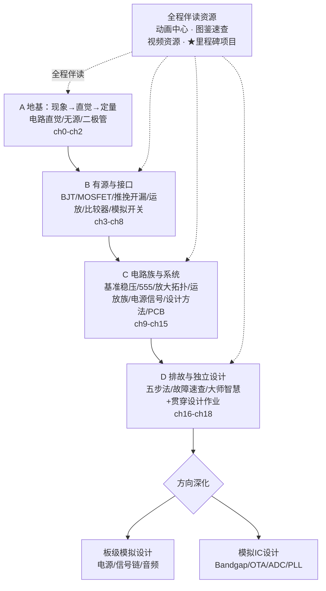

## 学习路线图

全书主线分四段（章号不变，仍为 ch0–18）：**A 地基**（ch0–ch2）→ **B 有源与接口**（ch3–ch8）→ **C 电路族与系统**（ch9–ch15）→ **D 排故与独立设计**（ch16–ch18）。每一段的过关标准写在各章验收清单里：A 段能画回路、估数量级；B 段能算偏置、分清推挽与开漏；C 段能选拓扑、算关键 RC、标出地回流；D 段能按五步收敛故障、交出五块齐全的设计说明。走到头再按方向深化分流：板级模拟设计或模拟 IC 设计。沿途全程伴读，动画中心、视频资源与图鉴速查随时可查。

