# 36 张待审图签核包 · consolidation-2026-11-10（28 + 内容漂移 8）

**闸事实**（analog-book/book/content.py:201-209）：仅 kind=figure 且 status∉{accepted,published} 阻断书构建；动画另有其闸，不挡构建。

**更新（CI sha 闸后）**：曾捕获 77 张字节与签核不符。**69 张 handraw 经 `label()` 精确变换测试，已按 `preserve_review_for_labels` 依法继承原签核**（metadata_amendments 记录 before/after sha）；剩 **8 张 papercut 真内容漂移**维持 generated（见 [review-queue-77.md](review-queue-77.md)）。当前挡构建图 = **36 = 28 + 8**。
**本包不代签**。签核方式：把 ✅ 已签 2026-11-10 改 ✓ 或回列 accepted id；代理据指示翻转 manifest status 并记录 review。

## 分流结论（代理预审，降低签核成本）

| 组 | 张数 | 性质 | 签核工作量 |
|---|---|---|---|
| A1 文本未变·图形待目审 | 1 | SVG 可见文本集与 7c82b1f 完全一致，但 7.3% 像素变化成因（皮肤/几何/叠放次序/标注归属）不能由文本相等推出 | 新旧预览并置过目 |
| A2 精度化/去 slop 重渲 | 9 | 数值集变化与数字保全审计记录逐项一致（见各条） | 对照审计条过目 |
| A3 图内新增算例 | 1 | ch15-trace-drop 新增 77.71/23.31/9.71 算例，已与散文 p3-02-ch15.md:108/:116 核对一致 | 扫一眼即可 |
| B 新图 | 17 | 7c82b1f 无前置版本 | 全量目审 |
| C 内容漂移 | 8 | papercut 签名版与当前版文本实质不符（69 张 handraw 已依法继承签核） | review-queue-77.md 逐张目审 |

A2 清单：ch13-audio-class-heat, ch13-compliance-ceiling, ch13-crystal-neg-resistance, ch13-current-sense-budget, ch13-sampling-quantization, ch14-pt100-error-budget, ch15-radiated-loop-area, ch16-bandwidth-five, ch16-instrument-trust

## A1 文本未变·图形待目审
### 1. ch16-probe-compensation  ✅ 已签 2026-11-10

当前（合并后场景重出）：

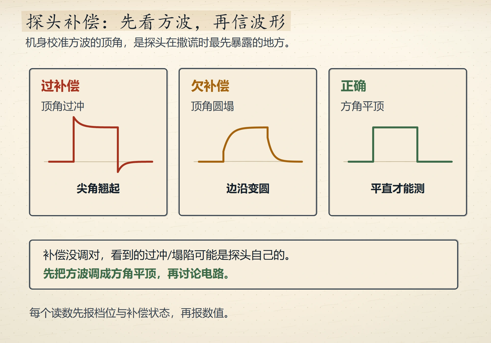

7c82b1f 前置版本：

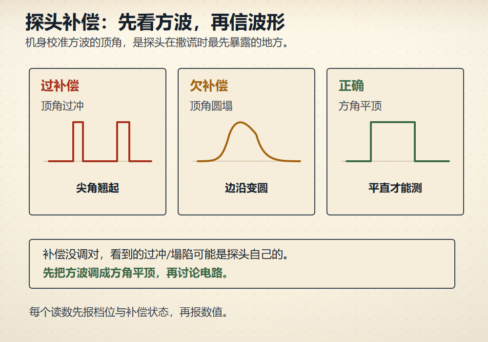

- 章·锚：16·16.6 ｜ 用途：探头补偿三种方波
- alt：手绘三种校准方波：过补偿顶角过冲、欠补偿顶角圆塌、正确方角平顶；提示补偿没调对时，看到的过冲或塌陷可能来自探头而不是电路。
- source_facts：docs/p4-01-ch16.md#16.6
- 像素 diff vs 7c82b1f：7.30% ｜ SVG 可见文本集完全一致；但像素变化成因（皮肤 / 波形路径几何 / 叠放次序 / 标注归属）不能由文本相等推出——请以上下两张并置目审为准。

## A2 精度化/去 slop 重渲（对照数字保全审计）
### 2. ch13-audio-class-heat  ✅ 已签 2026-11-10

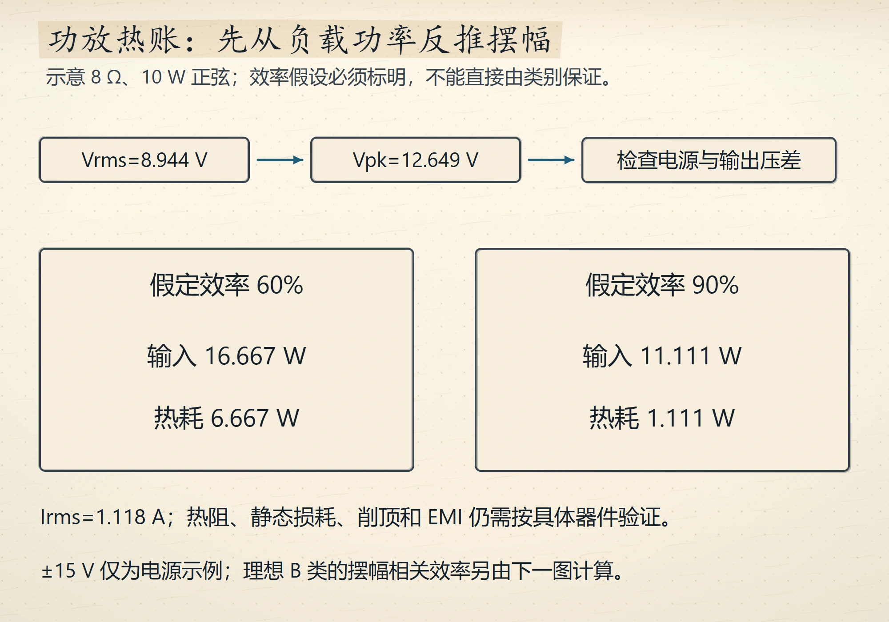

- 章·锚：13·13.9 ｜ 用途：功放摆幅与效率假设
- alt：先算负载电压电流，再在两种明确假定效率下比较热耗，不保证同音质或封装大小。
- source_facts：docs/p2-03-ch13.md#13.9
- 像素 diff vs 7c82b1f：18.78% ｜ 精度化：1.12→1.118、16.7→16.667、6.7→6.667、8.94→8.944；−78.5（改散文 π/4）

### 3. ch13-compliance-ceiling  ✅ 已签 2026-11-10

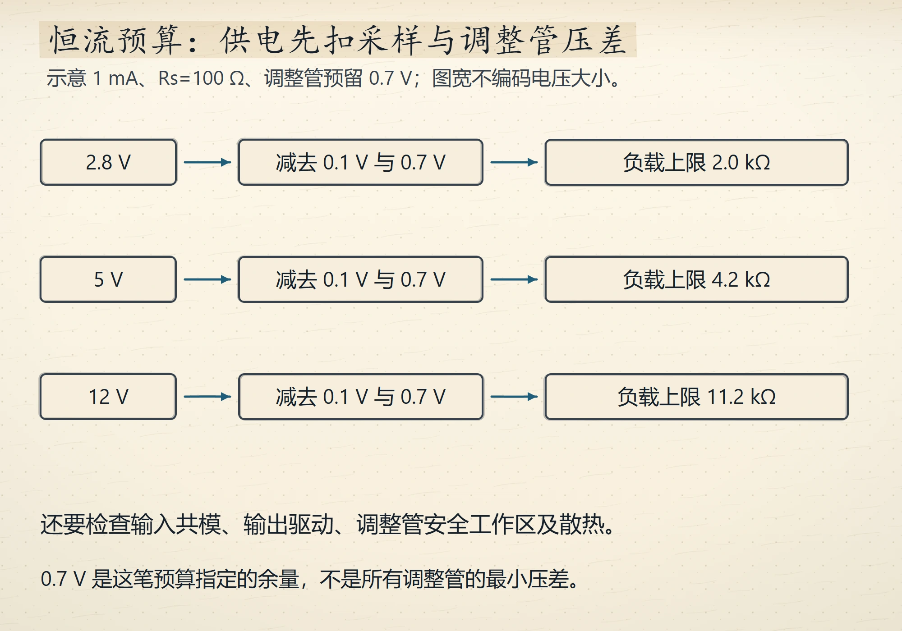

- 章·锚：13·13.5.1 ｜ 用途：恒流源的电压余量
- alt：三种供电扣除采样和指定调整管余量后得到不同的最大负载，不把余量当器件通用压差。
- source_facts：docs/p2-03-ch13.md#13.5.1
- 像素 diff vs 7c82b1f：15.55% ｜ 明细行收缩 19→13 文本（0.1V/0.7V 保留，审计已验）

### 4. ch13-crystal-neg-resistance  ✅ 已签 2026-11-10

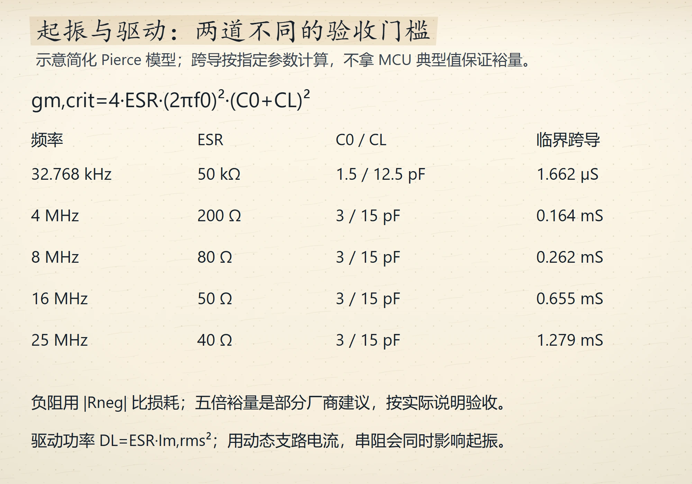

- 章·锚：13·13.10c ｜ 用途：起振跨导与驱动功率
- alt：五组指定模型参数分别算跨导，负阻取绝对值，驱动功率使用动态支路电流。
- source_facts：docs/p2-03-ch13.md#13.10c
- 像素 diff vs 7c82b1f：20.01% ｜ 表格扩充 22→29 文本（13.10c 五行表入图），审计已验

### 5. ch13-current-sense-budget  ✅ 已签 2026-11-10

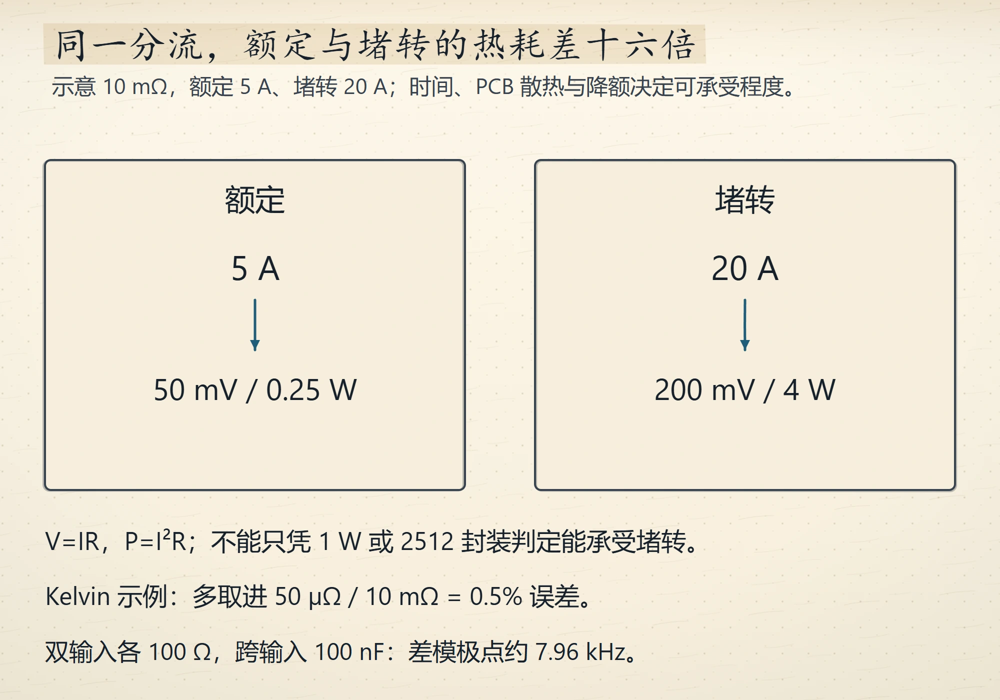

- 章·锚：13·13.8a ｜ 用途：分流功耗与 Kelvin 误差
- alt：额定与堵转电流四倍、热耗十六倍，封装额定不能替代瞬态热预算，并核差分滤波的两只串阻。
- source_facts：docs/p2-03-ch13.md#13.8a
- 像素 diff vs 7c82b1f：14.99% ｜ 去 slop：−3.8/7.6/70/96（LM358 断言撤出，审计项 #3）；+7.96/100

### 6. ch13-sampling-quantization  ✅ 已签 2026-11-10

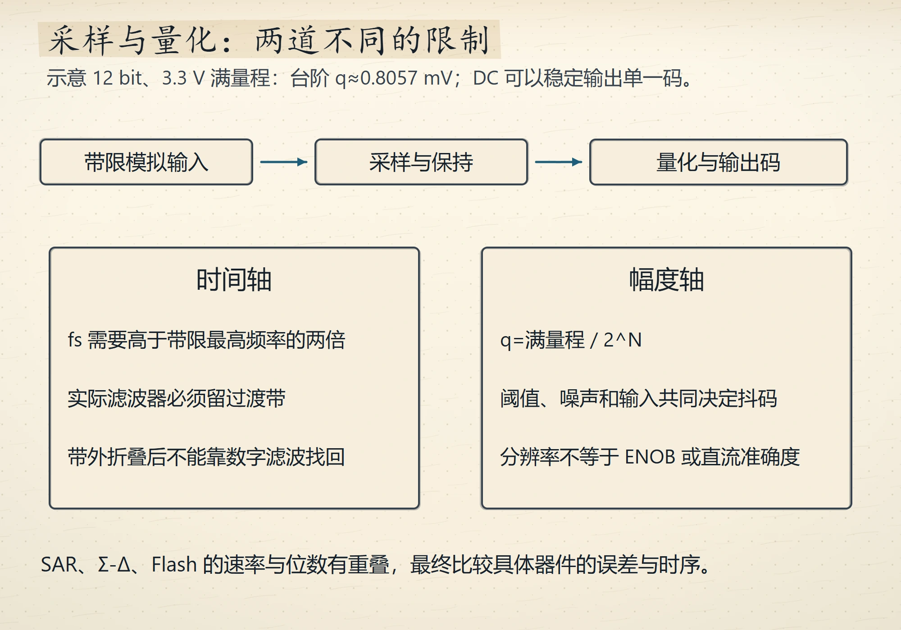

- 章·锚：13·13.6 ｜ 用途：采样与量化分别预算
- alt：流程把时间采样和幅度量化分开，指出恒定输入可以输出固定码，位数不保证直流或动态精度。
- source_facts：docs/p2-03-ch13.md#13.6
- 像素 diff vs 7c82b1f：21.65% ｜ 去 slop：位深例（10/16/18/24/50/500/8）撤出；0.8→0.8057 精确化

### 7. ch14-pt100-error-budget  ✅ 已签 2026-11-10

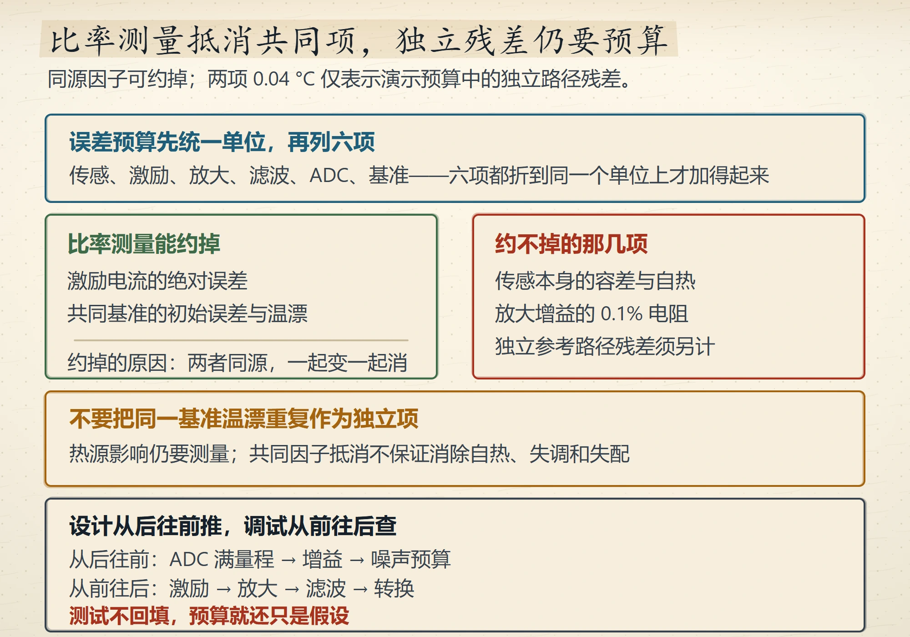

- 章·锚：14·14.12 ｜ 用途：PT100 的误差预算与比率测量
- alt：先统一误差单位：同源参考的初始误差和共同温漂可以约掉，传感自热、放大误差及独立路径残差仍需预算。演示两项0.04摄氏度不得重复代表同一共同基准温漂；设计从ADC量程倒推，测试从激励开始逐级验证。
- source_facts：docs/p3-01-ch14.md#14.12
- 像素 diff vs 7c82b1f：13.57% ｜ 仅 −10，文本 18→18

### 8. ch15-radiated-loop-area  ✅ 已签 2026-11-10

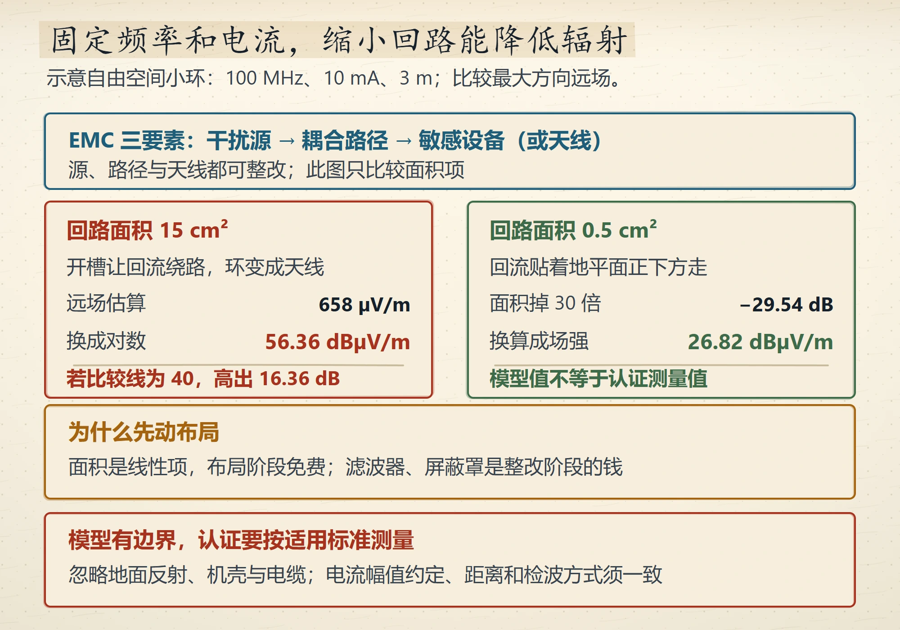

- 章·锚：15·15.6 ｜ 用途：回路面积决定辐射等级
- alt：自由空间小环最大方向远场估算：100MHz、10mA、3m，面积 15 平方厘米时 658 微伏每米、56.36dBµV/m；面积降到 0.5 平方厘米且电流不变时约 21.93 微伏每米、26.82dBµV/m，下降 29.54dB。40dBµV/m 只是比较线，不是所有标准的限值。忽略地面、机壳与电缆，模型不能代替认证。
- source_facts：docs/p3-02-ch15.md#15.6
- 像素 diff vs 7c82b1f：13.75% ｜ 精度化：29.5→29.54、56→56.36、660→658；审计已验 56.36dBµV/m

### 9. ch16-bandwidth-five  ✅ 已签 2026-11-10

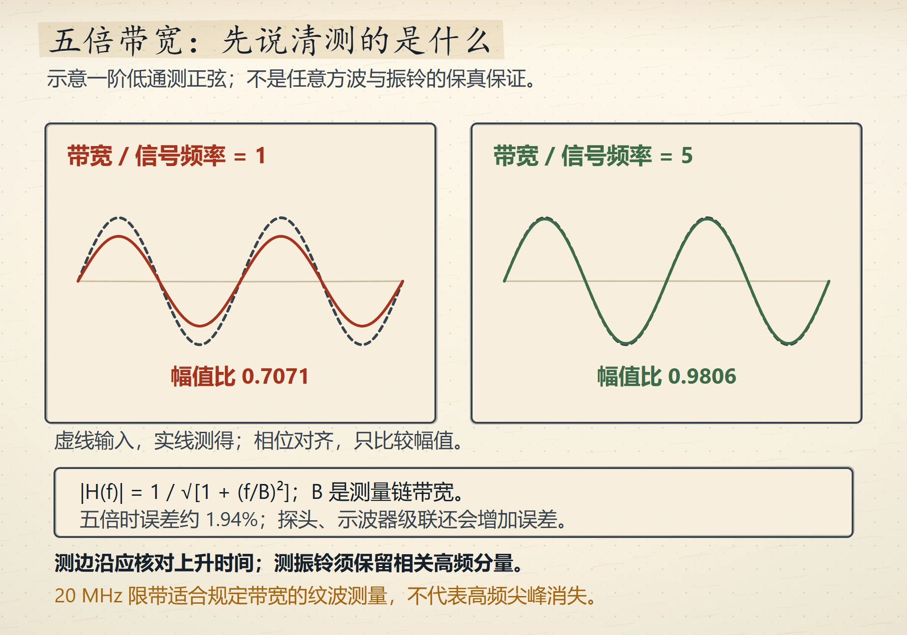

- 章·锚：16·16.6 ｜ 用途：示波器带宽五倍规则
- alt：一阶低通正弦幅值比较：测量链带宽与信号频率之比为 1 时幅值比 0.7071，为 5 时幅值比 0.9806，误差约 1.94%。虚线输入、实线测得，已对齐相位仅比较幅值；20 MHz 限带不代表高频尖峰消失。
- source_facts：docs/p4-01-ch16.md#16.6
- 像素 diff vs 7c82b1f：15.87% ｜ +0.7071/0.9806/1.94（−3dB/带宽积精确值，散文 p4-01-ch16 命中 2 处），−10

### 10. ch16-instrument-trust  ✅ 已签 2026-11-10

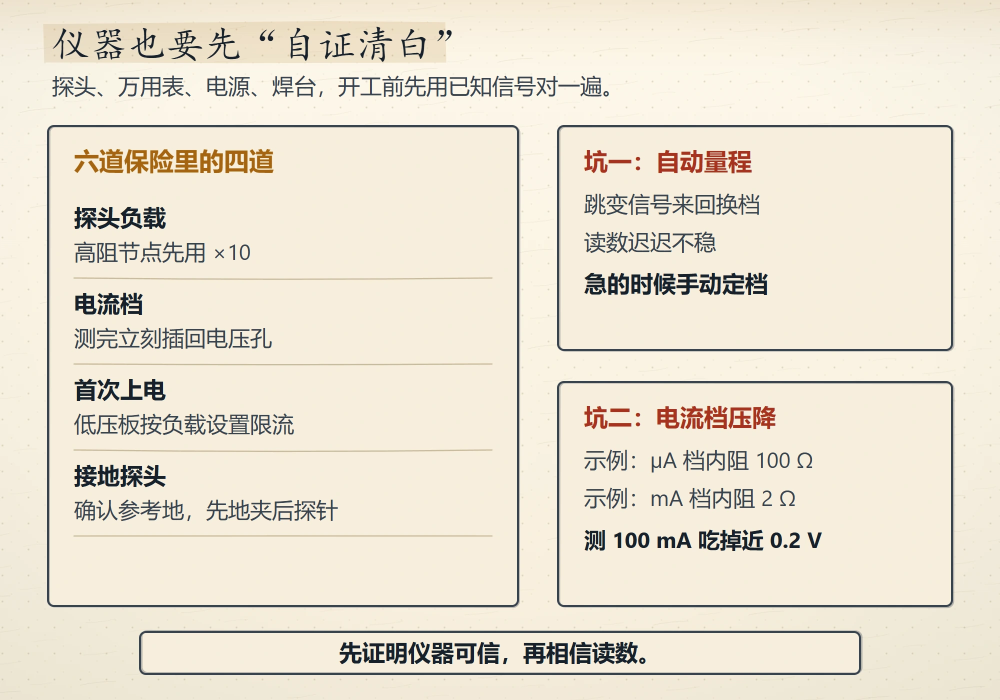

- 章·锚：16·16.3 ｜ 用途：仪器信任链
- alt：仪器检查单：高阻节点先用乘十档、测完电流插回电压孔、低压板按负载设置限流；普通接地探头确认参考地后先地夹后探针。右栏示例内阻为微安档 100 欧姆、毫安档 2 欧姆；100 毫安流过 2 欧姆会产生 0.2 伏压降，实际值查仪表手册。
- source_facts：docs/p4-01-ch16.md#16.3
- 像素 diff vs 7c82b1f：7.87% ｜ 仅 −50（旧刻度值），文本 20→20

## A3 图内新增算例（散文一致性已核）
### 11. ch15-trace-drop  ✅ 已签 2026-11-10

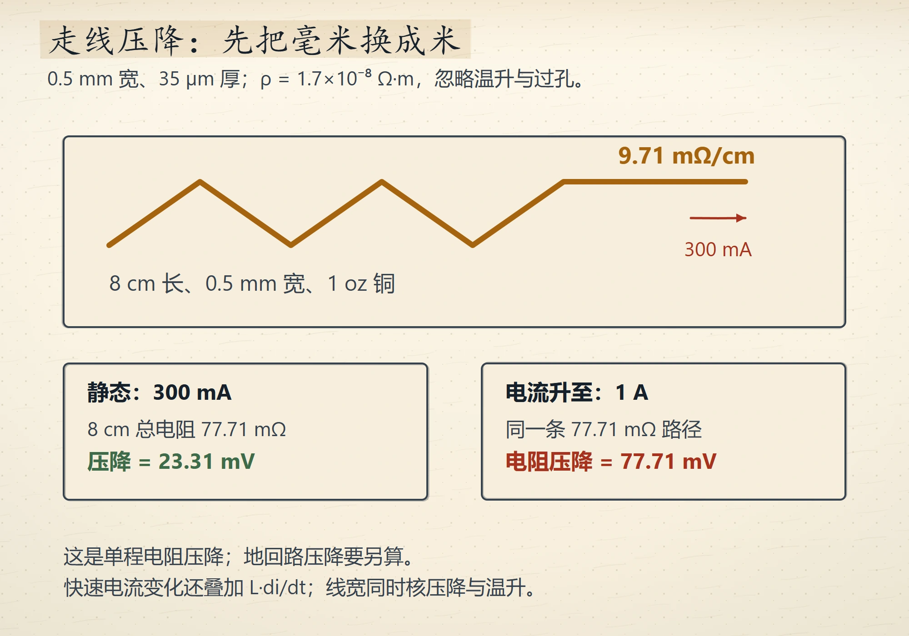

- 章·锚：15·15.1 ｜ 用途：电源走线的压降账
- alt：走线电阻按电阻率乘长度除截面积计算：0.5 毫米宽、35 微米厚、8 厘米长，单程电阻 77.71 毫欧；300 毫安压降 23.31 毫伏、1 安培压降 77.71 毫伏。示例忽略温升、过孔与接触电阻，快速瞬态另加电感压降。
- source_facts：docs/p3-02-ch15.md#15.1
- 像素 diff vs 7c82b1f：9.47% ｜ +77.71/23.31/9.71 ↔ 散文 :108/:116 完全一致

## B 新图（无前置，全量目审）
### 12. ch13-buck-ripple  ✅ 已签 2026-11-10

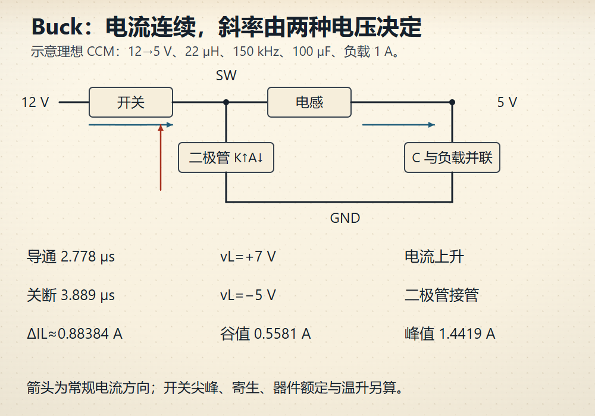

- 章·锚：13·13.2c ｜ 用途：Buck 的连接与电流预算
- alt：导通与续流共享电感，列出同一算例的峰谷电流，说明理想模型之外还须核寄生与热耗。
- source_facts：docs/p2-03-ch13.md#13.2c
- 像素 diff vs 7c82b1f：（无前置） ｜ 新图

### 13. ch13-crystal-load-cap  ✅ 已签 2026-11-10

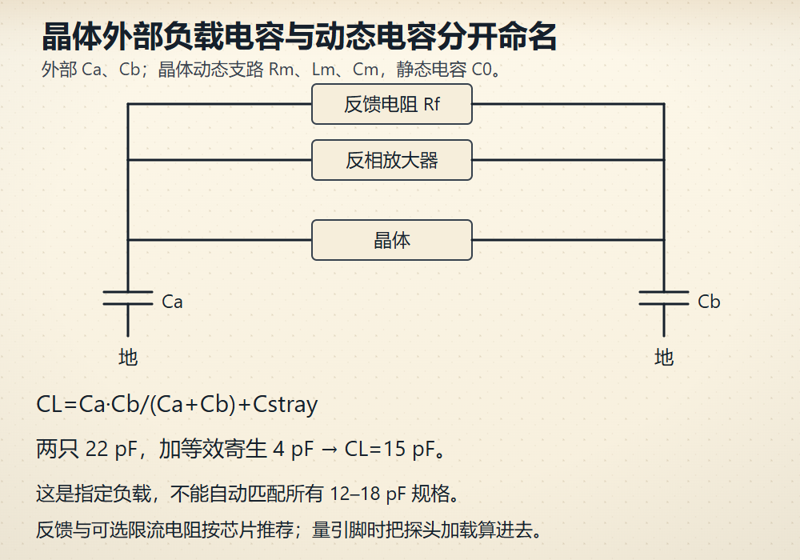

- 章·锚：13·13.10 ｜ 用途：Pierce 连接与负载电容
- alt：外部 Ca、Cb 与动态 Cm 分开命名，两只二十二皮法及四皮法寄生合成十五皮法，须匹配指定晶体。
- source_facts：docs/p2-03-ch13.md#13.10
- 像素 diff vs 7c82b1f：（无前置） ｜ 新图

### 14. ch14-bom-trace-v2  ✅ 已签 2026-11-10

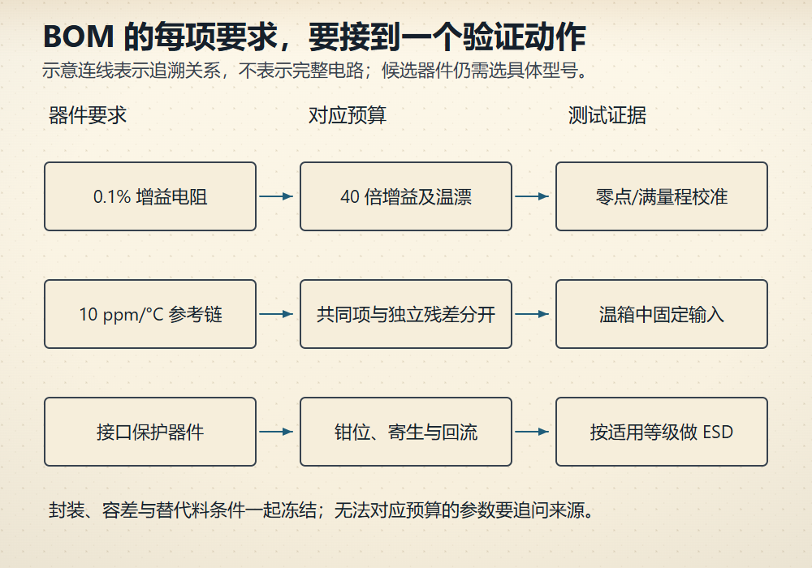

- 章·锚：14·14.12 ｜ 用途：BOM 预算与测试追溯
- alt：三行对应：0.1%增益电阻到40倍增益及校准，10ppm每摄氏度参考链到残差预算及温箱测试，保护器件到钳位回流及板级ESD测试；封装和替代料一起核对。
- source_facts：docs/p3-01-ch14.md#14.12
- 像素 diff vs 7c82b1f：（无前置） ｜ 新图

### 15. ch14-buck-budget-v2  ✅ 已签 2026-11-10

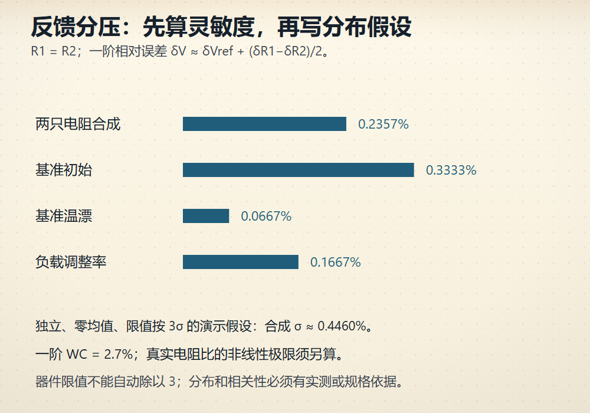

- 章·锚：14·14.8 ｜ 用途：反馈分压误差的统计假设
- alt：电阻比为一时两只电阻相对灵敏度分别正负二分之一；限值按3sigma且独立的演示模型，电阻、参考初始、温漂、负载贡献为0.2357、0.3333、0.0667、0.1667%，总sigma约0.4460%，一阶WC为2.7%。
- source_facts：docs/p3-01-ch14.md#14.8
- 像素 diff vs 7c82b1f：（无前置） ｜ 新图

### 16. ch14-design-evidence-v2  ✅ 已签 2026-11-10

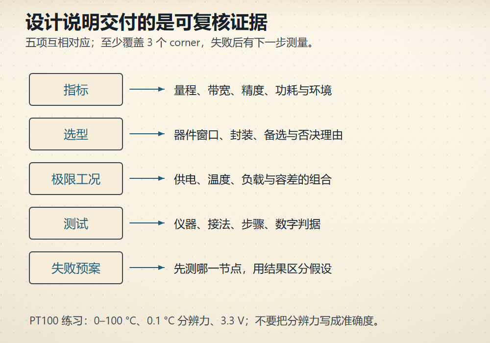

- 章·锚：14·设计说明作业（精通出口） ｜ 用途：设计说明的五项证据
- alt：指标、选型、极限工况、测试、失败预案五项逐行对应验证材料；至少三个corner；PT100练习0到100摄氏度、0.1摄氏度分辨力和3.3伏供电，不把分辨力当准确度。
- source_facts：docs/p3-01-ch14.md#设计说明作业（精通出口）
- 像素 diff vs 7c82b1f：（无前置） ｜ 新图

### 17. ch14-error-budget-v2  ✅ 已签 2026-11-10

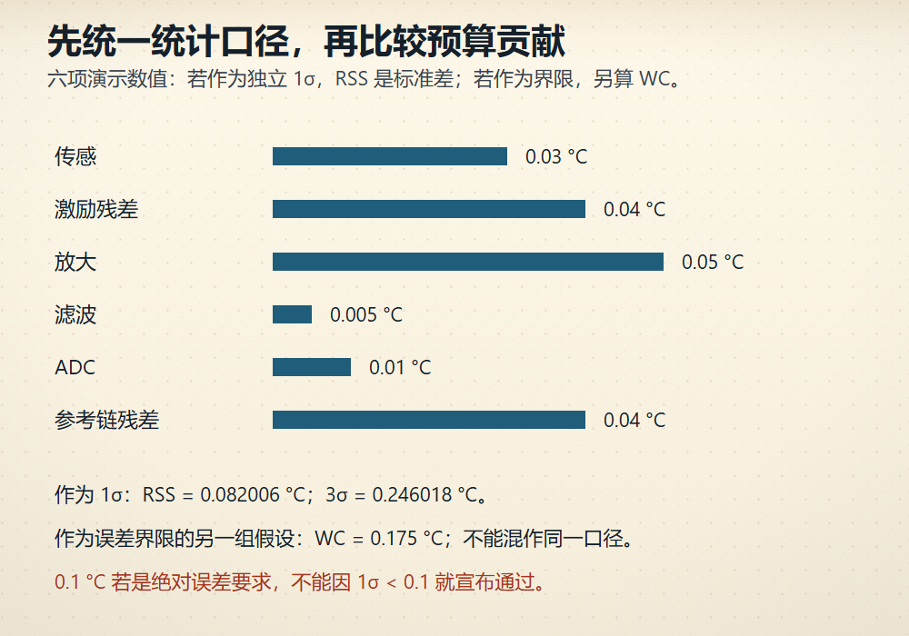

- 章·锚：14·14.9 ｜ 用途：PT100 预算统计口径
- alt：六项0.03、0.04、0.05、0.005、0.01、0.04摄氏度按独立1sigma解释时RSS为0.082006，3sigma为0.246018；若改作误差上限则WC为0.175，不能混用。
- source_facts：docs/p3-01-ch14.md#14.9
- 像素 diff vs 7c82b1f：（无前置） ｜ 新图

### 18. ch14-meas-window-v2  ✅ 已签 2026-11-10

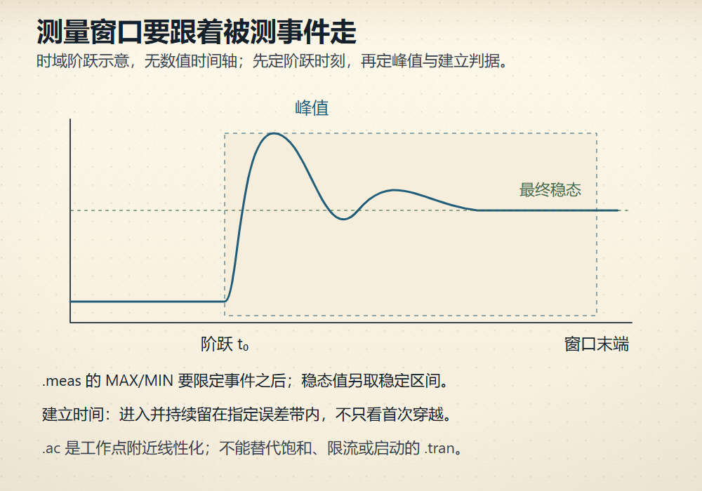

- 章·锚：14·14.6 ｜ 用途：仿真测量的时间窗口
- alt：阶跃时刻后的窗口包含峰值和稳定区域；峰值与稳态测量区间分开，建立时间要求进入并留在容差带，AC线性化不能验证大信号饱和。
- source_facts：docs/p3-01-ch14.md#14.6
- 像素 diff vs 7c82b1f：（无前置） ｜ 新图

### 19. ch14-pt100-zero-v2  ✅ 已签 2026-11-10

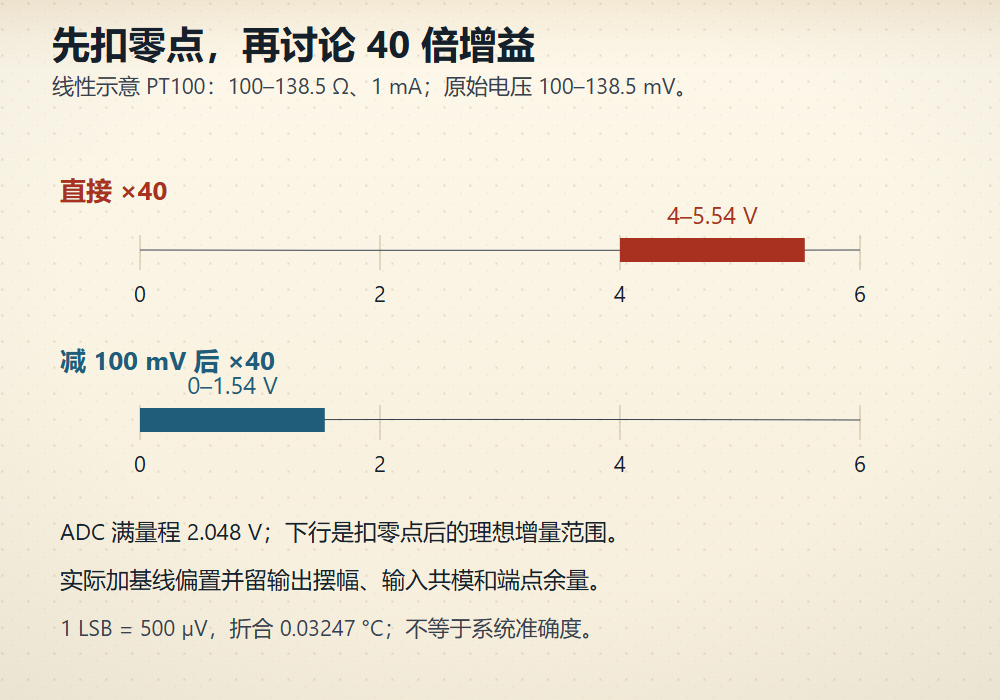

- 章·锚：14·14.4 ｜ 用途：PT100 零点与增量
- alt：1mA 激励下 100至138.5mV 直接乘40得4至5.54V，超出2.048V量程；先扣100mV再放大得0至1.54V理想增量，实际须加基线偏置并核共模与输出余量。
- source_facts：docs/p3-01-ch14.md#14.4
- 像素 diff vs 7c82b1f：（无前置） ｜ 新图

### 20. ch14-ratio-cancel-v2  ✅ 已签 2026-11-10

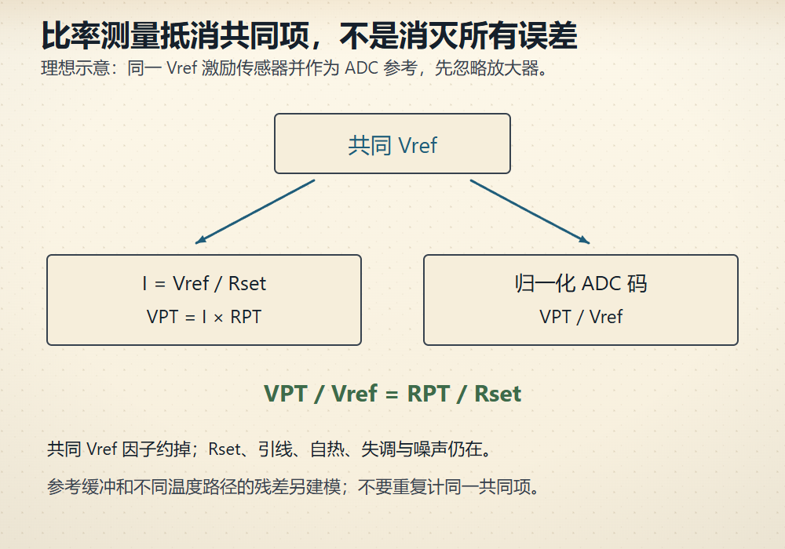

- 章·锚：14·14.9 ｜ 用途：比率测量抵消共同因子
- alt：共同参考电压用于激励和ADC参考，理想归一化码等于RPT除以Rset；共同电压因子约掉，设定电阻、引线、自热、失调及独立噪声仍须预算。
- source_facts：docs/p3-01-ch14.md#14.9
- 像素 diff vs 7c82b1f：（无前置） ｜ 新图

### 21. ch14-uniform-sum-v2  ✅ 已签 2026-11-10

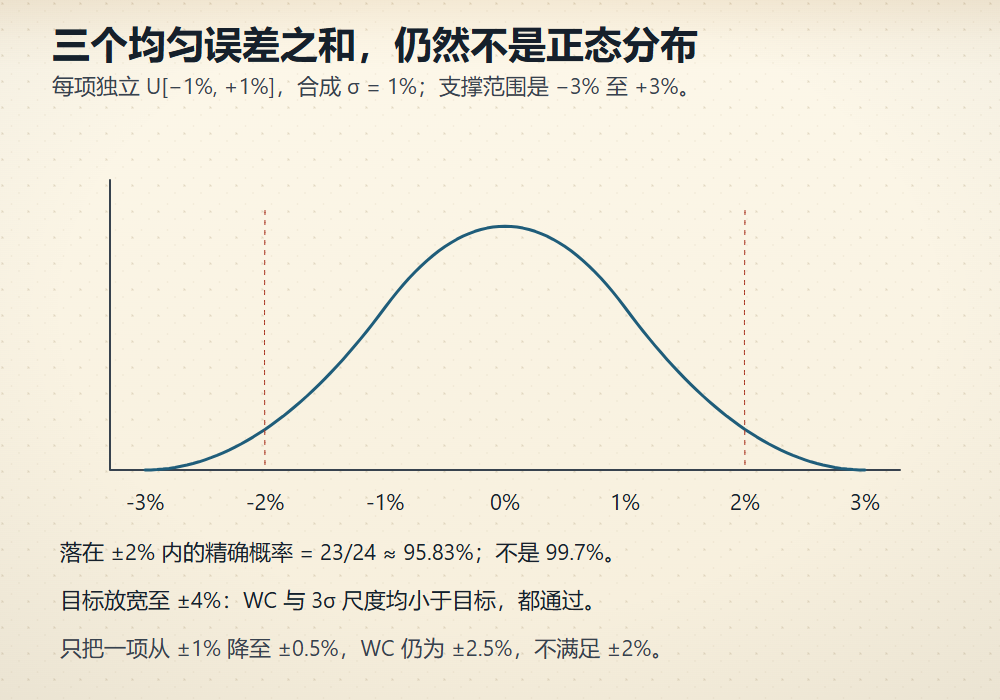

- 章·锚：14·14.10 ｜ 用途：三个均匀误差的覆盖率
- alt：三个独立正负1%均匀误差之和的概率密度，范围正负3%，sigma为1%；正负2%内概率23/24约95.83%，正负4%目标下WC和3sigma都通过。
- source_facts：docs/p3-01-ch14.md#14.10
- 像素 diff vs 7c82b1f：（无前置） ｜ 新图

### 22. ch15-decap-resonance-v2  ✅ 已签 2026-11-10

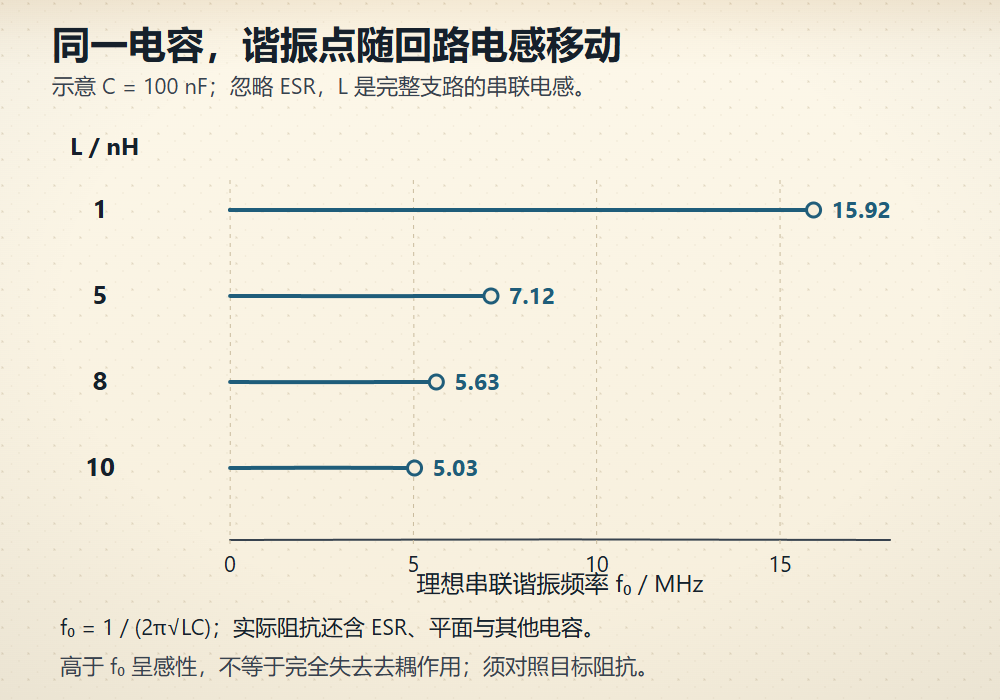

- 章·锚：15·15.1 ｜ 用途：去耦支路的谐振频率
- alt：同一 100nF 电容，串联电感 1、5、8、10nH 的理想谐振频率分别约 15.92、7.12、5.63、5.03MHz；轴从零起，实际去耦还需比较 ESR 与目标阻抗。
- source_facts：docs/p3-02-ch15.md#15.1
- 像素 diff vs 7c82b1f：（无前置） ｜ 新图

### 23. ch15-esd-path-v2  ✅ 已签 2026-11-10

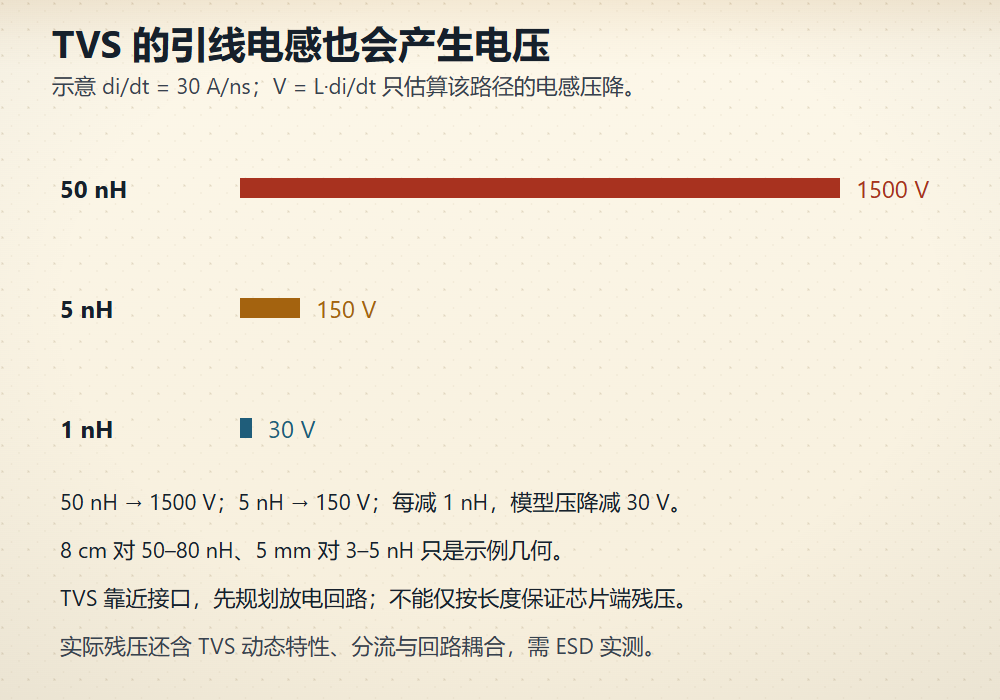

- 章·锚：15·15.6 ｜ 用途：放电路径的电感压降
- alt：固定电流变化率 30A/ns，串联电感 50、5、1nH 对应 1500、150、30V 压降；柱长按电感比例。此模型不等于芯片残压或通过认证的保证。
- source_facts：docs/p3-02-ch15.md#15.6
- 像素 diff vs 7c82b1f：（无前置） ｜ 新图

### 24. ch15-filter-modes-v2  ✅ 已签 2026-11-10

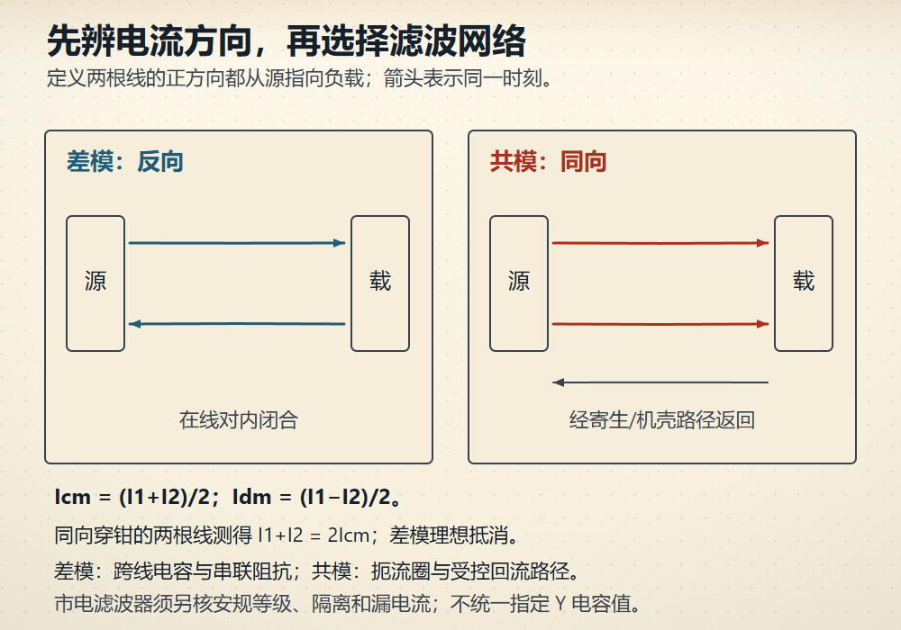

- 章·锚：15·15.6 ｜ 用途：共模与差模的电流路径
- alt：左图差模两线电流反向，右图共模同向经寄生或机壳路径返回。两线同向穿过电流钳测到代数和等于两倍共模分量；不同模态使用不同滤波和回流设计。
- source_facts：docs/p3-02-ch15.md#15.6
- 像素 diff vs 7c82b1f：（无前置） ｜ 新图

### 25. ch15-impedance-geometry-v2  ✅ 已签 2026-11-10

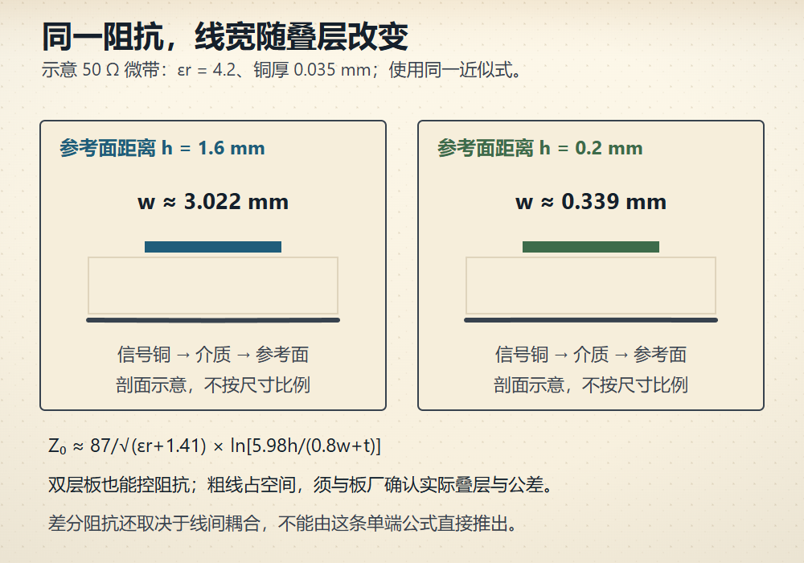

- 章·锚：15·15.3 ｜ 用途：微带线宽与叠层
- alt：同一 50 欧姆微带近似式，介电常数 4.2、铜厚 0.035mm；参考面距离 1.6mm 与 0.2mm 时线宽约 3.022mm 与 0.339mm。剖面不按比例；双层板可控阻抗，差分阻抗需另算耦合。
- source_facts：docs/p3-02-ch15.md#15.3
- 像素 diff vs 7c82b1f：（无前置） ｜ 新图

### 26. ch15-input-filter-v2  ✅ 已签 2026-11-10

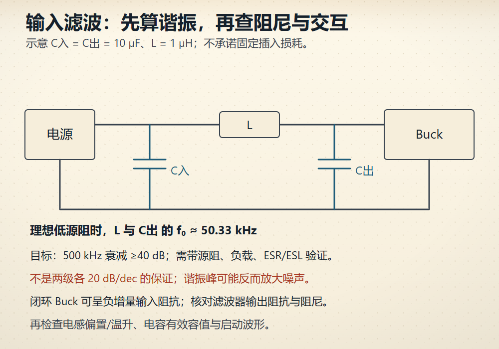

- 章·锚：15·15.6 ｜ 用途：Buck 输入滤波的验证边界
- alt：电源经 C-L-C 滤波接 Buck，两只电容各 10µF、电感 1µH；理想低源阻时 L 与输出侧电容谐振约 50.33kHz。500kHz 衰减至少 40dB 是待验证目标，不是 LC 选值的保证。
- source_facts：docs/p3-02-ch15.md#15.6
- 像素 diff vs 7c82b1f：（无前置） ｜ 新图

### 27. ch15-line-flight-v2  ✅ 已签 2026-11-10

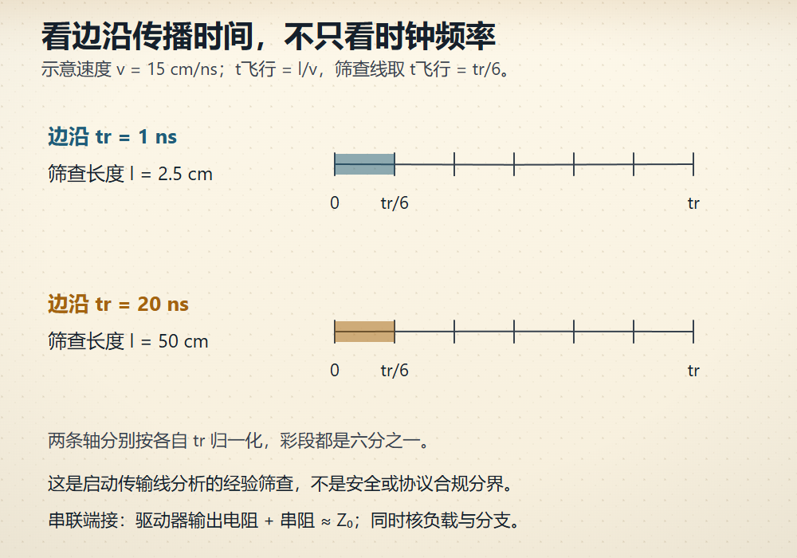

- 章·锚：15·15.3 ｜ 用途：边沿与传播延迟
- alt：传播速度示意 15cm/ns，1ns 与 20ns 边沿的六分之一传播长度分别为 2.5cm、50cm；两条归一时间轴显示同样的六分之一比例，不作为协议合规保证。
- source_facts：docs/p3-02-ch15.md#15.3
- 像素 diff vs 7c82b1f：（无前置） ｜ 新图

### 28. ch15-return-area-v2  ✅ 已签 2026-11-10

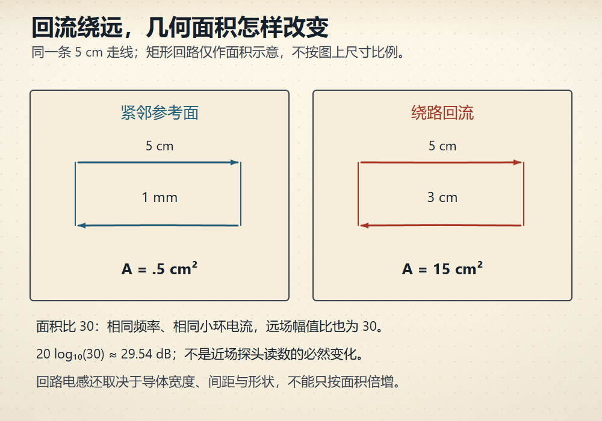

- 章·锚：15·15.7 ｜ 用途：回流面积与小环远场
- alt：同一条 5cm 走线，回程距离示意 1mm 或 3cm，矩形面积为 0.5或15平方厘米。固定频率和电流的小环远场幅值比30，即29.54dB；不据此推算电感或近场探头读数。
- source_facts：docs/p3-02-ch15.md#15.7
- 像素 diff vs 7c82b1f：（无前置） ｜ 新图

## 附注

- 每图另有 print_fallback（*-print.svg 灰度）；本包预览为屏显皮肤，印刷样张在签核后由书构建产物另验。
- manifest 快照：visual-manifest.snapshot.yml。
- 像素 diff 口径：|Δ|>12/255 像素占比；A 组 7.3%–21.6% 均含皮肤重渲成分，故辅以 SVG 文本集对比（更有判别力）。