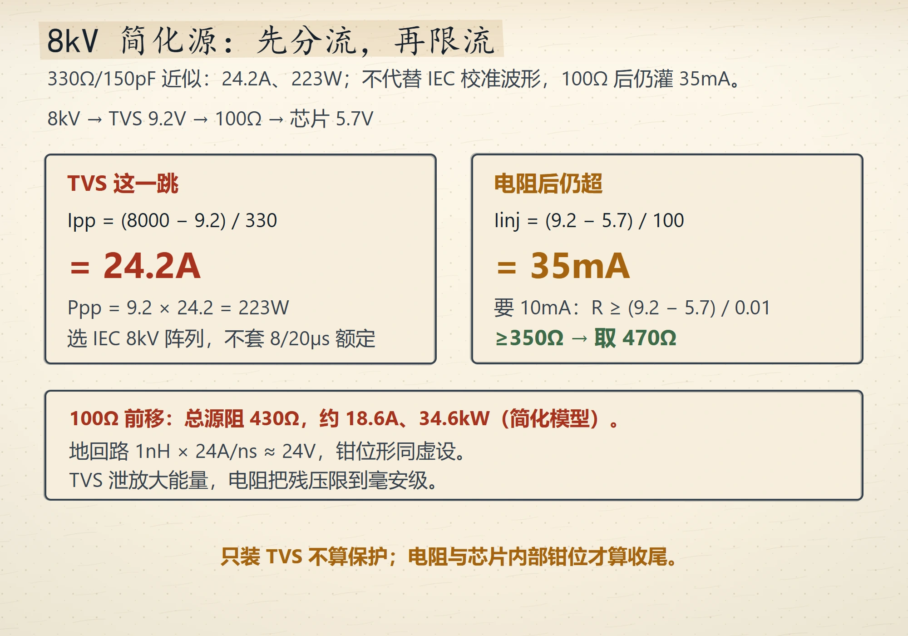
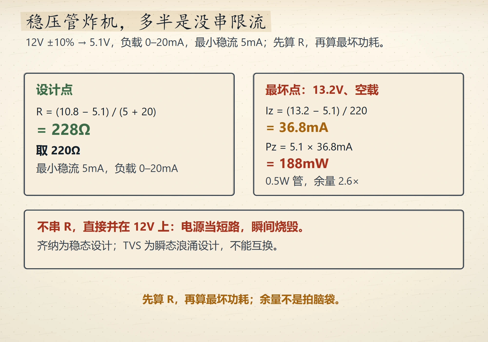
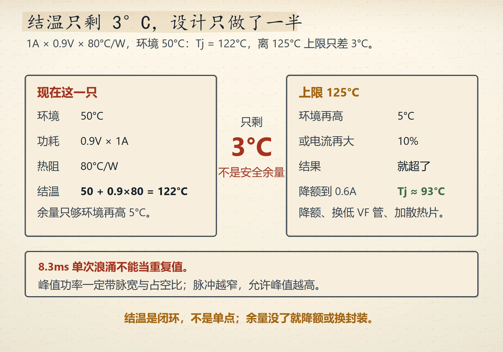
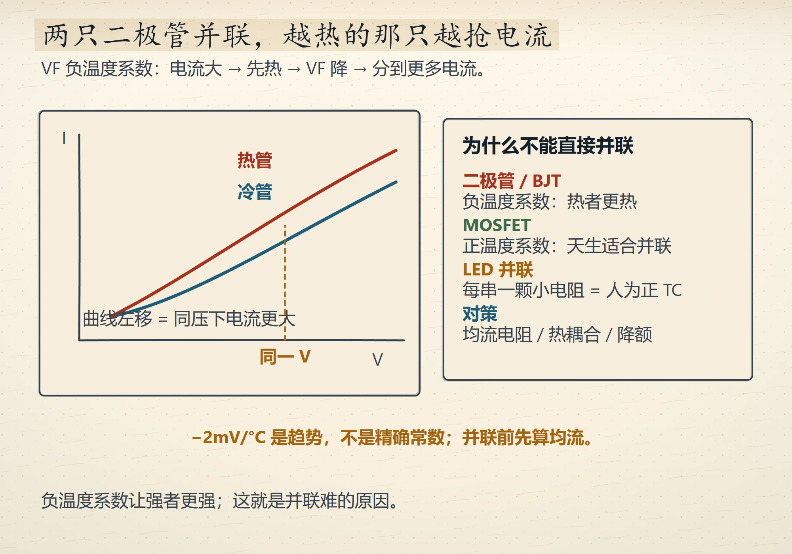
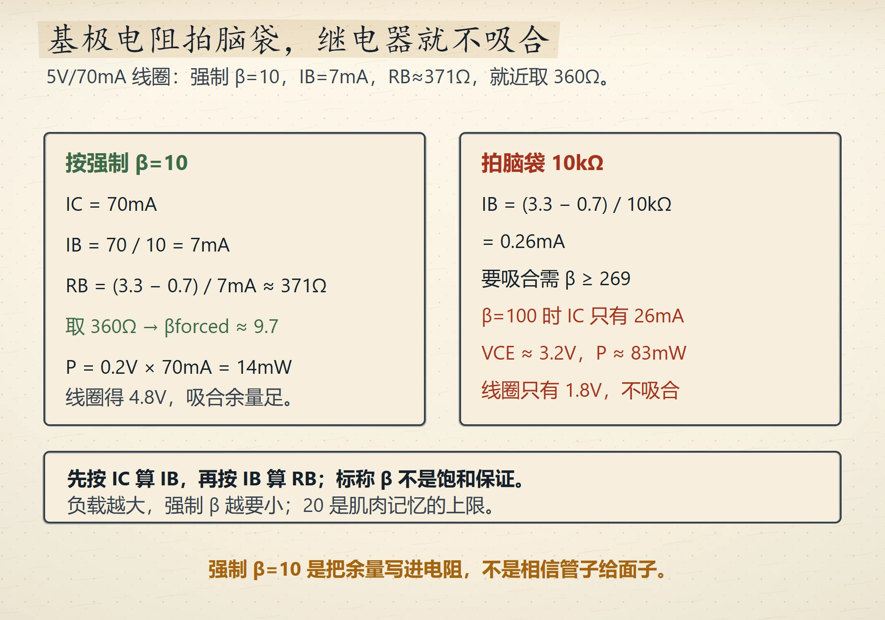
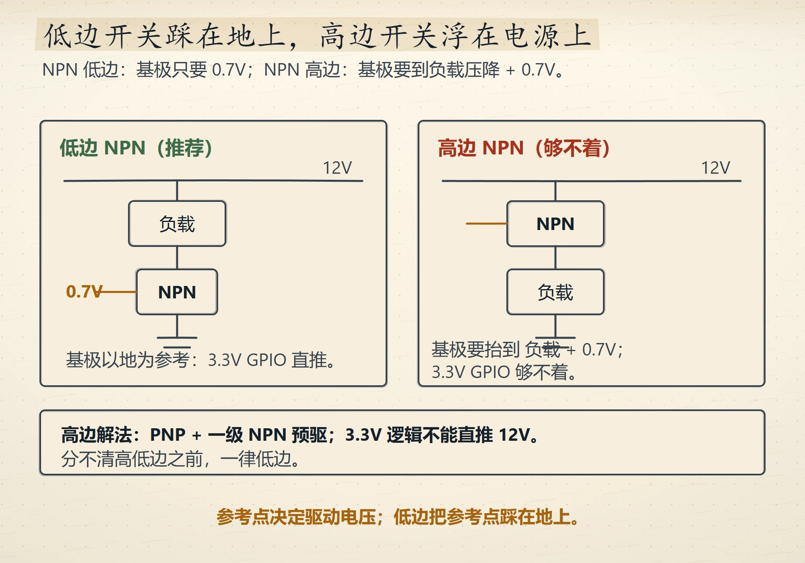
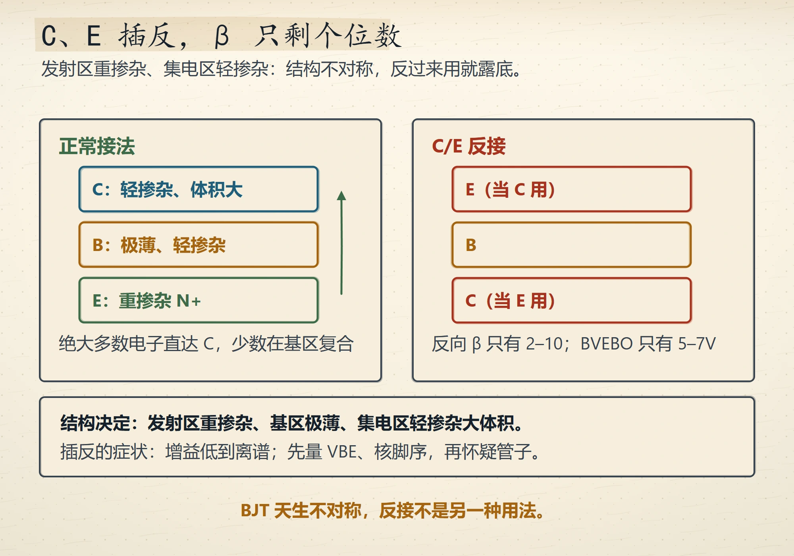
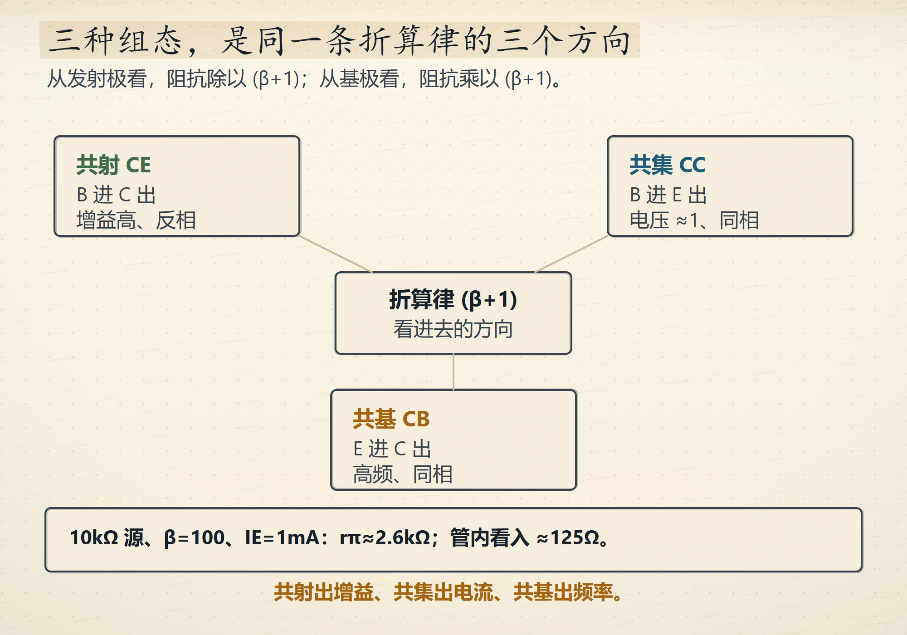
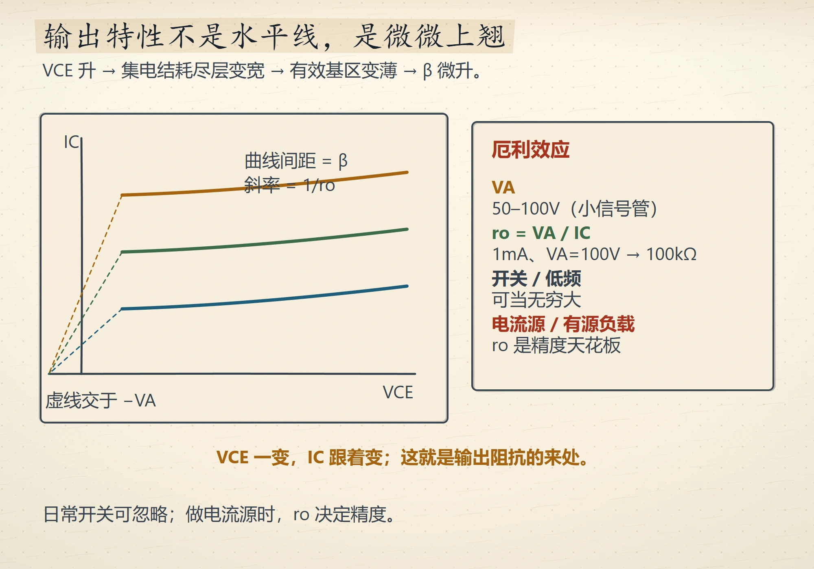

# Wave 10 图库（9 张，待审）

评分入口：[`contact-wave10.html`](contact-wave10.html)（本地打开）。
本页图片路径相对仓库根，GitHub 可直接预览。

## ch2（4 张）

### IEC 8kV 的 24A 分账
`ch02-esd-chain` · V4 · `IG-013`

### 稳压管的限流电阻与最坏功耗
`ch02-zener-budget` · V4 · `IG-013`

### 结温余量只剩 3°C
`ch02-junction-margin` · V4 · `IG-013`

### 并联二极管的热抢流
`ch02-parallel-hog` · V4 · `IG-013`

## ch3（5 张）

### 继电器基极电阻的两笔账
`ch03-switch-budget` · V4 · `IG-013`

### 低边与高边开关的参考点
`ch03-low-high-side` · V4 · `IG-013`

### C/E 反接为什么β只剩个位数
`ch03-reverse-beta` · V4 · `IG-013`

### 三种组态共用一条阻抗折算律
`ch03-config-impedance` · V4 · `IG-013`

### 厄利效应与输出阻抗
`ch03-early-effect` · V4 · `IG-013`

