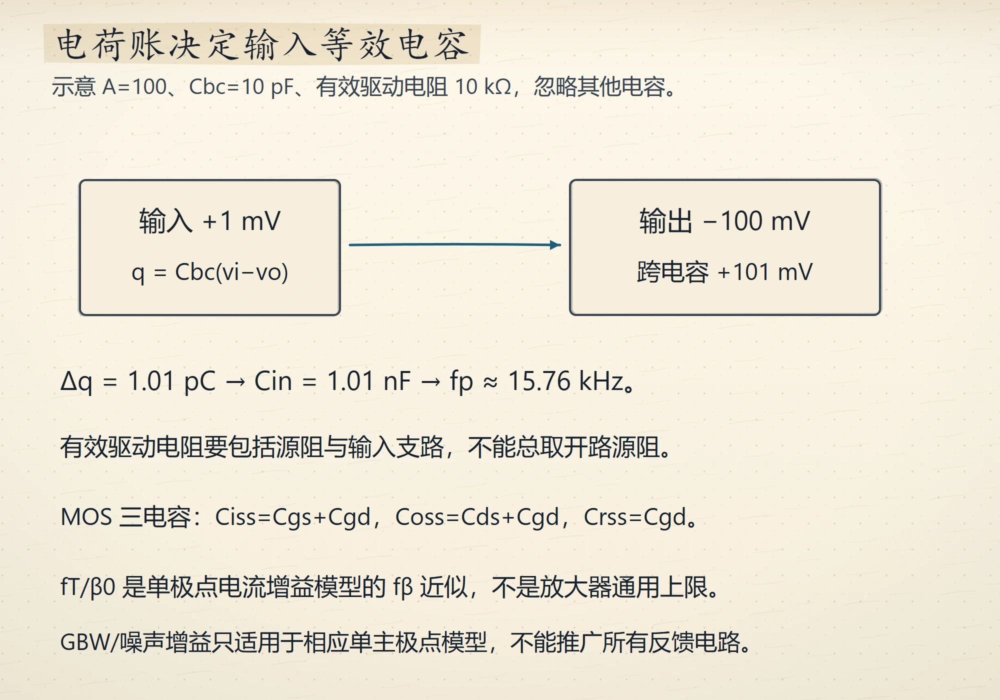
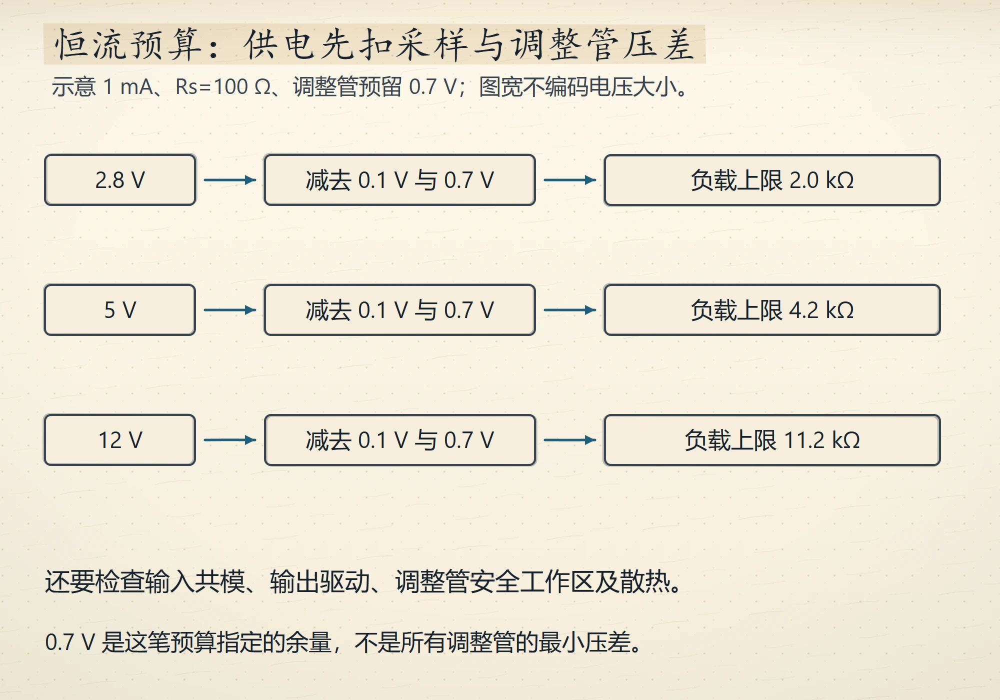
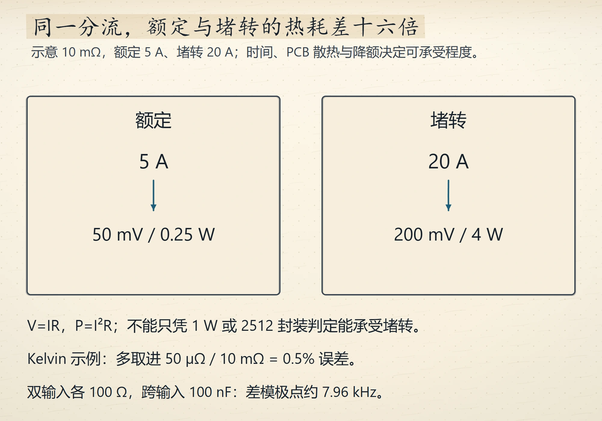

# Wave 11 图库（3 张，待审）

评分入口：[`contact-wave11.html`](contact-wave11.html)（本地打开）。
本页图片路径相对仓库根，GitHub 可直接预览。

## ch11（1 张）

### 米勒电容把带宽压到 15.8kHz
`ch11-miller-bandwidth` · V4 · `IG-013`

## ch13（2 张）

### 恒流源的合规电压天花板
`ch13-compliance-ceiling` · V4 · `IG-013`

### 10mΩ 分流电阻的两笔账
`ch13-current-sense-budget` · V4 · `IG-013`

