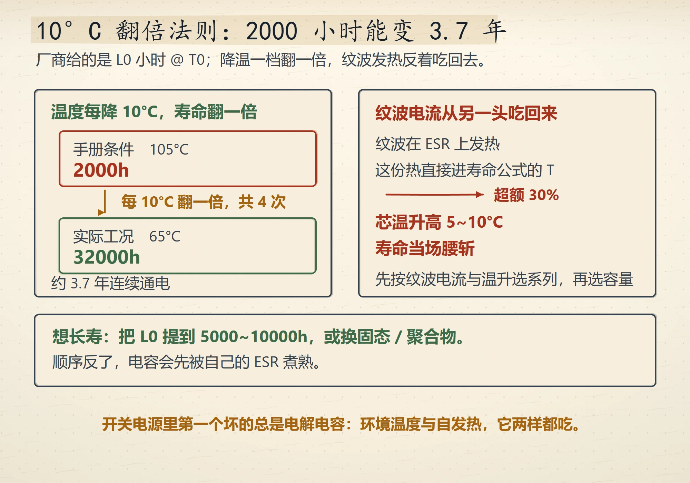
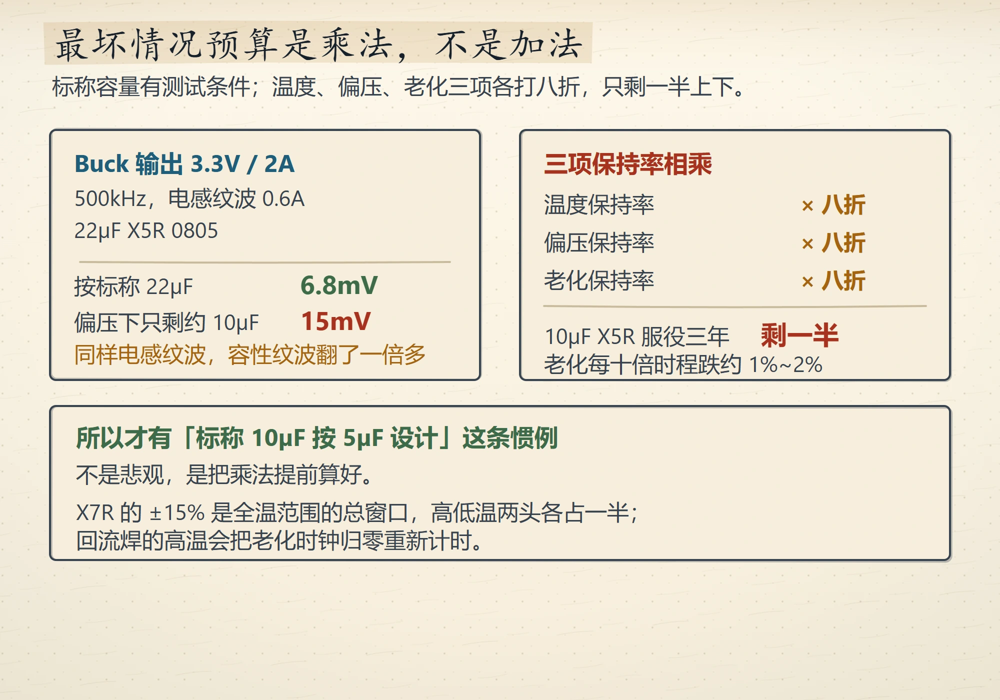
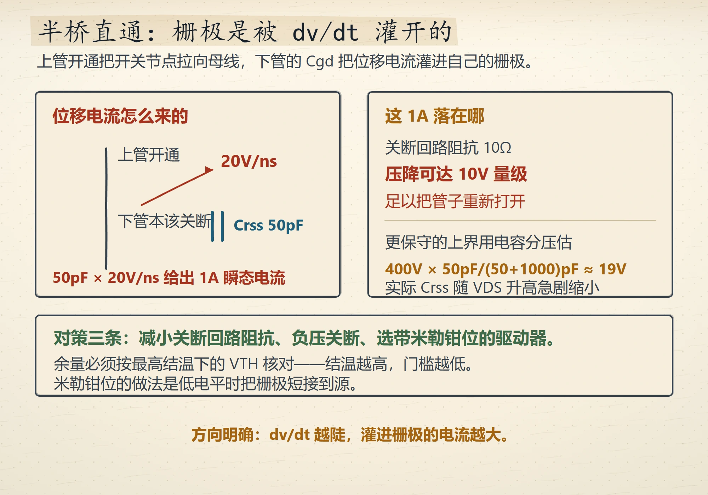
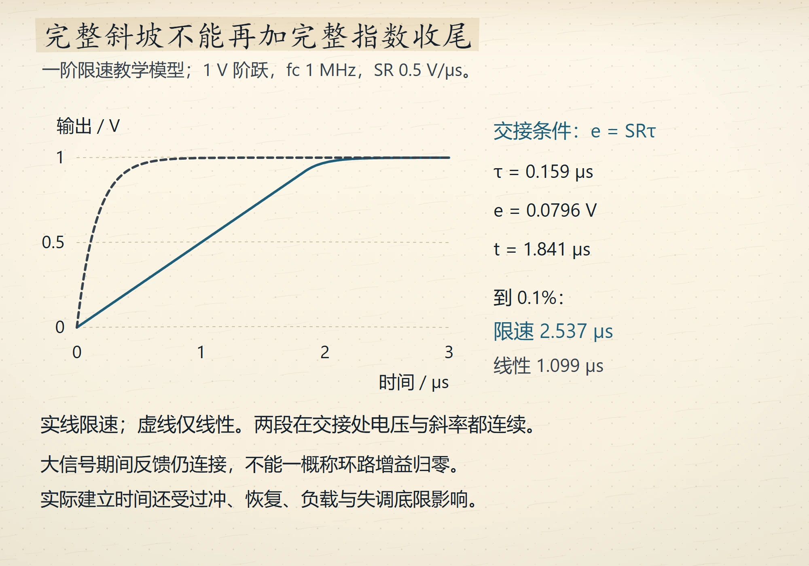
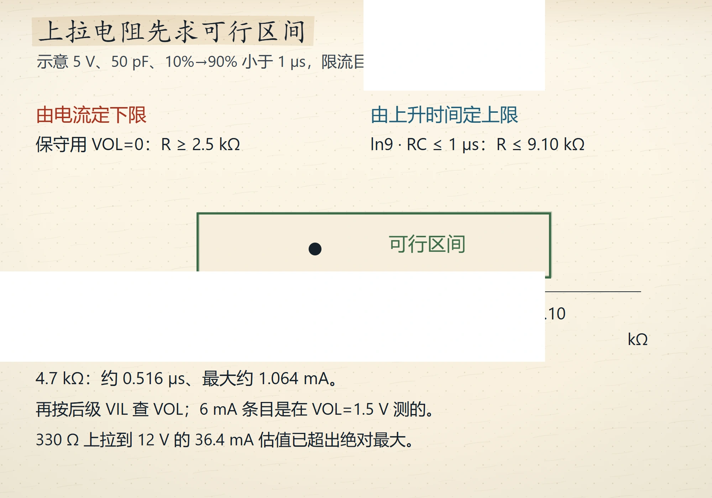
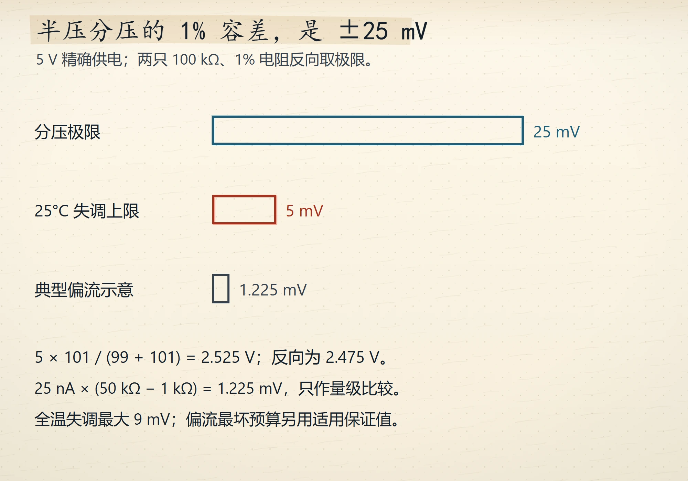

# Wave 12 图库（6 张，待审）

评分入口：[`contact-wave12.html`](contact-wave12.html)（本地打开）。
本页图片路径相对仓库根，GitHub 可直接预览。

## ch01（2 张）

### 10°C 翻倍法则下的电解电容寿命账
`ch01-electrolytic-life` · V4 · `IG-013`

### 降容是乘法：三项八折只剩一半
`ch01-derating-product` · V4 · `IG-013`

## ch04（1 张）

### dv/dt 误导通的定量图像
`ch04-dvdt-false-turnon` · V4 · `IG-013`

## ch06（1 张）

### 压摆率与全功率带宽的两套物理
`ch06-slew-vs-gbw` · V4 · `IG-013`

## ch07（2 张）

### 上拉电阻同时挂在三本账上
`ch07-pullup-three-accounts` · V4 · `IG-013`

### 阈值精度的误差预算排序
`ch07-threshold-budget` · V4 · `IG-013`

