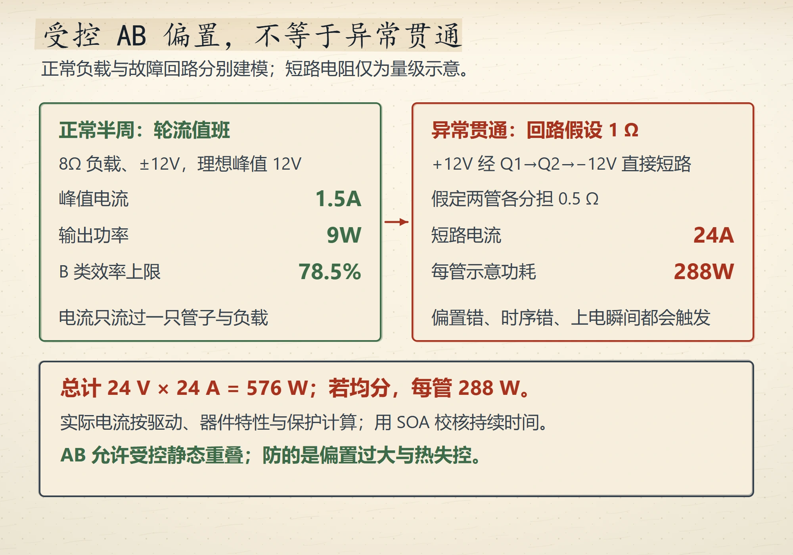
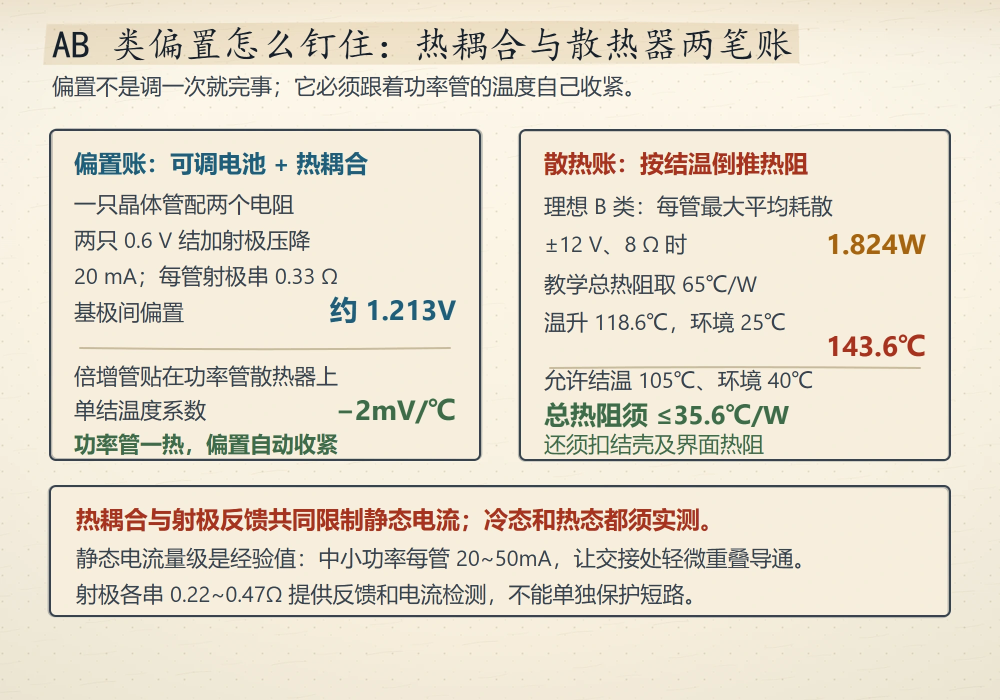
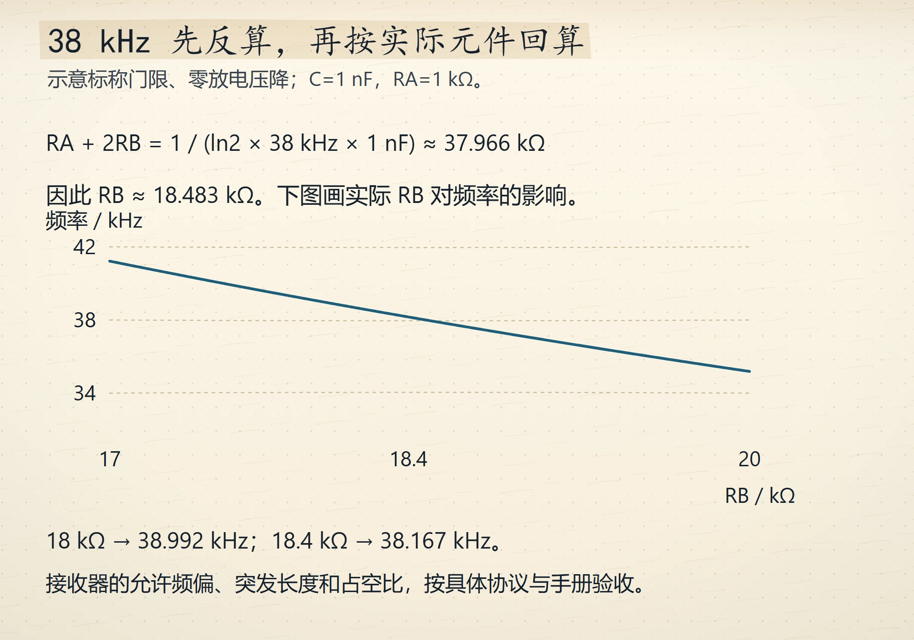
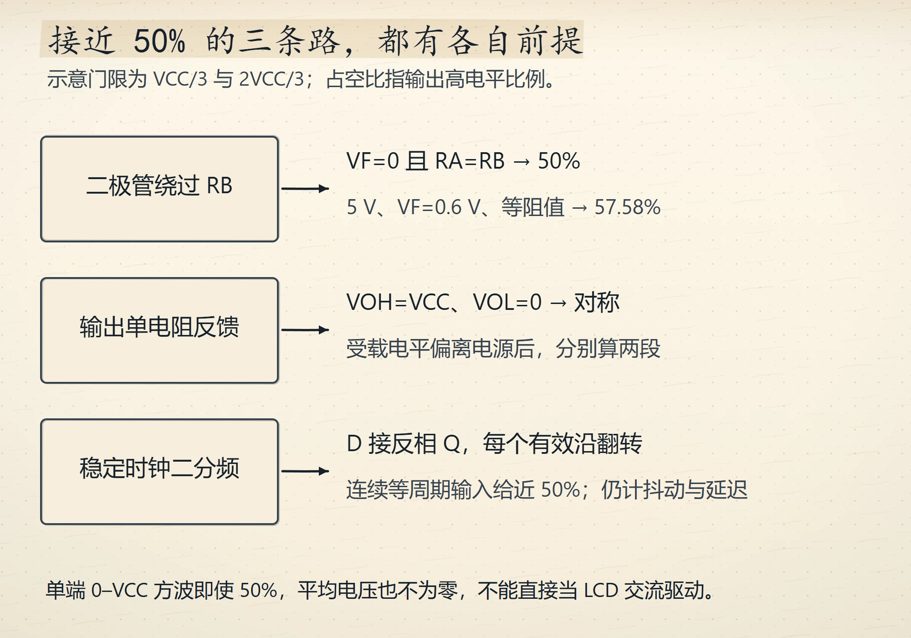
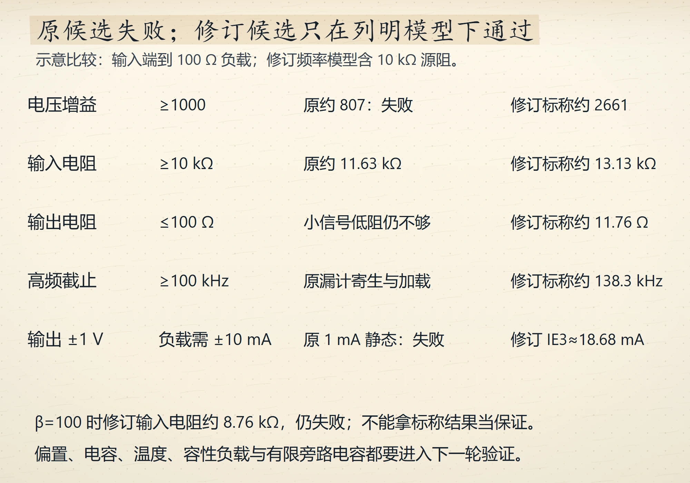
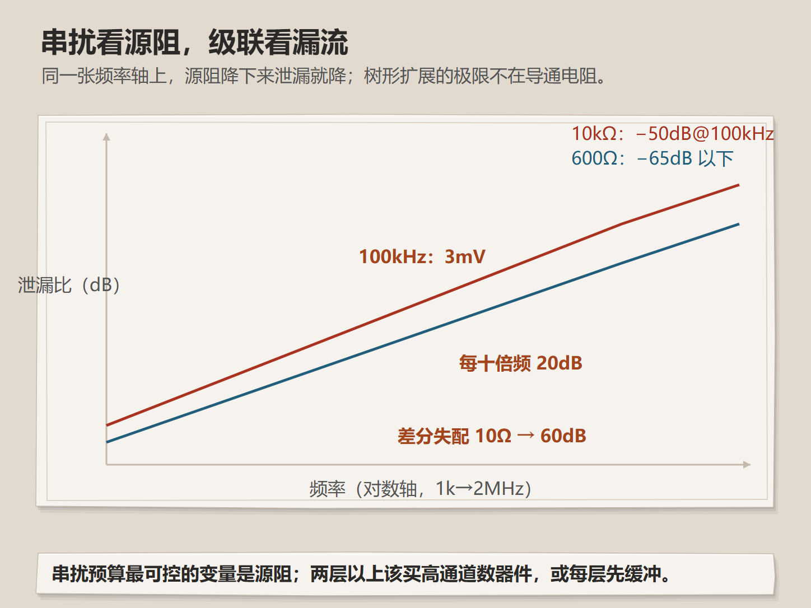
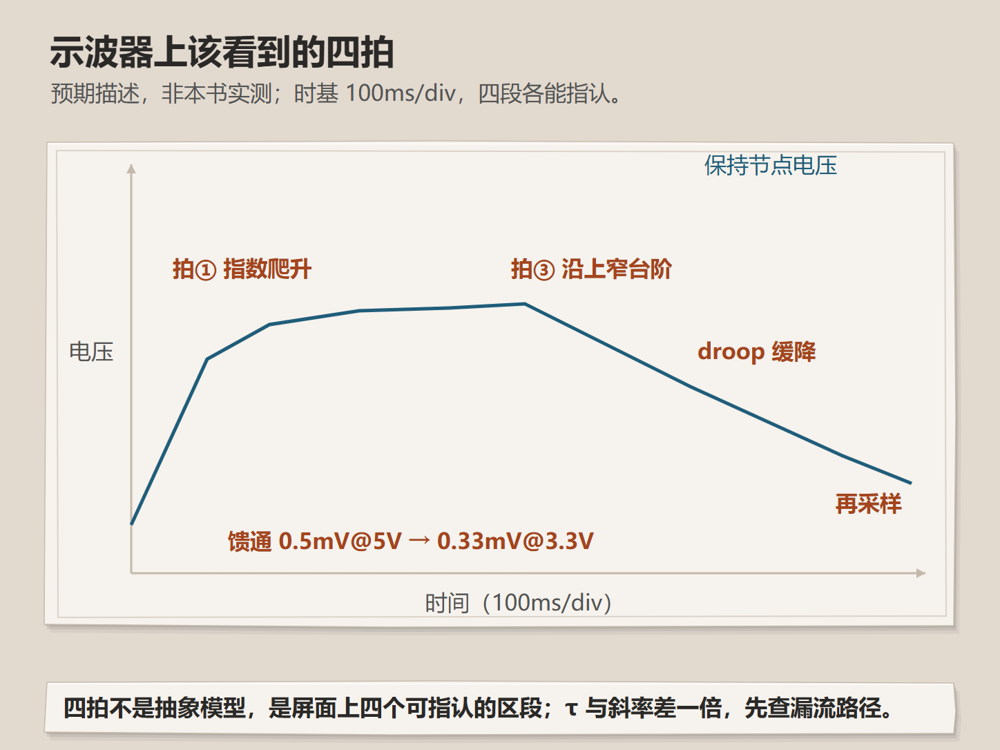
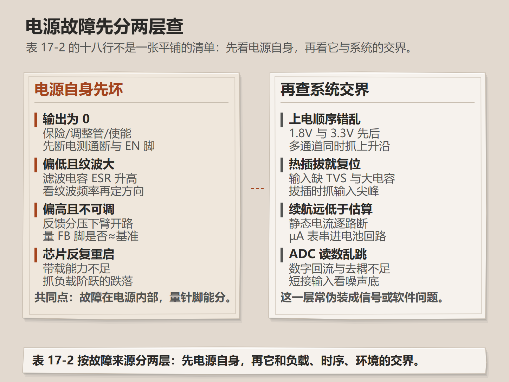

# Wave 13 图库（9 张，待审）

评分入口：[`contact-wave13.html`](contact-wave13.html)（本地打开）。
本页图片路径相对仓库根，GitHub 可直接预览。

前 6 张是本轮新画；后 3 张是既存图修掉真实版面缺陷后重绘，签核已失效，需重新打分。

## 新增 6 张

### 推挽正常半周与直通的电流功率对账
`ch05-shoot-through-ledger` · V4 · `IG-013` · ch5 · anchor 5.6

### AB 类偏置的热耦合与散热器两笔账
`ch05-ab-bias-thermal` · V4 · `IG-013` · ch5 · anchor 5.6

### 7805 四种死法对应的四本账
`ch09-ldo-four-accounts` · V4 · `IG-013` · ch9 · anchor 9.4

### 按 38kHz 目标反推 555 元件值
`ch10-astable-reverse-design` · V4 · `IG-013` · ch10 · anchor 10.4

### 准 50% 占空比的三条路与两个极端
`ch10-duty-fifty-paths` · V4 · `IG-013` · ch10 · anchor 10.4

### 两级放大器四项指标的余量对账
`ch11-two-stage-margin` · V4 · `IG-013` · ch11 · anchor 11.11

## 重绘待重新签核 3 张

### 串扰、差分失配与级联
`ch08-crosstalk-cascade-mismatch` · V3 · `IG-015` · ch8 · anchor 8.2

### 示波器上的四拍预期波形
`ch08-scope-expected-beats` · V1 · `IG-015` · ch8 · anchor 8.6

### 电源故障的两层分诊
`ch17-power-fault-layers` · V2 · `IG-007` · ch17 · anchor 17.1

