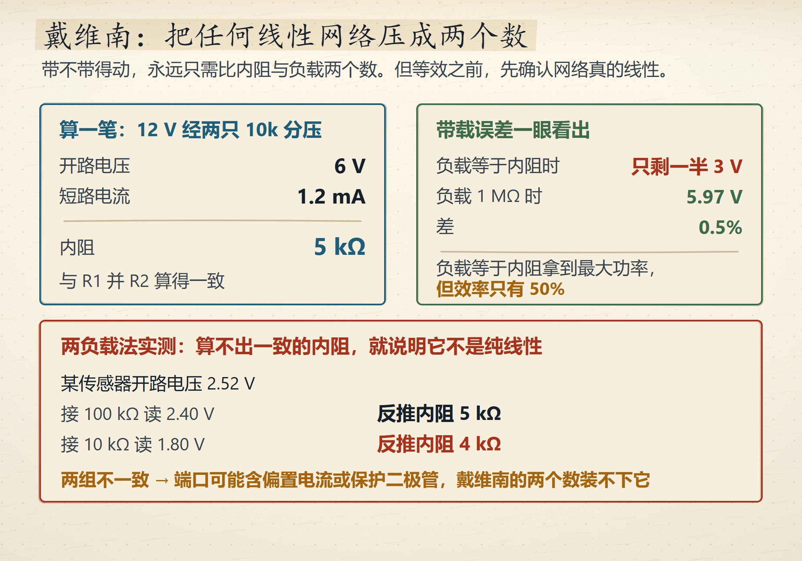
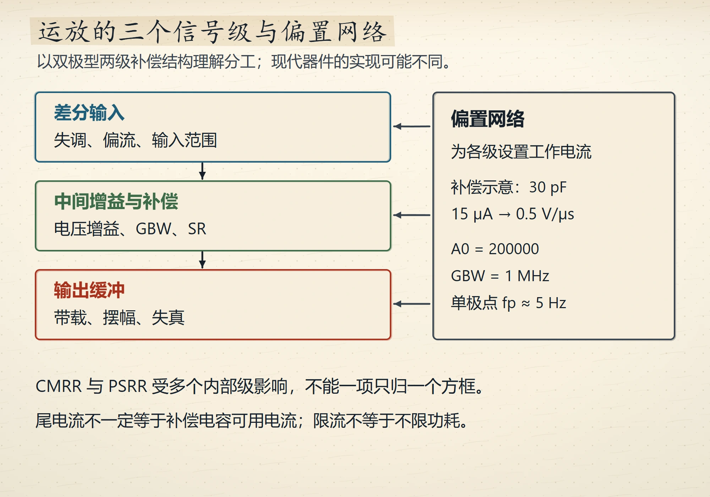
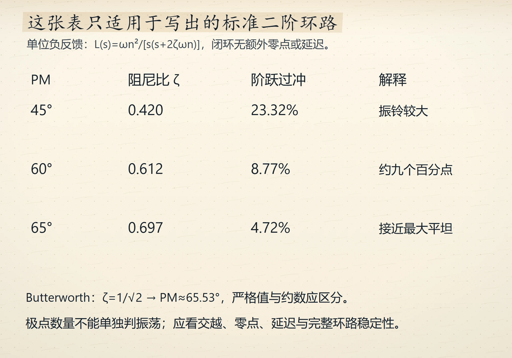
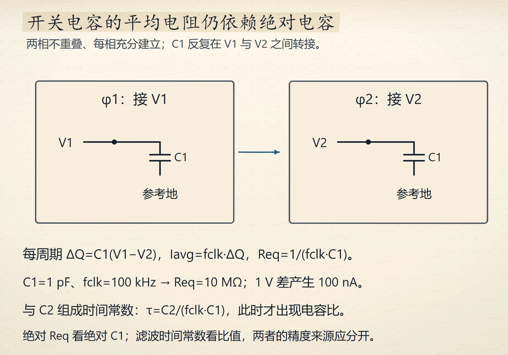
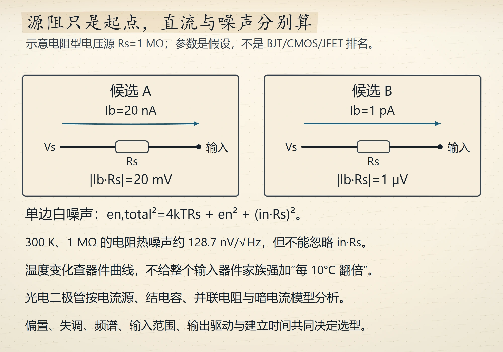

# Wave 14 图库（5 张，待审）

评分入口：[`contact-wave14.html`](contact-wave14.html)（本地打开）。
本页图片路径相对仓库根，GitHub 可直接预览。

本轮补的是「每节图数」最薄的章：ch01、ch06、ch11、ch12。
五张只画「分账」与「分工」，不重复既有图的结构。

### 1. 戴维南等效与两负载法实测内阻
`ch01-thevenin-two-load` · V4 · `IG-013` · ch1 · anchor 1.4

### 2. 741 内部四级的分工与补偿代价
`ch06-741-four-blocks` · V4 · `IG-013` · ch6 · anchor 6.1

### 3. 相位裕度与阻尼比过冲的换算
`ch11-phase-margin-table` · V4 · `IG-013` · ch11 · anchor 11.5

### 4. 开关电容等效电阻的来历与代价
`ch12-switched-cap-equivalent` · V4 · `IG-013` · ch12 · anchor 12.12

### 5. 按源阻抗选运放输入级
`ch12-input-stage-source-z` · V4 · `IG-013` · ch12 · anchor 12.13

