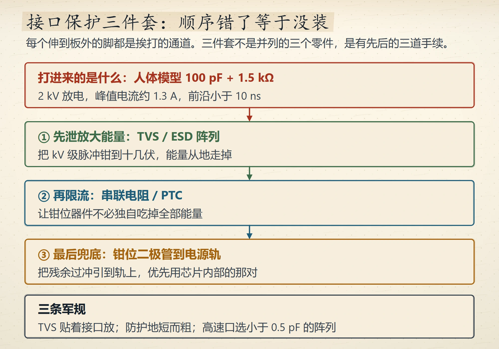
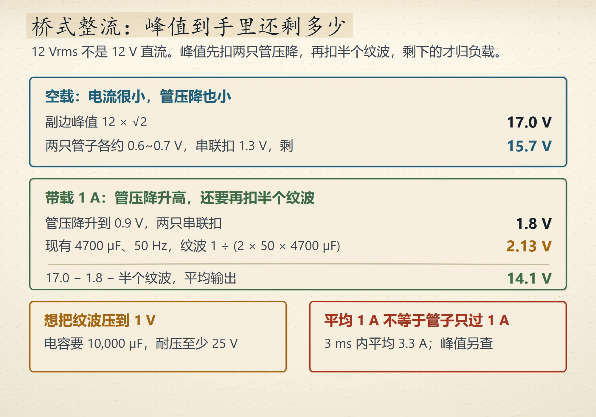
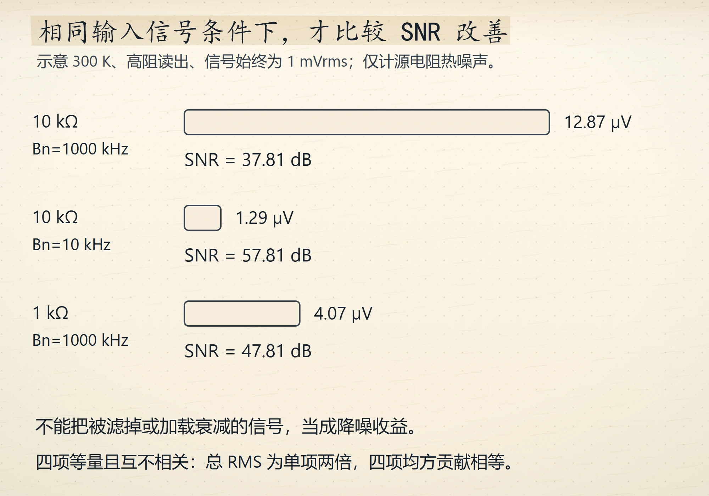
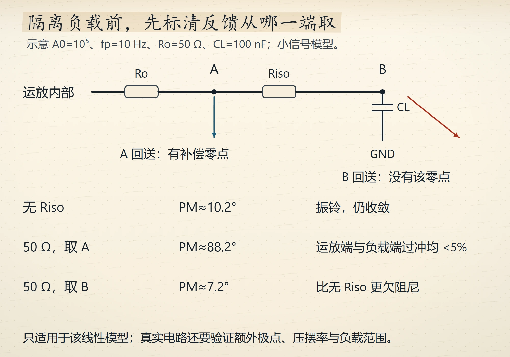
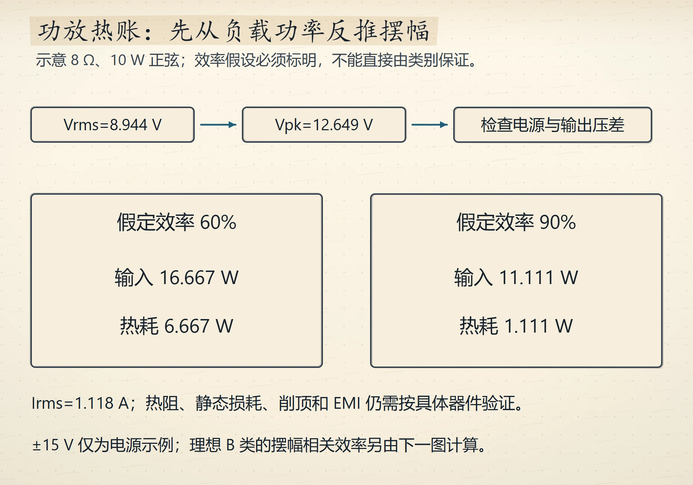

# Wave 15 图库（5 张，待审）

评分入口：[`contact-wave15.html`](contact-wave15.html)（本地打开）。
本页图片路径相对仓库根，GitHub 可直接预览。

本轮改了选点口径：不再只看「每节图数」，而是先排除掉已有候选图或已插图的小节，
只挑**真正一张图都没有**且数字密集的锚点。ch02 占两张（2.8、2.10）。

### 1. 接口保护三件套的先后次序
`ch02-protection-order` · V4 · `IG-013` · ch2 · anchor 2.8

### 2. 桥式整流的电压分账与峰值电流
`ch02-rectifier-voltage-ledger` · V4 · `IG-013` · ch2 · anchor 2.10

### 3. 三种噪声税与信噪比算例
`ch11-noise-three-taxes` · V4 · `IG-013` · ch11 · anchor 11.10

### 4. 隔离电阻的反馈取点与相位裕度
`ch12-riso-feedback-point` · V4 · `IG-013` · ch12 · anchor 12.9

### 5. B 类与 D 类推同一只喇叭的热账
`ch13-audio-class-heat` · V4 · `IG-013` · ch13 · anchor 13.9

