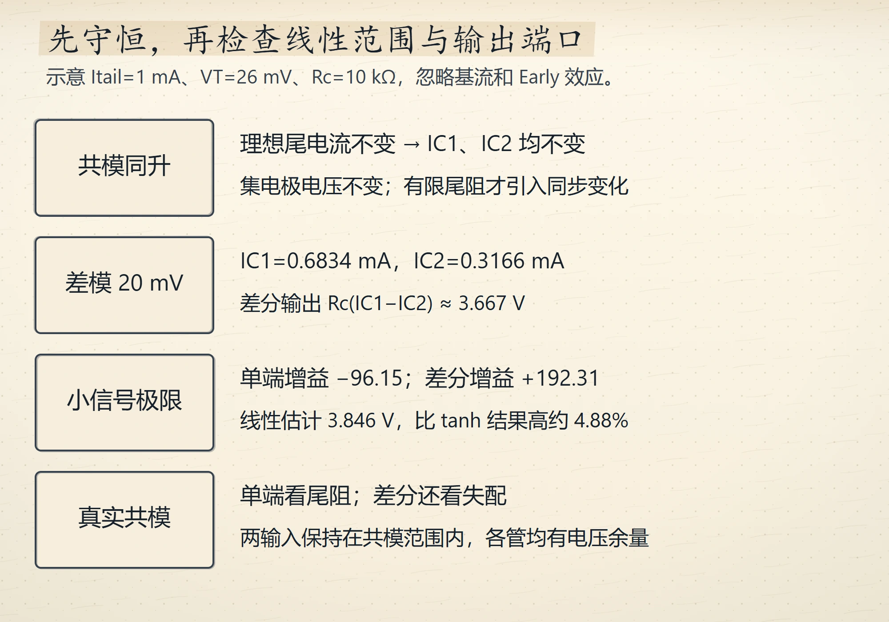
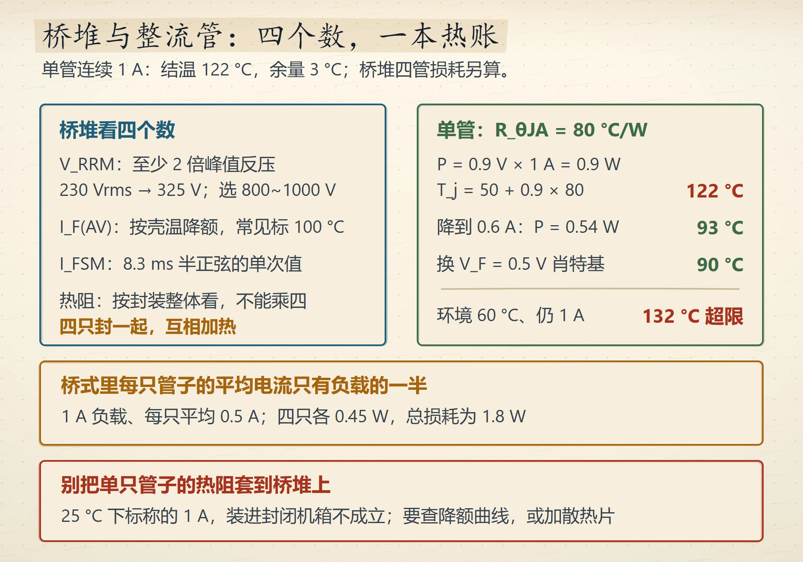
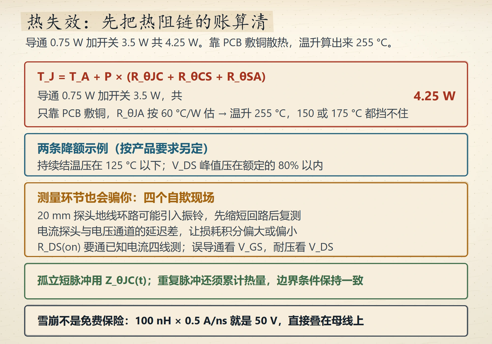
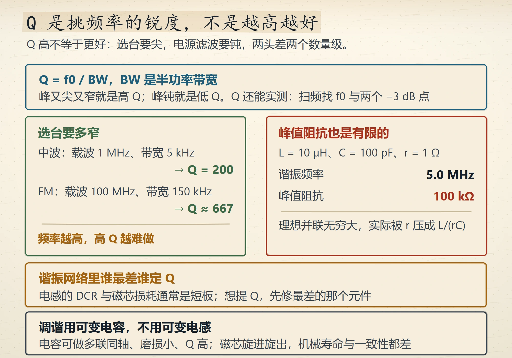
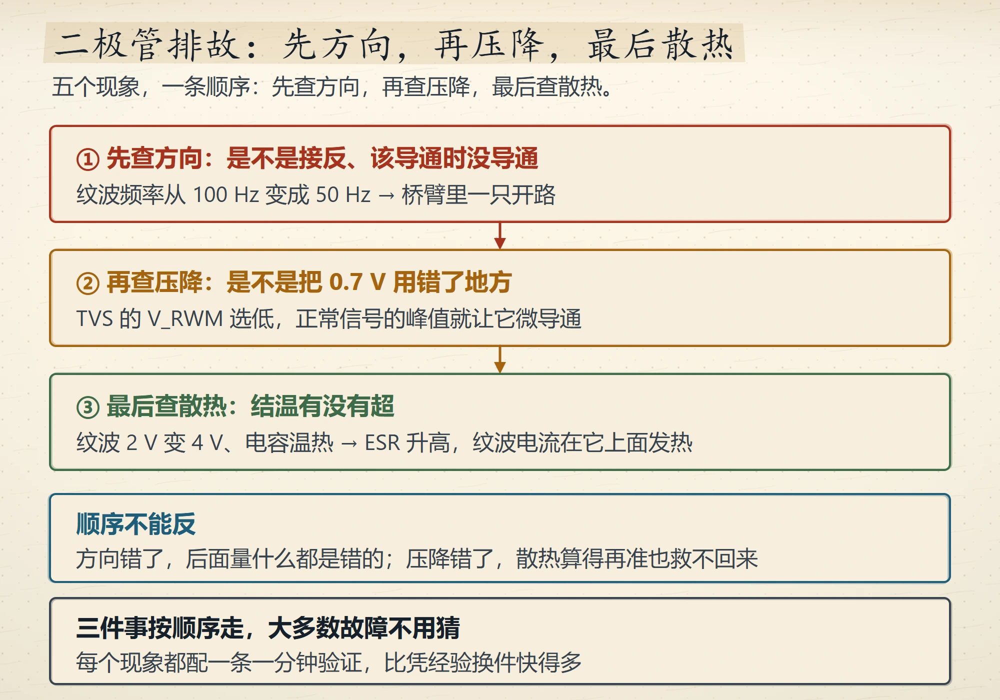

# Wave 16 图库（5 张，待人工审图）

锚点：§11.7、§2.12、§4.5、§1.5、§2.13 —— 全库仅剩的 0 图小节里数字最密的五处。
全部 `status: generated`，未插正文，`review_scores` 为空。

---

## 1. `ch11-diffpair-four-beats` — 差分对的四拍

**anchor**：`docs/p2-01-ch11.md#11.7`
**讲什么**：四拍横框。① 两边同升是共模，尾电流锁死在 1 mA，谁也多拿不走，输出差 = 0；② 一升一降是差模，各 ±10 mV，总量仍是 1 mA，只在两管间重新分配，输出差 ≈ 2ΔI·R_C；③ 尾节点自举，一管想抬一管想压正好抵消，R_tail 上没有交流，对差模隐身；④ 共模的真实泄漏来自 R_tail 有限与两管不可能匹配，失配 1% 就把 CMRR 拉到 60 dB。
底部算账：r_e = 26 mV / 0.5 mA = 52 Ω，A_dm = 10 kΩ / 104 Ω ≈ 96（约 40 dB，单端）；R_tail = 1 MΩ 时 CMRR ≈ 86 dB，提到 10 MΩ 再涨 20 dB。

**为什么值得一张图**：四拍拆解的全部信息就是"两管内电流如何挪"，文字要读四段，图一眼看完。

---

## 2. `ch02-bridge-junction-ledger` — 桥堆四数与结温账

**anchor**：`docs/p1-03-ch2.md#2.12`
**讲什么**：左栏桥堆看四个数（V_RRM 至少 2 倍峰值反压，市电 230 Vrms 峰值 325 V 选 600~1000 V；I_F(AV) 按壳温降额、常见标 100 °C；I_FSM 是 8.3 ms 半正弦单次值；热阻按封装整体看、不能乘四）。
右栏结温账 R_θJA = 80 °C/W：0.9 V × 1 A → 122 °C；降到 0.6 A → 93 °C；换 0.5 V 肖特基 → 90 °C；环境 60 °C 仍 1 A → 132 °C 超限。
下方琥珀框：桥式里每只管子平均电流只有负载的一半（1 A 负载、每只平均 0.5 A、两只各 0.45 W、总损耗约 0.9 W）；底部红框：别把单只管子热阻套到桥堆上，25 °C 下标称的 1 A 装进封闭机箱不成立。

**为什么值得一张图**：四个选型数与三行结温账在正文里隔着好几段，图把它们摆成一张对账表。

---

## 3. `ch04-thermal-chain-ledger` — 热阻链与四种测量自欺

**anchor**：`docs/p1-05-ch4.md#4.5`
**讲什么**：顶部红框给热阻链 T_J = T_A + P × (R_θJC + R_θCS + R_θSA)；导通 0.75 W 加开关 3.5 W 共 4.25 W，只靠 PCB 敷铜、R_θJA 按 60 °C/W 估 → 温升 255 °C，150 或 175 °C 的额定都挡不住。
蓝框两条降额线：持续结温压在 125 °C 以下、V_DS 峰值压在额定的 80% 以内。
琥珀框四种测量自欺：长地线探头（20 mm 环路）、电流探头与电压通道的延迟差、万用表电阻挡、关断尖峰与该结温 V_TH 比。绿框写脉冲要看 Z_θJC(t)。
底部写雪崩不是免费保险：100 nH × 0.5 A/ns = 50 V。

**为什么值得一张图**：4.25 W × 60 °C/W = 255 °C 是全节骨架，文字里被表 4-2 隔开；一眼看到"255 vs 175"才知道为什么热失效排在故障模式表末行却最致命。

---

## 4. `ch01-q-selectivity-map` — Q 是挑频率的锐度

**anchor**：`docs/p1-02-ch1.md#1.5`
**讲什么**：顶部定义 Q = f0 / BW，Q 还能实测（扫频找 f0 与两个 −3 dB 点）。
左绿框选台要多窄：中波载波 1 MHz、带宽 5 kHz → Q 约 100；FM 载波 100 MHz、带宽 150 kHz → Q 只要个位数；频率越高高 Q 越难做。
右红框峰值阻抗也是有限的：L = 10 µH、C = 100 pF、r = 1 Ω → 谐振 5.0 MHz、峰值阻抗 100 kΩ；理想并联无穷大，实际被 r 压成 L/(rC)。
下方琥珀框：谁最差谁定 Q。底部：调谐用可变电容不用可变电感。

**为什么值得一张图**：Q 的两个用法（要尖 / 要钝）与"峰值阻抗有限"是同一页上的三件事，图把它们分成两栏一眼对照。

---

## 5. `ch02-diode-fault-order` — 二极管排故的三步顺序

**anchor**：`docs/p1-03-ch2.md#2.13`
**讲什么**：三个框用实心向下箭头串起来。① 先查方向（纹波频率从 100 Hz 变成 50 Hz → 桥臂一只开路）；② 再查压降（把 0.7 V 用错地方；TVS 的 V_RWM 选低，正常信号峰值就让它微导通）；③ 最后查散热（纹波 2 V 变 4 V、电容温热 → ESR 升高，纹波电流在它上面发热）。
蓝框写顺序不能反。底部写三件事按顺序走，大多数故障不用猜。

**为什么值得一张图**：本节自己给出的判据就是"先方向 → 再压降 → 最后散热"这三步，五个案例只是这三步的实例。箭头方向和先后次序都是真的，不是装饰。

---

## 复核方式

五项评分：教学必要性、事实精度、构图层级、风格一致性、印刷可读性（各 1–5）。
5 分才可写 `accepted`。回复"第 X 张：5/5/5/5/5"或"全部 5 分通过"。
