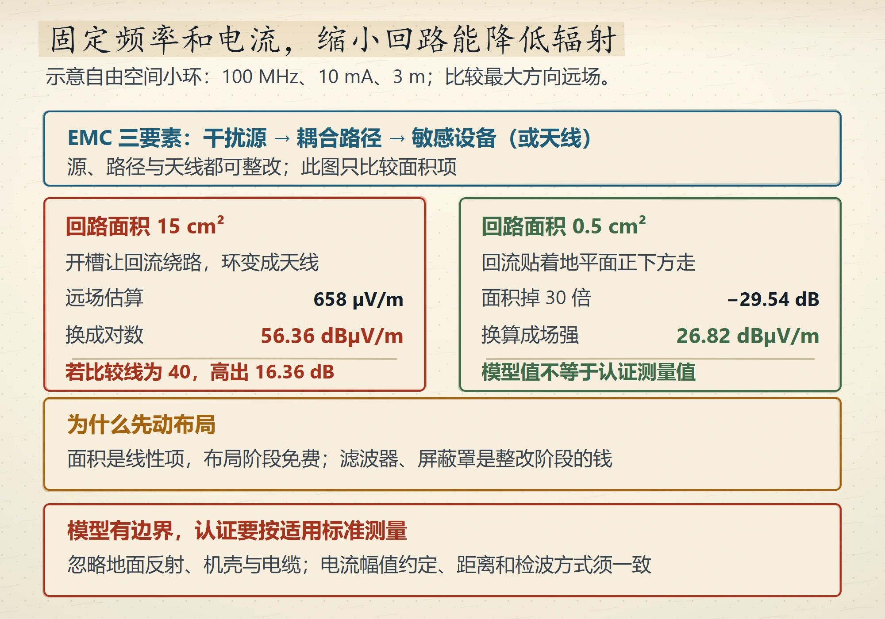
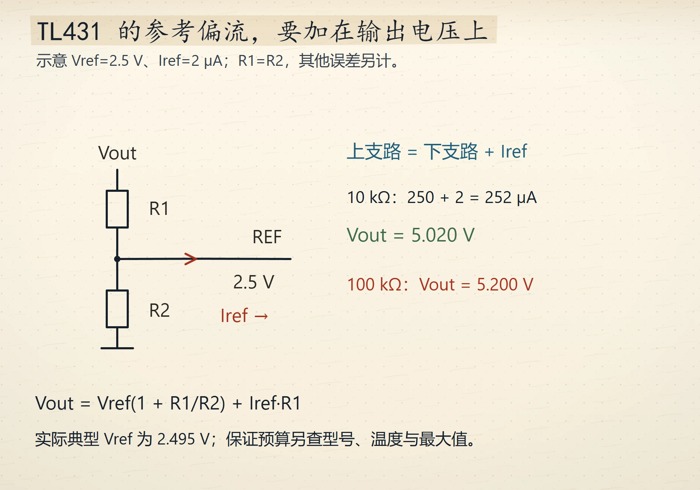
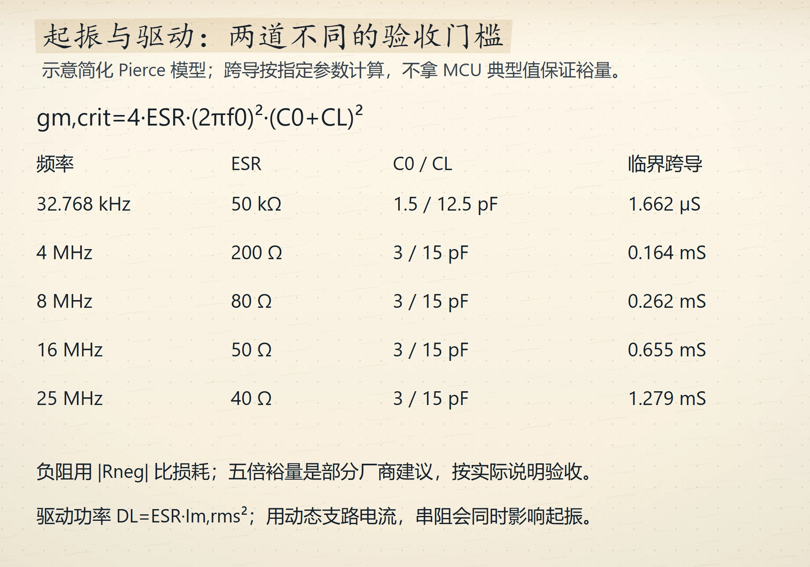
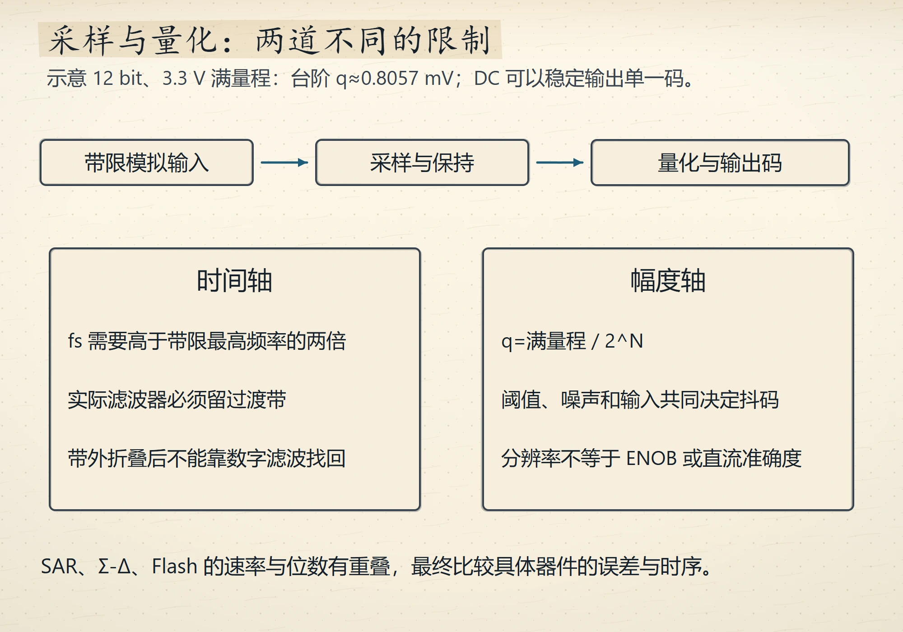
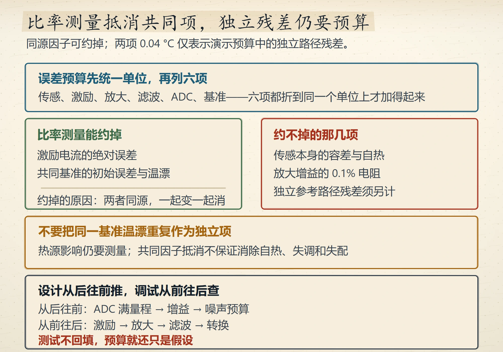

# Wave 17 图廊（5 张，待人工审图）

本包 5 张全部 `status: generated`、`review_scores` 为空、未插入正文；没有伪造人工签核。
图片为 1000×700 手绘草图，print 变体已同时生成。

**`ch15-radiated-loop-area`**　anchor `docs/p3-02-ch15.md#15.6`　purpose：回路面积决定辐射等级

alt：手绘辐射分账。顶部蓝框写电磁兼容三要素：干扰源、耦合路径、敏感设备或天线，模拟工程师能掌控的是后两个。左红框回路面积 15 平方厘米，开槽让回流绕路、环路变成天线，远场估算 660 微伏每米，换成对数 56 分贝微伏每米，限值 40、超 16 分贝。右绿框回路面积 0.5 平方厘米，回流贴着地平面正下方走，面积掉 30 倍也就是负 29.5 分贝，换算成场强 26 分贝微伏每米，限值 40、余量充足。琥珀框写为什么先动布局：面积是线性项、布局阶段免费，滤波器与屏蔽罩是整改阶段的钱。底部红框写辐射超标的发射十有八九是电缆当天线，1 米电缆在 30 到 300 兆赫是高效天线。

---

**`ch09-tl431-divider-floor`**　anchor `docs/p1-10-ch9.md#9.2`　purpose：TL431 分压电阻的下限

alt：手绘 TL431 分压账。顶部蓝框写 TL431 强制参考端等于 2.5 伏，外接两只电阻分压。左绿框算目标 5 伏：分压电流取 250 微安，两电阻之和 20 千欧，各 10 千欧、1% 金属膜；参考端的 2 微安流过 10 千欧，偏 20 毫伏。右红框抬到 100 千欧档：同一支 2 微安压降变大到 0.2 伏，输出直接崩 4%，省下的电全变成输出误差，不如直接买固定基准。琥珀框写另外三笔账：最小阴极电流 0.4 到 1 毫安、动态阻抗约 0.2 欧、阴极电容 0.01 到 1 微法有振荡窗口。底部写耐压不是分压电阻的问题而是 R1 的问题：输出 24 伏时 R1 扛 21.5 伏，0805 单颗耐压 150 伏没问题，上百伏就要串两颗分担。

---

**`ch13-crystal-neg-resistance`**　anchor `docs/p2-03-ch13.md#13.10`　purpose：晶振起振的负阻裕度

alt：手绘晶振负阻两笔账。顶部蓝框写工程要求负阻大于等于 5 倍最大等效串联电阻，余量不足会起振慢甚至低温不启振。左绿框 8 兆赫晶体：等效串联电阻 80 欧、静态电容 3 皮法、负载电容 15 皮法，临界跨导 0.26 毫安每伏；单片机内部反相器有几毫安每伏，裕度 20 倍以上很稳。右红框 32.768 千赫晶体：等效串联电阻天然巨大、35 到 90 千欧，临界跨导反而极小、1.7 微安每伏，所以实时时钟振荡器功耗能做到微安级。琥珀框写两个数差得很远方向却一致：临界跨导与等效串联电阻成正比、与频率的平方成正比。底部红框写先确认起振再谈频率准不准：负载电容配错只让走时慢一点，负阻裕度不够是根本不起振；军规 ④ 说起振时间与负阻裕度成反比、裕度越小醒得越慢。

---

**`ch13-sampling-quantization`**　anchor `docs/p2-03-ch13.md#13.6`　purpose：采样率与量化台阶的两道账

alt：手绘采样与量化两栏。左上蓝框采样是时间离散化：每隔一个采样周期抓一次瞬时值，采样率必须大于信号最高频率的 2 倍，否则高频伪装成低频就是混叠。右上绿框量化是幅度离散化：台阶等于满量程除以 2 的 N 次方，3.3 伏量程、12 位得 0.8 毫伏，读数末位抖动就是量化噪声。琥珀框算 1 ksps 够不够：读 50 赫兹工频，1 ksps 大于 2 倍，可以；直接读 1 千赫音频，1 ksps 小于 2 倍，混叠失真；对策是提到 10 ksps 以上或前置 500 赫兹低通。底部红框三种架构：逐次逼近约 1 Msps、12 到 18 位；过采样不到 1 ksps、16 到 24 位；并行比较 Gsps 级、低于 8 位。

---

**`ch14-pt100-error-budget`**　anchor `docs/p3-01-ch14.md#14.12`　purpose：PT100 的误差预算与比率测量

alt：手绘误差预算两栏。顶部蓝框写误差预算先统一单位，再列六项：传感、激励、放大、滤波、ADC、基准，六项都折到同一个单位上才加得起来。左绿框比率测量能约掉两项：激励电流的绝对误差与基准的初始误差，原因是两者同源、一起变一起消。右红框约不掉的那几项：传感本身的容差与自热、放大增益的 0.1% 电阻、基准温漂 10 ppm 每摄氏度。琥珀框写温漂预算只有 0.04 摄氏度，低压差稳压器与开关电源都是热源，基准要靠远离热源来保精度。底部写设计从后往前推、调试从前往后查：后面是 ADC 满量程到增益到噪声预算，前面是激励到放大到滤波到转换；测试不回填，预算就还只是假设。
