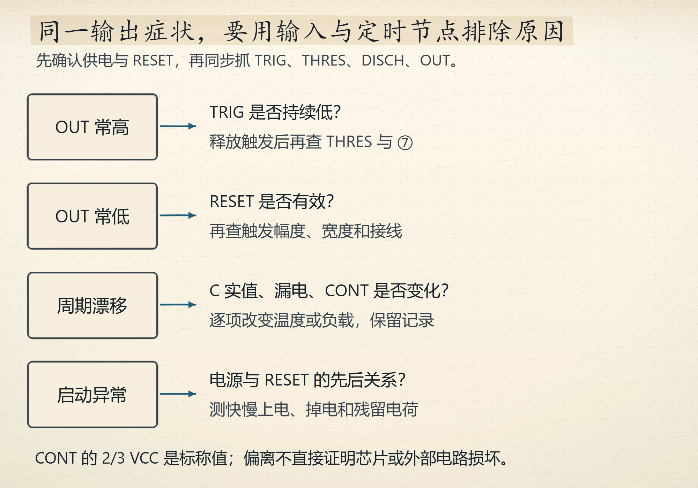
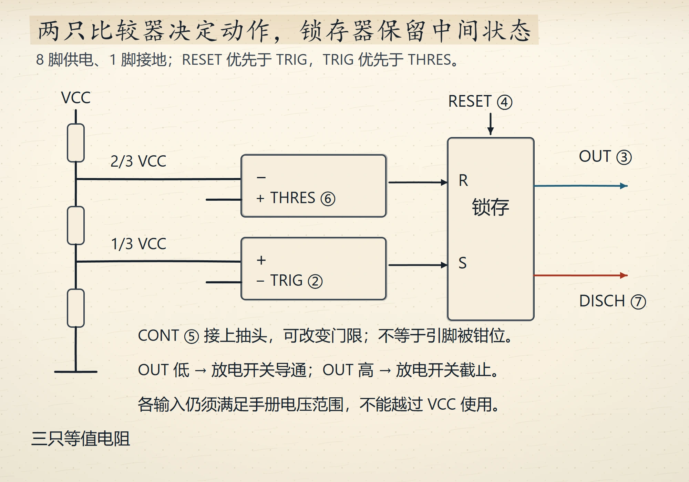
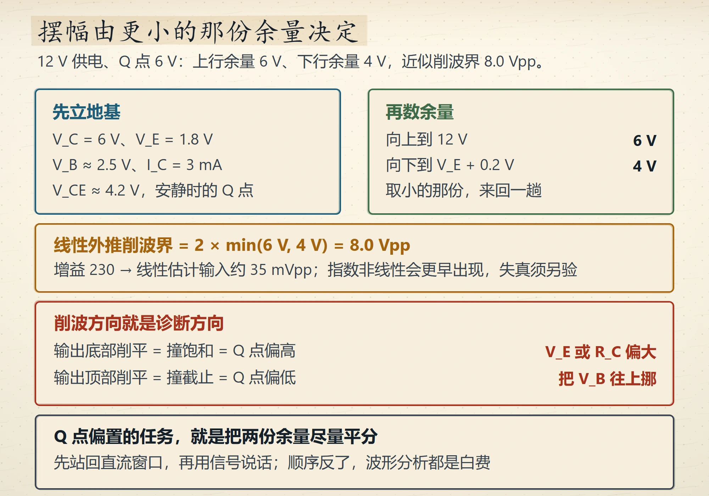

# Wave 18 图廊（3 张，待人工审图）

本包 3 张全部 `status: generated`、`review_scores` 为空、未插入正文；没有伪造人工签核。
图片为 1000×700 手绘草图，print 变体已同时生成。

**`ch10-555-fault-tree`**　anchor `docs/p1-11-ch10.md#10.3`　purpose：555 故障图谱五站定位

alt：手绘 555 故障图谱。顶部蓝框写 5 脚直接接在内部 2/3 Vcc 的抽头上，悬空等于给高阻抽头接天线，改的正是挡块高度；标准做法接 10 纳法到地。中间框列五站：①输出常高、6 脚电压不动，判据是放电管没工作，7 脚虚焊或 R2 开路；②频率对、占空比漂，判据是 R1 或 R2 变值，或 5 脚电容漏电；③频率随温度狂漂，判据是 X7R 电容在干活，热风一吹变化超过 5% 即介质问题；④起振迟缓、偶发停振，判据是电源爬升太慢，4 脚加 RC 延时；⑤面包板行、焊到板上不行，判据是寄生 2 到 5 皮法参与定时，按板上实测重算。琥珀框写先量 5 脚直流电压、应恰好 2/3 Vcc，偏离就是外因，指标合格才轮到怀疑芯片。底部绿框处方三件套：就近 100 纳法加 10 微法、续流路径独立、走线不进继电器回路。

---

**`ch10-555-threshold-clamp`**　anchor `docs/p1-11-ch10.md#10.1`　purpose：555 的两条门限与占空比

alt：手绘 555 门限账。顶部蓝框写三只 5 千欧电阻串在电源与地之间抽出两条门限，2/3 Vcc 进比较器 A、1/3 Vcc 进比较器 B，这就是 555 这个名字的由来。左绿框「撞上限：按住」：电容升到 2/3 Vcc，比较器 A 翻转，触发器复位、放电管导通。右红框「落下限：松手」：电容降到 1/3 Vcc，比较器 B 翻转，触发器置位、放电管截止。琥珀框写所以占空比永远大于 50%：充电走 R1 加 R2、放电只走 R2，进得慢出得快；R1 只出现在充电支路，所以这个比值压不到 50%。底部写触发器只锁状态、不产生振荡，秋千自己会停，能量一路向电源讨。

---

**`ch03-ce-swing-budget`**　anchor `docs/p1-04-ch3.md#3.9`　purpose：共射级的摆幅预算与削波方向

alt：手绘共射摆幅预算。左蓝框先立地基：集电极 6 伏、发射极 1.8 伏、基极约 2.5 伏、集电极电流 3 毫安、管压降约 4.2 伏，这是安静时的 Q 点。右绿框再数余量：向上到 12 伏是 6 伏，向下到发射极加 0.2 伏是 4 伏，取小的那份。琥珀框写最大不失真摆幅等于 2 乘最小余量、即 8.0 Vpp；增益 230，想推满 8 Vpp 输入上限约 35 mVpp。红框写削波方向就是诊断方向：输出底部削平是撞饱和、Q 点偏高，查发射极电压或集电极电阻偏大；顶部削平是撞截止、Q 点偏低，把基极电压往上挪。底部写 Q 点偏置的任务就是把两份余量尽量平分，先站回直流窗口再用信号说话。
