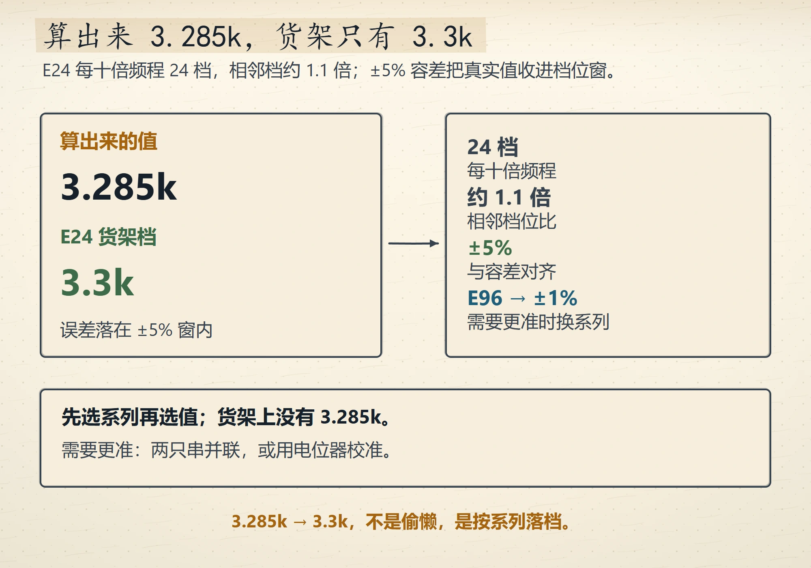
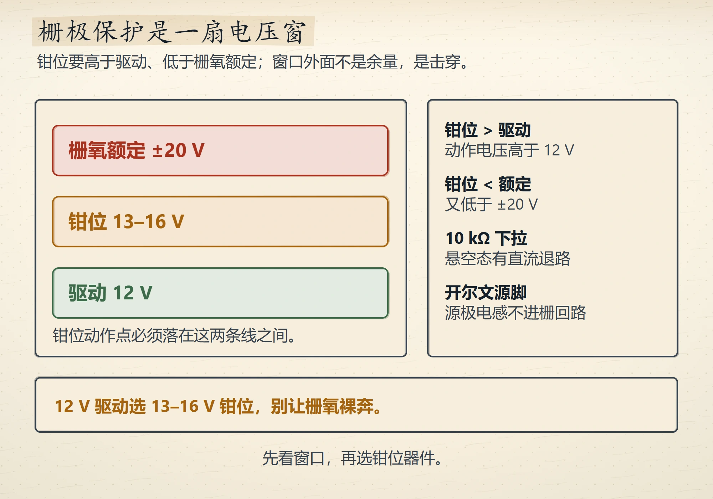
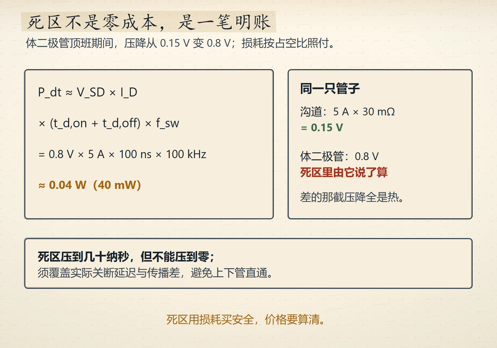
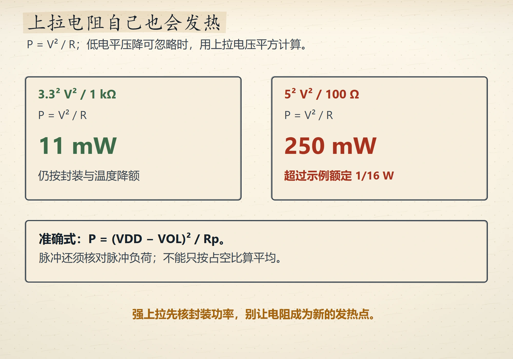
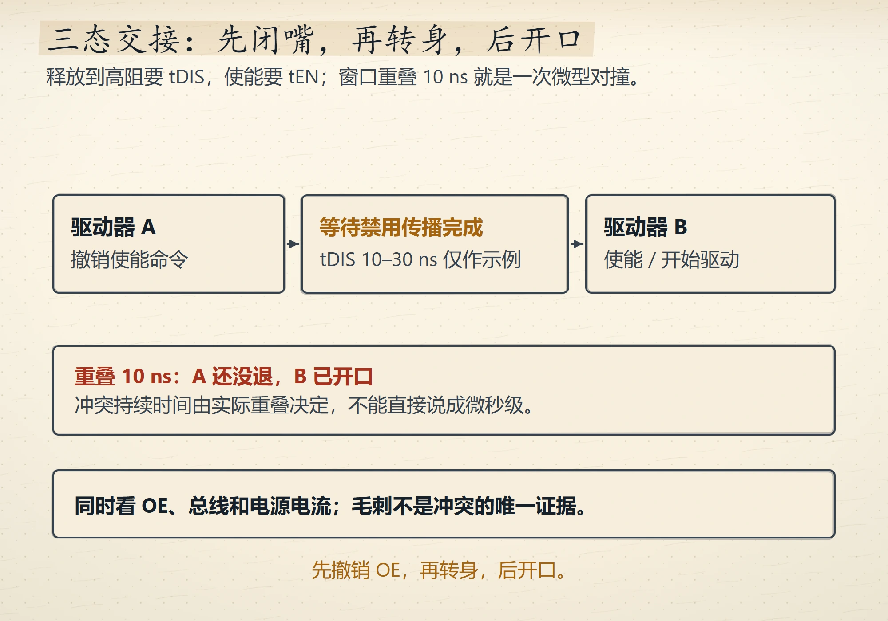
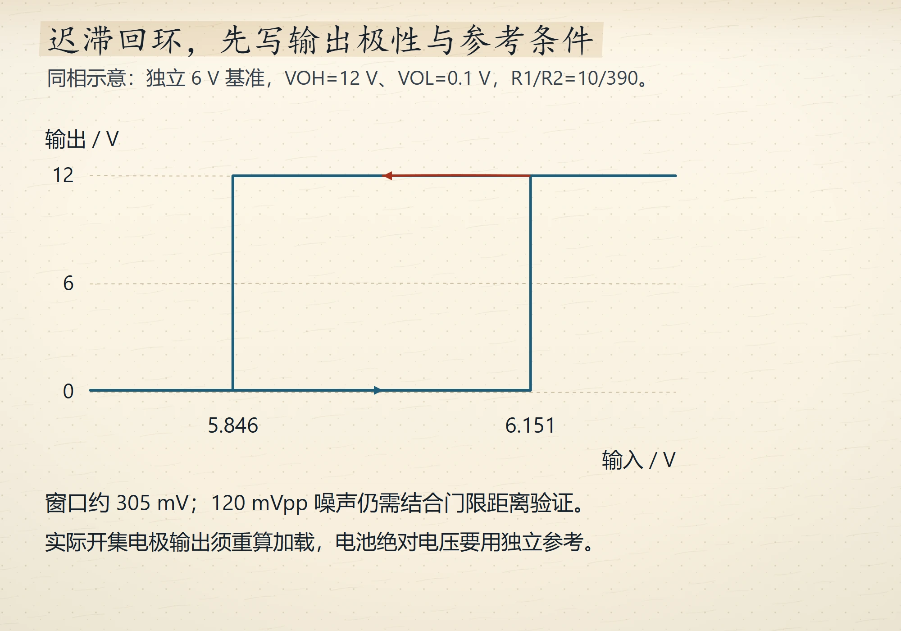
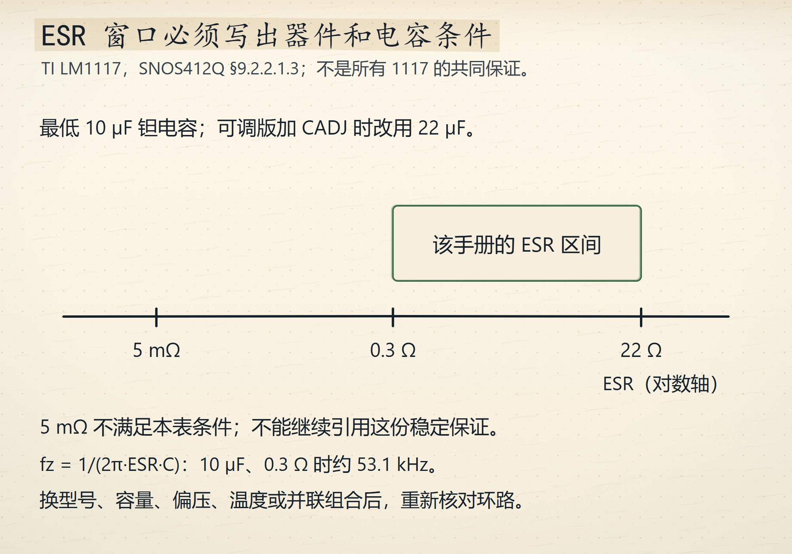
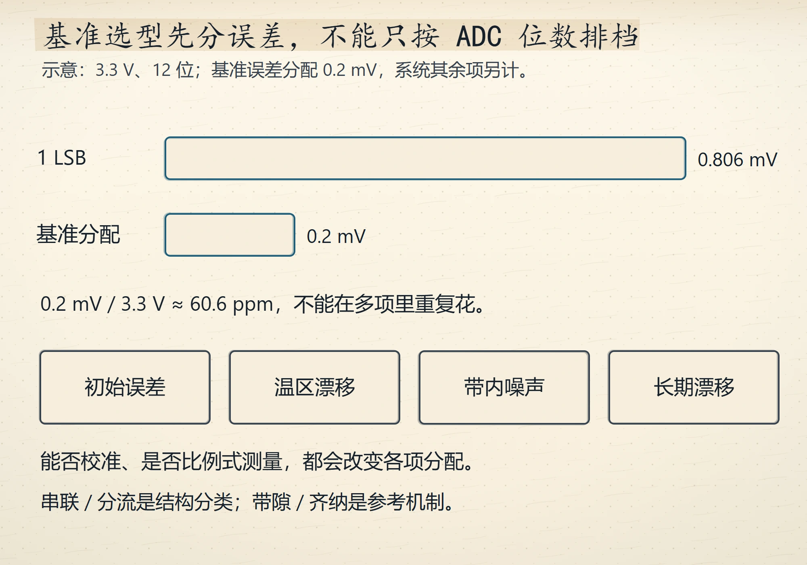

# Wave 8 图库（8 张，待审）

评分入口：[`contact-wave8.html`](contact-wave8.html)（本地打开）。
本页图片路径相对仓库根，GitHub 可直接预览。

## ch1（1 张）

### E24 档位与 3.3k 的来历
`ch01-e24-ladder` · V4 · `IG-013`

## ch4（2 张）

### 栅极保护的电压窗
`ch04-gate-window` · V4 · `IG-013`

### 死区损耗的明账
`ch04-deadtime-ledger` · V4 · `IG-013`

## ch5（2 张）

### 上拉电阻自己的功耗
`ch05-rp-power` · V4 · `IG-013`

### 三态总线的交接时序
`ch05-tristate-handover` · V4 · `IG-013`

## ch7（1 张）

### 迟滞窗口与两个阈值
`ch07-hysteresis-window` · V4 · `IG-013`

## ch9（2 张）

### LDO 的 ESR 稳定窗口
`ch09-esr-window` · V4 · `IG-013`

### 基准选型的精度阶梯
`ch09-reference-ladder` · V4 · `IG-013`

