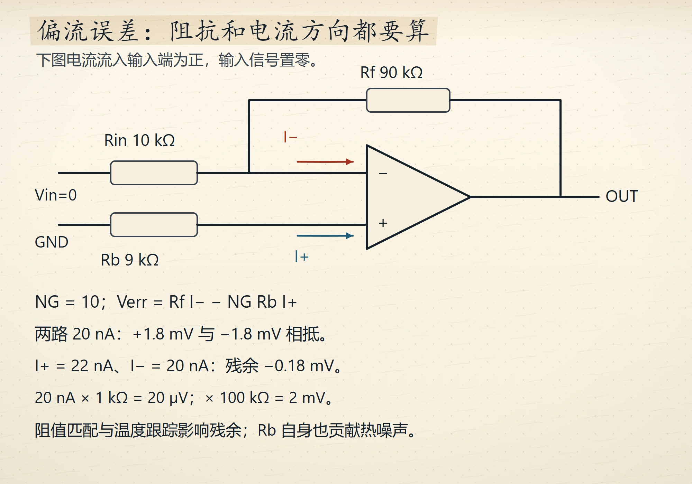
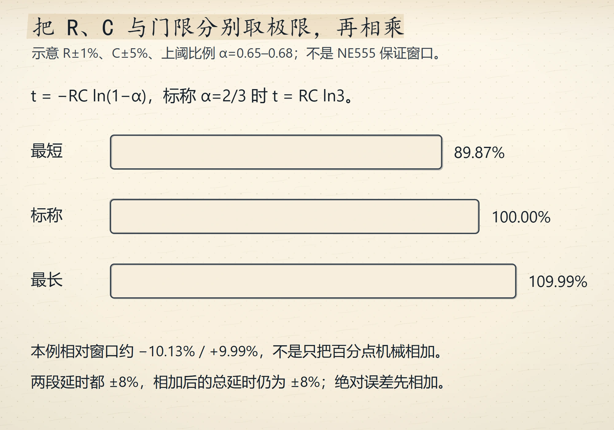
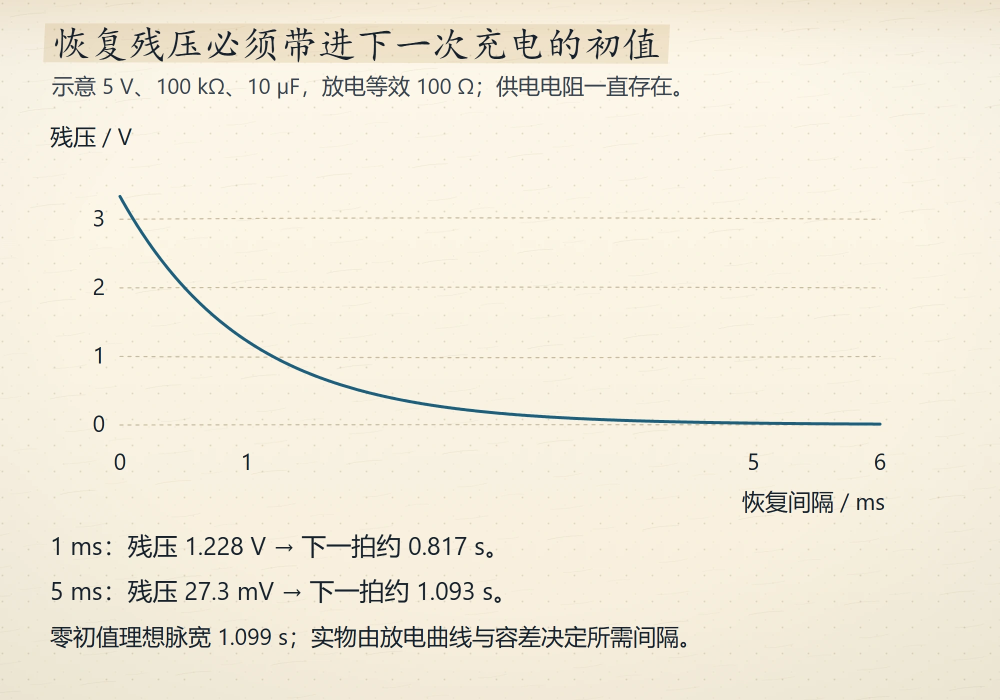
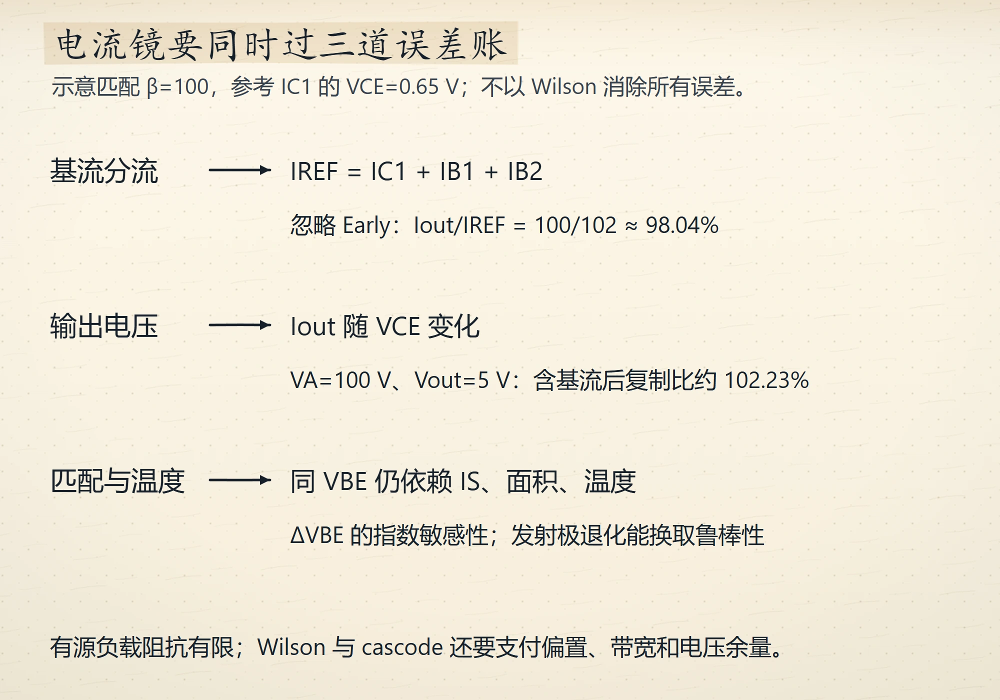
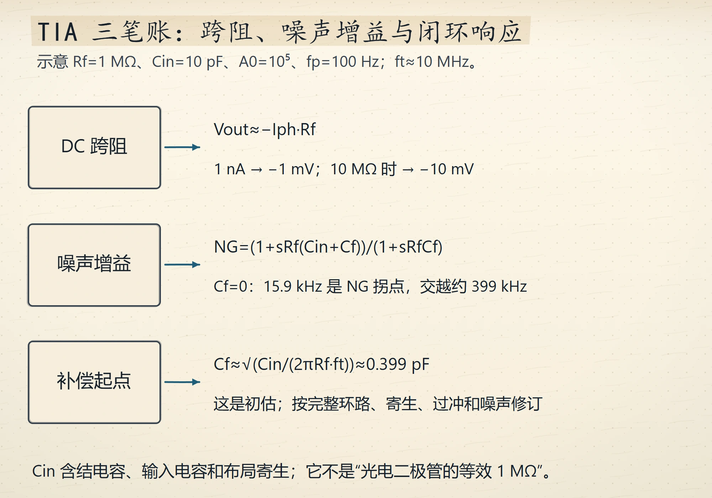
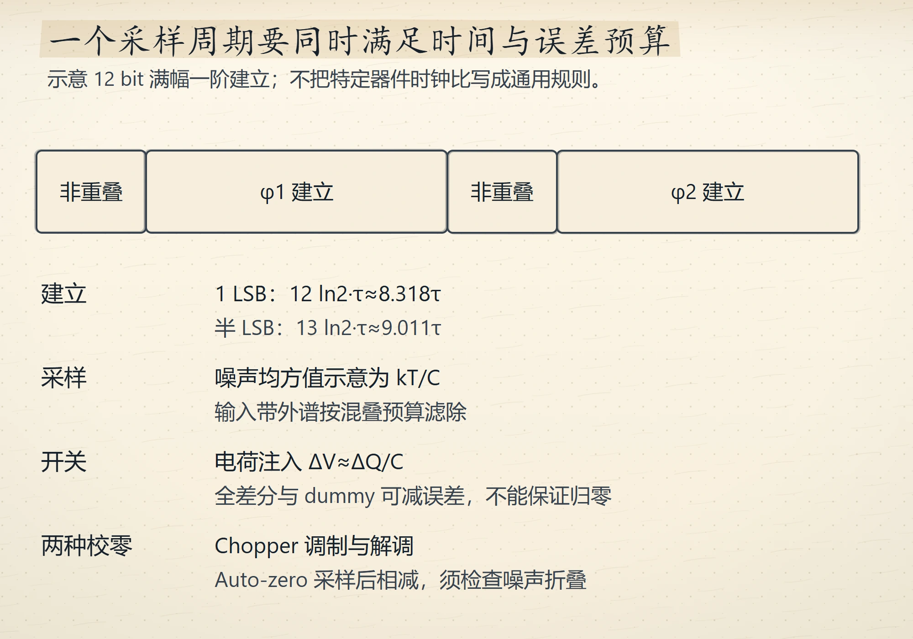
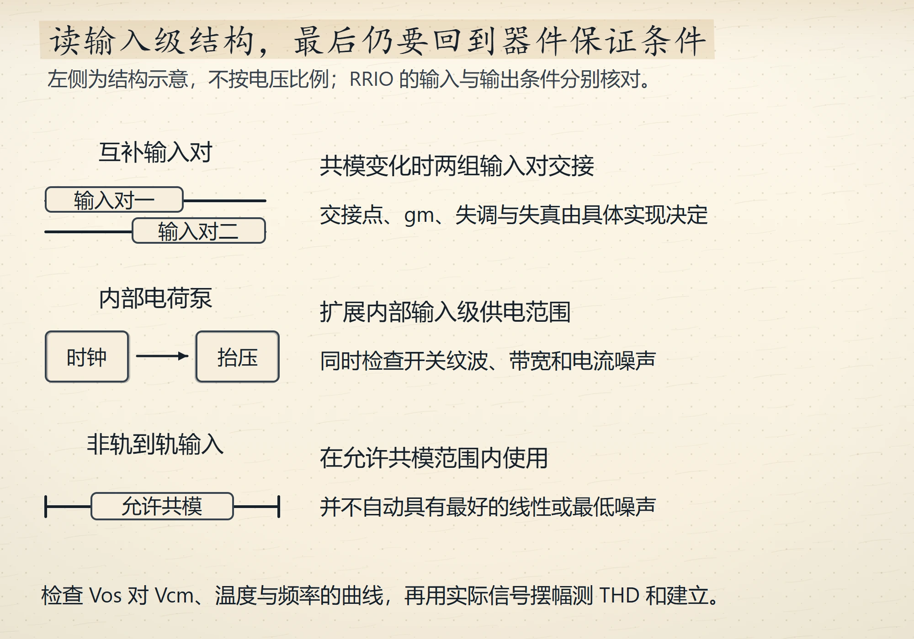

# Wave 9 图库（7 张，待审）

评分入口：[`contact-wave9.html`](contact-wave9.html)（本地打开）。
本页图片路径相对仓库根，GitHub 可直接预览。

## ch6（1 张）

### 输入偏置电流与平衡电阻
`ch06-bias-balance` · V4 · `IG-013`

## ch10（2 张）

### 单稳态 1.1RC 的误差预算
`ch10-monostable-budget` · V4 · `IG-013`

### 单稳态恢复时间与连发触发
`ch10-recovery-gap` · V4 · `IG-013`

## ch11（1 张）

### 电流镜的三笔误差
`ch11-mirror-three-errors` · V4 · `IG-013`

## ch12（3 张）

### TIA 的增益带宽稳定三角
`ch12-tia-three-way` · V4 · `IG-013`

### 开关电容的等效电阻
`ch12-switch-cap` · V4 · `IG-013`

### 按源阻抗选输入级
`ch12-input-types` · V4 · `IG-013`

