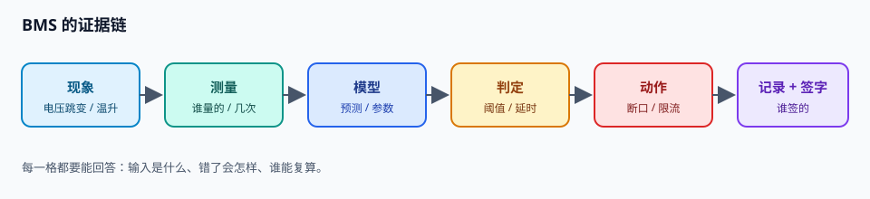

# 前言：把 BMS 当证据学

先看一场“事故”。

一台 4 串的实验 BMS，100 拍采样，1 秒一拍。第 45 拍，一切正常；第 46 拍，第 1 串电压从 3.932 V 跳到 4.300 V；第 47 拍，还是 4.300 V；第 48 拍，故障位翻成 `OVP`，充电 MOS 关断。

如果只截第 46 拍，你会说：“电压已经过压了，为什么不切？”

如果只看第 48 拍，你会说：“切得挺及时。”

只有把 45–48 拍连起来，你才看得见那条规则：**连续三拍越限，在第三拍确认并关断充电 MOS；下一拍采样才看到电流归零**。这条规则叫去抖。

BMS 的几乎所有争论，最后都会落到这种“把时间轴摊开”的问题上：

- SOC 说 30%，电芯真的还剩 30% 吗？你的“真值”是谁？
- 新息 15 mV，是模型错了，还是电压表偏了？一个方程，多个未知。
- 参数 R0 写大 10 倍，误差会变成多少？41.51%，还是 1.00%？哪个参数更要命？
- 100 帧里坏了 1 帧，剩下的 99 帧还能要吗？取决于你的状态机会不会重同步。

所以这本书不按“知识点”组织，而按**证据链**组织：

> 现象 → 测量 → 模型 → 判定 → 动作 → 记录 → 谁签字。

<figure>

<figcaption>图 0-1　BMS 的证据链。每一格都要能回答：输入是什么、错了会怎样、谁能复算。</figcaption>
</figure>

每一章都尽量给你三样东西：

1. **一个现场**：真实或可复现的故障/实验，带数字。
2. **一个能跑的实验**：PC 上就能做，不用碰电池。
3. **一个坑**：别人踩过、你也大概率会踩的那个。

书里的数字大多来自 BMS-Z 配套实验的实测与合成记录。它们不是“标准答案”，而是**可对照的坐标**：你可以把同样的实验跑一遍，看自己的结果落在哪。

## 先说清三个约定

**电流符号：充电为正。** 这与 BMS-Z 的代码一致（`I > 0` 充电，`I < 0` 放电）。很多教材用放电为正，换书时第一件事就是核对符号：符号错了，SOC 会朝反方向跑。

**SOC 用 0–1，显示时乘 100%。** 代码里不做“有时 0.8、有时 80”的混用。

**所有阈值都是示例值。** 真实产品必须查电芯 datasheet、保护 IC 与适用标准；书里的 4250 mV、2800 mV 只对应 BMS-Z 的教学固件。

## 这本书不做什么

- 不给你一张“照着抄就能量产”的阈值表。
- 不把 AI 当成测量仪；第 24 章专门讲它能做什么、不能做什么。
- 不假装开源项目可以直接商用；许可证、功能安全与供应链责任都要单独评估。

## 怎么开始

如果你完全零基础：先读第 1 章，然后去 BMS-Z 做“第 0 天小实验”，再回来读第 2 章。

如果你已经做过保护板：直接从第 7 章（tick 48）和第 10 章（OCV 四项）开始。

如果你只关心算法：第 10–17 章是一条完整的线，配 `code/` 和 BMS-Z 的 `code/soc/`。

最后一句话：

> BMS 的难点不是“算得准”，而是“算错了也知道自己错了，并且还能安全地停下来”。

这本书的每一章，都在为这句话补证据。
