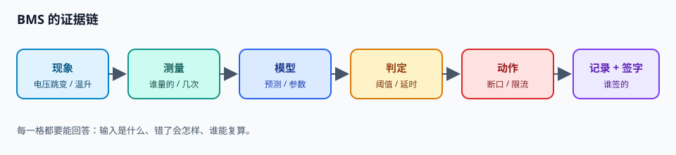

# 前言：把 BMS 当证据学

仪表还显示有电，一踩电门，车却突然限功率。松开电门，显示的电量又回来一点。电池没有在几秒内把电用光又补回来；负载改变了电芯的端电压，仪表对剩余电量的估计也可能跟着变。

谁发现这次变化？什么时候该限制电流？发出关断命令后，电流真的停了吗？回答这些问题的系统叫 **BMS（电池管理系统）**。本书从这样的现场问题讲起，再逐步走到算法、固件和产品验证。

第一次读，不需要先懂电化学、微积分或 Python。每章的“第一次主线”只要求看懂现象和一笔简单的数字账；公式与工程审查可以放到第二遍。

全书按三层阅读：

1. **先懂**：现象是什么，为什么发生；
2. **会算**：用一组具体数字从头算到尾；
3. **会做**：用实验、代码和测试验证，知道结论在哪里失效。

再看一个后面会复算的保护事件。这里“拍”指连续两次采样之间的一步：

一台 4 串的实验 BMS 共采 100 拍，每秒一拍。第 45 拍正常；第 46 拍，第 1 串电压从 3.932 V 跳到 4.300 V；第 47 拍仍是 4.300 V；第 48 拍确认过压（`OVP`），命令充电电子开关（MOS）关断。下一拍，采样才看到电流归零。

单看第 46 拍，会疑惑“为什么还不切”。连着看第 46–48 拍，才知道规则是**连续三拍越限，在第三拍确认**。这叫去抖，用来避免一次异常读数引发误动作；第 7 章会核对它的时间预算。

全书反复做同一件事：沿着现场留下的证据，核对从读数到动作的每一步。

> 现象 → 测量 → 模型 → 判定 → 动作 → 记录 → 谁签字。

<figure>

<figcaption>图 0-1　第一次先看“测量 → 判定 → 动作 → 记录”：读到了什么、决定做什么、实际做到了吗、事后能否查到。模型与签字环节留到后面的章节。</figcaption>
</figure>

书里的数字来自配套实验或标明条件的合成算例。先弄清每个数字属于哪次实验，再决定能否用于自己的电池。

## 先说清三个约定

**电流符号：充电为正。** 这与 BMS-Z 的代码一致（`I > 0` 充电，`I < 0` 放电）。很多教材用放电为正，换书时第一件事就是核对符号：符号错了，SOC 会朝反方向跑。

**SOC 用 0–1，显示时乘 100%。** 代码里不做“有时 0.8、有时 80”的混用。

**所有阈值都是示例值。** 真实产品必须查电芯 datasheet、保护 IC 与适用标准；书里的 4250 mV、2800 mV 只对应 BMS-Z 的教学固件。

## 怎么开始

完全零基础，先读第 1 章 §1.1–§1.4，再读第 2 章 §2.1–§2.4。能解释“为什么一带负载电压会掉”和“为什么整包要看最弱一节”，就已经有了继续读的起点。第 1 章后半的电化学公式可以晚些再看。

做过保护板，可以从第 7 章的三拍保护事件和第 10 章的电压模型开始；只关心算法，则顺着第 10–17 章读，配合代码复算。

## 三类车辆，不共用一套架构

本书从这一版起不再用“电动车”包打天下。相同的电芯原理之上，应用层分成三条：

- **电动自行车**：非机动车产品语境，常见的是紧凑集中式保护板或智能 BMS，重点是成本、休眠、电池包内热、背靠背 MOS 与防篡改；具体串数和电压看产品，不能拿“48 V”反推法律分类。
- **电动轻便摩托车／电动摩托车**：机动车产品语境，功率、持续电流、通信与热设计通常高一档；可见集成 MOS 方案，也可见接触器和预充，不能把电动自行车板直接放大铜皮就算完成。
- **电动汽车**：牵引电池通常进入主控＋从板、接触器、预充、HVIL、绝缘监测、功能安全、诊断和量产证据链；第 25、26、31、32 章主要在这一语境展开。

三条路线共用电芯、采样、保护、SOC／SOH／SOP 与通信原理，但**开关器件、隔离、法规、故障安全态和验证深度不共用**。章节只写“车用”时，必须能从上下文判断是哪一类；不能判断就算表述不合格。

最后落在这一句：

> BMS 的难点不是“算得准”，而是“算错了也知道自己错了，并且还能安全地停下来”。

这本书的每一章，都在为这句话补证据。

## 跟做实验：复算前言的三拍保护事件

前言的保护事件只有五个数字，全部可以脚本复算。把下面内容存成 `preface_three_beats.py`，只用标准库：

```python
# preface_three_beats.py：复算前言的三拍保护事件（只用标准库）
OVP_V = 4.250  # 教学固件示例阈值 4250 mV（前言约定的示例值）
v_cell1 = {45: 3.932, 46: 4.300, 47: 4.300, 48: 4.300, 49: 4.300}
current_a = {45: 12.0, 46: 12.0, 47: 12.0, 48: 12.0, 49: 0.0}

run, confirmed = 0, None
for beat in sorted(v_cell1):
    run = run + 1 if v_cell1[beat] > OVP_V else 0
    if confirmed is None and run >= 3:
        confirmed = beat
        print(f"第 {beat} 拍：连续三拍越限，确认 OVP，命令 MOS 关断")
print(f"下一拍电流读数：{current_a[confirmed + 1]} A")
```

运行 `python preface_three_beats.py`，对照前言正文。

**成功判据**：

- 第 45 拍 3.932 V 不越限（3.932 < 4.250 < 4.300），越限从第 46 拍开始。
- 连续计数在第 48 拍达到 3，脚本输出「确认 OVP，命令 MOS 关断」；单看第 46 拍时计数只有 1，这就是「为什么还不切」的答案。
- 第 49 拍电流读数 0.0 A，对应「下一拍，采样才看到电流归零」。

## 翻车对照：开读前最容易踩的坑

下表把前言正文里的约定与误区压成一页。素材全部来自本章，不引入新知识点。

| 症状 | 可能原因 | 排查或对照 |
|---|---|---|
| 换了教材，SOC 朝反方向跑 | 电流符号约定相反：本书充电为正，不少教材放电为正 | 读代码前先核对符号约定 |
| 代码里时而 0.8、时而 80 | SOC 单位混用 | 统一 0–1，只在显示时乘 100% |
| 拿 4250 mV 直接用到自己的电芯 | 把示例阈值当产品阈值 | 书里阈值只对应 BMS-Z 教学固件；真实产品查 datasheet、保护 IC 与适用标准 |
| 第 46 拍 4.300 V 还不切 | 只看单拍不看三拍窗口 | 连看第 46–48 拍：三拍越限才确认（去抖） |
| 拿「48 V」字样反推法律分类 | 用电压标签套产品语境 | 串数与电压看产品；表述必须能判断是哪一类车辆语境 |
| 电动自行车板放大铜皮就用到电摩 | 三条路线共用电芯原理；器件、隔离、法规不共用 | 按三类车辆语境核对器件、隔离与验证深度 |
| 仪表有电，一踩就限功率 | 负载改变端电压，SOC 估计跟着变 | 沿证据链核对每一步，别只看一格电量 |

> **同构点**　前言这条「现象 → 测量 → 模型 → 判定 → 动作 → 记录 → 谁签字」的证据链，在卷 I 第 18 章《大师的排故智慧》里是同一套纪律：先预测读数再动手测量，每个打勾的结论都要凭证据，事后能回溯到「谁、依据哪段记录、哪天」。

## 参考资料与版本核对

- BMS-Z 仓库主页：https://github.com/zhuguang-ZFG/BMS-Z
- 各章阶段教程入口：https://github.com/zhuguang-ZFG/BMS-Z/tree/main/docs/stages
- 版本核对：书中 4250 mV、2800 mV 等阈值对应 BMS-Z 教学固件；复算前先确认手里的代码版本与书中示例一致，再逐条对照约定（充电为正、SOC 用 0–1）。
