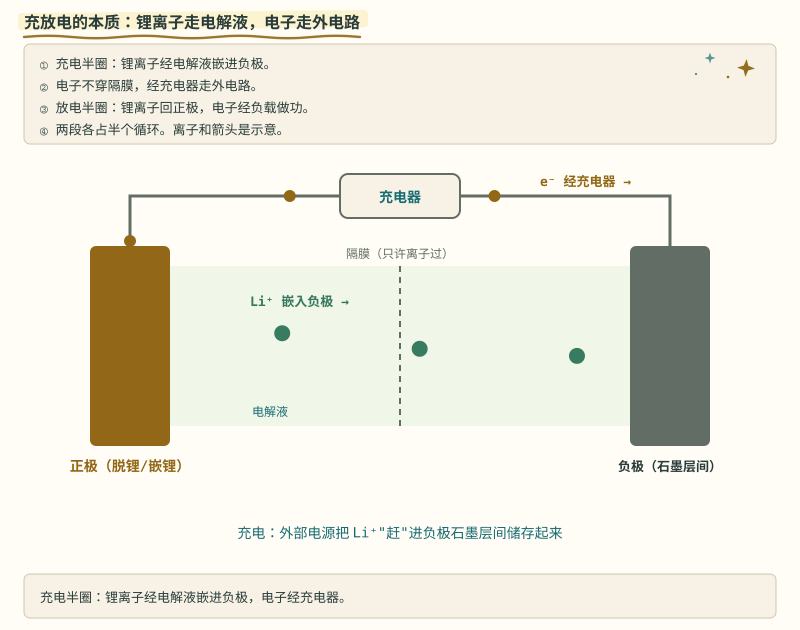
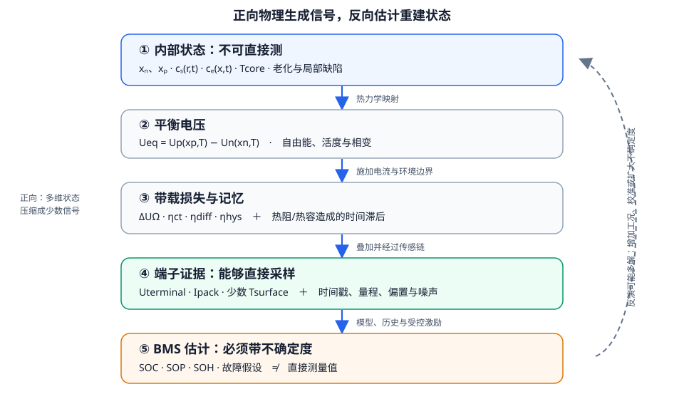
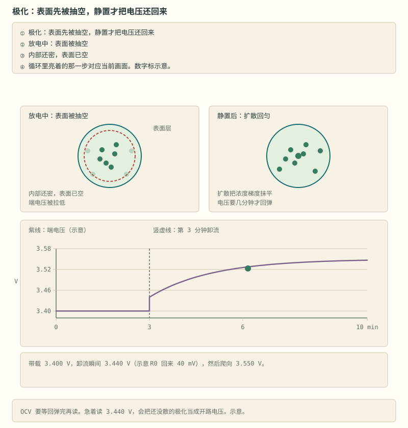

# 第 1 章 一块电池里在发生什么

::: story 现场
一颗 18650 放在桌上，25 °C，静置电压 3.70 V。把它接上负载，电压立刻下跳；几十秒后又慢慢下垂。断开负载，电压先跳回一截，再用更长时间爬回去。

这不是同一个“电量”忽多忽少，而是多个物理过程叠在一对端子上。BMS 只能直接看到电压、电流和少数温度点，却要反推电极里的锂分布、可用功率、老化和风险。本章先建立这条从电化学状态到测量证据的因果链；后续章节再把每一层写成可运行的模型。
:::
第一次读这一章，不必先追完公式推导。可以先看 §1.6 的五个电压点，分清电压的瞬时跳变与缓慢松弛，再回到 §1.2–§1.5 补原理。

**先自己判断**　一块显示“满电”的电池接上负载后，端电压立刻下跳。更可能是电量在一瞬间少了，还是同一份电量在电流经过内阻和极化时留下了压降？先写下答案；读到 §1.6，再用数字把它改成一笔账。

## 1.1 四个区域，两条通路

一节锂离子电芯至少包含四个功能区域：负极活性材料、电解液与隔膜、正极活性材料，以及连接两极的集流体和外电路。

**表 1-1**　电芯四个功能区域：载流者、任务与禁区（定性结构，无测量数字）

| 区域 | 主要载流者 | 主要任务 | 不能做什么 |
|---|---|---|---|
| 负极活性颗粒 | 颗粒内电子、嵌入态锂 | 储存或释放锂 | 不能让电子穿过隔膜 |
| 电解液与隔膜 | Li⁺ 与配对阴离子 | 提供离子通路并隔开两极 | 理想情况下不传导电子 |
| 正极活性颗粒 | 颗粒内电子、嵌入态锂 | 接收或释放锂 | 不能代替外电路输送电子 |
| 集流体与外电路 | 电子 | 把反应产生或需要的电子送到另一极 | 不输送 Li⁺ |

放电时，负极发生氧化，电子经外电路流向正极；Li⁺ 经电解液与隔膜流向正极。充电时两条通路同时反向。常规电流方向与电子运动方向相反，因此本书统一使用**充电为正、放电为负**的电流约定。

“阳极／阴极”按氧化／还原定义，会随充放电方向互换。为了避免工程讨论中把名称叫反，本书多数时候直接说**负极／正极**。

::: principle 一句话
**离子走里面，电子走外面；两条通路必须在界面处同时闭合。** 电子通路断开，没有持续电流；离子通路堵塞，端子上同样只能看到越来越大的极化。
:::

<figure class="book-motion" data-animation="li-ion-working.svg" data-mode="static">

<button type="button" data-book-motion v-book-motion aria-pressed="false" hidden>播放动画</button>
<figcaption>图 1-1　离子与电子的两条路。充电、放电分别占半个循环；箭头表示迁移方向，粒子数量和速度为示意。先跟住内部 Li⁺，再跟住外部 e⁻：两条路径在电极／电解液界面配合，电子不穿隔膜。把负载换成充电器后，两种粒子的迁移方向怎样改变？常规电流方向是否等于电子方向？</figcaption>
</figure>

## 1.2 电压从自由能来，不从“剩余格数”来

平衡电压不是“剩余格数”的直接读数，而是两极化学状态产生的能量差。电芯充分静置并接近平衡时，单位反应能够释放的吉布斯自由能（说人话：这一步反应总共肯放出多少能量）决定平衡电压：

$$
U_{\mathrm{eq}}=-\frac{\Delta_{\mathrm r}G}{nF}
$$

其中 $n$ 是每次反应转移的电子数，$F$ 是法拉第常数。负号说明：反应若能自发释放自由能（$\Delta_{\mathrm r}G<0$），原电池就能给出正电压。

组成改变时，反应商 $Q_{\mathrm r}$（产物与反应物两边的比例，一个记反应进度的比值）改变，理想形式由 Nernst 方程给出：

$$
U_{\mathrm{eq}}=U^\circ-\frac{RT}{nF}\ln Q_{\mathrm r}
$$

在 25 °C、$n=1$ 时，$\ln(10)\,RT/F\approx59.16\ \mathrm{mV}$。因此反应商每增大 10 倍，理想平衡电压降低约 59.16 mV。这里的 $Q_{\mathrm r}$ 是**无量纲反应商**，不是容量 $Q$，更不是 SOC。真实嵌入电极还有非理想活度、相变和两个电极各自的平衡电位，不能把“59 mV/十倍”直接换算成“每 10% SOC 多少毫伏”。

全电芯开路电压是两极平衡电位之差：

$$
U_{\mathrm{ocv}}=U_{\mathrm p}(x_{\mathrm p},T)-U_{\mathrm n}(x_{\mathrm n},T)
$$

$x_{\mathrm p}$、$x_{\mathrm n}$ 是两极的锂化学计量状态。第 3 章比较不同化学体系的曲线形状；本章只建立一个边界：**OCV 是平衡态函数，端电压是带载观测。** 刚撤流时电流虽为零，浓度梯度和滞回仍未消失，端电压不能立刻叫 OCV。

## 1.3 SOC 是工程坐标，不是某一点的锂浓度

SOC 可以先按一笔库存账来理解：它累计从端子流入和流出的电荷，不直接表示锂分布在颗粒表面还是内部。

BMS 常把 SOC 写成 0–1 的归一化库存坐标。若额定容量 $Q_{\mathrm n}$ 以 Ah 表示，按本书充电为正的约定，库仑积分为：

$$
z(t)=z(t_0)+\frac{1}{3600Q_{\mathrm n}}\int_{t_0}^{t}\eta_I I(\tau)\,\mathrm d\tau
$$

$\eta_I$ 汇总库仑效率等修正。这个式子记的是从端子搬过多少电荷，不直接告诉你锂在颗粒表面和内部怎样分布。

物理模型至少区分两种浓度：

- **颗粒平均浓度** $\bar c_{\mathrm s}$：更接近整颗粒还存有多少锂；
- **颗粒表面浓度** $c_{\mathrm s}(R,t)$：直接进入界面平衡电位与反应速率，带载时可以先于平均值撞到边界。

因此“平均还有锂”不等于“表面还能继续大电流充放”。老化还会损失可循环锂（LLI）或活性材料（LAM），使同一个 SOC 数字对应不同的 $x_{\mathrm n}$、$x_{\mathrm p}$ 区间。SOC 是必要的工程坐标，但不是一张完整的微观地图。

<figure>

<figcaption>图 1-2　从内部状态到端子证据的五层链。正向物理把隐藏状态压缩成少数信号；BMS 反向求解时必须带上模型、工况和不确定度。</figcaption>
</figure>

## 1.4 带载端电压是一笔损失账

接上负载后，端电压偏离平衡电压；按物理来源，这些偏离可以记成一笔带符号的账：

$$
U=U_{\mathrm{eq}}+\Delta U_{\Omega}+\eta_{\mathrm{ct}}+\eta_{\mathrm{diff}}+\eta_{\mathrm{hys}}
$$

**表 1-2**　端电压五项成分的物理来源与观察窗口（定性分类，无测量数字）

| 项 | 物理来源 | 典型观察方式 |
|---|---|---|
| $\Delta U_{\Omega}$ | 集流体、电解液、接触等欧姆损失 | 电流阶跃前后的快速跳变 |
| $\eta_{\mathrm{ct}}$ | 电极／电解液界面的电荷转移 | 随电流密度和温度非线性变化 |
| $\eta_{\mathrm{diff}}$ | 固相与电解液浓度梯度 | 脉冲持续时发展，撤流后缓慢松弛 |
| $\eta_{\mathrm{hys}}$ | 材料路径依赖 | 同一 SOC 下充、放方向的电压不重合 |

本书一阶等效电路把前三项的一部分压缩成：

$$
U=\mathrm{OCV}+IR_0+U_{\mathrm{rc}}
$$

它是有用的降阶模型，不是说电芯内部真的焊着一只电阻和一只 RC。尤其不能把所有缓慢电压变化都塞进一个“内阻”。

以对称 Butler–Volmer 关系为例，$j$ 表示穿过界面的电流密度，$\eta_{\mathrm{ct}}$ 表示推动这股电流所需的额外电压：

$$
j=2j_0\sinh\left(\frac{nF\eta_{\mathrm{ct}}}{2RT}\right)
$$

小过电位下，$\sinh y\approx y$，于是 $\eta_{\mathrm{ct}}\approx RTj/(nFj_0)$，看起来像一个局部线性电阻；电流变大后关系变成非线性。低温或反应物匮乏使交换电流密度 $j_0$ 降低，同样的 $j$ 就需要更大的过电位。这是“低温内阻变大”背后比单个毫欧数更具体的一层物理。

## 1.5 扩散把“表面”与“库存”分开

扩散不是瞬间完成的。带载时，颗粒表面的锂浓度先变，内部随后才跟上；球形活性颗粒中的固相扩散常写成 Fick 方程：

$$
\frac{\partial c_{\mathrm s}}{\partial t}
=\frac{D_{\mathrm s}}{r^2}\frac{\partial}{\partial r}
\left(r^2\frac{\partial c_{\mathrm s}}{\partial r}\right)
$$

它给出一个很有用的尺度估计：

$$
\tau_{\mathrm D}\sim\frac{R_{\mathrm p}^2}{D_{\mathrm s}}
$$

取教学值 $R_{\mathrm p}=5\ \mu\mathrm m$、$D_{\mathrm s}=10^{-14}\ \mathrm{m^2/s}$。得到 $\tau_{\mathrm D}\sim2500\ \mathrm s\approx42\ \mathrm{min}$；若扩散系数增大 10 倍，则约 250 s。这里的数值只展示平方尺度，不代表某一材料的固定参数：粒径、扩散系数、SOC 和温度都会改变结果。

这笔尺度解释了两件事：大电流时颗粒表面可以先“用空”或先“塞满”；撤流后，内部浓度继续重排，所以电压还会松弛。缩小颗粒能缩短扩散路径，却会增加比表面积和副反应机会。性能优化不是单向旋钮。

<figure class="book-motion" data-animation="polarization-physics.svg" data-mode="static">

<button type="button" data-book-motion v-book-motion aria-pressed="false" hidden>播放动画</button>
<figcaption>图 1-3　极化的物理图景：带载后界面与浓度分布改变，撤流后仍需松弛。空间和时间均为示意。区分立刻消失的欧姆压降与慢慢消失的极化：撤流不等于马上回到 OCV。颗粒表面先到边界而平均浓度尚有余量时，BMS 应限制的是“总电量”还是“此刻功率”？</figcaption>
</figure>

## 1.6 一次脉冲，拆出四个时刻

用一组完全公开的教学参数做账：静置平衡电压 3.720 V，放电电流 $I=-20\ \mathrm A$，快速等效电阻 $R_0=15\ \mathrm{m\Omega}$。脉冲持续后，极化项发展到 $U_{\mathrm{rc}}=-80\ \mathrm{mV}$。

**表 1-3**　一次 20 A 脉冲四个时刻的端电压账（教学合成参数：3.720 V、R₀=15 mΩ）

| 时刻 | 计算 | 端电压 |
|---|---|---:|
| 充分静置 | $3.720$ | 3.720 V |
| 刚加负载 | $3.720-20\times0.015$ | 3.420 V |
| 极化发展后 | $3.720-0.300-0.080$ | 3.340 V |
| 刚撤流 | $3.720-0.080$ | 3.640 V |
| 充分松弛 | $3.720$ | 3.720 V |

两个跳变各为 300 mV，对应 $IR_0$；80 mV 的尾巴不会在撤流瞬间消失。若在刚撤流时把 3.640 V 误当 OCV，并使用局部斜率 $\mathrm dOCV/\mathrm dz=0.8\ \mathrm{V/SOC}$，电压偏差会被换成：

$$
\Delta z\approx\frac{-0.080}{0.8}=-0.10
$$

也就是低估约 **10 个百分点**。这个偏差不是滤波器必犯的误差；它说明：**没有标注采样时刻的电压，不能直接查 OCV–SOC 表。** 第 10 章把这笔账写成离散 RC，第 12、13 章再讨论如何融合库仑计与模型。

## 1.7 “内阻”不是脱离工况的一只常数

一个毫欧数必须连同测量协议才有意义：SOC、温度、脉冲幅值、脉冲长度、采样带宽和取值时刻缺一不可。

**表 1-4**　不同观察窗口下的主导过程与等效模型影子（工程尺度归纳，无测量数字）

| 观察窗口 | 容易看到的主导过程 | 等效模型中的影子 |
|---|---|---|
| 采样系统可分辨的最快阶跃 | 导体、接触、电解液的快速压降 | $R_0$ 的一部分 |
| 毫秒至秒量级 | 双电层与电荷转移 | 高频 RC、$R_{\mathrm{ct}}$ |
| 秒至数十分钟 | 固相／电解液扩散与浓差 | 一个或多个 $R_iC_i$ |
| 数十秒至数小时 | 热积累与散热 | 热阻–热容网络 |
| 循环至日历时间 | SEI、生锂损失、活性材料损失 | 容量和参数的慢漂移 |

这些范围只表示工程观察尺度，边界会随电芯与仪器改变。用 10 ms 脉冲得到的“DCIR”与用 10 s 脉冲得到的值不应相同；后者已经把更多极化算进来。第 15 章说“内阻脸”时，指的也是规定工况下的等效结果，而不是脱离温度和 SOC 的材料常数。

::: trap 坑
规格表只写“内阻 20 mΩ”而不写方法，就还缺半句话。至少追问：交流还是直流、频率或脉冲长度、SOC、温度、静置时间、取哪个电压点？协议不同，数值不可直接横比。
:::

## 1.8 温度既改参数，也记下损失

低温会降低扩散和界面反应速率，使同样电流需要更大过电位；负极表面来不及嵌入时，充电可能转向析锂。高温能暂时降低部分阻抗，却会加速副反应和老化。于是“低温性能差”和“高温寿命差”可以同时成立。

端电压损失还会变成热。忽略相变与混合等更完整项后，一阶热账可写成：

$$
\dot Q_{\mathrm{irr}}=I\left(U-U_{\mathrm{eq}}\right),\qquad
\dot Q_{\mathrm{rev}}=IT\frac{\partial U_{\mathrm{eq}}}{\partial T}
$$

不可逆热与过电位相关；可逆熵热会随电流方向和熵系数改变符号。热敏电阻通常贴在表面，测到的是经过热阻和热容滤波后的温度，不是颗粒界面的瞬时温度。第 30 章会把这两笔热与散热、时间常数完整对账。

## 1.9 三根探针，只直接回答三类问题

**表 1-5**　三根探针各直接回答什么、仍缺什么证据（概念对照，无测量数字）

| BMS 量 | 直接知道什么 | 仍不知道什么 | 补证据的方法 |
|---|---|---|---|
| 端电压 $U$ | 两端当下电势差 | 平衡电压与各项极化各占多少 | 同步电流、静置、脉冲与模型分解 |
| 包电流 $I$ | 外电路电荷流率 | 电流在并联支路和电极面积上怎样分布 | 支路传感、结构模型、均流验证 |
| 表面温度 $T_s$ | 传感点附近表面温度 | 核心热点、局部短路点温度 | 多点温度、热模型、边界工况验证 |
| SOC | 不是直接测量量 | 可用电荷库存及其不确定度 | 库仑积分、OCV 锚点、状态估计 |
| SOH／SOP | 不是直接测量量 | 容量、阻抗和安全功率边界 | 受控激励、历史数据、老化与热模型 |

一组 $U/I/T$ 轨迹可能由低 SOC、低温、老化增阻、传感偏置或极化共同产生。这叫**不可辨识或弱可辨识**：不是算法不够聪明，而是证据不足。解决办法不是强行输出更多小数，而是增加独立信息：换工况、等待松弛、注入安全脉冲、校准传感器，或者诚实扩大不确定度。

## 1.10 BMS 能切断外路，不能切断电芯内部

外部短路经过端子与开关，硬件比较器、熔断器或接触器有机会切断。内部短路发生在隔膜里面，即使接触器已经打开，局部反应路径仍在电芯内部闭合。BMS 可以发现异常并隔离整包，却不能伸进电芯把那个点断开。

风险控制因此分四层：

1. **预防**：材料、电芯制造、洁净度、毛刺控制与机械防护；
2. **检测**：电压自放电、温差、压差、绝缘与气体等异常证据；
3. **切断**：对外部故障及时断开充放电路径；
4. **缓解传播**：熔断、隔热、泄压、消防与逃生时间。

热失控也不是唯一固定剧本。过充、外部加热、挤压穿刺、制造缺陷和内部短路都可能成为起点；共同危险是放热快于散热，温度上升又加快副反应，形成正反馈。第 3 章讨论化学窗口，第 25、26 章讨论如何把保护预算和试验做成可审计证据。

## 1.11 用这张尺度图进入全书

**表 1-6**　本章遗留问题与对应后续章节的路标（全书导览，无测量数字）

| 现在的问题 | 后续章节 |
|---|---|
| 不同化学的 OCV 与安全窗口 | 第 3 章 |
| 电压、电流、温度如何被可靠采到 | 第 6 章 |
| 端电压怎样变成等效电路 | 第 10 章 |
| SOC 如何融合积分与 OCV | 第 12、13 章 |
| 极化、温度怎样限制功率 | 第 14、30 章 |
| 容量和阻抗怎样随老化变化 | 第 15、16 章 |
| 故障如何在预算内切断并留下证据 | 第 25、26 章 |

::: lab 动手
做一个不拆电芯的脉冲观察：记录静置电压，接入已知安全负载数秒，再断开并继续记录。把“刚接入”“脉冲末端”“刚断开”“松弛末端”四个时刻分开，不要只抄一个最低电压。实验前必须确认电芯、导线、负载和量程允许该电流；不确定时使用本书第 10 章的合成模型，不在实物上试。
:::

## 练习

1. 25 °C、$n=1$，若理想反应商 $Q_{\mathrm r}$ 增大 100 倍，按 Nernst 方程计算平衡电压变化。再解释为什么这个结果不能直接说成“SOC 下降多少”。
2. 复算 §1.6 的五个电压点，并说明：①哪 300 mV 属于快速阶跃；②哪 80 mV 属于松弛尾巴；③把刚撤流电压当 OCV 时，局部斜率 0.8 V/SOC 会造成多少 SOC 偏差。
3. 某电芯带载电压比历史值低 180 mV。请设计一个最小诊断实验，区分“真实 SOC 较低”“快速等效电阻变大”“扩散极化变大”“电压传感器偏置”四种解释。答案至少写出控制量、观测时刻和独立校准。

## 参考资料

- Plett，ECE4710/5710 Topic 1 “Battery Boot Camp”：<http://mocha-java.uccs.edu/ECE5710/index.html>；本仓库编译导读 `docs/ece5710-notes01-中文导读.md`。
- Doyle, Fuller & Newman, “Modeling of Galvanostatic Charge and Discharge of the Lithium/Polymer/Insertion Cell”, *Journal of The Electrochemical Society* 140 (1993), DOI：<https://doi.org/10.1149/1.2221597>；PyBaMM v26.3.0 颗粒模型：<https://docs.pybamm.org/en/v26.3.0/source/examples/notebooks/models/MPM.html>。
- PyBaMM v26.10.1.1 Butler–Volmer 文档：<https://docs.pybamm.org/en/pybamm-v26.10.1.1/source/api/models/submodels/interface/kinetics/butler_volmer.html>；IUPAC《Terminology of electrochemical methods of analysis》，DOI：<https://doi.org/10.1515/pac-2018-0109>。
- Bernardi, Pawlikowski & Newman, “A General Energy Balance for Battery Systems”, *Journal of The Electrochemical Society* 132(1) (1985), DOI：<https://doi.org/10.1149/1.2113792>。
