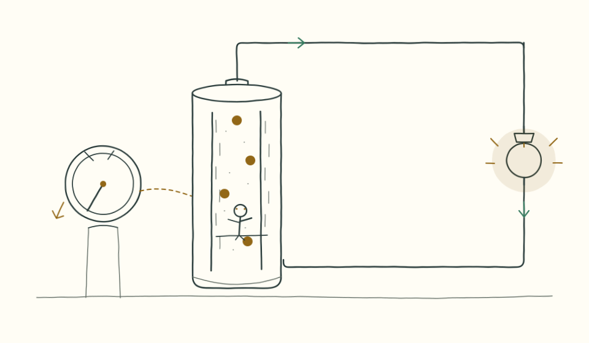
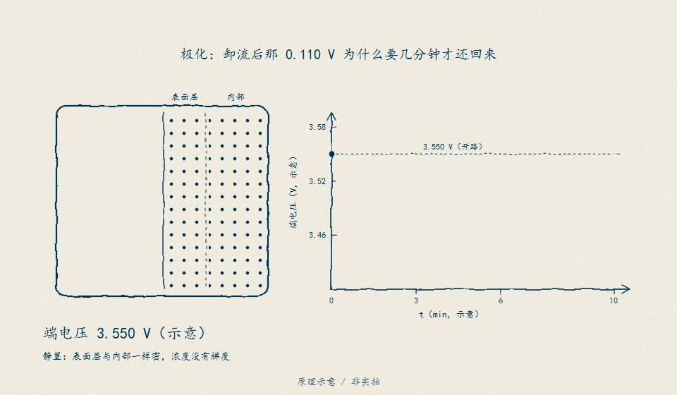
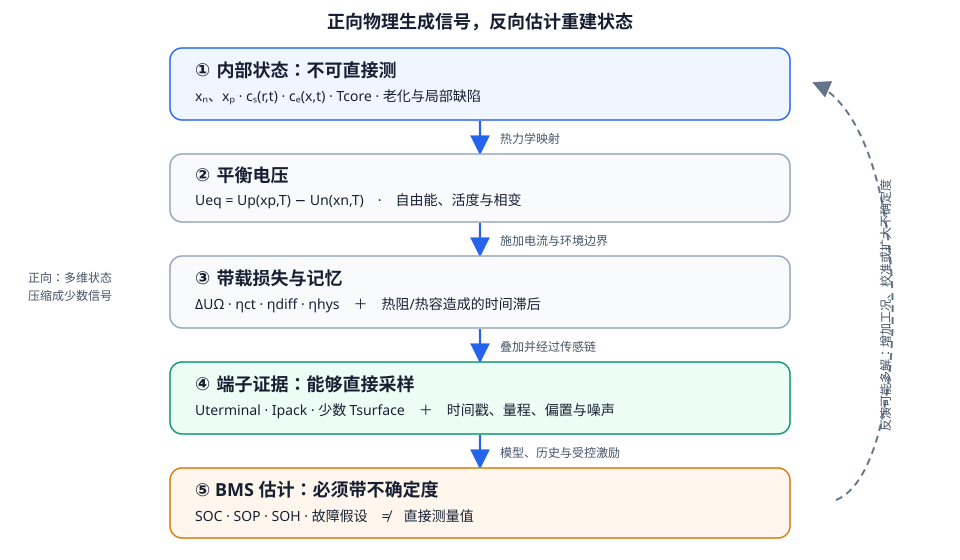
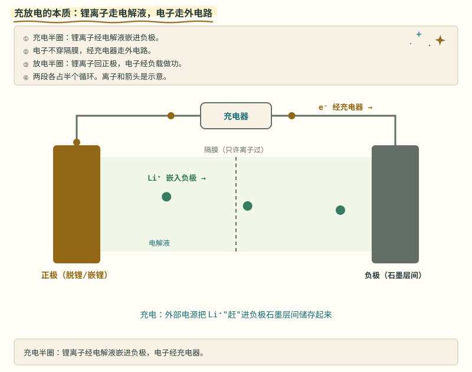
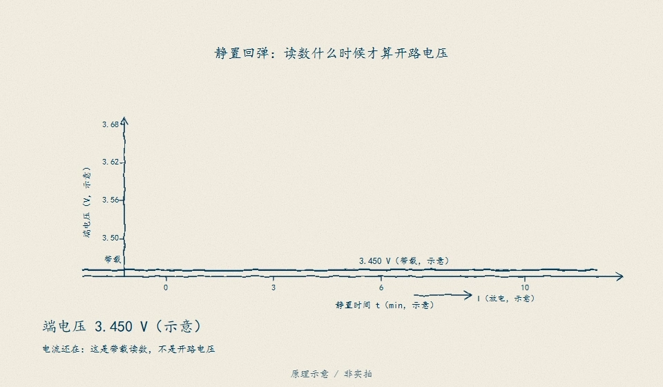
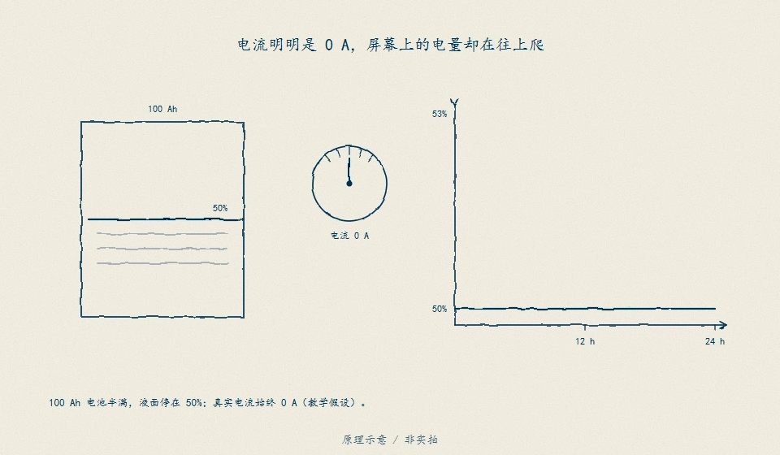

# 第 1 章 一块电池里在发生什么

<figure>

<figcaption>图 1-1　插画（手绘示意，非实拍）：电芯里靠离子来回搬运维持电势差。外部回路一接通，端子上立刻量到被压低的一截电压；本章先把这一截算清楚，再谈“还剩多少电”。</figcaption>
</figure>

::: story 现场
电动车或电动工具明明还显示有电，一用力，电量格却突然掉下去；一松手，格数又回来一点。

电量没有在一秒钟里消失又回来。变化的是**端电压**：电流一变，内部压降随之改变；撤去负载后，内部还要慢慢恢复。

本章只问：**电池明明还有电，为什么一带负载，电压就掉？**
:::

::: chapter-route 阅读路径

- **第一次主线**：读 §1.1–§1.4。先会解释现象、算一笔 `I×R`，并分清“测到的量”和“估出来的量”。
- **第二遍深挖**：再读 §1.5–§1.9。看看离子、自由能、扩散、温度和安全边界怎样支撑前面的直觉。
- **动手验证**：做 §1.10 的安全脉冲观察，或者只用表 1-1 的合成数据在纸上复算。
:::

**先自己判断**　满电电池接上负载，电压立刻下降。是电量瞬间少了，还是电流造成了压降？写下答案，读完 §1.1 再改。

## 1.1 先算一笔最简单的掉压账

先不讲电化学，只看一个教学算例。

一颗电芯充分静置时是 **3.720 V**。接入负载后，放电电流为 **20 A**。把导体、电解液、接触位置等快速阻力合在一起，暂时记成 **15 mΩ**。

`mΩ` 是毫欧，`15 mΩ = 0.015 Ω`。根据最熟悉的欧姆定律：

$$
\text{快速压降}=I R=20\ \mathrm A\times0.015\ \Omega=0.300\ \mathrm V
$$

所以，负载刚接通时：

$$
3.720\ \mathrm V-0.300\ \mathrm V=3.420\ \mathrm V
$$

这 0.300 V 是电流流过阻力留下的压降，**不是电量在一瞬间少了 0.300 V**。电压是推动电荷流动的“势差”，不是电量本身。

负载继续工作，极化又增加 **80 mV** 压降；撤流后，快速的 300 mV 先消失，较慢的 80 mV 再逐步恢复。

**表 1-1**　一次 20 A 脉冲的五个电压点（教学合成参数：静置 3.720 V、快速等效电阻 15 mΩ、慢压降 80 mV）

| 时刻 | 发生了什么 | 端电压 |
|---|---|---:|
| 充分静置 | 没有负载，内部也已基本稳定 | 3.720 V |
| 刚接负载 | 先减去 `20 A × 0.015 Ω = 0.300 V` | 3.420 V |
| 负载持续一会儿 | 再减去 0.080 V 的慢压降 | 3.340 V |
| 刚断开负载 | 0.300 V 快速压降立即消失，慢压降还在 | 3.640 V |
| 充分恢复 | 内部重新分布，慢压降也基本消失 | 3.720 V |

这五个点已经解释了“掉格又回来”的大部分现象：**带载时看到的是电池状态和负载共同作用后的电压，不是单独的剩余电量。**

## 1.2 电压为什么一部分立刻变，一部分慢慢变

- 负载一接通，电流马上要通过导体、接触点和电解液。这里产生的压降来得很快，工程上常压缩成一个快速等效电阻，记作 $R_0$。
- 电流继续流动，电极表面的物质先被消耗或堆积，内部来不及补上。这种额外压降叫**极化**。
- 负载断开后，电流造成的快速压降马上消失；内部浓度仍不均匀，所以极化只能慢慢松弛。

“极化”听起来抽象，说人话就是：**电芯内部为了维持当前电流，不得不额外付出的电压代价。**

<figure class="book-motion" data-animation="polarization-physics.webp" data-mode="static">

<button type="button" data-book-motion v-book-motion aria-pressed="false" hidden>播放动画</button>
<figcaption>图 1-2　先看时间顺序：接通时快速跳变，持续带载时继续缓慢下垂，断开时先跳回一截，再慢慢恢复。前者主要对应快速压降，后者主要对应极化松弛。</figcaption>
</figure>

第一次阅读可以先用下面这个最小模型：

$$
\text{带载电压}\approx\text{静置电压}-\text{快速压降}-\text{慢压降}
$$

它还不是完整电芯模型，但足够帮助你读懂后面大多数曲线。

## 1.3 同一个低电压，可能有五种解释

看到电压低，不能立刻断言“没电了”。至少有下面几种可能：

**表 1-2**　端电压偏低的常见原因与最小核对方法

| 可能原因 | 为什么会低 | 先看什么证据 |
|---|---|---|
| SOC 较低 | 可用电荷库存确实减少 | 撤流后的恢复电压、此前的电流积分 |
| 电流较大 | `I×R` 压降随电流增大 | 同一时刻的电流，改变负载后的电压跳变 |
| 温度较低 | 反应和扩散变慢，等效阻力增大 | 电芯温度、同一 SOC 的冷热对照 |
| 电芯老化 | 容量减少或阻抗增加 | 容量测试、固定协议下的脉冲对照 |
| 测量有偏差 | 采样链自身报错 | 独立仪表校准、通道互换或基准源检查 |

因此，一条电压曲线通常不是答案，而是一条线索。BMS 要把电压与电流、温度、时间和历史一起看。

<figure>

<figcaption>图 1-3　内部状态经过多层作用，最后只在端子上留下少数信号。正向看是“内部怎样生成电压”，反向看则可能一题多解，所以估计必须带上工况和不确定度。</figcaption>
</figure>

::: trap 坑
只截一张电压最低时的图，往往无法判断电芯到底是没电、太冷、老化，还是正被大电流拉低。至少要同时保留电流、温度和时间轴。
:::

## 1.4 BMS 能直接测什么，又在猜什么

BMS 无法直接观察电极颗粒内部，只能读取少数传感信号。

**表 1-3**　BMS 的直接测量与估计结果

| 量 | 是直接测量吗 | 它直接告诉我们什么 | 它不能单独证明什么 |
|---|---|---|---|
| 端电压 $U$ | 是 | 两端此刻的电势差 | 不能单独证明 SOC |
| 包电流 $I$ | 是 | 外电路中电荷流动有多快、方向如何 | 不能单独说明每个并联支路怎样分流 |
| 表面温度 $T_s$ | 是 | 传感器附近有多热 | 不能保证电芯内部没有热点 |
| SOC | 否，是估计值 | 剩余可用电荷的大致比例 | 不是某个传感器直接读出的真值 |
| SOH／SOP | 否，是估计值 | 健康程度与当前可用功率 | 不能脱离模型、工况和验证记录 |

::: principle 一句话
**电压、电流、温度是探针；SOC、SOH、SOP 是根据探针和模型推出来的答案。** 答案可以很有用，但必须允许被校准、被质疑，也要知道什么时候证据不够。
:::

第一次读到这里即可。若想先动手，直接去 §1.10；下面的离子、自由能与扩散解释留给第二遍。

## 1.5 电芯里面有两条路

一节锂离子电芯里，离子和电子走的不是同一条路。

- **锂离子走里面**：在电解液和隔膜中移动；
- **电子走外面**：经过集流体、导线和负载；
- 两条路必须在正负极界面配合，电流才能持续。

**表 1-4**　电芯四个区域的简单分工

| 区域 | 主要移动者 | 主要任务 | 不能做什么 |
|---|---|---|---|
| 负极活性材料 | 颗粒内电子、嵌入态锂 | 储存或释放锂 | 不能让电子直接穿过隔膜 |
| 电解液与隔膜 | Li⁺ 与配对阴离子 | 提供离子通路并隔开两极 | 理想情况下不传导电子 |
| 正极活性材料 | 颗粒内电子、嵌入态锂 | 接收或释放锂 | 不能代替外电路送电子 |
| 集流体与外电路 | 电子 | 把电子送到另一极 | 不输送 Li⁺ |

放电时，电子经外电路流向正极，Li⁺ 经电芯内部流向正极；充电时两者同时反向。本书统一采用**充电电流为正、放电电流为负**的工程约定。

<figure class="book-motion" data-animation="li-ion-working.svg" data-mode="static">

<button type="button" data-book-motion v-book-motion aria-pressed="false" hidden>播放动画</button>
<figcaption>图 1-4　先跟住内部的 Li⁺，再跟住外部的电子。二者在电极／电解液界面配合，电子不穿隔膜；充电时两者都反向。</figcaption>
</figure>

## 1.6 电压来自化学能，不是“剩余格数”

静置足够久、接近平衡时，两极的化学状态决定平衡电压，也就是开路电压 OCV。

单位反应可以释放的吉布斯自由能决定平衡电压：

$$
U_{\mathrm{eq}}=-\frac{\Delta_{\mathrm r}G}{nF}
$$

其中 $n$ 是每次反应转移的电子数，$F$ 是法拉第常数。组成变化时，理想形式可写成 Nernst 方程：

$$
U_{\mathrm{eq}}=U^\circ-\frac{RT}{nF}\ln Q_{\mathrm r}
$$

在 25 °C、$n=1$ 时，反应商每变化 10 倍，理想电压约变化 59.16 mV。但 $Q_{\mathrm r}$ 不是容量或 SOC；真实嵌入电极还有非理想活度、相变和两极各自的平衡电位，不能把“59 mV”换算成电量格。

全电芯 OCV 是正、负极平衡电位之差：

$$
U_{\mathrm{ocv}}=U_{\mathrm p}(x_{\mathrm p},T)-U_{\mathrm n}(x_{\mathrm n},T)
$$

所以必须分清两个词：**OCV 是接近平衡时的参考电压；端电压是此刻真正量到、同时含有带载损失的电压。**

<figure class="book-motion" data-animation="ocv-rest-timeline.webp" data-mode="static">

<button type="button" data-book-motion v-book-motion aria-pressed="false" hidden>播放动画</button>
<figcaption>图 1-5　撤流只先消除快速压降，内部仍在松弛。电压变化足够慢并满足静置协议后，才适合和 OCV 表比较；校正与滞回见第 12 章。</figcaption>
</figure>

## 1.7 SOC 是库存账，不是电压表刻度

SOC 可以先理解成“还剩多少可用电荷”的工程账本。若满电容量为 $Q_{\mathrm n}$，本书采用充电为正的约定，库仑积分写成：

$$
z(t)=z(t_0)+\frac{1}{3600Q_{\mathrm n}}\int_{t_0}^{t}\eta_I I(\tau)\,\mathrm d\tau
$$

公式做的事很朴素：把每一小段的电流换成电荷变化，持续加到初始库存，再除以采用的满电容量，得到 0–1 的比例。

纯积分会遇到初值不准、电流零偏和容量老化等问题，所以还要用静置 OCV、满充条件或状态估计算法校正。第 12 章会从一笔“空秤没归零”的日常账开始讲。

<figure class="book-motion" data-animation="coulomb-counting.webp" data-mode="static">

<button type="button" data-book-motion v-book-motion aria-pressed="false" hidden>播放动画</button>
<figcaption>图 1-6　真实电流为 0 A，传感器却多报 +0.1 A，24 h 后账本虚增 2.4 Ah。积分不会发现“秤没归零”，SOC 必须校正。</figcaption>
</figure>

SOC 只说明总库存，不说明锂的分布。颗粒平均浓度接近“还有多少”，表面浓度却直接影响当前反应。因此平均还有余量时，表面也可能不适合继续大电流充放。

## 1.8 扩散与温度：为什么电芯需要时间

物质移动需要时间。带载时颗粒表面先变，内部随后跟上；撤流后仍会重新分布。这是 §1.2 中慢压降和慢恢复的来源之一。

球形颗粒中的固相扩散常写成：

$$
\frac{\partial c_{\mathrm s}}{\partial t}
=\frac{D_{\mathrm s}}{r^2}\frac{\partial}{\partial r}
\left(r^2\frac{\partial c_{\mathrm s}}{\partial r}\right)
$$

一个实用的时间尺度估计是：

$$
\tau_{\mathrm D}\sim\frac{R_{\mathrm p}^2}{D_{\mathrm s}}
$$

取教学值 $R_{\mathrm p}=5\ \mu\mathrm m$、$D_{\mathrm s}=10^{-14}\ \mathrm{m^2/s}$，约为 2500 s，即 42 min；扩散系数增大 10 倍，则约 250 s。这不是材料常数，只说明：**路径变长，等待时间按平方增长；扩散变快，等待时间缩短。**

温度又会改变反应和扩散速度。低温时，同样电流往往需要更大压降；高温可能暂时减小部分阻力，却会加快副反应和老化。因此“低温性能差”和“高温寿命差”可以同时成立。

电压损失还会变成热。一阶热账可拆成不可逆热与可逆熵热；本书充电电流取正，熵热式中的温度用开尔文：

$$
\dot Q_{\mathrm{irr}}=I\left(U-U_{\mathrm{eq}}\right),\qquad
\dot Q_{\mathrm{rev}}=IT_{\mathrm K}\frac{\partial U_{\mathrm{eq}}}{\partial T}
$$

温度传感器通常贴在表面，它看到的是经过热阻和热容延迟后的温度，而不是电芯内部每个位置的即时温度。完整热账留到第 30 章。

## 1.9 “内阻”和安全结论都必须带条件

“这颗电芯内阻 20 mΩ”只说了半句话。至少还要问：什么温度、什么 SOC、多大电流、脉冲多长、取哪个电压点？

**表 1-5**　不同观察时间容易看见的过程

| 观察时间 | 更容易看见什么 | 工程模型里的影子 |
|---|---|---|
| 仪器能分辨的最快阶跃 | 导体、接触、电解液的快速压降 | $R_0$ 的一部分 |
| 毫秒至秒 | 界面反应与双电层 | 高频 RC、电荷转移阻力 |
| 秒至数十分钟 | 固相／电解液扩散 | 一个或多个 $R_iC_i$ |
| 数十秒至数小时 | 热积累与散热 | 热阻–热容网络 |
| 循环至日历时间 | 容量和阻抗慢慢变化 | 老化参数漂移 |

同一电芯用 10 ms 和 10 s 脉冲得到的“内阻”通常不同，后者算进了更多极化。数值必须连同测试协议保存。

BMS 也有边界。外部短路经过端子和开关，可由比较器、熔断器或接触器切断；内部短路在电芯内，即使外部断开仍可能继续。BMS 只能检测、停机和隔离整包，不能切开内部短路点。

所以安全要分层：材料制造预防，传感算法检测，开关熔断切断外路，结构和热设计减缓传播。开源代码和阈值不能代替这些层级。

## 1.10 动手验证，并知道下一步去哪

::: lab 动手
最安全的做法是先用表 1-1 的合成数据画出时间轴，标出“刚接通、负载末端、刚断开、充分恢复”四个观察位置。

如果使用真实电芯，只能在确认电芯、导线、负载、保险与仪表量程都允许的条件下，由具备相应经验的人做低风险脉冲观察。记录静置电压，接入已知安全负载数秒，再断开并继续记录；不要拆电芯，也不要只抄最低电压。不确定时使用第 10 章的合成模型。
:::

**表 1-6**　从本章问题继续向下学

| 你接下来想弄懂什么 | 去哪一章 |
|---|---|
| 不同化学体系为什么电压平台不同 | 第 3 章 |
| 电压、电流、温度怎样可靠采样 | 第 5、6 章 |
| 快速压降和慢压降怎样写成等效电路 | 第 10 章 |
| SOC 怎样记账、校准和融合 | 第 12、13 章 |
| 极化与温度怎样限制可用功率 | 第 14、30 章 |
| 容量和阻抗怎样随老化变化 | 第 15、16 章 |
| 保护怎样在限定时间内动作并留下证据 | 第 7、25、26 章 |

## 练习

1. **判断机制**：一块电池接上负载后电压立即下降，断开后立即回升一截。为什么这不能证明电量先消失、又恢复？请只用两句话回答。
2. **手算量级**：复算 §1.1 的五个电压点。若快速等效电阻从 15 mΩ 增大到 25 mΩ，20 A 负载刚接通时电压是多少？其他条件先保持不变。
3. **指出边界**：某电芯带载电压比以前低 180 mV。写出一个最小检查顺序，区分 SOC 较低、电流较大、温度较低、阻抗增加和电压采样偏差。每一步至少写出要看的另一个信号。

## 参考资料

- Plett，ECE4710/5710 Topic 1 “Battery Boot Camp”：<http://mocha-java.uccs.edu/ECE5710/index.html>；本仓库编译导读 `docs/ece5710-notes01-中文导读.md`。
- Doyle, Fuller & Newman, “Modeling of Galvanostatic Charge and Discharge of the Lithium/Polymer/Insertion Cell”, *Journal of The Electrochemical Society* 140 (1993), DOI：<https://doi.org/10.1149/1.2221597>；PyBaMM v26.3.0 颗粒模型：<https://docs.pybamm.org/en/v26.3.0/source/examples/notebooks/models/MPM.html>。
- PyBaMM v26.10.1.1 Butler–Volmer 文档：<https://docs.pybamm.org/en/pybamm-v26.10.1.1/source/api/models/submodels/interface/kinetics/butler_volmer.html>；IUPAC《Terminology of electrochemical methods of analysis》，DOI：<https://doi.org/10.1515/pac-2018-0109>。
- Bernardi, Pawlikowski & Newman, “A General Energy Balance for Battery Systems”, *Journal of The Electrochemical Society* 132(1) (1985), DOI：<https://doi.org/10.1149/1.2113792>。
