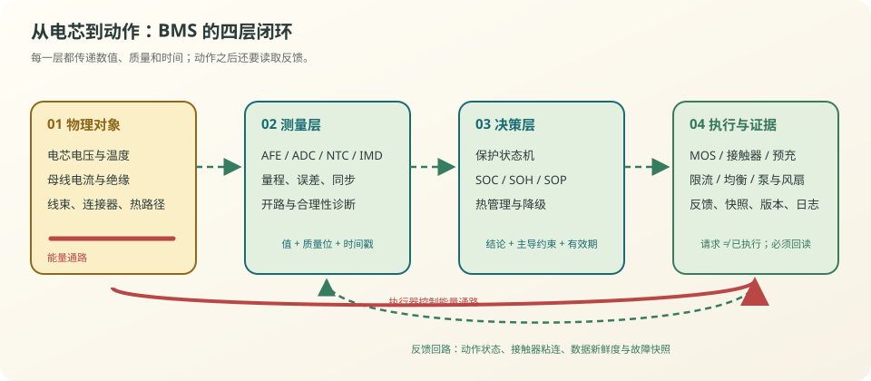
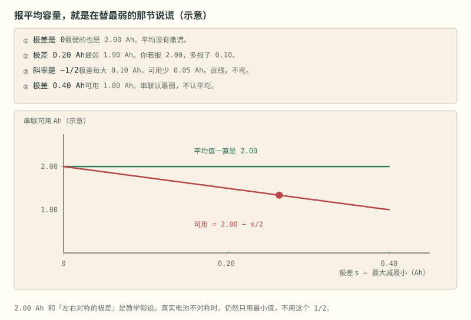

# 第 2 章 BMS 的六件事与三种形态

::: story 现场
一块 16 串的储能 pack，单体电压都正常，SOC 显示 55%。但第 7 串的温度比别的串高 8 °C，内阻也大 20%。它会在充电时先到 3.65 V，在放电时先到 2.8 V——整包可用容量被它一个人吃掉。BMS 如果只报“平均 SOC 55%”，就把这个短板藏得干干净净。
:::

## 2.1 六件事

**表 2-1**　BMS 六件事的输入、输出与失败样子（职责对照，无测量数字）

| 职责 | 输入 | 输出 | 失败的样子 |
|---|---|---|---|
| 测量 | 单体电压、电流、温度 | 采样值、诊断 | 过充漏判、SOC 漂移 |
| 状态估计 | 采样、模型、历史 | SOC/SOH/SOP | 续航虚标、功率误判 |
| 保护 | 阈值、延时、故障 | 断口、限流、告警 | 热失控 |
| 均衡 | 压差、温度、充电状态 | 均衡开关 | 局部过热、容量浪费 |
| 通信 | 内部总线、整车/EMS | CAN/Modbus/MQTT | 上层误决策 |
| 数据 | 事件、波形、统计 | 日志、黑匣子 | 事故无法追溯 |

这六件事里，**安全保护不能依赖状态估计任务持续正常运行**。SOC 错误会影响显示，也可能影响功率与充放电控制，是否可容忍取决于用途。系统应设置独立的监控与硬件保护通路；代码分成两个函数，并不能证明两条通路独立。

但“独立”不等于“互不通信”。状态估计可以给功率限制提供更精细的边界，保护链路却不能依赖 SOC 算法活着才能动作。一个实用的判断方法是：**拔掉上位机、让主算法卡死，过压和过温还能不能关断？**

## 2.2 从信号到动作：四层闭环

<figure>

<figcaption>图 2-1　从物理对象、测量、决策到执行与证据的四层闭环。虚线表示信息与反馈，红线表示执行器所控制的能量通路；证据贯穿各层。</figcaption>
</figure>

把一套 BMS 拆成四层，会比按芯片型号记忆更稳：

1. **物理对象**：电芯、母线、线束与热路径，决定哪些状态能被看到、哪些能量必须被控制；
2. **测量层**：分压、采样电阻、NTC、绝缘监测把物理量变成带误差的数字；
3. **决策层**：保护状态机、SOC/SOH/SOP、热管理请求把数字变成结论；
4. **执行与证据**：MOS、接触器、均衡和热管理把结论变成动作，反馈确认动作是否到位。时间戳、故障快照、版本、校准参数与日志贯穿各层。

这四层之间不能只传一个“值”，还要传**质量**。例如单体电压 `3.612 V` 至少应同时带上采样时间、通道诊断、是否开路、是否超时；否则上层得到的是一个长得像数字的未知物。

::: principle 一句话
控制闭环里，**值回答“是多少”，质量位回答“能不能信”，时间戳回答“现在还算不算数”**。
:::

## 2.3 三种硬件形态

**集中式**：一块板扫完所有串。便宜、体积小，但线束长、扩展性差，适合 16S 以下。

**分布式（主从）**：每个模组一个从控（CMC/BMU-Slave），负责采样、均衡、本地保护；主控（BCU）汇总、估算、控制接触器。foxBMS 2 就是这一路。

**模块化/菊花链**：从控之间用隔离菊花链串起来，减少线束。扩展方便，代价是通信故障定位更复杂。

**表 2-2**　三种硬件形态的收益、代价与设计先问（架构对照，无测量数字）

| 形态 | 主要收益 | 首要代价 | 设计时先问 |
|---|---|---|---|
| 集中式 | 成本低、链路短 | 长采样线束、共模与维修压力 | 最远采样线多长，开路怎样发现？ |
| 主从式 | 模组自治、易扩展 | 节点、供电与通信故障增多 | 从控失联时谁还能关断？ |
| 菊花链 | 隔离与线束更整齐 | 单点断链、时序与诊断复杂 | 断在第 N 节时还能看到哪些节点？ |

架构选择不是“串数到了多少就换一种”，而是线束、隔离、维修、同步采样、功能安全与成本的联合决策。16 串教学板可以集中式；16 串高共模、长线束、强干扰的工业设备，仍可能需要隔离与分布式设计。

## 2.4 木桶：串联认最小

串联电芯流过同一电流，容量由最弱单体决定。BMS-Z 在首页用了一个很狠的设计：把七篇验收清单画成七节电芯，**包 SOC 取最小值**，平均只标成“安慰值”。

这不是 UI 噱头，是 BMS 的核心事实：

- 充电时，容量最小的先到上限；
- 放电时，它又先到下限；
- 平均 SOC 会把这一节藏起来，让你以为“还有 50%”。

均衡能补偿荷电量差以及持续自放电造成的失配，但不能恢复衰减容量或消除自放电根因。**均衡不是修复。**

更严格地说，“最弱”有三张脸：

- **容量最弱**：同样电流下最先耗尽，限制可用 Ah；
- **内阻最大**：同样电流下压降和发热最大，限制可用功率；
- **热边界最差**：散热最差或测温最迟，限制持续工况。

因此 pack 的 SOC、SOP 与安全余量不能只认同一个排序。容量最小的电芯未必是 10 秒脉冲时电压掉得最快的电芯；BMS 要保留单体分布，不能把一切压成平均数。

把这件事算成一笔公开的账。取教学值：五节串联，额定容量 3.0 Ah，同一 1.5 A（0.5C）电流；单体电压窗口 2.80–3.65 V，并简化为下限对应 10% SOC、上限对应 90% SOC（真实 OCV 曲线非线性，这里只算库仑账）。五节初始都是 55% SOC，但第 4 节因老化只剩 2.2 Ah：

**表 2-3**　五节串联木桶账：最弱单体先到上下限（教学合成值：0.5C、55% 起点）

| 单体 | 容量 (Ah) | 初始 SOC | 放到下限的可用 (Ah) | 充到上限的需充 (Ah) |
|---|---:|---:|---:|---:|
| 1 | 3.0 | 55% | 0.45 × 3.0 = 1.35 | 0.35 × 3.0 = 1.05 |
| 2 | 3.0 | 55% | 1.35 | 1.05 |
| 3 | 3.0 | 55% | 1.35 | 1.05 |
| **4** | **2.2** | **55%** | **0.45 × 2.2 = 0.99 ← 最先到 2.80 V** | **0.35 × 2.2 = 0.77 ← 最先到 3.65 V** |
| 5 | 3.0 | 55% | 1.35 | 1.05 |

同一 1.5 A 放电，第 4 节 39.6 min 先到 2.80 V，整包只能放出 **0.99 Ah**；平均 SOC 55% 暗示的 1.35 Ah 是安慰值，虚增约 27%。同一 1.5 A 充电，第 4 节 30.8 min 先到 3.65 V，充电也必须随它收口。复算只有一行式子：$t=\Delta\mathrm{SOC}\times C/I$。注意这笔账里第 4 节输在两个方向——容量小意味着同样的 SOC 变化对应的安时少，不是它"更耗电"。均衡能搬平的是荷电量差；2.2 Ah 的物理容量衰减搬不回来，这正是本节后面要说的边界。

<figure class="book-motion" data-animation="weakest-cell-ah.svg" data-mode="static">

<button type="button" data-book-motion v-book-motion aria-pressed="false" hidden>播放动画</button>
<figcaption>图 2-2　最弱单体的安时账：串联电流相同，但各单体能到上下限的余量不同。所有容量为教学示例。</figcaption>

<strong>先看哪里：</strong>先看哪一节最先碰边界，再看平均数：平均余量不能让先到下限的单体继续放电。

<strong>看完追问：</strong>如果只改变第 7 串的容量，充电上限与放电下限会怎样限制整包？

</figure>

## 2.5 谁负责最后一跳

工程上最危险的空白，常出现在“大家都以为别人负责”的接口处：

**表 2-4**　四个接口场景的最后一跳与最少证据（职责分界对照，无测量数字）

| 场景 | 感知者 | 决策者 | 执行者 | 最少要留下的证据 |
|---|---|---|---|---|
| 单体过压 | AFE | 本地保护状态机 | 充电 MOS/主接触器 | 越限值、连续拍数、关断反馈 |
| 绝缘下降 | IMD | VCU/BCU 安全逻辑 | 高压接触器 | 正负母线电压、绝缘值、HVIL 状态 |
| 放电功率受限 | 电压/温度/电流采样 | SOP 算法 | VCU/逆变器 | 限值、主导约束、有效期 |
| 数据失联 | 通信栈 | 接收端降级逻辑 | 应用层/安全状态机 | 最后有效时间、丢帧数、替代值 |

表里每一行都要有明确的“最后一跳”：谁真的切断能量，谁确认切断成功。只发送一个 `shutdown_request = 1` 不算闭环；接触器可能粘连，MOS 可能击穿，通信可能在请求发出前就中断。

## 2.6 BMS 不负责什么

- 不负责电芯本体的安全设计（隔膜、泄压、热蔓延隔离）。
- 不负责全部保护（熔断器、断路器、服务开关、绝缘监测通常是独立部件）。
- 不负责热管理执行（水泵、风扇、压缩机由热管理控制器执行）。
- 不负责功能安全认证（认证覆盖系统与组织流程）。

把边界写进需求文档，比在代码里加一百个 `if` 更重要。

::: trap 坑
把“平均 SOC”当成“可用 SOC”。串联 pack 的可用容量由最弱单体决定；平均 55% 的 pack，可能有一节已经在 5%。
:::

::: lab 动手
打开 BMS-Z 首页，勾几格验收清单，看“包 SOC”和“平均（安慰值）”怎么分叉。再画一条“第 7 串过温”的证据链：从 NTC、ADC、诊断、状态机一直画到接触器反馈；任何一格没有责任人，就标成接口风险。
:::

## 练习

1. 画出你手边任意一块 BMS 的四层框图，标出六件事分别落在哪块芯片/哪段代码，并给每个关键值补一个质量位。
2. 为什么“保护”与“SOC 估计”要独立？设计一次“主算法卡死”的故障注入，写出期望动作与验收证据。
3. 主从架构里，从控掉线时主控应该做什么？分别为静置、充电和大功率放电列出降级策略与代价。

## 参考资料

- BMS-Z 阶段 1：https://github.com/zhuguang-ZFG/BMS-Z/blob/main/docs/stages/stage-1-认识BMS.md
- BMS-Z 首页（包 SOC 演示）：https://zhuguang-zfg.github.io/BMS-Z/
- foxBMS 2：https://github.com/foxBMS/foxbms-2
