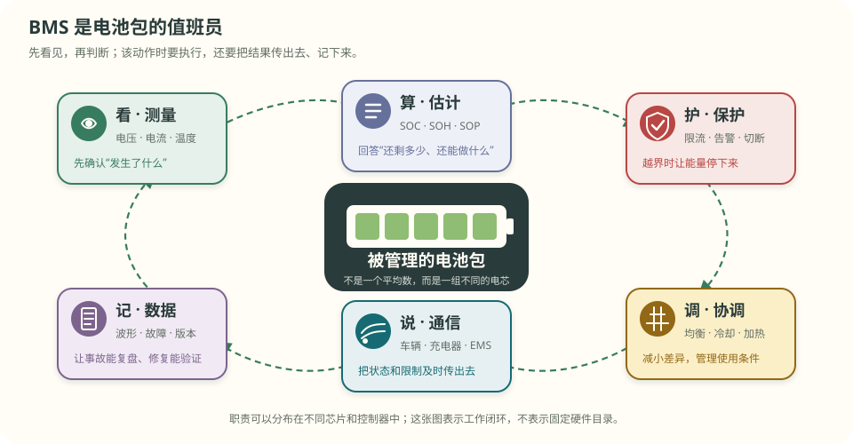

# 第 2 章 BMS 到底是做什么的

::: story 现场
一块电池包由很多节电芯串在一起。仪表显示“还剩 55%”，看起来很安全；但其中一节老化得更快，充电时它最先碰到上限，放电时又最先碰到下限。

整包像一支系在一起行走的队伍：最弱的一节不能继续，其他电芯即使还有余量，也必须一起停下来。

这就是为什么电池包不能只接一块电量显示器。它需要一套管理系统，分别监测每一节、判断还能做什么，并在危险前采取动作。这套系统就是 **BMS（Battery Management System，电池管理系统）**。
:::

先记住一句最简单的定义：

> **BMS 是电池包的值班员：看、算、保护、协调、传话、记账。**

**本章分三层，不必一次读完。**

- **第一次主线**：读 §2.1–§2.4。知道为什么需要 BMS、它做哪六件事，并算懂“最弱电芯拖住整包”。
- **第二遍深挖**：读 §2.5–§2.8。学习信号怎样变成动作、硬件怎样分布，以及工程责任在哪里交接。
- **动手验证**：做 §2.9 的纸上实验，画出六项职责检查表。

**先自己判断**　五节串联电芯的 SOC 分别是 60%、60%、60%、10%、60%。整包还能不能按平均值 50% 继续放心放电？先写下答案，读完 §2.3 再回来改。

## 2.1 为什么电池包需要管理系统

单节电芯已经会受到过充、过放、过流和过热的伤害。多节电芯组成电池包后，又多出一个麻烦：**每一节不会永远完全相同。**

它们可能在出厂时容量略有差别，也可能因为温度、散热、连接电阻和老化速度不同，逐渐拉开差距。串联时，所有电芯流过同一股电流，但每一节离上限和下限的距离并不一样。

如果只看整包总电压或平均数，就可能把最危险的那一节藏起来。因此 BMS 至少要回答三个问题：

1. 每一节现在怎么样？
2. 整包现在还能充多少、放多少、出多大功率？
3. 如果越过安全边界，谁来限制或切断电流？

## 2.2 六件事：看、算、保护、协调、传话、记账

工程文档常把 BMS 功能写成一长串术语。第一次读，可以先把它们翻成六个普通动作。

**表 2-1**　BMS 的六件事：先用人话理解，再认识工程名称

| 人话 | 工程名称 | 它在做什么 | 做不好会怎样 |
|---|---|---|---|
| 看 | 测量 | 读取每节电压、总电流和若干温度 | 看漏危险，后面的判断全错 |
| 算 | 状态估计 | 估计 SOC、SOH、SOP | 电量、健康和可用功率报错 |
| 保护 | 保护与故障管理 | 越限时限流、告警或断开充放电 | 过充、过放、过热或短路伤害扩大 |
| 协调 | 均衡与热管理请求 | 减小电芯差异，协调冷却或加热 | 有余量却用不上，局部越来越热 |
| 传话 | 通信 | 把状态和限制告诉车辆、充电器或储能系统 | 上层拿旧数据或错误限值做决定 |
| 记账 | 数据与诊断 | 保存故障发生前后、版本和配置 | 出问题后无法复盘，也无法证明修好 |

这六件事不是六个互不相干的按钮。例如“看”发现某节过压，“保护”决定停止充电，“传话”通知充电器，“记账”保存发生时间和原始值。任何一环断掉，系统都可能只做了半件事。

<figure>

<figcaption>图 2-1　BMS 的六件事。先沿顺时针读：看见现场，算出状态，保护边界，协调差异，向外传话，最后留下记录。图是职责地图，不表示六件事一定由六颗独立芯片完成。</figcaption>
</figure>

::: principle 一句话
**BMS 不会让电芯变得完美；它负责尽早看见差异，在边界内使用电池，并在越界时安全停下来。**
:::

## 2.3 木桶效应：整包听最弱的一节

先算一笔最简单的账。五节电芯串联，起点都显示 55% SOC。其中四节容量为 3.0 Ah，第 4 节老化后只剩 2.2 Ah。教学上先把放电下限简化成 10% SOC。

从 55% 放到 10%，每节都能使用自身容量的 45%。

- 普通电芯可放：$0.45\times3.0=1.35\ \mathrm{Ah}$；
- 第 4 节可放：$0.45\times2.2=0.99\ \mathrm{Ah}$。

串联电流必须经过每一节。第 4 节放出 0.99 Ah 后先碰到下限，整包必须停止；其他四节剩下的余量不能绕过它继续送出来。

**表 2-2**　五节串联的木桶账（教学合成值，55% 起点、10% 放电下限）

| 单体 | 当前容量 | 到下限可放出的电量 |
|---|---:|---:|
| 1 | 3.0 Ah | 1.35 Ah |
| 2 | 3.0 Ah | 1.35 Ah |
| 3 | 3.0 Ah | 1.35 Ah |
| **4** | **2.2 Ah** | **0.99 Ah，最先到下限** |
| 5 | 3.0 Ah | 1.35 Ah |

如果用 1.5 A 放电，第 4 节大约能坚持：

$$
t=\frac{0.99\ \mathrm{Ah}}{1.5\ \mathrm A}=0.66\ \mathrm h=39.6\ \mathrm{min}
$$

普通电芯原本可支持 54 min，但整包只能按 39.6 min 使用，少了约 27%。这不是 BMS “浪费电”，而是它必须阻止最弱电芯被继续过放。

<figure class="book-motion" data-animation="weakest-cell-ah.svg" data-mode="static">

<button type="button" data-book-motion v-book-motion aria-pressed="false" hidden>播放动画</button>
<figcaption>图 2-2　先找最短的那根柱子：它先碰到上限或下限，整包就必须停。平均数不能把余量借给最弱电芯。播放动画时，只观察“谁先触线”，不必先记全部数字。</figcaption>
</figure>

“最弱”还不只有容量一种：

- 容量最小的电芯先耗尽，限制能用多少电；
- 阻抗较大的电芯在大电流下掉压和发热更多，限制能出多大力；
- 散热最差的电芯先变热，限制能持续工作多久。

所以 BMS 要保留每节电芯的差异，不能只报一个平均 SOC。

## 2.4 均衡能帮忙，但不能返老还童

如果一节只是比其他电芯“多充了一点”或“少充了一点”，均衡可以搬走或转移少量电荷，让大家更接近。这像让队伍在出发前重新站齐。

但如果一节的实际容量已经从 3.0 Ah 衰减到 2.2 Ah，均衡不能把丢掉的材料和容量变回来。它只能调整当前电量差，不能修复电芯本体。

**表 2-3**　均衡能做什么，不能做什么

| 情况 | 均衡是否可能有帮助 | 原因 |
|---|---|---|
| 某节只是比别人多充一点 | 可以 | 能释放或转移少量电荷 |
| 某节长期自放电稍快 | 只能缓解 | 可以反复补差，但根因仍在 |
| 某节容量已经明显衰减 | 不能修复 | 物理容量没有被均衡恢复 |
| 某节温度异常或内部短路 | 不能当维修手段 | 应先诊断并采取安全措施 |

第一次主线到此结束：BMS 不能只看平均数，还要完成测量、估计、保护、协调、通信和记录。想先做纸上练习时，可以跳到 §2.9。

## 2.5 从一个数值到真正动作，中间有四层

一条单体电压不会自己关掉充电器。它要经过“被测到—被判断—发出命令—确认动作”四层。

<figure>

<figcaption>图 2-3　从物理对象到执行反馈的四层闭环。重点看最后一条反馈箭头：发出关断命令不等于电流真的停了，还要回读电流、端口电压或接触器状态。</figcaption>
</figure>

1. **物理对象**：电芯、线束、连接器和热路径，是真正被管理的东西；
2. **测量层**：把电压、电流、温度等物理量变成数字；
3. **决策层**：判断是否安全、还能充放多少、是否需要降级；
4. **执行与证据层**：驱动 MOS、接触器、均衡或热管理，并确认动作是否到位。

层与层之间不能只传一个数字。例如 `3.612 V` 还应带着三个问题：什么时候采的？通道有没有故障？这条数据是不是已经过期？工程上常把它们叫作时间戳和质量状态。

## 2.6 三种常见硬件形态

BMS 的六件事不一定都装在同一块板上。常见有三种组织方式。

**表 2-4**　三种硬件形态：先看适用问题，不按串数机械套用

| 形态 | 说人话 | 主要优点 | 主要代价 |
|---|---|---|---|
| 集中式 | 一块板看完所有电芯 | 成本低、链路短 | 采样线可能很长，扩展和维修压力大 |
| 主从式 | 每个模组有采样从控，主控统一协调 | 易扩展、故障可分区 | 节点和通信变多，从控失联要降级 |
| 菊花链 | 从板像串队一样逐级传数据 | 隔离与线束更整齐 | 某处断链时要判断还能看见哪些节点 |

“16 串以下一定集中式”只能当粗略经验，不能当设计定律。线束长度、共模电压、干扰、维修方式、同步要求和安全目标都可能改变选择。

在中大型系统里，主控常被叫作 **BCU** 或 BMU，靠近模组、直接监测电芯的从控常叫 **CMC** 或 CMU；储能站上层还可能有 **EMS** 负责功率调度。名字并不统一，不能只凭缩写判断职责：无论怎样命名，都要画清谁采样、谁做电池安全决策、谁执行，以及谁负责整站能量调度。

## 2.7 保护为什么不能只依赖 SOC 算法

SOC 是估计结果，依赖电流传感器、初始值、容量参数和算法持续运行。它适合回答“还剩多少”，却不应成为所有快速保护的唯一入口。

想象主算法卡死，但某节仍在继续充电。如果过压保护必须等 SOC 程序恢复才能动作，系统就把安全寄托在一个可能失效的软件任务上。

因此关键保护通常要有独立监控或硬件快速通路。这里的“独立”不是指代码分成两个函数，而是要追问：它们是否共用同一个传感器、处理器、时钟、电源和失效原因？真正的独立程度必须由系统分析和测试证明。

## 2.8 谁负责最后一跳

最危险的空白常常不是“没人发现故障”，而是大家都以为别人会完成最后动作。

**表 2-5**　四个场景里谁感知、谁决定、谁真正执行

| 场景 | 谁先看见 | 谁决定 | 谁执行 | 最少留下什么证据 |
|---|---|---|---|---|
| 单体过压 | 电压采样链 | 本地保护逻辑 | 充电 MOS 或接触器 | 越限值、确认次数、关断反馈 |
| 温度过高 | 温度传感器 | 保护或热管理逻辑 | 限流、风扇、泵或接触器 | 温度、限值、动作与反馈时间 |
| 可用功率下降 | 电压／电流／温度测量 | SOP 算法 | 车辆或逆变器降功率 | 限值、主导原因、有效期 |
| 通信失联 | 接收端通信栈 | 降级逻辑 | 应用或安全状态机 | 最后有效时间、丢帧数、替代策略 |

只把 `shutdown_request` 置为 1，不等于能量已经被切断。接触器可能粘连，MOS 可能损坏，通信也可能中断。闭环必须看到动作后的反馈。

::: trap 坑
把“平均 SOC 还有 50%”说成“整包还能安全使用 50%”。串联电池包的可用边界由最先触线的单体决定；平均数只能描述中心位置，不能替代单体极值。
:::

## 2.9 动手验证与视频伴读

::: lab 动手
在纸上画五节串联电芯，把 SOC 写成 60%、60%、60%、10%、60%。先算平均值，再圈出真正决定放电边界的那一节。然后为一次“第 4 节过热”画六格检查表：看、算、保护、协调、传话、记账。每格只写一句“最少需要什么证据”。
:::

### 视频伴读：只看与当前问题有关的内容

视频是另一种解释，不是事实来源的替代品。平台标题、分集和可用状态已于 **2026-10-31** 核验；阈值和器件参数仍以数据手册与本书算例边界为准。

1. **中文第一选择**：B 站“汽车学堂”《电池管理系统 BMS 的主要功能详解》，约 15 分 39 秒。它由采样、状态估计、控制、通信和诊断展开，适合读完 §2.2 后对照六件事。观看任务：暂停一次，自己把视频中的功能归入“看、算、保护、协调、传话、记账”。
2. **中文系统视角**：同一系列《电池管理系统的功能分析：整车—电池系统—BMS》，约 11 分 33 秒。适合读完 §2.5 后看系统边界。观看任务：找出哪些动作由 BMS 决定，哪些由车辆或热管理执行。
3. **英文可选**：YouTube · GreatScott!《BMS — DIY or Buy》。它适合建立保护板与成品 BMS 的硬件直觉，但不能代替电芯数据手册、量产安全分析或本章的职责闭环。

如果只想看一条，选第 1 条；英文不好可以完全跳过第 3 条。

## 练习

1. **判断机制**：为什么“五节 SOC 的平均值是 50%”不能证明整包还能安全放出 50%？请指出真正应该先看的量。
2. **手算量级**：四节 3.0 Ah 电芯与一节 2.4 Ah 电芯串联，都从 60% 放到 10%。最弱电芯能放出多少 Ah？若电流为 1.2 A，多久先触线？
3. **指出边界**：某系统已经检测到单体过压，并发出接触器断开命令。还缺哪些反馈，才能证明电流真的被切断？至少写出两个可测信号和一个异常分支。

## 参考资料

- BMS-Z 阶段 1：https://github.com/zhuguang-ZFG/BMS-Z/blob/main/docs/stages/stage-1-认识BMS.md
- 汽车学堂（B 站）：[《电池管理系统 BMS 的主要功能详解》](https://www.bilibili.com/video/BV1eN4y117s3/)；[《电池管理系统的功能分析》](https://www.bilibili.com/video/BV1rC4y1d76j/)
- GreatScott!（YouTube）《BMS — DIY or Buy》：https://www.youtube.com/watch?v=rT-1gvkFj60
- foxBMS 2：https://github.com/foxBMS/foxbms-2
