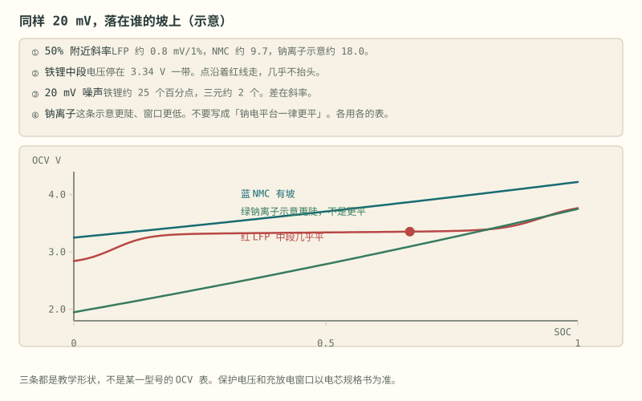
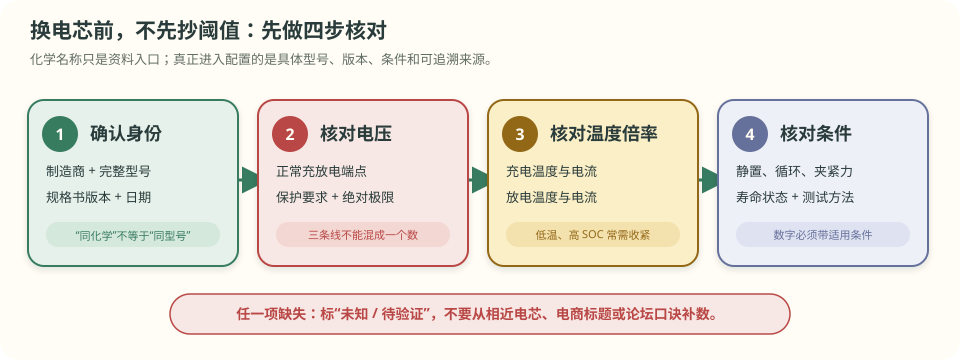
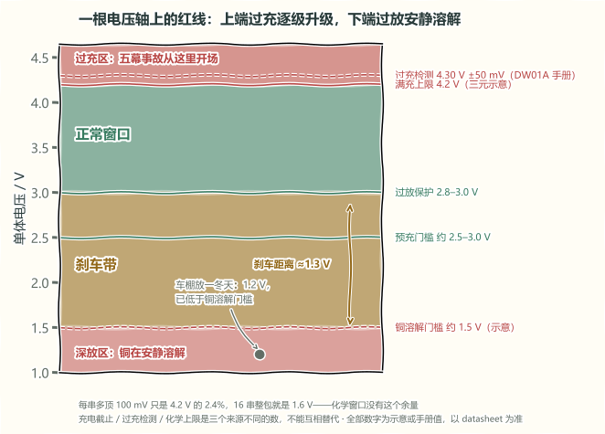
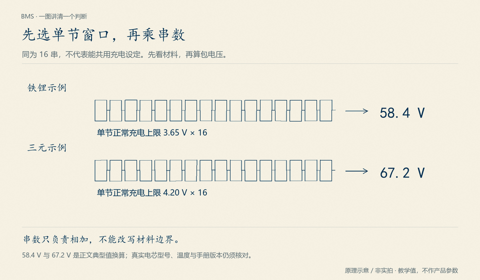

# 第 3 章 为什么不同电芯不能共用一套电压

::: story 现场
维修站里，有人把一块按普通 4.2 V 锂电设计的保护板接到另一种电芯上。保护板还在等电压升到原来的动作点，这颗电芯却可能已经超过自己的充电上限。

保护板没有坏，比较器也没有算错。错的是参数表：**电芯换了，安全窗口还留在旧型号。**
:::

> **保护阈值跟具体电芯型号和当前规格书走，不跟“三元”“铁锂”“钠离子”这几个名字走。**

::: chapter-route 阅读路径

- **第一次主线**：读 §3.1–§3.4。分清三类常见电芯的电压尺子，知道为什么 4.2 V 不能到处抄。
- **第二遍深挖**：读 §3.5–§3.8。理解曲线斜率、过充过放、温度倍率与新化学的工程边界。
- **动手验证**：完成 §3.9 的“换电芯四步核对”，学会从规格书而不是论坛口诀找阈值。
:::

**先自己判断**　一块标称 3.2 V 的铁锂电芯能不能使用普通三元锂常见的 4.2 V 充电器？是“最多充不满”，还是可能把电芯推到危险区？

## 3.1 “标称电压”不是“充到这里就停”

电芯资料里经常同时出现三个不同的电压：

- **标称电压**：用于粗略描述能量等级，不是充电停止线；
- **推荐充电截止电压**：正常充电程序到这里转入结束条件；
- **保护或绝对上限**：再往上可能损伤电芯，保护应在规定条件下介入。

标称 3.2 V 的铁锂电芯，充电上端常见示例却在 3.65 V 左右。两个数字写在同一份资料里，前者用来描述能量等级，后者才进入充电条件。

**表 3-1**　三类常见电芯的电压性格（只作入门示例，不能直接写进产品）

| 化学体系 | 常见标称电压 | 常见充电上端示例 | 一眼记住的特点 |
|---|---:|---:|---|
| 三元锂 NCM | 3.6／3.7 V | 约 4.2 V | 电压随 SOC 变化较明显 |
| 磷酸铁锂 LFP | 3.2 V | 约 3.65 V | 中段电压平台很平 |
| 钠离子 | 约 2.9–3.0 V | 常见公开样例约 3.9–3.95 V | 路线很多，窗口必须跟具体电芯走 |

这些数字只是帮助认门。即使都叫三元锂，不同型号的上限、截止条件、温度范围和允许倍率也可能不同。产品参数必须回到**型号、版本、测试条件都明确的规格书**。

## 3.2 一张保护板为什么不能到处通用

保护板做的是“把实测值与设定线比较”。如果设定线属于另一种电芯，保护板就会非常认真地执行错误规则。

假设某铁锂电芯正常充电上端按 3.65 V 管理，却接入等待 4.2 V 才结束的充电方案。两条线相差：

\[
4.20\ \mathrm V-3.65\ \mathrm V=0.55\ \mathrm V
\]

相对 3.65 V 而言，0.55 V 约为 15%，足以跨出正常工作窗口。结果不是“多充一点更耐用”，而可能是过充、发热、产气、析锂与寿命快速下降。

反过来，如果把铁锂 3.65 V 的充电上端直接套给常见 4.2 V 三元电芯，通常会提前结束，无法充分充电。一个方向可能危险，另一个方向可能损失容量；两者都说明不能混用。

::: principle 一句话
**比较器只知道“高于还是低于设定线”，不知道这条线是否属于当前电芯。选错参数，比算错公式更早出事。**
:::

## 3.3 曲线形状决定电压对 SOC 的敏感度

许多人想用静置电压直接读 SOC。这个方法能不能用，取决于 OCV–SOC 曲线有多斜。

- 曲线较斜：SOC 变化一点，电压也明显变化，电压像刻度较开的尺子；
- 曲线很平：SOC 已变化很多，电压却只动几毫伏，尺子刻度挤在一起。

铁锂的中段平台就是典型例子。假设平台斜率约为每 1% SOC 只有 0.75 mV，测量误差为 20 mV，那么对应的不确定度约为：

\[
20\ \mathrm{mV}\div0.75\ \mathrm{mV/\%}\approx27\%
\]

同样 20 mV，如果某段三元曲线每 1% SOC 变化约 10 mV，只对应约 2 个百分点。两者相差十多倍。

<figure class="book-motion" data-animation="ocv-lfp-nmc-na.svg" data-mode="static">

<button type="button" data-book-motion v-book-motion aria-pressed="false" hidden>播放动画</button>
<figcaption>图 3-1　沿同一条水平误差带看横向跨度：曲线越平，同样几毫伏可能覆盖越大的 SOC 区间。这是形状示意，不是三类电芯可直接共用的标定表。</figcaption>
</figure>

电压表的误差只是其中一项。SOC 还受曲线斜率、工作点、温度、静置时间和标定电芯影响。

## 3.4 换电芯前，先核对四件事

拿到一个新型号，先找四组可执行参数；化学名称只用来定位资料。

<figure>

<figcaption>图 3-2　换电芯四步核对。化学名称只是资料入口；设计依据是具体型号、规格书版本、适用条件和验证方法。</figcaption>
</figure>

1. **身份**：制造商、完整型号、规格书版本和日期；
2. **电压**：正常充放电端点、保护要求与绝对极限分别是多少；
3. **温度与倍率**：不同温度、SOC 下允许多大充放电电流；
4. **条件**：这些数字是在什么静置时间、循环程序、夹紧力和寿命状态下得到的。

如果缺少其中一项，就把它标成待验证项，而不是从另一颗“差不多”的电芯抄过来。

第一次主线到此。想先做规格书核对，可以跳到 §3.9。

## 3.5 阈值必须钉在具体规格书上

钠离子尤其能说明“化学名字不够”。两份公开电芯规格书就给出了不同口径：

- 超钠 50 Ah（Rev 1.0）写 3.9 V 申请终止充电、3.95 V 强制终止、4.0 V 强制终止并锁定；
- 海四达 NaCP50160118-70H3 的规格表写 3.95 V 为最高充电电压，而同一份文件里的循环程序充到 3.9 V 就停、放到 2.0 V 就停。

“正常循环端点”“请求系统停止”“强制保护”和“绝对极限”不是同一根线。同一份规格书内部都可能为不同目的给出不同数值，设计时必须保留条款语境。

## 3.6 过充与过放为什么都要提前刹车

过充风险会随电压、时间和温度累积：正极结构受损、电解液氧化产气、负极析锂，枝晶又增加内部短路机会，最后可能进入放热正反馈。

过放往往更安静。电压很低时，负极铜集流体可能溶解；下一次充电时，铜又可能在别处沉积，增加内部短路风险。电芯不鼓包、不发热，也不能证明深度过放后仍然安全。

<figure>

<figcaption>图 3-3　一根教学电压轴上的“正常线、保护线和危险线”。保护点必须早于已知危险过程，为测量误差、确认时间和执行延迟留出刹车距离。具体数值仍以当前电芯规格书为准。</figcaption>
</figure>

::: trap 坑
把充电截止、保护检测和化学绝对上限混成一个数字。它们分别服务于正常使用、异常切断和不可跨越边界，来源和裕量都不同。
:::

## 3.7 温度和倍率会把窗口继续收窄

电芯允许的电流不是固定常数。低温时，反应和扩散变慢，充电尤其容易出现负极析锂；高温时，副反应和老化加快。于是同一 SOC 下，允许充电电流可能随温度大幅变化。

C 倍率是“相对于容量的电流”。对 50 Ah 电芯：

- 0.5C = 25 A；
- 1C = 50 A；
- 2C = 100 A。

同样 10 A，对 10 Ah 电芯是 1C，对 50 Ah 电芯只是 0.2C。串数决定整包电压，容量决定对应的 C 倍率；这两件事不要混在一起。

按常见铁锂示例，一块 16 串、50 Ah 的电池包，满充总电压约为：

\[
16\times3.65\ \mathrm V=58.4\ \mathrm V
\]

这仍只是算术示例。真实充电电流和截止条件要同时受电芯规格书、温度、SOC、热设计与系统策略约束。

## 3.8 固态、结构电池和钠离子也需要管理

固态电池换了离子通道和界面，结构电池还要承受机械载荷；这些变化会带来新的测量与失效问题，不会自动消除保护需求。钠离子的电压窗口和 OCV 曲线也必须逐型号标定，不能套用锂电 4.2 V 档。

仍然要测电压、电流和温度，也仍然要保护、通信和留记录。需要重做的是曲线、阈值、失效分析与验证工况。

## 3.9 动手验证与视频伴读

::: lab 动手
找一份你手边电芯的原厂规格书，只做四步摘录：完整型号和版本；正常充放电端点；允许温度与倍率；保护或绝对极限。每个数字后面写页码或条款号。若找不到原厂资料，就把该项写成“未知”，不要用电商标题补齐。
:::

### 视频伴读

本章不把“化学对比短视频”作为阈值来源。若需要先建立电化学画面，可回看第 1 章离子与电子动画；想理解曲线形状，优先播放本章图 3-1。外部视频更适合看材料和制造过程，所有电压、倍率和温度结论仍须回到具体规格书。

## 本讲服务知识点

<!-- kp-backlink:start -->
本章服务 4 个知识点；每条都能回到[核心问题地图](../../docs/核心问题地图.md)的 L1–L5 五级入口。这一节由 `curriculum/concepts.json` 的 `book` 字段生成。

**表 3-2**　本章服务的知识点与其梯子入口

| 知识点 ID | 标题 | 阶段 | 梯子到 | 握证 |
|---|---|---:|---|---|
| [`chemistry-voltage-window`](../../docs/核心问题地图.md#kp-chemistry-voltage-window) | 电压窗口看化学体系 | 0 | L3 | 手算纸 |
| [`deep-discharge-triage`](../../docs/核心问题地图.md#kp-deep-discharge-triage) | 深放不靠激活补救 | 0 | L3 | 手算纸 |
| [`cathode-family-traits`](../../docs/核心问题地图.md#kp-cathode-family-traits) | 正极材料决定性格 | 0 | L3 | 手算纸 |
| [`overcharge-chain`](../../docs/核心问题地图.md#kp-overcharge-chain) | 过充链 | 0 | L5 | 手算纸 / 日志 |

**电压窗口看化学体系：同为锂电池，充电器为什么不能只按串数选？**

先选电芯允许工作的电压范围，再谈串多少节。‘标称’像规格表上的名义工作点，方便比较容量和能量；充电截止是正常充电必须停住的边界；保护检测值是充电失控后另一道防线。三个数各管一件事。串联只是把单节电压加起来，不会让不兼容的化学体系变兼容。

**沿着这组输入做一遍**

1. 以正文铁锂教学值为例：每节标称 3.2 V，16 节串联得到 3.2×16=51.2 V。
2. 正常满充按每节 3.65 V 换算，包级是 3.65×16=58.4 V；这是另一种状态，不是前一步算错。
3. 三元示例上限 4.2 V 不能搬来用：即使也是 16 串，单节允许窗口已经不同。

**边界与反例**　典型表能教会换算，不能批准充电器设定。换厂家、型号或温度范围后，要重新核对该版本电芯手册与保护配置。

**看图任务**　盯住单节电压轴上的三条标记，再看串联如何把它们分别放大；不要把保护线画成正常充电终点。

**对应图解**　[cc-cv](../../docs/circuits/assets/cc-cv.svg)

<figure>

<figcaption>图 3-4　电压窗口看化学体系。原理示意 / 非实拍；数字沿用本节教学条件，不作产品参数。</figcaption>
</figure>

**深放不靠激活补救：放了一冬天只剩1.2 V的电芯，为什么不能直接小电流激活？**

电压低到保护动作，只说明应该停止继续放电；已经深放很久则可能伤到内部材料。严重过放时，铜集流体可能溶解，后来充电又可能在别处沉积，留下内部短路风险。外壳不热、不鼓包，不能把看不见的损伤排除掉。所谓‘激活’升回一个电压，也不会倒转已经发生的材料变化。

**沿着这组输入做一遍**

1. 先分清正文的两种数字：2.8–3.0 V 是保护教学示例，1.2 V 旧电芯是深放风险场景。
2. 保护动作线要提前留余量，不能拿它当铜开始溶解的精确分界。
3. 发现旧电芯落入风险场景时，记录型号、电压、存放历史和外观，停止自行复充并按专业流程处置。

**边界与反例**　不同电芯的低压处置要求不同。仅靠外观或把端电压拉高的结果，不能证明可以安全再用；不要在真电芯上试故障边沿。

**看图任务**　把‘检测到低压’与后面的材料损伤链分开；观察保护是提前拦截，不是事后修复。

**对应图解**　[overdischarge-copper](../../docs/circuits/assets/overdischarge-copper.svg)

**正极材料决定性格：同样叫锂电池，三元和铁锂为什么不能照抄同一套判断？**

电压曲线的形状来自材料中锂的占据状态，不是厂家随手画的刻度。同样移动一点电量，有的区域电压变化明显，有的区域几乎不动。曲线越平，几毫伏测量误差能覆盖的电量范围越大。铁锂平台很平，因此适合解释‘电压量得准，也未必能把电量猜准’。热稳定性较好也不代表可以忽略过充。

**沿着这组输入做一遍**

1. 正文示意模型在 s=0.5 时，对数项 ln(s/(1−s))=ln1=0，得到 3.70 V。
2. 把 s 换成 0.08 与 0.92，分别得到约 3.505 V 与 3.895 V；这里的 s 表示 0 到 1 的 SOC。
3. 在半满附近，每一个百分点约改变 3.2 mV。先比较这个斜率与电压误差，再判断查表值能信到什么程度。

**边界与反例**　这条对数曲线是教学模型，不是每种正极的实测 OCV 表。换材料时既不能复用曲线，也不能复用充电上限。

**看图任务**　比较曲线中段与两端的倾斜程度：同样宽的电压误差带，在水平轴上盖住多远？

**对应图解**　[ocv-lfp-nmc-na](../../docs/circuits/assets/ocv-lfp-nmc-na.svg)

**过充链：过充为什么会从一个电压数字升级成热失控？**

正常充电把锂送回合适的位置。越过材料允许范围后，更多输入不再等于更多可用电量，副反应会分走电流，可能产气、析锂并释放热量。温度上升又会加快某些副反应，形成越热越反应、越反应越热的反馈。保护必须在风险发展前拦截；等外壳明显烫起来，内部情况可能已经改变。

**沿着这组输入做一遍**

1. 先沿图确认第一步是超出适用充电窗口，而不是‘多充一点就多一点容量’。
2. 再分别找出产气、析锂和局部短路各需要什么观测，不能把所有箭头当成每颗电芯必经的顺序。
3. 最后把保护动作放回前端，说明为何要用独立硬件路径切断失控输入，而不是等软件估计出事故。

**边界与反例**　事故路径取决于材料、SOC、温度和失效方式。图展示可能的因果链，不是可以在真电池上验证的操作指南。

**看图任务**　找出热量回头加快反应的那一根反馈箭头；危险不是单个电压数字，而是失控路径被打开。

**对应图解**　[thermal-runaway](../../docs/circuits/handraw/exports/thermal-runaway.webp) · [overcharge-protection](../../docs/circuits/handraw/exports/overcharge-protection.webp)

<!-- kp-backlink:end -->

## 练习

1. **判断机制**：为什么把普通三元锂常见的 4.2 V 充电上端直接套给铁锂，不只是“多充一点”？请说明比较器为什么发现不了参数用错。
2. **手算量级**：铁锂平台区若每 1% SOC 只变化 0.75 mV，2 mV 测量误差约对应多少 SOC 不确定度？20 mV 呢？
3. **指出边界**：准备替换一种新电芯时，列出进入保护配置前必须从规格书确认的四类信息；若其中“低温充电倍率”缺失，应怎样处理？

## 参考资料

- BMS-Z 阶段 0（§0.1 化学家族）：https://github.com/zhuguang-ZFG/BMS-Z/blob/main/docs/stages/stage-0-前置知识.md
- BMS-Z 阶段 4（§4.3 三种开路电压形状）：https://github.com/zhuguang-ZFG/BMS-Z/blob/main/docs/stages/stage-4-SOC-SOH算法.md
- BMS-Z 动画索引（阶段 0 表）：https://github.com/zhuguang-ZFG/BMS-Z/blob/main/docs/circuits/README.md
- Tarascon & Armand, “Issues and Challenges Facing Rechargeable Lithium Batteries”, *Nature* 414 (2001), 359–367。
