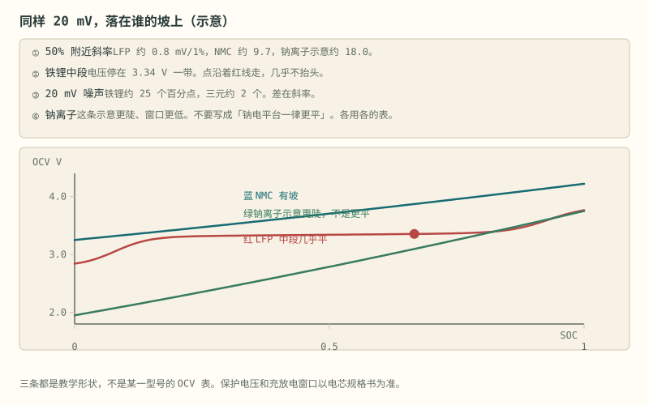
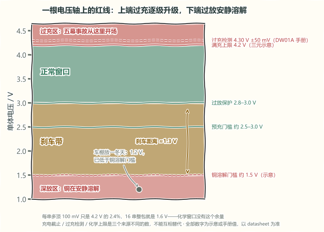

# 第 3 章 电芯化学家族

::: story 现场
维修站里，一块按锂电设计的保护板被拿去充钠离子电芯。板子的过充点停在 4.2 V 附近，还没动作，可这颗电芯的规格表上，3.95 V 可能就是充电上限。电压继续爬，保护板始终认为一切正常。

比较器没有错，错的是表。同一块硬件，换了一种化学，所有阈值就得跟着换。这一章认全化学家族的门牌号，后面每一章谈“红线从哪来”时才有落点。
:::

第一次读这一章，先记住开场那块被拿去充钠电芯的保护板：比较器没有错，错的是查的那张表。再看表 3-1 与图 3-1，把几种化学的电压窗口和 OCV 形状对上号——平台越平，同样大的电压误差换出的 SOC 区间越宽；然后读 §3.3 与 §3.4，分过充的逐级升级和过放的安静溶解，最后用 §3.5 看温度与倍率怎样把窗口再收窄。

## 3.1 化学家族与电压窗口

**表 3-1**　三种化学的标称电压与充放窗口（常见示例值，以各版规格书为准）

| 体系 | 标称电压 | 满充上限（常见示例） | 放电截止（常见示例） |
|---|---|---|---|
| 三元锂 NCM | 3.6 / 3.7 V | 4.2 V | 2.8–3.0 V |
| 磷酸铁锂 LFP | 3.2 V | 3.65 V | 约 2.5 V |
| 钠离子（层状氧化物/硬碳） | 2.9–3.0 V 量级 | 3.9–3.95 V 量级 | 1.5–1.8 V 量级 |

表里的数字全是常见体系的示例，不是通用门。同叫“三元”，不同厂家的满充/截止也可能差出 50 mV。钠的一行更散：两份公开电芯规格书就能给出两对数。超钠 50 Ah（Rev 1.0）写 3.9 V 申请终止充电、3.95 V 强制终止、4.0 V 强制终止并锁定；海四达 NaCP50160118-70H3（70 Ah）规格表写充电电压 3.95 V 为最高极限，同一份 PDF 的循环程序却是充到 3.9 V、放到 2.0 V 就停。**两家钠电不能并成一张“通用阈值表”，同一份规格书里规格表和循环程序也可以是两套端点。**

::: principle 一句话
**阈值跟这颗电芯的这一版规格书走，不跟化学的名字走。** 三元 4.2 V、铁锂 3.65 V 都是示例，以电芯 datasheet 为准。
:::

## 3.2 三种 OCV 形状

开路电压与 SOC 单调对应，但三种化学的曲线斜率完全不同：

- **三元**：整条曲线有明显坡度，电压法大致可用；
- **铁锂**：中段极平，荷电从约 30% 到 70%，电压只动约 30 mV，摊到每 1% 约 0.75 mV（约 0.075 V/SOC），已经和 2–5 mV 的采样噪声缠在一起；
- **钠离子**：不能画成“一律更平”。Quade 等测的 NaMO₂/硬碳全电池，OCV(SOC) 是三条对照曲线里最陡的，电压误差对 SOC 的伤害反而更小。

算一笔账：同样 20 mV 的电压误差，在铁锂平台区大约对应 25 个百分点的 SOC，在三元上大约只有 2 个。

**表 3-2**　20 mV 电压误差在三种化学上值的 SOC（教学示意斜率，钠引 Quade 实测）

| 化学 | 平台区斜率（示意） | 20 mV 电压误差对应的 SOC 不确定度 |
|---|---|---|
| 三元 NCM | 约 10 mV / 1% | 约 2 个百分点 |
| 铁锂 LFP | 约 0.75 mV / 1% | 约 25 个百分点 |
| 钠离子（Quade 等实测曲线） | 比三元更陡（示意） | 比三元更小 |

**同一份电压误差会换算成多大的 SOC 误差，取决于当前工作点的曲线斜率。** 这也解释了第 12 章中，电压法为何在铁锂平台区尤其吃力。

<figure class="book-motion" data-animation="ocv-lfp-nmc-na.svg" data-mode="static">

<button type="button" data-book-motion v-book-motion aria-pressed="false" hidden>播放动画</button>
<figcaption>图 3-1　三种 OCV 形状的示意对照：平台与斜坡改变电压对 SOC 的敏感度；不是化学家族的通用标定表。沿同一条水平电压误差带比较横向跨度：平台越平，可能对应的 SOC 区间越宽。为什么 5 mV 的采样误差不能直接换成所有电芯相同的 SOC 百分比？</figcaption>
</figure>

## 3.3 过充：逐级升级的事故

充过电芯手册给的上限，事故按剧本逐级上演：

1. **正极过度脱锂**：晶体结构像被抽了砖的墙，容量永久损失，不可逆；
2. **电解液氧化分解产气**：电池鼓包，摸到鼓包时事故已演到第二幕；
3. **负极析锂**：锂离子来不及住进石墨层间，在表面析出金属锂，长成枝晶；
4. **枝晶刺穿隔膜**：正负极内部短路；
5. **热失控**：放热、升温、更放热的正反馈，还会烤热旁边的电芯，一节变一包。

看相对值就知道化学窗口多窄：三元常见满充 4.2 V（示意），每节多顶 100 mV 只有 2.4%，但 16 串就是整包多 1.6 V，化学窗口没有这 2.4% 的余量。

::: trap 坑
把三个电压混成一个：①充电截止电压（充电器恒压段设的值）；②过充检测电压（保护 IC 开始断充的值，通常略高于①，DW01A 手册写 4.30 V±50 mV）；③化学上限（电芯手册的绝对上限）。三个数来源不同，不能互相替代。
:::

## 3.4 过放：安静的杀手

一辆电动车在车棚放了一冬天，开春充不进去，拆开一量单体只剩 1.2 V。过充轰轰烈烈，过放安安静静。

单体朝约 1.5 V 或更低走时，负极铜集流体可能被氧化溶解，铜离子跑进电解液，此时电池往往不鼓包不发热。下次充电，溶解的铜会在隔膜上重新沉积成金属铜，同样长成枝晶。**深放的电池没有鼓包等可见征兆，风险在下次充电时的内部短路**：很多厂家对放到约 1.5–2 V 以下或放了很久的电芯要求直接报废。

所以过放保护常在 2.8–3.0 V 动作，铜溶解门槛大约 1.5 V（示意），中间这约 1.3 V 就是刹车距离：**保护点必须提前于危险点**。约 2.5–3.0 V 是常见小电流预充门槛（教学换算 0.05C），不是铜溶解电压，别再把这两档记反。

<figure>

<figcaption>图 3-2　一根电压轴上的红线（手绘示意）：上端过充逐级升级，下端过放安静溶解。保护带中点到铜溶解门槛约 1.3 V 的刹车距离，就是“保护点必须提前于危险点”的长度；每串多顶 100 mV 只是 2.4%，16 串整包就是 1.6 V。数字均为示意或手册引用，以具体 datasheet 为准。</figcaption>
</figure>

## 3.5 温度与 C 倍率

温度给电池换内阻。示意曲线里 25 °C 内阻 20 mΩ，−20 °C 约 120 mΩ，差 6 倍；20 A 放电时压降从 0.4 V 变成 2.4 V，3.7 V 的单体只剩 1.3 V，BMS 看到一节“快空”的电芯，但电量还在。方向也要记准：**低温怕充电**（离子来不及嵌入石墨，和过充第三幕一样析锂），**高温怕一切**（副反应加速）。

C 倍率是另一把跟着容量走的尺子：1C = 一小时放完额定容量的电流。一块 16 串 50 Ah 的包：1C = 50 A，0.5C = 25 A，2C = 100 A；标称电量约 3 kWh，满电 1C 放电约 3.36 kW。同一个 10 A，对 10 Ah 是 1C，对 50 Ah 只是 0.2C：**串数不进电流公式，容量才进。**

::: lab 动手
打开 BMS-Z 阶段 0 的三张动画：`c-rate.svg` 看 0.5C/1C/2C 三种龙头开度，`temperature-two-faces.svg` 盯住左边那幕只在低温充电时上演，`ocv-soc-curve.svg`（阶段 4）在铁锂平台区挪游标，看 20 mV 能盖住几个百分点。然后口算：你的电芯在 −20 °C、20 A 下还能输出几伏？
:::

## 3.6 新成员：固态、结构电池与钠

- **固态**：固体电解质换掉的是离子通道，不是“需不需要保护”。电子仍走外电路；Bates 等以 LLZO 做的热力学计算里，短路时全固态的温升可以高于常规液态锂电（模型口径，不是某台车的实测）。正极侧还可能留少量液体降界面电阻。允许电压、电流、温度以这颗电芯的 datasheet 为准。
- **碳纤维结构电池**：电极兼承力件，能量密度还在论文试样量级（Asp 等 2021 约 24 Wh/kg，Chaudhary 等 2024 约 30 Wh/kg）。量到的是一整块板的端电压，局部 SOC 与载荷可以对不齐，现成多串 AFE 引脚图对不上这种几何。碳纤维外壳不算结构电池；那是箱子轻了，里面仍是普通电芯。
- **钠离子**：硬碳负极、另一套电压窗口。Hijazi 等 2023 年在 C/5、40 °C 下测一颗层状氧化物/硬碳软包：充到 3.80 V 优于充到 4.00 V；大于 C/2 时观察到金属钠析出（特定电芯的实验结果，不是行业红线）。

三种新化学换了离子、曲线和安全边界，但第 1 章的三类测量仍是电压、电流和温度，第 2 章的六项职责也没有变化。变化的是参数、阈值与验证工况。因此，本书先讲化学体系，再讲保护电路：**先确认保护对象，再设计保护方法。**

::: principle 一句话
**换化学，换曲线、换阈值、换失效故事；三根探针和安时积分的形式不换。**
:::

## 练习

1. 把超钠 50 Ah 的 4.0 V 锁定抄进海四达 70 Ah 的比较器，会出什么事？用两份规格书的数字说明。
2. 铁锂电芯静置电压 3.30 V，按 0.75 mV/1% 的平台斜率，2 mV 的采样误差对应多少 SOC 不确定度？
3. 一块 16 串 50 Ah 铁锂包，0.5C 充电电流是多少安？整包满充电压是多少伏（用常见示例）？

## 参考资料

- BMS-Z 阶段 0（§0.1 化学家族）：https://github.com/zhuguang-ZFG/BMS-Z/blob/main/docs/stages/stage-0-前置知识.md
- BMS-Z 阶段 4（§4.3 三种开路电压形状）：https://github.com/zhuguang-ZFG/BMS-Z/blob/main/docs/stages/stage-4-SOC-SOH算法.md
- BMS-Z 动画索引（阶段 0 表）：https://github.com/zhuguang-ZFG/BMS-Z/blob/main/docs/circuits/README.md
- Tarascon & Armand《Issues and Challenges Facing Rechargeable Lithium Batteries》（Nature, 414, 359–367, 2001）：钴酸锂、磷酸铁锂、三元等化学体系与电压窗口取舍的原始讨论，本章化学家族对比的经典出处
