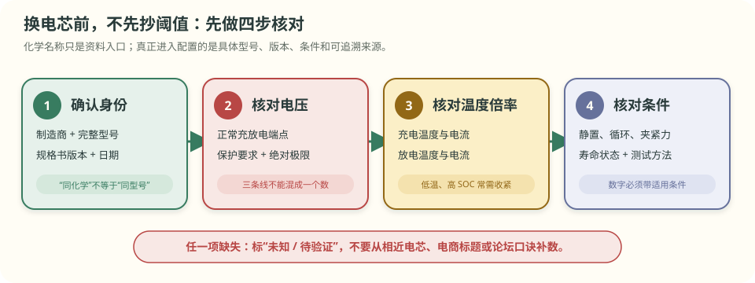

# 第 3 章 为什么不同电芯不能共用一套电压

::: story 现场
维修站里，有人把一块按普通 4.2 V 锂电设计的保护板接到另一种电芯上。保护板还在等电压升到原来的动作点，这颗电芯却可能已经超过自己的充电上限。

保护板没有坏，比较器也没有算错。真正的错误是：**换了电芯，却没有换那张规定安全窗口的表。**

三元锂、磷酸铁锂、钠离子都能储存电能。材料不同，工作电压、曲线形状、温度特性和危险起点也不同。
:::

先记住本章唯一的总原则：

> **保护阈值跟具体电芯型号和当前规格书走，不跟“三元”“铁锂”“钠离子”这几个名字走。**

**本章分三层，不必一次读完。**

- **第一次主线**：读 §3.1–§3.4。分清三类常见电芯的电压尺子，知道为什么 4.2 V 不能到处抄。
- **第二遍深挖**：读 §3.5–§3.8。理解曲线斜率、过充过放、温度倍率与新化学的工程边界。
- **动手验证**：完成 §3.9 的“换电芯四步核对”，学会从规格书而不是论坛口诀找阈值。

**先自己判断**　一块标称 3.2 V 的铁锂电芯能不能使用普通三元锂常见的 4.2 V 充电器？是“最多充不满”，还是可能把电芯推到危险区？

## 3.1 “标称电压”不是“充到这里就停”

电芯资料里经常同时出现三个不同的电压：

- **标称电压**：用于粗略描述能量等级，不是充电停止线；
- **推荐充电截止电压**：正常充电程序到这里转入结束条件；
- **保护或绝对上限**：再往上可能损伤电芯，保护应在规定条件下介入。

把标称电压当成满充电压，就像把汽车的“平均速度”当成“最高限速”，数字都叫电压，职责却完全不同。

**表 3-1**　三类常见电芯的电压性格（只作入门示例，不能直接写进产品）

| 化学体系 | 常见标称电压 | 常见充电上端示例 | 一眼记住的特点 |
|---|---:|---:|---|
| 三元锂 NCM | 3.6／3.7 V | 约 4.2 V | 电压随 SOC 变化较明显 |
| 磷酸铁锂 LFP | 3.2 V | 约 3.65 V | 中段电压平台很平 |
| 钠离子 | 约 2.9–3.0 V | 常见公开样例约 3.9–3.95 V | 路线很多，窗口必须跟具体电芯走 |

这些数字只是帮助认门。即使都叫三元锂，不同型号的上限、截止条件、温度范围和允许倍率也可能不同。产品参数必须回到**型号、版本、测试条件都明确的规格书**。

## 3.2 一张保护板为什么不能到处通用

保护板做的是“把实测值与设定线比较”。如果设定线属于另一种电芯，保护板就会非常认真地执行错误规则。

假设某铁锂电芯正常充电上端按 3.65 V 管理，却接入等待 4.2 V 才结束的充电方案。两条线相差：

\[
4.20\ \mathrm V-3.65\ \mathrm V=0.55\ \mathrm V
\]

相对 3.65 V 而言，0.55 V 约为 15%，足以跨出正常工作窗口。结果不是“多充一点更耐用”，而可能是过充、发热、产气、析锂与寿命快速下降。

反过来，如果把铁锂 3.65 V 的充电上端直接套给常见 4.2 V 三元电芯，通常会提前结束，无法充分充电。一个方向可能危险，另一个方向可能损失容量；两者都说明不能混用。

::: principle 一句话
**比较器只知道“高于还是低于设定线”，不知道这条线是否属于当前电芯。选错参数，比算错公式更早出事。**
:::

## 3.3 曲线形状决定电压对 SOC 的敏感度

许多人想用静置电压直接读 SOC。这个方法能不能用，取决于 OCV–SOC 曲线有多斜。

- 曲线较斜：SOC 变化一点，电压也明显变化，电压像刻度较开的尺子；
- 曲线很平：SOC 已变化很多，电压却只动几毫伏，尺子刻度挤在一起。

铁锂的中段平台就是典型例子。假设平台斜率约为每 1% SOC 只有 0.75 mV，测量误差为 20 mV，那么对应的不确定度约为：

\[
20\ \mathrm{mV}\div0.75\ \mathrm{mV/\%}\approx27\%
\]

同样 20 mV，如果某段三元曲线每 1% SOC 变化约 10 mV，只对应约 2 个百分点。两者相差十多倍。

<figure class="book-motion" data-animation="ocv-lfp-nmc-na.svg" data-mode="static">

<button type="button" data-book-motion v-book-motion aria-pressed="false" hidden>播放动画</button>
<figcaption>图 3-1　沿同一条水平误差带看横向跨度：曲线越平，同样几毫伏可能覆盖越大的 SOC 区间。这是形状示意，不是三类电芯可直接共用的标定表。</figcaption>
</figure>

这就是为什么“电压表很准”不等于“SOC 一定准”。还要看当前化学体系、SOC 工作点、温度、静置是否充分以及曲线来自哪颗电芯。

## 3.4 换电芯前，先核对四件事

看到一个新电芯型号，不要先问“它是不是铁锂”，而要先找四组可执行参数。

<figure>

<figcaption>图 3-2　换电芯四步核对。化学名称只是资料入口；设计依据是具体型号、规格书版本、适用条件和验证方法。</figcaption>
</figure>

1. **身份**：制造商、完整型号、规格书版本和日期；
2. **电压**：正常充放电端点、保护要求与绝对极限分别是多少；
3. **温度与倍率**：不同温度、SOC 下允许多大充放电电流；
4. **条件**：这些数字是在什么静置时间、循环程序、夹紧力和寿命状态下得到的。

如果缺少其中一项，就把它标成待验证项，而不是从另一颗“差不多”的电芯抄过来。

第一次主线到此结束：不同化学不能共用一套电压，参数必须回到具体型号和规格书。想先做核对练习时，可以跳到 §3.9。

## 3.5 阈值必须钉在具体规格书上

钠离子尤其能说明“化学名字不够”。两份公开电芯规格书就给出了不同口径：

- 超钠 50 Ah（Rev 1.0）写 3.9 V 申请终止充电、3.95 V 强制终止、4.0 V 强制终止并锁定；
- 海四达 NaCP50160118-70H3 的规格表写 3.95 V 为最高充电电压，而同一份文件里的循环程序充到 3.9 V 就停、放到 2.0 V 就停。

“正常循环端点”“请求系统停止”“强制保护”和“绝对极限”不是同一根线。同一份规格书内部都可能为不同目的给出不同数值，设计时必须保留条款语境。

## 3.6 过充与过放为什么都要提前刹车

过充不是碰到某个神秘数字才突然爆炸，而是风险逐步升级：正极结构受损、电解液氧化产气、负极析锂、枝晶增加内部短路机会，最终可能进入放热正反馈。

过放往往更安静。电压很低时，负极铜集流体可能溶解；下一次充电时，铜又可能在别处沉积，增加内部短路风险。电芯不鼓包、不发热，也不能证明深度过放后仍然安全。

<figure>

<figcaption>图 3-3　一根教学电压轴上的“正常线、保护线和危险线”。保护点必须早于已知危险过程，为测量误差、确认时间和执行延迟留出刹车距离。具体数值仍以当前电芯规格书为准。</figcaption>
</figure>

::: trap 坑
把充电截止、保护检测和化学绝对上限混成一个数字。它们分别服务于正常使用、异常切断和不可跨越边界，来源和裕量都不同。
:::

## 3.7 温度和倍率会把窗口继续收窄

电芯允许的电流不是固定常数。低温时，反应和扩散变慢，充电尤其容易出现负极析锂；高温时，副反应和老化加快。于是同一 SOC 下，允许充电电流可能随温度大幅变化。

C 倍率是“相对于容量的电流”。对 50 Ah 电芯：

- 0.5C = 25 A；
- 1C = 50 A；
- 2C = 100 A。

同样 10 A，对 10 Ah 电芯是 1C，对 50 Ah 电芯只是 0.2C。串数决定整包电压，容量决定对应的 C 倍率；这两件事不要混在一起。

按常见铁锂示例，一块 16 串、50 Ah 的电池包，满充总电压约为：

\[
16\times3.65\ \mathrm V=58.4\ \mathrm V
\]

这仍只是算术示例。真实充电电流和截止条件要同时受电芯规格书、温度、SOC、热设计与系统策略约束。

## 3.8 固态、结构电池和钠离子也需要管理

- **固态电池**改变的是离子通道和界面体系，不等于天然不需要保护；允许电压、电流和温度仍要由具体电芯验证。
- **结构电池**让储能材料同时承担结构载荷，局部应力、温度和 SOC 可能更难用传统少数测点描述。
- **钠离子电池**换了离子、负极和电压窗口，不能沿用锂电 4.2 V 档，也不能把所有钠离子归成同一条 OCV 曲线。

第 1 章的电压、电流、温度三类探针仍然存在，第 2 章的六项管理职责也仍然存在；改变的是曲线、阈值、失效机理和验证工况。

## 3.9 动手验证与视频伴读

::: lab 动手
找一份你手边电芯的原厂规格书，只做四步摘录：完整型号和版本；正常充放电端点；允许温度与倍率；保护或绝对极限。每个数字后面写页码或条款号。若找不到原厂资料，就把该项写成“未知”，不要用电商标题补齐。
:::

### 视频伴读

本章不把“化学对比短视频”作为阈值来源。若需要先建立电化学画面，可回看第 1 章离子与电子动画；想理解曲线形状，优先播放本章图 3-1。外部视频更适合看材料和制造过程，所有电压、倍率和温度结论仍须回到具体规格书。

## 练习

1. **判断机制**：为什么把普通三元锂常见的 4.2 V 充电上端直接套给铁锂，不只是“多充一点”？请说明比较器为什么发现不了参数用错。
2. **手算量级**：铁锂平台区若每 1% SOC 只变化 0.75 mV，2 mV 测量误差约对应多少 SOC 不确定度？20 mV 呢？
3. **指出边界**：准备替换一种新电芯时，列出进入保护配置前必须从规格书确认的四类信息；若其中“低温充电倍率”缺失，应怎样处理？

## 参考资料

- BMS-Z 阶段 0（§0.1 化学家族）：https://github.com/zhuguang-ZFG/BMS-Z/blob/main/docs/stages/stage-0-前置知识.md
- BMS-Z 阶段 4（§4.3 三种开路电压形状）：https://github.com/zhuguang-ZFG/BMS-Z/blob/main/docs/stages/stage-4-SOC-SOH算法.md
- BMS-Z 动画索引（阶段 0 表）：https://github.com/zhuguang-ZFG/BMS-Z/blob/main/docs/circuits/README.md
- Tarascon & Armand, “Issues and Challenges Facing Rechargeable Lithium Batteries”, *Nature* 414 (2001), 359–367。
