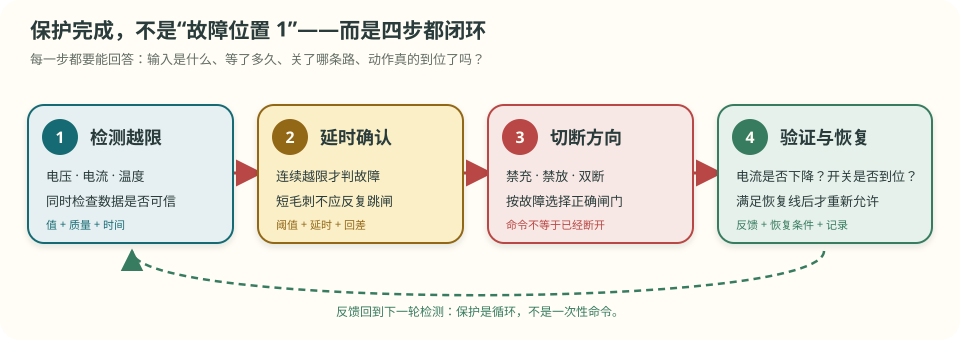

# 第 4 章 保护板怎样把电流关掉

::: story 现场
一块几块钱的单节锂电保护板上，常能找到两类黑色小芯片：一颗负责判断电压或电流是否越界，另一颗里面装着两只功率开关。

它们不会把“多出来的电”吸走，也不会修好受损电芯。保护板的动作是：**发现危险，等待规定的确认时间，关掉不该继续的电流方向，再等安全条件恢复。**

这一章先不要求你认全引脚，只回答两个问题：保护板怎样让电流停下来？为什么经常要用两只开关？
:::

> **最短答案**　检测芯片像保安，MOSFET 像电控闸门；保安发现越界后关闸。两只闸门背靠背，才能把充电和放电两个方向分别管住。

**本章分三层，不必一次读完。**

- **第一次主线**：读 §4.1–§4.4。看懂保护的四步闭环，以及两只背靠背 MOS 为什么能分别禁充、禁放。
- **第二遍深挖**：读 §4.5–§4.8。再认识 DW01、同口分口、高低边与预充。
- **动手验证**：做 §4.9 的低压分压链观察；绝不用真实电芯故意过充或短路。

<aside class="reading-bet" aria-label="开读押注">

开读押注 · 先自己判断：一只闸门为什么不够

一只电子开关已经收到“关闭”命令，为什么很多保护板还要放两只方向相反的开关？

<ol><li>一只只能关小电流</li><li>单只器件内部仍给一个方向留着路</li><li>两只只是为了分摊发热</li></ol>
</aside>

## 4.1 保护不是一个阈值，而是四步闭环

真正的保护过程至少有四步：

1. **检测**：量到电压、电流或温度越过设定线；
2. **确认**：连续越限一段时间，排除瞬时毛刺；
3. **切断**：关闭充电、放电或两个方向的开关；
4. **验证与恢复**：确认电流真的下降，并在满足恢复条件后重新允许工作。

<figure>

<figcaption>图 4-1　保护的四步闭环。只有“检测到故障”而没有动作反馈，不算保护完成；只有一根动作线而没有恢复条件，也会在阈值附近反复开关或永久锁死。</figcaption>
</figure>

这四步里，每一步都可能失败：采样可能报错，延时可能太长，开关可能击穿，断开命令也可能没有让电流真正归零。因此工程记录至少要保留触发值、确认时间、开关命令和动作反馈。

::: trap 坑
**命令变成“关”不等于电流已经断。** MOS 可能击穿短路，PCB 上可能存在旁路，采样也可能失真。保护动作后必须回读电流，并结合开关两端或端口电压确认能量通路真的被切断；反馈不一致时要锁存故障并升级处置。
:::

## 4.2 MOSFET：由小信号控制的大电流开关

MOSFET 可以先当成一只电子开关：控制端收到合适电压时，大电流通路打开；控制电压撤掉时，通路关闭。

保护板通常把开关串在电池与外部端口之间。正常时允许电流通过；过充时禁止电流继续流入电池；过放或放电过流时禁止电流继续流出电池。

这里最重要的不是先背引脚名，而是始终问一句：**现在要阻止的是充电方向、放电方向，还是两个方向？**

## 4.3 为什么一只 MOS 关不住两个方向

真实 MOSFET 内部天然带着一条单向的体二极管通路。即使控制端已经关掉，某一个方向的电流仍可能顺着这条二极管流过去。

所以保护板常把两只 MOS 方向相反地串联，也叫**背靠背**：

- 一只负责把充电方向彻底关住；
- 另一只负责把放电方向彻底关住；
- 两只都关，两个方向都被阻断。

<figure class="book-motion" data-animation="mosfet-backtoback.svg" data-mode="static">

<button type="button" data-book-motion v-book-motion aria-pressed="false" hidden>播放动画</button>
<figcaption>图 4-2　分别沿充电和放电方向追踪。不要只看“栅极已经关了”，还要看体二极管是否正向导通。两只方向相反的 MOS 才能把两种方向分开管理。</figcaption>
</figure>

**表 4-1**　背靠背开关的四种直觉状态

| 开关状态 | 充电 | 放电 | 常见用途 |
|---|---|---|---|
| 两只都开 | 允许 | 允许 | 正常工作 |
| 只关充电侧 | 禁止 | 仍可允许 | 过充后允许负载把电压拉回 |
| 只关放电侧 | 仍可允许 | 禁止 | 过放后保留充电自救通路 |
| 两只都关 | 禁止 | 禁止 | 严重故障或系统停机 |

表中的“允许”仍受器件、故障和其他保护条件约束，不表示任何情况下都能安全通电。

## 4.4 为什么保护后还要留一条恢复路

过充时，保护板常只禁止继续充电，却允许放电。这样接上负载后，电芯电压可以下降，回到恢复线以下。

过放时则相反：禁止继续放电，但保留受控充电路径，让电芯有机会回到恢复区。如果两个方向永远全部锁死，用户连安全恢复的入口也没有。

因此每条保护都要写成三件套：

- **触发条件**：何时认为故障成立；
- **动作方向**：禁充、禁放还是双断；
- **恢复条件**：降到哪条线、等待多久、是否需要外部充电器或人工解锁。

::: principle 一句话
**保护不是“发现异常就全关死”，而是按故障方向关掉危险通路，并为经过验证的恢复保留正确入口。**
:::

第一次主线到此结束。想先看实验和视频时，可以跳到 §4.9；器件与拓扑细节留在下面。

## 4.5 DW01：六只脚里的判断与延时

常见单节保护方案里，DW01 类芯片负责检测过充、过放和放电过流，OC／OD 输出控制充电侧与放电侧 MOS。不同兼容料号可能有不同阈值、延时和逻辑，必须查看当前型号手册。

**表 4-2**　DW01 类方案的状态逻辑（功能示意，阈值以具体手册为准）

| 状态 | 放电开关 | 充电开关 | 主要目的 |
|---|---|---|---|
| 正常 | 开 | 开 | 允许正常充放电 |
| 过充 | 开 | 关 | 禁止继续充，保留放电恢复 |
| 过放 | 关 | 开 | 禁止继续放，保留受控充电 |
| 放电过流／短路 | 关 | 开或按器件策略 | 尽快切断负载，等待恢复条件 |

以 DW01A 常见手册口径为例，过充检测典型值约 4.30 V，带器差与延时；但教学动画中的 4.28 V、1 s 等数值只是示意。**真值表可以帮助理解，阈值和延时必须逐项抄当前手册。**

## 4.6 同口、分口与接线名字

- **同口**：充电器和负载共用 P−，一组背靠背 MOS 管理两个方向；
- **分口**：充电端 C−、放电端 D− 分开，更容易把禁充与禁放做成不同物理通路。

常见端子含义：B+／B− 接电池总正负，P+／P− 接外部充放电回路；多串板还有 B1、B2……采样线。端子名只是常见习惯，接线前必须以当前板卡丝印和原理图为准。

采样排线插错顺序可能直接造成通道过压、短路或器件损坏。新手不要在带电电池包上“试哪个孔能插进去”。

## 4.7 高边与低边：开关放在正极还是负极

**表 4-3**　高边与低边的主要取舍

| 方案 | 开关位置 | 主要优点 | 主要代价 |
|---|---|---|---|
| 低边 | 电池负极回路 | N-MOS 驱动简单、成本低 | 断开后系统参考地可能变化；部分对地故障不经过开关 |
| 高边 | 电池正极回路 | 断正极后负载侧更容易整体失电 | 驱动参考点浮动，需要高边驱动、电荷泵或隔离 |

不能只说“高边更安全”或“低边更便宜”。开关位置要与系统接地、通信、充电、故障路径和法规一起评审。

## 4.8 大系统为什么还需要预充

高压系统或大功率控制器的输入端常有母线电容。电容完全没电时，直接闭合主接触器，瞬间看起来接近短路，可能产生很大的浪涌电流并烧蚀触点。

预充做法是先让电流经过电阻，慢慢把电容充到接近电池包电压，再闭合主回路。若包压 400 V、母线电容 1 mF、预充电阻 170 Ω，则时间常数为：

\[
\tau=RC=170\ \Omega\times1\ \mathrm{mF}=0.17\ \mathrm s
\]

约 3 个时间常数，也就是约 0.51 s，可上升到约 95%；刚接通电流约为：

\[
I=400\ \mathrm V\div170\ \Omega\approx2.35\ \mathrm A
\]

<figure class="book-motion" data-animation="precharge-sequence-curve.svg" data-mode="static">

<button type="button" data-book-motion v-book-motion aria-pressed="false" hidden>播放动画</button>
<figcaption>图 4-3　预充不能只等固定时间，而应读取母线是否按预期上升。上不去可能是后端短路；异常快也可能意味着测量、接线或接触器状态有问题。</figcaption>
</figure>

## 4.9 安全动手与视频伴读

::: lab 动手
只用低压电源、电阻分压链和万用表模拟多节电芯，逐步调整某一抽头，记录保护板动作前后的端口状态，并与手册阈值和延时比较。不要用真实电芯故意过充、过放或短路；不要把共地的多路台式电源直接串起来冒充独立电芯。
:::

### 视频伴读

1. **一分钟认芯片**：B 站“小鱼教你模数电”《锂电池保护芯片 DW01 的工作原理》，约 65 秒。只用于快速看见 DW01、MOS 与通断方向；看完后用图 4-2 自己解释为什么要两只 MOS。
2. **硬件深挖**：B 站“乐派 BMS 工作室”《开源保护板之硬件原理篇》，约 36 分 35 秒。适合读完 §4.5–§4.7 后对着原理图看。该页面同时包含开发板销售与社群资料引流，器件参数与设计结论必须回查原理图、BOM 和数据手册。

播放量、讲解完整度和产品可量产性不是一回事。视频只能帮助建立电流路径，不能替你完成 SOA、热设计、短路能量和安全验证。

## 练习

1. **判断机制**：为什么单只 MOS 已经关断，仍可能有一个方向的电流通过？两只背靠背器件怎样补上这个缺口？
2. **手算量级**：两只导通电阻各为 5 mΩ 的 MOS 串联，电流为 10 A。总压降和总导通损耗分别是多少？这些数值为什么还不能单独证明器件选型安全？
3. **指出边界**：系统检测到过充并关闭充电 MOS 后，至少检查哪两个反馈，才能确认保护动作真的完成？若电流仍未下降，应怎样处理？

## 参考资料

- BMS-Z 电路详解 ①（MOS、DW01、预充）：https://github.com/zhuguang-ZFG/BMS-Z/blob/main/docs/circuits/01-功率回路-MOS保护与预充.md
- BMS-Z 阶段 2（拆板、丝印、分压链实测）：https://github.com/zhuguang-ZFG/BMS-Z/blob/main/docs/stages/stage-2-保护板实践.md
- BMS-Z 资源总纲（含 DW01A 手册入口）：https://github.com/zhuguang-ZFG/BMS-Z/blob/main/docs/bms-resources.md
- B 站：[小鱼教你模数电《锂电池保护芯片 DW01 的工作原理》](https://www.bilibili.com/video/BV1fMWBesE6M/)；[乐派 BMS 工作室《开源保护板之硬件原理篇》](https://www.bilibili.com/video/BV1CB4y1d7Fx/)
