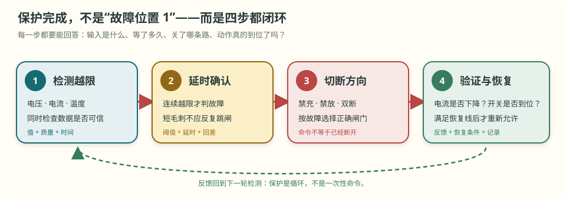
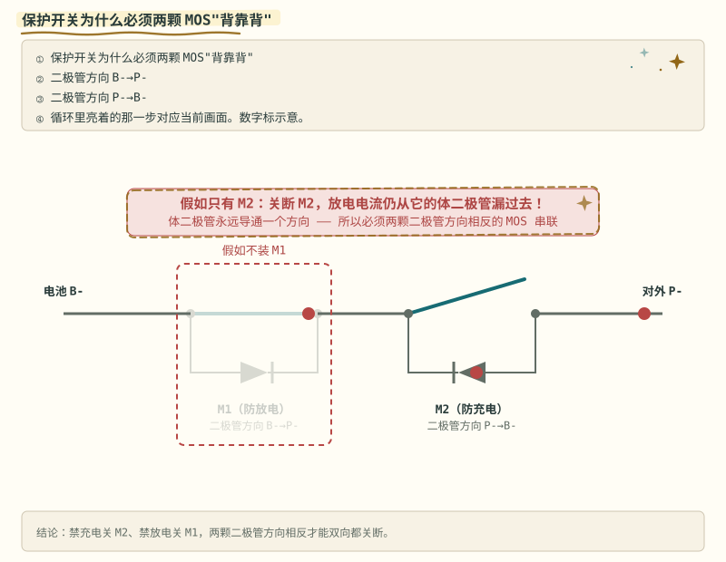
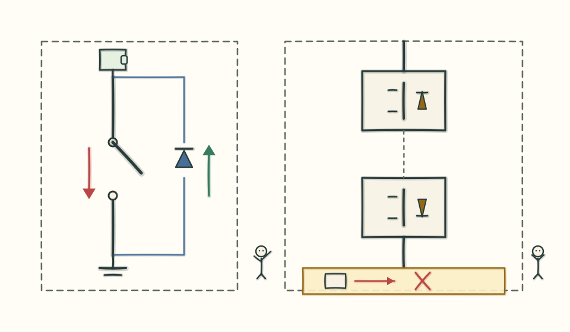
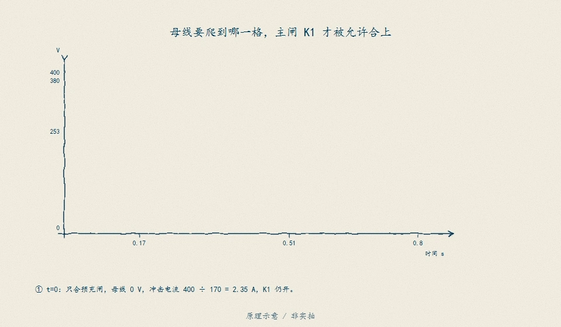

# 第 4 章 保护板怎样把电流关掉

::: story 现场
一块几块钱的单节锂电保护板上，常能找到两颗黑色小芯片：一颗负责判断电压或电流是否越界，另一颗里面装着两只功率开关。

它们不会把“多出来的电”吸走，也不会修好受损电芯。保护板的动作是：**发现危险，等待规定的确认时间，切断不该继续的那一路电流，再等安全条件恢复。**

阈值来自电芯规格书，这是上一章的事；动作却发生在板上。这一章先不要求你认全引脚，只回答两个问题：保护板怎样让电流停下来？为什么经常要用两只开关？
:::

> **最短答案**　检测芯片像保安，MOSFET 像电控闸门；保安发现越界后关闸。两道闸门背靠背，才能把充电和放电两个方向分别管住。

::: chapter-route 阅读路径

- **第一次主线**：读 §4.1–§4.4。看懂保护的四步闭环，以及两只背靠背 MOS 为什么能分别禁充、禁放。
- **第二遍深挖**：读 §4.5–§4.8。再认识 DW01、同口分口、高低边与预充。
- **动手验证**：做 §4.9 的低压分压链观察；绝不用真实电芯故意过充或短路。
:::

<aside class="reading-bet" aria-label="开读押注">
<p class="reading-bet__eyebrow">开读押注 · 先自己判断：一只闸门为什么不够</p>
<p>一只电子开关已经收到“关闭”命令，为什么很多保护板还要放两只方向相反的开关？</p>
<ol><li>一只只能关小电流</li><li>单只器件内部仍给一个方向留着路</li><li>两只只是为了分摊发热</li></ol>
</aside>

## 4.1 保护不是一个阈值，而是四步闭环

一次完整的保护过程至少有四步：

1. **检测**：量到电压、电流或温度越过设定线；
2. **确认**：连续越限一段时间，排除瞬时毛刺；
3. **切断**：关闭充电、放电或两个方向的开关；
4. **验证与恢复**：确认电流真的下降，并在满足恢复条件后重新允许工作。

<figure>

<figcaption>图 4-1　保护的四步闭环。只有“检测到故障”而没有动作反馈，不算保护完成；只有一根动作线而没有恢复条件，也会在阈值附近反复开关或永久锁死。</figcaption>
</figure>

这四步里，每一步都可能失败：采样可能报错，延时可能太长，开关可能击穿，断开命令也可能没让电流归零。因此工程记录至少要保留触发值、确认时间、开关命令和动作反馈。

::: trap 坑
**发出“关断”命令，不等于电流已经断。** MOS 可能击穿短路，PCB 上可能存在旁路，采样也可能失真。保护动作后必须回读电流，并结合开关两端或端口电压确认能量通路真的被切断；反馈不一致时要锁存故障并升级处置。
:::

## 4.2 MOSFET：由小信号控制的大电流开关

MOSFET 可以先当成一只电子开关：控制端收到合适电压时，大电流通路打开；控制电压撤掉时，通路关闭。

保护板通常把开关串在电池与外部端口之间。正常时让电流通过；一旦过充，就禁止电流继续流入电池；过放或放电过流时，则禁止电流继续流出电池。

这里最重要的不是先背引脚名，而是始终问一句：**现在要阻止的是充电方向、放电方向，还是两个方向？**

## 4.3 为什么一只 MOS 关不住两个方向

真实 MOSFET 内部天然带着一条单向的体二极管通路。即使控制端已经关掉，某一个方向的电流仍可能顺着这条二极管流过去。

所以保护板常把两只 MOS 方向相反地串联，这种接法也叫**背靠背**：

- 一只负责把充电方向彻底关住；
- 另一只负责把放电方向彻底关住；
- 两只都关，两个方向都被阻断。

<figure class="book-motion" data-animation="mosfet-backtoback.svg" data-mode="static">

<button type="button" data-book-motion v-book-motion aria-pressed="false" hidden>播放动画</button>
<figcaption>图 4-2　分别沿充电和放电方向追踪。不要只看“栅极已经关了”，还要看体二极管是否正向导通。两只方向相反的 MOS 才能把两种方向分开管理。</figcaption>
</figure>

**表 4-1**　背靠背开关的四种直觉状态

| 开关状态 | 充电 | 放电 | 常见用途 |
|---|---|---|---|
| 两只都开 | 允许 | 允许 | 正常工作 |
| 只关充电侧 | 禁止 | 仍可允许 | 过充后允许负载把电压拉回 |
| 只关放电侧 | 仍可允许 | 禁止 | 过放后保留充电自救通路 |
| 两只都关 | 禁止 | 禁止 | 严重故障或系统停机 |

表中的“允许”仍受器件、故障和其他保护条件约束，不表示任何情况下都能安全通电。

<figure>

<figcaption>图 4-3　一只开关加一条二极管通路，总有一个方向关不掉（左）；两只 MOS 背靠背，充电、放电才各有一道能关的闸（右）。定性示意。</figcaption>
</figure>

## 4.4 为什么保护后还要留一条恢复路

过充时，保护板常只禁止继续充电，却允许放电。接上负载后，电芯电压可以下降，回到恢复线以下。

过放时则相反：禁止继续放电，但保留受控充电路径，让电芯有机会回到恢复区。如果两个方向都被永久锁死，用户连安全恢复的入口也没有。

因此每条保护都要写成三件套：

- **触发条件**：何时认为故障成立；
- **动作方向**：禁充、禁放还是双断；
- **恢复条件**：降到哪条线、等待多久、是否需要外部充电器或人工解锁。

::: principle 一句话
**保护不是“发现异常就全关死”，而是按故障方向关掉危险通路，并为经过验证的恢复保留正确入口。**
:::

第一次主线到此结束。想先看实验和视频，可以跳到 §4.9；器件与拓扑细节留在下面。

## 4.5 DW01：六只脚里的判断与延时

常见单节保护方案里，DW01 类芯片负责检测过充、过放和放电过流；OC／OD 两路输出控制充电侧与放电侧 MOS。不同兼容料号可能有不同阈值、延时和逻辑，必须查看当前型号手册。

**表 4-2**　DW01 类方案的状态逻辑（功能示意，阈值以具体手册为准）

| 状态 | 放电开关 | 充电开关 | 主要目的 |
|---|---|---|---|
| 正常 | 开 | 开 | 允许正常充放电 |
| 过充 | 开 | 关 | 禁止继续充，保留放电恢复 |
| 过放 | 关 | 开 | 禁止继续放，保留受控充电 |
| 放电过流／短路 | 关 | 开或按器件策略 | 尽快切断负载，等待恢复条件 |

以 DW01A 常见手册口径为例，过充检测典型值约 4.30 V，带器差与延时；但教学动画中的 4.28 V、1 s 等数值只是示意。**真值表可以帮助理解，阈值和延时必须逐项抄当前手册。**

## 4.6 同口、分口与接线名字

- **同口**：充电器和负载共用 P−，一组背靠背 MOS 管理两个方向；
- **分口**：充电端 C−、放电端 D− 分开，更容易把禁充与禁放做成不同物理通路。

常见端子含义：B+／B− 接电池组的总正与总负，P+／P− 接外部充放电回路；多串板还有 B1、B2……采样线。端子名只是常见叫法，接线前必须以当前板卡丝印和原理图为准。

采样排线插错顺序可能直接造成通道过压、短路或器件损坏。新手不要在带电电池包上“试哪个孔能插进去”。

## 4.7 高边与低边：开关放在正极还是负极

**表 4-3**　高边与低边的主要取舍

| 方案 | 开关位置 | 主要优点 | 主要代价 |
|---|---|---|---|
| 低边 | 电池负极回路 | N-MOS 驱动简单、成本低 | 断开后系统参考地可能变化；部分对地故障不经过开关 |
| 高边 | 电池正极回路 | 断正极后负载侧更容易整体失电 | 驱动参考点浮动，需要高边驱动、电荷泵或隔离 |

不能只说“高边更安全”或“低边更便宜”。开关位置要与系统接地、通信、充电、故障路径和法规一起评审。

## 4.8 大系统为什么还需要预充

高压系统或大功率控制器的输入端常有母线电容。电容完全没电时直接闭合主接触器，回路近似短路，可能产生很大的浪涌电流并烧蚀触点。

预充做法是先让电流经过电阻，慢慢把电容充到接近电池包电压，再闭合主回路。若包压 400 V、母线电容 1 mF、预充电阻 170 Ω，则时间常数为：

\[
\tau=RC=170\ \Omega\times1\ \mathrm{mF}=0.17\ \mathrm s
\]

约 3 个时间常数，也就是约 0.51 s 之后，母线电压可升到约 95%；刚接通的电流约为：

\[
I=400\ \mathrm V\div170\ \Omega\approx2.35\ \mathrm A
\]

<figure class="book-motion" data-animation="precharge-sequence-curve.webp" data-mode="static">

<button type="button" data-book-motion v-book-motion aria-pressed="false" hidden>播放动画</button>
<figcaption>图 4-4　预充不能只等固定时间，而应读取母线是否按预期上升。上不去可能是后端短路；异常快也可能意味着测量、接线或接触器状态有问题。</figcaption>
</figure>

## 4.9 安全动手与视频伴读

::: lab 动手
只用低压电源、电阻分压链和万用表模拟多节电芯，逐步调整某一抽头，记录保护板动作前后的端口状态，再把测到的动作点与延时同手册比较。不要用真实电芯故意过充、过放或短路；不要把共地的多路台式电源直接串起来冒充独立电芯。
:::

### 视频伴读

1. **一分钟认芯片**：B 站“小鱼教你模数电”《锂电池保护芯片 DW01 的工作原理》，约 65 秒。只用于快速看见 DW01、MOS 与通断方向；看完后用图 4-2 自己解释为什么要两只 MOS。
2. **硬件深挖**：B 站“乐派 BMS 工作室”《开源保护板之硬件原理篇》，约 36 分 35 秒。适合读完 §4.5–§4.7 后对着原理图看。该页面同时包含开发板销售与社群资料引流，器件参数与设计结论必须回查原理图、BOM 和数据手册。

播放量、讲解完整度和产品可量产性，是三件不同的事。视频只能帮助建立电流路径，不能替你完成 SOA、热设计、短路能量和安全验证。

保护要关得对，前提是量得准。下一章顺着分压、采样和 ADC，把这条测量链从头走一遍。

## 4.10 跟做实验：用一段脚本复算保护板的三个数字

§4.8 的预充、练习里的 MOS 压降与 §4.9 的动作时刻都能脚本复算。把下面内容存成 `protection_board_replay.py`，只用标准库：

```python
# protection_board_replay.py：复算第 4 章的数字（只用标准库）
import math

# 1) 预充：400 V 包压、1 mF 母线电容、170 Ω 预充电阻（4.8）
R, C, U = 170.0, 1e-3, 400.0
tau = R * C
print(f"τ = {tau:.2f} s；3τ ≈ {3 * tau:.2f} s；3τ 时约 {100 * (1 - math.exp(-3)):.0f}% 包压")
print(f"刚接通电流 {U / R:.2f} A")

# 2) 两只背靠背 MOS 各 5 mΩ 串联、10 A（练习 2）
print(f"压降 {10 * 0.010:.2f} V；总损耗 {10 ** 2 * 0.010:.1f} W")

# 3) 从 4.20 V 以 50 mV/s 上升，碰到 4.30 V 的时刻（练习 1）
print(f"碰线时刻 {(4.30 - 4.20) / 0.050:.1f} s，再加 80–200 ms 确认延时")
```

运行 `python protection_board_replay.py`，把打印值逐项对回正文。

**成功判据**：

- 预充：τ = 0.17 s，3τ ≈ 0.51 s 时约 95% 包压；刚接通电流 2.35 A（4.8）。
- 两只 5 mΩ MOS 串联 10 A：总压降 0.10 V，总导通损耗 1.0 W；这只是练习账，不能单独证明器件选型安全。
- 从 4.20 V 以每秒 50 mV 上升：2.0 s 碰到 4.30 V，之后还要走完 80–200 ms 内部确认延时才关充电 MOS。
- 任何偏差先查单位：mF 换 F、mV/s 换 V/s。
## 4.11 翻车对照：保护板现场的七种翻法

下表把 §4.1–§4.9 的误区压成一页。症状写现场看到的，原因指回对应小节。

**表 4-4**　保护板现场的七种翻法

| 症状 | 可能原因 | 排查或对照 |
|---|---|---|
| 发了关断命令就认为电流已断 | MOS 可能击穿、PCB 有旁路、采样可能失真（4.1 坑） | 回读电流并对照开关两端或端口电压；不一致就锁存故障并升级 |
| 单只 MOS 已关；某个方向仍有电流 | 体二极管给一个方向留着通路（4.3） | 背靠背两只、方向相反；分别管住充电与放电 |
| 保护后两个方向全部锁死 | 没有留恢复入口（4.4） | 写成三件套：触发条件、动作方向、恢复条件；过充留放电恢复、过放留受控充电 |
| 把教学动画的 4.28 V、1 s 当真实阈值 | 示意值当手册（4.5） | 阈值与延时逐项抄当前型号手册（DW01A 常见口径约 4.30 V；含器件差异与延时） |
| 带电电池包上试哪个孔能插采样排线 | 插错顺序造成通道过压、短路或器件损坏（4.6） | 接线前核对丝印与原理图；不带电试插 |
| 一句「高边更安全」或「低边更便宜」定方案 | 单一维度下结论（4.7） | 与系统接地、通信、充电、故障路径和法规一起评审 |
| 预充只等固定时间不读母线电压 | 后端短路或母线未按预期上升没被发现（图 4-4） | 按母线电压到位判据放行。上不去查后端短路，异常快查测量、接线或接触器状态 |

> **同构点**　§4.1 的「发出关断命令后必须回读电流」，与卷 I 第 18 章《大师的排故智慧》的「预测 → 测量 → 核对」双向验证是同一纪律：动作之后要有独立反馈，不能把「我已发出命令」当成「事情已经发生」。

## 本讲服务知识点

<!-- kp-backlink:start -->
本章服务 4 个知识点；每条都能回到[核心问题地图](../../docs/核心问题地图.md)的 L1–L5 五级入口。这一节由 `curriculum/concepts.json` 的 `book` 字段生成。

**表 4-5**　本章服务的知识点与其梯子入口

| 知识点 ID | 标题 | 阶段 | 梯子到 | 握证 |
|---|---|---:|---|---|
| [`five-protections-table`](../../docs/核心问题地图.md#kp-five-protections-table) | 五大保护与断口 | 1 | L3 | 手算纸 |
| [`board-parts-id`](../../docs/核心问题地图.md#kp-board-parts-id) | 认板上五类器件 | 2 | L3 | 照片 |
| [`terminal-port-topology`](../../docs/核心问题地图.md#kp-terminal-port-topology) | 同口分口与端子 | 2 | L3 | 照片 |
| [`dw01-three-judgements`](../../docs/核心问题地图.md#kp-dw01-three-judgements) | DW01三道判断题 | 2 | L3 | 手算纸 |

**五大保护与断口：五大保护各断哪个开关，恢复条件又是什么？**

一条保护不是一个阈值，而是三件事：什么时候触发、阻断哪股电流、什么条件下恢复。过充主要禁止继续充，过放主要禁止继续放；温度策略也要区分充电和放电。对应的开关必须确实处在要切断的路径里。英文缩写只是标签，认清作用方向后再记 OVP、UVP 等名字更不易混。

**教学算例：沿着这组输入做一遍**

1. 正文三元示例的 4.20 V 是正常充电截止，4.25 V 是过充检测示例，两者分列。
2. 若过充条件持续满足，就核对充电通路是否被禁止；不能只观察软件故障位。
3. 再为每一行补延时与恢复条件，并核对执行反馈，才形成一张完整保护表。

**边界与反例**　化学上限不是可由两个示例数推出来的第三条通用线。不同芯片、端口结构和电芯条件下，动作方向与恢复方式都要查原文。

**看图任务**　从每个检测条件沿箭头追到实际断口，分别跟一次充电和放电路径；同一个 MOS 位置不一定阻断两个方向。

**对应图解**　[mosfet-backtoback](../../docs/circuits/assets/mosfet-backtoback.svg)

**先自己判断**　写出三元示例里充电截止、过充检测、化学上限各是什么来源，并说明 4.25 V 属于哪一个。

完成后再展开标准；先保留自己的计算、判断或运行记录。

<details class="kp-retrieval-check">
<summary>核对通过标准</summary>

4.25 V 归到过充检测值；截止 4.20 V 归充电器恒压段；化学上限归电芯手册、仓库不给通用数。

</details>


**认板上五类器件：拿到一块保护板，先认哪五类器件？**

先认器件再谈参数。保护 IC（集成电路）读电压和电流，功率 MOS（场效应管）执行通断，检流电阻把电流换成毫伏，NTC（负温度系数热敏电阻）测温度，采样排线把每节电压送进来。料号要看封装顶上的印字或原始资料，不能按封装大小猜；检流电阻要只从本体两端取压，走线压降不能算进电流。

**教学算例：沿着这组输入做一遍**

1. 标称 1.00 mΩ 的检流电阻过 50 A，本体压降按 U=IR 是 50 mV。
2. 若把两侧共 0.32 mΩ 走线一起算进取样回路，总电阻变 1.32 mΩ，同一 50 A 读到 66 mV。
3. 按 1.00 mΩ 反算电流会得到 66 A，相对 50 A 偏大 32%，说明取样点必须落在电阻本体。

**边界与反例**　封装大不等于功率 MOS，丝印模糊时自动 OCR（光学字符识别）也可能读错；要补原图、上传者说明或手册，不能只凭一次识别。

**看图任务**　看两条取样线从哪里引出：是从电阻本体内侧，还是把焊盘和铜皮一起圈进去。

**对应图解**　[shunt-kelvin](../../docs/circuits/assets/shunt-kelvin.svg)

**先自己判断**　1.00 mΩ 检流电阻、50 A：算本体压降，再算含 0.32 mΩ 走线后的读数与相对误差。

完成后再展开标准；先保留自己的计算、判断或运行记录。

<details class="kp-retrieval-check">
<summary>核对通过标准</summary>

50 mV、66 mV、约 32%；注明是示意走线值。

</details>


**同口分口与端子：B−、P−、C−、D− 四个负端子，接错一个会怎样？**

端子决定电流走哪条路。同口板充放电共用 P−，一组背靠背 MOS 管两个方向；分口板把充电和放电的 MOS 分开，才有 C− 与 D−。B− 是电芯负极，P− 是包外负极，两者之间隔着 MOS，不是同一个点。采样插头按节数逐点接，少一针就整体错位。

**教学算例：沿着这组输入做一遍**

1. 4 串有 5 个电压节点：每节正端加最下面的负极，所以平衡插头是 5 针而不是 4 针。
2. 若少接、接错或反插一针，通道不再跨在预期两节点之间，可能量到零、跨多节或超过输入允许范围。
3. 不要通电试错；先按该板手册逐针核对线序与节点电压。某几个数看着正常，不代表整束线已经接对。

**边界与反例**　同口板没有独立的 C−/D−，B− 与 P− 之间隔着 MOS；想改成充放独立切断，得改功率回路，不是改两根线。

**看图任务**　沿 P− 往板内走，看它先经过哪只 MOS；再找 B− 与 P− 之间是否直通。

**对应图解**　[mosfet-backtoback](../../docs/circuits/assets/mosfet-backtoback.svg)

**先自己判断**　4 串和 13 串各需几针平衡插头？少插一针会怎样？

完成后再展开标准；先保留自己的计算、判断或运行记录。

<details class="kp-retrieval-check">
<summary>核对通过标准</summary>

5 针与 14 针（串数+1）；少插或插反导致采样整体错位。

</details>


**DW01三道判断题：DW01 用六只脚做哪三类判断？**

DW01 把三类条件分开判：过充看电芯电压，过放也看电压，过流看 CS 脚上的压降。每类都同时带阈值和延时，短路档的延时短到微秒级。阈值说明从哪里开始算异常，延时说明要持续多久才算数；把 4.30 V 当成充电截止，就把保护线当成了正常充电线。

**教学算例：沿着这组输入做一遍**

1. 过充条件是 4.30 V±50 mV 且持续 80–200 ms；刚到 4.30 V 的那一拍只开始计时，不立刻关断。
2. 短路判据看 CS 典型 1.2 V（范围 1.0–1.4 V），延时是微秒级；放电过流则是 CS>150 mV、10 ms 级。
3. 三种条件的阈值与延时都不同，读手册时要分行抄，不能用一个过流 1.2 V 概括全部。

**边界与反例**　4.30 V 是保护动作线，不是充电器的截止电压；换兼容料号时阈值、延时、断口三栏都可能变。

**看图任务**　盯住比较器翻转到 OC 拉低之间的那段延时，看检测到和已关断差了多少。

**对应图解**　[dw01-protection-schematic](../../docs/circuits/assets/dw01-protection-schematic.svg)

**先自己判断**　电压从 4.20 V 以每秒 50 mV 上升：算碰到 4.30 V 的时刻，再说明之后还要等什么。

完成后再展开标准；先保留自己的计算、判断或运行记录。

<details class="kp-retrieval-check">
<summary>核对通过标准</summary>

2.0 s 碰线；还要走完 80–200 ms 内部确认延时才关充电 MOS；阈值注明以手册为准。

</details>

<!-- kp-backlink:end -->

## 练习

1. **判断机制**：为什么单只 MOS 已经关断，仍可能有一个方向的电流通过？两只背靠背器件怎样补上这个缺口？
2. **手算量级**：两只导通电阻各为 5 mΩ 的 MOS 串联，电流为 10 A。总压降和总导通损耗分别是多少？这些数值为什么还不能单独证明器件选型安全？
3. **指出边界**：过充后关断充电 MOS，要检查哪两个反馈才能确认保护动作真的完成？若电流仍未下降，又该怎样处理？

## 参考资料

- BMS-Z 电路详解 ①（MOS、DW01、预充）：https://github.com/zhuguang-ZFG/BMS-Z/blob/main/docs/circuits/01-功率回路-MOS保护与预充.md
- BMS-Z 阶段 2（拆板、丝印、分压链实测）：https://github.com/zhuguang-ZFG/BMS-Z/blob/main/docs/stages/stage-2-保护板实践.md
- BMS-Z 资源总纲（含 DW01A 手册入口）：https://github.com/zhuguang-ZFG/BMS-Z/blob/main/docs/bms-resources.md
- B 站：[小鱼教你模数电《锂电池保护芯片 DW01 的工作原理》](https://www.bilibili.com/video/BV1fMWBesE6M/)；[乐派 BMS 工作室《开源保护板之硬件原理篇》](https://www.bilibili.com/video/BV1CB4y1d7Fx/)
