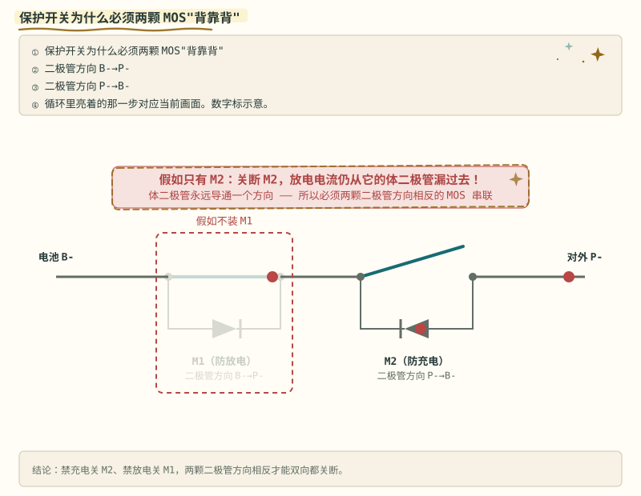
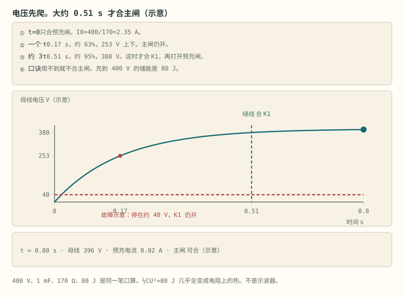

# 第 4 章 保护板解剖

::: story 现场
桌上摊着一块几块钱买来的单节保护板，5 Ah 手机电芯上拆下来的那种。翻到正面，先找两颗黑色贴片：一颗六脚小芯片，丝印里有 DW01；旁边一颗八脚的，丝印里有 8205A，一颗封装里装着两颗 N-MOS。

先对印字，再谈引脚。这两颗料加几个电阻电容，就是一整层独立于任何软件的硬件保护。这一章把它拆开：闸门、保安、还有合闸前那个不起眼却救命的电阻。
:::

<aside class="reading-bet" aria-label="开读押注">

开读押注 · 先选，读完 §4.1 再改票

一颗 N-MOS 已经收到“关断”命令，为什么保护板还常要两颗背靠背？

<ol><li>一颗只能关小电流</li><li>一颗的体二极管仍给一个方向留着路</li><li>两颗只是为了分摊发热</li></ol>
</aside>

第一次读这一章，先照开场那样核对印字：六脚那颗是 DW01，八脚那颗是 8205A，两颗粒料加几个电阻电容就是一层不依赖软件的硬件保护。然后看图 4-1，弄清为什么一颗 MOS 关不住两个方向、必须背靠背；再用表 4-2 过一遍 DW01 的四种状态。§4.3 与 §4.4 讲同口分口、高边低边怎么选，§4.5 的预充回路是合闸前那道保险。

## 4.1 MOSFET：电控闸门

MOSFET 是电压控制的开关：**栅极 G 是闸门把手**，电压加到阈值以上就导通，栅极本身几乎不耗电流；漏极 D 与源极 S 是水道两端，导通后电流两个方向都能走。选型看三样：耐压 VDS（整包最高电压再留裕量）、导通电阻 RDS(on)（决定发热 P = I²R）、栅电荷 Qg（决定驱动快慢）。

问题在于体二极管：制造 MOS 时衬底与漏极天然形成一个 PN 结，甩不掉，**单颗 MOS 总有一个方向关不死**。所以保护回路用两颗背靠背：M1 靠电池 B- 一侧，M2 靠对外 P- 一侧。M1 的体二极管顺着充电电流方向，它关不死充电、只能防放电；M2 的正好相反，只能防充电。两管的二极管方向对顶，两个方向才都关得住。示意账：两管都开、放电 10 A、每管 5 mΩ，压降 100 mV；充电 5 A 时 50 mV（数字是示意，选型看手册 Rds(on)）。

::: principle 一句话
**一颗 MOS 的体二极管还通着，两颗背靠背才关得住两个方向。** 只留一颗，总有一个方向从二极管漏过去，保护形同虚设。
:::

把“谁关得住谁”摆成矩阵再记一遍：关断动作只断沟道，体二极管那一向管不住。

**表 4-1**　单颗 MOS 关断在两个方向的通断矩阵（电路定性，无测量数字）

| 只关断这一颗 | 充电方向 | 放电方向 |
|---|---|---|
| M1（靠 B-，体二极管顺着充电） | 关不住：电流顺二极管漏过去 | 关得住：沟道断，二极管反偏 |
| M2（靠 P-，体二极管顺着放电） | 关得住：沟道断，二极管反偏 | 关不住：电流顺二极管漏过去 |

两颗同时关断，两个方向才同时关得住；任意只留一颗，被漏过去的那个方向就是保护缺口。

<figure class="book-motion" data-animation="mosfet-backtoback.svg" data-mode="static">

<button type="button" data-book-motion v-book-motion aria-pressed="false" hidden>播放动画</button>
<figcaption>图 4-1　背靠背 MOS 的通路：沟道关断后体二极管仍可能允许一个方向。编号与器件朝向以图中示意为准。分别追踪充电和放电路径；不要只看栅极低了，而要看体二极管方向与是否反偏。如果只放一颗 MOS，关断沟道后为什么未必能同时阻断两种方向？</figcaption>
</figure>

## 4.2 DW01：一颗芯片里的保护大脑

DW01 只有 6 个引脚，内部就四样东西：

- 基准源（一把精确的尺子）；
- 三个电压比较器（分别盯过充、过放、过流）；
- 内部延时发生器（比较器响了先数一段延时再动作，防毛刺；TD 引脚只是出厂测试缩短延时用的测试脚）；
- 输出逻辑（驱动 OD、OC 两个栅极）。

输出真值表背下来，就看懂了 DW01：

**表 4-2**　DW01 四状态下 OD/OC 门的开关组合（逻辑真值，阈值以手册为准）

| 状态 | OD（放电门） | OC（充电门） | 结果 |
|---|---|---|---|
| 正常 | 高 | 高 | 充放随意 |
| 过放保护 | 低 | 高 | 只许充不许放 |
| 过充保护 | 高 | 低 | 只许放不许充 |
| 放电过流/短路 | 低 | 高 | 断负载，等恢复 |

以 DW01A 数据手册口径：过充检测典型 4.30 V±50 mV，过充延时约 80–200 ms；短路保护电压典型 1.2 V（1.0–1.4 V），微秒级动作。过放后芯片进入微安级休眠：宁可装死，也不让电芯继续掉电。每一行都留一条恢复通路：过充只断充电 MOS，放电路还通着，电压回落后自动恢复。

三个引脚的分工再对一遍：**VDD/VSS 直接跨接电芯**，判断题一“电压太高？”和判断题二“电压太低？”都在这里答；**CS 是检流引脚**，感知 VSS 与 CS 间的压差，判断题三“电流太猛？”充放两个方向都判。配套 MOS 常用 8205A：单封装里两颗 N-MOS，天然背靠背。阈值 + 延时 + 恢复条件，三要素缺一不可。

::: trap 坑
把示意图上的数字当手册值。BMS-Z 教学动画里的 4.28 V 断开、1.0 s 确认、4.18 V 恢复，是标注过的示意，不是 DW01A 手册值；手册口径是 4.30 V±50 mV、80–200 ms。真值表可以背，阈值必须抄你这块板的手册。
:::

## 4.3 同口与分口

- **同口**：充放电共用 P- 端，一组背靠背 MOS，便宜，大多数小保护板走这条路；
- **分口**：充电 MOS（C-）与放电 MOS（D-）分开，可以只断充电保留放电（或反之），UPS、太阳能路灯常用。

同口便宜但不能分方向，分口贵一点却把“只许放不许充”做成了物理事实。

接线端子接错一个就烧板：B+/B- 接电池组总正总负，P+/P- 接负载与充电器，C-/D- 只在分口板上出现。多串板上还有采样排线 B1、B2、B3……每节一根，是板子的神经末梢；平衡插头针数一般是串联数加 1，插反或少插一针，采样就错位。

## 4.4 高边还是低边

背靠背解决“双向能不能关死”，**高边/低边解决这组开关串在 B+ 还是 B-**：

**表 4-3**　高边与低边：开关位置、优点与代价（选型权衡，无测量数字）

| 方案 | 位置 | 优点 | 代价 |
|---|---|---|---|
| 低边 | MOS 串在 B- 回路 | 源极近地，驱动简单，保护板主流 | 断开后负载端对地可能有残压；正极对地短路时故障电流不经过开关 |
| 高边 | MOS 串在 B+ 回路 | 断正极，负载侧失电干净，对地短路仍在路径上 | 每个栅极要以各自源极为参考：电荷泵、自举或高边驱动 IC，成本与 EMI 都上一档 |

选型口诀：能低边就低边；规范或系统要求“断正极”再上高边。**别把“高边更安全”当无条件真理：驱动做砸的高边，比规规矩矩的低边更危险。**

## 4.5 预充回路：合闸前先灌满蓄水池

逆变器、电机控制器输入端有个大电容（母线电容，几百 μF 到几 mF），完全放电时相当于短路。400 V 电池直接合主继电器，瞬间电流只受回路毫欧级电阻限制，可达数千安（数量级示例），触点直接烧蚀粘连。

> 先自己判断：400 V 包直接合主闸，回路只有毫欧级电阻，母线电容是空的。那一瞬间的电流是几十安、几百安，还是几千安？

解法是预充：先合预充继电器，电流被迫经过预充电阻 R，电容平缓充电；母线电压爬到包压的 90–95%（历时约 t ≈ 3RC）再合主闸，此时两端几乎没有压差，无火花闭合；随后断开预充继电器。算一笔示意账：400 V、1 mF，想约 0.5 s 爬到 95%，R ≈ t/(3C) ≈ 170 Ω。刚接通电流约 2.35 A。储能 E = CU²/2 = 80 J，一次预充几乎全变成电阻上的热，所以按**脉冲额定**选线绕或水泥电阻。还有一条量产必备诊断：超时母线电压上不来 → 外部短路或后端故障，**禁止合主闸**。

::: lab 动手
BMS-Z 阶段 2 §2.6 的分压链实测台：一台可调电源跨接一串相等的电阻，抽头当假电芯接保护板各采样点，万用表只量正在拧的那一节。慢慢拧高，记动作电压与延时，对照手册。**绝不用真电池做过充**；共地（非隔离）的多路电源直接叠到 B1–Bn 上会经地线把串短路，这是新手烧掉的第一块板子最常见的死因。
:::

<figure class="book-motion" data-animation="precharge-sequence-curve.svg" data-mode="static">

<button type="button" data-book-motion v-book-motion aria-pressed="false" hidden>播放动画</button>
<figcaption>图 4-2　预充时序与母线电压同时读：先经限流支路充电，再检查到位条件，最后进入主回路。全部参数为示意。对齐线圈命令与母线爬升：主接触器闭合条件来自反馈，不来自固定等待时间。电压不升与升得过快分别可能意味着什么？仅延长等待能解决吗？</figcaption>
</figure>

## 4.6 这块板在全书里的位置

保护板是三层保护里的第一层：硬件级，微秒到毫秒动作，不需要任何软件在场。第 7 章讲的 tick48 软件保护是第二层：AFE 采样、软件状态机、去抖与回差，毫秒到秒级。两层各看各的：软件会死机、通信会丢包，所以硬件这层必须独立；硬件比较器不够聪明，分不清“该限流”和“该断开”，所以软件这层负责策略。

记住一条贯穿全书的分工：**这块几块钱的板子负责“绝不让它发生”，BMS 软件负责“尽量不让它走到那一步”。**

## 练习

1. 只关断 M2，为什么充电电流到 0 而放电仍能走？用体二极管方向说明。
2. 按 DW01 真值表，过放保护与放电过流两种状态下 OD/OC 有何异同？为什么都留着充电通路？
3. 母线电容 1 mF、预充电阻 170 Ω，包压 400 V：大约多久爬到 380 V？刚接通电流约多少安？

## 参考资料

- BMS-Z 电路详解 ①（MOS、DW01、预充）：https://github.com/zhuguang-ZFG/BMS-Z/blob/main/docs/circuits/01-功率回路-MOS保护与预充.md
- BMS-Z 阶段 2（拆板、丝印、分压链实测）：https://github.com/zhuguang-ZFG/BMS-Z/blob/main/docs/stages/stage-2-保护板实践.md
- BMS-Z 资源总纲（含 DW01A 手册直链）：https://github.com/zhuguang-ZFG/BMS-Z/blob/main/docs/bms-resources.md
