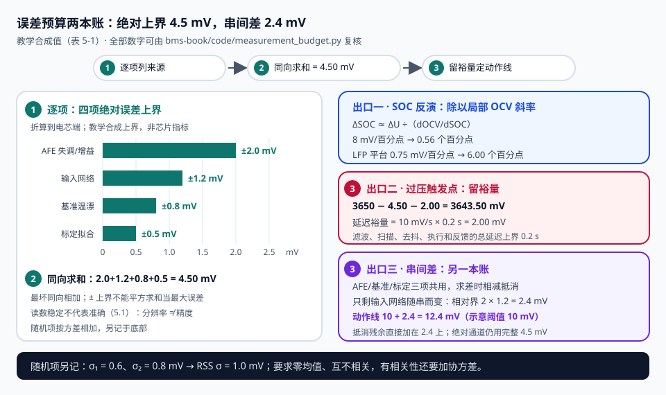

# 第 5 章 测量链：误差预算不是表格，是站位

::: story 现场
一位工程师把 ADC 从 12 位换成 16 位，单体电压还是不准。台架上读数只抖 0.3 mV，看起来很好；把板子升温、接上线束、开启均衡后，读数却偏了 4 mV。他换了两家 AFE，问题照旧。

最后发现：基准温漂、输入网络的漏电压降与均衡电流经过的共用走线，决定了读数的偏移。ADC 把这个偏移分成了更多格，却没有消掉它。先找出误差来自哪里，再回答它会怎样改变动作。
:::

## 5.1 给每个测量值补齐三个属性

从传感器、调理、数字化到诊断，四个环节都要交代。交给上层的不应只有一个数：`value + quality + timestamp`。4.100 V 是刚转换的值，还是均衡关断前的缓存？温度是正常的 25 °C，还是开路后被软件替成了 25 °C？这会直接改变保护、估计与功率限值。

**分辨率、精度和重复性回答不同问题。** 以 5 V 满量程的理想 ADC 为例，12 位的一格约 1.22 mV，16 位约 0.076 mV；这是量化刻度。重复采样的离散程度叫重复性；与可追溯参考值的偏差，才进入精度预算。读数稳定不代表准确。

## 5.2 电压：先合成误差，再决定阈值

专用 AFE 可以直接差分测量各串电芯；包压等通道常另用分压。预算按实际拓扑分解，不能给每个通道都套分压电阻误差。下面四项是**教学合成的绝对误差上界**，并非某款芯片的指标：

| 误差项 | 折算到电芯端的上界 | 如何缩小或验证 |
|---|---:|---|
| AFE 失调、增益与非线性残差 | ±2.0 mV | 多点标准源比对，覆盖工作温度 |
| 输入网络、连接器与漏电压降 | ±1.2 mV | 带实际线束验证，切换均衡状态 |
| 基准与前端温漂残差 | ±0.8 mV | 冷热稳态及升降温过程比对 |
| 标定源与拟合残差 | ±0.5 mV | 保留标准源不确定度和校准记录 |

最坏同向误差为：

$$
E_{\max}=\sum_i |E_i|=4.5\ \mathrm{mV}
$$

不能把四个“±上界”直接平方求和，然后称作最大误差。只有明确为**零均值、互不相关的随机项**，才能按方差相加：σ²总 = Σσ²ᵢ。两项标准差 0.6、0.8 mV 的 RSS 标准差为 1.0 mV；它不是绝对上界，有相关性时还要加协方差。

<figure>

<figcaption>图 5-1　同一份电压误差有不同出口：估计需要局部敏感度，保护需要最坏误差与动作延迟，随机噪声另记方差账。全部数字为教学合成值。</figcaption>
</figure>

对静置 OCV 的局部反演，ΔSOC ≈ ΔU / (dOCV/dSOC)。本书合成电芯中段斜率 0.8 V/SOC，即 8 mV/百分点；4.5 mV 对应 **0.56 个百分点**。采用 LFP 平台区教学斜率 0.75 mV/百分点，同一误差变成 **6 个百分点**。这是局部线性近似；带载端电压还含内阻、极化、温度与滞回，不能直接代入 OCV 表。

对过压动作，假设真实上限为 3650 mV，测量最坏低读 4.5 mV，电压上升速率有可信上界 10 mV/s，**滤波、扫描、去抖、执行和反馈的总延迟**上界为 0.2 s，则教学触发点需满足：

$$
U_{trip}\le U_{limit}-E_{\max}-\dot U_{\max}t_{delay}=3643.5\ \mathrm{mV}
$$

如果上升速率或延迟没有界，就不能拿这个数字作安全保证。先证明预算的条件，再填阈值。

::: principle 一句话
误差沿决策方向传播：**SOC 看敏感度，保护看最坏偏差和总延迟，均衡看串间相对误差。** 共用基准的偏差可能在串间相减时抵消，却仍会把绝对过压点推错。
:::

## 5.3 电流：偏置、增益与漏积分分开算

| 方案 | 主要优势 | 预算中要特别检查 |
|---|---|---|
| 分流器 + 放大器 | 线性与低电流分辨率较好 | 插入损耗、零点、温漂、共模范围 |
| 霍尔 | 隔离、插入损耗小 | 零点与温漂、带宽、低电流误差 |
| 磁通门 | 低零漂和宽动态范围 | 成本、体积、安装条件 |
| 罗氏线圈 | 快速交流响应 | 不测直流，不能独立承担库仑计量 |

本书取**充电为正**。偏置 b、相对增益误差 g 和漏积分电量 ΔQ漏分别进入安时账：

$$
\Delta SOC\approx\frac{bt+g\int I\,dt-\Delta Q_{\mathrm{漏}}}{3600Q}
$$

这里 t 用秒，Q 用 Ah，ΔQ漏用 A·s，结果为 0–1 的 SOC 差；百分点还要乘 100。100 Ah 包的 +0.05 A 偏置持续静置 7 天，虚增 **8.4 个百分点**。增益误差随真实净通量增长；容量 Q 的误差另算，不能与偏置混成一个“电流精度”。

若 1 Hz 点采样恰好避开 20 A、200 ms 的矩形脉冲，会漏记 4 A·s，即 **0.001111 Ah**。采样率应根据输入带宽、抗混叠与所需积分误差确定；提高显示刷新率，不能补回漏掉的电量。

## 5.4 同步：一对准确的数，也可能是一对错数

电压和电流各自准确，还必须对应同一时刻。用旧电流补偿新电压时，一个 50 A 阶跃经过 2 mΩ 的 R0，会留下 **100 mV** 的假残差。这个误差比几毫伏的静态精度大得多，EKF 却可能把它解释成 SOC 或参数错误。

保存采样时刻，测出多通道扫描和滤波的延迟；重采样时说明保持、插值和边沿处理。保护通路与计量通路可以有不同带宽，但要分别验证延迟与积分误差；不能把“10 Hz 足够显示”推成“10 Hz 足够保护”。

## 5.5 温度与开线：先验证被测对象

NTC 的电阻曲线只是链条的一段。安装位置、导热胶、压紧程度与热时间常数，决定它看到电芯表面还是空气。快速升温时，传感器滞后可能比标定误差更大。热功率限制同时考虑空间覆盖与动态响应。

开线诊断需要受控激励。对完好的低阻采样连接，注入电流引起的变化通常较小；断线后，输入滤波电容可能被明显充放电，或者影响相邻通道。**变化方向、阈值和等待时间以所用 AFE 诊断模式为准**。在允许的模拟输入范围内，用电芯模拟器、已知低电压源与断线夹具，验证“真实低电压”和“采样线断开”两个分支；不靠一个静态 0 V 读数猜测。

高压测量另有共模与隔离预算：包内 AFE、低压 MCU、调试口和外部通信的边界都要画在原理图上，不能仅因通信能通就认为隔离成立。

::: trap 坑
拿室温、无均衡、短线束的单点校准证明整包精度。也不要因为两项看起来“互相抵消”就减掉裕量：只要抵消没有稳定、可验证的条件，就保留最坏偏差。
:::

## 5.6 把预算变成验收记录

一张记录至少写：被测量、参考源及不确定度、温度与线束、均衡/负载状态、原始误差、校准系数与版本、校准后残差、采样时刻和总延迟。校准点与验收点分开；要有未用于拟合的中间点、冷热条件和负载阶跃。

交付两个结论：①测量本身满足什么误差界；②在此误差界和延迟下，哪些 SOC、保护、均衡或 SOP 结论还能成立。缺第二层，误差预算仍只是表格。

::: lab 动手
在仓库根跑 `python bms-book/code/measurement_budget.py`，核对 4.50 mV、6.00 个百分点、8.40 个百分点、100.0 mV 与 3643.50 mV。把绝对误差上界各放大一倍，分别重算 SOC 与过压裕量；保留输入条件与输出。
:::

## 练习

1. 设计一个开线验证方案，说明参考源、激励、等待时间，以及如何区分真实低电压和断线。
2. 100 Ah 包，电流零点 +0.05 A，静置 7 天，SOC 漂移多少？再说明 1% 增益误差为何不产生相同的静置漂移。
3. 分别为保护与库仑计量列出带宽、延迟和同步的验收依据。解释为什么不能只凭一个采样率判定两者都合格。

## 参考资料

- BMS-Z 电路详解·采样链：https://github.com/zhuguang-ZFG/BMS-Z/blob/main/docs/circuits/02-采样链与AFE芯片.md
- BMS-Z 参数速查卡：https://github.com/zhuguang-ZFG/BMS-Z/blob/main/docs/参数速查卡.md
- 本章确定性预算实验：`bms-book/code/measurement_budget.py`（合成值和全部计算条件随代码给出）。
