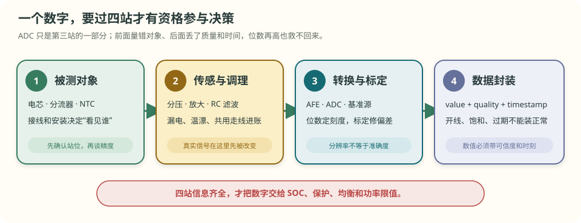
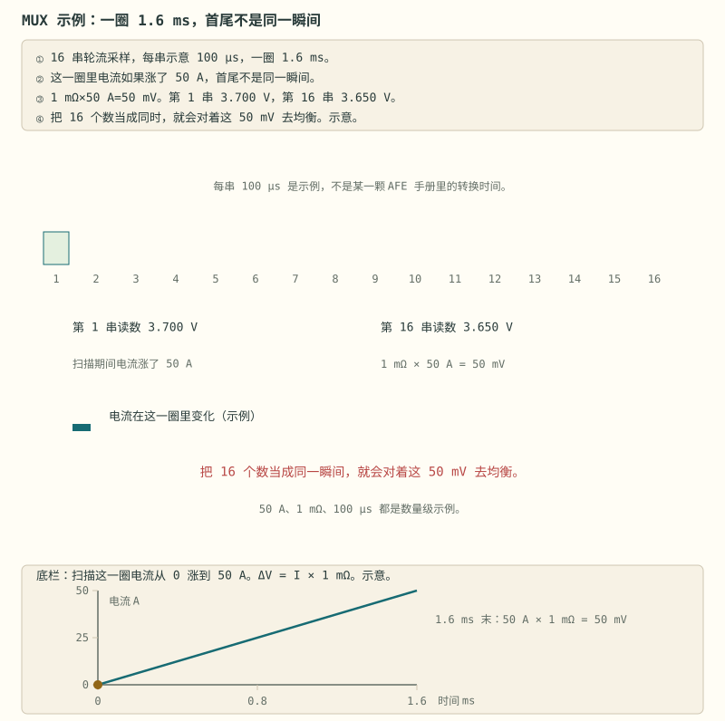

# 第 5 章 测量为什么会“很稳，却不准”

::: story 现场
一位工程师把 ADC 从 12 位换成 16 位，单体电压读数果然多了几位小数，而且连续十次只抖 0.3 mV。可是一升温、接上线束、开启均衡，读数仍会整体偏掉约 4 mV。

原因不在“小数位不够”。基准源会漂，输入网络会漏电，共用走线会产生压降，传感器也可能根本没有贴在真正发热的位置。ADC 只是把送到它面前的信号切成更多格，不能自动把前面已经产生的偏差消掉。

这一章只回答一个问题：**屏幕上的一个数字，要经过哪些证据，才有资格让 BMS 据此保护、估算或限功率？**
:::

> **最短答案**　位数决定尺子刻得多细，不保证尺子没有弯。一个可用测量至少要带三样东西：数值、可信度和采样时刻。

**本章分三层，不必一次读完。**

- **第一次主线**：读 §5.1–§5.4。看懂数字经过哪四站、分辨率为什么不等于准确度，以及 4.5 mV 误差怎样改变决策。
- **第二遍深挖**：读 §5.5–§5.8。再处理串间差、电流积分、时间错位、温度与开线诊断。
- **动手验证**：读 §5.9，运行确定性预算脚本，并把输入条件、计算过程和动作边界一起保存。

**先自己判断**　仪表连续显示 `4.1000 V、4.1000 V、4.1000 V`，能否据此宣布真实电压就是 4.1000 V？先别急着回答，读完 §5.2 再回来。

## 5.1 一个数字要经过四个站点

从真实电芯到软件里的 `4.100 V`，至少要经过四站：

1. **被测对象与接线**：到底量的是电芯端子、电路板铜皮，还是一段带电流的共用走线；
2. **传感与调理**：分压器、分流器、放大器、NTC 和 RC 滤波怎样改变原始信号；
3. **转换与标定**：AFE、ADC 和基准源怎样把模拟量变成数字，再用校准系数修正；
4. **数据封装**：把 `value + quality + timestamp` 一起交给上层，而不是只交一个看起来正常的数。

<figure>

<figcaption>图 5-1　ADC 只是第三站的一部分。前面站错位置，量到的对象就错；后面丢掉质量位和时间戳，上层就分不清正常值、替代值与旧缓存。</figcaption>
</figure>

例如温度值 `25 °C` 可能有三种完全不同的含义：传感器真的量到 25 °C；传感器开路后软件代入默认值 25 °C；一秒前的旧缓存恰好是 25 °C。数字相同，保护意义完全不同。

## 5.2 分辨率、重复性和准确度不是一回事

以 5 V 满量程的理想 ADC 为例：

- 12 位共有 4096 格，每格约 `5 V ÷ 4096 = 1.22 mV`；
- 16 位共有 65536 格，每格约 `5 V ÷ 65536 = 0.076 mV`。

这两个数字只说明**分辨率**，也就是最小刻度有多细。

- **重复性**回答：在相同条件下反复测，读数彼此靠得多近；
- **准确度**回答：在声明的温度、线束、负载和带宽条件下，读数离可追溯参考值有多远。

因此 `4.1040、4.1041、4.1040 V` 可以非常稳定，却始终比真实值高 4 mV。多出来的小数位把偏差显示得更细，没有让偏差消失。

::: principle 一句话
**稳定不等于准确，小数位也不是证据。** 先问量到了谁、误差从哪里来、这个值是哪一刻的，再问 ADC 有多少位。
:::

## 5.3 先算一笔 4.5 mV 的最坏账

专用 AFE 常直接差分测量各串电芯，包压等通道可能另用分压。预算必须按真实拓扑拆，不能给所有通道套同一张表。下面四项是**教学合成的绝对误差上界**，不是某款芯片的保证值。

**表 5-1**　电压通道四项误差上界与验证手段

| 误差项 | 折算到电芯端的上界 | 怎样验证 |
|---|---:|---|
| AFE 失调、增益与非线性残差 | ±2.0 mV | 多点标准源比对，覆盖工作温度 |
| 输入网络、连接器与漏电压降 | ±1.2 mV | 带真实线束验证，切换均衡状态 |
| 基准与前端温漂残差 | ±0.8 mV | 冷热稳态与升降温过程比对 |
| 标定源与拟合残差 | ±0.5 mV | 保存标准源不确定度和校准记录 |

如果四项都可能朝同一方向推，最坏上界要直接相加：

\[
E_{\max}=2.0+1.2+0.8+0.5=4.5\ \mathrm{mV}
\]

这不是说每次一定错 4.5 mV，而是说：在尚未证明它们随机、独立并服从某种分布前，不能把最坏边界擅自缩小。

## 5.4 同一误差要按三种决策换算

4.5 mV 本身还不是结论。它进入不同决策，要换成不同的账：

- **进入 SOC**：用局部 OCV 斜率换算。中段斜率为 8 mV／百分点时，4.5 mV 约对应 0.56 个百分点；铁锂平台若按教学斜率 0.75 mV／百分点，同一误差会放大到 6 个百分点。
- **进入过压保护**：不仅要减去 4.5 mV，还要为扫描、滤波、去抖和执行延迟留出电压继续上升的空间。
- **进入串间差与均衡**：同一颗 AFE 上的共用偏差可能相减，只剩随通道变化的部分；但这种抵消必须有结构和实测证据。

若真实上限为 3650 mV，测量最坏低读 4.5 mV，可信上升速率上界为 10 mV/s，总延迟上界为 0.2 s，则教学触发点应满足：

\[
U_{trip}\le3650-4.5-10\times0.2=3643.5\ \mathrm{mV}
\]

如果上升速率或总延迟没有可信上界，3643.5 mV 就不能被当成安全保证。

<figure>

<figcaption>图 5-2　SOC 按局部敏感度换算，保护计入最坏偏差与总延迟，均衡使用串间相对误差。图中均为可由脚本复算的教学合成值。</figcaption>
</figure>

第一次主线到此结束：**先列误差来源，再按决策方向传播；不要拿“位数高、读数稳”替代这两步。**

## 5.5 绝对误差、串间差和随机噪声要分开计算

绝对过压判断不能享受“共用误差相减”的红利，仍要保留完整 4.5 mV。串间差则可以在证据充分时单独记账。

在本章教学假设中，AFE 失调／增益、基准温漂和标定拟合对同一颗 AFE 的各串完全共用，求差时抵消；随串变化的输入网络残差为 ±1.2 mV，因此两串之差的相对误差界为：

\[
E_{diff}=1.2+1.2=2.4\ \mathrm{mV}
\]

取 A 真值 3640 mV、B 真值 3632 mV，真实差为 8 mV：

**表 5-2**　同一真差在三种通道残差下的表观结果

| 残差摆法 | A 读数 | B 读数 | 表观差 |
|---|---:|---:|---:|
| 共用项同向叠加 | 3643.3 | 3635.3 | 8.0 mV |
| 通道残差 +1.2／−1.2 mV | 3644.5 | 3634.1 | 10.4 mV |
| 通道残差 −1.2／+1.2 mV | 3642.1 | 3636.5 | 5.6 mV |

若意图是“真实串差至少 10 mV 才均衡”，仅把显示阈值写成 10 mV 会误动作。要保证表观越线时真实差仍不低于 10 mV，教学动作线应抬到 `10 + 2.4 = 12.4 mV`。

随机噪声采用另一种算法。只有误差项明确为零均值、互不相关的随机量时，才能按方差相加。两项标准差 0.6 mV 与 0.8 mV 的 RSS 标准差是 1.0 mV；它不是绝对最大值。若两个误差会一起变大或一起变小，还要计入协方差。第 12、15、17、27 章会继续使用这套语言。

## 5.6 电流零偏会持续累积，增益误差只随真实电流

**表 5-3**　常见电流传感方案与主要检查点

| 方案 | 主要优势 | 预算里特别检查 |
|---|---|---|
| 分流器 + 放大器 | 线性好，低电流分辨率较高 | 插入损耗、零点、温漂、共模范围 |
| 霍尔 | 隔离，插入损耗小 | 零点、温漂、带宽、低电流误差 |
| 磁通门 | 低零漂、宽动态范围 | 成本、体积、安装条件 |
| 罗氏线圈 | 快速交流响应 | 不测直流，不能独立做库仑计量 |

本书取充电为正。偏置 `b`、相对增益误差 `g` 和漏积分电量分别进入 SOC 误差：

\[
\Delta SOC\approx\frac{bt+g\int I\,dt-\Delta Q_{\text{漏}}}{3600Q}
\]

其中 `t` 用秒，`Q` 用 Ah，结果为 0–1 的 SOC 差。100 Ah 电池包在真实零电流时若有 +0.05 A 偏置，7 天会凭空累计 `0.05 × 168 = 8.4 Ah`，也就是 **8.4 个百分点**。1% 增益误差乘以真实零电流仍为零，所以不会产生同样的静置漂移。

采样还可能漏掉脉冲。若 1 Hz 点采样恰好避开 20 A、200 ms 的矩形脉冲，会漏记 4 A·s，也就是 **0.001111 Ah**。提高显示刷新率不能补回已经错过的电量；要根据输入带宽、抗混叠和允许积分误差设计采样。

## 5.7 时间错位：两个都准确的数，也可能拼成错误结论

电压和电流即使各自准确，也必须对应同一时刻。若用旧电流补偿新电压，50 A 阶跃经过 2 mΩ 的快速等效电阻，会制造：

\[
50\ \mathrm A\times2\ \mathrm{m\Omega}=100\ \mathrm{mV}
\]

这个假残差远大于几毫伏的静态精度，估算器却可能把它误解成 SOC、内阻或模型参数变化。

<figure class="book-motion" data-animation="mux-time-skew.svg" data-mode="static">

<button type="button" data-book-motion v-book-motion aria-pressed="false" hidden>播放动画</button>
<figcaption>图 5-3　空间上是同一电池包，时间上却不是同一刻。保存每个样本的真实采样时刻，才能区分真实串间失配与扫描顺序制造的假压差。</figcaption>
</figure>

保护通路和计量通路可以采用不同带宽，但要分别验证：保护看从物理越限到动作反馈的总延迟；计量看抗混叠、脉冲积分误差和电压电流对齐。不能用“10 Hz 足够显示”证明两条链都合格。

## 5.8 温度与开线：先证明传感器真的看到了对象

NTC 的电阻曲线只是测温链的一段。安装位置、导热胶、压紧力和热时间常数，决定它看到的是电芯表面、极耳、铜排还是周围空气。快速升温时，安装造成的滞后可能远大于室温标定误差。

开线诊断不能只看“是不是 0 V”。对完好的低阻采样连接施加受控激励，读数变化通常较小；断线后，输入滤波电容可能被明显充放电，也可能影响相邻通道。变化方向、等待时间和阈值依具体 AFE 模式而定。

::: trap 坑
不要用室温、短线束、无均衡的单点校准证明整包精度；也不要用真实电芯故意制造过压、断线或短路。应在器件允许的输入范围内，用电芯模拟器、低压源和断线夹具分别验证“真实低电压”与“采样线断开”。
:::

高压测量还要单独画出共模与隔离边界：包内 AFE、低压 MCU、调试口和外部通信能互相传数据，不等于隔离耐压、爬电距离和故障路径已经成立。

## 5.9 把预算变成验收记录

一张合格记录至少写清：

- 被测量与测量站位；
- 参考源及其不确定度；
- 温度、线束、均衡与负载状态；
- 原始误差、校准系数和版本；
- 校准后残差、质量位、采样时刻与总延迟；
- 这份误差对 SOC、保护、均衡或 SOP 结论造成什么边界。

校准点与验收点要分开。用于拟合的点只能证明“记住了这些点”，未参与拟合的中间点、冷热条件和负载阶跃才开始检验泛化。

::: lab 动手
在仓库根运行 `python bms-book/code/measurement_budget.py`。核对 4.50 mV、6.00 个百分点、8.40 个百分点、100.0 mV 与 3643.50 mV；再核对串间差账的 2.4 mV 相对界、三行表观差 8.0／10.4／5.6 mV，以及 12.4 mV 动作线。把四项绝对误差上界分别放大一倍，重算 SOC、过压触发点和均衡动作线，并保存输入条件。
:::

### 视频伴读

**Texas Instruments《Introduction to the BQ76942 / BQ76952》**，YouTube 英文视频，约 4 分 38 秒。适合在本章后、进入第 6 章前观看：把画面中的监测、保护和主控三类职责分别写下来。它是产品概览，不是精度保证；具体误差、时序和诊断能力仍要回查所用料号的数据手册与安全手册。

## 练习

1. **判断概念**：仪表连续显示 `4.1000 V`，为什么只能说明重复性可能较好，不能证明准确度？把 ADC 从 12 位换成 16 位，哪些误差不会因此自动消失？
2. **手算漂移**：100 Ah 电池包在真实零电流时有 +0.05 A 偏置，持续 7 天会产生多少 SOC 漂移？为什么 1% 增益误差不会产生同样的静置漂移？
3. **设计证据**：设计一个开线验证方案，写出参考源、激励、等待时间、质量位和异常动作；说明怎样区分真实低电压、采样线断开与旧缓存。

## 参考资料

- BMS-Z 电路详解·采样链：https://github.com/zhuguang-ZFG/BMS-Z/blob/main/docs/circuits/02-采样链与AFE芯片.md
- BMS-Z 参数速查卡：https://github.com/zhuguang-ZFG/BMS-Z/blob/main/docs/参数速查卡.md
- Texas Instruments，How to improve battery cell voltage measurement accuracy in BMS monitoring：https://www.ti.com/document-viewer/lit/html/SSZT315
- Texas Instruments《Introduction to the BQ76942 / BQ76952》：https://www.youtube.com/watch?v=f0sG9cH1m8Q
- 本章确定性预算实验：`bms-book/code/measurement_budget.py`（合成值和全部计算条件随代码给出）。
