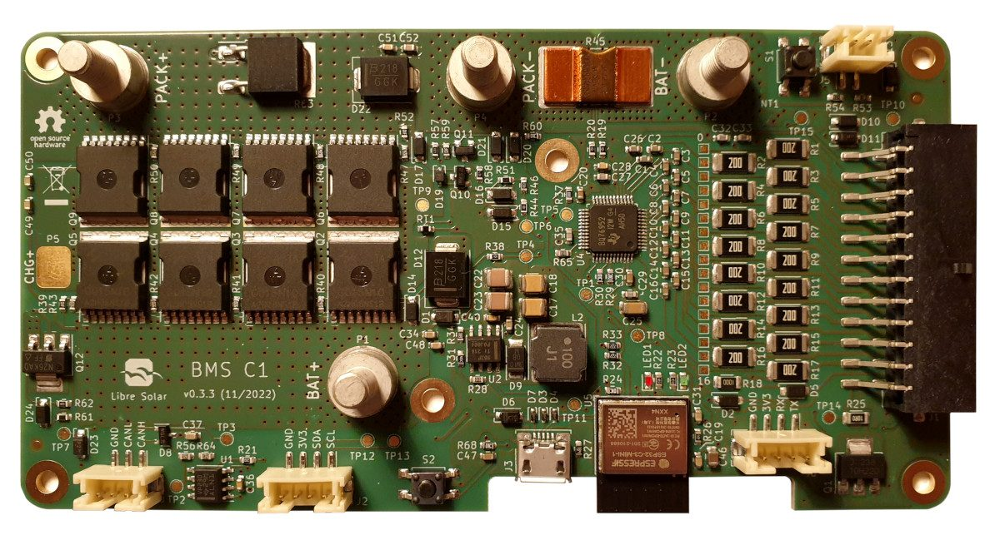
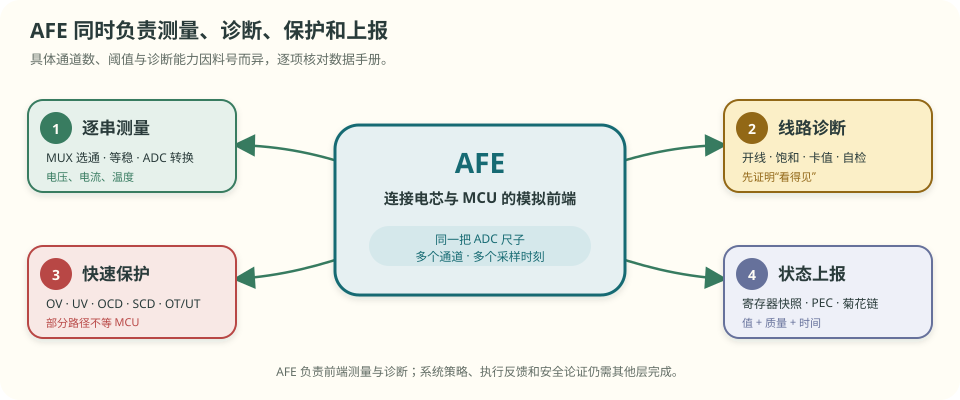
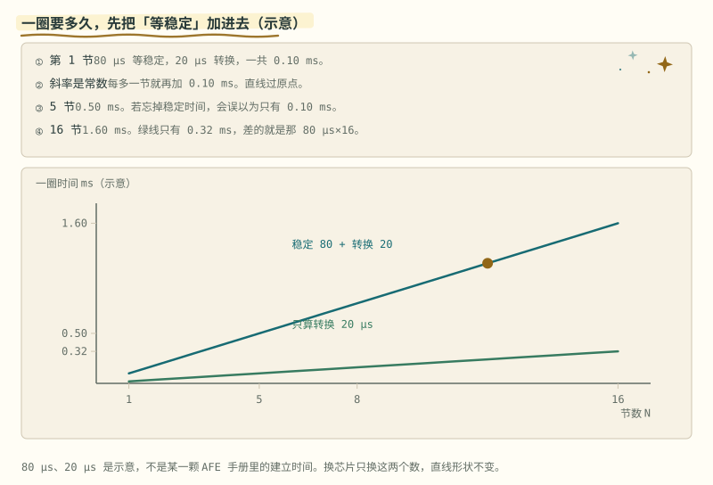
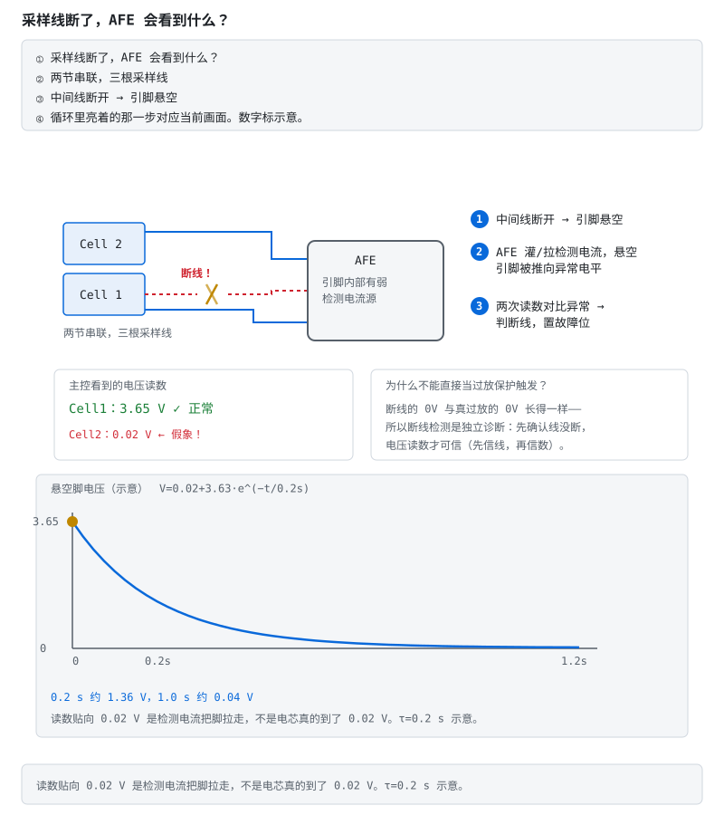
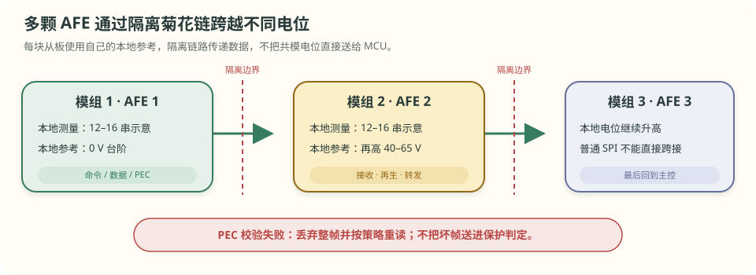
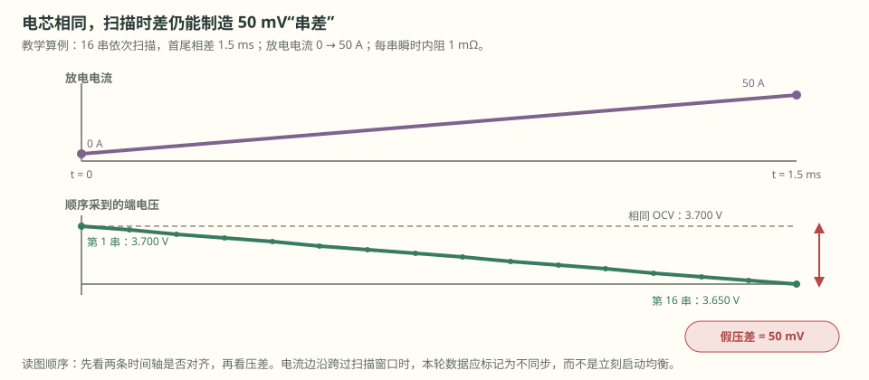

# 第 6 章 AFE 怎样轮流看十几节电芯

::: story 现场
第 5 章追的是单个读数的误差；十几个通道却要共用同一套 ADC，于是又多出一个问题：它们并不在同一瞬间被读到。

储能柜后台显示十几节电芯电压都在正常区间。工程师把万用表探针搭到其中一节的采样端子上，实测值却和后台对不上。

顺着排线检查，插头根部有一根采样线已经断开。AFE 输入端的滤波电容暂时记住了断线前的旧电压，邻近通道切换时又把它一点点带偏，于是软件仍收到一个“像真的一样”的读数。

断的是一根线，丢掉的却是这一节的观察和保护。本章先讲清：AFE 怎样轮流测十几节电芯，又怎样发现自己已经看不见了。
:::

> **最短答案**　AFE 接在电芯与 MCU 之间：轮流测量各通道，诊断采样线，执行部分硬件快速保护，并上报数据质量和采样时刻。

::: chapter-route 阅读路径

- **第一次主线**：读 §6.1–§6.4。弄清 AFE 的四项职责、顺序扫描的时间差，以及开线诊断。
- **第二遍深挖**：读 §6.5–§6.9。处理误差预算、RC／NTC、隔离菊花链、电流计量和固件时间账。
- **动手验证**：读 §6.10，沿四张动画复算扫描时间，并完成一次低压开线诊断设计。
:::

> **跨卷互引**　AFE 把基准、运放与多路切换接成一条采样链：原理先读[电压基准与稳压器](../../analog/docs/p1-10-ch9.md#ch9)与[运放应用电路族](../../analog/docs/p2-02-ch12.md#ch12)；本章只讲通道扫描、开线诊断与 BMS 侧时间账。

**先自己判断**　16 节电芯显示在同一帧报文里，能否据此认定它们是在同一瞬间测得？先写下答案，读完 §6.3 再回来。

## 6.1 AFE 先处理四类工作

AFE 是 Analog Front End，中文常译作模拟前端。它接在高压电芯与低压 MCU 之间，常见的电池 AFE 会承担四类职责：

1. **逐串测量**：轮流读取单体电压，同时兼顾电流、温度等通道；
2. **线路诊断**：检查开线、输入异常、自检或通信错误；
3. **快速保护**：部分过压、欠压、过流和短路路径可由硬件比较器直接处理；
4. **状态上报**：把寄存器快照、校验结果和通道状态交给 MCU。

<figure class="book-photo-pair">

<figcaption>图 6-1　左：LibreSolar BMS C1 开源板；右：AFE 的四项职责。照片用来认板级位置：右侧多针连接器接电芯采样线，AFE 位于板中央，左侧是功率开关。不能只凭外观判断具体引脚、量程或安全等级。照片：LibreSolar，CC BY-SA 4.0。</figcaption>
</figure>

实物板把采样、诊断和功率通断放得很近，但它们不是同一个功能块。信号沿右侧采样连接器进入，先经过输入网络和 AFE；MCU 再读取状态、控制左侧开关。通道数、阈值、诊断和保护能力仍以当前料号的数据手册为准。

## 6.2 一颗 ADC 怎样巡逻十六串

很多 AFE 不会为每节电芯放一颗独立 ADC，而是用一个多路选择器 MUX，轮流把各通道接到同一套 ADC 和基准源上。

共用器件减少了通道之间的系统差异，顺序转换则引入时间差：

- ADC 与基准的共用偏差在比较串间差时可能大部分抵消；
- 各串按顺序转换，第一串和最后一串不在同一时刻。

算一笔教学时间账：每串先等 80 µs 让输入稳定，再花 20 µs 完成转换，共 100 µs。

- 5 串一圈：`5 × 100 µs = 0.50 ms`；
- 16 串一圈：`16 × 100 µs = 1.60 ms`；
- 若只算转换：`16 × 20 µs = 0.32 ms`，漏掉了 1.28 ms 建立时间。

<figure class="book-motion" data-animation="afe-scan-budget.svg" data-mode="static">

<button type="button" data-book-motion v-book-motion aria-pressed="false" hidden>播放动画</button>
<figcaption>图 6-2　蓝线包含“选通后等稳”和“ADC 转换”，绿线只算转换。通道越多，漏掉的建立时间越大；实际时序必须按当前料号和配置读取。</figcaption>
</figure>

::: principle 一句话
**MUX 让各串共用同一把尺子，却没有让它们共享同一个瞬间。**
:::

## 6.3 为什么相同电芯会出现 50 mV 假压差

静置时，1.60 ms 的先后差通常不明显；电流快速变化时，时间差就会被当成电压差。

假设各节电芯 OCV 完全相同，快速等效电阻都按 1 mΩ 计算。扫描期间放电电流从 0 A 增加到 50 A：

\[
\Delta U=50\ \mathrm A\times1\ \mathrm{m\Omega}=50\ \mathrm{mV}
\]

第一串在接近 0 A 时采，最后一串在接近 50 A 时采。报文里看见的 50 mV 差异，可能主要来自采样时刻，而不是电芯容量或均衡状态。

因此一份合格的数据记录至少还要带上：通道顺序或时间偏移、同一时钟域的电流轨迹，以及本轮是否跨过接触器动作或电流边沿。没有这些信息，“同一帧”不能自动等同于“同时采样”。

## 6.4 先证明线还在，再相信这串电压

断线后的读数没有固定形态。滤波电容会保留旧电压，MUX 切换、输入漏电与诊断激励还会继续改变它，所以读数可能缓慢漂移，甚至在一段时间内仍落在正常区间。

教学示例把断线后的输入写成：

\[
V(t)=0.02+3.63e^{-t/0.2\ \mathrm s}
\]

在 0.2 s 时仍约为 1.36 V；1 s 后才接近 0.04 V。这是输入网络与诊断激励的响应，不代表真实电芯从 3.65 V 掉到了 0.02 V。

AFE 的开线检测通常会施加受控电流，再比较本通道和相邻通道的响应。真实低电压、采样线断开和旧缓存必须用不同证据区分，不能只凭一个静态读数猜测。

<figure class="book-motion" data-animation="open-wire-detection.svg" data-mode="static">

<button type="button" data-book-motion v-book-motion aria-pressed="false" hidden>播放动画</button>
<figcaption>图 6-3　受控激励前后的通道响应用于区分低电压与断线。真实低电压由独立低压源确认；断线要在规定的激励和等待时间下验证。</figcaption>
</figure>

::: principle 一句话
**先信线还在，再信这串电压。** 一个看起来精确的旧值，比明显报错的值更危险。
:::

第一次主线到此结束。若暂时不读器件细节，可以直接跳到 §6.10。

## 6.5 这组 AFE 误差合计 5.5 mV

第 5 章用 4.5 mV 演示通用测量预算；这里换一组独立的 AFE 教学算例，数字不能混用。这组误差项是基准温漂 2.0 mV、ADC 失调与增益 1.5 mV、RC 漏电 0.8 mV、MUX 电荷注入 0.3 mV、布局拾取 0.9 mV，最坏同向合计为：

\[
2.0+1.5+0.8+0.3+0.9=5.5\ \mathrm{mV}
\]

5.5 mV 已超过 ±5 mV 的教学目标。出厂标定可修正基准初始误差、失调和增益等系统项，示例剩余约 1.8 mV。随机噪声、温漂、接线压降和时间错位仍要分别验证。

专用 AFE 把基准、输入网络、诊断、保护和通信放进同一条可验证的链，ADC 位数只是其中一项。

## 6.6 RC 决定切换后要等多久

输入 RC 既滤噪，也决定通道切换后要等多久。教学示例取 `R = 1 kΩ`、`C = 100 nF`：

\[
\tau=RC=100\ \mathrm{\mu s}
\]

上一串为 3.200 V，本串真实为 3.700 V：

**表 6-1**　同一 RC 在 1τ 与 5τ 后的建立程度

| 等待时间 | 已走完的变化 | 读数约为 | 误差约为 |
|---|---:|---:|---:|
| 1τ = 100 µs | 63.2% | 3.515 V | −185 mV |
| 5τ = 500 µs | 99.3% | 3.697 V | −3.4 mV |

R 取大了会直接带来压降。输入漏电流若按 1 µA 估算，在 100 Ω 上产生 0.1 mV，在 1 kΩ 上产生 1 mV；偏高还是偏低取决于漏电方向。漏电流还随温度变化，不能把它当成固定校准量。

NTC 还要核对接法和阻温曲线。固定电阻上拉、NTC 在下臂时，温度越高，NTC 阻值越小，中点电压越低。一个 10 kΩ NTC 的教学值可为：25 °C 时 10 kΩ，0 °C 时约 33.6 kΩ，50 °C 时约 3.6 kΩ。阻温关系不是直线，量产应按供应商 R–T 表查表或拟合，不能只拿两个温度点硬拉直线。

::: trap 坑
加大电容会延长建立时间。固定驻留时间不变时，读数更容易带着上一串的尾差。RC 必须与手册允许值、采样时序、漏电和抗混叠一起验证。
:::

## 6.7 串数超过单颗范围后，通信必须跨电位

以 BQ76952 为例，官方资料给出的支持范围为 3–16 串。串数超过单颗范围后，常见做法是每个模组放一颗 AFE，再通过隔离菊花链逐级传递命令和数据。

相邻从板的本地参考电位并不相同。若每块板监测 12–18 串、单体按 3.6 V 估算，相邻模块的参考地就可能差约 40–65 V。普通 SPI 不能直接跨过这种共模台阶；isoSPI 等隔离链路通过变压器或隔离接口传递信号跳变，不把直流电位直接送进 MCU。

<figure>

<figcaption>图 6-4　各模块保留自己的本地参考电位，数据通过隔离链路逐级传递。图中 12–16 串与 40–65 V 用于说明共模台阶。</figcaption>
</figure>

链路数据还要做 PEC 或 CRC 校验。校验失败的整帧不能进入保护判定，应按有界策略重读并记录通信质量。

链路断开后的延迟主要由超时判定决定。教学示例中，断点在第 3 跳后，总延迟约 2.15 ms，其中 2 ms 是超时，每跳只增加约 0.05 ms。最后一个正常应答节点位于断点上游。

## 6.8 电流必须从分流器本体取样

分流器测大电流时必须使用开尔文四线。若 100 A 流过 0.5 mΩ 分流器，本体压降为 50 mV；若取样路径又混入 0.4 mΩ 引线电阻，会多出 40 mV，总计读到 90 mV。仍按 0.5 mΩ 换算，就会误报 180 A，凭空多出 80 A。

不少 AFE 还把库仑计、独立保护比较器和若干外围控制一起集成：

- **库仑计**用采样更快的通道累计电流，为 SOC 提供安时增量；
- **OV／UV／OCD／SCD／OT／UT** 等比较器可给出不经过 MCU 任务循环的快速路径；
- **均衡开关**控制外部电阻泄放，但占空比与热限制必须按手册；
- **shutdown／wake** 决定长期静置功耗，不能只看运行时毫安数。

软件策略仍然需要，但微秒级短路不能等毫秒级任务循环。硬件快路径、软件策略和执行反馈应分别取证。

## 6.9 10 ms 任务最多容纳两次整帧重读

教学固件以 10 ms 为一个周期，固定开销为：读取 2.0 ms、校验 0.4 ms、SOC 计算 1.0 ms、限值计算 0.5 ms、报文处理 1.0 ms，总计 4.9 ms，只剩 5.1 ms。

每次整帧重读再占 2.0 ms：

- 重读 1 次，剩 3.1 ms；
- 重读 2 次，剩 1.1 ms；
- 重读 3 次，周期会超时。

因此重试必须有上限。通信恢复不能反过来挤掉保护任务。类似地，若系统每 80 ms 喂一次看门狗、超时 100 ms，上次喂狗在 80 ms，后续喂狗遗漏，系统应在 180 ms 左右复位，而不是等下一轮任务到 240 ms 才察觉。

扫描时刻也要进入质量判断：

**表 6-2**　16 串顺序扫描在三种电流工况下的解释

| 扫描期间工况 | 首尾中心时刻差 | 可能混入的假压差 | 本轮用途 |
|---|---:|---:|---|
| 静置，电流约 0 A | 约 1.5 ms | 接近 0 mV | 可主要按真实串差解释 |
| 电流线性增加 0 → 50 A | 约 1.5 ms | 约 50 mV | 先按各通道时刻对齐电流 |
| 负载在扫描中途跳变 | 约 1.5 ms | 取决于边沿位置 | 标记边沿污染，不直接启停均衡 |

<figure>

<figcaption>图 6-5　上方是电流时间轴，下方是各串读数。只看电压曲线，会把时间差误判成电芯差；保留转换序号、时间偏移和电流轨迹，才能识别边沿污染。</figcaption>
</figure>

检测到电流变化率过大或接触器刚动作时，可把本轮标成“边沿污染”，不用于均衡启停。等完整扫描落入稳定窗口后再判断。对齐后的电压是派生量，适合趋势、均衡和参数辨识；保护判定仍依据原始测量、质量状态与保守误差界。

有了带时刻和质量标记的电压，下一步才是拿它做保护判断。第 7 章会跟着一颗越限的单体，看保护为什么要连等三拍。

## 6.10 安全动手与视频伴读

::: lab 动手
打开 BMS-Z 详解②的四张动画：`mux-scan.svg` 看通道轮询，`afe-scan-budget.svg` 对比 1.60 ms 与 0.32 ms，`mux-adc-filter.svg` 看 1τ 只完成 63.2%，`open-wire-detection.svg` 看断线后缓存值怎样变化。再口算：12 串按每串 100 µs 扫一圈是 1.20 ms；若只算 20 µs 转换，会误报为 0.24 ms。
:::

### 视频伴读

1. **快速全景**：Texas Instruments《Introduction to the BQ76942 / BQ76952》，YouTube 英文视频，约 4 分 38 秒。观看任务：把内容分成“AFE 监测、AFE 硬件保护、MCU 策略”三列。
2. **中文深挖**：TI 官方《1.1 BQ76952 系统方案介绍》，约 28 分 53 秒。适合读完 §6.5–§6.9 后观看；暂停画出电芯输入、分流器、保护 FET、通信和 MCU 的边界。

两条都是产品介绍，不是当前设计的精度或安全保证。通道范围、滤波、保护延时、诊断和功耗必须回查所用料号的数据手册、技术参考手册与安全手册。

## 本讲服务知识点

<!-- kp-backlink:start -->
本章服务 2 个知识点；每条都能回到[核心问题地图](../../docs/核心问题地图.md)的 L1–L5 五级入口。这一节由 `curriculum/concepts.json` 的 `book` 字段生成。

**表 6-3**　本章服务的知识点与其梯子入口

| 知识点 ID | 标题 | 阶段 | 梯子到 | 握证 |
|---|---|---:|---|---|
| [`afe-mcu-split`](../../docs/核心问题地图.md#kp-afe-mcu-split) | 感知决策分工 | 3 | L3 | 日志 |
| [`afe-crc-register-read`](../../docs/核心问题地图.md#kp-afe-crc-register-read) | CRC与寄存器快照 | 3 | L3 | 日志 |

**感知决策分工：保护板已经能断电了，为什么还要 AFE 加 MCU？**

AFE（模拟前端）负责贴近电芯的测量和指定硬件保护，MCU（微控制器）负责策略、算法和通信。电芯信号经过 RC 滤波，再到采样与比较器；数字读数通过 I2C 或 SPI 等板内接口交给 MCU。硬件切断可不等待软件主循环，但具体延迟仍看器件与配置。两条路径职责不同，也可能共享执行器，不能只看有两个芯片就宣称独立冗余。

**教学算例：沿着这组输入做一遍**

1. 从电芯开始逐级写：电芯→RC 滤波→AFE（采样与硬件保护）→I2C/SPI→MCU（策略、算法、通信）。
2. 区分硬件比较器的检测/输出与软件的采样、校验、判定、输出，分别量测延迟；不能把某一档短路响应推广到所有保护。
3. MCU 再把结果送到 MOS 或继电器，并通过 UART（串口）、CAN（控制器局域网）、BLE（低功耗蓝牙）对外报告；每一级都要能单独验证。
4. 因此软件反应快只覆盖它那一段，替代不了 AFE 的硬件兜底。

**边界与反例**　把开发板引脚直接接到电池包高压上，会超出接口共模范围；软件保护也不能替代硬件路径，两条都要分别验证。

**看图任务**　沿信号链从左走到右，看哪一级在电芯旁、哪一级在低压侧，别把 MCU 的引脚当成能直接碰高压。

**对应图解**　[afe-register-read](../../docs/circuits/assets/afe-register-read.svg)

**先自己判断**　从电芯写到对外通信，按顺序列出整条链上每一级做什么。

完成后再展开标准；先保留自己的计算、判断或运行记录。

核对通过标准

RC 滤波、AFE 采样与硬件保护、I2C/SPI、MCU 策略、MOS/继电器、对外总线六级不漏不乱。

**CRC与寄存器快照：读得越快，数据就越新吗？**

读完一帧要能证明它没坏。CRC（循环冗余校验）把数据按约定算出一个校验值，收端重算并比对；对不上就丢掉这一帧，不能拿去保护。读到的还是寄存器快照，AFE 按自己的转换周期刷新，读得再快也只是把同一份旧数据多拿几次。重读要计入时间预算。

**教学算例：沿着这组输入做一遍**

1. 教学校验：0x12 与 0x34 的低 8 位相加得 0x46，与发送端校验值一致，这一帧可以采用。
2. 第二字节翻成 0x35 后，和变成 0x47，与 0x46 不匹配，说明传输中至少有一位变了。
3. 这一帧丢弃并重读；重读次数要有上限，不能把失败静默吞掉，也不能无限重试。
4. 真实多项式与校验字段以那颗 AFE 的手册为准，教学加法只演示对不上就丢。

**边界与反例**　校验只能发现这一帧的位错，不能证明数据新鲜；旧的正确帧也能通过校验，时间戳和刷新周期要另看。

**看图任务**　盯住 CRC 对不上的那一拍：看这一帧是不是被丢掉重读，而不是继续送进保护判断。

**对应图解**　[afe-register-read](../../docs/circuits/assets/afe-register-read.svg)

**先自己判断**　按教学校验算 0x12/0x34 与 0x12/0x35 两帧的低 8 位和，并说明各自处理。

完成后再展开标准；先保留自己的计算、判断或运行记录。

核对通过标准

0x46 与 0x47；后者不匹配丢帧重读；注明真实多项式以手册为准。

<!-- kp-backlink:end -->

## 练习

1. **解释机制**：为什么 MUX 架构能让串间一致性较好，却不能保证各串同时采样？上层至少要保存哪些时间信息？
2. **手算量级**：16 串按每串 80 µs 等稳、20 µs 转换，扫一圈需要多久？若只算转换会报成多少？扫描期间电流增加 50 A、单体快速等效电阻为 1 mΩ，首尾可能出现多少假压差？
3. **设计证据**：设计一个低压开线验证，说明参考源、受控激励、等待时间、本通道与相邻通道记录、质量位和异常动作；怎样区分真实低电压、断线缓存值与通信旧帧？

## 参考资料

- BMS-Z 详解②（采样链与 AFE 芯片）：https://github.com/zhuguang-ZFG/BMS-Z/blob/main/docs/circuits/02-采样链与AFE芯片.md
- BMS-Z 阶段 3（AFE 精读与固件架构）：https://github.com/zhuguang-ZFG/BMS-Z/blob/main/docs/stages/stage-3-AFE-MCU智能BMS.md
- Texas Instruments BQ76952 产品页：https://www.ti.com/product/BQ76952
- Texas Instruments 视频：[《Introduction to the BQ76942 / BQ76952》](https://www.ti.com/video/6176047023001)（TI 官网 4:38，另有 [YouTube 版](https://www.youtube.com/watch?v=f0sG9cH1m8Q)）
