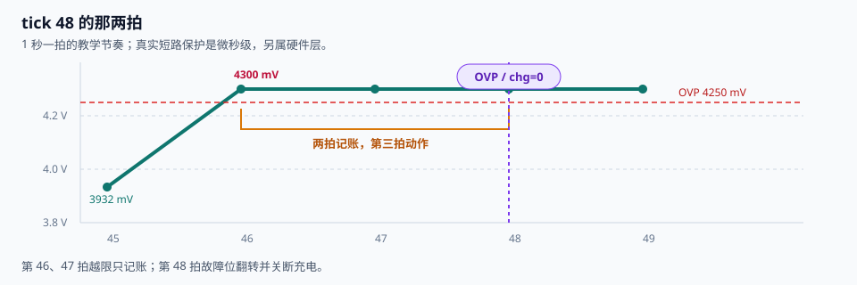
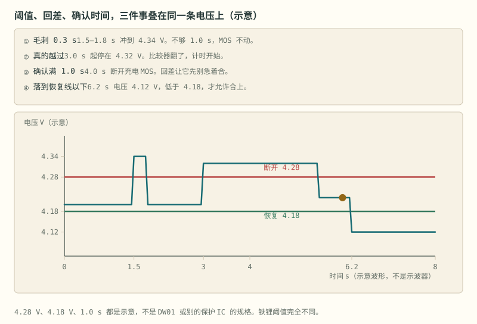

# 第 7 章 保护：tick 48 的那两拍

::: story 现场
4 串实验 pack，1 秒一拍。第 45 拍一切正常；第 46 拍第 1 串从 3.932 V 跳到 4.300 V；第 47 拍仍是 4.300 V；第 48 拍故障位才翻成 `OVP`，充电 MOS 拉低。

第 46 拍就过压了，为什么第 48 拍才切？这不是迟钝，是**去抖**：连续两拍越限先记账，第三拍确认后动作。少一拍，噪声就能让继电器跳舞；多一拍，电芯就多受一秒罪。
:::

<figure>

<figcaption>图 7-1　tick 46 越限，tick 47 仍越限，tick 48 才确认并关断充电。去抖不是迟钝，是给噪声留出的确认窗口。</figcaption>
</figure>

## 7.1 三层保护

**表 7-1**　三层保护的层级、响应时间与典型动作（工程量级归纳，无测量数字）

| 层级 | 实现 | 响应时间 | 典型动作 |
|---|---|---|---|
| 电芯/硬件级 | 保护 IC、比较器、保险丝 | 微秒–毫秒 | 关断 MOSFET、熔断 |
| BMS 级 | AFE 阈值、软件状态机 | 毫秒–秒 | 断接触器、限流、告警 |
| 系统级 | 断路器、服务开关、消防 | 秒–分钟 | 隔离、排烟、灭火 |

三层不能合并。软件会死机，通信会丢包，接触器会粘连；**独立性**是安全的基础。

## 7.2 去抖与回差

BMS-Z 的教学固件给了成套示例：

**表 7-2**　教学固件五项保护的触发与恢复（`test_bms.c` 配置，非产品阈值）

| 项目 | 触发 | 动作与恢复 |
|---|---|---|
| OVP | 单体 > 4250 mV，连续 3 拍 | 禁充；最高单体 < 4150 mV 后清除 |
| UVP | 单体 < 2800 mV，连续 3 拍 | 禁放；充电器在场且最低单体 > 3000 mV 后清除 |
| OCD | 放电 > 10 A，连续 5 拍 | 禁放；放电 < 5 A 后清除 |
| SCD | 放电 > 30 A，本拍 | 双断并锁存；电流回到 ±100 mA 窗口才解锁 |
| OT | 温度 > 60 °C | 双断；< 55 °C 后清除 |

两条细节最容易被忽略：

1. **故障态也要继续评估**。不能因为已经 OVP 就跳过 OT；多项故障要合并成“禁充 + 禁放”的掩码。
2. **恢复不是回到同一根线**。OVP 在 4250 mV 触发，要落到 4150 mV 才清除——这 100 mV 就是回差，防止在阈值附近反复开关。

<figure class="book-motion" data-animation="ov-hysteresis-delay.svg" data-mode="static">

<button type="button" data-book-motion v-book-motion aria-pressed="false" hidden>播放动画</button>
<figcaption>图 7-2　过压去抖与回差：越限持续时间决定动作，恢复阈值另设，避免边界附近反复开关。电压与延时为另一组示意，不等于 tick48 仿真参数。</figcaption>

<strong>先看哪里：</strong>同时看输入电压、计时和开关状态：尖峰、持续越限、恢复不是同一个事件。

<strong>看完追问：</strong>把恢复阈值设成触发阈值，会在哪一段引起来回开关？

</figure>

同一个“三拍确认”有两只时钟。若从**首个已经采到越限的样本**起算，后面只剩 N−1 个采样间隔；若从**物理故障任意发生的时刻**起算，故障可能刚好错过上一拍，最坏还要多等一个完整采样周期。把判决和执行反馈也装进去：

- 首次观测后的反应时间：`t_seen = (N−1)·Ts + Td + Ta`；
- 物理故障的最坏反应时间：`t_worst = N·Ts + Td + Ta`。

Ts 是采样周期，Td 是判决耗时，Ta 要从命令发出一直量到安全反馈到位，而不是只量 GPIO 翻转。若输入滤波、AFE 扫描不包含在 Ts 里，还要单列输入链延迟。tick 46 到 tick 48 是 2 个已观测间隔；真实故障若刚发生在 tick 45 之后，最坏接近 3 个间隔。1 秒一拍只为读日志，绝不是产品保护周期。

<section class="book-lab" data-book-lab="protection" v-book-lab aria-label="保护确认拍数与故障反应时间交互实验">
<h4>把确认拍数装进故障反应时间口袋</h4>
<button type="button" data-lab-reset hidden>恢复算例参数</button>

教学时间预算：把输入扫描与滤波折算进采样周期，执行时间量到安全反馈。FTTI 取 100 ms 只是演示不等式，不是标准或产品阈值。

<label>采样周期 Ts / ms：20<input type="range" data-param="samplePeriod" min="5" max="50" step="5" value="20" disabled></label>
<label>确认拍数 N：3<input type="range" data-param="confirmCount" min="1" max="5" step="1" value="3" disabled></label>
<label>判决 Td / ms：2<input type="range" data-param="decision" min="0" max="20" step="1" value="2" disabled></label>
<label>执行反馈 Ta / ms：15<input type="range" data-param="actuator" min="1" max="80" step="1" value="15" disabled></label>
<label>故障反应窗口 / ms：100<input type="range" data-param="ftti" min="50" max="200" step="10" value="100" disabled></label>

首次观测后：<output data-output="observed">57 ms</output>物理故障最坏：<output data-output="worst">77 ms</output>

余量：<output data-output="margin">+23 ms</output>判定：<output class="timing-status" data-output="status" data-state="within" aria-live="polite">预算内</output>

<i class="timing-ftti" data-timing-ftti style="left:100%"></i>

等待首拍连续确认判决执行反馈FTTI

<strong>做两组对照：</strong>把确认拍数从 3 降到 1，首次观测后的时间少了多少，最坏时间为何仍保留一拍？再把执行反馈拖到 60 ms，观察哪一段先吃完余量。少去抖与快执行不是同一个设计旋钮。

</section>

## 7.3 断口方向：禁充还是禁放？

保护动作不是“一刀切”，而是按故障决定方向：

- OVP → 禁充（继续放电通常没问题）；
- UVP / OCD → 禁放；
- SCD / OT → 双断。

如果 OVP 与 UVP 同时存在，必须双断；不能为了恢复其中一项而放过另一项。BMS-Z 的 `enter_fault` 就是用故障掩码合并限制，主因只影响显示，不影响断口。

::: principle 一句话
**先评估全部保护，再合并断口。** 不是命中第一条就 return。
:::

## 7.4 接触器与预充

高压 pack 的合闸顺序：

1. 闭合负极接触器；
2. 闭合预充接触器 + 预充电阻，给母线电容充电；
3. 母线电压接近 pack 电压后，闭合正极接触器；
4. 断开预充。

需要检测：预充超时、接触器粘连（断开后母线仍有电压）、接触器拒动（闭合后电压不上升）。

预充的本质是“先灌满蓄水池，再开主闸”。没有预充，浪涌电流会把接触器和电容一起打伤。

## 7.5 功能安全与标准

- **ISO 26262**：道路车辆功能安全；
- **IEC 61508**：通用功能安全；
- **IEC 62619**：工业锂二次电池安全；
- **UL 1973**：固定式储能；
- **UN 38.3**：运输测试。

开源项目通常不声称满足这些标准。你可以借鉴架构，但认证需要危害分析、需求追溯、验证证据与组织流程。**许可证不等于认证，认证也不等于免责。**

## 7.6 把阈值表变成验收矩阵

阈值表只写“何时应该动”；验收矩阵还要写清**注入什么、看哪条证据、何时算动作完成**。命令位翻转只是中间证据：MOS 要看电流或端口电压，接触器要看辅助触点与母线电压，保险丝要看回路真正断开。

**表 7-3**　四个故障工况的注入、同拍证据与通过标准（教学合成验收矩阵）

| 工况 | 受控注入 | 必须同拍保存的证据 | 通过标准 |
|---|---|---|---|
| 持续 OVP | 一串连续 3 拍高于 4250 mV | 原始值、计数器、禁充命令、端口反馈 | 前两拍不误动；第三拍禁充；反馈在时间预算内到位 |
| 单拍尖峰 | 一串只高 1 拍后恢复 | 原始值、计数器复位、命令 | 不关断，不留下活动故障；尖峰仍有诊断记录 |
| OVP 叠加 SCD | OVP 未恢复时注入 30 A 以上放电 | 完整故障位图、禁充/禁放命令、电流反馈 | 升级为双断，旧故障不覆盖新故障 |
| 接触器拒动 | 给闭合命令但母线电压不上升 | 线圈命令、辅助触点、母线斜率、超时计时 | 超时后回退安全态并锁 DTC，不继续下一步 |

恢复路径也要进矩阵：输入回到恢复阈值不等于立刻重合闸，必须先确认其他故障、锁存条件和执行反馈都满足。第 25 章再把这张矩阵放进 FTTI 与功能安全流程；本章只负责把一条保护从输入走到反馈。

::: trap 坑
只测“正常越限”，不测“故障叠加”。OVP 还没恢复时又发生短路，状态机是否升级？旧故障恢复时，会不会清掉另一项正在累积的计数？
:::

::: lab 动手
先用上面的时间口袋拖出“预算内”和“超预算”各一组参数，再在 BMS-Z 跑 `python code/firmware/pc_demo.py`，打开 `samples.csv` 定位第 45–50 拍。回答：① 第 46、47 拍故障位是什么？② 第 48 拍命令为什么翻转、第 49 拍电流为什么才归零？③ 把日志的一秒教学拍换成你的采样周期后，首次观测与物理故障两只时钟分别是多少？
:::

## 7.7 一拍之内：保护 tick 的时间预算分解

7.2 节的 `t_seen` 与 `t_worst` 是拍与拍之间的账；本节点开一拍的内部，回答一个更细的问题：以本章实验的默认参数（Ts = 20 ms、N = 3、Td = 2 ms、Ta = 15 ms）为例，一个保护 tick 的时间里每一段花在哪儿，哪些能压、哪些不能压。

**表 7-4**　一拍之内的时间预算分解（等待、确认、判决、执行四段取本章实验默认参数；日志一段为教学合成值）

| 阶段 | 时间占用 | 依据 | 能否压缩 |
|---|---|---|---|
| 采样等待（等首拍） | 最坏 20 ms | 故障刚好错过上一拍，最坏多等一个完整 Ts（7.2） | 减 Ts 可压，下限受 AFE 扫描与前端滤波建立时间约束 |
| 滤波与去抖确认 | (3−1)×20 = 40 ms | 首个越限样本之后还剩 N−1 个采样间隔（7.2 算式） | 压 N 等于改安全语义，不是工程旋钮 |
| 阈值判定与状态机转移 | 2 ms | 实验判决参数 Td；五项保护全部评估后合并掩码（7.3） | 可小幅压缩，真正的纪律是时间上界可证明 |
| 执行器动作 | 15 ms | Ta 从命令发出量到安全反馈到位（7.2） | 物理时间，靠器件选型，不靠代码 |
| 日志落盘 | 1 ms（教学合成值） | 教学固件每拍写一行样本，演示拍内开销的归属 | 可异步化，但不得挤占判定路径 |

前四段合计 20 + 40 + 2 + 15 = 77 ms，正是实验读数里的"物理故障最坏"77 ms；对照 100 ms 的故障反应窗口，余量 23 ms。日志那 1 ms 不在反应链上——它在拍内，不在拍间：从采样到动作的路径上没有它，但它决定一拍还能剩下多少空闲。这张表与 7.6 的验收矩阵配套使用：矩阵回答"注入什么、看哪条证据"，预算表回答"证据必须在多少毫秒之内出现"；任何一段超支，先动的应该是设计——采样架构、器件选型、任务划分——而不是悄悄把阈值改松。

**哪些能压。** 采样等待与确认段都正比于 Ts，是最粗的旋钮：Ts 从 20 ms 减到 10 ms，首次观测时间从 (3−1)×20 + 2 + 15 = 57 ms 降到 (3−1)×10 + 2 + 15 = 37 ms，最坏时间从 77 ms 降到 3×10 + 2 + 15 = 47 ms。代价藏在拍内：判决 2 ms 加日志 1 ms 的固定开销在 20 ms 拍里占空 3/20 = 15%，压到 5 ms 拍就占空 3/5 = 60%，再小就要与 AFE 一轮扫描争时间，拍与拍开始重叠，去抖计数器的语义就乱了。前端滤波的延迟也要记账：若输入滤波或 AFE 内部平均不包含在 Ts 里，7.2 已经提醒要单列输入链延迟，不能把这笔钱藏到账本之外。

**哪些不能压。** 去抖拍数 N 是安全策略：教学固件里 OVP、UVP 连续 3 拍，OCD 连续 5 拍，SCD 本拍（表 7-2）——越致命的故障 N 越小。章首 tick 48 的故事就是 N = 3 的账：少一拍，噪声就能让继电器跳舞；多一拍，电芯就多受一秒罪。执行器的 15 ms 是线圈、栅极电荷与预充回路的物理时间（7.4），代码压不动；把 Ta 只量到 GPIO 翻转等于在账本上作弊。7.4 的预充顺序把这一点放大了：母线电压逼近 pack 电压需要真实的物理时间，预充超时、接触器粘连、拒动这三项检测，本身就是用时间预算写成的判据。

**Td 的纪律是有界，不是最快。** 2 ms 只占 77 ms 的 2/77 ≈ 2.6%，再优化收益有限；真正的要求是上界可证明：禁止动态内存分配，禁止随输入伸缩的循环，"命中第一条就 return"的写法会让 Td 随故障组合变化，直接违反 7.3 的合并原则——五项保护每拍都评估（包括已处于故障态的项，7.2），再合并成断口掩码。

**拍与拍之间的边界。** 去抖计数器是跨拍状态，属于被保护对象而不属于某一拍：单拍尖峰之后它必须复位（表 7-3 的尖峰工况），连续越限时它逐拍累加。恢复也不走同一根线：OVP 在 4250 mV 触发、4150 mV 才清除，100 mV 回差让计数器不会在阈值附近一拍置位一拍清零。故障叠加时掩码升级而不覆盖：OVP 未愈又遇 SCD，断口从禁充升为双断，旧计数照旧保留（表 7-3 的叠加工况）。

**中断里不许做的事。** 一拍之内还有一条隐形分界线：中断上下文只做搬运——置标志、打时间戳、把样本推进队列；阈值判定、掩码合并、执行器命令、日志写盘全部留给主循环那一拍。理由就在预算表里：中断中每多花一份时间，都是从 20 ms 里抢的，而且抢的是无法计入验收矩阵的部分。SCD 的"本拍"动作看似例外，其实它走表 7-1 的硬件级比较器，微秒–毫秒量级，根本不经过软件 tick。浮点与定点的选择同理：表 7-2 的阈值全是整数（mV、mA、°C），定点比较的上界可以写进验收矩阵；在没有硬件浮点的小核上，一次浮点库调用就可能吃掉整个 2 ms 的判决预算，非规格化数还会带来偶发抖动。

::: trap 坑
把日志写盘放进判定路径。1 秒一拍的教学固件看不出问题——1 秒一拍只为读日志，绝不是产品保护周期；换成 20 ms 一拍，一次阻塞写就把判决之后剩余的 20 − 2 − 1 = 17 ms 吃完，下一拍样本直接丢失，去抖计数器在错误的时刻累加或复位，账从此对不上。
:::

回到 tick 48：把同一套去抖语义从 1 秒教学拍搬进 20 ms 产品拍，每一段都必须能在表 7-4 里找到自己的格子；7.6 验收矩阵里"时间预算"那一栏，写的就是这张表。

## 练习

1. 采样周期 20 ms、连续 3 拍确认、判决 2 ms、执行反馈 15 ms：从首个越限样本起多久完成？物理故障最坏多久完成？若故障反应窗口为 100 ms，还剩多少余量？
2. 画出接触器状态机（预充、正常、故障、断开），补上粘连与拒动分支，并写出每次状态迁移依赖的反馈。
3. 为“持续 OVP、单拍尖峰、OVP 叠加 SCD”各设计一次故障注入，写出输入、预期命令、执行反馈和通过时限。

## 参考资料

- BMS-Z 阶段 2/3：https://github.com/zhuguang-ZFG/BMS-Z/tree/main/docs/stages
- BMS-Z 固件走读：https://github.com/zhuguang-ZFG/BMS-Z/blob/main/code/README.md
- BMS-Z PC 全链路：https://github.com/zhuguang-ZFG/BMS-Z/blob/main/docs/共学/08-pc全链路五天.md
