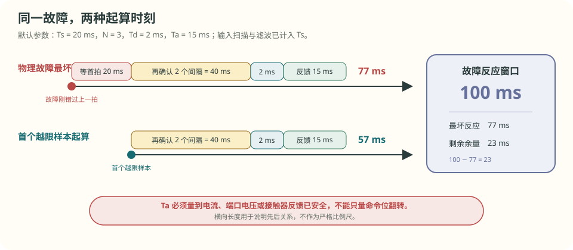
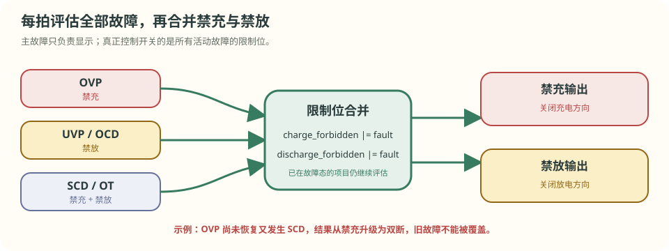

# 第 7 章 保护为什么要等三拍

::: story 现场
4 串教学电池包每秒记录一次。tick 45 正常；tick 46 时，第 1 串从 3.932 V 跳到 4.300 V；tick 47 仍为 4.300 V；tick 48 才置位 `OVP` 并发出禁充命令。tick 49 的电流反馈才归零。

tick 46 已经越线，为什么不立刻关断？因为这套状态机要求连续 3 拍越限。单拍尖峰不会动作，持续过压会在第三拍确认。

这里有 4 个不同时间：物理越限、首次采到越限、发出命令、反馈确认安全。保护时间账必须把它们分开。
:::

<figure>

<figcaption>图 7-1　tick 46 首次越限，tick 48 连续第三拍确认并发出禁充命令，tick 49 才看到电流归零。命令和物理结果不是同一个时间点。</figcaption>
</figure>

<aside class="reading-bet" aria-label="开读押注">

开读押注 · 哪一拍才算保护完成

tick 46 首次越限，tick 48 发出关断命令。哪一拍才有资格把“电流已经归零”写进证据？

<ol><li>tick 46</li><li>tick 48</li><li>tick 49</li></ol>
</aside>

> **最短答案**　阈值只说明“可能出事了”。保护还要经过连续确认、选择禁充或禁放、发出命令，并用电流或电压反馈证明动作已完成。

**本章分三层。**

- **第一次主线**：读 §7.1–§7.3。跟着 tick 46–49 分清阈值、确认、命令和反馈，并算出 57 ms 与 77 ms 两只时钟。
- **第二遍深挖**：读 §7.4–§7.8。处理故障掩码、接触器、验收矩阵、任务预算和功能安全边界。
- **动手验证**：读 §7.9，运行教学固件并对照第 45–50 拍。

**先自己判断**　如果第 48 拍命令位已经变成“禁充”，但电流仍未下降，保护算完成了吗？

## 7.1 一次保护要留下 4 个时间点

tick 48 的过程可拆成 4 步：

1. **越限**：物理电压超过阈值；
2. **确认**：连续样本满足规定拍数，排除短尖峰；
3. **命令**：状态机发出禁充、禁放或双断；
4. **反馈**：电流、端口电压、辅助触点或母线状态证明执行器已到位。

只记录阈值和命令位，证据链仍缺最后一段。MOS 可能击穿，接触器可能粘连，通信也可能让命令没有到达执行器。

::: principle 一句话
**命令发出不等于能量已经切断。保护完成时间要量到安全反馈。**
:::

## 7.2 阈值、确认拍数和恢复线要成套出现

下面是 BMS-Z 教学固件的配置，不是产品通用阈值。

**表 7-1**　5 项教学保护的触发、动作与恢复

| 项目 | 触发条件 | 动作 | 恢复条件 |
|---|---|---|---|
| OVP | 单体 > 4250 mV，连续 3 拍 | 禁充 | 最高单体 < 4150 mV |
| UVP | 单体 < 2800 mV，连续 3 拍 | 禁放 | 充电器在场且最低单体 > 3000 mV |
| OCD | 放电 > 10 A，连续 5 拍 | 禁放 | 放电 < 5 A |
| SCD | 放电 > 30 A，本拍 | 双断并锁存 | 电流回到 ±100 mA 窗口并满足解锁条件 |
| OT | 温度 > 60 °C | 双断 | 温度 < 55 °C |

确认拍数用于过滤短暂毛刺。恢复线则避免输入在阈值附近来回穿越时频繁开关。OVP 在 4250 mV 触发、4150 mV 清除，两条线相差 100 mV，这就是回差。

<figure class="book-motion" data-animation="ov-hysteresis-delay.svg" data-mode="static">

<button type="button" data-book-motion v-book-motion aria-pressed="false" hidden>播放动画</button>
<figcaption>图 7-2　尖峰、持续越限和恢复是 3 个事件。若触发线与恢复线相同，电压在边界附近轻微波动就会反复开关。</figcaption>
</figure>

故障态不能停止其他项目的评估。系统已经 OVP 时仍要检查 OT、SCD 等故障；否则新故障会被旧状态挡住。

## 7.3 同一故障有两只时钟

设采样周期为 `Ts`，确认拍数为 `N`，判决耗时为 `Td`，执行器从命令到安全反馈的时间为 `Ta`。

从首个已经采到越限的样本起算，后面只剩 `N−1` 个采样间隔：

\[
t_{seen}=(N-1)T_s+T_d+T_a
\]

物理故障可能刚好错过上一拍，最坏还要多等一个完整采样周期：

\[
t_{worst}=NT_s+T_d+T_a
\]

取 `Ts = 20 ms`、`N = 3`、`Td = 2 ms`、`Ta = 15 ms`：

- 首次观测后：`(3−1) × 20 + 2 + 15 = 57 ms`；
- 物理故障最坏：`3 × 20 + 2 + 15 = 77 ms`；
- 若故障反应窗口为 100 ms，余量为 `100 − 77 = 23 ms`。

<figure>

<figcaption>图 7-3　两只时钟的差别是最前面的一个采样周期。Ta 必须量到电流、端口电压或接触器反馈已安全，不能只量 GPIO 翻转。</figcaption>
</figure>

若输入滤波和 AFE 扫描未包含在 `Ts` 内，还要单独加入输入链延迟。章首每秒一拍只是为了读日志，不能当作产品保护周期。

<section class="book-lab" data-book-lab="protection" v-book-lab aria-label="保护确认拍数与故障反应时间交互实验">
<h4>计算首次观测与物理故障两种反应时间</h4>
<button type="button" data-lab-reset hidden>恢复算例参数</button>

教学时间预算：输入扫描与滤波已折算进采样周期，执行时间量到安全反馈。FTTI 取 100 ms 只用于演示不等式。

<label>采样周期 Ts / ms：20<input type="range" data-param="samplePeriod" min="5" max="50" step="5" value="20" disabled></label>
<label>确认拍数 N：3<input type="range" data-param="confirmCount" min="1" max="5" step="1" value="3" disabled></label>
<label>判决 Td / ms：2<input type="range" data-param="decision" min="0" max="20" step="1" value="2" disabled></label>
<label>执行反馈 Ta / ms：15<input type="range" data-param="actuator" min="1" max="80" step="1" value="15" disabled></label>
<label>故障反应窗口 / ms：100<input type="range" data-param="ftti" min="50" max="200" step="10" value="100" disabled></label>

首次观测后：<output data-output="observed">57 ms</output>物理故障最坏：<output data-output="worst">77 ms</output>

余量：<output data-output="margin">+23 ms</output>判定：<output class="timing-status" data-output="status" data-state="within" aria-live="polite">预算内</output>

<i class="timing-ftti" data-timing-ftti style="left:100%"></i>

等待首拍连续确认判决执行反馈FTTI

<strong>做两组对照：</strong>把确认拍数从 3 降到 1，比较两只时钟；再把执行反馈拖到 60 ms，看哪一段先用完余量。

</section>

第一次主线到此结束。想直接跑日志，可以跳到 §7.9。

## 7.4 全部故障合并成禁充与禁放

保护动作按故障方向选择：

- OVP 禁充；
- UVP、OCD 禁放；
- SCD、OT 双断。

如果 OVP 尚未恢复又发生 SCD，结果要从禁充升级为双断。状态机每拍评估全部保护，再用故障掩码合并禁充与禁放；“主故障”只用于显示，不能覆盖其他活动故障。

<figure>

<figcaption>图 7-4　限制位采用合并逻辑。状态机已经处于故障态时，其他故障仍继续计数和判定。</figcaption>
</figure>

## 7.5 硬件、软件和接触器负责不同时间尺度

**表 7-2**　三层保护的时间量级与典型动作

| 层级 | 实现 | 响应量级 | 典型动作 |
|---|---|---|---|
| 电芯／硬件级 | 保护 IC、比较器、保险丝 | 微秒–毫秒 | 关断 MOS、熔断 |
| BMS 软件级 | AFE 阈值、状态机 | 毫秒–秒 | 断接触器、限流、告警 |
| 系统级 | 断路器、服务开关、消防 | 秒–分钟 | 隔离、排烟、灭火 |

微秒级短路不能等待软件 tick。软件则负责故障组合、恢复条件、接触器状态机和证据记录。三层可能协同，但不能只保留一层。

高压电池包合闸通常按以下顺序执行：

1. 闭合负极接触器；
2. 闭合预充支路，母线电容经电阻充电；
3. 母线电压接近包电压后闭合正极接触器；
4. 断开预充支路。

每一步都要检查反馈。预充超时可能表示后端短路或支路拒动；断开命令后母线仍不下降，要检查接触器粘连；闭合命令后母线不上升，则检查拒动或接线问题。

## 7.6 阈值表必须落成验收矩阵

阈值表只写何时触发。验收矩阵还要写注入、命令、物理反馈和时限。

**表 7-3**　4 个教学故障工况的验收矩阵

| 工况 | 受控注入 | 同拍保存的证据 | 通过标准 |
|---|---|---|---|
| 持续 OVP | 一串连续 3 拍高于 4250 mV | 原始值、计数器、禁充命令、端口反馈 | 前两拍不动作；第三拍禁充；反馈在预算内到位 |
| 单拍尖峰 | 一串只高 1 拍后恢复 | 原始值、计数器复位、命令 | 不关断，不留活动故障；保留诊断记录 |
| OVP 叠加 SCD | OVP 未恢复时注入 30 A 以上放电 | 故障位图、禁充／禁放命令、电流反馈 | 升级为双断，旧故障不覆盖新故障 |
| 接触器拒动 | 发出闭合命令但母线电压不上升 | 线圈命令、辅助触点、母线斜率、超时计时 | 超时后回退安全态并锁存 DTC |

输入回到恢复线后也不能立刻重合闸。其他活动故障、锁存条件和执行器反馈必须同时满足。

::: trap 坑
只测单一故障会漏掉最危险的状态机错误。OVP 尚未恢复时再注入短路，检查断口是否升级为双断；随后清除 OVP，确认 SCD 仍保持锁存。
:::

## 7.7 20 ms 任务里，哪些时间可以优化

默认时间账可分为 4 段：等待首拍 20 ms、连续确认 40 ms、判决 2 ms、执行反馈 15 ms，合计 77 ms。教学日志另占 1 ms，但不属于故障反应路径。

把 `Ts` 从 20 ms 降到 10 ms，在其他参数不变时：

- `t_seen` 从 57 ms 降到 37 ms；
- `t_worst` 从 77 ms 降到 47 ms。

周期变短也会压缩任务余量。判决 2 ms 加日志 1 ms，在 20 ms 周期内占 15%；若周期缩到 5 ms，则占 60%，还未计 AFE 扫描、通信和其他任务。

确认拍数 `N` 不是普通性能参数。OVP／UVP 用 3 拍，OCD 用 5 拍，SCD 本拍动作，体现的是不同故障对噪声与延迟的取舍。执行反馈 `Ta` 由器件和回路决定，软件不能把物理动作时间优化掉。

判决时间 `Td` 的要求是上界可证明：不用动态内存，不写随输入无限增长的循环，不在命中第一条故障后提前返回。所有保护先评估，再合并限制位。

中断只搬运数据：置标志、打时间戳、把样本推进队列。阈值判断、故障合并、执行器命令和日志写盘留在确定周期的任务中。SCD 的快速动作由硬件比较器完成，不等待软件循环。

## 7.8 功能安全边界与视频伴读

道路车辆常涉及 ISO 26262，工业与储能还可能涉及 IEC 61508、IEC 62619、UL 1973，运输涉及 UN 38.3。适用标准由产品、市场和安全目标决定；开源代码和许可证不能替代危害分析、需求追溯、故障注入与认证流程。

### 视频伴读

**Texas Instruments《Battery Protector, Monitor, or Gauge?》**，官方英文视频，约 4 分 33 秒。观看时画 3 列：哪些保护能由专用硬件直接动作，哪些监测结果交给 MCU，哪些估算属于 gauge。视频用于分清器件职责；阈值、延时和诊断覆盖仍以当前芯片手册为准。

## 7.9 动手验证 tick 45–50

::: lab 动手
先用 §7.3 的交互实验做出一组预算内参数和一组超预算参数。然后在仓库根运行 `python code/firmware/pc_demo.py`，打开 `samples.csv`，定位 tick 45–50。

核对 3 件事：① tick 46、47 的故障位和计数器；② tick 48 为什么发出禁充命令；③ tick 49 为什么才看到电流归零。最后把 1 s 教学拍换成自己的采样周期，分别计算 `t_seen` 与 `t_worst`。
:::

## 练习

1. 采样周期 20 ms、连续 3 拍确认、判决 2 ms、执行反馈 15 ms：从首个越限样本起多久完成？物理故障最坏多久完成？若故障反应窗口为 100 ms，还剩多少余量？
2. 画出接触器状态机（预充、正常、故障、断开），补上粘连与拒动分支，并写出每次状态迁移依赖的反馈。
3. 为“持续 OVP、单拍尖峰、OVP 叠加 SCD”各设计一次故障注入，写出输入、预期命令、执行反馈和通过时限。

## 参考资料

- BMS-Z 阶段教程：https://github.com/zhuguang-ZFG/BMS-Z/tree/main/docs/stages
- BMS-Z 固件走读：https://github.com/zhuguang-ZFG/BMS-Z/blob/main/code/README.md
- BMS-Z PC 全链路：https://github.com/zhuguang-ZFG/BMS-Z/blob/main/docs/共学/08-pc全链路五天.md
- Texas Instruments《Battery Protector, Monitor, or Gauge?》：https://www.ti.com/video/5766070024001
