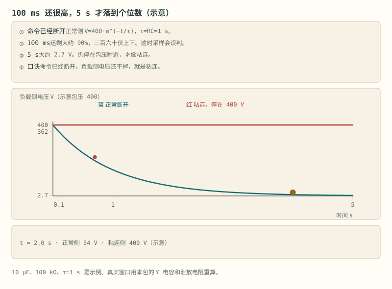
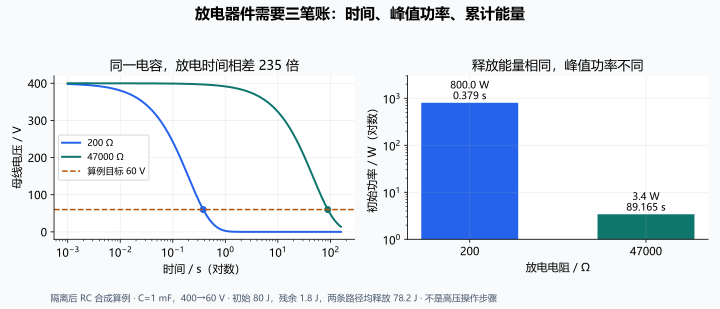

# 第 8 章 硬件失效与二次保护

::: story 现场
车已经“下电”，仪表黑了，维修工拧开高压盒。万用表往母线上一搭：接近 400 V。线圈明明断了电，触点却被此前大电流分断的电弧熔焊在一起：命令断了，电没断。

“以为没电，实际带电”是维修触电的头号来源。硬件会坏，坏法比教科书多：这一章把失效模式摆开，再看软件全错时谁来兜底：二次保护。
:::

第一次读这一章，先记住开场那只搭上母线读出 400 V 的万用表：命令断了，电没断。§8.1 拆开采样链的三种坏法——开线、卡值、漂移，它们让“读数是真的”这条前提先失效，后面的判决自然都不算数；再读 §8.3 与图 8-1，学会用反馈窗口而不是即时读数判断粘连。软件全错时谁兜底看 §8.5，整条上下电时序用 §8.6 的表 8-1 串起来。

## 8.1 采样链的三种坏法

一切保护判决都建立在“读数是真的”上，而采样链有三种坏法（详解② §4/§4b）：

- **开线**：采样线断掉，读数被滤波电容记在旧值附近、又被邻近通道拉偏：不是 0 也不是真值，是个似是而非的值，比读 0 更危险；断线的 0 V 与真过放的 0 V 无法直接区分，所以断线检测是独立诊断。检出靠 AFE 内置开线检测，固件周期执行，先信线再信数；
- **卡值**：读数不飞，只是不动。真实信号总带噪声，别的都在动、只有它不动，就是卡死。示意判据：电压连续 60 拍变化 < 1 LSB，而同窗口其他串变化 > 5 mV；温度通道纹丝不动而其他 NTC 有 ≥ 0.5 °C 纹波；
- **漂移**：动得很慢地偏，某一拍看不出，一个月里拉开。靠对账抓：静置对账（电压查表 SOC 与安时积分持续拉大）、满充对账（两次校准间的净漂移记日志：速率从 0.5%/月 跳到 5%/月，本身就是故障信号）。

三道检查互不替代：量程按电芯、传感器和输入链路的有效范围判断；卡值还要检查输入有没有变化的机会：稳定工况下，恒定读数并不自动说明卡死。漂移需要独立比对，不能拿同一误差源算出的两个结果互证。判不可信后，保留原始值、质量位与时间，记录 DTC；冗余源是否可用于控制，要证明其独立性和覆盖范围。**包压÷串数或相邻串插值不能证明缺失单体没有过压。** 这些分支可在电芯模拟器/HIL 上注入断线、冻结读数、偏置和同步错误验证，不必等待偶发现场失效。

::: principle 一句话
会飞的查量程，不动的查激励与卡值，慢慢偏的靠独立对账。**无效状态必须跟着数值走**；一个看起来正常的替代值，不能自动获得安全判决资格。
:::

## 8.2 接触器：吸合要狠，保持要省

电磁接触器张开时气隙大，需要较大的吸合驱动；吸合后磁路改变，可降低保持功耗。驱动分吸合与保持两档，但具体电压、电流、持续时间和 PWM 频率取自线圈/驱动器手册，并验证最低电源电压与冷热工况。带内置 economizer 的接触器不一定允许外部再 PWM；关断钳位电压也会改变线圈退磁速度，影响触点释放时间。不能把“一半电压、四分之一功耗”当作通用控制档。

接触器的负载分断能力依电压、电流、回路电感、极性与次数规定。正常下电先请求负载卸流，再确认电流降到规定窗口后分断。故障时，分断策略要与接触器短路耐受、熔断器和其他切断器件配合：**并非每只接触器都能安全分断任意短路电流**。事后检查反馈并保存电流、母线电压、线圈状态和动作时刻。高压直流没有交流自然过零的便利，灭弧结构和回路能量是选型依据的一部分。

## 8.3 粘连检测：命令断了，电断没断

> 先自己判断：接触器正常断开，母线 400 V、泄放 τ = 1 s。断开命令发出 0.1 s 后去采样，表上还剩百分之几？

大电流分断的电弧可能把触点熔焊：线圈断电了，触点没分开。每次下电必须验证：看负载侧电压掉不掉。关键是**别下结论太早**。示例负载侧电容 10 µF、泄放 100 kΩ，τ = 1 s，正常断开按 400·e^(−t) 衰减。0.1 s 时还有约 362 V（约九成），这时采样会把正常断开误判成粘连；5 s 才掉到约 2.7 V。粘连侧则一直停在 400 V：5 s 时还贴在包压附近，才锁粘连、禁止再上电。Y 电容和预充回路都会留下残压；真实窗口要用本包的电容和泄放电阻重算，别抄这 1 s。

::: trap 坑
线圈一断电就采样：残压还没泄完，正常断开被判成粘连，误报锁车；判据太松，真粘连被放过，维修工面对的是带电母线。窗口与阈值按本包的 τ 算，不照抄示例。
:::

<figure class="book-motion" data-animation="contactor-weld-check.svg" data-mode="static">

<button type="button" data-book-motion v-book-motion aria-pressed="false" hidden>播放动画</button>
<figcaption>图 8-1　接触器粘连的反馈对照：命令断开后，正常母线按放电路径下降，粘连候选仍贴近包压。曲线为示意。先确认断开命令，再观察足够长的反馈窗口；母线未立即归零不等于触点焊死。为什么需要先知道母线电容和泄放路径，才能选择粘连检查时刻？</figcaption>
</figure>

## 8.4 主动放电：碰撞后的几秒钟

接触器断开后，母线电容（逆变器 DC-link，几百 µF 到几 mF）里还存着 E = ½·C·U² 的能量：400 V、1 mF 就是 80 J，足以致命。GB/T 18384 的碰撞安全要求催生了主动放电：

- **被动放电**：几十 kΩ 泄放电阻常接，分钟级：示例 47 kΩ、τ = 47 s，降到 60 V 要约 89 s。平时够用，碰撞后不够快；
- **主动放电**：碰撞信号或下电指令触发，投入小阻值放电电阻（或借用电机绕组主动短路），几秒内把母线拉到 60 V 以下：示例 200 Ω、τ = 0.2 s，约 0.38 s 到 60 V，此时电容里还剩约 1.8 J；
- **BMS 的角色**：先确认接触器已断（配合粘连检测），再投放电电阻并监督完成、上报状态。顺序错了就是事故：闸还合着就投 200 Ω，电阻按 U²/R = 800 W 持续吃功率，母线也没隔离。

时间账用 t = −τ·ln(U/U0) 自己算：60/400 = 0.15，ln(0.15) ≈ −1.90，乘各自的 τ 就是上面的 89 s 与 0.38 s。放电电阻按脉冲功率选型：80 J 在几秒内全部灌进电阻，连续功率额定值没意义，看脉冲能量额定。

两只电阻不能换时间：预充电阻在合主闸之前限流，主动放电电阻在主闸打开之后泄放；顺序错了就是事故。

## 8.5 二次保护：断电即安全

安全状态不是软件里的一行 `state = SAFE`。驱动级应定义 MCU 复位、GPIO 高阻、欠压和程序未启动时的输出；常开接触器通常失电释放，但已经焊死的触点不因线圈失电恢复。软件输出默认断开，是必要的设计条件，仍需独立切断通路、反馈与故障分析，不能声称“任何失效断电都安全”。

窗口看门狗检查服务时序，问答式看门狗进一步检查执行序列或计算结果；能覆盖哪些故障取决于服务逻辑和独立程度。二级保护芯片可绕过主控发出切断，但若共用供电、采样线或同一焊死执行器，两路仍可能一起失效。把“独立”拆成传感、供电、计算、时钟和执行五条边，逐条验证共同原因与潜伏故障。

这套“功能层—监控层—硬件层”的三级思路，在功能安全流程里叫 E-Gas 三层监控：谁检测、谁复核、谁切断的职责分派，第 25 章展开。

::: principle 一句话
**失控的引脚必须等于断开。** 一级保护天天上班；二级保护一辈子可能只动作一次，但那一次不许依赖任何软件假设。
:::

## 8.6 上下电时序：把本章串成一张表

**表 8-1**　上下电五个步骤的动作与回退判据（流程对照，无测量数字）

| 步骤 | 上电 | 下电 |
|---|---|---|
| 1 | 自检：IMD / HVIL / 粘连检测（上次下电遗留） | 请求用电器降流 |
| 2 | 闭主负 | 电流≈0 确认 |
| 3 | 闭预充，监测母线电压上升斜率 | 断主正 |
| 4 | 母线≈包压（90–95%）→ 闭主正 | 断主负 |
| 5 | 断预充，进入运行态 | 按拓扑确认隔离、主动放电、完成验收与记录 |

任一步超时或超差即中止，回退到安全态。表里每一步都对应前面某一节：自检用 8.3 的粘连检测，降流是 8.2 的“先卸货再拉闸”，下电最后两步是 8.4 的放电与确认。

硬件防线兜住的是“事故”；日常还有一种慢性的不健康：串与串之间慢慢拉开压差。那不再是失效，而是第 9 章均衡要管的日常。

::: lab 动手
回 BMS-Z 详解④，打开两张动画。`contactor-weld-check.svg` 盯住 0.1 s 那拍（约 362 V，别下结论）和 5 s 那拍（约 2.7 V 对 400 V）。`active-discharge.svg` 看“先确认触点分开、再投电阻”的顺序。然后按 8.6 的表给自己设计的包走一遍：每一步超时设多少、回退到哪？
:::

## 8.7 为什么“母线仍有电”至少有四种解释

**表 8-2**　母线仍有电的四种观测、候选原因与区分证据（诊断决策表，无测量数字）

| 下电后的观测 | 候选原因 | 应补的区分证据 |
|---|---|---|
| 电压沿指数下降，但慢于预期 | 电容较大、泄放电阻偏大、冷态阻值或模型错误 | 实测 RC、负载连接状态、独立电压源比对 |
| 电压贴近包压 | 主触点粘连、预充支路未断、外部充电器/变流器回灌 | 辅助触点、支路命令与电流、外部能源状态 |
| 命令与辅助触点正常，读数一直不动 | 采样卡值、反馈接口冻结 | 第二测点、采样时刻、转换状态和受控激励 |
| 投入放电后几乎不下降 | 隔离未成立、放电路径开路、功率器件未导通 | 放电电流、器件诊断、母线斜率与回路核查 |

辅助触点也是测量，不是无误的物理证明；不同母线测点与器件组合决定故障可区分程度。无法区分时输出“隔离状态未确认”，不能为了让状态机继续运行而选一个最方便的解释。

## 8.8 主动放电的三笔账与验收矩阵

400 V、1 mF 母线从 400 V 降到 60 V，初始能量 80 J，残余 1.8 J，**释放 78.2 J**。200 Ω 路径的初始功率为 800 W，达到目标约 0.379 s；47 kΩ 路径初始约 3.404 W，需 89.165 s。时间、峰值功率、累计能量是三项不同约束。

电阻与开关要检查脉冲能量曲线、重复动作冷却、温升、峰值电流与端电压；放电也可能分给多个器件或负载，不能只把全部能量记在一个电阻上。若母线仍连接外部能源，能量不再只有电容的 80 J，单次 RC 公式失效。

<figure>

<figcaption>图 8-2　同一电容，两种放电速度：时间缩短 235 倍，初始功率增大 235 倍，释放能量仍为 78.2 J。全部为合成 RC 算例。</figcaption>

<strong>读图核对：</strong>先看对数时间轴上的 60 V 交点，再看峰值功率；“时间够快”不能替代“器件承受得住”的验证。

</figure>

验证矩阵至少交叉覆盖：正常下电/掉电复位/急停、负载在场/外部回灌、放电开路/触点粘连、冷热/最低驱动电压。每项保存命令、反馈、母线电压、电流、总耗时和故障锁存；本章实验 `engineering_ledger.py` 只复算隔离后被动 RC，不能验证真实高压硬件。

## 练习

1. 为什么粘连检测不能在线圈断电后立刻采样？用 τ = 1 s 的示例数字说明。
2. 被动 47 kΩ 与主动 200 Ω 两条泄放路径，400 V、1 mF 的母线降到 60 V 各要约多久？为什么碰撞后被动不够用？
3. 列出一个采样通道被判不可信前后的处理链：三道检查各抓什么坏法，判决降级到哪些冗余源？

## 参考资料

- BMS-Z 详解④（§1.3 主动放电、§2 接触器管理、§3.2 安全状态）：https://github.com/zhuguang-ZFG/BMS-Z/blob/main/docs/circuits/04-系统安全与量产.md
- BMS-Z 详解②（§4 开线检测、§4b 卡值与漂移）：https://github.com/zhuguang-ZFG/BMS-Z/blob/main/docs/circuits/02-采样链与AFE芯片.md
