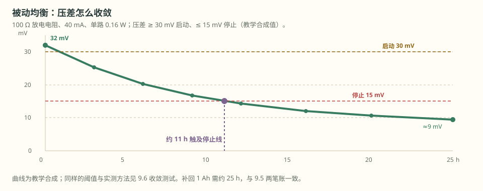
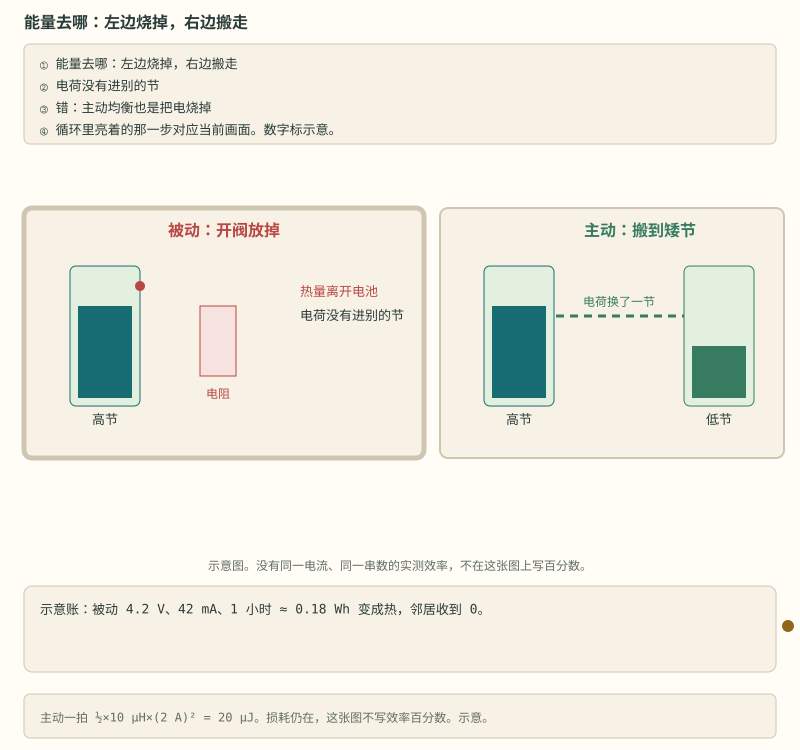

# 第 9 章 均衡：平均是安慰值

::: story 现场
充电末期，BMS 显示第 12 串到达 3.65 V，报“满充”，充电机收枪。拆开账一看：整包实际只充进 92%（教学合成值）——第 12 串早到顶，其余 15 串还饿着。这不是充电器小气，是串联的必然：同一电流下，容量偏小的串先撞上限，整包容量被这一节“代表”了。

均衡能救吗？只能救“电压差”，救不了“容量差”。第 2 章说过，平均 SOC 是最会藏短板的安慰值；这一章讲怎么把假满充拆开、补回。
:::

<figure>

<figcaption>图 9-1　被动均衡把最高串的电压放掉一点，压差才会收敛。合成曲线按 100 Ω、40 mA 绘制。</figcaption>
</figure>

## 9.1 均衡在均衡什么

串联电芯流过同一电流，但容量、内阻、自放电各不相同。充电时容量最小的先到上限，放电时它又先到下限。均衡的目标不是“电压完全相等”，而是：

- 充电末期让各单体**同时**到达上限；
- 放电末期让各单体**同时**到达下限；
- 避免个别单体长期停在高 SOC 或低 SOC。

一句话：均衡管“末端不一致”，不管“容量不一致”。容量差要靠配组与参数标定（见第 13 章），均衡只负责把电压差磨平。

## 9.2 被动均衡：把多的变成热

原理：给电压偏高的单体并联放电电阻，把多余电量耗成热。三笔账（示例值）：

- 电流：I ≈ U/R = 4 V / 100 Ω = 40 mA；
- 功率：P ≈ U²/R = 4² / 100 = 0.16 W，全部变成热；
- 时间：t ≈ ΔQ/I = 1 Ah / 0.04 A = 25 h。

25 小时才补回 1 Ah——被动均衡只能“微调”，不能“修复”。设计时还有三笔账要一起算：

- **占空比降额**：0.16 W 是额定脉冲能力，按 50% 占空比降额后持续热设计按 0.08 W 计（教学合成值）；
- **总热账**：16 路同开 = 16 × 0.16 = 2.56 W（教学合成值），足以让铜箔局部升温十几度，贴着电阻的 NTC 被“加热”，温度读数失真；
- **关断—采样时序**：均衡电流会把单体电压拉低几十 mV，采样前先关断均衡、等电压回弹再采，否则边放边量，越均衡越误判。

## 9.3 主动均衡：搬能量，不是烧能量

| 拓扑 | 原理 | 优点 | 代价 |
|---|---|---|---|
| 电容开关 | 电容在相邻单体间轮换 | 简单 | 电流小、开关损耗大 |
| 电感 | Buck-Boost 搬能量 | 效率较高、电流可到 1–2 A | 控制复杂、有 EMI |
| 变压器 | 多绕组正激/反激 | 可整包对单体 | 体积大、成本高 |
| 独立 DC-DC | 每串一个隔离变换器 | 灵活、电流大 | 成本与复杂度最高 |

控制时序也要入账：开关频率决定电感体积与纹波；均衡电流必须实测标定（电阻 + 示波器，不看计算值）；电感纹波电流是 EMI 的头号来源，layout 没处理好，均衡一开机、AFE 一起噪。

效率账：被动均衡 100% 转热；主动均衡典型按 80–90% 把能量搬走（教学合成值）。同样补 1 Ah：被动烧掉 4 Wh，主动只损耗约 0.4–0.8 Wh。

<figure class="book-motion" data-animation="balance-energy-fate.svg" data-mode="static">

<button type="button" data-book-motion v-book-motion aria-pressed="false" hidden>播放动画</button>
<figcaption>图 9-2　均衡能量去向：被动路线烧成热，主动路线把一部分电量搬给低荷电单体；工况与效率均为示意。</figcaption>

<strong>先看哪里：</strong>跟着能量走，不只看最后压差：相同的压差下降，可能对应完全不同的损耗。

<strong>看完追问：</strong>为什么主动均衡效率要在相同输入、输出和工作点下比较，不能只看宣传百分比？

</figure>

## 9.4 控制策略的四个问题

1. 什么时候允许均衡？（充电末期、静置、还是动态）
2. 均衡谁？（电压最高、SOC 最高、还是容量最大）
3. 均衡多久？（定时、到阈值、还是能量最优）
4. 出故障怎么办？（电阻开路/短路、MOS 粘连、温度过高）

BMS-Z 教学固件的入口条件写得很具体：充电器在场、净电流 > 0、最高串 ≥ 3600 mV、压差 ≥ 30 mV 才启动；电流归零或反向、拔枪、最高串跌破门槛、压差 < 15 mV 时停止。30 mV 与 15 mV 之间是回差——和第 7 章保护的回差一样，防止在阈值附近反复开关。

**何时不该均衡**：低温（允许充电未确认，先放掉的是宝贵电量）；低 SOC（电压曲线陡，压差可能只是 SOC 差的假象）；充电握手未完成（均衡只会把包放空）。

::: principle 一句话
**被动均衡是“水位与开阀”：高水位那格开阀放掉一点，水变成热走了。** 它解决末端不一致，不解决容量不一致；选拓扑之前先算能量账。
:::

## 9.5 两笔量化对比账

补回同样的 1 Ah 不平衡（教学合成值）：

| 方案 | 均衡电流 | 所需时间 | 能量代价 |
|---|---|---|---|
| 被动 100 Ω | 40–100 mA | 10–25 h | 约 4 Wh 全部烧成热 |
| 主动 DC-DC | 2 A | 0.5 h | 约 0.7 Wh 转换损耗 |

时间差 50 倍，能量差约 6 倍。跑 `python code/balancing_energy.py` 可复现，结尾断言 25.0 h、0.5 h、4 Wh、0.7 Wh。

但别急着选主动：一年静置的储能柜，被动均衡每晚充末期跑两小时就够；一天两充两放的车用包，25 h 的被动窗口根本不存在。工况决定拓扑，账决定一切。

## 9.6 均衡的验证

均衡做出来，要拿出三条证据才算数：

- **压差收敛曲线**：记录均衡全程的最高/最低串电压，画 ΔV–t 曲线。合格线：ΔV 单调下降、无台阶回跳；停止后 10 分钟内回升不超过 5 mV（教学合成值）。图 9-1 就是这条曲线的样子。
- **电阻温升**：单路 0.16 W、16 路同开 2.56 W，用热电偶点测电阻表面并对照 NTC 读数，温升超 20 °C 就要降额或加铜箔（教学合成值）。
- **故障注入**：电阻开路 → 该串 ΔV 纹丝不动；电阻短路 → 该串电压被持续拉低；MOS 粘连 → 关断命令下发后 ΔV 仍按原速率收敛。每条先写“预期观测”再注入，和第 7 章去抖一样。

::: trap 坑
低温、低 SOC 时开均衡。电压曲线陡，压差可能只是 SOC 差的假象；均衡电流还让本来就不富裕的可用容量更少。BMS-Z 把“充电器在场 + 净电流 > 0 + 电压门槛”同时写进入口条件，就是为了把这几个坑一次堵死。
:::

::: lab 动手
先跑 `python code/balancing_energy.py`，把被动 25 h 与主动 0.5 h 的账复现一遍。再读 BMS-Z 的 `docs/circuits/03-充电均衡与计量.md`，回答：均衡电阻阻值是多少？入口条件与本章控制四问怎么一一对应？
:::

## 练习

1. 100 Ω 放电电阻、单体 4 V、要补回 ΔQ = 1 Ah：算 I、P、t 三笔账，说明为什么被动均衡只能微调。
2. 为 16S LFP 设计均衡阈值与回差表（启动电压、启动压差、停止压差、温度条件），说明为什么不能设成 3.65 V 一刀切。
3. 主动均衡在什么工况下不划算？给出一个量化例子（提示：日循环次数、静置时长、2 A 电流的自耗）。

## 参考资料

- BMS-Z 电路详解·充电均衡与计量：https://github.com/zhuguang-ZFG/BMS-Z/blob/main/docs/circuits/03-充电均衡与计量.md
- BMS-Z 阶段 1 木桶效应：https://github.com/zhuguang-ZFG/BMS-Z/blob/main/docs/stages/stage-1-认识BMS.md
- SmartBMS：https://github.com/Green-bms/SmartBMS
