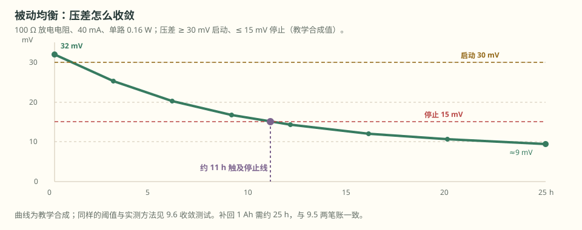
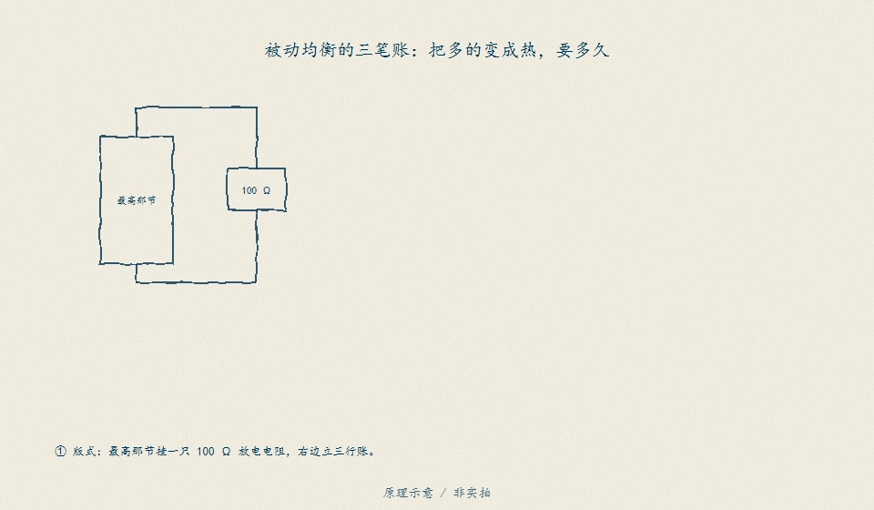
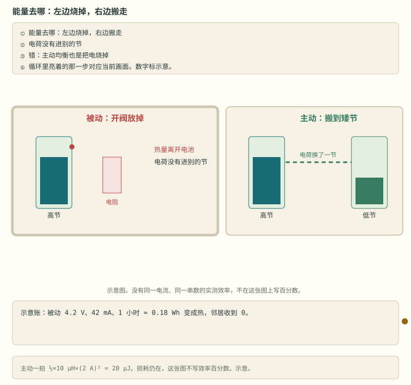
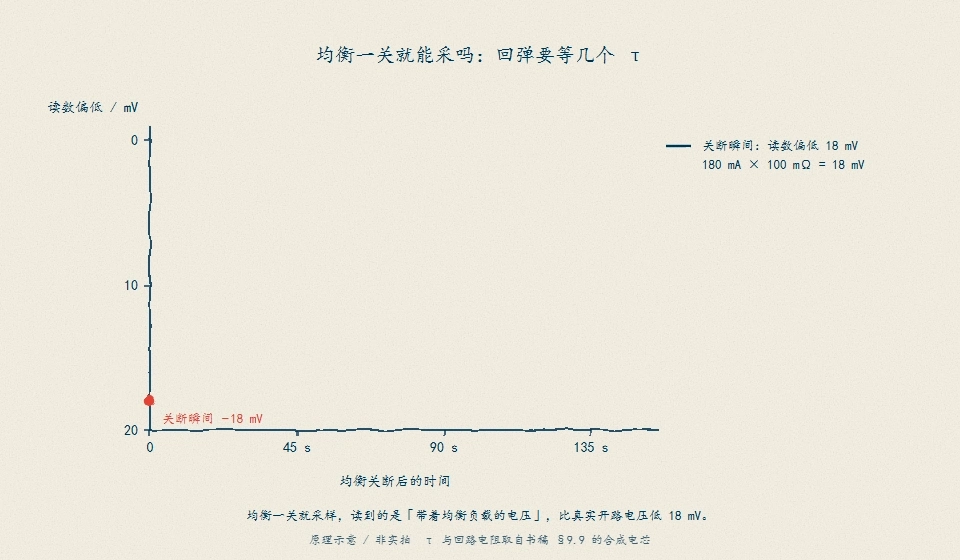

# 第 9 章 均衡：平均是安慰值

::: story 现场
充电末期，BMS 显示第 12 串到达 3.65 V，报“满充”，充电机收枪。拆开账一看：整包实际只充进 92%（教学合成值）：第 12 串早到顶，其余 15 串还饿着。这是串联的必然：同一电流下，容量偏小的串先撞上限，整包容量被这一节“代表”了。

均衡能救吗？只能救“电压差”，救不了“容量差”。第 2 章说过，平均 SOC 是最会藏短板的安慰值；这一章讲怎么把假满充拆开、补回。
:::

<figure>

<figcaption>图 9-1　被动均衡把最高串的电压放掉一点，压差才会收敛。合成曲线按 100 Ω、40 mA 绘制。</figcaption>
</figure>

::: chapter-route 阅读路径

- **第一次主线**：读 §9.1–§9.4。先分清均衡修的是荷电量差，不会修复容量衰减；再认识被动与主动两条路线。
- **第二遍深挖**：读 §9.5–§9.9。计算时间、能量、SOC 敏感度、可用窗口和关断后的等待时间。
- **动手验证**：复算图 9-1 与两笔量化账，再用章末练习写出启动、停止和禁止条件。
:::

**先自己判断**　一节电芯容量已经从 3.0 Ah 衰减到 2.2 Ah。加大均衡电流能把容量补回 3.0 Ah 吗？

## 9.1 均衡在均衡什么

串联电芯流过同一电流，但容量、内阻、自放电各不相同。充电时容量最小的先到上限，放电时它又先到下限。均衡的目标不是“电压完全相等”，而是：

- 充电末期让各单体**同时**到达上限；
- 放电末期让各单体**同时**到达下限；
- 避免个别单体长期停在高 SOC 或低 SOC。

均衡处理末端荷电量不一致，不会修复容量不一致。容量差要靠配组与参数标定（见第 13 章）。

## 9.2 被动均衡：把多的变成热

原理：给电压偏高的单体并联放电电阻，把多余电量耗成热。三笔账（示例值）：

- 电流：I ≈ U/R = 4 V / 100 Ω = 40 mA；
- 功率：P ≈ U²/R = 4² / 100 = 0.16 W，全部变成热；
- 时间：t ≈ ΔQ/I = 1 Ah / 0.04 A = 25 h。

25 小时才补回 1 Ah，被动均衡只能“微调”，不能“修复”。设计时还有三笔账要一起算：

- **占空比降额**：0.16 W 是额定脉冲能力，按 50% 占空比降额后持续热设计按 0.08 W 计（教学合成值）；
- **总热账**：16 路同开 = 16 × 0.16 = 2.56 W（教学合成值），足以让铜箔局部升温十几度，贴着电阻的 NTC 被“加热”，温度读数失真；
- **关断—采样时序**：均衡电流会把单体电压拉低几十 mV，采样前先关断均衡、等电压回弹再采，否则边放边量，越均衡越误判（拉低多少、等多久，9.9 节算给你看）。

<figure class="book-motion" data-animation="balance-ledger.webp" data-mode="static">

<button type="button" data-book-motion v-book-motion aria-pressed="false" hidden>播放动画</button>
<figcaption>图 9-2　被动均衡三笔账：40 mA、0.16 W、25 h；单路按 50% 占空比降额到 0.08 W，16 路同开 2.56 W。</figcaption>

<strong>先看哪里：</strong>先看电阻上那三笔账怎么互相咬住：电流小、功率小、时间就很长；再看 16 路同开时的热账。

<strong>看完追问：</strong>如果把均衡电阻从 100 Ω 换成 50 Ω，电流、功率、时间各变成多少？热设计还够吗？

</figure>

## 9.3 主动均衡：搬能量，不是烧能量

**表 9-1**　四种主动均衡拓扑的原理与代价（拓扑对比，无测量数字）

| 拓扑 | 原理 | 优点 | 代价 |
|---|---|---|---|
| 电容开关 | 电容在相邻单体间轮换 | 简单 | 电流小、开关损耗大 |
| 电感 | Buck-Boost 搬能量 | 效率较高、电流可到 1–2 A | 控制复杂、有 EMI |
| 变压器 | 多绕组正激/反激 | 可整包对单体 | 体积大、成本高 |
| 独立 DC-DC | 每串一个隔离变换器 | 灵活、电流大 | 成本与复杂度最高 |

控制时序也要入账：开关频率决定电感体积与纹波；均衡电流必须实测标定（电阻 + 示波器，不看计算值）；电感纹波电流是 EMI 的头号来源，layout 没处理好，均衡一开机、AFE 一起噪。

效率账：被动均衡 100% 转热；主动均衡典型按 80–90% 把能量搬走（教学合成值）。同样补 1 Ah：被动烧掉 4 Wh，主动损耗约 **0.44–1.0 Wh**。

这个数要按“送到”算，不是按“拿走”算。要让弱串真收下 4 Wh，源串得付 4/η Wh，于是损耗 = 4·(1/η−1)：η=0.90 时 0.44 Wh，η=0.80 时 1.0 Wh。若按 4·(1−η) 算，会得到偏小的 0.4–0.8 Wh；那个式子对应“源串拿出 4 Wh、弱串收到不足 4 Wh”，补不满这 1 Ah。9.5 节的表与 9.8 节的 1.18 Ah 用的都是前一种口径。

<figure class="book-motion" data-animation="balance-energy-fate.svg" data-mode="static">

<button type="button" data-book-motion v-book-motion aria-pressed="false" hidden>播放动画</button>
<figcaption>图 9-3　均衡能量去向：被动路线烧成热，主动路线把一部分电量搬给低荷电单体；工况与效率均为示意。跟着能量走，不只看最后压差：相同的压差下降，可能对应完全不同的损耗。为什么主动均衡效率要在相同输入、输出和工作点下比较，不能只看宣传百分比？</figcaption>
</figure>

## 9.4 控制策略的四个问题

1. 什么时候允许均衡？（充电末期、静置、还是动态）
2. 均衡谁？（电压最高、SOC 最高、还是容量最大）
3. 均衡多久？（定时、到阈值、还是能量最优）
4. 出故障怎么办？（电阻开路/短路、MOS 粘连、温度过高）

BMS-Z 教学固件的入口条件写得很具体：充电器在场、净电流 > 0、最高串 ≥ 3600 mV、压差 ≥ 30 mV 才启动；电流归零或反向、拔枪、最高串跌破门槛、压差 < 15 mV 时停止。30 mV 与 15 mV 之间是回差，和第 7 章保护的回差一样，防止在阈值附近反复开关。

**何时不该均衡**，三条都要先排除：

- 低温：允许充电未确认，先放掉的是宝贵电量；
- 低 SOC：电压曲线陡，压差可能只是 SOC 差的假象，量化理由见 9.7 节：平台中段 1 个百分点的真实电量差只有 0.75 mV，比 5 mV 的采样噪声小一个数量级；
- 充电握手未完成：均衡只会把包放空。

::: principle 一句话
**被动均衡是“水位与开阀”：高水位那格开阀放掉一点，水变成热走了。** 它解决末端不一致，不解决容量不一致；选拓扑之前先算能量账。
:::

## 9.5 两笔量化对比账

补回同样的 1 Ah 不平衡（教学合成值）：

**表 9-2**　补回 1 Ah：两方案的电流、时间与能量代价（教学合成值，`balancing_energy.py` 断言可复现）

| 方案 | 均衡电流 | 所需时间 | 能量代价 |
|---|---|---|---|
| 被动 100 Ω | 40–100 mA | 10–25 h | 约 4 Wh 全部烧成热 |
| 主动 DC-DC | 2 A | 0.5 h | 约 0.7 Wh 转换损耗 |

时间差 50 倍，能量差约 6 倍。跑 `python bms-book/code/balancing_energy.py` 可复现，结尾断言 25.0 h、0.5 h、4 Wh、0.7 Wh。

但别急着选主动：一年静置的储能柜，被动均衡每晚充末期跑两小时就够；一天两充两放的车用包，凑不出 25 h 的被动窗口。工况决定拓扑，账决定选型。

## 9.6 均衡的验证

均衡做出来，要拿出三条证据才算数：

- **压差收敛曲线**：记录均衡全程的最高/最低串电压，画 ΔV–t 曲线。合格线：ΔV 单调下降、无台阶回跳；停止后 10 分钟内回升不超过 5 mV（教学合成值）。图 9-1 就是这条曲线的样子。
- **电阻温升**：单路 0.16 W、16 路同开 2.56 W，用热电偶点测电阻表面并对照 NTC 读数，温升超 20 °C 就要降额或加铜箔（教学合成值）。
- **故障注入**：电阻开路 → 该串 ΔV 纹丝不动；电阻短路 → 该串电压被持续拉低；MOS 粘连 → 关断命令下发后 ΔV 仍按原速率收敛。每条先写“预期观测”再注入，和第 7 章去抖一样。

## 9.7 压差在曲线上的价签

第 12 章算过：同一毫伏，在不同工作区值不同的 SOC。把那张表搬到均衡的旋钮上，压差阈值立刻有了价钱（教学合成值，斜率取第 12 章同一组）：

**表 9-3**　压差与噪声在两个工作区的 SOC 价签（教学合成值，斜率同第 12 章）

| 位置 | dOCV/dSOC（V/SOC） | 30 mV 值多少 SOC | 5 mV 噪声值多少 SOC |
|---|---:|---:|---:|
| 两端膝段 | 6.8 | 0.44 pp | 0.074 pp |
| 平台中段 | 0.075 | 40 pp | 6.7 pp |

两行要读成两件事：

- **膝段：压差是能用的信号**。30 mV 对应 0.44 pp 的真实电量差，5 mV 采样噪声只值 0.074 pp，信噪比 6:1，判据站得住。所以“启动 30 mV / 停止 15 mV”要落在充电末期（LFP 超过 3600 mV 已经进了顶部膝段）。
- **平台中段：压差不能当信号用**。1 个百分点的真实电量差只有 0.75 mV，而采样噪声就有 5 mV，是信号的 6.7 倍；你读到的 30 mV 主要来自滞回、温度与弛豫（第 12 章：LFP 10–20 mV 的滞回就值 13–27 pp）。在那儿开均衡，就是拿假差异去烧真电量。

要把判据落在膝段，先得确认自己在哪一段：

- 底部膝段（SOC < 10%）虽然也陡，但可用容量本来就少，放掉的每毫安时都更贵，所以 9.4 节把它排除在外；
- 平台中段（约 20–80%）的读数被滞回与噪声主导，不能当判据；
- 适合判均衡的只有充电末期的顶部膝段，这正是“充电器在场 + 净电流 > 0 + 最高串 ≥ 3600 mV”三条一起出现在入口条件里的原因。

阈值还要给测量留余量：停止线 15 mV 在膝段只值 0.22 pp，采样噪声与关断回弹合计 5 mV 时就只剩 3 倍余量，再缩线就是以噪声为判据。所以 30/15 不是随手定的：**启动要够大到不误判，停止要够大到不被噪声与回弹推翻。**

阈值还必须绑定电流口径。端电压 = OCV + 充电电流 ×（R0 + R1 + 更多极化），所以同一条 3.65 V 线在不同电流下管的是不同的 OCV。0.5C（10 Ah 电芯 5 A）与 0.05C 之间差 4.5 A × 35 mΩ ≈ **158 mV**。这里的 35 mΩ 取 `code/soc/compare.py` 那台合成电芯，R0=20 mΩ、R1=15 mΩ、C1=3000 F，两阻相加即得。158 mV 在膝段值 2.3 pp，在平台段则是 2 个 SOC 的量级。加上膝点还随温度与老化漂移，单给一个电压数，等于把“某次标定的膝点”当成永久的满充定义。这就是入口条件为什么写的是“充电器在场 + 净电流 > 0 + 电压门槛”三条，而不是一条电压线：**电压阈值离开电流条件就没有定义。**

## 9.8 均衡追得上多少：窗口账

> 先自己判断：每晚充电末期开两小时被动均衡，40 mA。它追得上多大的串间自放电差——几十毫安，还是几毫安？

被动均衡的补回量有上限，而且上限由**窗口**决定，不由不平衡的大小决定：

- 每天能搬多少：40 mA × 2 h = **80 mAh**（每晚充电末期开两小时，教学合成值）；窗口放大到 8 h 是 0.32 Ah。
- 不平衡每天涨多少：串间自放电差 I_diff 一天就是 I_diff × 24 h。要追得上，必须 `I_bal × t_窗口 ≥ I_diff × 24 h`。
- 代进去：2 h 窗口只允许 80 mAh ÷ 24 h = **3.3 mA** 的串间自放电差；8 h 窗口放宽到 13 mA。差得超过这个数，被动均衡就是“用小勺舀漏水的船”。

容量失配涨得更快：容量差 ΔC 的串每完成一次满充满放，就要被放掉约 ΔC 的电（小容量串先到顶，多出来的电流由它自己的均衡电阻烧掉）。日循环两次、ΔC = 0.1 Ah，一天就是 0.2 Ah，已经超过 2 h 窗口能搬的 0.08 Ah，差异会逐日累积。设计规则一句话：**窗口可搬电量 ≥ 日循环次数 × 容量失配量。**

反过来，均衡通道不能常开：100 Ω 挂在 4 V 上就是 40 mA 持续漏电，10 Ah 电芯一天 0.96 Ah，约 **9.6%/天**，存放十天见底。所以每个均衡口都要有 MOS 常闭：第 7 章列的“MOS 粘连”在这本账里相当于每天 9.6% 的自耗。

主动均衡把窗口问题换成速率与效率问题。2 A 搬 1 Ah 只要 0.5 h，但能量来自源串。85% 效率下源串付出 1 Ah ÷ 0.85 ≈ 1.18 Ah，多出的 0.18 Ah 变成损耗，按 4 V 算约 0.7 Wh。被动方案全部耗散，主动方案速度更快但仍有转换损耗。

## 9.9 关断—采样之间要等多久

9.2 节说“采样前先关断均衡、等电压回弹”。等多久有账可算，两个数（教学合成值）：

- **被拉低多少**：均衡电流流过的回路电阻 = 电芯内阻 R0 + 线阻 + MOS 导通电阻。百欧级路子只有 40 mA，按 20 mΩ + 10 mΩ 算约 1.2 mV，可以忽略；但真板子上的被动均衡常跑到 150–200 mA，回路在 100 mΩ 量级时就是 **15–20 mV**，采到的是“带着均衡负载的电压”，不是 OCV 的邻居。
- **回弹要多久**：极化时间常数 τ = R1·C1 = 15 mΩ × 3000 F = 45 s（取 `code/soc/compare.py` 那台合成电芯：R0=20 mΩ、R1=15 mΩ、C1=3000 F，此处只用 R1 与 C1）。等 2–3 个 τ 才算落底，约 1.5–2 分钟。9.6 节“停止后 10 分钟内回升不超过 5 mV”这条合格线之所以合理，是因为 10 min ≈ 13τ，早就松弛完了。

所以时序是：**关均衡 → 等 2–3 个 τ（分钟级）→ 采样 → 判据 → 再开均衡**，不是“关一下就采”。交错太紧时，读数误差正好等于“均衡电流 × 回路电阻”，与真实压差同量级。这是无真值诊断（第 17 章）的典型入口：数据看着正常，只是从来没等过。

<figure class="book-motion" data-animation="balance-settle-window.webp" data-mode="static">

<button type="button" data-book-motion v-book-motion aria-pressed="false" hidden>播放动画</button>
<figcaption>图 9-4　关断—采样之间的等待窗口：把本节两笔账画到同一条时间轴上。关断瞬间偏低 18 mV（180 mA × 100 mΩ），1τ = 45 s 只回弹 63.2%、此时仍差 6.6 mV，要等到 2–3 个 τ（90–135 s）才落进 2 mV 以内。偏低量与判据同量级，所以 30 mV 的真实压差在关断瞬间读成 12 mV，低于 15 mV 停止线，均衡提前停而曲线看着正常。给一组“关断后立刻采样”的压差记录，写出你为什么不能用它判停止条件。合成 RC 算例，τ 取 R1·C1 = 15 mΩ × 3000 F。</figcaption>
</figure>

::: trap 坑
低温、低 SOC 时开均衡。电压曲线陡，压差可能只是 SOC 差的假象；均衡电流还让本来就不富裕的可用容量更少。BMS-Z 把“充电器在场 + 净电流 > 0 + 电压门槛”同时写进入口条件，就是为了把这几个坑一次堵死。
:::

::: lab 动手
先跑 `python bms-book/code/balancing_energy.py`，把被动 25 h 与主动 0.5 h 的账复现一遍。再读 BMS-Z 的 `docs/circuits/03-充电均衡与计量.md`，回答：均衡电阻阻值是多少？入口条件与本章控制四问怎么一一对应？
:::

## 本讲服务知识点

<!-- kp-backlink:start -->
本章服务 2 个知识点；每条都能回到[核心问题地图](../../docs/核心问题地图.md)的 L1–L5 五级入口。这一节由 `curriculum/concepts.json` 的 `book` 字段生成。

**表 9-4**　本章服务的知识点与其梯子入口

| 知识点 ID | 标题 | 阶段 | 梯子到 | 握证 |
|---|---|---:|---|---|
| [`balance-current-scale`](../../docs/核心问题地图.md#kp-balance-current-scale) | 均衡是细流不是大河 | 1 | L3 | 手算纸 |
| [`balance-settle-window`](../../docs/核心问题地图.md#kp-balance-settle-window) | 均衡关断后的回弹 | 3 | L3 | 手算纸 |

**均衡是细流不是大河：把均衡电流加大，能不能补上两节的容量档差？**

均衡主要修同一组电芯间的小差异。被动均衡从偏高单体放掉一点电，变成热；主动均衡尝试把能量搬到别处，也有损耗。两者都不能把容量小的电芯变大。先把要调整的安时数除以均衡电流，算出时间，才知道这股细流追不追得上使用过程里的差异。

**教学算例：沿着这组输入做一遍**

1. 5 Ah 电池的 1 个百分点是 5×0.01=0.05 Ah。
2. 50 mA 即 0.05 A，理想时间 0.05÷0.05=1 h；200 mA 即 0.2 A，约 0.25 h。
3. 1C 放电是 5 A，同样 0.05 Ah 只要 0.01 h=36 s。这个量级对比说明均衡不能代替配组。

**边界与反例**　时间计算忽略了控制占空比和热降额，真实过程可能更长。35 Ah 与 50 Ah 的容量档差不是‘多开一会儿均衡’就能补回的电量差。

**看图任务**　先看每条支路的电流数量级，再看被搬走或变热的能量去向；压差变小不等于容量差消失。

**对应图解**　[balance-vs-pack-current](../../docs/circuits/assets/balance-vs-pack-current.svg)

**先自己判断**　教学 5 Ah：算 1 个百分点的安时数，再算 50 mA、200 mA、1C 各需多久。

完成后再展开标准；先保留自己的计算、判断或运行记录。

核对通过标准

0.05 Ah；1 h、0.25 h、36 s；注明不含效率。

**均衡关断后的回弹：均衡刚关断就读电压，为什么会把均衡提前停掉？**

均衡打开时，电流沿回路流动，线路电阻和电芯动态都会让读数偏低。关断后，纯线路压降可以很快消失，电芯内部极化却还要松弛。正文用单时间常数等效模型解释这条慢尾：等一个 τ 只恢复最终变化的约 63%，还留下约 37%。所以先区分快项与慢项，再决定读数等待窗。

**教学算例：沿着这组输入做一遍**

1. 180 mA 流过 100 mΩ，偏低量 U=IR=18 mV。
2. 慢尾教学模型取 τ=R1C1=15 mΩ×3000 F=45 s，并假定待恢复幅值为 18 mV；这不表示所有线路压降都按45秒消失。
3. 等 1τ 只回弹 63.2%，残差约 18×36.8%≈6.6 mV，还没落进 2 mV。
4. 残差18e^(−t/45)<2，得到t>45ln9≈99 s；约2.2τ以后才满足这道示意门槛，90秒尚略超出。

**边界与反例**　单 τ 是指定合成电芯的简化；真实电芯的回弹有多个时间尺度，不能用一个 45 s 概括所有工况。

**看图任务**　看关断后曲线先陡后缓地回弹；注意 1τ 处只回到六成多，不是直接归零。

**对应图解**　[balance-settle-window](../../docs/circuits/handraw/exports/balance-settle-window.webp)

**先自己判断**　算 180 mA×100 mΩ 的偏低量与 τ=15 mΩ×3000 F；再说明 1τ 后残差与需要等几个 τ。

完成后再展开标准；先保留自己的计算、判断或运行记录。

核对通过标准

18 mV、45 s；1τ 残差约 6.6 mV；2–3τ 即 90–135 s 落进 2 mV。

<!-- kp-backlink:end -->

## 练习

1. 100 Ω 放电电阻、单体 4 V、要补回 ΔQ = 1 Ah：算 I、P、t 三笔账，说明为什么被动均衡只能微调。
2. 为 16S LFP 设计均衡阈值与回差表（启动电压、启动压差、停止压差、温度条件），说明为什么不能设成 3.65 V 一刀切。
3. 主动均衡在什么工况下不划算？给出一个量化例子（提示：日循环次数、静置时长、2 A 电流的自耗）。

## 参考资料

- BMS-Z 电路详解·充电均衡与计量：https://github.com/zhuguang-ZFG/BMS-Z/blob/main/docs/circuits/03-充电均衡与计量.md
- BMS-Z 阶段 1 木桶效应：https://github.com/zhuguang-ZFG/BMS-Z/blob/main/docs/stages/stage-1-认识BMS.md
- SmartBMS：https://github.com/Green-bms/SmartBMS
