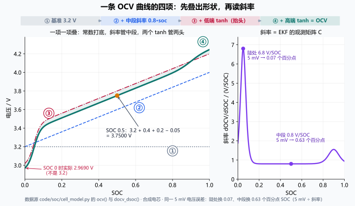
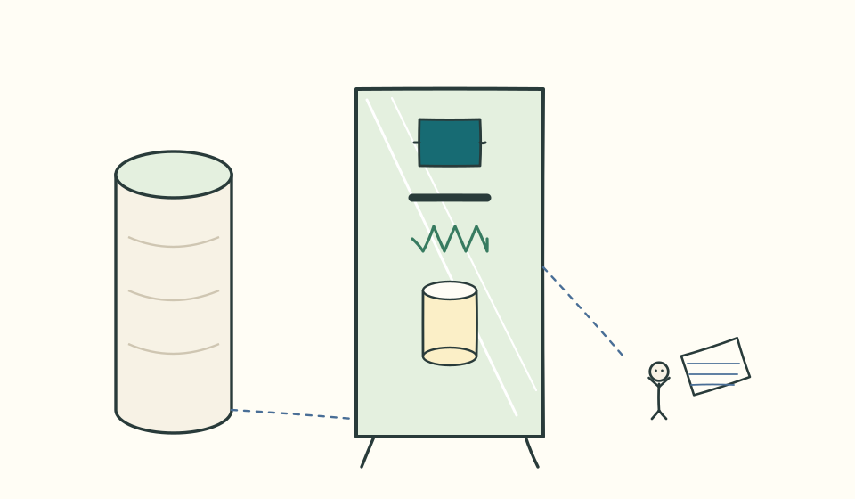
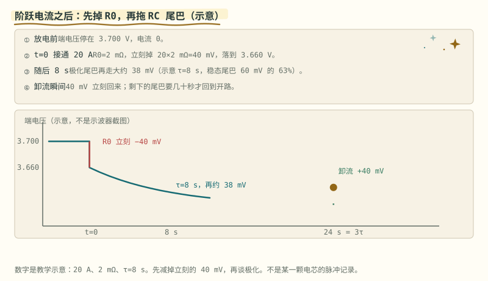

# 第 10 章 模型：一条 OCV 曲线的四项

::: story 现场
均衡解决的是电芯之间的差异；这一章回到单颗电芯，看它的电压能告诉我们什么。BMS-Z 的合成电芯用一行公式定义 OCV 与 SOC 的关系：

```python
3.2 + 0.8*soc + 0.20*tanh((soc-0.05)*30) + 0.05*tanh((soc-0.90)*15)
```

SOC 0.5 时手算 3.7500 V，代码算出的也是 3.7500 V；SOC 0.05 处斜率冲到 **6.800 V/SOC**，中段回落到 **0.800**。同一个 1 mV 噪声，在陡处只换到很少的 SOC，在合成电芯的平台区却能换走一大截。EKF 的观测矩阵 $C=\mathrm{dOCV}/\mathrm{dSOC}$ 要的就是这个数。
:::

模型把内部状态换算成可测端电压。每一项都要能说清来源：平衡电压、欧姆压降、极化动态和路径历史分别由什么数据约束。

::: chapter-route 阅读路径

- **第一次主线**：先读 §10.1 和 §10.4。看懂四项分别影响曲线哪一段，以及参数写错后残差会怎样暴露。
- **第二遍深挖**：再读 §10.2、§10.3 与 §10.5，补齐 R0、RC、斜率和模型适用边界。
- **动手验证**：运行章内交互与章末代码，只改一项参数，先预测哪一段曲线会变。
:::

**先自己判断**　同样 5 mV 的电压误差，落在 OCV 陡坡和平台区，哪一处造成的 SOC 不确定度更大？

## 10.1 四项各管一段

**表 10-1**　合成 OCV 曲线四项在 SOC 0.5 的贡献（`code/soc/compare.py` 合成电芯口径）

| 项 | 作用 | 在 SOC 0.5 的贡献 |
|---|---|---|
| `3.2` | 基准平台 | 3.2000 V |
| `0.8*soc` | 中段斜率 | 0.4000 V |
| `0.20*tanh((soc-0.05)*30)` | 低 SOC 抬头 | 0.2000 V（已饱和） |
| `0.05*tanh((soc-0.90)*15)` | 高 SOC 抬头 | −0.0500 V |

四项相加为 3.7500 V，但常数 `3.2` 不是 SOC=0 时的电压。此时低端项为 0.20·tanh(−1.5) = −0.1810 V，尚未到 −0.20 V 的极限；高端项约为 −0.0500 V。SOC=0 处的实际 OCV 是 3.2000 − 0.1810 − 0.0500 = **2.9690 V**。

这条合成曲线中段斜率约为 0.800 V/SOC；两个 tanh 项使 SOC 0.05 和 0.90 附近的斜率增大。这是演示用的函数形状，不能据此给真实电芯划定化学安全边界。SOC 0.05 处斜率为 6.800 V/SOC，是中段的 8.5 倍；同样的电压误差，在这里换算出的局部 SOC 误差约为中段的八分之一。EKF 观测矩阵中的 $C=\mathrm{dOCV}/\mathrm{dSOC}$ 用的正是这个局部斜率；实际修正还取决于噪声、极化状态和协方差，见第 27 章。

<figure>

<figcaption>图 10-1　左图逐项叠加 OCV，右图给出局部斜率。数据来自 <code>code/soc/cell_model.py</code> 的 <code>ocv()</code> 与 <code>docv_dsoc()</code>；5 mV 的局部 SOC 换算量等于 5 mV 除以斜率。比较右图中段与两端，同样的电压误差会换算成多大的 SOC 差？</figcaption>
</figure>

把 5 mV 分别除以 6.800 和 0.800 V/SOC，局部换算量约为 0.07 和 0.63 个百分点。斜率越大，这项电压误差对应的 SOC 区间越小；这仍不是滤波器的最终误差界。

::: principle 一句话
四项各有职责：常数给基准，中段斜率控制平台倾角，两个 tanh 描述两端膝区。拟合后仍要逐项核对符号、量级和适用区间。
:::

<figure>
<figcaption>图 10-2　模型不是真身，是按约定替真身出场的四位替身：OCV 给基准、R0 管立刻压降、RC 对管拖尾、电容管缓慢漂移。替身只承诺这四条规矩，其余行为一概不负责——用模型之前，先想清楚你让它替的是哪一段。</figcaption>
</figure>

## 10.2 R0：电流一加就掉的那一下

<section class="book-lab" data-book-lab="ocv" v-book-lab aria-label="OCV 四项交互实验">
<h4>把曲线拆开：拖动 SOC 和中段斜率</h4>
<button type="button" data-lab-reset hidden>恢复算例参数</button>
<p class="lab-note">教学合成模型。改变斜率后，端点和中段都会改变；5 mV 换算只是局部敏感度，不是滤波器实际修正。</p>
<div class="lab-controls">
<label>SOC（0–1）：<span data-value="soc">0.50</span><input type="range" data-param="soc" min="0" max="1" step="0.01" value="0.50" disabled></label>
<label>中段斜率（V/SOC）：<span data-value="slope">0.8</span><input type="range" data-param="slope" min="0.05" max="1.2" step="0.05" value="0.8" disabled></label>
</div>
<svg viewBox="0 0 720 330" role="img" aria-label="合成 OCV 曲线与当前 SOC 游标">
<path d="M60 30V270H660" fill="none" stroke="currentColor" opacity="0.5"/>
<text x="18" y="26" fill="currentColor" font-size="14">OCV / V</text><text x="605" y="315" fill="currentColor" font-size="14">SOC →</text>
<text x="30" y="276" fill="currentColor" font-size="12">2.8</text><text x="30" y="90" fill="currentColor" font-size="12">4.2</text>
<text x="60" y="292" fill="currentColor" font-size="12">0</text><text x="355" y="292" fill="currentColor" font-size="12">0.5</text><text x="652" y="292" fill="currentColor" font-size="12">1</text>
<rect data-band x="60" y="142.5" width="600" height="8" fill="#d97706" opacity="0.18"/>
<polyline data-curve points="60,248 90,219 120,190 180,178 300,157 360,146.5 480,126 600,102 660,82" fill="none" stroke="#2563eb" stroke-width="3"/>
<circle data-cursor cx="360" cy="146.5" r="7" fill="#d97706"/>
</svg>
<div class="lab-readouts"><span>OCV：<output data-output="voltage">3.7500 V</output></span><span>斜率：<output data-output="derivative">0.800 V/SOC</output></span><span>5 mV 局部换算：<output data-output="error">0.63 个百分点</output></span></div>
<p>四项相加：<output data-output="terms">3.2000 + 0.4000 + 0.2000 − 0.0500 V</output></p>
<p class="visual-question"><strong>试着推翻直觉：</strong>把 SOC 移到 0.05，再移到 0.50。电压噪声没变，为什么换算的 SOC 区间变了？把斜率调小后，两端陡区是否也消失？</p>
</section>

端电压：

$$
U = \mathrm{OCV} + I R_0 + U_{rc}
$$

BMS-Z 的电芯 $R_0=20\ \mathrm{m\Omega}$。2 A 充电，台阶 $2 \times 0.020 = 40\ \mathrm{mV}$，手算与代码逐位相同。

在这个等效模型里，$R_0$ 不存储状态：电流台阶一出现，$IR_0$ 压降就跟着跳变；撤流后这项立即消失。它把电解液、隔膜、集流体和连接部位等处的快速阻抗合并在一起。

$R_0$ 随温度、SOC 和老化状态变化。参数写错会直接改变电流台阶处的端电压，§10.4 给出合成对照；第 28 章用脉冲起点的电压跳变估计它，前提是采样速度足以分开快速跳变与极化。

## 10.3 RC：拖尾巴的那一段

一阶 RC 的离散递推：

$$
U_{rc,k+1} = e^{-\Delta t/\tau} U_{rc,k} + R_1\left(1-e^{-\Delta t/\tau}\right) I_k, \quad \tau=R_1C_1
$$

系数 $e^{-\Delta t/\tau}$ 来自零阶保持下的精确积分：一个采样周期内把电流视为常数，RC 状态按指数变化。撤流后经过 **3–4 个 $\tau$**，这项极化约剩初值的 5%–2%。

RC 项近似电极和电解液中的慢过程，包括浓度分布的建立与松弛。一个指数环节只能描述一段时间尺度；脉冲前段若拟合不上，须同时检查测量与模型阶数，不能直接认定数据坏了。第 1 章介绍了固相扩散的时间尺度，第 28 章再用 HPPC 曲线检验 RC 拟合。

<figure class="book-motion" data-animation="rc-step-r0-tail.svg" data-mode="static">

<button type="button" data-book-motion v-book-motion aria-pressed="false" hidden>播放动画</button>
<figcaption>图 10-3　电压阶跃分解：20 A、2 mΩ 产生 40 mV 立刻压降，RC 拖尾再发展；该动画参数与本章 2 A 示例不同。盯住开始和撤流两次竖直跳变，再看中间弯曲拖尾：R0 与 RC 不住在同一个时间位置。撤流后立刻跳回的幅值应如何与开始阶跃对账？为什么末端总压差不能全叫 R0？</figcaption>
</figure>

## 10.4 参数写错，谁会当场崩

> 先自己判断：R0 和 C1 都写大 10 倍。两个都是电芯参数、都错同一个倍数，SOC 误差会差几倍，两三倍，还是四十倍？

BMS-Z 的合成对照中，把 R0 写大 10 倍，SOC RMSE 为 **41.51%**；把 C1 写大 10 倍，为 **1.00%**。这些是该工况下的 SOC 估计误差，不是电压 RMSE。复现：`cd code/soc && python compare.py --sweep`（真值电芯保持标称，只把 EKF 侧参数写错；同 seed 42、同 4.7 h 工况、同传感器缺陷），仓库回归测试钉住这张表。

**表 10-2**　参数写大 10 倍对 SOC RMSE 的影响（demo 输出：`compare.py --sweep`）

| 参数 | 写大 10 倍后的 SOC RMSE | 说明 |
|---|---:|---|
| R0 | 41.51% | 每一拍的台阶都错，误差立刻显形 |
| R1 | 36.14% | 同样是电阻、同样乘在瞬态电流上，权重低一档 |
| C1 | 1.00% | 只改变弛豫时间，短窗内影响小 |
| 容量（5.0 / 11 Ah 两档） | 0.20% | 只影响长期漂移，每拍观测都把它拉回来 |

在这组回放中，$R_0$ 写错会让每个电流台阶的预测电压偏离真值，EKF 可能把残差误归给 SOC；$C_1$ 写错主要改变松弛速度，因此这一工况下的 SOC RMSE 小得多。容量误差改变库仑积分的长期斜率，但电压观测在本工况中能不断修正 SOC。换工况或换 OCV 斜率后，表中的排序可能改变。

这组脉冲数据应先核对 $R_0$，再看 $R_1$、$C_1$ 的松弛拟合；这不等于说 $C_1$ 在其他工况也不重要。第 13 章会看到，短窗口里不同的 $K$、$A$、$\tau$ 组合可能得到相近的拟合误差。

## 10.5 这条曲线的三个边界

用到这页账之前，有三条边界要预先说清，免得日后把它们当漂移“修好”。

第一条是滞回。真实电芯的充放电 OCV 不重合：放完电静置后测到的电压，比充完电静置后测到的低，LFP 尤其明显。本模型一条曲线走天下，是工程近似；需要更较真时，把充放两条曲线和它们的“准稳态”条件一起写进参数表。第 3 章化学家族里各体系的窗口差异，就是这类表的第一列。

第二条是温度。OCV 本身是温度的函数（每度零点几毫伏，不同化学体系连符号都可能不同）。BMS 在高温或低温里若仍用 25 °C 的表，估出来的 SOC 带着一个系统偏移。车载的常规做法是锁定几条等温线、在表内插值，而不是全温区建表；加上第 30 章那笔可逆热的提醒：带载电压里本来就有温度项的影子。

第三条是“四项”之外的机制。本模型不包含析锂、副反应和 SEI 生长；在正常工况下可暂不计入，一旦越过适用边界，就必须转向第 15、16 章讨论的老化与失效模型。模型边界与模型精度同样重要：只有说明它不覆盖什么，才能判断现有结论可以支持到哪里。

::: trap 坑
用一条“看起来很顺”的拟合曲线代替参数辨识。曲线能对上，参数可能全错；换一个工况，误差立刻爆炸。**拟合优度不是参数正确性。**
:::

::: lab 动手
去 BMS-Z 跑“电芯建模五天”第 1 天的命令，把 OCV 拆成四项；再把中段斜率从 0.8 改成 0.4，算 SOC 0.5 的 OCV。然后跑第 5 天“把模型改坏”，观察 R0 与 C1 的差异。
:::

四项拆完，还要装回去用。下一章看它第一次上岗：充电时电流与电压怎样在恒流、恒压两段之间交接班。

## 本讲服务知识点

<!-- kp-backlink:start -->
本章服务 1 个知识点；每条都能回到[核心问题地图](../../docs/核心问题地图.md)的 L1–L5 五级入口。这一节由 `curriculum/concepts.json` 的 `book` 字段生成。

**表 10-3**　本章服务的知识点与其梯子入口

| 知识点 ID | 标题 | 阶段 | 梯子到 | 握证 |
|---|---|---:|---|---|
| [`ocv-trust`](../../docs/核心问题地图.md#kp-ocv-trust) | OCV 可信度 | 4 | L5 | 日志 / 仿真输出 |

**OCV 可信度：电压什么时候能当 SOC 的尺子，什么时候会骗人？**

端电压同时含有电池状态、内阻压降和内部尚未消退的浓度差。撤掉电流，欧姆压降先消失，后面的松弛却还没结束；同一个 SOC 从充电还是放电走来，也可能落在不同电压支路。等状态适用后再查 OCV 表，仍要看曲线斜率：平台越平，几毫伏误差对应的电量区间越宽。

**教学算例：沿着这组输入做一遍**

1. 同一教学样本带载 3.450 V，撤流立即到 3.490 V；这 40 mV 的跳变不等于已到平衡。
2. 放电支参考为 3.620 V，充电支为 3.660 V；等待不能自动抹掉 40 mV 的路径差异。
3. 平台示例斜率约 0.75 mV/百分点，5 mV÷0.75≈6.7 个百分点。电压很稳定，也不代表 SOC 很确定。

**边界与反例**　静置多久、用哪张温度表、怎样处理历史，都必须按电芯和数据条件确定。不能把一个教学时间常数写成通用等待阈值。

**看图任务**　先分开瞬时跳变和慢尾，再用同一个电压误差带比较平台与陡坡覆盖的 SOC 范围。

**对应图解**　[ocv-rest-timeline](../../docs/circuits/handraw/exports/ocv-rest-timeline.webp) · [ocv-plateau-distrust](../../docs/circuits/handraw/exports/ocv-plateau-distrust.webp)

**先自己判断**　合上页面，用页内时间点（带载 3.400 V、撤流 3.440 V、静置 3.550 V）写出「哪一刻才能取 OCV」。

完成后再展开标准；先保留自己的计算、判断或运行记录。

<details class="kp-retrieval-check">
<summary>核对通过标准</summary>

指出撤流瞬间与静置后取到的不是同一个数，静置后才可作 OCV。

</details>

<!-- kp-backlink:end -->

## 练习

1. 写出 OCV 公式在 SOC=0、0.05、0.5、1.0 的值，并解释每一段的主导项。
2. 为什么 `exp(-dt/τ)` 能与连续世界严格等价？用一句话说明“零阶保持”。
3. R0 与 C1 各写大 10 倍，为什么误差差这么多？从“每一拍”与“时间常数”两个角度解释。

## 参考资料

- BMS-Z 电芯建模五天：https://github.com/zhuguang-ZFG/BMS-Z/blob/main/docs/共学/09-电芯建模五天.md
- BMS-Z `cell_model.py`：https://github.com/zhuguang-ZFG/BMS-Z/blob/main/code/soc/cell_model.py
- BMS-Z 阶段 4：https://github.com/zhuguang-ZFG/BMS-Z/blob/main/docs/stages/stage-4-SOC-SOH算法.md
- Chen & Rinçón-Mora《Accurate Electrical Battery Model Capable of Predicting Runtime and I–V Performance》（IEEE Transactions on Energy Conversion, 21(2), 2006）：能同时预测续航与 I–V 特性的电模型经典论文，本章模型四项的参考蓝本
