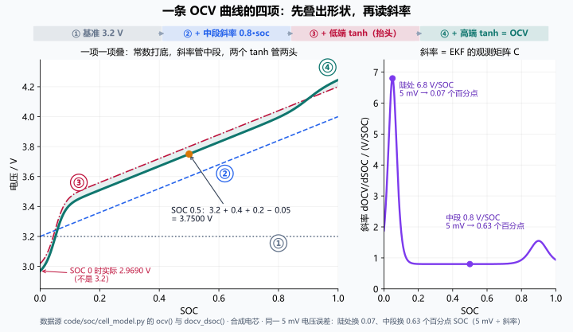
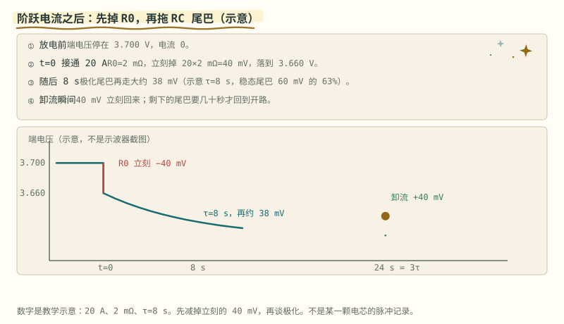

# 第 10 章 模型：一条 OCV 曲线的四项

::: story 现场
BMS-Z 的合成电芯只有一行 OCV 公式，却把"电压怎么变成 SOC"讲透了：

```python
3.2 + 0.8*soc + 0.20*tanh((soc-0.05)*30) + 0.05*tanh((soc-0.90)*15)
```

SOC 0.5 时手算 3.7500 V，代码也 3.7500 V；SOC 0.05 处斜率冲到 **6.800 V/SOC**，中段回落到 **0.800**。同一个 1 mV 噪声，在陡处只换到很少的 SOC，在合成电芯的平台区却能换走一大截。EKF 的观测矩阵 $C=\mathrm{dOCV}/\mathrm{dSOC}$ 要的就是这个数。
:::

这一章讲 BMS 算法的地基：电芯模型。别把“模型”想成什么高深的东西：它就是一张“翻译表”，把电池内部你看不见的状态，翻译成端子上你量得到的电压。翻译表的每一段都要说得清来历：哪一段是化学，哪一段是欧姆，哪一段是扩散，哪一段是历史。说不清来历的拟合曲线，在第 13 章会看到它怎么骗人；说清来历的四个部分，哪怕简陋，也能陪你走完大部分工程决策。

## 10.1 四项各管一段

**表 10-1**　合成 OCV 曲线四项在 SOC 0.5 的贡献（`code/soc/compare.py` 合成电芯口径）

| 项 | 作用 | 在 SOC 0.5 的贡献 |
|---|---|---|
| `3.2` | 基准平台 | 3.2000 V |
| `0.8*soc` | 中段斜率 | 0.4000 V |
| `0.20*tanh((soc-0.05)*30)` | 低 SOC 抬头 | 0.2000 V（已饱和） |
| `0.05*tanh((soc-0.90)*15)` | 高 SOC 抬头 | −0.0500 V |

加起来 3.7500 V。注意 `3.2` 不是"0% 时的实际电压"：SOC=0 时低端 tanh 取到下限 −0.20，实际 OCV 是 2.9690 V。

读这条曲线要分段读。中间那段是"工作区"，也是缓坡：BMS 每天大部分时间待在这里，可 SOC 每动一点，电压只跟着动一点。两端两个 tanh 是"报警区"：SOC 逼近 0.05 或 0.90 时曲线突然抬头，电压对 SOC 变得极敏感，这是化学在报警：快没锂可嵌了，或快嵌满了。低 SOC 那头的斜率是 6.800 V/SOC，是中段的 8.5 倍；同一个电压噪声落在这里，只对应八分之一的 SOC 不确定度。EKF 的观测矩阵 $C=\mathrm{dOCV}/\mathrm{dSOC}$ 把这件事变成了滤波语言：电压残差往 SOC 上换算，除的就是这个斜率。斜率大的地方，电压“说话算数”；平台区，电压含含糊糊，滤波器就要少信它一点；第 27 章的观测权重就是从这里长出来的。

<figure>

<figcaption>图 10-1　OCV 四项按 ①→④ 叠出一条曲线（左），再把它求导读斜率（右）。数据直接取自 <code>code/soc/cell_model.py</code> 的 <code>ocv()</code> 与 <code>docv_dsoc()</code>；5 mV 换算 = 5 mV ÷ 斜率。左图从下往上数四条线，每多一条就多一项；再看右图的尖峰——它就是左图曲线“突然抬头”的那一段。右图中段平坦、两头凸起；如果你是 EKF，哪段电压你最愿意信？哪段该少信一点？</figcaption>
</figure>

打个比方：OCV 曲线像一段登山路。中段是缓坡，走一步升一点，高度计（电压表）读数能告诉你走了多远；两头是陡崖，挪一小步高度就猛变。高度计误差同样是 5 mV，在陡崖上只对应 0.07 个百分点的“位置”，在缓坡上却对应 0.63 个百分点：**斜率越大，电压越能说清 SOC。**

::: principle 一句话
**常数是基准，斜率管中段，两个 tanh 管两头。** 一条曲线不是"拟合出来的"，是四个可解释的部分叠出来的。
:::

## 10.2 R0：电流一加就掉的那一下

<section class="book-lab" data-book-lab="ocv" v-book-lab aria-label="OCV 四项交互实验">
<h4>把曲线拆开：拖动 SOC 和中段斜率</h4>
<button type="button" data-lab-reset hidden>恢复算例参数</button>
<p class="lab-note">教学合成模型。改变斜率后，端点和中段都会改变；5 mV 换算只是局部敏感度，不是滤波器实际修正。</p>
<div class="lab-controls">
<label>SOC（0–1）：<span data-value="soc">0.50</span><input type="range" data-param="soc" min="0" max="1" step="0.01" value="0.50" disabled></label>
<label>中段斜率（V/SOC）：<span data-value="slope">0.8</span><input type="range" data-param="slope" min="0.05" max="1.2" step="0.05" value="0.8" disabled></label>
</div>
<svg viewBox="0 0 720 330" role="img" aria-label="合成 OCV 曲线与当前 SOC 游标">
<path d="M60 30V270H660" fill="none" stroke="currentColor" opacity="0.5"/>
<text x="18" y="26" fill="currentColor" font-size="14">OCV / V</text><text x="605" y="315" fill="currentColor" font-size="14">SOC →</text>
<text x="30" y="276" fill="currentColor" font-size="12">2.8</text><text x="30" y="90" fill="currentColor" font-size="12">4.2</text>
<text x="60" y="292" fill="currentColor" font-size="12">0</text><text x="355" y="292" fill="currentColor" font-size="12">0.5</text><text x="652" y="292" fill="currentColor" font-size="12">1</text>
<rect data-band x="60" y="142.5" width="600" height="8" fill="#d97706" opacity="0.18"/>
<polyline data-curve points="60,248 90,219 120,190 180,178 300,157 360,146.5 480,126 600,102 660,82" fill="none" stroke="#2563eb" stroke-width="3"/>
<circle data-cursor cx="360" cy="146.5" r="7" fill="#d97706"/>
</svg>
<div class="lab-readouts"><span>OCV：<output data-output="voltage">3.7500 V</output></span><span>斜率：<output data-output="derivative">0.800 V/SOC</output></span><span>5 mV 局部换算：<output data-output="error">0.63 个百分点</output></span></div>
<p>四项相加：<output data-output="terms">3.2000 + 0.4000 + 0.2000 − 0.0500 V</output></p>
<p class="visual-question"><strong>试着推翻直觉：</strong>把 SOC 移到 0.05，再移到 0.50；电压噪声没变，为什么换算的 SOC 区间变了？把斜率调小后，两端陡区是否也消失？</p>
</section>

端电压：

$$
U = \mathrm{OCV} + I R_0 + U_{rc}
$$

BMS-Z 的电芯 $R_0=20\ \mathrm{m\Omega}$。2 A 充电，台阶 $2 \times 0.020 = 40\ \mathrm{mV}$，手算与代码逐位相同。

R0 是这三项里"性格"最鲜明的。它不通状态、不记历史，电流一来它立刻出现，电流一走它立刻消失，像一根弹簧，压多少是多少。物理上它来自电解液离子迁移的阻力、隔膜孔隙的曲折、集流体和极耳的欧姆损耗，是一串"立刻发生、立刻结束"的过程的总和。

也正因为它的性格鲜明，它最藏不住错误。R0 随温度下降而上升（低温里离子跑不动），随老化而上升（SEI 增厚、电解液消耗）。参数表里的 R0 写错，每一拍、每一个工况都错，没有任何缓冲，下一节有数字。第 28 章会教你单独把它从脉冲的瞬时跳变里量出来：那是整套参数辨识里最干净的一步，因为它"只认立刻"。

## 10.3 RC：拖尾巴的那一段

一阶 RC 的离散递推：

$$
U_{rc,k+1} = e^{-\Delta t/\tau} U_{rc,k} + R_1\left(1-e^{-\Delta t/\tau}\right) I_k, \quad \tau=R_1C_1
$$

这个 `exp(-dt/τ)` 有确切来历：它是连续方程在零阶保持下的精确解，不是经验拟合。用一句人话说：在一个采样周期内，电流被认为保持不变（零阶保持），精确积分指数衰减，就得到这个系数。它决定了"撤流后电压多久回弹"：工程上常说等 **3–4 个 τ** 才接近稳态。

物理上，RC 项是"慢过程"的替身。电流变化后，固相颗粒表面和内部的锂浓度要重新分布，电解液里也有浓差极化建立与消散的过程；这些过程比欧姆压降慢得多、又比 SOC 本身快得多，折中起来就用一个指数环节近似。知道它是替身很重要：真实电芯在脉冲前段常出现“单一 τ 拟合不上”的尴尬，那是模型阶数不够的信号，不是数据坏了。第 1 章的单颗粒模型会告诉你，一根脉冲前段的电压里藏着无穷多个时间常数；第 28 章的 HPPC 解剖会再次见到它。

<figure class="book-motion" data-animation="rc-step-r0-tail.svg" data-mode="static">

<button type="button" data-book-motion v-book-motion aria-pressed="false" hidden>播放动画</button>
<figcaption>图 10-2　电压阶跃分解：20 A、2 mΩ 产生 40 mV 立刻压降，RC 拖尾再发展；该动画参数与本章 2 A 示例不同。盯住开始和撤流两次竖直跳变，再看中间弯曲拖尾：R0 与 RC 不住在同一个时间位置。撤流后立刻跳回的幅值应如何与开始阶跃对账？为什么末端总压差不能全叫 R0？</figcaption>
</figure>

## 10.4 参数写错，谁会当场崩

BMS-Z 的合成对照中，把 R0 写大 10 倍，SOC RMSE 为 **41.51%**；把 C1 写大 10 倍，为 **1.00%**。这些是该工况下的 SOC 估计误差，不是电压 RMSE。复现：`cd code/soc && python compare.py --sweep`（真值电芯保持标称，只把 EKF 侧参数写错；同 seed 42、同 4.7 h 工况、同传感器缺陷），仓库回归测试钉住这张表。

**表 10-2**　参数写大 10 倍对 SOC RMSE 的影响（demo 输出：`compare.py --sweep`）

| 参数 | 写大 10 倍后的 SOC RMSE | 说明 |
|---|---:|---|
| R0 | 41.51% | 每一拍的台阶都错，误差立刻显形 |
| R1 | 36.14% | 同样是电阻、同样乘在瞬态电流上，权重低一档 |
| C1 | 1.00% | 只改变弛豫时间，短窗内影响小 |
| 容量（5.0 / 11 Ah 两档） | 0.20% | 只影响长期漂移，每拍观测都把它拉回来 |

这几个数差四十倍，原因藏在上一节的"性格"里。R0 错，每个电流台阶都错一个固定比例：它直接站在观测方程里，EKF 会把错的电压台阶当成 SOC 的新息去修，越修越偏。C1 错，只改 τ 不改"每一拍"的幅值结构，短时间窗内它犯的错长得像"初值不对"，滤波器有耐心慢慢消化。容量错得更轻：它只改积分的长期斜率，而每拍的电压观测都在把它拉回：**观测只能钉住它看得见的量**。

这不等于 C1 不重要：调参要有优先级，**先修 R0，再修 C1**，否则你会在一堆等效的参数组合里迷路。等效组合是辨识里的常客：第 13 章会看到，短窗口里 K、A、τ 三个参数互相搬家，拟合误差一样小、答案完全不同。R0 之所以该先修，是因为它住在"立刻"里，任何窗口都骗不了它。

## 10.5 这条曲线的三个边界

用到这页账之前，有三条边界要预先说清，免得日后把它们当漂移"修好"。

第一条是滞回。真实电芯的充放电 OCV 不重合：放完电静置到的电压，比充完电静置到的低，LFP 尤其明显。本模型一条曲线走天下，是工程近似；需要更较真时，把充放两条曲线和它们的"准稳态"条件一起写进参数表，第 3 章化学家族里各体系的窗口差异就是这类表的第一列。

第二条是温度。OCV 本身是温度的函数（每度零点几毫伏，化学体系不同符号都可能不同），BMS 在高温或低温里若仍用 25 °C 的表，估出来的 SOC 带着一个系统偏移。车载的常规做法是锁定几条等温线、表内插值，而不是全温区建表；加上第 30 章那笔可逆热的提醒：带载电压里本来就有温度项的影子。

第三条是"四项"之外的东西。本模型没有析锂、没有副反应、没有 SEI 的生长；它们在日常工况里老老实实为零，一旦越界就不归这页账管，那是第 15、16 章的地盘。模型的边界感，比模型的精度更重要：知道它不证明什么，才敢拿它去证明什么。

::: trap 坑
用一条"看起来很顺"的拟合曲线代替参数辨识。曲线能对上，参数可能全错；换一个工况，误差立刻爆炸。**拟合优度不是参数正确性。**
:::

::: lab 动手
去 BMS-Z 跑"电芯建模五天"第 1 天的命令，把 OCV 拆成四项；再把中段斜率从 0.8 改成 0.4，算 SOC 0.5 的 OCV。然后跑第 5 天"把模型改坏"，观察 R0 与 C1 的差异。
:::

## 练习

1. 写出 OCV 公式在 SOC=0、0.05、0.5、1.0 的值，并解释每一段的主导项。
2. 为什么 `exp(-dt/τ)` 能等价于连续世界？用一句话说明"零阶保持"。
3. R0 与 C1 各写大 10 倍，为什么误差差这么多？从"每一拍"与"时间常数"两个角度解释。

## 参考资料

- BMS-Z 电芯建模五天：https://github.com/zhuguang-ZFG/BMS-Z/blob/main/docs/共学/09-电芯建模五天.md
- BMS-Z `cell_model.py`：https://github.com/zhuguang-ZFG/BMS-Z/blob/main/code/soc/cell_model.py
- BMS-Z 阶段 4：https://github.com/zhuguang-ZFG/BMS-Z/blob/main/docs/stages/stage-4-SOC-SOH算法.md
- Chen & Rinçón-Mora《Accurate Electrical Battery Model Capable of Predicting Runtime and I–V Performance》（IEEE Transactions on Energy Conversion, 21(2), 2006）：能同时预测续航与 I–V 特性的电模型经典论文，本章模型四项的参考蓝本
