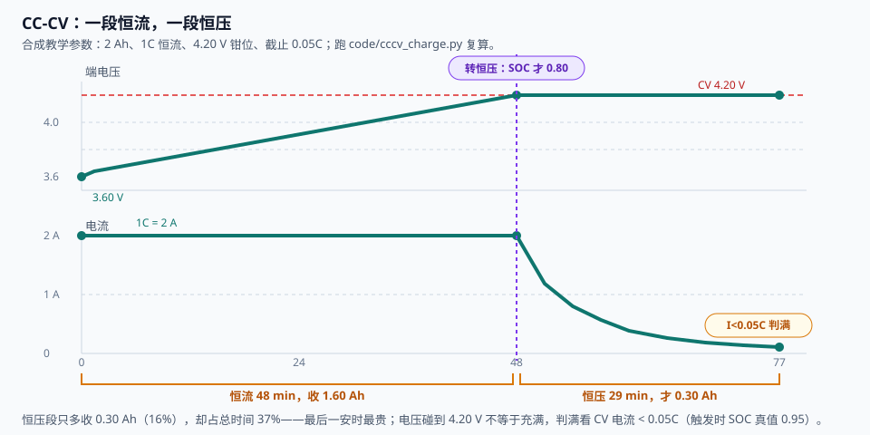
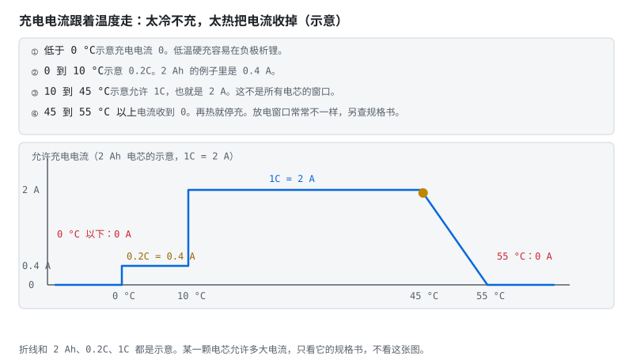

# 第 11 章 CC-CV：恒流恒压

::: story 现场
快充站里，车主盯着屏幕嘀咕：电压老早顶到上限了，电流却越充越小，最后几个百分点又等了快半小时。桩是不是坏了？

桩没坏，这是 CC-CV 的下半场在上班：电压到顶只是“恒压段入场券”，充满要看电流自己衰到截止值。这一章把两段充电的账算清，再看 BMS 每个控制周期怎么决定"此刻允许充多少"。
:::

## 11.1 为什么不能一路大电流充到底

把电池想成"水位 + 一根有阻力的进水管"，标准充电分两步走，前面还可能有可选的第零步：

1. **预充（可选）**：单体低于手册预充门槛（常见约 2.5–3.0 V）、又没落到约 1.5–2 V 深放带时，先按手册用很小电流（常见示例 0.05C）抬回门槛以上；深放或放了很久的电芯很多厂家要求报废，不要拿这档去"激活"；
2. **恒流 CC**：开大水龙头，恒定电流猛灌，电压一路爬升，此刻电芯内部的化学反应跟得上；
3. **恒压 CV**：电压顶住满充值不动，让电芯自己“吸”，越接近满吸得越慢，电流自然衰减到截止值（0.05–0.1C），判充满。

快满时电池"吸收能力"下降（极化），硬灌只会让端电压虚高、负极析锂：往快满的杯子里猛倒水，溢出来的不是水，是锂。以 50 Ah 包为例，截止 0.05–0.1C 就是 2.5–5 A，最后几个百分点常常要花半小时以上（示意）。“电压到了就拔”会少充一截。4.2 V 只是三元的示例满充值，窗口以这颗电芯的规格书为准（第 3 章）。

::: principle 一句话
电压到上限只说明进入电压约束。**协议规定的电压、电流、温度与持续时间共同定义满充参考点**；因上游限流而出现低电流，不能单独证明满充。
:::

## 11.2 一笔示意账：恒流收大头，恒压磨零头

本书配套的合成电芯（教学参数，不是任何真实电芯的规格）：2 Ah，OCV = 3.50 + 0.70·s（s ≤ 0.80；顶部更陡，抬到 0.887 V/SOC），R0 = 50 mΩ、R1 = 20 mΩ、τ = 30 s；CC 段 1C = 2 A，CV 段钳 4.20 V，截止 0.05C = 0.10 A。前向欧拉跑出来：

- **恒流段**：48 min 端电压碰 4.20 V，收进 1.60 Ah，SOC 才到 0.80；
- **恒压段**：再花 29 min，电流从 2 A 衰到 0.10 A，只多收 0.30 Ah，占总充入的 16%，却占总时间的 37%；
- **截止时刻**：电流 < 0.05C 时 SOC 真值 0.95：最后一安时最贵。

<figure>

<figcaption>图 11-1　CC-CV 两段：恒流段电压爬坡，恒压段电流衰减。本书合成电芯的合成教学值（2 Ah、1C、截止 0.05C），不是实测记录。</figcaption>
</figure>

这笔账与详解③ §1 的示意对得上：2 Ah 电芯恒流大约灌进 1.6 Ah，恒压再灌进约 0.3 Ah，电流从 2 A 收到 0.1 A。反过来，若把"电压到 4.20 V"当满充，SOC 锚在 0.80，少记 0.30 Ah，这是白白送人的系统误差。

::: lab 动手
跑 `python code/cccv_charge.py`：十二条断言全 PASS 后，改三个数各跑一遍：R0 翻倍（模拟老化）、截止提到 0.1C、按 5 °C 查地图把 CC 电流限到 0.4 A。看 48 min、29 min、0.80 三个数怎么动，再回答：老化电芯的"电压到顶"会更早还是更晚？
:::

## 11.3 满充判据与 SOC 锚点

CC 末端 U=OCV+IR0+Urc，电流越大、内阻越高，端电压越早碰上限。CV 电流下降能减小部分极化，但**截止不等于所有浓度梯度已经消失**。本书合成例在截止时内部 SOC 仍为 0.95；把显示定义为 100% 是协议归一化，应同时声明使用哪个容量与上下端点，不能把显示百分比直接当电极物理填充率。

工程判据（stage-4 §4.8）：CV 段电流 < 0.05C **且持续 t 秒**，不是电压碰上限，也不是电流碰一下就算。这个锚点是安时积分的救命绳：积分是开环累加，零漂每一拍都被加进去（1 mA 零漂，一天 24 mAh，10 Ah 电池一个月漂约 7%），全靠满充校准与静置 OCV 两个与积分历史无关的绝对参照把它拉回。

## 11.4 充电地图：四个约束取最小

产品里没有"固定 1C"。BMS 每个控制周期查一张**充电地图**，把"此刻最多能充多少"报给充电机（GB/T 27930 的 BCL 报文，源头就是这张表）。允许充电电流 = 四个约束取最小：

**表 11-1**　充电地图四个约束各自回答的问题与形状（约束框架，无测量数字）

| 约束 | 回答的问题 | 大概形状 |
|---|---|---|
| 析锂边界 | 负极还收得下锂吗 | 低温 + 高 SOC 时收紧到 0 |
| 温度窗口 | 这个温度允许多大 | 冰点以下 0，常温放开，高温收回 |
| 电压限幅 | 单体要顶到上限了吗 | 充电为正，I ≈ max(0,(Vmax−OCV−Urc)/R0)，还需预测窗验证 |
| SOP 与老化 | 此刻出得去这么大力吗 | 内阻抬高后，同一电压限幅算出的电流自动变小 |

stage-4 §4.7b 的示意地图（2 Ah 电芯，教学值，实际以规格书为准）：T < 0 °C 全停；0–10 °C 给 0.2C/0.2C/0.1C（SOC 0–70/70–90/90–100 三档）；10–45 °C 给 1C/0.5C/0.2C；45–55 °C 给 0.5C/0.2C/0。demo 查表：−5 °C → 0 A，5 °C → 0.4 A，25 °C、SOC 0.50 → 2 A，50 °C → 1 A，≥55 °C → 0。满充附近约束收得更紧：25 °C、SOC 0.95，地图这格给 0.4 A，电压墙只给 0.10 A；四个约束取最小，这一拍被电压墙咬住。

::: principle 一句话
**太冷怕析锂，太热怕老化，太满怕过充，大电流问 SOP。** 四个数取最小，才是这一拍能给多少。
:::

地图是约束数据，不是执行控制器。是否允许插值，应由边界验证决定：平滑区可在验证过的网格内插值；禁充边界不能被插值跨越成正电流。报文周期、地图刷新与充电机响应共同进入延迟预算，过期需求值不得继续当许可。快充档要和相应工况的寿命、安全及热验证关联，报文和法规条款分别查所用版本原文。

::: trap 坑
把限值地图当连续无边界的曲面外推。只有网格内经过验证的插值才可能使用；不确定或禁止工况必须有显式无效/禁充状态，不能由数学插值替代。
:::

<figure class="book-motion" data-animation="temp-ichg-derate.svg" data-mode="static">

<button type="button" data-book-motion v-book-motion aria-pressed="false" hidden>播放动画</button>
<figcaption>图 11-2　温度改变充电许可：示意电流地图在低温和高温端收紧；不能作为电芯通用充电限值。温度轴变化时先看电流许可，再看 SOC 所在格；低温限制是在避免析锂，不是等待过温才动作。同一 SOC 下从常温降到低温，哪一条边界先决定能否继续充电？</figcaption>
</figure>

## 11.5 工程落地清单

- **OCV 表分温度**：至少 −10/0/25/45 °C 四张表，查表插值；
- **满充校准判据**：CV 段电流 < 0.05C 且持续 t 秒，不是电压碰上限；
- **精度目标**：声明温度、倍率、SOC 窗口、独立参考与统计方法；某一合成工况的低 RMSE 不代表全工况产品精度；
- **验证顺序**：先用合成负控和回放验证接口、符号、边界，再使用受控台架与独立测量验证真实电芯；仿真模型正确不能替代硬件验收。

## 11.6 从充电到 SOC：锚点已就位

这一章解决了"怎么充"和"什么时候算满"。满充这一刻给出的 SOC = 1 锚点，正是下一章的主角之一：第 12 章看 SOC 的三条路——安时积分、OCV 查表、滤波融合——怎样用满充与静置两个锚点把自己拉回真值。

## 11.7 CV 电流为什么会越来越小

在教学局部模型中，忽略 Urc，设 OCV=a+bs、容量 Qcap 用 Ah、R 固定，恒压 Vmax 下 I=(Vmax−a−bs)/R。安时方程 ds/dt=ηI/(3600Qcap) 给出 dI/dt=−ηbI/(3600QcapR)：

**I(t)=I入·exp(−t/τCV)，τCV=3600QcapR/(ηb)。** 电流衰减来自控制器维持恒压与 OCV 上升共同作用。η≈1、Qcap=2 Ah、R=70 mΩ、b=0.70 V/SOC 时，τCV=720 s；从 0.5 A 降到 0.1 A 需 720ln5≈1159 s，即 19.3 min。

这只是局部解析例，不替代 11.2 的带 RC、顶部变斜率的 48/29 min 仿真。真实充电还受扩散、温度、限流器和采样延迟影响；若充电器测的是总输出电流，辅助负载会让它不等于电芯净充电电流。

## 11.8 容量与能量要分两本账

充入电量 ΔQ=∫I dt/3600，单位 Ah；端口能量 Ein=∫UI dt/3600，单位 Wh。同一 Ah 在不同电压阶段对应不同 Wh。即使截止时得到相同显示 SOC，也不能据此断言能量效率或热损耗相同。

以本书合成例为基线，记录 CC/CV 起止、累计 Ah/Wh、最高单体电压、最热测点、电流限值与主导约束。对比老化电芯时先固定温度、协议与测点，再区分容量下降、内阻增大造成提前转 CV、及限流策略改变。只看总时长无法分辨这三件事。

## 11.9 充电验收要主动制造“假满充”

**表 11-2**　四类假满充注入的误读与应验证结果（验收设计对照，无测量数字）

| 注入条件 | 容易误读为 | 应验证的结果 |
|---|---|---|
| 上游因温度限流，电流突然变小 | 已到截止电流，满充 | 未处于合格 CV 条件不置满充；记录主导约束 |
| 一节电芯先触顶，整包电压仍较低 | 整包尚未满，可继续 | 单体限值控制充电许可，不能用平均压覆盖 |
| 电流传感器有负偏置 | 净充电电流更早低于门限 | 独立比对、偏置预算与截止延时评估 |
| 温度跨禁充边界、报文保留旧需求 | 通信仍通，继续充 | 更新许可和超时，反馈核实实际电流下降 |

报告给协议、配置版本、注入时刻、期望动作、实际反馈与通过界限。第 12 章建立 SOC 锚点时，以这份判据为前置，不能仅收到“充满”消息就复位。

## 练习

1. 2 Ah 电芯截止 0.05C 是多少安？若把截止提到 0.1C，省下的时间换来了什么代价？
2. 用 11.2 的账回答：电压刚到 4.20 V 就把 SOC 标成 100%，会少记多少安时？为什么充电电流越大、温度越低，这个偏差越大？
3. 25 °C、SOC 0.95 时地图给 0.4 A、电压墙给 0.10 A，这一拍允许电流是多少？被哪个约束卡住？

## 参考资料

- BMS-Z 详解③（§1 CC-CV）：https://github.com/zhuguang-ZFG/BMS-Z/blob/main/docs/circuits/03-充电均衡与计量.md
- BMS-Z 阶段 0（§0.1.6 充电的两段论）：https://github.com/zhuguang-ZFG/BMS-Z/blob/main/docs/stages/stage-0-前置知识.md
- BMS-Z 阶段 4（§4.7b 充电地图、§4.8 工程落地）：https://github.com/zhuguang-ZFG/BMS-Z/blob/main/docs/stages/stage-4-SOC-SOH算法.md
