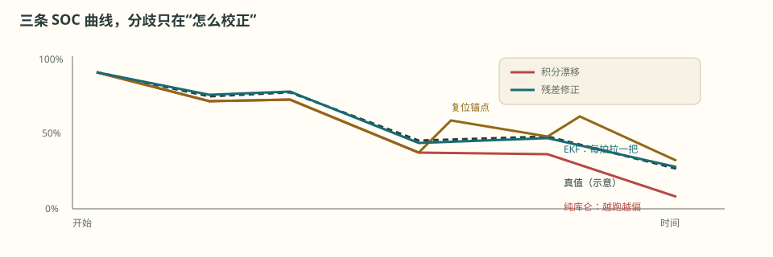
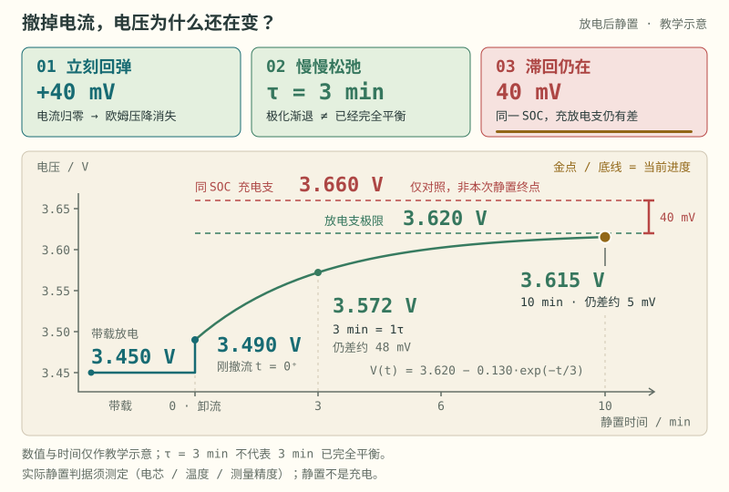

# 第 12 章 SOC：三条路与三个锚点

::: story 现场
同一段工况，三种 SOC 估算器跑出三条曲线：

- **纯库仑计**：在已知初值、容量与可信电流下，短时积分准确；偏置会长期累积；
- **库仑 + 复位**：靠满充和静置 OCV 两个锚点把漂移拉回；
- **EKF**：在模型有效且观测可信时，用电压新息修正状态，不必每次等静置。

它们的分歧不在“积分”，而在**怎么校正**。BMS-Z 的 `compare.py` 把这三条线画在同一张图上，分叉的位置就是答案。
:::

<figure>

<figcaption>图 12-1　三条 SOC 曲线。纯库仑越跑越偏；复位锚点把误差拉回；EKF 用每拍残差修正。</figcaption>
</figure>

## 12.1 库仑计数

$$
SOC_k = SOC_{k-1} + \frac{\eta I_k \Delta t}{3600 Q}
$$

充电为正，所以充电时 SOC 上升。$Q$ 用 Ah，$\Delta t$ 用秒；单位错一个，结果差几个数量级。

优点：短时精度高、动态响应快。

缺点：纯积分，误差累积。电流零点偏置、容量误差、采样丢失都会变成永久漂移。

一个 100 Ah pack，0.1 A 偏置，静置 10 天 → 24% 漂移。这不是实现缺陷，是方案属性：**纯积分没有校正通道。**

## 12.2 三个锚点：满充、静置与初始化

**满充锚点**：电芯在指定温度与充电协议下达到电压、电流和持续时间判据，才能定义本协议的满充参考点。保护切断、上游限流或低温降额也会造成电流衰减，不能仅凭“电压高、电流小”宣布满电。

**静置 OCV 锚点**：先检查电流、温度、静置时长和电压变化率，再用适用于该电芯与历史的 OCV 表。低电流不证明极化消失；LFP 的滞回与平平台也不会被计时器自动消掉。锚点应带置信度，必要时渐进校正，避免显示和控制限值突跳。

本章标题中的第三个锚点是**受控初始化**：新电芯在已知工况下建立的初始状态，或经验证且带时间、温度、版本的非易失状态记录。断电前的 SOC 不一定等于再次上电的 SOC；断电时长、静态耗电、换芯和参数版本都要纳入失效判断。

BMS-Z 的实现里有两个容易漏的细节：

1. 静置计时是**双向去抖**：普通超限采样让计时回退，避免噪声每次都清零。
2. 满充校准明确说明“仍在充电”，必须清掉旧静置计时；撤流后重新等够窗口，不能一拍就用 OCV 覆盖满充结果。

<figure class="book-motion" data-animation="ocv-rest-timeline.svg" data-mode="static">

<button type="button" data-book-motion v-book-motion aria-pressed="false" hidden>播放动画</button>
<figcaption>图 12-2　OCV 静置锚点的生命周期：计时、扰动回退、满充清零与撤流后重新等待；时序为教学示意。</figcaption>

<strong>先看哪里：</strong>看电流符号和计时器是否同步：一次满充更新不能继承之前的静置时间。

<strong>看完追问：</strong>停充后立即更新 OCV，会把哪个尚未松弛的电压成分带进 SOC？

</figure>

## 12.3 EKF：用电压残差拉回

状态 $x=[SOC, U_{rc}]$，观测：

$$
z = \mathrm{OCV}(SOC) + I R_0 + U_{rc} + v
$$

每拍：

1. 用电流预测状态与协方差；
2. 用 $C=[\mathrm{dOCV}/\mathrm{dSOC}, 1]$ 线性化观测；
3. 算残差、增益、修正。

同一个 15 mV 残差，在 SOC 0.05 处 $C=6.8$ V/SOC，局部反演约 0.22 个百分点；合成电芯中段 $C=0.8$ V/SOC，约 1.875 个百分点。这是假设误差全部来自 SOC 时的敏感度换算，不是 EKF 的实际修正；实际修正为 $K_{SOC}e$，还取决于协方差、噪声与极化状态。第 27 章展开这个区别。

::: principle 一句话
**库仑计负责“连续”，锚点负责“不跑飞”，EKF 负责“每拍拉一把”。** 三者不是互斥，是分工。
:::

## 12.4 三条路的取舍

| 方案 | 优点 | 缺点 | 适用 |
|---|---|---|---|
| 纯库仑 | 简单、易核对积分 | 初值、偏置和容量误差缺少观测校正 | 短时任务、受控充电 |
| 库仑 + 复位 | 可解释、可测试 | 依赖满充/静置 | 储能、可定期校准 |
| EKF | 动态好、无需静置 | 依赖模型与参数 | 车用、宽工况 |

BMS-Z 的结论很务实：先把库仑与锚点做对，再上 EKF。**没有好的 OCV 表和参数，EKF 只是把错误模型算得更平滑。**

::: trap 坑
把“参考 SOC”当成“真值”。如果参考值是用同一路电流积分出来的，它和你的估算器共享误差源；报告里必须标注 `independent_soc_truth: false`（JSON 报告字段；同名字段在 Python 代码里写作 `False`）。
:::

::: lab 动手
跑 `python code/soc_coulomb_ocv.py`，对比纯积分、OCV 校正、电流偏置、容量误差四组结果。再把偏置从 0.05 A 改成 0.2 A，观察漂移。最后去 BMS-Z 跑 `compare.py --plot`，看三条曲线的分叉点。
:::

## 练习

1. 推导库仑计在 0.1 A 偏置下 10 天的漂移，并解释为什么“静置校正”能救它。
2. 为什么满充复位后要清掉静置计时？如果不清，会发生什么？
3. 同一个 15 mV 残差，在 $C=6.8$ 与 $C=0.8$ 时各对应多少 SOC 误差？

## 参考资料

- BMS-Z 阶段 4：https://github.com/zhuguang-ZFG/BMS-Z/blob/main/docs/stages/stage-4-SOC-SOH算法.md
- BMS-Z `estimators.py`：https://github.com/zhuguang-ZFG/BMS-Z/blob/main/code/soc/estimators.py
- BMS-Z 无真值诊断：https://github.com/zhuguang-ZFG/BMS-Z/blob/main/docs/共学/10-无真值诊断五天.md
- Plett《Battery Management Systems》Vol. I（Artech House, 2015）：电芯建模与状态估计的完整体系，本章 SOC 三条路的理论框架出处
