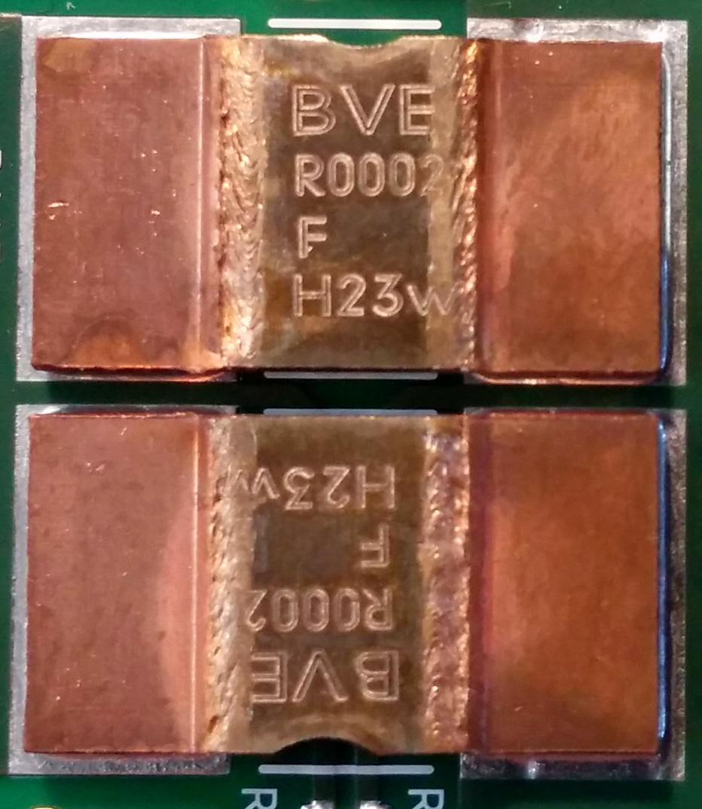
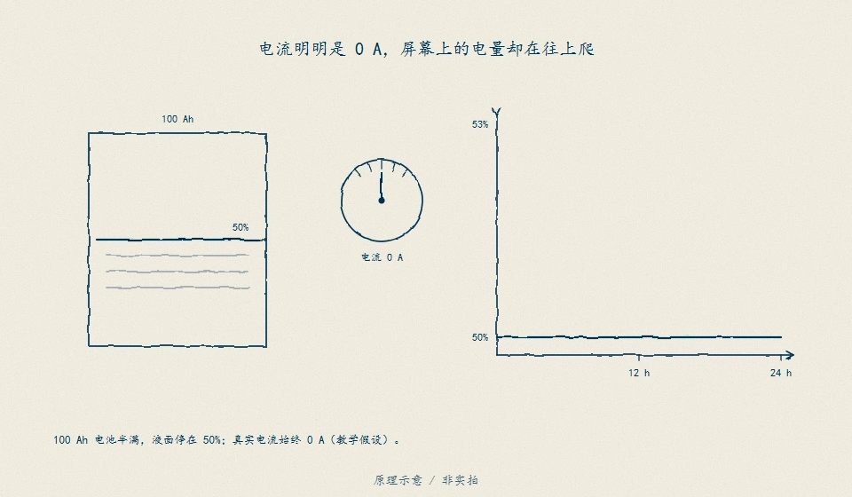
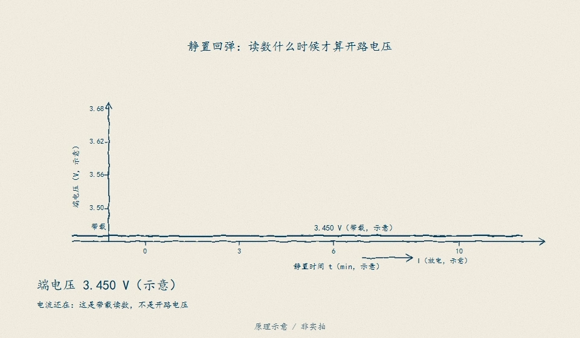
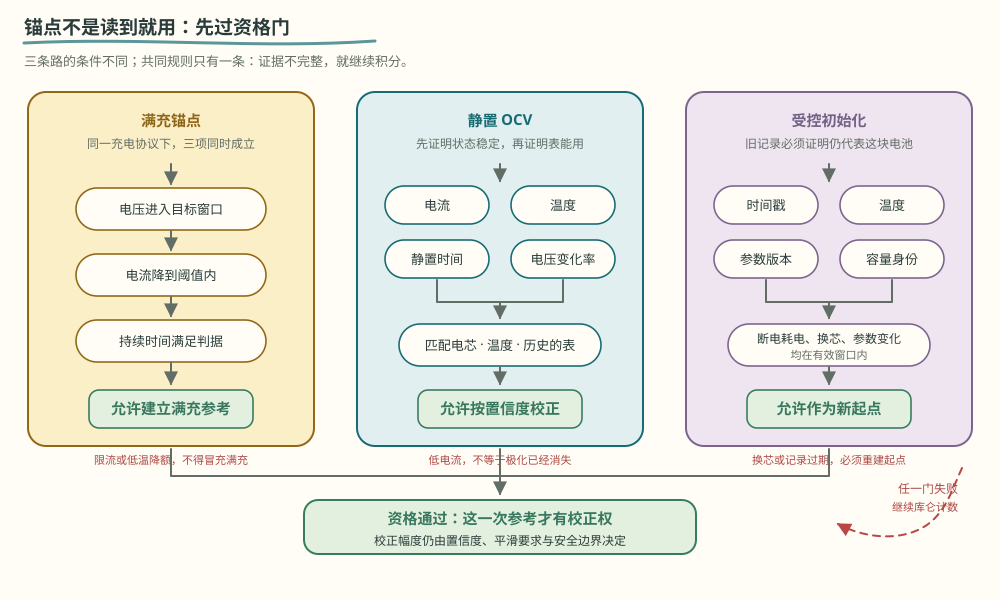
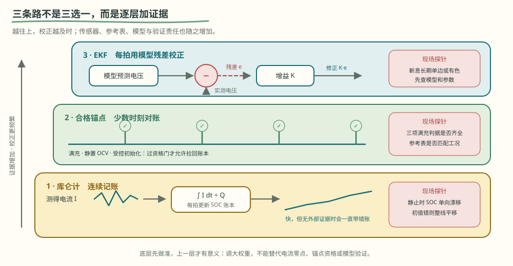
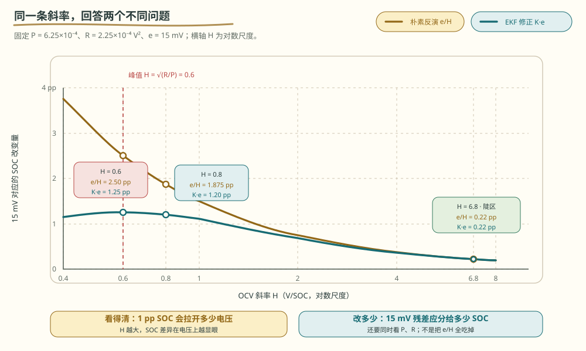
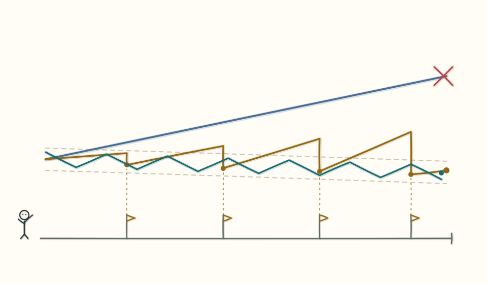

# 第 12 章 SOC：三条路与三个锚点

::: story 现场
一块电池原本显示 50%。没有充电，第二天却显示 52.4%。电池真的多出了电吗？

先分清两件事：**电池里实际剩多少**，和**屏幕估计还剩多少**。它们不是同一个东西。
:::

剩余电荷占满电容量的比例叫 **SOC**，屏幕通常显示它的估算值。把指定使用条件下的满电容量看作 100%，50% 就是还剩一半可用电荷；不是电压降到了一半。

沿着开头这块“自己多出 2.4%”的电池，先问电量怎样记，再看错账怎样积累，最后找一份可信的参考来对账。后面的三种方法是逐步增加证据，不是让你选一种就丢掉另外两种。

::: chapter-route 阅读路径

- **第一次主线**：沿着错账、三个锚点和“预测—对照—修正”读到 §12.4 的对照表。
- **第二遍深挖**：打开本章进阶页，复算六项误差、OCV 斜率、卡尔曼增益和 238 h 回放。
- **动手验证**：每次只改偏置、权重或锚点间隔中的一项，先写预测，再核对原始输出。
:::

## 12.1 库仑计数

### 正常的账怎样记

不用公式也能开始：**原来剩多少，加上充进去的，再减去用掉的。** 持续记录电流来算电荷增减，这种办法叫“库仑计数”，也叫“安时积分”。这里的“积分”，先理解成把每一小段的增减累加起来。

下面约定一块 **100 Ah** 的电池，开始剩 **50 Ah**。Ah 读“安时”，是电荷量的单位：1 A 电流持续 1 h，就对应 1 Ah。为了好理解，可以把本例的满电画成 100 格，50 Ah 就画成 50 格；电芯里面并没有这些格子。

### 让电流计犯一个小错

把这块电池放着，不充也不放。为单独研究测量误差，本例忽略自放电和 BMS 自身耗电，真实电量保持不变。

电流计却没有归零——像一台没放东西也有读数的秤。真实电流是 **0 A**，它一直报 **+0.1 A**。本章约定**充电为正**，于是计算程序误以为一直有电充进来。

看图时先别看所有刻度，只盯两处：蓝色的真实电量不动，红色的估算却不断升高。

<figure class="book-photo">

<figcaption>图 12-1　分流电阻把电流变成很小的压降，采样电路再据此算出电流。照片只用来认外形，无法判断它在某块板上的量程或精度。照片：wdwd，CC BY-SA 4.0。</figcaption>
</figure>

实物很小，误差却会一直进账。零偏来自完整采样链，不能只凭照片归因于分流电阻。

<figure class="book-motion" data-animation="coulomb-counting.webp" data-mode="static">

<button type="button" data-book-motion v-book-motion aria-pressed="false" hidden>播放动画</button>
<figcaption>图 12-2　一天后：真实仍剩一半，屏幕却显示 52.4%。增加的是记录，不是电。100 Ah 电池、+0.1 A 零偏的教学示意，忽略自放电与静态耗电。</figcaption>
</figure>

### 一天到底多记了多少

先算电荷量，再把它换成屏幕上的百分数。不要把这两步混在一起：

1. **多记多少**：0.1 A × 24 h = **2.4 Ah**，也就是本例里多记了 2.4 格。
2. **账上剩多少**：原来的 50 Ah + 多记的 2.4 Ah = **52.4 Ah**；真实仍是 50 Ah。
3. **屏幕显示多少**：52.4 Ah ÷ 满电的 100 Ah = **52.4%**，比真实的 50% 高 **2.4 个百分点**。

52.4% − 50% = **2.4 个百分点**，本章简写为 **2.4 pp**。这不是相对增加了 2.4%；这里先记住“两个电量百分数直接相减”就够了。

> 先自己判断：现在把电流计调准，屏幕会自动从 52.4% 回到 50% 吗？

**不会。** 调准后不再继续多记，但旧账上那 2.4 Ah 还在。**停止记错，不等于已经对好账。** 要纠正旧账，还需要另一份可信的参考，下一节就讲它。

如果完全不处理这个零偏，放到 10 天（240 h）就多记 **24 Ah**，显示 74%，真值仍为 50%。这仍是同一个理想例子，不是实测电池表现。

### 第二遍：把口算写成更新公式

**教学算例**　100 Ah 电池、+0.1 A 零偏、24 h 多记 2.4 Ah，是下面更新公式的贯穿参数。

刚才做的是“先算电荷增减，再除以容量”。程序把一天拆成很多小段，每小段更新一次：

$$
SOC_k = SOC_{k-1} + \frac{\eta I_k \Delta t}{3600 Q}
$$

$I_k$ 是第 $k$ 拍测得的电流，单位 A；$\Delta t$ 是采样间隔，单位秒；$Q$ 是采用的容量，单位 Ah。分母的 3600 把 A·s 换成 Ah。公式中的 SOC 按 0–1 计，0.5 就是 50%。

$\eta$ 是库仑效率，用来计入副反应等造成的电荷损失；上面的教学例子取 $\eta=1$，只看零偏。初值、容量和电流可信时，库仑计短时准确、响应快；但**纯积分没有校正通道**，不能自己发现账本与真实电量的差别。

### 第二遍：六项误差各有多大

前例的“空秤没归零”，专业名叫电流零点偏置，简称零偏。它只是误差的一种；下面仍用 100 Ah 电池，分开核算六种来源。这些量级不能直接相加当作总误差保证。

**表 12-1**　库仑计六项误差源的量级与时间性格（100 Ah 教学口径，逐项算式）

| 误差源 | 算式 | 量级 | 时间性格 |
|---|---|---|---|
| 电流零点偏置 0.1 A | 0.1 A × 240 h ÷ 100 Ah | 24 pp / 10 天 | 随时间线性累积，无界 |
| 电流增益误差 1% | 1% ×（1.5 个等效循环 × 100 Ah）÷ 100 Ah | ≈ 1.5 pp / 天 | 随吞吐累积 |
| 库仑效率误当 1.00（真值 0.99） | (1 − 0.99) × 100 Ah ÷ 100 Ah | 1 pp / 循环 | 随循环累积（LFP 常 ≥ 0.999，即约 0.1 pp/循环；低温高倍率会变差） |
| 容量偏小 3% | 3% × ΔSOC | 每走 50 pp 偏 1.5 pp | 从锚点起线性张开 |
| 丢采 1 分钟 @ 2.5 A | 2.5 × 60 ÷ 3600 ÷ 100 | 0.042 pp / 分钟 | 只要不是长时间丢采就很小的量级 |
| 初值误差 | 直接加在整条曲线上 | 永久平移 | 不会自愈，只能靠锚点 |

读表时先抓住三件事：

- **偏置是斜率错，初值是截距错。** 前者随时间越偏越远，后者让整条曲线从起点就平移。
- **增益、效率、容量是“标定项”**：需要可信的参考测量和合适工况来核对，不能指望静置自己修好。
- **丢采要看多久、几次**：这里丢一分钟只有 0.042 pp，不代表长时间或反复丢采也可忽略。

## 12.2 三个锚点：满充、静置与初始化

程序看不到我们在例子里画出的“真实 50%”。它只有自己的账本，不能凭空知道多记了 2.4 Ah。要纠正，就得找**账本之外的参考**。这样的参考，工程上叫“锚点”。

### 电压为什么能帮忙对账

可以提前测量某种电芯：在不同剩余电量、温度和充放电历史下，让它充分静置，再记录电压，得到一张参考表。充分松弛、没有外部电流时的电压，叫**开路电压，简称 OCV**。

以后条件合格，就可以“测电压 → 查匹配的表 → 得到一个参考 SOC”。假设参考值约为 50%，账本却写着 52.4%，就有了检查和修正旧账的依据。**不是把电压直接除以满电电压，也不是查表结果一定等于真值。** 参考也有误差，校正多少要看它有多可信。

但这里有个门槛：**电流停了，电压不一定立刻稳定。** 上个例子一直静置；下面换成“刚停止放电”的情形，看为什么不能马上查表。

### 刚停止放电，会发生什么

1. **先跳一下。** 电流流过内阻时会产生压降；停止放电，这部分压降立刻消失，端电压回升。这一部分叫欧姆压降。
2. **再慢慢恢复。** 刚才放电造成的内部状态变化不会瞬间恢复，电压还会继续缓慢变化。这叫极化松弛。
3. **还要问刚才在充电还是放电。** 同样剩一半电，刚充到这里和刚放到这里，静置电压也可能不同。这种与历史有关的差异叫滞回；不能只靠多等一会儿就当它不存在。

图 12-3 把这三件事画在同一条时间轴上。先看“立刻跳、慢慢变、两条参考线不重合”，不用记所有电压数值。

<figure class="book-motion" data-animation="ocv-rest-timeline.webp" data-mode="static">

<button type="button" data-book-motion v-book-motion aria-pressed="false" hidden>播放动画</button>
<figcaption>图 12-3　停止放电后，电压先跳回一截，再缓慢恢复；上方充电支只作对照，不是这次静置的终点。数值和时间均为教学示意。</figcaption>
</figure>

图中 $\tau=3$ min 是描述恢复快慢的时间常数，不是“等 3 min 就合格”。3 min 时约为 3.572 V，仍没到放电支的 3.620 V。

> 先自己判断：只要把等待时间加倍，就能保证充、放电两条参考线重合吗？

**不能。** 等待能让这一次的极化逐渐消退，却不能把充放电历史造成的滞回当成零。这是静置查表仍可能不准的原因之一。

**静置 OCV 锚点**，是用充分松弛后的开路电压反查 SOC。可信与否，要分两步检查：

- **先看状态**：电流、温度、静置时长和电压变化率都要满足该电芯的判据。低电流只说明流得少，不证明极化已经消失；不能照抄图里的分钟数。
- **再看参考表**：OCV 表要适用于该电芯、温度与充放电历史。LFP 的平平台和滞回仍会限制精度。校正应带置信度，必要时逐步靠近参考值，避免显示和控制限值突跳。

**满充锚点**，是在指定温度与充电协议下，电芯同时满足**电压、电流、持续时间**判据后，建立本协议的满充参考。保护切断、上游限流、低温降额也可能让电流变小；仅凭“电压高、电流小”，不能宣布满电。

**受控初始化**，是先核实起点再开始积分。可以来自新电芯在已知工况下建立的状态，也可以来自断电后仍保留、且经过有效性验证的非易失记录。记录要带时间、温度和参数版本；断电多久、耗掉多少电、是否换芯、参数是否变化，都要纳入失效判断。

<figure>

<figcaption>图 12-4　锚点先过资格门，再取得校正权。任一条件不合格，都只保留库仑计数，不把这次读数写成新的 SOC 基准。</figcaption>
</figure>

### 第二遍：什么时候允许校正

BMS-Z 的实现还有两条计时规则。它们决定何时允许校正，不是图 12-2 的电压曲线：

1. 静置计时是**双向去抖**：普通超限采样让计时回退，避免噪声每次都清零。
2. 满充校准时仍在充电，必须清掉旧静置计时；撤流后重新等够窗口，不能下一拍就用 OCV 覆盖满充结果。

### 第二遍：1 mV 值多少 SOC

同样差 1 mV，换成 SOC 不一定差得一样多。曲线斜率 dOCV/dSOC 表示 SOC 变化时电压跟着变多少；小误差下，**SOC 误差 ≈ 电压误差 ÷ 曲线斜率**。

**表 12-2**　1 mV 电压误差在三个工作区的 SOC 换算（合成曲线与 LFP 教学斜率）

| 工作区 | dOCV/dSOC（V/SOC） | 1 mV 换算成 SOC |
|---|---|---|
| 本书合成曲线中段（第 10 章口径） | 0.8 | 0.125 pp |
| 两端陡区 | 6.8 | 0.015 pp |
| LFP 平台教学斜率 | 0.075 | **1.33 pp** |

**曲线越平，同样的电压误差会换成越大的 SOC 误差。** 按表中 LFP 教学斜率估算，10–20 mV 的滞回对应约 13–27 pp，只用于量级判断（滞回边界见第 10 章）。所以 LFP 通常更依赖满足判据的满充锚点，不能把平台区单点查表当成精确校准。

两端陡区的 1 mV 只对应 0.015 pp，对电压误差没那么敏感；但温度和充放电历史仍须匹配。

### 第二遍：断电与换芯的账

前面的理想静置例子忽略了静态耗电。现实中，若 BMS 的 2 mA 静态耗电没有经过主电流采样通道，断电 10 天（240 h）就会漏掉这笔放电：

2 mA × 240 h = 0.48 Ah → 对 100 Ah 是 **0.48 pp**；断电 100 天就是 4.8 pp。

这里是**真实电荷减少、记录没有跟着减少**，与前例“真实不变、账本多记”不同。它与时间成正比，方向是放电；再加上自放电、温度和换芯后的容量变化，旧记录不能无条件当成新初值。

只有时间戳、温度、参数版本等有效性检查通过，保存状态才可用于受控初始化；超出有效窗口或换芯后，应重新建立可信起点。记住：**积分负责连续计算，锚点提供有条件的校正依据。**

### 三条路其实是三层证据

底层永远是库仑计：它负责连续记账。合格的满充、静置或初始化在少数时刻提供对账；EKF 再用模型把电压残差变成每拍的动态校正。往上加一层，校正机会更多，所需证据也更多。

<figure>

<figcaption>图 12-5　三条路不是三选一。上一层建立在下一层之上，也多背一份传感器、参考表或模型验证责任。</figcaption>
</figure>

## 12.3 EKF：用电压残差拉回

### 先看一次“预测—对照—修正”

如果电池正在工作，等不了长时间静置怎么办？可以用模型估计电流、内阻和极化对电压的影响，再检查电量账本。这类办法中的一种叫**扩展卡尔曼滤波，简称 EKF**。

另取一个教学时刻，先不看矩阵：

1. **预测**：先按电流更新电量，再用模型算出“应该测到 3.500 V”。
2. **对照**：实际测到 3.515 V，比预测高 **15 mV**。这个“实测减预测”的差，叫**电压残差**。
3. **修正**：差值可能来自 SOC，也可能来自极化、模型或测量误差，不能全算到电量头上。算法按各项可信度，分配这次修正。

例如只看 SOC 的简化教学式，若增益 $K=0.8$ SOC/V，则本次修正为 $0.8\times0.015=0.012$，即 **增加 1.2 个百分点**。这里不是把 SOC 改成实测电压，也不是每次都加 1.2；增益和残差都会变。

> 先自己判断：实测电压比预测高，能立即断定“剩余电量一定估低了”吗？

**不能。** 先检查模型与测量是否可信；同一个电压差，可能有不止一种原因。抓住预测、对照、修正这三步，再往下看算法细节。

### 第二遍：把三步写成公式

完整状态与矩阵推导在第 27 章。这里先把 §12.3 开头的三步写成最小公式。

同时估计两个量：剩余电量比例 $SOC$ 与极化电压 $U_{rc}$，记为状态 $x=[SOC, U_{rc}]$。沿用充电电流为正的约定，测得的端电压 $z$ 写成：

$$
z = \mathrm{OCV}(SOC) + I R_0 + U_{rc} + v
$$

每拍：

1. 用电流预测状态与协方差；
2. 用 $C=[\mathrm{dOCV}/\mathrm{dSOC}, 1]$ 线性化观测；
3. 算残差、增益、修正。

同一个 15 mV 残差，在 SOC 0.05 处 $C=6.8$ V/SOC，局部反演约 0.22 个百分点；合成电芯中段 $C=0.8$ V/SOC，约 1.875 个百分点。这是假设误差全部来自 SOC 时的敏感度换算，不是 EKF 的实际修正；实际修正为 $K_{SOC}e$，还取决于协方差、噪声与极化状态。第 27 章展开这个区别。

### 第二遍：修正量为什么不等于 e/H

把上面那句“实际修正为 $K_{SOC}e$”算出来。一维教学式（$P$ 是先验方差、$R$ 是电压噪声方差、$H=\mathrm{dOCV}/\mathrm{dSOC}$）：

$$
K = \frac{P H}{H^2 P + R}
$$

取三个教学值。$P=(2.5\ \mathrm{pp})^2=6.25\times10^{-4}$。$R=(15\ \mathrm{mV})^2=2.25\times10^{-4}\ \mathrm{V^2}$；残差 $e=15$ mV：

**表 12-3**　三种斜率下 EKF 修正量与朴素反演的对比（一维教学算式，P、R、e 取教学值）

| $H$（V/SOC） | $K$（SOC/V） | 修正 $K e$ | 朴素反演 $e/H$ |
|---|---|---|---|
| 0.6（$=\sqrt{R/P}$） | 0.833 | **1.25 pp** | 2.5 pp |
| 0.8（合成中段） | 0.800 | **1.20 pp** | 1.875 pp |
| 6.8（两端陡区） | 0.146 | **0.22 pp** | 0.22 pp |

<figure>

<figcaption>图 12-6　“看得清”与“改得多”不是同一件事。斜率越陡，1 pp 的 SOC 差异越容易显现在电压上；对固定的 15 mV 残差，却只需较小的 SOC 改动来解释。</figcaption>
</figure>

固定本例的 $P$、$R$ 和残差，$K e$ 在 $H\approx\sqrt{R/P}=0.6$ V/SOC 处最大。$H\to0$ 时，电压几乎不给 SOC 信息，修正趋近零；$H$ 很大时，一小点 SOC 变化已足以解释 15 mV，修正也会变小。

朴素反演 $e/H$ 是非零 $H$ 下 $P\to\infty$ 的极限。先验越不确定，EKF 才越接近直接反演。表中 $H=0.8$ 时，1.875 pp 是实际 1.20 pp 的 1.56 倍；这个比值不能套到另外两行。

真实 EKF 还同时估计极化状态，$K_{SOC}$ 受两状态协方差影响，不能保证总比这条一维式小。这条简式只用来建立量级直觉；第 27 章再展开 $A$、$C$、$Q$、$R$ 的完整计算。

::: principle 一句话
库仑积分提供连续变化，满充或静置锚点校正累计偏差，EKF 每拍按电压残差分配修正量。三者承担不同环节，可以组合使用。
:::

## 12.4 三条路的取舍

**表 12-4**　三条 SOC 路线的适用场景、典型失效与现场探针

| 方案 | 适合什么工况 | 典型失效 | 现场探针 |
|---|---|---|---|
| 纯库仑 | 短时任务、受控充电；积分简单，容易核对 | 偏置持续累积；初值错让整条曲线平移 | 静止工况里 SOC 是否一直朝同一方向漂 |
| 库仑 + 锚点 | 储能等可定期满充或静置的系统 | 限流或低温降额被误判为满充，错误锚点反而拉偏 | 电压、电流、持续时间是否同时满足满充判据 |
| EKF | 车用、宽工况，需要动态修正 | 参数失配时把错误模型算得更平滑 | 新息是否长期单边偏或带滞后相关，而非近似白噪声 |

### 第二遍：238 h 回放中的三条路

定性比较到此为止。`code/soc_coulomb_ocv.py` 把同一组工况跑了五遍，可以直接读出代价有多大。

工况是 100 Ah、LFP 式平坦 OCV 表，总长 **238 h（约 9.9 天）**。两次 20 A 放电、两次 10 A 充电，中间穿插 8 h、8 h、168 h、48 h 四段静置；净搬走 60 Ah，所以真值终值恰好是 **40.00%**。那四段静置就是四次 OCV 锚点机会。图 12-7 把工况和三条路的分工摊在一起：

<figure>

<figcaption>图 12-7　三条路的分工：库仑计负责连续记账，合格静置提供对账，EKF 每拍用电压残差拉一把。同一段 238 h 工况里，电流表偏 +0.05 A 时纯库仑终值 51.90%（+11.90 pp）；加上四次 OCV 锚点也只拉到 46.15%（+6.15 pp），最大一次 9.06 pp 只收回 2.72 pp。时间轴为示意，静置段长不按比例。</figcaption>
</figure>

**表 12-5**　同一段 238 h 工况下三条路的实际代价（`code/soc_coulomb_ocv.py` 实算，真值终值 40.00%）

| 情形 | 终值 SOC | 偏真值 | 全程最大误差 |
|---|---|---|---|
| 纯库仑，电流表无偏置 | 40.00% | ±0.00 pp | 0.00 pp |
| 纯库仑，电流表偏 +0.05 A | 51.90% | **+11.90 pp** | 11.90 pp |
| OCV 校正，无偏置 | 40.00% | ±0.00 pp | 0.00 pp |
| OCV 校正，同样偏 +0.05 A | 46.15% | **+6.15 pp** | 9.06 pp |
| OCV 校正，容量按 95 Ah（真值 100 Ah） | 39.01% | −0.99 pp | 2.77 pp |

先核对能手算的第二行。

**第二行可以手算。** 0.05 A × 238 h ÷ 100 Ah = 11.90 pp，与表里的 +11.90 pp 完全一致。纯库仑的偏置误差随时间线性累积，用一次乘法就能预测，这也让它容易诊断。

**第四行最关键。** 同样的偏置，加上四次 OCV 锚点，终值误差从 11.90 pp 降到 6.15 pp，**只减少约一半**。把四次锚点逐个摊开，就能看清这 6.15 pp 是怎么剩下来的：

**表 12-6**　四次 OCV 锚点各自收回多少（`soc_coulomb_ocv.py` 逐段实算，+0.05 A 偏置）

| 锚点所在静置段 | 校正前偏差 | 校正后偏差 | 这一次收回 |
|---|---|---|---|
| 8 h | +0.50 pp | +0.35 pp | 0.15 pp |
| 8 h | +0.80 pp | +0.56 pp | 0.24 pp |
| **168 h（7 天）** | **+9.06 pp** | +6.34 pp | 2.72 pp |
| 48 h | +8.79 pp | **+6.15 pp** | 2.64 pp |

两个独立的原因，一个比一个重要：

**一、这个演示程序只在每段静置结束时校正一次。** 这是程序的调度设置，不是“必须等七天”的物理规律。那段 7 天静置攒了 0.05 A × 168 h ÷ 100 Ah = 8.4 pp（偏差从 +0.66 走到 +9.06），期间没有校正。全程最大误差 9.06 pp 出现在本段最后一个采样点、校正之前。

**二、这个演示每次只收回 30% 的差。** 权重取教学值 0.3，不是通用推荐值；实际应按参考可信度和输出平滑要求设计。因此 +9.06 pp 这次只收回 $9.06\times0.3\approx2.72$ pp。

这两条可以用实验分开。把权重从 0.3 改成 1.0（完全信 OCV），终值误差归零，但**全程最大误差仍有 8.50 pp**。这部分来自第一条原因：误差在没有锚点的那 168 小时里累积，提高 OCV 权重也消除不了。**权重决定终值能否校准干净，锚点间隔决定中途最大误差。**

在本例的可靠参考与校正频率下，锚点能限制误差，但不保证归零。修电流表零点可以停止新增错账；已经累积的旧账，仍需可信参考来纠正。两件事都要做，不能用调大权重代替传感器校准。

（一条诚实边界：这个 demo 的 OCV 锚点读数是从真值反推的，锚点本身没有误差，所以上面的残差纯粹来自权重与锚点间隔。真实系统的 OCV 表、滞回与温度都会给锚点自己加一份误差，第 10 章与 §12.2 讲的就是那一份。）

**第五行的方向相反，而且锚点在这里几乎治好了它。** 容量按 95 Ah（偏小 5%）算，同样的安时被除以更小的分母，所以每搬一度电估计都比真值多走一点。净放 60 Ah 下不校正会落到 100 − 60÷95×100 = **36.84%**（偏低 3.68 pp），而四次锚点把它拉回 **39.01%**，只差 0.99 pp。

同样四次锚点，为什么剩余误差不同？因为两者攒误差的条件不同：**偏置在静置时也按时间攒，容量误差要有电流流过才会继续变化。** 最后 48 h 是静置：偏置又增加 2.4 pp，容量误差却没有新增。

两种情形都在这 48 h 的末尾才做最后一次校正，且都保留校正前误差的 70%。偏置情形在对账前还在不断多记，容量误差情形则没有；不是最后一次校正之后又累积了误差。

表 12-1 里「偏置是斜率错、无界累积」与「容量是从锚点起线性张开」两行，在这里有了各自的数字和各自的归宿。顺带也说明为什么长期停放的储能系统最怕电流零点：停着不动，偏置还在计费。

BMS-Z 的结论很务实：先把库仑与锚点做对，再上 EKF。**没有好的 OCV 表和参数，EKF 只是把错误模型算得更平滑。**

::: trap 坑
把“参考 SOC”当成“真值”。如果参考值是用同一路电流积分出来的，它和你的估算器共享误差源；报告里必须标注 `independent_soc_truth: false`（JSON 报告字段；同名字段在 Python 代码里写作 `False`）。
:::

::: lab 动手
跑 `python bms-book/code/soc_coulomb_ocv.py`，核对表 12-5 的五行：真值终值 40.00%，纯库仑带 0.05 A 偏置落在 51.90%，加四次 OCV 锚点后是 46.15%。

再做三个对照，每个都先预测、再运行：

1. 把 `BIAS_A` 从 0.05 改成 0.2（四倍）。纯库仑终值应该是 100 − 60 + 0.2×238 = **87.6%**——先自己算，再跑；对不上，就回头检查“偏置按时间线性累积”这一步。
2. 把校正那行的权重从 `0.7 * soc_est + 0.3 * soc_ocv` 改成完全信 OCV（`0.0 * soc_est + 1.0 * soc_ocv`）。预期：终值误差归零，**但全程最大误差只从 9.06 pp 降到 8.50 pp**。这 8.50 pp 在 7 天无锚点的静置段里累积，调权重消除不了。
3. 先恢复原来的 0.3 权重，只测试校正次数：把 `PROFILE` 里 `(7 * 24 * 3600, 0.0)` 那一段拆成七段 `(24 * 3600, 0.0)`。
   总时长不变，但每段仍 ≥1 h，锚点从 4 次变成 10 次。预期最大误差从 9.06 pp 降到 **5.07 pp**、终值到 43.55%（+3.55 pp）。这说明**在参考同样可靠时，校正频率也很重要**；真实系统不能为了多校正，就跳过静置与可信度判据。

最后去 BMS-Z 跑 `compare.py --plot`，看三条曲线的分叉点。
:::

## 练习

1. 推导库仑计在 0.1 A 偏置下 10 天的漂移，并解释为什么“静置校正”能救它。
2. 为什么满充复位后要清掉静置计时？如果不清，会发生什么？
3. 用 $K = PH/(H^2P + R)$：$P=(2.5\ \mathrm{pp})^2$、$R=(15\ \mathrm{mV})^2$、$e=15$ mV，算 $H=0.6$、0.8、6.8 V/SOC 三处的修正量，并解释为什么它不等于 $e/H$。

## 参考资料

- BMS-Z 阶段 4：https://github.com/zhuguang-ZFG/BMS-Z/blob/main/docs/stages/stage-4-SOC-SOH算法.md
- BMS-Z `estimators.py`：https://github.com/zhuguang-ZFG/BMS-Z/blob/main/code/soc/estimators.py
- BMS-Z 无真值诊断：https://github.com/zhuguang-ZFG/BMS-Z/blob/main/docs/共学/10-无真值诊断五天.md
- Plett《Battery Management Systems》Vol. I（Artech House, 2015）：电芯建模与状态估计的完整体系，本章 SOC 三条路的理论框架出处
