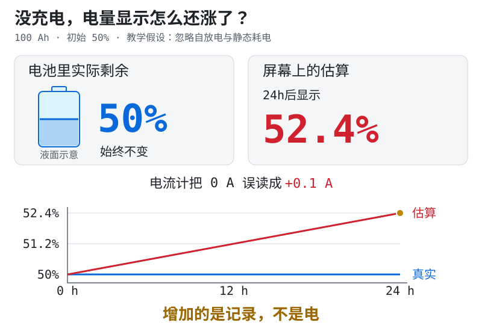
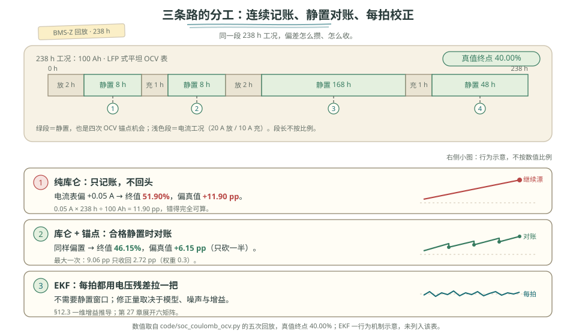

# 第 12 章 SOC：三条路与三个锚点

::: story 现场
一块电池原本显示 50%。没有充电，第二天却显示 52.4%。电池真的多出了电吗？

先分清两件事：**电池里实际剩多少**，和**屏幕估计还剩多少**。它们不是同一个东西。
:::

剩余电荷占满电容量的比例叫 **SOC**，屏幕通常显示它的估算值。把指定使用条件下的满电容量看作 100%，50% 就是还剩一半可用电荷；不是电压降到了一半。

这章先回答三个日常问题：电量怎么记？为什么会记错？记错以后拿什么对账？先读 §12.1 的例子和 §12.2 的校正思路；公式、误差表和 §12.3 的 EKF 推导，可以第二遍再读。

**本章双层路线：先把账讲清，再决定要不要进公式。**

- **第一次主线**：读 §12.1 到“一天到底多记多少”、§12.2 三个锚点、§12.3 的“预测—对照—修正”和 §12.4 前两张对比表。读完应能不看原文解释：为什么调准电流计只会停止新增错账，旧的 2.4 Ah 仍不会自动消失。
- **第二遍深挖**：再读更新公式、六项误差预算、OCV 斜率、卡尔曼增益，以及 238 h 数字对照。读完应能把偏置、容量、初值与锚点间隔分别写成量级账，不把残差直接全算给 SOC。
- **动手验证**：完成章末实验与三道练习。每次只改一项条件，先写预测，再贴原始输出并解释为什么变化。

第一次阅读看到“**深挖入口**”可以直接跳到下一个 `##` 或下一个没有标“深挖”的 `###`。跳过后仍能回答本章的三个日常问题；第二遍再回来复算。

## 12.1 库仑计数

### 先看正常的账怎样记

不用公式也能开始：**原来剩多少，加上充进去的，再减去用掉的。** 持续记录电流来算电荷增减，这种办法叫“库仑计数”，也叫“安时积分”。这里的“积分”，先理解成把每一小段的增减累加起来。

下面约定一块 **100 Ah** 的电池，开始剩 **50 Ah**。Ah 读“安时”，是电荷量的单位：1 A 电流持续 1 h，就对应 1 Ah。为了好理解，可以把本例的满电画成 100 格，50 Ah 就画成 50 格；电芯里面并没有这些格子。

### 再让电流计犯一个小错

把这块电池放着，不充也不放。为单独研究测量误差，本例忽略自放电和 BMS 自身耗电，真实电量保持不变。

电流计却没有归零——像一台没放东西也有读数的秤。真实电流是 **0 A**，它一直报 **+0.1 A**。本章约定**充电为正**，于是计算程序误以为一直有电充进来。

看图时先别看所有刻度，只盯两处：蓝色的真实电量不动，红色的估算却不断升高。

<figure class="book-motion" data-animation="coulomb-counting.svg" data-mode="static">

<button type="button" data-book-motion v-book-motion aria-pressed="false" hidden>播放动画</button>
<figcaption>图 12-1　一天后：真实仍剩一半，屏幕却显示 52.4%。增加的是记录，不是电。100 Ah 电池、+0.1 A 零偏的教学示意，忽略自放电与静态耗电。</figcaption>
</figure>

### 一天到底多记了多少

先算电荷量，再把它换成屏幕上的百分数。不要把这两步混在一起：

1. **多记多少**：0.1 A × 24 h = **2.4 Ah**，也就是本例里多记了 2.4 格。
2. **账上剩多少**：原来的 50 Ah + 多记的 2.4 Ah = **52.4 Ah**；真实仍是 50 Ah。
3. **屏幕显示多少**：52.4 Ah ÷ 满电的 100 Ah = **52.4%**，比真实的 50% 高 **2.4 个百分点**。

52.4% − 50% = **2.4 个百分点**，本章简写为 **2.4 pp**。这不是相对增加了 2.4%；这里先记住“两个电量百分数直接相减”就够了。

> 先自己判断：现在把电流计调准，屏幕会自动从 52.4% 回到 50% 吗？

**不会。** 调准后不再继续多记，但旧账上那 2.4 Ah 还在。**停止记错，不等于已经对好账。** 要纠正旧账，还需要另一份可信的参考，下一节就讲它。

如果完全不处理这个零偏，放到 10 天（240 h）就多记 **24 Ah**，显示 74%，真值仍为 50%。这仍是同一个理想例子，不是实测电池表现。

### 写算法时，再看这条公式

> **深挖入口**　下面把刚才的三步口算写成程序公式。第一次只需记住：每拍搬进多少 Ah，最后要除以采用的容量。

**教学算例**　100 Ah 电池、+0.1 A 零偏、24 h 多记 2.4 Ah，是下面更新公式的贯穿参数。

刚才做的是“先算电荷增减，再除以容量”。程序把一天拆成很多小段，每小段更新一次：

$$
SOC_k = SOC_{k-1} + \frac{\eta I_k \Delta t}{3600 Q}
$$

$I_k$ 是第 $k$ 拍测得的电流，单位 A；$\Delta t$ 是采样间隔，单位秒；$Q$ 是采用的容量，单位 Ah。分母的 3600 把 A·s 换成 Ah。公式中的 SOC 按 0–1 计，0.5 就是 50%。

$\eta$ 是库仑效率，用来计入副反应等造成的电荷损失；上面的教学例子取 $\eta=1$，只看零偏。初值、容量和电流可信时，库仑计短时准确、响应快；但**纯积分没有校正通道**，不能自己发现账本与真实电量的差别。

### 误差预算：六项各自的量级

> **深挖入口**　这是一张进阶查表，第一次读可以先跳到 §12.2。前例的“空秤没归零”，专业名叫电流零点偏置，简称零偏。它只是误差的一种；下面仍用 100 Ah 电池，分开核算六种来源。这些量级不能直接相加当作总误差保证。

**表 12-1**　库仑计六项误差源的量级与时间性格（100 Ah 教学口径，逐项算式）

| 误差源 | 算式 | 量级 | 时间性格 |
|---|---|---|---|
| 电流零点偏置 0.1 A | 0.1 A × 240 h ÷ 100 Ah | 24 pp / 10 天 | 随时间线性累积，无界 |
| 电流增益误差 1% | 1% ×（1.5 个等效循环 × 100 Ah）÷ 100 Ah | ≈ 1.5 pp / 天 | 随吞吐累积 |
| 库仑效率误当 1.00（真值 0.99） | (1 − 0.99) × 100 Ah ÷ 100 Ah | 1 pp / 循环 | 随循环累积（LFP 常 ≥ 0.999，即约 0.1 pp/循环；低温高倍率会变差） |
| 容量偏小 3% | 3% × ΔSOC | 每走 50 pp 偏 1.5 pp | 从锚点起线性张开 |
| 丢采 1 分钟 @ 2.5 A | 2.5 × 60 ÷ 3600 ÷ 100 | 0.042 pp / 分钟 | 只要不是长时间丢采就很小的量级 |
| 初值误差 | 直接加在整条曲线上 | 永久平移 | 不会自愈，只能靠锚点 |

读表时先抓住三件事：

- **偏置是斜率错，初值是截距错。** 前者随时间越偏越远，后者让整条曲线从起点就平移。
- **增益、效率、容量是“标定项”**：需要可信的参考测量和合适工况来核对，不能指望静置自己修好。
- **丢采要看多久、几次**：这里丢一分钟只有 0.042 pp，不代表长时间或反复丢采也可忽略。

## 12.2 三个锚点：满充、静置与初始化

程序看不到我们在例子里画出的“真实 50%”。它只有自己的账本，不能凭空知道多记了 2.4 Ah。要纠正，就得找**账本之外的参考**。这样的参考，工程上叫“锚点”。

### 电压为什么能帮忙对账

可以提前测量某种电芯：在不同剩余电量、温度和充放电历史下，让它充分静置，再记录电压，得到一张参考表。充分松弛、没有外部电流时的电压，叫**开路电压，简称 OCV**。

以后条件合格，就可以“测电压 → 查匹配的表 → 得到一个参考 SOC”。假设参考值约为 50%，账本却写着 52.4%，就有了检查和修正旧账的依据。**不是把电压直接除以满电电压，也不是查表结果一定等于真值。** 参考也有误差，校正多少要看它有多可信。

但这里有个门槛：**电流停了，电压不一定立刻稳定。** 上个例子一直静置；下面换成“刚停止放电”的情形，看为什么不能马上查表。

### 刚停止放电，会发生什么

1. **先跳一下。** 电流流过内阻时会产生压降；停止放电，这部分压降立刻消失，端电压回升。这一部分叫欧姆压降。
2. **再慢慢恢复。** 刚才放电造成的内部状态变化不会瞬间恢复，电压还会继续缓慢变化。这叫极化松弛。
3. **还要问刚才在充电还是放电。** 同样剩一半电，刚充到这里和刚放到这里，静置电压也可能不同。这种与历史有关的差异叫滞回；不能只靠多等一会儿就当它不存在。

图 12-2 把这三件事画在同一条时间轴上。第一次只看“立刻跳、慢慢变、两条参考线不重合”，不必记住所有电压数值。

<figure class="book-motion" data-animation="ocv-rest-timeline.svg" data-mode="static">

<button type="button" data-book-motion v-book-motion aria-pressed="false" hidden>播放动画</button>
<figcaption>图 12-2　停止放电后，电压先跳回一截，再缓慢恢复；上方充电支只作对照，不是这次静置的终点。数值和时间均为教学示意。</figcaption>
</figure>

图中 $\tau=3$ min 是描述恢复快慢的时间常数，不是“等 3 min 就合格”。3 min 时约为 3.572 V，仍没到放电支的 3.620 V。

> 先自己判断：只要把等待时间加倍，就能保证充、放电两条参考线重合吗？

**不能。** 等待能让这一次的极化逐渐消退，却不能把充放电历史造成的滞回当成零。这是静置查表仍可能不准的原因之一。

**静置 OCV 锚点**，是用充分松弛后的开路电压反查 SOC。可信与否，要分两步检查：

- **先看状态**：电流、温度、静置时长和电压变化率都要满足该电芯的判据。低电流只说明流得少，不证明极化已经消失；不能照抄图里的分钟数。
- **再看参考表**：OCV 表要适用于该电芯、温度与充放电历史。LFP 的平平台和滞回仍会限制精度。校正应带置信度，必要时逐步靠近参考值，避免显示和控制限值突跳。

**满充锚点**，是在指定温度与充电协议下，电芯同时满足**电压、电流、持续时间**判据后，建立本协议的满充参考。保护切断、上游限流、低温降额也可能让电流变小；仅凭“电压高、电流小”，不能宣布满电。

**受控初始化**，是先核实起点再开始积分。可以来自新电芯在已知工况下建立的状态，也可以来自断电后仍保留、且经过有效性验证的非易失记录。记录要带时间、温度和参数版本；断电多久、耗掉多少电、是否换芯、参数是否变化，都要纳入失效判断。

### 实现时再看：什么时候允许校正

> **深挖入口**　这两条是软件调度规则。第一次只要知道“锚点也要先过资格审查”，可以直接跳到“现在再看三条路”。

BMS-Z 的实现还有两条计时规则。它们决定何时允许校正，不是图 12-2 的电压曲线：

1. 静置计时是**双向去抖**：普通超限采样让计时回退，避免噪声每次都清零。
2. 满充校准时仍在充电，必须清掉旧静置计时；撤流后重新等够窗口，不能下一拍就用 OCV 覆盖满充结果。

### 锚点灵敏度：1 mV 值多少 SOC

> **深挖入口**　这里把“电压尺子好不好用”换成斜率。第一次只需带走一句：曲线越平，同样的毫伏误差会放大成越多 SOC 误差。

同样差 1 mV，换成 SOC 不一定差得一样多。曲线斜率 dOCV/dSOC 表示 SOC 变化时电压跟着变多少；小误差下，**SOC 误差 ≈ 电压误差 ÷ 曲线斜率**。

**表 12-2**　1 mV 电压误差在三个工作区的 SOC 换算（合成曲线与 LFP 教学斜率）

| 工作区 | dOCV/dSOC（V/SOC） | 1 mV 换算成 SOC |
|---|---|---|
| 本书合成曲线中段（第 10 章口径） | 0.8 | 0.125 pp |
| 两端陡区 | 6.8 | 0.015 pp |
| LFP 平台教学斜率 | 0.075 | **1.33 pp** |

**曲线越平，同样的电压误差会换成越大的 SOC 误差。** 按表中 LFP 教学斜率估算，10–20 mV 的滞回对应约 13–27 pp，只用于量级判断（滞回边界见第 10 章）。所以 LFP 通常更依赖满足判据的满充锚点，不能把平台区单点查表当成精确校准。

两端陡区的 1 mV 只对应 0.015 pp，对电压误差没那么敏感；但温度和充放电历史仍须匹配。

### 第三个锚点的账：断电与换芯

前面的理想静置例子忽略了静态耗电。现实中，若 BMS 的 2 mA 静态耗电没有经过主电流采样通道，断电 10 天（240 h）就会漏掉这笔放电：

2 mA × 240 h = 0.48 Ah → 对 100 Ah 是 **0.48 pp**；断电 100 天就是 4.8 pp。

这里是**真实电荷减少、记录没有跟着减少**，与前例“真实不变、账本多记”不同。它与时间成正比，方向是放电；再加上自放电、温度和换芯后的容量变化，旧记录不能无条件当成新初值。

只有时间戳、温度、参数版本等有效性检查通过，保存状态才可用于受控初始化；超出有效窗口或换芯后，应重新建立可信起点。记住：**积分负责连续计算，锚点提供有条件的校正依据。**

### 现在再看“三条路”

- **只记账**：持续记录电流，但没有别的证据纠正旧账。
- **记账，遇到合格参考再对账**：例如满足条件的满充或静置时刻。
- **记账，同时用模型检查**：先算“按这个电量，应该测到多大电压”，再与实际测量比较。这就是下一节 EKF 的入口。

<figure>

<figcaption>图 12-3　三条路的区别在于如何校正。这里另换一段有充放电的示意工况，不是前面静置一天的 100 Ah 算例；图线不是实测，也不保证某种算法总能贴住真值。</figcaption>
</figure>

## 12.3 EKF：用电压残差拉回

### 先看一次“预测—对照—修正”

如果电池正在工作，等不了长时间静置怎么办？可以用模型估计电流、内阻和极化对电压的影响，再检查电量账本。这类办法中的一种叫**扩展卡尔曼滤波，简称 EKF**。

另取一个教学时刻，先不看矩阵：

1. **预测**：先按电流更新电量，再用模型算出“应该测到 3.500 V”。
2. **对照**：实际测到 3.515 V，比预测高 **15 mV**。这个“实测减预测”的差，叫**电压残差**。
3. **修正**：差值可能来自 SOC，也可能来自极化、模型或测量误差，不能全算到电量头上。算法按各项可信度，分配这次修正。

例如只看 SOC 的简化教学式，若增益 $K=0.8$ SOC/V，则本次修正为 $0.8\times0.015=0.012$，即 **增加 1.2 个百分点**。这里不是把 SOC 改成实测电压，也不是每次都加 1.2；增益和残差都会变。

> 先自己判断：实测电压比预测高，能立即断定“剩余电量一定估低了”吗？

**不能。** 先检查模型与测量是否可信；同一个电压差，可能有不止一种原因。第一次读到这里，抓住这三步就够了；下面是把它写成算法的细节。

### 再把三步写成公式

> **深挖入口**　完整状态与矩阵推导在第 27 章。本节只把 §12.3 开头的三步写成最小公式，第一次可以跳到 §12.4。

同时估计两个量：剩余电量比例 $SOC$ 与极化电压 $U_{rc}$，记为状态 $x=[SOC, U_{rc}]$。沿用充电电流为正的约定，测得的端电压 $z$ 写成：

$$
z = \mathrm{OCV}(SOC) + I R_0 + U_{rc} + v
$$

每拍：

1. 用电流预测状态与协方差；
2. 用 $C=[\mathrm{dOCV}/\mathrm{dSOC}, 1]$ 线性化观测；
3. 算残差、增益、修正。

同一个 15 mV 残差，在 SOC 0.05 处 $C=6.8$ V/SOC，局部反演约 0.22 个百分点；合成电芯中段 $C=0.8$ V/SOC，约 1.875 个百分点。这是假设误差全部来自 SOC 时的敏感度换算，不是 EKF 的实际修正；实际修正为 $K_{SOC}e$，还取决于协方差、噪声与极化状态。第 27 章展开这个区别。

### 修正量到底有多大：K 而不是 e/H

> **深挖入口**　这一节专门拆“看得清”和“改得多”为什么不是同一句话。若只想先会用三条路线，第二遍再读。

把上面那句“实际修正为 $K_{SOC}e$”算出来。一维教学式（$P$ 是先验方差、$R$ 是电压噪声方差、$H=\mathrm{dOCV}/\mathrm{dSOC}$）：

$$
K = \frac{P H}{H^2 P + R}
$$

取三个教学值。$P=(2.5\ \mathrm{pp})^2=6.25\times10^{-4}$。$R=(15\ \mathrm{mV})^2=2.25\times10^{-4}\ \mathrm{V^2}$；残差 $e=15$ mV：

**表 12-3**　三种斜率下 EKF 修正量与朴素反演的对比（一维教学算式，P、R、e 取教学值）

| $H$（V/SOC） | $K$（SOC/V） | 修正 $K e$ | 朴素反演 $e/H$ |
|---|---|---|---|
| 0.6（$=\sqrt{R/P}$） | 0.833 | **1.25 pp** | 2.5 pp |
| 0.8（合成中段） | 0.800 | **1.20 pp** | 1.875 pp |
| 6.8（两端陡区） | 0.146 | **0.22 pp** | 0.22 pp |

两条结论，都不要背结论、要记机制：

- **固定本例的 $P$、$R$ 和残差，修正量在 $H \approx \sqrt{R/P}$ 处最大。** 曲线很陡时，一小点 SOC 变化就能解释这 15 mV，因此不需要改很多 SOC；曲线很平（$H\to0$）时，电压几乎提供不了 SOC 信息，修正也趋近零。
- **朴素反演 $e/H$ 是非零 $H$ 下 $P\to\infty$ 的极限。** 先验越不确定，修正越接近直接反演。在本表 $H=0.8$ 这一行，1.875 pp 约为实际 1.20 pp 的 1.56 倍；不能把这个比值套到另外两行。

别把两个问题混为一谈：**同样差 1 个百分点，陡区更容易在电压上看出差别；同样差 15 mV，陡区只需较小的 SOC 改动就能解释。** “更容易看出”不等于“每次改得更多”。

真实 EKF 还同时估计极化状态，$K_{SOC}$ 受两状态协方差影响，不能保证总比这条一维式小。这条简式只用来建立量级直觉；第 27 章再展开 $A$、$C$、$Q$、$R$ 的完整计算。

::: principle 一句话
**库仑计负责“连续”，锚点负责“不跑飞”，EKF 负责“每拍拉一把”。** 三者不是互斥，是分工。
:::

## 12.4 三条路的取舍

**表 12-4**　三条 SOC 路线的优缺点与适用场景（方案对比，无测量数字）

| 方案 | 优点 | 缺点 | 适用 |
|---|---|---|---|
| 纯库仑 | 简单、易核对积分 | 初值、偏置和容量误差缺少观测校正 | 短时任务、受控充电 |
| 库仑 + 复位 | 可解释、可测试 | 依赖满充/静置 | 储能、可定期校准 |
| EKF | 动态好、无需静置 | 依赖模型与参数 | 车用、宽工况 |

三条路各自的典型失效，与现场能查的探针：

**表 12-5**　三条路线的典型失效与现场探针（失效模式对照，无测量数字）

| 方案 | 典型失效 | 现场探针 |
|---|---|---|
| 纯库仑 | 偏置累积成“永久性漂移”，初值错则整条曲线平移 | 同一段静止工况里 SOC 是否一直朝同一方向漂（只升或只降，方向随偏置符号） |
| 库仑 + 复位 | 假满充（限流/低温降额被当好充）把锚点拉到错误位置 | 满充判据的三要素是否同时成立：电压、电流、持续时间 |
| EKF | 参数失配时“把错误模型算得更平滑”，残差长期单边偏 | 新息序列是否有色（单边偏、滞后相关），而不是白噪声 |

### 把形容词换成数字

> **深挖入口**　下面用 238 h 工况把锚点权重与锚点间隔拆开。第一次可以直接读粗体结论，再去章末动手。

上面两张表是定性的。`code/soc_coulomb_ocv.py` 把同一组工况跑了五遍，可以直接读出代价有多大。工况是 100 Ah、LFP 式平坦 OCV 表，总长 **238 h（约 9.9 天）**。两次 20 A 放电、两次 10 A 充电，中间穿插 8 h、8 h、168 h、48 h 四段静置；净搬走 60 Ah，所以真值终值恰好是 **40.00%**。那四段静置就是四次 OCV 锚点机会。图 12-4 把这段工况和三条路的分工摊在一起：

<figure>

<figcaption>图 12-4　三条路的分工：库仑计负责连续记账，合格静置提供对账，EKF 每拍用电压残差拉一把。同一段 238 h 工况里，电流表偏 +0.05 A 时纯库仑终值 51.90%（+11.90 pp）；加上四次 OCV 锚点也只拉到 46.15%（+6.15 pp），最大一次 9.06 pp 只收回 2.72 pp。时间轴为示意，静置段长不按比例。</figcaption>
</figure>

**表 12-6**　同一段 238 h 工况下三条路的实际代价（`code/soc_coulomb_ocv.py` 实算，真值终值 40.00%）

| 情形 | 终值 SOC | 偏真值 | 全程最大误差 |
|---|---|---|---|
| 纯库仑，电流表无偏置 | 40.00% | ±0.00 pp | 0.00 pp |
| 纯库仑，电流表偏 +0.05 A | 51.90% | **+11.90 pp** | 11.90 pp |
| OCV 校正，无偏置 | 40.00% | ±0.00 pp | 0.00 pp |
| OCV 校正，同样偏 +0.05 A | 46.15% | **+6.15 pp** | 9.06 pp |
| OCV 校正，容量按 95 Ah（真值 100 Ah） | 39.01% | −0.99 pp | 2.77 pp |

三件事值得停一下：

**第二行没有任何玄学。** 0.05 A × 238 h ÷ 100 Ah = 11.90 pp，和表里的 +11.90 pp 一位不差。纯库仑的偏置误差可以用一次乘法预测——这既是它的弱点，也是它唯一的好处：**错得完全可算**。

**第四行是本节最该记住的一行。** 同样的偏置，加上四次 OCV 锚点，终值误差从 11.90 pp 降到 6.15 pp——**只砍掉一半，没有治好**。把四次锚点逐个摊开，就能看清这 6.15 pp 是怎么剩下来的：

**表 12-7**　四次 OCV 锚点各自收回多少（`soc_coulomb_ocv.py` 逐段实算，+0.05 A 偏置）

| 锚点所在静置段 | 校正前偏差 | 校正后偏差 | 这一次收回 |
|---|---|---|---|
| 8 h | +0.50 pp | +0.35 pp | 0.15 pp |
| 8 h | +0.80 pp | +0.56 pp | 0.24 pp |
| **168 h（7 天）** | **+9.06 pp** | +6.34 pp | 2.72 pp |
| 48 h | +8.79 pp | **+6.15 pp** | 2.64 pp |

两个独立的原因，一个比一个重要：

**一、这个演示程序只在每段静置结束时校正一次。** 这是程序的调度设置，不是“必须等七天”的物理规律。那段 7 天静置攒了 0.05 A × 168 h ÷ 100 Ah = 8.4 pp（偏差从 +0.66 走到 +9.06），期间没有校正。全程最大误差 9.06 pp 出现在本段最后一个采样点、校正之前。

**二、这个演示每次只收回 30% 的差。** 权重取教学值 0.3，不是通用推荐值；实际应按参考可信度和输出平滑要求设计。因此 +9.06 pp 这次只收回 $9.06\times0.3\approx2.72$ pp。

这两条可以用实验分开。把权重从 0.3 改成 1.0（完全信 OCV），终值误差归零，但**全程最大误差仍有 8.50 pp**——那部分是第一条原因造成的，再信 OCV 也救不回来，因为误差攒在没有锚点的那 168 小时里。换句话说：**权重决定最后收不收干净，锚点的疏密决定中途能飘多远。**

在本例的可靠参考与校正频率下，锚点能限制误差，但不保证归零。修电流表零点可以停止新增错账；已经累积的旧账，仍需可信参考来纠正。两件事都要做，不能用调大权重代替传感器校准。

（一条诚实边界：这个 demo 的 OCV 锚点读数是从真值反推的，锚点本身没有误差，所以上面的残差纯粹来自权重与锚点间隔。真实系统的 OCV 表、滞回与温度都会给锚点自己加一份误差，第 10 章与 §12.2 讲的就是那一份。）

**第五行的方向相反，而且锚点在这里几乎治好了它。** 容量按 95 Ah（偏小 5%）算，同样的安时被除以更小的分母，所以每搬一度电估计都比真值多走一点。净放 60 Ah 下不校正会落到 100 − 60÷95×100 = **36.84%**（偏低 3.68 pp），而四次锚点把它拉回 **39.01%**，只差 0.99 pp。

同样四次锚点，为什么剩余误差不同？因为两者攒误差的条件不同：**偏置在静置时也按时间攒，容量误差要有电流流过才会继续变化。** 最后 48 h 是静置：偏置又增加 2.4 pp，容量误差却没有新增。

两种情形都在这 48 h 的末尾才做最后一次校正，且都保留校正前误差的 70%。偏置情形在对账前还在不断多记，容量误差情形则没有；不是最后一次校正之后又累积了误差。

表 12-1 里「偏置是斜率错、无界累积」与「容量是从锚点起线性张开」两行，在这里有了各自的数字和各自的归宿。顺带也说明为什么长期停放的储能系统最怕电流零点：停着不动，偏置还在计费。

BMS-Z 的结论很务实：先把库仑与锚点做对，再上 EKF。**没有好的 OCV 表和参数，EKF 只是把错误模型算得更平滑。**

::: trap 坑
把“参考 SOC”当成“真值”。如果参考值是用同一路电流积分出来的，它和你的估算器共享误差源；报告里必须标注 `independent_soc_truth: false`（JSON 报告字段；同名字段在 Python 代码里写作 `False`）。
:::

::: lab 动手
跑 `python bms-book/code/soc_coulomb_ocv.py`，核对表 12-6 的五行：真值终值 40.00%，纯库仑带 0.05 A 偏置落在 51.90%，加四次 OCV 锚点后是 46.15%。

再做三个对照，每个都先预测、再运行：

1. 把 `BIAS_A` 从 0.05 改成 0.2（四倍）。纯库仑终值应该是 100 − 60 + 0.2×238 = **87.6%**——先自己算，再跑；对不上就是「偏置按时间线性累积」还没真的落地。
2. 把校正那行的权重从 `0.7 * soc_est + 0.3 * soc_ocv` 改成完全信 OCV（`0.0 * soc_est + 1.0 * soc_ocv`）。预期：终值误差归零，**但全程最大误差只从 9.06 pp 降到 8.50 pp**。这 8.50 pp 是那段 7 天静置在无人看管时攒出来的，调权重救不回来。
3. 先恢复原来的 0.3 权重，只测试校正次数：把 `PROFILE` 里 `(7 * 24 * 3600, 0.0)` 那一段拆成七段 `(24 * 3600, 0.0)`。总时长不变，但每段仍 ≥1 h，锚点从 4 次变成 10 次。预期最大误差从 9.06 pp 降到 **5.07 pp**、终值到 43.55%（+3.55 pp）。这说明**在参考同样可靠时，校正频率也很重要**；真实系统不能为了多校正，就跳过静置与可信度判据。

最后去 BMS-Z 跑 `compare.py --plot`，看三条曲线的分叉点。
:::

## 练习

1. 推导库仑计在 0.1 A 偏置下 10 天的漂移，并解释为什么“静置校正”能救它。
2. 为什么满充复位后要清掉静置计时？如果不清，会发生什么？
3. 用 $K = PH/(H^2P + R)$：$P=(2.5\ \mathrm{pp})^2$、$R=(15\ \mathrm{mV})^2$、$e=15$ mV，算 $H=0.6$、0.8、6.8 V/SOC 三处的修正量，并解释为什么它不等于 $e/H$。

## 参考资料

- BMS-Z 阶段 4：https://github.com/zhuguang-ZFG/BMS-Z/blob/main/docs/stages/stage-4-SOC-SOH算法.md
- BMS-Z `estimators.py`：https://github.com/zhuguang-ZFG/BMS-Z/blob/main/code/soc/estimators.py
- BMS-Z 无真值诊断：https://github.com/zhuguang-ZFG/BMS-Z/blob/main/docs/共学/10-无真值诊断五天.md
- Plett《Battery Management Systems》Vol. I（Artech House, 2015）：电芯建模与状态估计的完整体系，本章 SOC 三条路的理论框架出处
