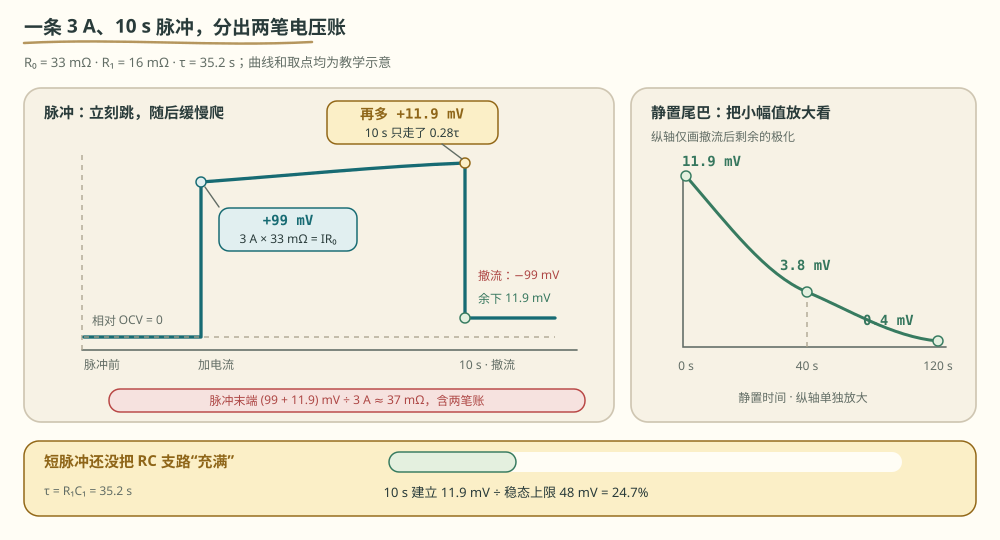
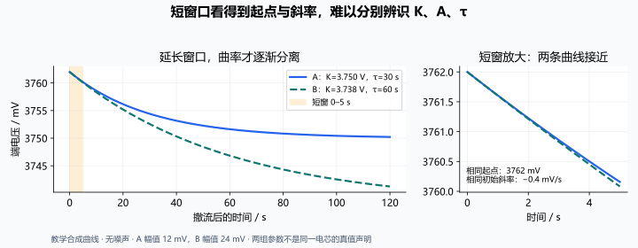
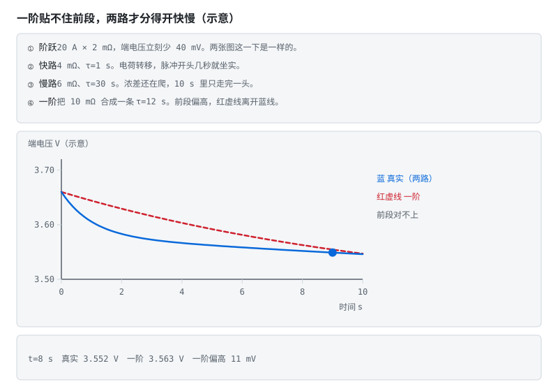

# 第 13 章 HPPC：40 秒窗为什么会骗人

::: story 现场
给一颗电芯充 3 A、10 秒，再撤流静置。两位同学读同一条曲线：一位说内阻 37 mΩ，另一位说 33 mΩ。谁算错了？

都没算错，只是**量的不是同一样东西**。33 mΩ 是电流一变、电压立刻跳的那一截；37 mΩ 把 10 秒里慢慢建立的极化也算了进去。这一章就是教你把一条曲线拆成几笔各自的账。
:::

<aside class="reading-bet" aria-label="开读押注">

开读押注 · 两条曲线都很顺，信谁

同一条回弹尾巴，40 s 窗和 120 s 窗都能拟出漂亮指数线。哪一个 R1 更值得写进参数表？

<ol><li>40 s，离脉冲更近</li><li>120 s，更接近露出渐近线</li><li>两者一样，曲线顺就够了</li></ol>
</aside>

::: chapter-route 阅读路径

- **第一次主线**：读 §13.1–§13.2。沿一条脉冲分出瞬时、指数和长时漂移，再完成三步辨识。
- **第二遍深挖**：读 §13.3–§13.5。检查短窗口、多解、温度与参数表的适用域。
- **动手验证**：比较 40 s 与 120 s 拟合窗口，保留原始曲线、残差和参数版本。
:::

## 13.1 HPPC 在测什么

混合脉冲功率特性（HPPC）用“脉冲 + 静置”把电芯的响应拆成三部分：

1. **瞬时台阶** → $R_0$；
2. **指数回弹** → $R_1, C_1$（时间常数 $\tau=R_1C_1$）；
3. **长时间漂移** → 扩散、OCV 变化、温升。

### 先跟一条脉冲走一遍

**教学算例**　用本章实验 `hppc_fit.py` 的合成电芯：$R_0=33$ mΩ，$R_1=16$ mΩ，$C_1=2200$ F，所以 $\tau=R_1C_1=35.2$ s。充 3 A、10 s，再静置。先不写拟合，只记账：

1. **电流一加上**：3 A × 33 mΩ = **99 mV**，电压立刻跳起。这一截就是 $R_0$ 的证据。
2. **再充 10 秒**：极化电压慢慢长。充得够久它能长到 3 A × 16 mΩ = 48 mV；但 10 s 只走了 τ 的不到三分之一，只长到 $48\times(1-e^{-10/35.2})\approx$ **11.9 mV**，约 24.7%。
3. **撤流瞬间**：99 mV 立刻掉回去，剩下的 11.9 mV 才开始慢慢消退。
4. **静置 40 s**：还剩 $11.9\times e^{-40/35.2}\approx$ **3.8 mV**；静置 120 s 时只剩约 0.4 mV。

<figure>

<figcaption>图 13-1　把欧姆跳变与极化拖尾放在同一笔账里。两侧纵轴分别示意端电压增量和残余极化，横向距离不按时间比例；全部数值为合成教学值。</figcaption>
</figure>

开场那两个数就这样对上了：(99 + 11.9) mV ÷ 3 A ≈ **37 mΩ**，是“欧姆 + 一部分极化”；只取立刻跳的 99 mV，才得到 33 mΩ。

> 先自己判断：把 40 s 时的电压当成“已经恢复完”，回弹幅值会读成多少？

读成约 11.9 − 3.8 = 8.1 mV，少了约三分之一。尾巴还没走完，就会把幅值、τ 和 R1 一起带偏；§13.3 会把这件事叫作“拿窗口终点冒充渐近线”。

在多个 SOC 点（如 10%、20%、…、90%）重复，可以得到参数表。本书 10 s 脉冲与 40/120 s 静置用于合成辨识对照，不代表某标准规定的完整 HPPC 剖面；工程测试应另行声明充放电方向、倍率、温度、SOC 步进与预处理。

三个时间尺度不能串账：毫秒到零点几秒看欧姆跳变，几秒到几十秒看极化；继续拉长后，扩散、OCV 漂移和温升也会进入窗口。

## 13.2 三步辨识

**第一步：R0**

$$
R_0 = \frac{|\Delta U_{\text{instant}}|}{|\Delta I|}
$$

实际测量里的“瞬时”仍是一个小窗口。本书用脉冲前 1 s 与脉冲后 0.3 s 的均值相减，以少量极化偏差换噪声抑制；分子、分母保持同号或都取幅值。窗口还要避开电流上升沿，并校正电压、电流通道的滤波延迟，否则台阶会被抹成斜坡，R0 系统性偏小。

**第二步：τ**

对撤流后的回弹段做指数拟合（充电脉冲后 A 为正，放电脉冲后 A 为负）：

$$
U(t) = K + A e^{-t/\tau}
$$

BMS-Z 的做法是网格扫 $\tau$，再对 $K$ 与 $A$ 做二维最小二乘；同时修正“短脉冲还没到稳态”的幅值偏差。

τ 进了指数，直接同时优化三个参数容易受初值影响。固定一个 τ 后，K 和 A 可用线性最小二乘求解；逐格比较残差，再取最小值。

**第三步：R1**

$$
R_1 = \frac{A}{I_p\left(1-e^{-t_p/\tau}\right)},\qquad C_1=\frac{\tau}{R_1}
$$

::: principle 一句话
**R0 看“立刻”，RC 看“拖尾”。** 混在同一个窗口里，极化会被算进瞬时内阻；参数虽然能拟合，却失去各自的物理含义。
:::

只有脉冲充分长时，才可近似 R1=A/Ip。上式假设脉冲前极化已充分松弛、Ip 近似恒定、局部 OCV 与参数近似不变。10 s 脉冲、τ=35.2 s，只建立了 **24.7%** 的稳态极化；漏掉幅值修正，就会把 R1 低估约四倍。初始极化不为零时，要把初始状态一同建模。

## 13.3 把窗口终点当渐近线

两种常见捷径犯的是同一种错：拿 40 s 窗的末端均值，或拿最后一个采样点，固定为渐近线 $K=U_\infty$。如果 $\tau=30$ s，40 s 只过了 1.33 个 τ，尾巴仍剩 $e^{-40/30}\approx$ **26%**；充电脉冲后测得的末端电压还偏高。固定它会压低回弹幅值，连带改变 τ 与 R1。

让 $K$ 与 $A$ 一起参与拟合，或延长观察窗到约 3–4 个 τ。这里受影响的是极化参数；单独从瞬时阶跃提取的 R0 要另行检查采样与滤波。BMS-Z 的 `fit_relaxation` 说明中也给出了固定末段均值造成偏差的合成对照。

本书 `hppc_fit.py` 用同一份带噪数据：R1 真值 **16.00 mΩ**，120 s 窗估计 **16.07 mΩ**（误差 **0.44%**）；截成 40 s 窗后，误差升到 **17.5%**。光看两条拟合曲线都顺，分不出这笔差异。

## 13.4 短窗口为什么让多个答案都成立

当窗口 t≪τ，指数展开得到 U(t) ≈ (K+A) − (A/τ)t。数据主要识别出“截距 K+A”和“斜率 A/τ”，却很难分别确定 K、A、τ。三参数模型在短窗里近似只剩两个可见组合；低拟合误差并不能恢复失去的曲率信息。

短窗里的指数近似直线。τ 调大、A 随之调整、K 再补偿，残差可以几乎不动。图 13-2 特意放大 **0–5 s** 的无噪声教学曲线，展示这种不可分性；前面的 40/120 s 是另一组带噪实验。

<figure>

<figcaption>图 13-2　两组教学参数具有相同起点与初始斜率，却给出不同渐近线和时间常数。左图延长到 120 s，右图只放大 0–5 s；这不是前面 40/120 s 拟合实验的数据。</figcaption>
</figure>

检查 τ 网格边界、不同窗长与不同脉冲方向的参数稳定性；必要时增加曲率可见的静置段和重复试验。延长窗口也有代价：温升、SOC 漂移和慢扩散可能破坏常参数假设。3–4τ 是单指数观察渐近线的经验尺度，不是所有电芯都适用的充分条件。

窗口不够长时，可以只报告 R0 和可辨识的等效弛豫量；若必须分别给出 K、A、τ，就要改实验设计：延长合格静置段、在电芯允许范围内调整脉冲幅值，并在多个 SOC 点重复。

## 13.5 参数表怎么落到 BMS

1. 根据电芯允许工况选温度点；0/25/45 °C 只是教学网格，低温充电脉冲是否允许要查电芯边界；
2. 每个温度下覆盖 10–90% SOC；
3. R0、R1、C1 按 SOC × 温度分别建表、插值；容量按规定的上下端点、温度与老化状态另存。电流/方向要成为第三轴，须另有试验数据支持；
4. 记录辨识工况（脉冲时长、静置时长、倍率），否则无法复现；
5. 上线后用在线辨识（RLS）慢速修正，但要有激励与安全边界。

三个温度、九个 SOC 点，R0、R1、C1 共有 **3×9×3=81 个值**。若把容量也复制到每格，才是原来的 **3×9×4=108 个数**；容量沿 SOC 轴重复，另表更清楚。每组辨识值还要带脉冲方向、倍率、温度、窗口和版本。丢了这些记录，就无法判断参数变化来自电芯还是测试条件。

参数表上线前，还要用完整回弹段检查模型残差。如果一阶模型总在前几秒留下同向偏差，可能需要检查模型阶数或采样链。

<figure class="book-motion" data-animation="second-order-rc.svg" data-mode="static">

<button type="button" data-book-motion v-book-motion aria-pressed="false" hidden>播放动画</button>
<figcaption>图 13-3　二阶 RC 机制示意；它与图 13-1 的一阶合成电芯不是同组数据。残差若集中在前几秒，单纯延长一阶拟合窗口未必能消掉。</figcaption>
</figure>

::: trap 坑
用“拟合 RMSE 很小”证明参数正确。短窗里的 K、A、τ 可能强相关，换个窗口就换一组参数。同一网格、同一权重的标准双线性插值，先 SOC 后温度与反过来完全等价；正值约束和不外推才是要验证的条件。
:::

::: lab 动手
在仓库根跑 `python bms-book/code/hppc_fit.py`，核对独立提取的 R0 与 40/120 s 窗的 R1。再跑 `python code/soc/hppc_demo.py` 比较两种误读。缩短静置窗时记录 K、τ、R1，解释为什么单独提取的 R0 不应随静置窗改变。
:::

## 本讲服务知识点

<!-- kp-backlink:start -->
本章服务 1 个知识点；每条都能回到[核心问题地图](../../docs/核心问题地图.md)的 L1–L5 五级入口。这一节由 `curriculum/concepts.json` 的 `book` 字段生成。

**表 13-1**　本章服务的知识点与其梯子入口

| 知识点 ID | 标题 | 阶段 | 梯子到 | 握证 |
|---|---|---:|---|---|
| [`hppc-identification`](../../docs/核心问题地图.md#kp-hppc-identification) | HPPC 辨识 | 4 | L5 | 仿真输出 / 手算纸 |

**HPPC 辨识：一条脉冲怎样拆出 R0、R1 和 C1？**

给电池一条已知电流脉冲，相当于主动问它三个问题。刚加电流的电压跳变主要暴露快速内阻 R0；随后缓慢变化的部分反映极化支路 R1；这段变化有多快，再告诉我们时间常数 τ。用 τ=R1C1 才能推回等效电容 C1。它们是某个模型和观察窗下的参数，不是拆开电芯就能找到的三颗元件。

**教学算例：沿着这组输入做一遍**

1. 先在同一条电流脉冲边缘取 ΔV 与 ΔI，用 R0=ΔV/ΔI；不要把慢尾混进瞬时跳变。
2. 再读慢变化的渐近幅度，结合脉冲是否足够长求 R1，短脉冲需要有限持续时间修正。
3. 指数变化达到最终幅度约 63.2% 时经过一个 τ，再用 C1=τ/R1，核对秒与欧姆的单位。

**边界与反例**　SOC、温度、倍率和取点窗口一变，参数含义也会变。脉冲最低电压除以电流，不能得到一个无条件的唯一内阻。

**看图任务**　把同一条曲线的‘边沿、慢尾、时间尺’分开标；三种读数不要都从最低点取。

**对应图解**　[hppc-pulse](../../docs/circuits/handraw/exports/hppc-pulse.webp) · [rc-step-r0-tail](../../docs/circuits/assets/rc-step-r0-tail.svg)

**先自己判断**　合上页面，用页内 20 A 与 40 mV 复算 R0。

完成后再展开标准；先保留自己的计算、判断或运行记录。

核对通过标准

算出 R0 = 2 mΩ；说明这一截不归时间常数。

<!-- kp-backlink:end -->

## 练习

1. 为什么 R0 要用瞬时跳变，而不是脉冲末端？
2. τ=30 s 时，40 s 窗还剩多少未恢复的极化？用 $e^{-t/\tau}$ 算。
3. 设计一张参数表：温度 3 点 × SOC 6 点 × 参数 4 个，共多少个数？怎么存进 MCU？

## 参考资料

- BMS-Z HPPC 五天：https://github.com/zhuguang-ZFG/BMS-Z/blob/main/docs/共学/07-hppc五天.md
- BMS-Z `hppc_demo.py`：https://github.com/zhuguang-ZFG/BMS-Z/blob/main/code/soc/hppc_demo.py
- BMS-Z 参数速查卡：https://github.com/zhuguang-ZFG/BMS-Z/blob/main/docs/参数速查卡.md
- 本书 HPPC 拟合实验：本章单指数短脉冲辨识与窗长对照。SAE J2464 属于安全与滥用测试资料，不作为本章 HPPC 方法出处。
