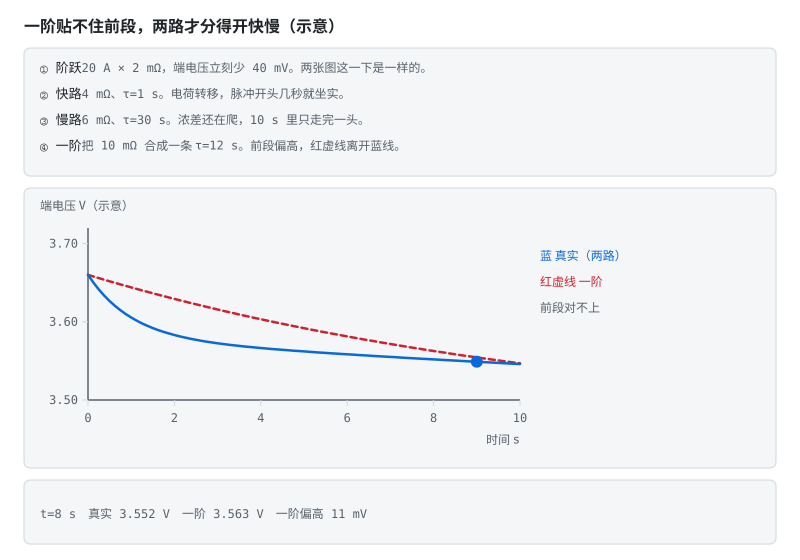
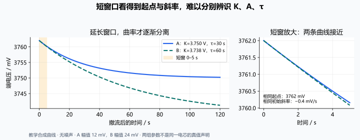

# 第 13 章 HPPC：40 秒窗为什么会骗人

::: story 现场
一条脉冲测试，看起来只是"施加电流、撤流、等待"。但把脉冲末端压差除以电流并叫它 R0，就把欧姆与极化混在了一起；把还没到 3–4 个 τ 的尾巴当成稳态，则会把渐近线、R1 与 C1 一起带偏。

BMS-Z 的 `hppc_demo.py` 把这两个坑都做成了可复现的对照：同一段数据，换一种拟合，参数就换一张脸。
:::

HPPC 的全名叫混合脉冲功率特性测试，出身很实际：混合动力汽车想知道"这颗电芯此刻能给出多少功率、吸进多少功率"，于是工程师用一段标准脉冲把电芯"逗"出响应，再从响应里拆参数。它后来成了参数辨识的通用工作台，几乎每一本 BMS 教材都绕不开它。但测试本身简单到近乎朴素，复杂的是读数。这一章就是教你读：同一个脉冲，读出 R0、R1、C1 三个数，而且知道每个数在哪种读法下会变形。

## 13.1 HPPC 在测什么

混合脉冲功率特性（HPPC）用"脉冲 + 静置"把电芯的响应拆成三部分：

1. **瞬时台阶** → $R_0$；
2. **指数回弹** → $R_1, C_1$（时间常数 $\tau=R_1C_1$）；
3. **长时间漂移** → 扩散、OCV 变化、温升。

在多个 SOC 点（如 10%、20%、…、90%）重复，可以得到参数表。本书 10 s 脉冲与 40/120 s 静置用于合成辨识对照，不代表某标准规定的完整 HPPC 剖面；工程测试应另行声明充放电方向、倍率、温度、SOC 步进与预处理。

把这三部分当成三层时间尺度来记就清楚了：最快的那一层（毫秒到零点几秒）是纯欧姆，电流和电压同步跳；中间层（几秒到几十秒）是极化建立与消散，形状是指数；最慢的那一层（几分钟以上）是扩散、自放电和温漂，已经不属于"参数"，属于"环境在动"。辨识的全部要点，就是让每一层的读数不串层：拿毫秒层的尺子去量中间层，或者用几十秒的窗口去等几分钟的稳态，都会得到"看起来合理"的错误。

## 13.2 三步辨识

**第一步：R0**

$$
R_0 = \frac{|\Delta U_{\text{instant}}|}{|\Delta I|}
$$

用脉冲开始/结束的瞬时跳变，不要用几十秒后的值。分子、分母的符号保持一致，或都取幅值；本书充电电流为正。电压与电流还要对齐采样时间，滤波延迟可能把阶跃抹成斜坡。

实际测量时，"瞬时"是个小窗口：本书取脉冲前 1 s 与脉冲后 0.3 s 的均值相减，用一点平均换噪声抑制，代价是窗口里已经混进少量极化，这属于已声明的偏差，不是偷懒。窗口要避开电流上升沿和滤波器延迟，这两处会把干净的台阶抹成斜坡，R0 就跟着系统性偏小。

**第二步：τ**

对撤流后的回弹段做指数拟合（充电脉冲后 A 为正，放电脉冲后 A 为负）：

$$
U(t) = K + A e^{-t/\tau}
$$

BMS-Z 的做法是网格扫 $\tau$，再对 $K$ 与 $A$ 做二维最小二乘；同时修正"短脉冲还没到稳态"的幅值偏差。

网格搜索听起来笨，用在这里很务实：τ 进了指数里，三个参数互相纠缠，直接非线性优化容易掉进局部最小；把 τ 钉在网格点上，K 和 A 就退化成线性最小二乘，每一格都有解析解，快而稳。这是工程辨识的常用套路：能把问题降成线性，就不要急着上非线性。

**第三步：R1**

$$
R_1 = \frac{A}{I_p\left(1-e^{-t_p/\tau}\right)},\qquad C_1=\frac{\tau}{R_1}
$$

::: principle 一句话
**R0 看"立刻"，RC 看"拖尾"。** 把两者混在一个窗口里，得到的只是一个能拟合的错觉。
:::

只有脉冲充分长时，才可近似 R1=A/Ip。上式假设脉冲前极化已充分松弛、Ip 近似恒定、局部 OCV 与参数近似不变。10 s 脉冲、τ=35.2 s，只建立了 **24.7%** 的稳态极化；漏掉幅值修正，就会把 R1 低估约四倍。初始极化不为零时，要把初始状态一同建模。

那个 **24.7%** 值得停下来看一眼它是怎么来的：脉冲期间极化按 $1-e^{-t/\tau}$ 充电，10 s 对 35.2 s 的 τ，充到 $1-e^{-10/35.2}\approx24.7\%$。撤流时刻的极化幅值只有“充分长脉冲”的四分之一；不除以这个系数，R1 直接小四倍。这是物理账，不是拟合技巧；第 28 章解剖同一条曲线时，它还会出现一次。

<figure class="book-motion" data-animation="second-order-rc.svg" data-mode="static">

<button type="button" data-book-motion v-book-motion aria-pressed="false" hidden>播放动画</button>
<figcaption>图 13-1　一阶与二阶 RC 的拖尾对照：快支路、慢支路可在不同时间段显形；参数为示意，不是本书 HPPC 数据。比较开始后的短窗与长尾：一阶模型贴住后段，不代表它同时解释了前段。残差主要集中在前几秒时，是延长同一个单指数窗口就能解决，还是需要检查模型阶数？</figcaption>
</figure>

## 13.3 两个当场骗人的拟合

**坑一：40 秒窗末端均值当稳态。**

如果 $\tau$ 是 30 秒，40 秒只过了 1.33 个 τ，指数还剩下 26%。把充电脉冲后的末端电压当 K，会高估渐近线、低估回弹幅值；偏的是极化参数，不能据此直接宣布 R0 被低估。R0 是否受影响，要看它是否从同一瞬时阶跃单独提取。

**坑二：固定渐近线。**

把 $U_\infty$ 硬设成"静置 40 秒的最后一个采样"，等于假设已经稳态；τ 越大，偏差越大。正确做法是让 $U_\infty$ 也参与拟合，或者等 3–4 个 τ。

这两个坑的共同点是"拿窗口的终点冒充渐近线"。渐近线是模型参数，是拟合出来的未知数，不是数据里能指出来的一个点；只要指数还没走完，最后一个采样就带着未衰减的尾巴。τ 越大，尾巴越长，冒充的代价越大。

BMS-Z 的 `fit_relaxation` 在函数说明里明确报告了这两类偏差，并给出合成实验的对照，回答的是“差多少”，而不是“看起来差不多”。

## 13.4 短窗口为什么让多个答案都成立

当窗口 t≪τ，指数展开得到 U(t) ≈ (K+A) − (A/τ)t。数据主要识别出"截距 K+A"和"斜率 A/τ"，却很难分别确定 K、A、τ。三参数模型在短窗里近似只剩两个可见组合；低拟合误差并不能恢复失去的曲率信息。

换个说法：指数曲线在很短的一小段里几乎就是一条直线，而一条直线定不出指数。K、A、τ 三个参数在短窗里会“成对搬家”：τ 调大一点、A 跟着调、K 再补一刀，拟合的残差几乎不动。你能看见的只有截距和初始斜率两个组合，第三个自由度被窗口藏起来了。这就是为什么两个相差很远的参数组合可以在 40 s 窗里同样“拟合得很好”：拟合器没坏，是信息不在数据里。

<figure>

<figcaption>图 13-2　两组教学参数具有相同起点与初始斜率，却给出不同渐近线和时间常数。短窗口中近似重合，延长窗口才能看见曲率差异。</figcaption>
</figure>

检查 τ 网格边界、不同窗长与不同脉冲方向的参数稳定性；必要时增加曲率可见的静置段和重复试验。延长窗口也有代价：温升、SOC 漂移和慢扩散可能破坏常参数假设。3–4τ 是单指数观察渐近线的经验尺度，不是所有电芯都适用的充分条件。

工程上的折中很朴素：窗口不够长时，要么承认参数不可分、只报有把握的（比如只报 R0 和"等效弛豫"），要么改实验设计——加长静置、提高脉冲幅值、换 SOC 点重复——而不是把拟合器逼出一个"精确"答案。

## 13.5 参数表怎么落到 BMS

1. 根据电芯允许工况选温度点；0/25/45 °C 只是教学网格，低温充电脉冲是否允许要查电芯边界；
2. 每个温度下覆盖 10–90% SOC；
3. 每个参数用 SOC × 温度的二维表和插值；电流/方向作为第三轴时要另有试验数据支持；
4. 记录辨识工况（脉冲时长、静置时长、倍率），否则无法复现；
5. 上线后用在线辨识（RLS）慢速修正，但要有激励与安全边界。

这张表会很大：三个温度、九个 SOC 点、四个参数（R0、R1、C1，加容量），就是一百多个数。MCU 存得下，但你要知道每个数是怎么来的：辨识工况不随表存档，半年后没人说得清哪行是哪个温度哪个窗口测的，这张表就废了。第 21 章的数据准备会再强调一遍：元数据是数据的一部分。

::: trap 坑
用"拟合 RMSE 很小"证明参数正确。短窗里的 K、A、τ 可能强相关，换个窗口就换一组参数。同一网格、同一权重的标准双线性插值，先 SOC 后温度与反过来完全等价；正值约束和不外推才是要验证的条件。
:::

::: lab 动手
在仓库根跑 `python bms-book/code/hppc_fit.py`，核对独立提取的 R0 与 40/120 s 窗的 R1。再跑 `python code/soc/hppc_demo.py` 比较两种误读。缩短静置窗时记录 K、τ、R1，解释为什么单独提取的 R0 不应随静置窗改变。
:::

## 练习

1. 为什么 R0 要用瞬时跳变，而不是脉冲末端？
2. τ=30 s 时，40 s 窗还剩多少未恢复的极化？用 $e^{-t/\tau}$ 算。
3. 设计一张参数表：温度 3 点 × SOC 6 点 × 参数 4 个，共多少个数？怎么存进 MCU？

## 参考资料

- BMS-Z HPPC 五天：https://github.com/zhuguang-ZFG/BMS-Z/blob/main/docs/共学/07-hppc五天.md
- BMS-Z `hppc_demo.py`：https://github.com/zhuguang-ZFG/BMS-Z/blob/main/code/soc/hppc_demo.py
- BMS-Z 参数速查卡：https://github.com/zhuguang-ZFG/BMS-Z/blob/main/docs/参数速查卡.md
- 本书 HPPC 拟合实验：本章单指数短脉冲辨识与窗长对照。SAE J2464 属于安全与滥用测试资料，不作为本章 HPPC 方法出处。
