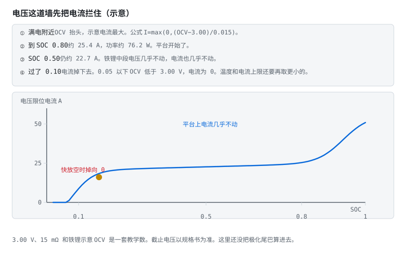
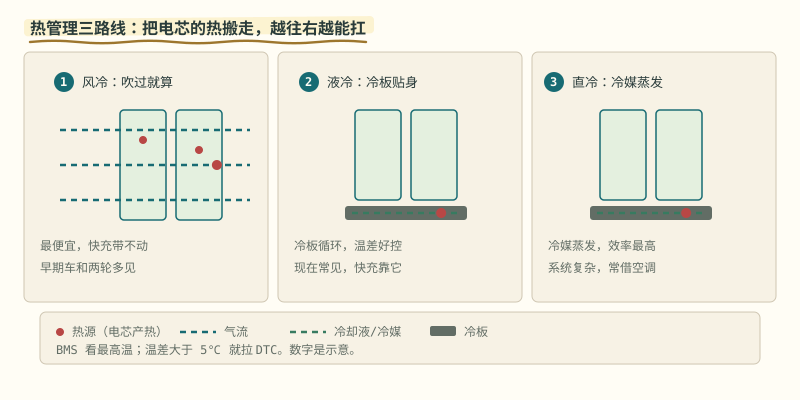
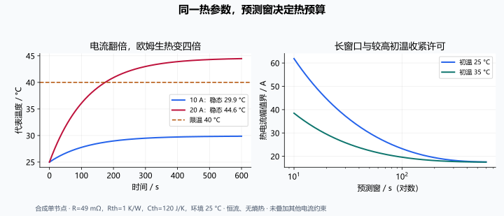

# 第 14 章 SOP 与热：三约束取最小，温度慢半拍

::: story 现场
一辆车在 0 °C 的早晨请求 200 kW。BMS 看着 SOC 80%、电压正常，就放行；十秒后单体电压掉到下限，功率被硬切。司机感受到的是“突然没劲”，电芯感受到的是“一次不必要的深度极化”。

SOP 不是“当前能出多大电流”，而是“未来 N 秒内，在电压、电流、温度、SOC 四个墙都不撞的前提下，能出多大功率”。
:::

## 14.1 三个约束，取最紧

BMS-Z 的 `sop_demo.py` 把约束写成三条：

1. **电压墙**：端电压不能越过上/下限（含极化预测）；
2. **SOC 墙**：不能把 SOC 用到窗口外；
3. **电流帽**：电芯、连接器、熔断器、接触器的最大电流。

对每个候选电流，前向仿真整个时间窗，检查末态电压与 SOC；取满足所有约束的最大值。**三约束取最小，不是取平均。**

<figure class="book-motion" data-animation="sop-voltage-limit.svg" data-mode="static">

<button type="button" data-book-motion v-book-motion aria-pressed="false" hidden>播放动画</button>
<figcaption>图 14-1　电压墙限制放电幅值：允许电流由 OCV 到 Vmin 的余量和等效阻抗决定。放电幅值取正，参数为示意。 SOC 接近下限时，电压余量缩小，允许电流被压向零；高 SOC 也仍受电流帽限制。在相同 OCV 下把电阻加倍，电压墙允许电流会怎样变化？发热能否只看这个电流？</figcaption>
</figure>

## 14.2 闭式公式为什么偏乐观

<section class="book-lab" data-book-lab="sop" v-book-lab aria-label="SOP 三约束交互实验">
<h4>三堵墙，谁最先挡住电流？</h4>
<button type="button" data-lab-reset hidden>恢复算例参数</button>

10 Ah 合成电芯，Vmin=2.8 V、SOC 下限 0.10、电流帽 30 A；固定 OCV 与 Rint，未计 RC、OCV 随 SOC 变化或温升反馈，不能当产品功率承诺。功率为单电芯端口值。

<label>OCV / V：3.7<input type="range" data-param="ocv" min="3" max="4.2" step="0.05" value="3.7" disabled></label>
<label>R / mΩ：20<input type="range" data-param="resistance" min="10" max="100" step="5" value="20" disabled></label>
<label>SOC：0.5<input type="range" data-param="soc" min="0.11" max="0.95" step="0.01" value="0.5" disabled></label>
<label>预测窗 / s：600<input type="range" data-param="horizon" min="10" max="1200" step="10" value="600" disabled></label>

<svg viewBox="0 0 720 240" role="img" aria-label="电压墙、SOC 墙与电流帽的允许电流条形比较">
<text x="20" y="45" fill="currentColor" font-size="17">电压墙</text><rect data-bar="0" x="130" y="20" width="211.5" height="35" rx="5" fill="#2563eb"/>
<text x="20" y="105" fill="currentColor" font-size="17">SOC 墙</text><rect data-bar="1" x="130" y="80" width="112.8" height="35" rx="5" fill="#0f766e"/>
<text x="20" y="165" fill="currentColor" font-size="17">电流帽</text><rect data-bar="2" x="130" y="140" width="141" height="35" rx="5" fill="#b45309"/>
<text x="130" y="215" fill="currentColor" font-size="13">条长按 0–100 A 显示，超过 100 A 截顶；精确值见下方。</text>
</svg>

电压：<output data-output="limit-0">45.0 A</output>SOC：<output data-output="limit-1">24.0 A</output>硬件：<output data-output="limit-2">30.0 A</output>

允许：<output data-output="current">24.0 A</output>主导：<output data-output="binding">SOC 墙</output>端电压：<output data-output="terminal">3.220 V</output>

端口功率：<output data-output="power">77.3 W</output>欧姆生热：<output data-output="heat">11.5 W</output>

<strong>试三次：</strong>缩短预测窗，看主导约束如何切换；把 R 增到 60 mΩ，看电压墙如何收紧；再降低 SOC，检查发热是否仍按同样方向变化。解释“电流取最小”与“功率取平均”为什么不同。

</section>

常见的 Rint 近似：

$$
P_{\text{dis}} \approx \frac{V_{\text{ocv}} - V_{\min}}{R} \cdot V_{\min}
$$

它只用了“此刻”的 OCV 与 R，忽略了：

- RC 极化的积累；
- OCV 随 SOC 下降；
- 温度变化导致 R 上升；
- 电流帽与线束压降。

所以闭式值通常偏乐观。BMS-Z 的对照是：闭式除法 vs 二分 + 前向仿真，后者更保守，也更接近真实可用功率。

## 14.3 热：温度是慢变量，但会否决一切

产热：

$$
\dot{Q} \approx I^2 R + I \cdot T \frac{\partial U_{\text{ocv}}}{\partial T}
$$

第一项是欧姆热，第二项是熵热（可正可负）。温度响应是一个低通：

$$
\Delta T(\omega) = \frac{R_{\text{th}}\dot{Q}(\omega)}{1 + j\omega\tau_{\text{th}}}, \quad \tau_{\text{th}}=R_{\text{th}}C_{\text{th}}
$$

BMS-Z 的 `thermal_demo.py` 给出两个可记的结论：

- 正弦生热的幅值被压缩 $1/\sqrt{1+(\omega\tau)^2}$，相位滞后 $\arctan(\omega\tau)$；
- 对零均值正弦电流，I² 含直流和 **2ω** 分量，温度会分别形成平均温升与衰减、滞后的纹波；其他电流波形需另行展开。

::: principle 一句话
**功率限制要预测温升，而不是等温度到上限。** 温度慢半拍，等它到线，极化早就撞墙了。
:::

<figure class="book-motion" data-animation="thermal-paths.svg" data-mode="static">

<button type="button" data-book-motion v-book-motion aria-pressed="false" hidden>播放动画</button>
<figcaption>图 14-2　从产热到散热：电芯、界面和冷却介质构成热路径；温度变化滞后于生热。示意结构不代表具体模组。按路径看温差在哪里积累：传感器读到的是安装位置温度，未必是内部最高温度。热阻加大与热容加大分别改变稳态温升还是时间常数？</figcaption>
</figure>

## 14.4 热约束怎样从能量守恒走到电流上限

只计恒定欧姆生热，且把电芯视为一个温度节点：

$$
C_{th}\frac{dT}{dt}=I^2R-\frac{T-T_{amb}}{R_{th}},\qquad
\tau=R_{th}C_{th}
$$

单位逐项核对：Cth 是 J/K，左侧为 W；Rth 是 K/W，温差除热阻也是 W。同一个 Rth 负责散热的“坡度”，Cth 负责储存热量的“惯性”。二者不能混叫内阻。

恒流、固定参数时精确解为：

$$
T(t)=T_{amb}+(T_0-T_{amb})e^{-t/\tau}
+I^2RR_{th}(1-e^{-t/\tau})
$$

T0 不超过 Tmax、t>0 时，可解出热电流幅值上限：

$$
I_{thermal}=\sqrt{
\frac{T_{max}-T_{amb}-(T_0-T_{amb})e^{-t/\tau}}
{RR_{th}(1-e^{-t/\tau})}}
$$

分子非正时先检查是否已过温、环境是否超过限值，不能对负数开方后用异常值代替许可。本书教学策略对已过温状态直接禁载。参数随温度变化、有熵热或多节点时，应前向积分并检查整个窗口，不能硬用这一闭式解。

取 R=49 mΩ、Rth=1 K/W、Cth=120 J/K、Tamb=T0=25 °C：10 A 作用 10/120/600 s，末温分别为 **25.392/28.097/29.867 °C**。以 Tmax=40 °C 解上限，分别为 **61.876/22.006/17.556 A**。短时允许值很高，仍须和电压墙、SOC 墙、电流帽取交集；它不是可单独放行的电流。

<figure>

<figcaption>图 14-3　电流、初温与窗口共同决定温升：左图生热平方律，右图预测窗收紧电流界。单节点合成解析解，不含熵热与其他约束。</figcaption>

<strong>读图核对：</strong>横轴右图是对数刻度；短窗口热电流界可能超过硬件帽，所以热图不能独立放行。

</figure>

## 14.5 生热频率：平方并不总是“翻倍”

<section class="book-lab" data-book-lab="thermal" v-book-lab aria-label="热阻热容与预测温升实验">
<h4>温升的两把旋钮：热阻定稳态，热容定速度</h4>

49 mΩ 固定生热电阻，环境 25 °C，限温 40 °C。单节点、恒流、无熵热；热约束允许值不代表系统最终许可。

<label>电流幅值 / A：10<input type="range" data-param="current" min="0" max="20" step="1" value="10" disabled></label>
<label>热阻 / K/W：1<input type="range" data-param="rth" min="0.5" max="2" step="0.1" value="1" disabled></label>
<label>热容 / J/K：120<input type="range" data-param="cth" min="60" max="240" step="20" value="120" disabled></label>
<label>初始温度 / °C：25<input type="range" data-param="initial" min="25" max="45" step="1" value="25" disabled></label>
<label>预测窗 / s：120<input type="range" data-param="horizon" min="10" max="600" step="10" value="120" disabled></label>

<button type="button" data-lab-reset hidden>恢复算例参数</button>
<svg viewBox="0 0 720 320" role="img" aria-label="恒流温升曲线与 40 摄氏度限温线">
<path d="M60 40V260H660" fill="none" stroke="currentColor" opacity="0.45"/>
<text x="14" y="30" data-top-label fill="currentColor" font-size="14">45 °C</text><text x="14" y="265" fill="currentColor" font-size="14">20 °C</text>
<path data-limit-line d="M60 92H660" stroke="#be123c" stroke-dasharray="7 5" fill="none"/>
<text x="570" y="80" fill="#be123c" font-size="14">限温 40 °C</text>
<polyline data-thermal-curve points="60,218 180,210 300,204 420,199 540,194 660,192" fill="none" stroke="#2563eb" stroke-width="3"/>
<text x="60" y="286" fill="currentColor" font-size="14">0 s</text><text x="625" y="286" data-end-label fill="currentColor" font-size="14">120 s</text>
</svg>

生热：<output data-output="heat">4.90 W</output>τ：<output data-output="tau">120 s</output>末温：<output data-output="final">28.097 °C</output>

稳态：<output data-output="steady">29.90 °C</output>本窗热电流界：<output data-output="allowed">22.006 A</output>

<strong>做三组对照：</strong>只把热容减半，稳态温度变不变？把热阻加倍，稳态和时间常数各怎样变？初温移到 35 °C，120 s 电流界为什么收紧到约 19.118 A？

</section>

**表 14-1**　四种电流波形的 I² 结构与温度对照（解析分解）

| 电流波形 | I² 的主要结构 | 温度应对照什么 |
|---|---|---|
| I=A sinωt | A²/2 − A²cos2ωt/2 | 直流温升和 2ω 纹波 |
| I=±A 的对称双极方波 | 恒定 A² | 忽略切换与熵热时，只向恒温升收敛 |
| I 在 0 与 A 间切换 | 原周期的开关功率 | 原频率及高次谐波经热低通 |
| I=I0+A sinωt | 直流、ω 和 2ω | 偏置导致的 ω 分量不能漏算 |

熵热与 I 的符号、SOC 和温度有关，可能吸热也可能放热；温度滞后应相对**生热**计算，而不是一律相对电流。第 30 章正弦低通实验关闭熵项，是为了把这两层变化拆开验证。

## 14.6 参数辨识、传感器位置与放行证据

在可控低风险台架中，已知生热下的稳态温差可估 Rth，阶跃到稳态的比例可估 τ，再由 Cth=τ/Rth 得到热容。实际“已知生热”可能包含接触损耗和熵热，因此要说明测量/估计方法、安装与环境条件。

一个节点通常描述某种平均或代表温度；表面 NTC 不等于内部热点。冷却界面变化、多电芯温差明显时，单节点拟合能贴住一个测点，却可能漏掉另一处最高温度。量出不同位置的残差，再决定是否增加芯部—表面或电芯—冷板节点。

SOP 交付表应同时给预测窗、初始 SOC/极化/温度、参数与版本、每项限制的电流、主导约束、端口功率和置信边界。相同 10 s 许可不能复制到持续运行；运行中也要持续确认电压、电流与温度反馈，而非只在窗口末端做一次检查。

## 14.7 工程落地

- 10 秒峰值与持续功率是两张表，不能混用；
- 低温充电单独限流（析锂风险），必要时先加热；
- 温度传感器要覆盖最热与最冷点；
- SOP 要随 SOH 更新（内阻涨了，同样功率下压降更大）；
- 故障时 SOP 归零，而不是“降一点”。

::: trap 坑
只用单体电压算 SOP，忽略连接器与线束压降。pack 级 200 A 时，1 mΩ 的连接电阻就是 0.2 V，足以让“看起来还能放”的功率变成过放。
:::

::: lab 动手
跑 BMS-Z 的 `python code/soc/sop_demo.py` 与 `thermal_demo.py`。前者打印 6 个 SOC 点 × 3 档时间窗的对照；后者给出稳态温度、τ 与正弦低通。把时间窗从 10 秒改成 30 秒，观察 SOP 怎么变。
:::

## 练习

1. 用 Rint 公式算 25 °C、SOC 50%、R=1 mΩ 时的放电功率，再与“加 RC 极化”的结果比较，解释差异。
2. 零均值 1 Hz 正弦、±A 对称 1 Hz 方波、0/A 单极 1 Hz 方波，分别会产生哪些生热分量？为什么不能都回答“2 Hz”？
3. 设计一个低温充电策略：温度 < 5 °C 时，电流上限怎么随温度变化？

## 参考资料

- BMS-Z SOP 五天：https://github.com/zhuguang-ZFG/BMS-Z/blob/main/docs/共学/05-sop五天.md
- BMS-Z 热五天：https://github.com/zhuguang-ZFG/BMS-Z/blob/main/docs/共学/06-热五天.md
- BMS-Z `sop_demo.py` / `thermal_demo.py`：https://github.com/zhuguang-ZFG/BMS-Z/tree/main/code/soc
- Plett ECE5710 Notes07 热建模中文导读（本地讲义第 7–11、7–25 页核对）：https://github.com/zhuguang-ZFG/BMS-Z/blob/main/docs/ece5710-notes07-中文导读.md
