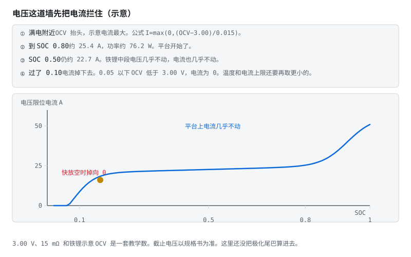
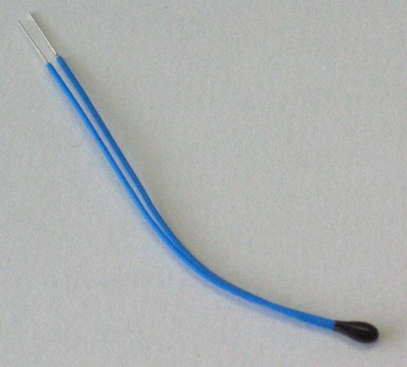
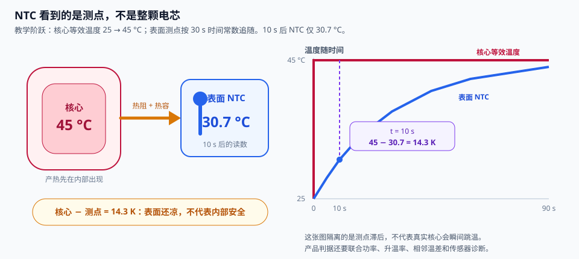
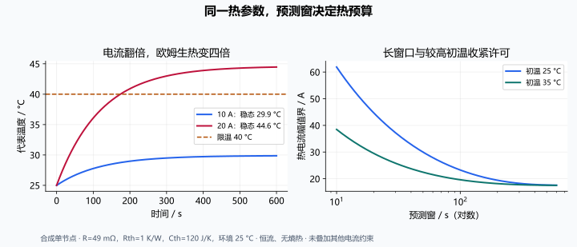
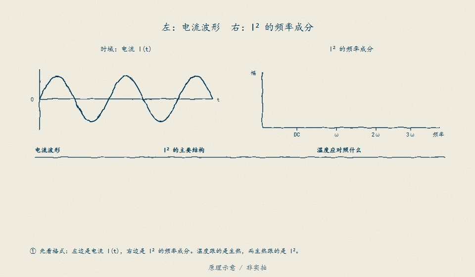
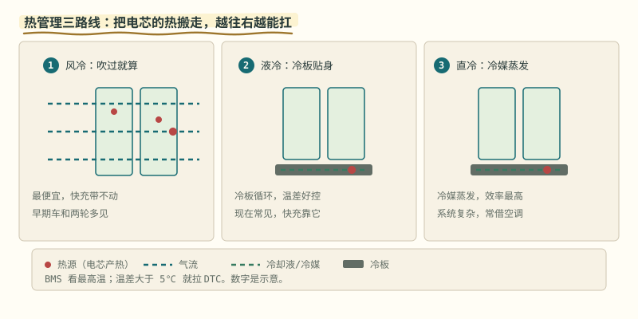

# 第 14 章 SOP 与热：三约束取最小，温度慢半拍

::: story 现场
一颗 10 Ah 电芯还剩一半电，要连续放电 10 分钟。有人只按电压算出“最多能放 45 A”，结果不到 6 分钟，剩余电量就碰到了 10% 的下限，设备被迫停下。

45 A 是怎么算的？开路电压（OCV）为 3.7 V，内阻为 20 mΩ，放电下限为 2.8 V；电压余量除以内阻，得到 (3.7 − 2.8) V ÷ 0.020 Ω = 45 A。这笔账只检查了电压。

再看电量：45 A 持续 10 分钟，需要 45 A × (10/60 h) = **7.5 Ah**；从 50% 用到 10%，这颗电芯只有 10 Ah × 40% = **4 Ah** 可用。把 4 Ah 分摊到 10 分钟，平均最多 **24 A**（4 Ah ÷ (10/60 h)）。

这就是 SOP（可用功率）要回答的问题：在指定的时间内，电压、剩余电量、硬件允许电流和温度都不越界，最多能输出多少功率？
:::

> 先自己判断：把预测窗从 600 s 缩短到 60 s，挡住电流的还是 SOC 墙吗？

60 s 内 SOC 墙允许 240 A，远松于电压墙的 45 A 与电流帽的 30 A，这时挡住的是**电流帽**。窗口一变，主导约束就可能变，所以每次都要重算三者并取最小。上一章从 HPPC 曲线里辨识出的内阻，正是这里电压墙的关键输入。

::: chapter-route 阅读路径

- **第一次主线**：读开场的 45 A / 24 A、§14.1–§14.2 的约束实验、§14.3 的热解释，再看 §14.7。
- **第二遍深挖**：打开本章进阶页，复算闭式电压界、热电流上限与表 14-1 的频率结构。
- **动手验证**：运行 `sop_demo.py` 与 `thermal_demo.py`，每次只改预测窗或一个热参数。
:::

## 14.1 三个约束，取最紧

BMS-Z 的 `sop_demo.py` 把约束写成三条：

1. **电压墙**：端电压不能越过上/下限（含极化预测）；
2. **SOC 墙**：不能把 SOC 用到窗口外；
3. **电流帽**：电芯、连接器、熔断器、接触器的最大电流。

对每个放电候选电流，前向仿真整个时间窗，检查**全程最低端电压**与窗末 SOC；取满足各项约束的最大电流。充电方向则改为检查全程最高端电压。单项许可值不能取平均。

<figure class="book-motion" data-animation="sop-voltage-limit.svg" data-mode="static">

<button type="button" data-book-motion v-book-motion aria-pressed="false" hidden>播放动画</button>
<figcaption>图 14-1　电压余量和等效阻抗决定放电侧的电压界（电流幅值取正，参数为示意）。SOC 接近下限时，这道界会收紧；高 SOC 仍受硬件电流帽限制。电阻翻倍后，电压界会怎样变？</figcaption>
</figure>

## 14.2 只算电压为什么不够

<section class="book-lab" data-book-lab="sop" v-book-lab aria-label="SOP 三约束交互实验">
<h4>三堵墙，谁最先挡住电流？</h4>
<button type="button" data-lab-reset hidden>恢复算例参数</button>
<p class="lab-note">10 Ah 合成电芯，Vmin=2.8 V、SOC 下限 0.10、电流帽 30 A；固定 OCV 与 Rint，未计 RC 极化、OCV 随 SOC 变化或温升反馈，不能当作产品功率承诺。功率为单电芯端口值。</p>
<div class="lab-controls">
<label>OCV / V：<span data-value="ocv">3.7</span><input type="range" data-param="ocv" min="3" max="4.2" step="0.05" value="3.7" disabled></label>
<label>R / mΩ：<span data-value="resistance">20</span><input type="range" data-param="resistance" min="10" max="100" step="5" value="20" disabled></label>
<label>SOC：<span data-value="soc">0.5</span><input type="range" data-param="soc" min="0.11" max="0.95" step="0.01" value="0.5" disabled></label>
<label>预测窗 / s：<span data-value="horizon">600</span><input type="range" data-param="horizon" min="10" max="1200" step="10" value="600" disabled></label>
</div>
<svg viewBox="0 0 720 240" role="img" aria-label="电压墙、SOC 墙与电流帽的允许电流条形比较">
<text x="20" y="45" fill="currentColor" font-size="17">电压墙</text><rect data-bar="0" x="130" y="20" width="211.5" height="35" rx="5" fill="#2563eb"/>
<text x="20" y="105" fill="currentColor" font-size="17">SOC 墙</text><rect data-bar="1" x="130" y="80" width="112.8" height="35" rx="5" fill="#0f766e"/>
<text x="20" y="165" fill="currentColor" font-size="17">电流帽</text><rect data-bar="2" x="130" y="140" width="141" height="35" rx="5" fill="#b45309"/>
<text x="130" y="215" fill="currentColor" font-size="13">条长按 0–100 A 显示，超过 100 A 截顶；精确值见下方。</text>
</svg>
<div class="lab-readouts"><span>电压：<output data-output="limit-0">45.0 A</output></span><span>SOC：<output data-output="limit-1">24.0 A</output></span><span>硬件：<output data-output="limit-2">30.0 A</output></span></div>
<div class="lab-readouts"><span>允许：<output data-output="current">24.0 A</output></span><span>主导：<output data-output="binding">SOC 墙</output></span><span>端电压：<output data-output="terminal">3.220 V</output></span></div>
<div class="lab-readouts"><span>端口功率：<output data-output="power">77.3 W</output></span><span>欧姆生热：<output data-output="heat">11.5 W</output></span></div>
<p class="visual-question"><strong>试三次：</strong>缩短预测窗，看主导约束如何切换；把 R 增到 60 mΩ，看电压墙如何收紧；再降低 SOC，检查发热是否仍按同样方向变化。解释“电流取最小”与“功率取平均”为什么不同。</p>
</section>

### 第二遍：闭式电压界漏了哪些约束

Rint 闭式近似只算电压界：用当前 OCV 到下限 $V_{\min}$ 的余量除以电阻，得到电压界电流；再乘边界端电压，得到这道界对应的端口功率。

**教学算例**　开场的 10 Ah 电芯、600 s 窗口、45 A 电压墙与 24 A SOC 墙，是本节贯穿全程的对照。

$$
P_{\text{dis}} \approx \frac{V_{\text{ocv}} - V_{\min}}{R} \cdot V_{\min}
$$

它只用了“此刻”的 OCV 与 R，忽略了：

- RC 极化的积累；
- OCV 随 SOC 下降；
- 温度变化导致 R 上升；
- 电流帽与线束压降。

在本书的 3 Ah 合成电芯回放中，只算当前电压界的闭式值，会高于二分加前向仿真的许可值；原因是后者还检查窗内极化、OCV 变化、电流帽和 SOC 下限。这是模型内对照，不是真实电芯的精度声明。

## 14.3 热：温度是慢变量，但会否决一切

电流经过电芯会产生热，但温度传感器不会立刻读到内部最热的位置。即使电压、SOC 和硬件电流帽都允许，预测窗内的温升也可能先碰到上限。

::: principle 一句话
**功率限制要预测温升。** 温度读数落后于内部产热；若等到测点碰线才收紧，可能已经错过本窗的安全边界。
:::

<figure class="book-photo-pair">
<div class="book-photo-pair__images">


</div>
<figcaption>图 14-2　左：珠状测温 NTC 与绝缘引线，未展示安装位置与固定方式；右：测点滞后的连续图。NTC 只测安装点附近的温度，固定方式和界面材料都会影响响应。右图是教学阶跃，不代表核心温度会瞬间跳变。照片：Ansgar Hellwig，CC BY-SA 2.0 DE；原图未改动，2026-11-07 入库。</figcaption>
</figure>

左图帮助辨认器件，右图回答“为什么传感器还不热，内部已经升温”。SOP 不能等测点碰线才开始收紧。

热方程、频率分析和参数辨识放在本章进阶页；它们解释这道热约束怎样算出来。

### 第二遍：把生热与温度响应写成式子

净生热近似拆成不可逆热与可逆熵热：

$$
\dot{Q} \approx I^2 R_{\mathrm{heat}} + I T_{\mathrm K} \frac{\partial U_{\text{ocv}}}{\partial T}
$$

第一项用等效发热电阻 $R_{\mathrm{heat}}$ 汇总欧姆与极化耗散；第二项是可正可负的熵热，$T_{\mathrm K}$ 必须用开尔文。温度对**生热变化**的响应是低通：

$$
\Delta T(\omega) = \frac{R_{\text{th}}\dot{Q}(\omega)}{1 + j\omega\tau_{\text{th}}}, \quad \tau_{\text{th}}=R_{\text{th}}C_{\text{th}}
$$

BMS-Z 的 `thermal_demo.py` 给出两个可记的结论：

- 正弦生热的幅值被压缩 $1/\sqrt{1+(\omega\tau)^2}$，相位滞后 $\arctan(\omega\tau)$。
- 对零均值正弦电流，I² 含直流和 **2ω** 分量，温度会分别形成平均温升，以及衰减、滞后的纹波；其他电流波形需另行展开。

**算一笔**：熵热什么时候不能忽略。仍取本章 49 mΩ 的发热电阻，放电 20 A、25 °C（298 K）：不可逆热 $I^2R=20^2\times0.049=19.6$ W。熵热系数按公开测量的实测范围取两档——NMC 全 SOC 窗约 −0.2～+0.4 mV/K、LFP 约 −0.35～+0.2 mV/K，符号随 SOC 翻转：

- $\partial U/\partial T=+0.4$ mV/K：$IT\,\partial U/\partial T=20\times298\times0.0004\approx2.38$ W 放热，约占总生热的 11%。
- $\partial U/\partial T=-0.2$ mV/K：$\approx-1.19$ W 吸热，把总生热拉低约 6%。

倍率降到 2 A 再看：不可逆热只剩 $2^2\times0.049=0.196$ W，同一条 +0.4 mV/K 曲线仍贡献 $\approx0.24$ W——**低倍率下放热侧的熵热反超不可逆热**，份额过半。熵热与 I 同号、可逆；不可逆热随 I² 增长、永远为正。测量文献报告的低倍率早期放电"电芯反而变凉"，正是吸热段压过 I²R 的现象。高倍率教学例把熵热并掉，前提是其份额只有个位数百分比；低倍率工况或精细热模型必须单列——PyBaMM 的热子模型也把 dU/dT 留作独立参数（见本章参考资料）。

## 14.4 第二遍：从能量守恒算热电流上限

以下只计恒定的 $I^2R$ 发热，并把电芯视为一个温度节点。这里的 $R$ 取用于生热计算的等效电阻，与前面 20 mΩ 的电压界算例不是同一组参数。

$$
C_{th}\frac{dT}{dt}=I^2R-\frac{T-T_{amb}}{R_{th}},\qquad
\tau=R_{th}C_{th}
$$

单位逐项核对：Cth 是 J/K，左侧为 W；Rth 是 K/W，温差除以热阻也是 W。同一个 Rth 负责散热的“坡度”，Cth 负责储存热量的“惯性”。二者不能与内阻混为一谈。

恒流、固定参数时精确解为：

$$
T(t)=T_{amb}+(T_0-T_{amb})e^{-t/\tau}
+I^2RR_{th}(1-e^{-t/\tau})
$$

T0 不超过 Tmax、t>0 时，可解出热电流幅值上限：

$$
I_{thermal}=\sqrt{
\frac{T_{max}-T_{amb}-(T_0-T_{amb})e^{-t/\tau}}
{RR_{th}(1-e^{-t/\tau})}}
$$

分子非正时先检查是否已过温、环境是否超过限值，不能对负数开方后用异常值代替许可。本书教学策略对已过温状态直接禁载。参数随温度变化、有熵热或多节点时，应前向积分并检查整个窗口，不能硬用这一闭式解。

取 R=49 mΩ、Rth=1 K/W、Cth=120 J/K、Tamb=T0=25 °C，恒流 10 A；限温 Tmax=40 °C。三个预测窗分别得到：

- **10 s**：末温 25.392 °C，热电流界 61.876 A；
- **120 s**：末温 28.097 °C，热电流界 22.006 A；
- **600 s**：末温 29.867 °C，热电流界 17.556 A。

窗口越长，热电流界越紧。每项热界仍须与电压墙、SOC 墙和电流帽取交集，不能单独作为放行电流。

<figure>

<figcaption>图 14-3　电流、初温与窗口共同决定温升：左图生热平方律，右图预测窗收紧电流界。单节点合成解析解，不含熵热与其他约束。</figcaption>
<p class="visual-guide"><strong>读图核对：</strong>右图横轴为对数刻度；短窗口热电流界可能超过硬件帽，所以热图不能独立放行。</p>
</figure>

## 14.5 第二遍：平方并不总使频率“翻倍”

<section class="book-lab" data-book-lab="thermal" v-book-lab aria-label="热阻热容与预测温升实验">
<h4>温升的两把旋钮：热阻定稳态，热容定速度</h4>
<p class="lab-note">生热电阻固定为 49 mΩ，环境 25 °C，限温 40 °C。单节点、恒流、无熵热；热约束允许值不代表系统最终许可。</p>
<div class="lab-controls">
<label>电流幅值 / A：<span data-value="current">10</span><input type="range" data-param="current" min="0" max="20" step="1" value="10" disabled></label>
<label>热阻 / K/W：<span data-value="rth">1</span><input type="range" data-param="rth" min="0.5" max="2" step="0.1" value="1" disabled></label>
<label>热容 / J/K：<span data-value="cth">120</span><input type="range" data-param="cth" min="60" max="240" step="20" value="120" disabled></label>
<label>初始温度 / °C：<span data-value="initial">25</span><input type="range" data-param="initial" min="25" max="45" step="1" value="25" disabled></label>
<label>预测窗 / s：<span data-value="horizon">120</span><input type="range" data-param="horizon" min="10" max="600" step="10" value="120" disabled></label>
</div>
<button type="button" data-lab-reset hidden>恢复算例参数</button>
<svg viewBox="0 0 720 320" role="img" aria-label="恒流温升曲线与 40 摄氏度限温线">
<path d="M60 40V260H660" fill="none" stroke="currentColor" opacity="0.45"/>
<text x="14" y="30" data-top-label fill="currentColor" font-size="14">45 °C</text><text x="14" y="265" fill="currentColor" font-size="14">20 °C</text>
<path data-limit-line d="M60 92H660" stroke="#be123c" stroke-dasharray="7 5" fill="none"/>
<text x="570" y="80" fill="#be123c" font-size="14">限温 40 °C</text>
<polyline data-thermal-curve points="60,218 180,210 300,204 420,199 540,194 660,192" fill="none" stroke="#2563eb" stroke-width="3"/>
<text x="60" y="286" fill="currentColor" font-size="14">0 s</text><text x="625" y="286" data-end-label fill="currentColor" font-size="14">120 s</text>
</svg>
<div class="lab-readouts"><span>生热：<output data-output="heat">4.90 W</output></span><span>τ：<output data-output="tau">120 s</output></span><span>末温：<output data-output="final">28.097 °C</output></span></div>
<div class="lab-readouts"><span>稳态：<output data-output="steady">29.90 °C</output></span><span>本窗热电流界：<output data-output="allowed">22.006 A</output></span></div>
<p class="visual-question"><strong>做三组对照：</strong>只把热容减半，看稳态温度变不变；把热阻加倍，看稳态和时间常数各怎样变。再把初温移到 35 °C，看 120 s 电流界为何收紧到约 19.118 A。</p>
</section>

平方后的频率成分取决于电流波形；表 14-1 把四种输入逐项展开。

**表 14-1**　四种电流波形的 I² 结构与温度对照（解析分解）

| 电流波形 | I² 的主要结构 | 温度应对照什么 |
|---|---|---|
| I=A sinωt | A²/2 − A²cos2ωt/2 | 直流温升和 2ω 纹波 |
| I=±A 的对称双极方波 | 恒定 A² | 忽略切换与熵热时，只向恒温升收敛 |
| I 在 0 与 A 间切换 | 原周期的开关功率 | 原频率及高次谐波经热低通 |
| I=I0+A sinωt | 直流、ω 和 2ω | 偏置导致的 ω 分量不能漏算 |

熵热与 I 的符号、SOC 和温度有关，可能吸热也可能放热；温度滞后应相对**生热**计算，而不是一律相对电流。第 30 章正弦低通实验关闭熵项，是为了把这两层变化拆开验证。

把表 14-1 画到同一张纸上，就能看出“翻倍”只是四种情况里的一种。

<figure class="book-motion" data-animation="isquared-spectrum.webp" data-mode="static">

<button type="button" data-book-motion v-book-motion aria-pressed="false" hidden>播放动画</button>
<figcaption>图 14-4　平方并不总使频率“翻倍”。左边是电流 I(t)，右边是 I² 的频率成分：I=A sinωt 时 I² = A²/2 − A²cos2ωt/2，直流抬升加一条 2ω 纹波，“翻倍”的直觉只来自这一行；I=±A 的对称双极方波 I² 恒为 A²，纹波整项消失；I 在 0 与 A 间切换时 I² 是原周期的开关功率，原频率及高次谐波都在（50% 占空时为奇次），经热低通后才被削平；I=I0+A sinωt 则直流、ω 和 2ω 三根同时存在，偏置导致的 ω 分量不能漏算。结构见表 14-1，原理示意 / 非实拍。</figcaption>
</figure>

## 14.6 第二遍：参数辨识、传感器位置与放行证据

在可控低风险台架中，已知生热下的稳态温差可估 Rth，阶跃到稳态的比例可估 τ，再由 Cth=τ/Rth 得到热容。实际“已知生热”可能包含接触损耗和熵热，因此要说明测量与估计方法、安装与环境条件。

一个节点通常描述某种平均或代表温度；表面 NTC 不等于内部热点。冷却界面变化、多电芯温差明显时，单节点拟合能贴住一个测点，却可能漏掉另一处最高温度。量出不同位置的残差，再决定是否增加芯部—表面或电芯—冷板节点。

SOP 交付表应同时给预测窗、初始 SOC、极化与温度、参数与版本、每项限制的电流、主导约束、端口功率和置信边界。相同 10 s 许可不能复制到持续运行；运行中也要持续确认电压、电流与温度反馈，而非只在窗口末端做一次检查。

## 14.7 工程落地

- 10 秒峰值与持续功率是两张表，不能混用；
- 低温充电单独限流（析锂风险），必要时先加热；
- 温度传感器要覆盖最热与最冷点；
- SOP 要随 SOH 更新（内阻涨了，同样功率下压降更大）；
- 要求禁载的故障将 SOP 归零；允许降级运行的故障按验证过的限功率策略处置。

散热硬件也要进入模型边界。风冷、液冷和直冷搬热的方式不同，各自适用的热阻、热容与测点布局不能照抄。

这些边界也不是终身有效的：老化让容量下降、内阻上升，同一张 SOP 表会慢慢过时。下一章的 SOH，要同时盯住这两张脸。

<figure class="book-motion" data-animation="thermal-paths.svg" data-mode="static">

<button type="button" data-book-motion v-book-motion aria-pressed="false" hidden>播放动画</button>
<figcaption>图 14-5　风冷靠气流，液冷和直冷通过板内介质搬热。动画用于比较三条路线，画面里的结构和温差判据是教学示意。</figcaption>
</figure>

::: trap 坑
只用单体电压算 SOP，忽略连接器与线束压降。pack 级 200 A 时，1 mΩ 的连接电阻就是 0.2 V，足以让“看起来还能放”的放电变成过放。
:::

::: lab 动手
跑 BMS-Z 的 `python code/soc/sop_demo.py` 与 `thermal_demo.py`。前者打印 6 个 SOC 点 × 3 档时间窗的对照；后者给出稳态温度、τ 与正弦低通。把时间窗从 10 秒改成 30 秒，观察 SOP 怎么变。
:::

## 14.8 跟做实验：热电流界闭式解逐位复算

仓库里跑 `python code/soc/sop_demo.py` 与 `thermal_demo.py` 可得全表。§14.4 那三个预测窗，十二行 Python 逐位复算：

```python
import math

R, Rth, Cth = 0.049, 1.0, 120.0     # 49 mΩ、1 K/W、120 J/K
Tamb, T0, Tmax = 25.0, 25.0, 40.0
tau = Rth * Cth
for t in (10.0, 120.0, 600.0):
    t_end = Tamb + 10**2 * R * Rth * (1 - math.exp(-t / tau))   # 10 A 恒流末温
    i_lim = math.sqrt((Tmax - Tamb - (T0 - Tamb) * math.exp(-t / tau))
                      / (R * Rth * (1 - math.exp(-t / tau))))
    print(f"t={t:5.0f} s  末温 {t_end:.3f} °C  热电流界 {i_lim:.3f} A")
print(f"600 s 窗 SOP = min(45, 24, 30) = {min(45, 24, 30)} A；"
      f"60 s 窗 = min(45, 240, 30) = {min(45, 240, 30)} A")
```

**成功判据**：应看到 10 s：25.392 °C、61.876 A；120 s：28.097 °C、22.006 A；600 s：29.867 °C、17.556 A。窗口越长，热界越紧。末行应看到 24 A（SOC 墙主导）与 30 A（电流帽主导），即开场“换窗重算”的两笔账。把 T0 改 35 °C，120 s 界应收紧到 19.118 A。
## 14.9 翻车对照：SOP 放行的八种漏项

素材全部出自本章，第三列是先补一步再放行的对照。

**表 14-2**　SOP 放行的八种漏项

| 症状 | 可能原因 | 排查或对照 |
|---|---|---|
| 按电压算 45 A 不到 6 分钟就停 | 只查电压墙；SOC 墙只允许 24 A（章首） | 三堵墙逐条算、取最小 |
| 60 s 窗沿用“SOC 墙主导”标签 | 窗口一变主导约束换人（章首） | 每窗重算：min(45, 240, 30)=30 A |
| 三项许可值取平均放行 | 平均会故意越过最紧限制（知识点·SOP 取最小） | 只取 min，不折中 |
| 测点 30.7 °C 就继续大电流 | NTC 以 τ=30 s 追内部热点；滞后 14 °C（§14.3） | 按预测窗算温升；不等测点碰线 |
| 10 s 峰值表当持续功率用 | 峰值与持续是两张表（§14.7） | 分窗长交付，注明预测窗 |
| pack 级 200 A 直接放行 | 1 mΩ 连接电阻吃掉 0.2 V（章末坑） | 把线束/连接器压降计入电压墙 |
| 热电流界单独作为放行电流 | 热界只是四约束之一（§14.4） | 与电压墙、SOC 墙、电流帽取交集 |
| 低倍率测试照搬“熵热可忽略” | 2 A 时熵热份额过半，符号还随 SOC 翻转（§14.3 算一笔） | 低倍率单列 $IT\,\partial U/\partial T$，符号按 SOC 查实测曲线 |

> **同构点**　热低通 $\tau_{th}=R_{th}C_{th}$ 与卷 I 第 1 章《无源元件的真实面目》的 RC 电路是同一副骨架：热阻对热容，正如电阻对电容，温度对电压；“三约束取最小、窗口一变就重算”的纪律，又与卷 I 第 14 章《电路设计方法论》的验收判据同课。

## 本讲服务知识点

<!-- kp-backlink:start -->
本章服务 1 个知识点；每条都能回到[核心问题地图](../../docs/核心问题地图.md)的 L1–L5 五级入口。这一节由 `curriculum/concepts.json` 的 `book` 字段生成。

**表 14-3**　本章服务的知识点与其梯子入口

| 知识点 ID | 标题 | 阶段 | 梯子到 | 握证 |
|---|---|---:|---|---|
| [`sop-minimum`](../../docs/核心问题地图.md#kp-sop-minimum) | SOP 取最小 | 4 | L5 | 手算纸 / 仿真输出 |

**SOP 取最小：SOP 为什么永远听最短的那块板？**

允许输出多大电流，不是问电池愿不愿意，而是逐条检查能不能承受。电压下限、剩余电量、器件电流和温度各给一个上限，最小的那一个先挡住动作。预测窗口也在题目里：同样剩余电量，撑十秒和撑十分钟不是同一承诺。取平均会故意越过最紧的限制，因此不能用来折中安全边界。

**教学算例：沿着这组输入做一遍**

1. 600 s 教学窗口中，电压约束允许 45 A，SOC 约束允许 24 A，器件电流帽是 30 A。
2. 逐项比较后取 min(45,24,30)=24 A；不是把三个允许值相加再平均。
3. 窗口缩成 60 s，同样电量允许的电流会改变，主导约束可能换人；重新算一遍，不能沿用旧标签。

**边界与反例**　这里是简化模型的单电芯电流边界。缺少温升、动态压降、包级差异或执行误差时，不得把结果包装成真实整车功率保证。

**看图任务**　看哪堵墙最先挡住电流游标；改变时间窗后，观察是哪一堵墙移动，而不是只看最后的大数字。

**对应图解**　[sop-derating](../../docs/circuits/handraw/exports/sop-derating.webp) · [sop-voltage-limit](../../docs/circuits/assets/sop-voltage-limit.svg)

**先自己判断**　合上页面，用页内 2 s/10 s/30 s 分级复算一条功率上限。

完成后再展开标准；先保留自己的计算、判断或运行记录。

<details class="kp-retrieval-check">
<summary>核对通过标准</summary>

算式含电压约束与内阻约束两条，并取较小者。

</details>

<!-- kp-backlink:end -->

## 练习

1. 用 Rint 公式算 25 °C、SOC 50%、R=1 mΩ 时的放电功率，再与“加 RC 极化”的结果比较，解释差异。
2. 分别指出零均值 1 Hz 正弦、±A 对称 1 Hz 方波、0/A 单极 1 Hz 方波各自产生的生热分量，并说明为什么不能都回答“2 Hz”。
3. 设计一个低温充电策略：温度 < 5 °C 时，电流上限怎么随温度变化？

## 参考资料

- BMS-Z SOP 五天：https://github.com/zhuguang-ZFG/BMS-Z/blob/main/docs/共学/05-sop五天.md
- BMS-Z 热五天：https://github.com/zhuguang-ZFG/BMS-Z/blob/main/docs/共学/06-热五天.md
- BMS-Z `sop_demo.py` / `thermal_demo.py`：https://github.com/zhuguang-ZFG/BMS-Z/tree/main/code/soc
- Plett ECE5710 Notes07 热建模中文导读（本地讲义第 7–11、7–25 页核对）：https://github.com/zhuguang-ZFG/BMS-Z/blob/main/docs/ece5710-notes07-中文导读.md
- NMC/LFP 熵热系数量级与电热对比（MDPI World Electric Vehicle Journal 16(2):60）。https://www.mdpi.com/2032-6653/16/2/60
- PyBaMM 官方文档（热子模型与 dU/dT 可逆热参数，第 23 章上手同一实现）。https://docs.pybamm.org/
