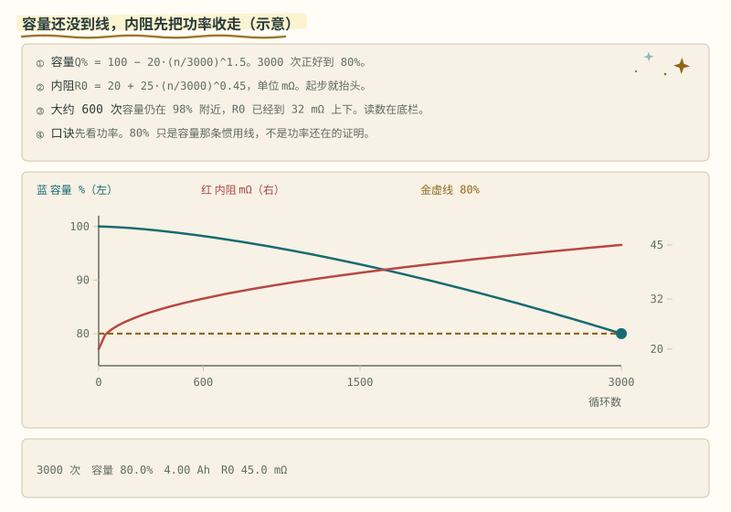
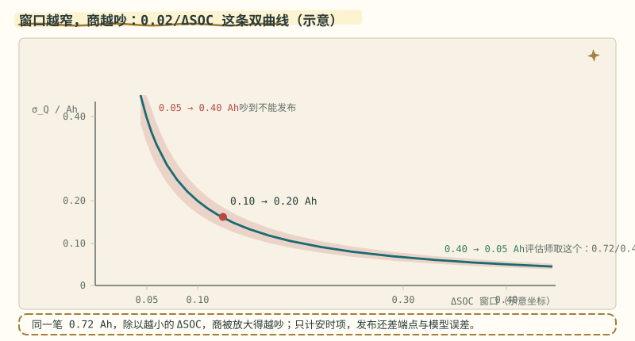
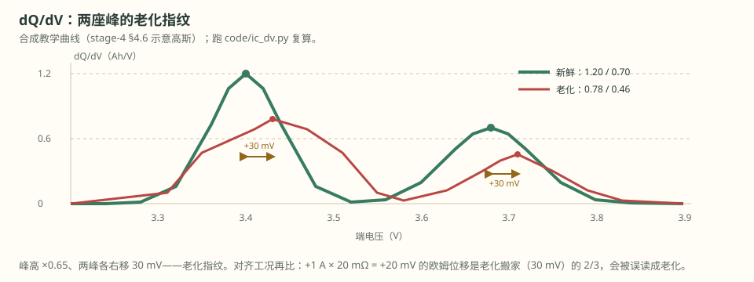
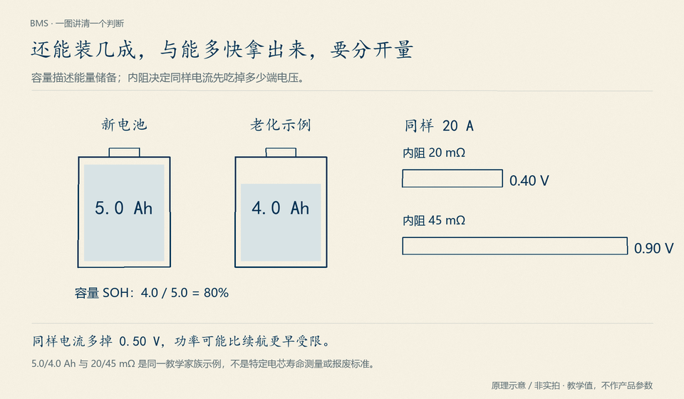

# 第 15 章 SOH 的两张脸

::: story 现场
二手车评估师只有十分钟：给一块名牌 2.00 Ah 的电芯充进去 0.72 Ah，看 SOC 从 0.30 走到 0.70，报出“SOH 90%”，收工。

同一周，一位网约车司机在抱怨另一件事：容量还有八成多，车却先“没劲儿”了，爬坡时功率被悄悄收走。一个盯着容量，一个先感到内阻。SOH 从来不是一张脸，而是两张：满充容量 Q 和内阻 R0。
:::

::: chapter-route 阅读路径

- **第一次主线**：读 §15.1–§15.2。把容量 SOH 与功率 SOH 分开，并复算 1.80 Ah 为什么不能直接发布成精确的 90%。
- **第二遍深挖**：读 §15.3–§15.7。再处理增量容量、双卡尔曼、两类指标冲突与显著性判断。
- **动手验证**：用章末练习分别给容量和内阻写出输入、参考值、误差界与放行条件。
:::

**先自己判断**　两次估计分别得到 90% 和 87% SOH。能否只凭 3 个百分点的差异就宣布电池明显老化？

## 15.1 两张脸：容量下降，内阻上升

老化的两个可观测后果：满充容量 Q 下降、内阻 R0 上升。BMS-Z 的示意家族（教学数，不是某颗电芯的寿命数据）：新电池 5.0 Ah、20 mΩ；容量滑到惯用的 80% 寿命线时，是 4.0 Ah、45 mΩ。

<figure>

<figcaption>图 15-1　SOH 的两张脸：同一颗电芯，容量那一半还精神，功率那一半已经疲惫。两半可以各说各话，所以才有 15.6 的“不和”。定性示意。</figcaption>
</figure>

内阻这张脸往往先咬人。同样 20 A，欧姆压降从 0.40 V 变成 0.90 V，多出来的 0.50 V 全压在电压墙上，第 14 章的 SOP 公式给出的允许电流立刻缩水。容量还没到报废线，功率先被收走：车还能跑，但“没劲儿”了。

::: principle 一句话
SOH 至少要分容量与内阻两种口径：容量回答还能跑多久，内阻回答当前还能给多少功率。两者不能用一个百分数代替。
:::

## 15.2 窗口容量法：一段局部充电估整包

最稳的容量测量是一次完整的充放；车上没有完整充放，只有一段段局部充电。窗口容量法的账是 Q = ΔAh/ΔSOC：充进去的安时，除以这段 SOC 跨度。

窗口太窄时，误差会被放大。**先假设 SOC 两端准确**，并设示意安时标准差为 0.02 Ah，则 σ_Q = 0.02/ΔSOC；下表只计安时这一项，不能当完整发布依据：

**表 15-1**　ΔSOC 窗口对 σ_Q 的影响（只计安时项的示意值）

| ΔSOC 窗口 | σ_Q（示意） | 够不够发布 |
|---|---|---|
| 0.05 | 0.40 Ah | 对 2 Ah 参考已达 20 个百分点，不能只凭此值发布 |
| 0.10 | 0.20 Ah | 仍太吵 |
| 0.40 | 0.05 Ah | 还需加入 SOC 端点与模型误差 |

ΔSOC 趋于 0，这条双曲线趋于无穷；窗口拉大，它往 0 贴，但不到 0。

评估师那笔账：0.72 Ah/0.40 = **1.80 Ah**，对名牌 2.00 Ah 是 SOH 90%。

这笔账的误差怎么穿过除法？分子（充进去的安时）的抖动，除以 ΔSOC 后原样传给商；分母（SOC 跨度）的抖动，则被放大成 ΔAh/ΔSOC² 倍。窗口越窄，分母越小，第二条路就越吵。若两个 SOC 端点标准差各 0.01，彼此独立且与安时误差独立，把两路按方差相加就是一阶传播。σ_Q² ≈ (σ_Ah/ΔSOC)² + (ΔAh/ΔSOC²)²·σ_ΔSOC²，其中 σ_ΔSOC² = σ_start² + σ_end² − 2Cov(start, end)。完整 σ_Q 约 **0.0809 Ah**，SOH 标准差约 **4.05 个百分点**，而不是只计安时项的 2.5 个百分点。

若端点相关系数为 +0.8，同样输入得到 σ_Q≈0.0575 Ah；共同偏移在作差时可能抵消，但是否相关须有依据。上式假定安时与 SOC 端点误差独立；不独立时还需交叉协方差。非零偏置、非线性与协议差异不能靠随机方差公式消除。第 17 章实验可复算；发布时另说明参考容量和区间口径。

::: trap 坑
用同一个假定容量的库仑计得到 ΔSOC，再把它代回 ΔAh/ΔSOC，会原样算回假定容量：这是循环论证。窗口端点需要独立的、可说明不确定度的锚点或联合辨识；扩大窗口不能修复这个信息缺口。
:::

<figure class="book-motion" data-animation="soh-aging.svg" data-mode="static">

<button type="button" data-book-motion v-book-motion aria-pressed="false" hidden>播放动画</button>
<figcaption>图 15-2　老化的容量与内阻两张脸：教学曲线展示容量下降和内阻上升，不是某款电芯的寿命保证。对齐同一时刻的容量和内阻；达到 80% 容量时，不代表仍具有原来的功率能力。用 20 A 和 20/45 mΩ 两档内阻，算欧姆压降变化，再说明它怎样挤占 SOP。</figcaption>
</figure>

窗口容量法这段教学还有第二张脸：同一个商，窗口越窄越吵。

<figure class="book-motion" data-animation="soh-window-hyperbola.svg" data-mode="static">

<button type="button" data-book-motion v-book-motion aria-pressed="false" hidden>播放动画</button>
<figcaption>图 15-3　窗口越窄，商越吵（教学示意）：同一笔 0.72 Ah 充入安时，ΔSOC = 0.05 时 σ_Q = 0.02/0.05 = 0.40 Ah，吵到不能发布；ΔSOC = 0.10 时 0.20 Ah；评估师取最宽窗 ΔSOC = 0.40，σ_Q = 0.02/0.40 = 0.05 Ah，1.80 = 0.72/0.40 才敢写进报告。小分母放大误差，这条双曲线就是「先扩大窗口」的定量版。</figcaption>
<p class="visual-guide"><strong>先看哪里：</strong>先看游点从左（ΔSOC = 0.05，σ_Q = 0.40 Ah，红）滑到右（ΔSOC = 0.40，σ_Q = 0.05 Ah，绿）；红色误差带在窄窗端张开最宽，宽窗端收窄贴住曲线。</p>
<p class="visual-question"><strong>看完追问：</strong>把窗口从 0.05 加倍到 0.10，σ_Q 从 0.40 降到 0.20。商的不确定度减半，为什么不是减为四分之一？</p>
</figure>

## 15.3 增量容量：峰是相变的指纹

增量容量 dQ/dV 把“这一小段电压里塞进了多少安时”画成曲线：电压走不动而安时还在进的地方，就拱起一个峰。峰是电芯内部相变的指纹，不是噪声尖刺；峰顶的斜率是 0。

本书的合成教学曲线（出自 stage-4 §4.6 的示意高斯，不是某种化学的实测）：

fresh(V) = 1.20·exp(−(V−3.40)²/(2·0.04²)) + 0.70·exp(−(V−3.68)²/(2·0.05²))，单位 Ah/V

两座峰：3.40 V、1.20 Ah/V 与 3.68 V、0.70 Ah/V。读峰先读位置与高度，再谈形状。

## 15.4 老化在峰上留下的指纹

老化在这条曲线上做两件事：峰变矮，峰搬家。教学设定：高度 ×0.65，两座峰各右移 30 mV，老化峰落在 3.43 V（0.78 Ah/V）与 3.71 V（0.455 Ah/V）。

<figure>

<figcaption>图 15-4　增量容量的两座峰：较高靠左的是新鲜曲线，较矮靠右的是老化曲线。合成教学值（示意高斯，非某种化学的实测）：新鲜峰 3.40 V / 1.20 与 3.68 V / 0.70 Ah/V；老化后高度 ×0.65，两峰各右移 30 mV。</figcaption>
</figure>

但让峰搬家的原因不止老化。**温度或倍率一变，峰也会搬迁**：+1 A 充电、20 mΩ 串联内阻，就把第一峰向右推 +20 mV，已经是老化搬家 30 mV 的 2/3。没扣掉 IR、没对齐工况就比峰位、峰高，差出来的不是老化，是工况。

::: principle 一句话
**峰在斜率为 0 的地方；老化让峰变矮，有时还搬家。** 看见峰，先问这次的温度和倍率，再谈它变矮了没有。
:::

## 15.5 双卡尔曼：两张脸一起估

先立一个图景：快岗每一拍都盯着 SOC，慢岗隔几天才盘一次容量和内阻。双卡尔曼就是把这个分工做成两台滤波器。Q 和 R0 可以作为慢参数，与 SOC 联合估计，也可以采用双滤波器交替更新。快慢分离便于调参和管理激励，但不是说“单滤波器做不到”。两路估计共享电流、电压和状态误差，交叉依赖不能因拆成两个对象就忽略。内阻也随温度、SOC 和倍率快速变化，应先区分可逆工况变化与长期老化。

可观测性有条件：参数只有在电流激励下才“看得见”。长期静置或电流纹丝不动时，参数估计的协方差会长大。工程对策是激励不足时**冻结参数更新**，别让慢滤波器在黑暗中乱走。朴素法也有价值：记录每次完整循环的吞吐容量比，长期拟合，简单、稳、可解释。公开的老化数据可取自 Battery Archive。

## 15.6 两张脸不和，怎么办

容量脸对续航负责，内阻脸对功率负责，两张脸很少同步恶化。发布的纪律是把两张脸分开报、各带不确定度：窗口法给出 σ_Q，增量容量给出峰的位置与高度，滤波器给出随时间的轨迹，它们各自只是证据链上的一环，不是互相替代的答案。

这两张脸为什么会动？容量为什么开头掉得快、后来慢，内阻为什么悄悄抬头？第 16 章把老化拆成日历与循环两支，讲它们各自的物理。

## 15.7 差了三个百分点，算不算真的老了

SOH 从 90% 变成 87%，看起来下降了 3 个百分点。若两次容量估计各自的不确定度都取 §15.2 算出的 σ_Q = 0.0809 Ah，对 2.00 Ah 参考容量等于每次约 4.05 个百分点，那么“差 3 点”还小于单次测量自己的噪声。

先做最乐观的独立随机误差账：两次差值的标准差为 √(0.0809² + 0.0809²) = **0.1144 Ah**，折成 2.00 Ah 参考容量是 **5.72 个百分点**。两次结果 1.80 Ah 与 1.74 Ah 只差 0.06 Ah，即 **0.52 个标准差**；不能据此宣布发生了永久衰减。按 95% 的粗判据，差值要超过约 1.96 × 0.1144 = **0.224 Ah**，才值得立案继续查。这里仍未计入共同偏置、温度漂移与协议变化；把它们算进去，门槛只会更高。

**表 15-2**　同样写着“容量 SOH 90%”，工程含义可以完全不同

| 记录 | 容量脸 | 内阻脸 | 测量条件 | 可以说什么 |
|---|---:|---:|---|---|
| A | 90% | 110% R0_ref | 同温、同 SOC、同脉冲 | 续航略降，功率影响需按 SOP 复算 |
| B | 90% | 225% R0_ref | 同温、同 SOC、同脉冲 | 容量尚可，功率脸已经严重恶化 |
| C | 90% | 180% R0_ref | 一次 25 °C、一次 0 °C | 不能把全部内阻差归因于永久老化 |
| D | 90% | 未测 | ΔSOC 由同一假定容量的库仑计给出 | 容量结论是循环论证，90% 无效 |

趋势发布至少要写四列：估计值、不确定度、归一化工况、相对哪个参考。不要把“90%”做成一枚脱离协议的健康徽章。容量脸和内阻脸分别画趋势，只有在相同窗口、相同温度归一和相同算法版本下，前后点才有资格连成线。

::: lab 动手
跑本书仓库的 `python bms-book/code/ic_dv.py`，八项断言应全部 PASS。对照输出读四件事：

- E1 两座新鲜峰 (3.400 V, 1.200) 与 (3.680 V, 0.700) Ah/V，峰顶斜率为 0；
- E2 老化峰 (3.430 V, 0.780) 与 (3.710 V, 0.455)，高度比 0.650、右移 30 mV；
- E3 工况污染：+1 A × 20 mΩ 把第一峰推 +20 mV；
- E4 窗口容量的三档 σ（0.40 / 0.20 / 0.05 Ah）与 1.80 Ah、SOH 90% 那笔账。

然后把 `AGE_DV` 改成 0 再跑，看哪几项变红（改完记得改回来）。
:::

## 15.8 跟做实验：把 σ_Q 与显著性门槛算出来

仓库里跑 `python bms-book/code/ic_dv.py`，八项断言应全 PASS（两座峰、老化搬家、+20 mV 欧姆位移都在断言里）。§15.2/§15.7 的两笔误差账，十行 Python 逐位复算：

```python
import math

for w in (0.05, 0.10, 0.40):                    # ΔSOC 三档窗口
    print(f"ΔSOC={w:.2f}  σ_Q(只计安时)={0.02 / w:.2f} Ah")
dq = 0.72                                       # 评估师那笔 0.72/0.40
sig_q = math.sqrt((0.02 / 0.40) ** 2
                  + (dq / 0.40 ** 2) ** 2 * (0.01 ** 2 + 0.01 ** 2))
print(f"完整 σ_Q = {sig_q:.4f} Ah ≈ {sig_q / 2.00 * 100:.2f} pp")
diff = math.sqrt(2) * sig_q
print(f"两次差值 σ = {diff:.4f} Ah = {diff / 2.00 * 100:.2f} pp；"
      f"95% 门槛 {1.96 * diff:.3f} Ah")
```

**成功判据**：三档应看到 0.40 / 0.20 / 0.05 Ah（表 15-1）；完整传播 σ_Q=0.0809 Ah≈4.05 pp，不是只计安时项的 2.5 pp；两次差值 σ=0.1144 Ah（5.72 pp），95% 立案门槛 0.224 Ah；90% 对 87% 只差 0.06 Ah（0.52σ），不能宣布老化。
## 15.9 翻车对照：SOH 发布的七种翻车

素材全部出自本章，第三列是先补一步再发布的对照。

**表 15-3**　SOH 发布的七种翻车

| 症状 | 可能原因 | 排查或对照 |
|---|---|---|
| 十分钟报出“SOH 90%”收工 | 只测容量脸，无不确定度、无工况（表 15-2） | 两张脸分开报，各带 σ 与参考 |
| 窄窗口也敢直接发布 | σ_Q=0.02/ΔSOC，ΔSOC=0.05 时 0.40 Ah（§15.2） | 先拉宽窗口，再算完整传播 |
| ΔSOC 用同一假定的库仑计反推 | 循环论证：原样算回假定容量（章末坑） | 端点改用独立锚点或联合辨识 |
| 第一峰移到 3.42 V 就判老化 | +1 A × 20 mΩ 欧姆位移就推 20 mV（§15.4） | 先扣 IR、对齐温度与倍率 |
| 90% 变 87% 就宣布明显老化 | 3 pp 小于单次 4.05 pp 噪声（§15.7） | 差值超 0.224 Ah 再立案 |
| 容量 80% 线上一切照旧 | 内阻脸可能已 225%，功率先被收走（表 15-2 B） | 20 A 下复算 0.40→0.90 V 压降 |
| 两次不同温度的点连成趋势 | 工况不同，前后点无资格连线（§15.7） | 同窗口、同温度归一、同算法版本 |

> **同构点**　σ_Q 的两路误差按方差相加、共同项先合并，与卷 I 第 14 章《电路设计方法论》的误差预算合成（RSS、别把共同温漂算两遍）同一套账；“先问温度与倍率，再谈老化”又与卷 I 第 16 章《排故五步法》先区分工况、再定根因同课。

## 本讲服务知识点

<!-- kp-backlink:start -->
本章服务 2 个知识点；每条都能回到[核心问题地图](../../docs/核心问题地图.md)的 L1–L5 五级入口。这一节由 `curriculum/concepts.json` 的 `book` 字段生成。

**表 15-4**　本章服务的知识点与其梯子入口

| 知识点 ID | 标题 | 阶段 | 梯子到 | 握证 |
|---|---|---:|---|---|
| [`soc-capacity-denominator`](../../docs/核心问题地图.md#kp-soc-capacity-denominator) | SOC分母会变 | 0 | L3 | 手算纸 |
| [`soh-dual-indicators`](../../docs/核心问题地图.md#kp-soh-dual-indicators) | 容量与内阻双指标 | 4 | L3 | 手算纸 |

**SOC分母会变：老电池显示100%，为什么仍比新电池少装电？**

SOC 回答‘现在装了当前油箱的几成’，容量 SOH 回答‘现在这个油箱相当于新买时的几成’。电池老了，可装的容量会缩水，但把缩水后的容量充满，SOC 仍可以是 100%。这两个百分数的分母不同。用出厂容量算当前 SOC，会把已经装满的旧电池说成永远充不满。

**教学算例：沿着这组输入做一遍**

1. 新电池容量 50 Ah，老化后实测当前满充容量 40 Ah。
2. 容量 SOH 用当前除出厂：40÷50=80%。
3. 若现在剩余可用电量也是 40 Ah，SOC 用当前容量作分母：40÷40=100%，并不与 SOH=80% 矛盾。

**边界与反例**　容量比较必须对齐温度、倍率与截止条件。冬天一次可用容量下降，不能不分工况就全部记成不可逆老化。

**看图任务**　把两只油箱的大小与液面高度分开看；满格描述当前占比，不会把缩小的容器变回原尺寸。

**对应图解**　[soh-aging](../../docs/circuits/assets/soh-aging.svg)

**先自己判断**　出厂50 Ah、当前满充40 Ah，求容量SOH及装满时SOC。

完成后再展开标准；先保留自己的计算、判断或运行记录。

<details class="kp-retrieval-check">
<summary>核对通过标准</summary>

80%与100%，注明两者分母。

</details>


**容量与内阻双指标：容量还剩 80%，车为什么已经没劲了？**

电池‘能装多少’和‘能多快拿出来’不是同一件事。容量下降让续航缩短；内阻上升会让相同电流吃掉更多端电压，先撞到欠压限制，表现为还有电却没劲。估计容量和内阻还需要足够工况变化：长期静置时看不出某些参数，继续更新只会把噪声当成老化。

**教学算例：沿着这组输入做一遍**

1. 教学新电池为 5.0 Ah、20 mΩ；容量到 4.0 Ah 时，容量 SOH=4.0÷5.0=80%。
2. 同一 20 A 电流，20 mΩ 给出 20×0.020=0.40 V 压降；45 mΩ 给出 0.90 V。
3. 多掉的 0.50 V 会更早触碰电压下限。容量百分数因此不能单独保证原来的功率能力。

**边界与反例**　静置无激励时，内阻参数不是越估越准。先冻结不具备可观测条件的更新，保留不确定性，等足够电流变化后再恢复。

**看图任务**　把容量下降线与内阻上升线分开读；同一条电流线下，比较哪条端电压更早碰到限制。

**对应图解**　[soh-aging](../../docs/circuits/assets/soh-aging.svg)

<figure>

<figcaption>图 15-5　容量与内阻双指标。原理示意 / 非实拍；数字沿用本节教学条件，不作产品参数。</figcaption>
</figure>

**先自己判断**　20 A 下算 20 mΩ 与 45 mΩ 的欧姆压降，并说明为什么功率先受限。

完成后再展开标准；先保留自己的计算、判断或运行记录。

<details class="kp-retrieval-check">
<summary>核对通过标准</summary>

0.40 V 与 0.90 V；压降更大使端电压更早触下限，SOP 先被收走。

</details>

<!-- kp-backlink:end -->

## 练习

1. 一块名牌 5.0 Ah 的电芯，一段充电吞进 1.50 Ah，SOC 从 0.20 走到 0.50。Q 与 SOH 各是多少？按 σ_Q = 0.02/ΔSOC（示意），不确定度是多少？
2. 某次测量的 dQ/dV 第一峰出现在 3.42 V，充电电流 +1 A、内阻 20 mΩ。这是老化搬家还是欧姆位移？用数字说明。
3. 为什么说“内阻往往先咬到 SOP”？用 20 A、20 mΩ → 45 mΩ 算一笔压降账回答。

## 参考资料

- BMS-Z 阶段 4（§4.6 SOH 与联合估计）：https://github.com/zhuguang-ZFG/BMS-Z/blob/main/docs/stages/stage-4-SOC-SOH算法.md
- 本书 demo：code/ic_dv.py（增量容量的两座峰）
- ECE5720 Notes04 中文导读（容量与电阻讲义）：https://github.com/zhuguang-ZFG/BMS-Z/blob/main/docs/ece5720-notes04-中文导读.md
- Battery Archive（公开老化数据）：https://www.batteryarchive.org/
