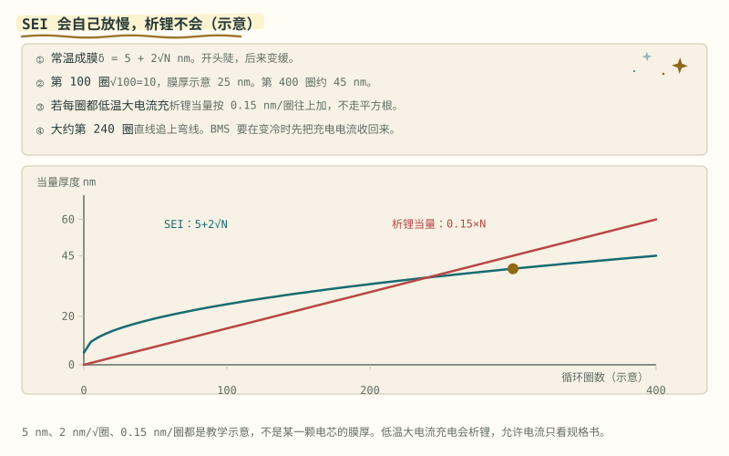
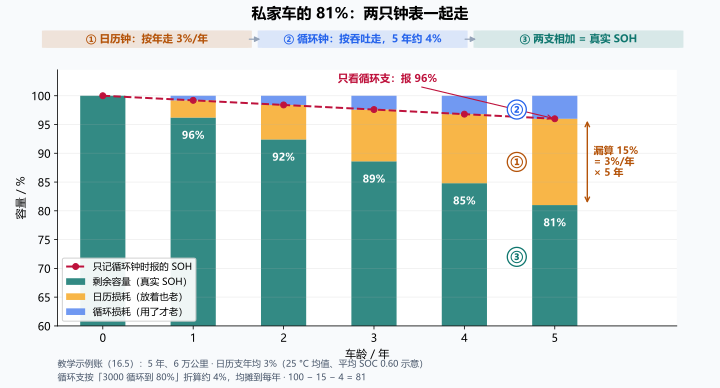

# 第 16 章 老化物理

::: story 现场
二手车场里并排停着两台同型号的车。一台是网约车，两年跑了 20 万公里；一台是私家车，五年只跑了 5 万公里。哪台的电池更老？

直觉指向里程多的那台，物理却未必：前者老在循环，后者老在日历，电池放着不动也在老。这一章把第 15 章那条合成的 SOH 曲线拆成两支，看它们各自被什么驱动。
:::

第一次读这一章，先看图 16-1 的两条教学曲线：一条按时间开方增长，一条按吞吐量逐圈累加。§16.2 与 §16.3 分别讲日历与循环两种老法，表 16-1 说清三种使用场景下谁主导。§16.5 的私家车账是全章最该会算的一笔——日历钟与循环钟叠成 81%，只记循环钟会报成 96%；最后用 §16.8 检查自己报 SOH 时有没有把口径写全。

## 16.1 一条曲线，两种老法

第 15 章的 SOH 是一条合成曲线。工程上要拆成两支分别建模，因为**驱动量不同**：

- **日历老化**：电池放着不动也在老。驱动量是时间、温度、存储 SOC；
- **循环老化**：用起来才老。驱动量是吞吐量（累计充放 Ah）、DOD、倍率。

SEI 生长与活性锂损失是重要机制，但还包括正负极活性材料损失、颗粒开裂、接触退化、电解液副反应等。日历/循环是按驱动量划分，不是两个互不相关的微观反应盒子；同一机制可能同时受时间、温度和循环影响。分开记账有助辨识，但不能默认两者总能简单相加。

可以把同一块电池的 SOH 曲线看成两只钟表拧出来的：一只按月份走，一只按循环次数走。修表之前，先认清每只钟表的驱动量。

::: principle 一句话
时间、温度、SOC 与吞吐量、倍率、DOD 分别描述不同驱动。**先固定测量协议和环境，再把变化归为老化**；温度造成的可逆内阻变化不能直接计成永久衰减。
:::

## 16.2 日历老化：放着不动也在老

扩散受限的 SEI 简化模型可出现平方根时间依赖，但真实电芯不一定只有这一机制。本章 δ=5+2√N nm 使用**循环数 N 作为教学横轴**：第 100/400 圈是 25/45 nm，它不是日历老化拟合式，不能把圈数直接改成天数沿用同一系数。动画用于比较形状，非实测膜厚。

体会 √ 的脾气：圈数翻 4 倍（100 → 400），膜厚只从 25 nm 到 45 nm，不到两倍。开头那段长得最快，后面越来越平：容量曲线“先陡后缓”的微观出处之一就在这里。

高温和满电存储都在加速它，这就是“长期停放别充到 100%”的出处。最差组合是高温加满 SOC：储能站的满电浮充，正好两条都占。对策跟着驱动量走：凉快、中等 SOC 的存放环境，是不用拆电池就能做的延寿手段。

## 16.3 循环老化：按吞吐量记账

循环支按吞吐量、DOD、倍率记账。教学形状 Q% = 100 − 20·(n/3000)^1.5：3000 次等效循环落到 80%。它只用来记“越用越掉”的弯曲形状，不是某款电芯的寿命表。

有一种循环老化不走弯线：低温大电流充电时的析锂。锂离子来不及嵌入石墨层间，在负极表面析出金属。示意口径：析锂当量按 0.15 nm/圈直线累加，大约第 240 圈就追上那条 √ 弯线：按上面的教学式算，第 240 圈 SEI 约 36 nm，析锂当量 0.15×240 = 36 nm，直线追平弯线。

注意这条红线的前提：“每一圈都低温大电流充”。扩散限制的膜会自己放慢，析锂不会，所以 BMS 在变冷时先把充电电流收回来（第 14 章的温度降额），而不是等 SEI 那种慢变化。规格书不允许的充法，就不要充。

::: trap 坑
不能把教学的平方根和直线当成全部电芯的老化定律。析锂可能部分可逆、也可能转化为不可逆损失，并受电流、温度、SOC 与历史强烈影响；直线只是本章每圈固定损失的形状对照。
:::

<figure class="book-motion" data-animation="sei-sqrt-plating.svg" data-mode="static">

<button type="button" data-book-motion v-book-motion aria-pressed="false" hidden>播放动画</button>
<figcaption>图 16-1　两种教学形状：平方根增长与逐圈累加的析锂当量。横轴与参数只用于理解不同累积规律。先看曲线斜率是否随过程减小，再看交叉点；不是所有老化都能用同一条平方根拟合。把低温快充的直线累积强行用平方根外推，会在后段产生什么方向的偏差？</figcaption>
</figure>

## 16.4 谁主导，看场景

合成的近似：SOH ≈ 1 −（日历损耗 + 循环损耗）。关键在三个场景里谁主导：

**表 16-1**　三个使用场景下谁主导老化及对策（教学合成）

| 场景 | 谁在主导 | 对策 |
|---|---|---|
| 网约车两年 20 万公里 | 循环 | SOH 跟吞吐量走，容量重标定按里程安排 |
| 私家车五年 5 万公里 | 日历 | 存放 SOC 与热环境比里程更伤电池 |
| 储能站满电浮充 | 日历（高温 + 满 SOC 是最差组合） | 闲置时把 SOC 拉进存储区间，热管理配合 |

三行各有各的逻辑：

- 网约车：里程就是吞吐量，循环支记满账，标定跟着里程走；
- 私家车：里程少，日历支照跑，存放在什么 SOC、停在什么热环境，比多跑几千公里更伤；
- 储能站：把高温和满 SOC 两条加速项占齐，能做的是把闲置 SOC 拉回存储区间，并让别人管温度。

## 16.5 示例账：私家车的 81%

教学账（数字全是示意）：私家车 5 年、6 万公里。循环支按“3000 循环到 80%”折算约 4%；日历支按年均 3%（25 °C 均值、平均 SOC 0.60 的示意值）约 15%。**合下来 SOH ≈ 81%**：只看循环支，会以为还有 96%。

<figure>

<figcaption>图 16-2　私家车的 81%：日历钟 ① 与循环钟 ② 逐年叠加成真实 SOH ③。教学示例账，数字与本节正文一致，不是实测；生成脚本 <code>bms-book/generate_figures.py</code>。先看红虚线（只记循环钟）几乎是平的；再看每根柱子里的橙色块一年比一年厚：差出来的 15% 全是它。如果这台车第 5 年开始改成网约车，下一年哪种颜色的块会突然变厚？</figcaption>
</figure>

打个比方：电池身上有两只钟。一只是挂钟，不管你开不开车，它按日历一格一格走，天热、满电放着时走得更快；另一只是里程表，只有真开起来才转。私家车大部分时间停在车库里，里程表转得慢，挂钟却一天没停，所以**低里程不等于年轻**。

“才开 6 万公里怎么就掉到 80%”，在日历老化面前不是异常。反过来说也成立：只按循环数建 SOH 模型，私家车的 SOH 会被**高估**：里程少，日历损耗照样在跑。

给你一台车的画像四要素（里程、车龄、地域、用车习惯），就能先估个方向：里程和习惯定循环支，车龄、地域（温度谱）和存放 SOC 定日历支。两支各估一遍再合成，比只看里程表靠谱。

这笔账反过来也是判据：一台里程很低、SOH 却明显下滑的车，先查存放条件与热环境，不要先怀疑电芯批次。

## 16.6 对 BMS 的要求：记账，是为了建模

日历支需要温度和 SOC 的历史统计。这正是 BMS 要记“平均温度、SOC 分布直方图”这类运行统计的原因：它们是日历老化模型的输入，不是给云端凑数。这类记账不需要高精度测量，要的是低分辨率的长期积累：攒得够久，日历支才有可拟合的输入；第 15 章那台慢 EKF 估的是当前状态，这里的统计喂的是老化模型本身。第 20 章会看到这些数据怎么出包；这里先记住它们为什么存在。

模型建好了，还有一个更扎手的问题：车上没有参考容量、没有真值，拿什么验证估计没跑偏？第 17 章讲没有答案时的听诊法。

::: lab 动手
打开 BMS-Z 阶段 4 的两张动画。`sei-sqrt-plating.svg` 里盯住贴着蓝线的黄点，左边陡、右边平，再看红线（0.15 nm/圈）大约第 240 圈的交叉。`soh-aging.svg` 里看容量滑向 80% 惯用线时内阻同期上翘。然后算你自己的账：挑一台车的车龄、里程、地域和用车画像，按 16.5 的格式把两支损耗各估一遍，说出它更像 16.4 表里的哪一行、对策是什么。
:::

## 16.7 先把容量衰减拆成三类可疑原因

**表 16-2**　容量衰减的宏观现象、候选机制与区分测量（定性对照）

| 宏观现象 | 候选机制 | 能区分的测量条件 |
|---|---|---|
| 可用容量下降、OCV/ICA 特征移动 | 活性锂损失 LLI、活性材料损失 LAM、端点改变 | 相同温度和低倍率协议，电压窗一致，必要时电极参照 |
| 脉冲压降变大 | 老化电阻增长、低温、SOC 改变、连接器退化 | 同 SOC/温度/脉冲时长，四线测量与接触检查 |
| 休息后容量“回来” | 极化消退、温度恢复、倍率改变 | 标准化静置与复测，区分可逆与永久变化 |

容量法、ICA 和脉冲法是不同窗口的证据。某峰降低并不能唯一判定 LLI；滤波、温度和采样噪声也能改变峰形。诊断报告给候选机制、可排除项和还缺的实验，而不是从一张峰图直接宣布失效机理。

## 16.8 吞吐量、等效循环与时间都要说明口径

绝对吞吐量 Qthrough=∫|I|dt/3600；若把一次完整充放算一圈，EFC=Qthrough/(2Qref)。有的记录只累计放电，则用放电 Ah/Qref。两种口径不能混加，参考容量是否随 SOH 更新也要说明。

50 Ah 参考电芯累计绝对吞吐 30000 Ah，对应 **300 EFC**；若这 30000 Ah 仅是放电累计，则是 **600 EFC**。同一个文件写“循环 600 次”，不声明分母和方向，就无法复现寿命图。

时间与 EFC 同时增长会造成混淆：每一天都固定跑同样循环，容量对时间和对循环都能拟合。需要不同存储/循环组和温度、SOC 对照，才能区分两种驱动；只在一条轨迹上拆出“日历 15%+循环 4%”，并不能证明真实损耗各有多少。

## 16.9 把寿命模型当带适用域的预测

数据卡至少注明化学与批次、温度谱、SOC/DOD、倍率、截止协议、静置、参考容量/电阻和 EFC 定义。训练和验证按电芯或批次留出，寿命末段留独立窗口；不要从同一颗电芯的相邻循环随机切分，再称跨电芯泛化。

报告误差区间与适用域，检查外推到高温、快充或未见 DOD 是否改变机制。某条光滑曲线拟合良好，不代表它能预测拐点、内短路或异常批次。寿命估计帮助维护和策略选择，安全保护仍依赖当前可信测量与独立防线。

## 练习

1. 用 δ = 5 + 2√N nm（示意）算第 225 圈的 SEI 膜厚；析锂按 0.15 nm/圈，第 225 圈的当量是多少？哪条线在前？
2. 一块储能电池常年满电浮充在 35 °C。它的 SOH 损耗以哪一支为主？给出两条对策。
3. 一台私家车 5 年 6 万公里，循环支折算约 4%、日历支约 15%（均为示意）。只看循环支时 SOH 报多少？真实约多少？被漏算的是哪一支？

## 参考资料

- BMS-Z 阶段 4（§4.6b 老化拆两支；§4.6 SEI 平方根与析锂示意）：https://github.com/zhuguang-ZFG/BMS-Z/blob/main/docs/stages/stage-4-SOC-SOH算法.md
- BMS-Z 阶段 0（§0.1.1 一块电池里在发生什么）：https://github.com/zhuguang-ZFG/BMS-Z/blob/main/docs/stages/stage-0-前置知识.md
- BMS-Z 阶段 6（§6.1.6 BMS 与热管理的边界）：https://github.com/zhuguang-ZFG/BMS-Z/blob/main/docs/stages/stage-6-精通与毕业项目.md
- Vetter et al.《Ageing Mechanisms in Lithium-Ion Batteries》（Journal of The Electrochemical Society, 152(1) A883, 2005）：SEI 生长、锂沉积等老化机理的经典综述，本章老化两支的文献源头
