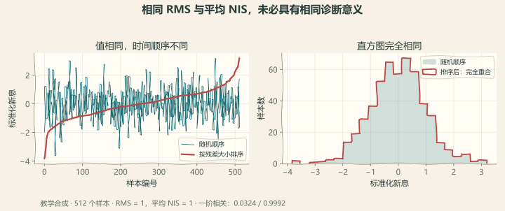
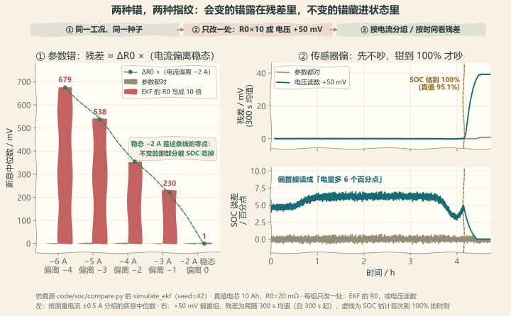
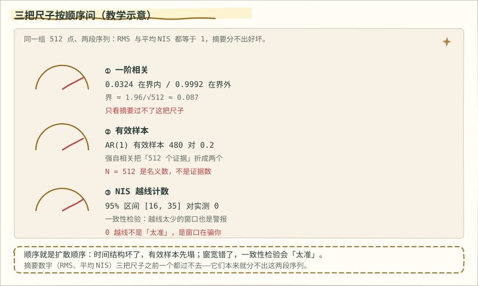

# 第 17 章 无真值诊断：没有参考答案时怎么判断

::: story 现场
上一章看的是老化怎么改写电芯；这一章回到没有参考 SOC 的现场。你只有模型、电流、电压，和一条越看越不对劲的残差曲线。怎么判断是“模型参数错了”，还是“电压表坏了”？

在 BMS-Z 的受控注入中，R0 失配留下与电流相关的残差（该组相关系数 −0.288）；电压偏置组却几乎不吵，因为 EKF 把那 50 mV 读成了“电量多 6 个百分点”，直到 SOC 估到 100% 才露馅。这些是诊断线索，能对上的病因不止一个：传感器增益错也跟着电流走，温度、SOC 与工况又可能互相关。先问能排除什么，再问还缺哪条证据。
:::

> **难度**：L2 进阶
> **先修**：第 12 章的 SOC 误差、第 15 章的 SOH 统计账。
> **学完你应能**：列出没有真值时的三条对账路径，并解释残差小为什么不能当证据。

::: chapter-route 阅读路径

- **第一次主线**：读 §17.1–§17.3。把新息理解成“模型预测与仪表读数的差”，再比较参数失配与传感器偏置留下的不同形状。
- **第二遍深挖**：读 §17.4–§17.7。处理无真值标注、可证伪诊断、拒绝测量后的可观测性与三项统计判据。
- **动手验证**：运行诊断脚本，分别注入 R0 失配和 50 mV 偏置，只根据保存的残差与工况写结论。
:::

**先自己判断**　电压残差与电流高度相关，能否直接断言“R0 参数写错了”？

## 17.1 新息：预测与测量的差

每拍先预测，再和测量对账：

**教学算例**　开场的 R0 失配组相关系数为 −0.288；下面的公式只定义每拍怎样得到这条残差。

$$
e_k = z_k - h(\hat{x}_k^-)
$$

它使用**更新前预测**与仪表读数，不需要参考 SOC。若先用同一个测量修正状态，再计算后验电压残差，滤波器已经“看过答案”，残差自然会变小。两种残差不能混用。

一个 15 mV 的新息，可能是 SOC 猜错、R0 写错、电压表偏置、温度变化或噪声。一个方程，多个未知，所以新息不能直接当成 SOC 误差。

## 17.2 三个诊断数

**表 17-1**　三个诊断数回答什么（BMS-Z 实测回放值）

| 指标 | 回答什么 | BMS-Z 实测（generic → calibrated） |
|---|---|---|
| 新息 RMS | 一般差多少 | 15.137 → 3.699 mV |
| 新息均值 | 一边倒还是两边晃 | −0.338 → +0.492 mV |
| NIS | 相对噪声算不算大 | 0.5340 → 0.0325 |

表中数值为 BMS-Z 特定回放的诊断统计，不是通用合格线。其报告还给出模型电压回放 RMSE：generic **186.3 mV**、标定后 **21.8 mV**；它与闭环滤波器的新息 RMS 不是同一个量，须说明预测方法、窗口和时间权重。

归一化新息平方按每拍计算：

$$
S_k=C_kP_k^-C_k^T+R_k,\qquad NIS_k=e_k^2/S_k
$$

在模型与协方差合理、零均值高斯假设成立的线性情形，标量 NIS 服从 1 自由度卡方分布，期望为 1；EKF 中只是近似参考。单拍常用 95% 上侧值约 3.84，意味着理想条件下也会有约 5% 越线，不能一次越线就宣判故障。窗口检验还要考虑样本相关、收敛期和重复检验。

**NIS 越小不代表模型越好。** 保持残差不变而把 S 加倍，NIS 就减半；Q/R 过大、状态不确定度保守或闭环吸收失配，都可能产生很小的值。读 NIS 时同时报告 S、新息均值/RMS 和误差时间结构。

::: principle 一句话
RMS 看大小，均值看偏置，NIS 看与自报不确定度是否相称；**再看时间相关性，才知道误差是否留下连续结构。**
:::

## 17.3 参数错 vs 传感器坏

BMS-Z 用同一段工况、同一个种子做了四组对照（`code/soc/compare.py` 的 `simulate_ekf`，共学《无真值诊断五天》第 3 天可复现）：

- **R0 偏大**：该受控组残差随电流变化（相关系数 −0.288；单凭数值不称统计显著，符号取决于约定）。同一次注入在两个窗口报出两个世界：残差窗口整体均值只有 +9.76 mV。SOC 窗口却报 41.51% RMSE（与第 10 章参数扫描同一接线、同一种子）；
- **电压表偏置 +50 mV**：残差在大半段工况里**几乎为零**，偏置被滤波器读成 SOC 偏高约 6 个百分点。SOC 估计被钳在 100% 之后（此时真值 95.1%），残差才一下子冒出来；
- **容量错（9.5 → 5.0 Ah）**：三个诊断数几乎不动，电压观测每拍把 SOC 拉回来。容量误差在本工况里没有留下明显模式；
- **温度**：本组回放没有温度通道，这一类要另做冷热对照（见表 17-2 第三行），不能把这三组的结论外推到温度。

先验证单位、时间同步和质量位，再把残差按电流方向、SOC、温度和脉冲边沿分组。电流与温度相关时，单变量相关系数不能区分谁主导；检查多变量拟合、独立窗口和受控注入。线索对应**候选原因**，不能直接当作换件结论。

<figure>

<figcaption>图 17-1　同一组 512 个合成正态样本，先同窗去均值并除以 RMS，再只改变顺序：RMS 与平均 NIS 都为 1，一阶相关却从 0.0324 变为 0.9992。平均平方等于 1 由归一化保证，不能验证模型；摘要数字无法替代时间结构。</figcaption>
</figure>

<figure>

<figcaption>图 17-2　两种错误模式（seed 42，同一工况）：R0 写成十倍，放电脉冲 −6/−5/−4/−3 A 的新息中位数为 679/538/354/230 mV，与 ΔR0 ×（电流偏离稳态 −2 A）的预测 675/537/354/221 mV 吻合到几 mV；电压读数 +50 mV 时，残差先接近零、SOC 却偏高约 6 个百分点，直到 SOC 到 100% 后残差均值才升到 32.5 mV。</figcaption>
</figure>

图 17-2 把其中两组摊开看。打个比方：滤波器像一个**会自己找补的记账员**。账对不上，他先改自己能改的那一栏：SOC。错法每拍都在变（R0 错，电流一跳差额就跟着跳），这一栏追不上，差额只好写在残差里；错法一直不变（电压整体偏 50 mV），他改一次 SOC 就把账抹平了，残差安安静静，错误搬进了“电量”那一栏。他只有在 SOC 改到头（100% 或 0%）、再也没法找补时才会喊出来。

> 先自己判断：把偏置改成 −50 mV，SOC 会被往下拉。这一回，残差会在哪一刻喊出来？

所以“残差小”有两种读法：模型和仪表都对，或者错误被状态吸收了。答案是**可能一直不喊**：同一组偏置改成 −50 mV，SOC 一路偏低约 6.2 个百分点，本工况最低只估到 35%，撞不到 0%，三个诊断数（中位 3.64 mV、均值约 0 mV、与电流相关 −0.002）和“都对”那一组几乎分不开。**整体偏置靠残差抓不住，要靠外部锚点**：独立仪表或参考电压源比对、与电压读数无关的物理事件（如充电机按电流截止判满）同 SOC 估计对账，或 SOC 被钳住时的那一段。注意长静置后的 OCV 点帮不上忙：它读的是同一块偏了的电压表。

## 17.4 诚实标注：参考值不是真值

<figure>

<figcaption>图 17-3　没有真值的诊断现场：地图不标北，罗盘只能给相对方向；诊断结论要写成“哪几条岔路被排除、还剩哪几条”，而不是一个假装绝对的坐标。定性示意。</figcaption>
</figure>

BMS-Z 的报告里有三项很关键：

```text
reference_kind = coulomb_reference_from_same_measured_current_and_separate_calibration_capacity
independent_soc_truth = False
model_fitted_on_validation = False
```

意思是：参考 SOC 是用同一路实测电流积分出来的，和被评估的估算器共享误差源；模型也没有在验证段上调参。

所以“和参考差 0.2%”不等于“精度 0.2%”。诊断数的价值在**相对比较**（generic 对 calibrated），不在宣称绝对精度。

## 17.5 把“可能是”推进到可验证结论

**表 17-2**　观测线索、候选原因与下一步区分证据（定性对照）

| 观测线索 | 至少两个候选原因 | 下一步区分证据 |
|---|---|---|
| 残差随电流变化 | R0 失配、电流增益错误、V/I 不同步 | 标准电流比对、边沿对齐、独立方向脉冲 |
| 整体偏移 | 电压偏置、OCV 表偏移、初始状态错误 | 参考电压源、已知温度静置点、不同 SOC 窗口 |
| 残差长期安静，SOC 钳到 0%/100% 时才突增 | 恒定电压偏置被 SOC 吸收、OCV 表整体偏移 | 独立仪表比对、与电压读数无关的满充/放空事件对账（图 17-2） |
| 连续慢漂 | 容量失配、温漂、滞回、慢扩散 | 独立容量锚点、冷热对照、延长松弛记录 |
| 偶发大尖峰 | 数据缺失、时间错位、接触不良 | 原始时刻、质量位、线束/任务诊断 |

白噪声式新息也不能证明安全；它只说明这段可见数据未留下明显结构。没有激励的区间，很多失配没有机会暴露。

## 17.6 拒绝测量以后，还要管理失去的观测

出现单个污染点，可按声明的门限拒绝该次更新，继续预测并记录原因。若持续拒绝，状态不确定度和盲行时间必须显式管理；不能一直积分、一直显示有效。恢复时检查新测量的质量、连续性和模型再获取条件。

不能为让 NIS “好看”随意扩大 Q/R，也不能让残差门限掩盖真实工况变化。记录原始测量、更新前预测、S、NIS、接受/拒绝和状态质量；需要 SOC 真值的 NEES 或绝对精度验收，另找独立参考。术语上，本书 NIS 指观测新息统计，NEES 指状态估计误差统计。

## 17.7 三把尺子，先问各自量的是什么

如果先把一段残差除以它自己的 RMS，再宣布“归一化后的 RMS 正好是 1”，你验收了什么？图 17-1 就藏着这个陷阱：脚本先生成 512 个正态样本，再用**同一窗口**去均值、除以 RMS。平均平方等于 1 是这道操作保证的；排序只改变先后，连越线次数也不会改变。它适合演示“摘要看不见顺序”，不能用来验收高斯新息模型。

下面把三个问题分开：有没有时间结构、相关怎样影响统计量、声明的概率模型能否解释当前窗口。N 表示预先选定的窗口长度；出现“95%”时，都要同时读它旁边的前提。

<figure class="book-motion" data-animation="diagnostics-three-gauges.svg" data-mode="static">

<button type="button" data-book-motion v-book-motion aria-pressed="false" hidden>播放动画</button>
<figcaption>图 17-4　三把尺子各自量什么：一阶相关先作筛查；有效样本要指定平稳模型和统计量；NIS 窗口区间另需独立标准正态新息。下方 21 次来自未做同窗归一化的合成样本；图 17-1 的归一化样本与其排序副本均为 24 次。</figcaption>
<p class="visual-guide"><strong>先看哪里：</strong>沿三行依次读“前提、读数、不能推出什么”。第二行的 1.14 来自指定 AR(1) 模型，不是给排序后的曲线估出的证据数；第三行才是独立正态算例。</p>
<p class="visual-question"><strong>看完追问：</strong>把窗口从 512 缩到 64，近似筛查界从 0.087 变成 0.245。同一个相关读数 0.10，在哪个窗口更容易被标出？</p>
</figure>

**尺子一：一阶相关只筛查一个滞后。** 大样本、白噪声基准下，单个非零滞后的样本相关可用 ±1.96/√N 作约 95% 的筛查界。N=512 时约 ±**0.087**。图 17-1 的 0.0324 没被这把尺子标出，0.9992 则暴露了排序带来的连续结构。但前者不能证明白噪声：二阶或更高阶仍可能有结构，零相关也不等于独立；图中的同窗归一化更不能自动满足标准正态独立假设。实际诊断还要看多滞后相关、工况分组与独立留出窗口，多次检查也会增加误报机会。

N 从 512 缩到 64，界变宽到 **0.245**，**同一个相关读数更难越界**。这不是说零假设下误报率变低；近似标称误报率仍是 5%，变化的是对固定相关效应的辨别能力。

**尺子二：有效样本数属于某个统计量。** 先另设一个模型：平稳 AR(1)，相隔 h 拍的相关为 ρʰ，且 0≤ρ<1。若每拍方差是 σ²，N 拍均值的方差满足：

$$
\operatorname{Var}(\bar u)=\frac{\sigma^2}{N}
\left[1+2\sum_{h=1}^{N-1}\left(1-\frac hN\right)\rho^h\right],
\qquad
N_{\mathrm{eff,mean}}=
\frac{N}{1+2\sum_{h=1}^{N-1}(1-h/N)\rho^h}.
$$

这里把它与独立样本均值的方差 σ²/N_eff 对齐。只有窗口远长于相关持续时间时，才可近似成 N(1−ρ)/(1+ρ)。ρ=0.9992 时相关衰减很慢，512 拍不够长，不能丢掉有限窗系数 1−h/N。

**表 17-3**　同样的相关参数，对均值与平均平方意味着不同的信息量（N=512；假设平稳、零均值高斯 AR(1)）

| 模型参数 ρ | 均值的有限窗 N_eff | 平均平方的有限窗 N_eff | 读法 |
|---|---:|---:|---|
| 0.0324 | 479.92 | 510.93 | 两个统计量的方差缩减不同 |
| 0.9992 | 1.14 | 1.29 | 强相关窗口接近重复看同一个随机量 |

表中沿用图 17-1 的两个数**作为假设模型参数**，没有把那两段数据拟合成 AR(1)。排序造成的单调曲线不能凭一个一阶相关系数获得平稳模型身份。在这个正相关有限窗模型里，均值有效样本数介于 1 和 N 之间；渐近式给出的 **0.20 在此不适用**。

为什么第三列不同？联合零均值高斯变量的平方相关是 ρ²ʰ，因此平均平方的方差等效样本数要在上式中用 ρ²ʰ。RMS 又是平均平方的平方根，区间还需按对应分布处理。**不能把均值的 N_eff 直接填进 RMS 或 NIS 的区间公式；方差等效也不意味着相关平方和精确服从该自由度的卡方分布。**

**尺子三：先声明模型，再给 NIS 窗口画参考带。** 这次换成预先声明尺度的标量新息 uₖ=eₖ/√Sₖ；假设各拍**独立、标准正态**，S 不用本窗口再拟合，窗口预先固定为 512 拍，且等权。此时每拍 NIS=uₖ²，512 拍的平方和服从 χ²(512)。直接调用 SciPy 的分位数函数，得到：

- **越线计数**：单拍上侧门限用 χ²₁ 的 0.95 分位数 **3.841459**（下文简写 3.84）。计数 B 服从 Binomial(512,0.05)，期望 **25.6** 次。0.025/0.975 分位数给出含端点参考区间 **[16,36]**；离散取整后实际覆盖率约 **96.76%**，不是恰好 95%。
- **窗口平均 NIS**：用 χ²(512) 的 0.025/0.975 分位数各除以 512，参考区间为 **[0.881243,1.126155]**。原来的 1±0.12 只是正态近似。

这两条分别是给定模型下的参考区间，**不是未知参数的置信区间，也不是联合 95% 判决**。例如 40 次越线提示该窗口与声明模型不相称，要查假设、工况、时序和 S；它不能单独判定 R0 错或传感器坏。重复滑窗、相关数据、先筛掉大残差再统计，都需要另行校准误报率。

新增实验保留原始标准正态抽样、只声明 S=1：seed 5720、N=512 时，平均 NIS 为 **0.928019**，越线 **21 次**，各自位于参考区间内。用同批样本做图 17-1 的同窗归一化后，平均平方被强制成 1，越线 **24 次**；排序后仍是 24 次。**计数没有时间顺序，落在带内也不会让排序序列变独立。**

**门限的另一半是误拒率。** 理想模型下，单拍门限 3.84 对应约 5% 上尾概率；10 Hz 时，正常测量被拒的**期望**为每秒 0.5 次。门限取 χ²₁ 的 0.999 分位数约 10.83，上尾概率降为 0.1%，代价是对部分异常的灵敏度下降。平均拒绝率不能说明最长连续盲行时间；相关与连续拒绝都要单独看。门限须与采样率、允许盲行时间和恢复条件一起声明。

再看真实回放的 calibrated NIS=0.0325：`real_data.py` 报的是**时间加权**平均，且真实序列可能相关。不能把它直接放进上述 512 拍等权独立窗口的区间。它仍值得追查：保存 e、S、时间权重与分组结果，检查协方差是否过于保守、噪声假设是否适用、失配是否被闭环状态吸收。单凭这个小数值，不能证明模型精度，也不能唯一确定 Q 或 R 的问题。

::: trap 坑
拿“参考 SOC”做真值，再调参调到曲线重合；或用本窗口归一化残差，再说平均 NIS=1 证明校准正确。两种做法都把检验目标提前写进了计算过程。
:::

::: lab 动手
先跑 `python bms-book/code/estimator_evidence.py`，比较顺序不同但 RMS 相同的两组序列。再跑下面的 SciPy 实验，区分“已知尺度抽样”与“同窗归一化”。真实回放用 `python code/soc/real_data.py`，从报告读取时间权重、窗口和参考值声明，不在评估段上调参后再报验证精度。电芯这头的疑点排查完了，下一章看数据那头：一帧正确，不等于数据可信。
:::

## 17.8 跟做实验：直接复用分位数实现

仓库根目录运行：

```bash
python -m pip install -r bms-book/requirements.txt
python bms-book/code/nis_window_evidence.py
```

核心分位数直接由开源 SciPy 计算；不需要自己实现卡方或二项逆分布。最小片段可以另存为 `three_rulers.py`：

```python
from scipy.stats import binom, chi2, norm

n = 512  # 预先固定、等权；u=e/sqrt(S) 独立标准正态，S 不由此窗拟合
threshold = chi2.ppf(0.95, df=1)
low, high = binom.ppf([0.025, 0.975], n=n, p=0.05).astype(int)
coverage = binom.cdf(high, n, 0.05) - binom.cdf(low - 1, n, 0.05)
mean_region = chi2.ppf([0.025, 0.975], df=n) / n
print(f"单拍上侧门限 {threshold:.6f}")
print(f"越线参考区间 [{low}, {high}]；含端点覆盖率 {coverage:.2%}")
print(f"平均 NIS 参考区间 {mean_region}")
for size in (512, 64):
    print(f"N={size}：单滞后近似筛查界 ±{norm.ppf(0.975) / size**0.5:.3f}")
```

**成功判据**：

- 最小片段输出门限 **3.841459**、计数区间 **[16,36]**、覆盖率 **96.76%**，均值区间约 **[0.881243,1.126155]**。
- 完整实验输出原始抽样平均平方 **0.928019**、越线 **21 次**；同窗归一化与排序副本都为 **1、24 次**。能解释为什么后一组不能拿“等于 1”自证。
- 平稳模型 ρ=0.9992 的有限窗有效样本：均值约 **1.141**，平均平方约 **1.291**。能解释为什么这两个数不能套在排序序列上。
- 近似筛查界从 **0.087** 变为 **0.245**；同一个相关读数更难越界，不能误读成短窗更敏感。

输出不符先核对：有没有把 3.84 当作精确阈值、是否在计数前做了同窗归一化、是否把原始序列换成排序序列、是否误用了渐近有效样本式。SciPy 负责计算分位数，适用前提仍由使用者负责。

## 17.9 翻车对照：无真值诊断的自欺清单

没有参考答案时，错误结论往往看起来更“干净”。

**表 17-4**　无真值诊断的自欺清单

| 症状 | 可能原因 | 排查或对照 |
|---|---|---|
| 一次 NIS 越线就宣判故障 | 理想模型的 3.84 门限也有约 5% 上尾 | 先声明独立性、窗宽与权重，再用参考区间筛查 |
| 平均 NIS 正好等于 1 就说校准正确 | 同窗去均值、除 RMS 把结果强制成 1 | 用预先声明 S 的留出窗口，保留原始 e 与 S |
| 把排序样本的一阶相关代入 AR(1) | 排序没有建立平稳随机过程模型 | 保留时间顺序，先检验模型与窗口条件 |
| NIS 从 0.53 降到 0.03 就说模型更好 | S 过于保守、分布不适用或失配被状态吸收 | 同时报告 S、新息均值/RMS、时间结构和时间权重 |
| 残差安静就判“模型和仪表都对” | 恒定偏置被 SOC 吸收，钳到 100% 才冒头 | 用独立仪表、满充/放空事件等外部锚点对账 |
| 残差随电流走就换 R0 | 电流增益错、V/I 不同步同型 | 独立方向脉冲、边沿对齐后再区分 |
| 把相关系数 −0.288 说成统计显著 | 单凭数值不称显著，温度与工况互相关 | 多变量拟合、独立窗口复核 |
| 调参调到与“参考 SOC”曲线重合 | 参考与估算器共享电流积分误差 | 明示 `independent_soc_truth = False` |
| 拒绝门限 3.84 直接上线 | 理想 10 Hz 下期望每秒误拒 0.5 次，连续拒绝另有风险 | 与采样率、盲行时限和恢复条件一起验证 |
| 长静置后拿 OCV 点校电压偏置 | 读的是同一块偏了的表 | 改用独立仪表或与电压读数无关的事件对账 |


> **同构点**　卷 I 第 14 章《电路设计方法论》的“假设—测量—证伪”循环在本章换了个对象再来一遍（那边同构点里已点名）：换元件后有标准答案可对；这里没有真值，先声明假设与可观测证据，再按 §17.7 的条件筛查。

## 本讲服务知识点

<!-- kp-backlink:start -->
本章服务 1 个知识点；每条都能回到[核心问题地图](../../docs/核心问题地图.md)的 L1–L5 五级入口。这一节由 `curriculum/concepts.json` 的 `book` 字段生成。

**表 17-5**　本章服务的知识点与其梯子入口

| 知识点 ID | 标题 | 阶段 | 梯子到 | 握证 |
|---|---|---:|---|---|
| [`soh-window-and-dqdv`](../../docs/核心问题地图.md#kp-soh-window-and-dqdv) | 局部窗口与dQdV | 4 | L3 | 手算纸 |

**局部窗口与dQdV：用一段局部充电报 SOH，窗口多窄就不能用了？**

只测一小段充入电量，也能尝试推算总容量：这段安时量除以经过的 SOC 比例。但窗口越窄，分母越小，同样计量误差被放得越大。dQ/dV 是看电压每变化一点，对应多少电量，峰形能提供材料反应线索；峰又随温度和倍率改变，所以比较老化前先对齐测试条件。

**教学算例：沿着这组输入做一遍**

1. SOC 从 30% 到 70%，窗口 ΔSOC=0.40；充入 0.72 Ah，估计容量 Q=0.72÷0.40=1.80 Ah。
2. 相对 2.00 Ah 名牌容量，示意 SOH=90%。先写工况，再写这两个结果。
3. 仅取安时误差 0.02 Ah，5%、10%、40% 窗口对应 σ_Q=0.40、0.20、0.05 Ah。端点 SOC 误差还要另计，不能漏掉。

**边界与反例**　5% 窗口的 0.40 Ah 噪声足以盖住小幅老化。换温度或倍率后的峰变矮，也不能直接当容量损失的百分数。

**看图任务**　缩窄同一条窗口，观察误差条如何变宽；再比较峰的位置与高度，先问测试条件是否一致。

**对应图解**　[soh-partial-window](../../docs/circuits/assets/soh-partial-window.svg) · [ica-dqdv](../../docs/circuits/assets/ica-dqdv.svg)

**先自己判断**　充 0.72 Ah、ΔSOC=0.40：算 Q 与相对 2.00 Ah 的 SOH；再算 5%、10%、40% 窗口的 σ_Q。

完成后再展开标准；先保留自己的计算、判断或运行记录。

<details class="kp-retrieval-check">
<summary>核对通过标准</summary>

1.80 Ah、约 90%；0.40/0.20/0.05 Ah；并判定 5% 窗口不可发布。

</details>

<!-- kp-backlink:end -->

## 练习

1. 新息 15 mV，在 $C=6.8$ 与 $C=0.8$ 时各对应多少 SOC 误差？
2. 设计一个“传感器坏 vs 参数错”的判定流程，列出每一步的输入与输出。
3. 为什么报告要写 `independent_soc_truth = false`？省掉会误导谁？

## 参考资料

- BMS-Z 无真值诊断五天：https://github.com/zhuguang-ZFG/BMS-Z/blob/main/docs/共学/10-无真值诊断五天.md
- BMS-Z SOC 真实数据专题：https://github.com/zhuguang-ZFG/BMS-Z/blob/main/docs/SOC真实数据专题.md
- BMS-Z `real_data.py`：https://github.com/zhuguang-ZFG/BMS-Z/blob/main/code/soc/real_data.py
- Plett ECE5720 Notes03，3–19 页新息定义、3–40 页测量门限（本地讲义核对；本书区分 NIS 与状态 NEES）：http://mocha-java.uccs.edu/ECE5720/ECE5720-Notes03.pdf

- SciPy v1.18.1：本章直接复用 `scipy.stats.chi2`、`binom` 与 `norm` 的公开分位数 API，BSD-3-Clause；源码固定至 [e4e854e](https://github.com/scipy/scipy/tree/e4e854eaa8f18d807cd3496028e257e36caa93cc)，[许可证](https://github.com/scipy/scipy/blob/e4e854eaa8f18d807cd3496028e257e36caa93cc/LICENSE.txt)。本书实验与图解为本项目编写，未复制上游实现。
