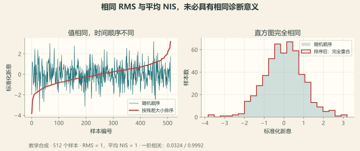

# 第 17 章 无真值诊断：没有答案时怎么听诊

::: story 现场
现场没有参考 SOC。你只有模型、电流、电压，和一条越看越不对劲的残差曲线。怎么判断是“模型参数错了”，还是“电压表坏了”？

在 BMS-Z 的受控注入中，R0 失配留下与电流相关的残差（该组 −0.288），电压偏置组则表现为整体平移。这些是诊断线索，不是唯一病因：传感器增益错也跟着电流走，温度、SOC 与工况又可能互相关。先问能排除什么，再问还缺哪条证据。
:::

## 17.1 新息：仪表和模型吵的那一架

每拍先预测，再和测量对账：

$$
e_k = z_k - h(\hat{x}_k^-)
$$

它使用**更新前预测**与仪表读数，不需要参考 SOC。若先用同一个测量修正状态，再计算后验电压残差，滤波器已经“看过答案”，残差自然会变小。两种残差不能混用。

一个 15 mV 的新息，可能是 SOC 猜错、R0 写错、电压表偏置、温度变化或噪声。一个方程，多个未知——所以新息不能直接当成 SOC 误差。

## 17.2 三个诊断数

**表 17-1**　三个诊断数回答什么（BMS-Z 实测回放值）

| 指标 | 回答什么 | BMS-Z 实测（generic → calibrated） |
|---|---|---|
| 新息 RMS | 一般差多少 | 15.137 → 3.699 mV |
| 新息均值 | 一边倒还是两边晃 | −0.338 → +0.492 mV |
| NIS | 相对噪声算不算大 | 0.5340 → 0.0325 |

表中数值为 BMS-Z 特定回放的诊断统计，不是通用合格线。其报告还给出模型电压回放 RMSE：generic **186.3 mV**、标定后 **21.8 mV**；它与闭环滤波器的新息 RMS 不是同一个量，须说明预测方法、窗口和时间权重。

归一化新息平方按每拍计算：

$$
S_k=C_kP_k^-C_k^T+R_k,\qquad NIS_k=e_k^2/S_k
$$

在模型与协方差合理、零均值高斯假设成立的线性情形，标量 NIS 服从 1 自由度卡方分布，期望为 1；EKF 中只是近似参考。单拍常用 95% 上侧值约 3.84，意味着理想条件下也会有约 5% 越线，不能一次越线就宣判故障。窗口检验还要考虑样本相关、收敛期和重复检验。

**NIS 越小不代表模型越好。** 保持残差不变而把 S 加倍，NIS 就减半；Q/R 过大、状态不确定度保守或闭环吸收失配，都可能产生很小的值。读 NIS 时同时报告 S、新息均值/RMS 和误差时间结构。

::: principle 一句话
RMS 看大小，均值看偏置，NIS 看与自报不确定度是否相称；**再看时间相关性，才知道误差是否留下连续结构。**
:::

## 17.3 参数错 vs 传感器坏

BMS-Z 用同一段工况、同一个种子做了四组对照：

- **R0 偏大**：该受控组残差随电流变化（相关系数 −0.288；单凭数值不称统计显著，符号取决于约定）；
- **电压表偏置**：残差整体平移，与电流无关；
- **容量错**：残差随 SOC 漂移；
- **温度错**：残差在温度变化时出现台阶。

先验证单位、时间同步和质量位，再把残差按电流方向、SOC、温度和脉冲边沿分组。电流与温度相关时，单变量相关系数不能区分谁主导；检查多变量拟合、独立窗口和受控注入。线索对应**候选原因**，不直接变成换件结论。

<figure>

<figcaption>图 17-1　同一组 512 个合成标准化残差，只改变顺序：RMS 与平均 NIS 都为 1，一阶相关却从 0.0324 变为 0.9992。摘要数字无法替代时间结构。</figcaption>
</figure>

## 17.4 诚实标注：参考值不是真值

BMS-Z 的报告里有三项很关键：

```text
reference_kind = coulomb_reference_from_same_measured_current_and_separate_calibration_capacity
independent_soc_truth = False
model_fitted_on_validation = False
```

意思是：参考 SOC 是用同一路实测电流积分出来的，和被评估的估算器共享误差源；模型也没有在验证段上调参。

所以“和参考差 0.2%”不等于“精度 0.2%”。诊断数的价值在**相对比较**（generic 对 calibrated），不在宣称绝对精度。

## 17.5 把“可能是”推进到可验证结论

**表 17-2**　观测线索、候选原因与下一步区分证据（定性对照）

| 观测线索 | 至少两个候选原因 | 下一步区分证据 |
|---|---|---|
| 残差随电流变化 | R0 失配、电流增益错误、V/I 不同步 | 标准电流比对、边沿对齐、独立方向脉冲 |
| 整体偏移 | 电压偏置、OCV 表偏移、初始状态错误 | 参考电压源、已知温度静置点、不同 SOC 窗口 |
| 连续慢漂 | 容量失配、温漂、滞回、慢扩散 | 独立容量锚点、冷热对照、延长松弛记录 |
| 偶发大尖峰 | 数据缺失、时间错位、接触不良 | 原始时刻、质量位、线束/任务诊断 |

白噪声式新息也不是安全证明；只说明这段可见数据未留下明显结构。没有激励的区间，很多失配根本没有机会暴露。

## 17.6 拒绝测量以后，还要管理失去的观测

出现单个污染点，可按声明的门限拒绝该次更新，继续预测并记原因。若持续拒绝，状态不确定度和盲行时间必须显式管理；不能一直积分、一直显示有效。恢复时检查新测量的质量、连续性和模型再获取条件。

不能为让 NIS “好看”随意扩大 Q/R，也不能让残差门限掩盖真实工况变化。记录原始测量、更新前预测、S、NIS、接受/拒绝和状态质量；需要 SOC 真值的 NEES 或绝对精度验收，另找独立参考。术语上，本书 NIS 指观测新息统计，NEES 指状态估计误差统计。

## 17.7 把“看着不对”变成可判定的三张尺子

“残差有结构”这句话要能过堂。三张尺子都用窗口长度 N 说话，数值取自本章自己的回放（N = 512，一阶相关取自图 17-1 那两条序列）：

**尺子一：白噪声的 95% 界是 1.96/√N。** N = 512 时是 1.96/22.6 ≈ **0.087**。图 17-1 那两条序列因此有了判决：一阶相关 0.0324 **落在界内**（不能拒绝白噪声），0.9992 远远在外（结构确凿）。没有这条界，“0.0324 算不算大”就只能靠感觉。

**尺子二：相关残差会吃掉有效样本数。** 按 AR(1) 近似，N_eff ≈ N(1−ρ)/(1+ρ)：

**表 17-3**　一阶相关对有效样本数的压缩（AR(1) 公式计算）

| 一阶相关 ρ | N_eff（N = 512） | 读法 |
|---|---:|---|
| 0.0324 | **480** | 接近白噪声：512 拍几乎都是独立信息 |
| 0.9992 | **0.2** | 512 拍里只剩 0.2 份独立样本 |

这就是“RMS 与平均 NIS 相同”却完全不等价的原因：一张能提供 480 份独立信息，另一张只有 0.2 份——后者的均值与 RMS 置信区间要按 0.2 去放，而不是按 512。

**尺子三：NIS 的窗口检验有两条硬线**（N = 512、单拍 95% 上侧 3.84 的前提）：

- **越线计数**：期望 512 × 0.05 = **25.6** 次，标准差 √(512 × 0.05 × 0.95) ≈ 4.9，95% 区间约 **[16, 35]** 次。窗口内越线四十次才值得立案——一次越线就宣判故障，等于把 5% 的误报当成故障率。
- **窗口均值**：单拍 NIS 的标准差是 √2，窗口均值的 95% 区间是 1 ± 1.96·√(2/512) = 1 ± **0.12**。均值偏到 0.5 或 1.8，都不是抖动。

**门限的另一半是误拒率。** 单点拒绝门限若设在 3.84，误拒率就是 5%：10 Hz 采样下每秒误拒 0.5 次测量，盲行时间会被这些“正常尖峰”推着走。设到 10.83（1 自由度卡方 99.9% 上侧），误拒率降到 0.1%，代价是真故障的灵敏度下降。**门限必须与采样率、允许的盲行时间一起声明**——这是 17.6 节“显式管理失去的观测”的量化版本。

尺子也有反直觉的用法。本章表里 calibrated 的 NIS 从 0.5340 变成 0.0325：0.0325 比 1 低三十倍，若窗口也是几百拍量级，就已经远超 ±0.12 的随机波动。按上面的读法，这不证明“模型更好”，而是说明 **S 声明得比真实残差宽**（或被闭环吸收）——这一行的量纲是“相对自报噪声”，越小越要先问一句：S 是谁给的。

::: trap 坑
拿“参考 SOC”做真值，然后调参调到曲线重合。你调的是“和参考的一致性”，不是“和物理的一致性”；换一个工况，误差会回来。
:::

::: lab 动手
在仓库根跑 `python bms-book/code/estimator_evidence.py`，比较相同 RMS/NIS、不同一阶相关的两组序列，再核对 S 加倍如何改变 NIS。真实回放用 `python code/soc/real_data.py`，从输出报告读取窗口、诊断量与参考值声明，不在评估段上调参后再报验证精度。
:::

## 练习

1. 新息 15 mV，在 $C=6.8$ 与 $C=0.8$ 时各对应多少 SOC 误差？
2. 设计一个“传感器坏 vs 参数错”的判定流程，列出每一步的输入与输出。
3. 为什么报告要写 `independent_soc_truth = false`？省掉会误导谁？

## 参考资料

- BMS-Z 无真值诊断五天：https://github.com/zhuguang-ZFG/BMS-Z/blob/main/docs/共学/10-无真值诊断五天.md
- BMS-Z SOC 真实数据专题：https://github.com/zhuguang-ZFG/BMS-Z/blob/main/docs/SOC真实数据专题.md
- BMS-Z `real_data.py`：https://github.com/zhuguang-ZFG/BMS-Z/blob/main/code/soc/real_data.py
- Plett ECE5720 Notes03，3–19 页新息定义、3–40 页测量门限（本地讲义核对；本书区分 NIS 与状态 NEES）：http://mocha-java.uccs.edu/ECE5720/ECE5720-Notes03.pdf
