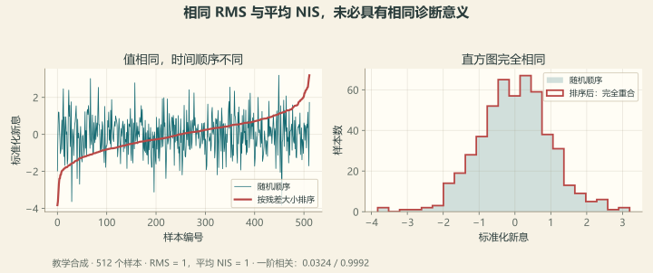
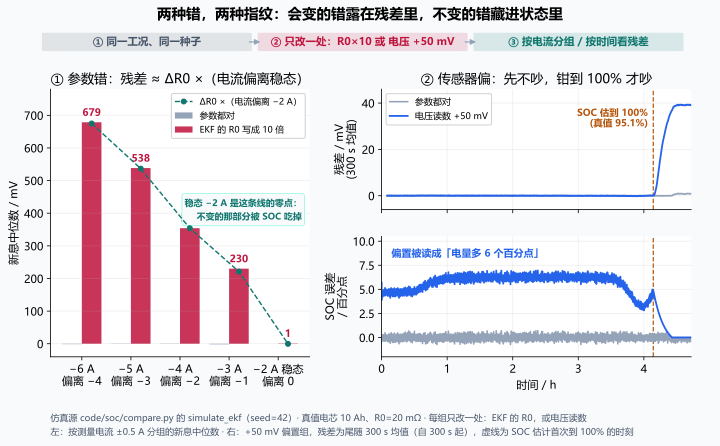
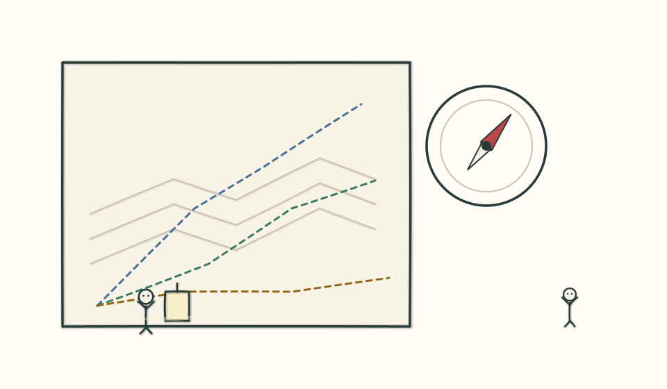
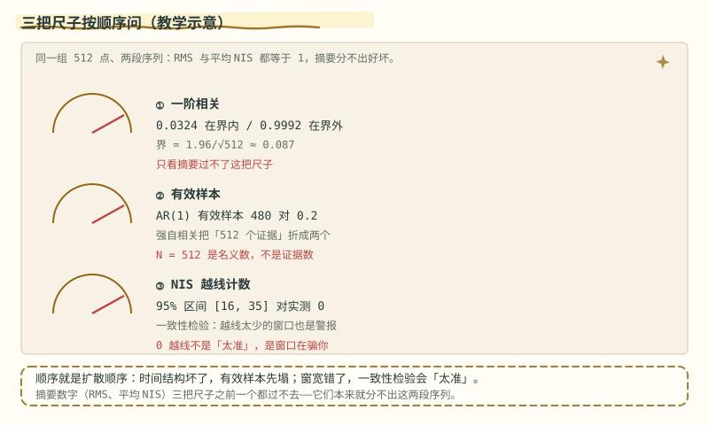

# 第 17 章 无真值诊断：没有参考答案时怎么判断

::: story 现场
上一章看的是老化怎么改写电芯；这一章回到没有参考 SOC 的现场。你只有模型、电流、电压，和一条越看越不对劲的残差曲线。怎么判断是“模型参数错了”，还是“电压表坏了”？

在 BMS-Z 的受控注入中，R0 失配留下与电流相关的残差（该组相关系数 −0.288）；电压偏置组却几乎不吵，因为 EKF 把那 50 mV 读成了“电量多 6 个百分点”，直到 SOC 估到 100% 才露馅。这些是诊断线索，能对上的病因不止一个：传感器增益错也跟着电流走，温度、SOC 与工况又可能互相关。先问能排除什么，再问还缺哪条证据。
:::

::: chapter-route 阅读路径

- **第一次主线**：读 §17.1–§17.3。把新息理解成“模型预测与仪表读数的差”，再比较参数失配与传感器偏置留下的不同形状。
- **第二遍深挖**：读 §17.4–§17.7。处理无真值标注、可证伪诊断、拒绝测量后的可观测性与三项统计判据。
- **动手验证**：运行诊断脚本，分别注入 R0 失配和 50 mV 偏置，只根据保存的残差与工况写结论。
:::

**先自己判断**　电压残差与电流高度相关，能否直接断言“R0 参数写错了”？

## 17.1 新息：预测与测量的差

每拍先预测，再和测量对账：

**教学算例**　开场的 R0 失配组相关系数为 −0.288；下面的公式只定义每拍怎样得到这条残差。

$$
e_k = z_k - h(\hat{x}_k^-)
$$

它使用**更新前预测**与仪表读数，不需要参考 SOC。若先用同一个测量修正状态，再计算后验电压残差，滤波器已经“看过答案”，残差自然会变小。两种残差不能混用。

一个 15 mV 的新息，可能是 SOC 猜错、R0 写错、电压表偏置、温度变化或噪声。一个方程，多个未知，所以新息不能直接当成 SOC 误差。

## 17.2 三个诊断数

**表 17-1**　三个诊断数回答什么（BMS-Z 实测回放值）

| 指标 | 回答什么 | BMS-Z 实测（generic → calibrated） |
|---|---|---|
| 新息 RMS | 一般差多少 | 15.137 → 3.699 mV |
| 新息均值 | 一边倒还是两边晃 | −0.338 → +0.492 mV |
| NIS | 相对噪声算不算大 | 0.5340 → 0.0325 |

表中数值为 BMS-Z 特定回放的诊断统计，不是通用合格线。其报告还给出模型电压回放 RMSE：generic **186.3 mV**、标定后 **21.8 mV**；它与闭环滤波器的新息 RMS 不是同一个量，须说明预测方法、窗口和时间权重。

归一化新息平方按每拍计算：

$$
S_k=C_kP_k^-C_k^T+R_k,\qquad NIS_k=e_k^2/S_k
$$

在模型与协方差合理、零均值高斯假设成立的线性情形，标量 NIS 服从 1 自由度卡方分布，期望为 1；EKF 中只是近似参考。单拍常用 95% 上侧值约 3.84，意味着理想条件下也会有约 5% 越线，不能一次越线就宣判故障。窗口检验还要考虑样本相关、收敛期和重复检验。

**NIS 越小不代表模型越好。** 保持残差不变而把 S 加倍，NIS 就减半；Q/R 过大、状态不确定度保守或闭环吸收失配，都可能产生很小的值。读 NIS 时同时报告 S、新息均值/RMS 和误差时间结构。

::: principle 一句话
RMS 看大小，均值看偏置，NIS 看与自报不确定度是否相称；**再看时间相关性，才知道误差是否留下连续结构。**
:::

## 17.3 参数错 vs 传感器坏

BMS-Z 用同一段工况、同一个种子做了四组对照（`code/soc/compare.py` 的 `simulate_ekf`，共学《无真值诊断五天》第 3 天可复现）：

- **R0 偏大**：该受控组残差随电流变化（相关系数 −0.288；单凭数值不称统计显著，符号取决于约定）。同一次注入在两个窗口报出两个世界：残差窗口整体均值只有 +9.76 mV。SOC 窗口却报 41.51% RMSE（与第 10 章参数扫描同一接线、同一种子）；
- **电压表偏置 +50 mV**：残差在大半段工况里**几乎为零**，偏置被滤波器读成 SOC 偏高约 6 个百分点。SOC 估计被钳在 100% 之后（此时真值 95.1%），残差才一下子冒出来；
- **容量错（9.5 → 5.0 Ah）**：三个诊断数几乎不动，电压观测每拍把 SOC 拉回来。容量误差在本工况里没有留下明显模式；
- **温度**：本组回放没有温度通道，这一类要另做冷热对照（见表 17-2 第三行），不能把这三组的结论外推到温度。

先验证单位、时间同步和质量位，再把残差按电流方向、SOC、温度和脉冲边沿分组。电流与温度相关时，单变量相关系数不能区分谁主导；检查多变量拟合、独立窗口和受控注入。线索对应**候选原因**，不能直接当作换件结论。

<figure>

<figcaption>图 17-1　同一组 512 个合成标准化残差，只改变顺序：RMS 与平均 NIS 都为 1，一阶相关却从 0.0324 变为 0.9992。摘要数字无法替代时间结构。</figcaption>
</figure>

<figure>

<figcaption>图 17-2　两种错误模式（seed 42，同一工况）：R0 写成十倍，放电脉冲 −6/−5/−4/−3 A 的新息中位数为 679/538/354/230 mV，与 ΔR0 ×（电流偏离稳态 −2 A）的预测 675/537/354/221 mV 吻合到几 mV；电压读数 +50 mV 时，残差先接近零、SOC 却偏高约 6 个百分点，直到 SOC 到 100% 后残差均值才升到 32.5 mV。</figcaption>
</figure>

图 17-2 把其中两组摊开看。打个比方：滤波器像一个**会自己找补的记账员**。账对不上，他先改自己能改的那一栏：SOC。错法每拍都在变（R0 错，电流一跳差额就跟着跳），这一栏追不上，差额只好写在残差里；错法一直不变（电压整体偏 50 mV），他改一次 SOC 就把账抹平了，残差安安静静，错误搬进了“电量”那一栏。他只有在 SOC 改到头（100% 或 0%）、再也没法找补时才会喊出来。

> 先自己判断：把偏置改成 −50 mV，SOC 会被往下拉。这一回，残差会在哪一刻喊出来？

所以“残差小”有两种读法：模型和仪表都对，或者错误被状态吸收了。答案是**可能一直不喊**：同一组偏置改成 −50 mV，SOC 一路偏低约 6.2 个百分点，本工况最低只估到 35%，撞不到 0%，三个诊断数（中位 3.64 mV、均值约 0 mV、与电流相关 −0.002）和“都对”那一组几乎分不开。**整体偏置靠残差抓不住，要靠外部锚点**：独立仪表或参考电压源比对、与电压读数无关的物理事件（如充电机按电流截止判满）同 SOC 估计对账，或 SOC 被钳住时的那一段。注意长静置后的 OCV 点帮不上忙：它读的是同一块偏了的电压表。

## 17.4 诚实标注：参考值不是真值

<figure>

<figcaption>图 17-3　没有真值的诊断现场：地图不标北，罗盘只能给相对方向；诊断结论要写成“哪几条岔路被排除、还剩哪几条”，而不是一个假装绝对的坐标。定性示意。</figcaption>
</figure>

BMS-Z 的报告里有三项很关键：

```text
reference_kind = coulomb_reference_from_same_measured_current_and_separate_calibration_capacity
independent_soc_truth = False
model_fitted_on_validation = False
```

意思是：参考 SOC 是用同一路实测电流积分出来的，和被评估的估算器共享误差源；模型也没有在验证段上调参。

所以“和参考差 0.2%”不等于“精度 0.2%”。诊断数的价值在**相对比较**（generic 对 calibrated），不在宣称绝对精度。

## 17.5 把“可能是”推进到可验证结论

**表 17-2**　观测线索、候选原因与下一步区分证据（定性对照）

| 观测线索 | 至少两个候选原因 | 下一步区分证据 |
|---|---|---|
| 残差随电流变化 | R0 失配、电流增益错误、V/I 不同步 | 标准电流比对、边沿对齐、独立方向脉冲 |
| 整体偏移 | 电压偏置、OCV 表偏移、初始状态错误 | 参考电压源、已知温度静置点、不同 SOC 窗口 |
| 残差长期安静，SOC 钳到 0%/100% 时才突增 | 恒定电压偏置被 SOC 吸收、OCV 表整体偏移 | 独立仪表比对、与电压读数无关的满充/放空事件对账（图 17-2） |
| 连续慢漂 | 容量失配、温漂、滞回、慢扩散 | 独立容量锚点、冷热对照、延长松弛记录 |
| 偶发大尖峰 | 数据缺失、时间错位、接触不良 | 原始时刻、质量位、线束/任务诊断 |

白噪声式新息也不能证明安全；它只说明这段可见数据未留下明显结构。没有激励的区间，很多失配没有机会暴露。

## 17.6 拒绝测量以后，还要管理失去的观测

出现单个污染点，可按声明的门限拒绝该次更新，继续预测并记录原因。若持续拒绝，状态不确定度和盲行时间必须显式管理；不能一直积分、一直显示有效。恢复时检查新测量的质量、连续性和模型再获取条件。

不能为让 NIS “好看”随意扩大 Q/R，也不能让残差门限掩盖真实工况变化。记录原始测量、更新前预测、S、NIS、接受/拒绝和状态质量；需要 SOC 真值的 NEES 或绝对精度验收，另找独立参考。术语上，本书 NIS 指观测新息统计，NEES 指状态估计误差统计。

## 17.7 把“看着不对”变成 3 项量化判据

“残差有结构”必须落到判据。下面 3 项都使用窗口长度 N，数值取自本章回放（N = 512，一阶相关取自图 17-1）：

<figure class="book-motion" data-animation="diagnostics-three-gauges.svg" data-mode="static">

<button type="button" data-book-motion v-book-motion aria-pressed="false" hidden>播放动画</button>
<figcaption>图 17-4　三把尺子：同一段 N = 512 的残差序列，摘要数字相同（RMS 与平均 NIS 都等于 1），一阶相关 0.0324 在 1.96/√512 ≈ 0.087 界内、0.9992 在界外；按 AR(1) 的有效样本为 480 对 0.2；NIS 越线计数 95% 区间 [16, 35]、窗口均值 1 ± 0.12。</figcaption>
<p class="visual-guide"><strong>先看哪里：</strong>三块表盘从上到下依次点亮：第一把指针落在 0.087 界内、0.9992 的红点在界外；第二把读 480 对 0.2；第三把 [16, 35] 的绿带里越线数是 0。每一格都同时给「界」和「读数」。</p>
<p class="visual-question"><strong>看完追问：</strong>把窗口长度从 512 换成 64，尺子一的界 1.96/√64 变成多少？「跌出界」会更容易还是更难？</p>
</figure>

**尺子一：白噪声的 95% 界是 1.96/√N。** N = 512 时是 1.96/22.6 ≈ **0.087**。图 17-1 那两条序列因此有了判决：一阶相关 0.0324 **落在界内**（不能拒绝白噪声），0.9992 远远在外（结构确凿）。没有这条界，“0.0324 算不算大”就只能靠感觉。

**尺子二：相关残差会吃掉有效样本数。** 按 AR(1) 近似，N_eff ≈ N(1−ρ)/(1+ρ)：

**表 17-3**　一阶相关对有效样本数的压缩（AR(1) 公式计算）

| 一阶相关 ρ | N_eff（N = 512） | 读法 |
|---|---:|---|
| 0.0324 | **480** | 接近白噪声：512 拍几乎都是独立信息 |
| 0.9992 | **0.2** | 512 拍里只剩 0.2 份独立样本 |

这就是“RMS 与平均 NIS 相同”却完全不等价的原因：一条能提供 480 份独立信息，另一条只有 0.2 份，后者的均值与 RMS 置信区间要按 0.2 去放，而不是按 512。

**尺子三：NIS 的窗口检验有两条硬线**（N = 512、单拍 95% 上侧 3.84 的前提）：

- **越线计数**：期望 512 × 0.05 = **25.6** 次，标准差 √(512 × 0.05 × 0.95) ≈ 4.9，95% 区间约 **[16, 35]** 次。窗口内越线 40 次才值得立案；一次越线就宣判故障，等于把 5% 的误报当成故障率。
- **窗口均值**：单拍 NIS 的标准差是 √2，窗口均值的 95% 区间是 1 ± 1.96·√(2/512) = 1 ± **0.12**。均值偏到 0.5 或 1.8，都不是抖动。

**门限的另一半是误拒率。** 单点拒绝门限若设在 3.84，误拒率就是 5%：10 Hz 采样下每秒误拒 0.5 次测量，盲行时间会被这些“正常尖峰”推着走。设到 10.83（1 自由度卡方 99.9% 上侧），误拒率降到 0.1%，代价是真故障的灵敏度下降。**门限必须与采样率、允许的盲行时间一起声明**，这是 17.6 节“显式管理失去的观测”的量化版本。

尺子也有反直觉的用法。本章表里 calibrated 的 NIS 从 0.5340 变成 0.0325：0.0325 只有 1 的三十分之一左右，若窗口也是几百拍量级，就已远远超出 ±0.12 的随机波动范围。按上面的读法，这不证明“模型更好”，而是说明 **S 声明得比真实残差宽**（或被闭环吸收）：这一行的量纲是“相对自报噪声”，越小越要先问一句：S 是谁给的。

::: trap 坑
拿“参考 SOC”做真值，然后调参调到曲线重合。你调的是“和参考的一致性”，不是“和物理的一致性”；换一个工况，误差会回来。
:::

::: lab 动手
在仓库根跑 `python bms-book/code/estimator_evidence.py`，比较相同 RMS/NIS、不同一阶相关的两组序列，再核对 S 加倍如何改变 NIS。真实回放用 `python code/soc/real_data.py`，从输出报告读取窗口、诊断量与参考值声明，不在评估段上调参后再报验证精度。电芯这头的疑点排查完了，下一章看数据那头：一帧正确，不等于数据可信。
:::

## 本讲服务知识点

<!-- kp-backlink:start -->
本章服务 1 个知识点；每条都能回到[核心问题地图](../../docs/核心问题地图.md)的 L1–L5 五级入口。这一节由 `curriculum/concepts.json` 的 `book` 字段生成。

**表 17-4**　本章服务的知识点与其梯子入口

| 知识点 ID | 标题 | 阶段 | 梯子到 | 握证 |
|---|---|---:|---|---|
| [`soh-window-and-dqdv`](../../docs/核心问题地图.md#kp-soh-window-and-dqdv) | 局部窗口与dQdV | 4 | L3 | 手算纸 |

**局部窗口与dQdV：用一段局部充电报 SOH，窗口多窄就不能用了？**

只测一小段充入电量，也能尝试推算总容量：这段安时量除以经过的 SOC 比例。但窗口越窄，分母越小，同样计量误差被放得越大。dQ/dV 是看电压每变化一点，对应多少电量，峰形能提供材料反应线索；峰又随温度和倍率改变，所以比较老化前先对齐测试条件。

**教学算例：沿着这组输入做一遍**

1. SOC 从 30% 到 70%，窗口 ΔSOC=0.40；充入 0.72 Ah，估计容量 Q=0.72÷0.40=1.80 Ah。
2. 相对 2.00 Ah 名牌容量，示意 SOH=90%。先写工况，再写这两个结果。
3. 仅取安时误差 0.02 Ah，5%、10%、40% 窗口对应 σ_Q=0.40、0.20、0.05 Ah。端点 SOC 误差还要另计，不能漏掉。

**边界与反例**　5% 窗口的 0.40 Ah 噪声足以盖住小幅老化。换温度或倍率后的峰变矮，也不能直接当容量损失的百分数。

**看图任务**　缩窄同一条窗口，观察误差条如何变宽；再比较峰的位置与高度，先问测试条件是否一致。

**对应图解**　[soh-partial-window](../../docs/circuits/assets/soh-partial-window.svg) · [ica-dqdv](../../docs/circuits/assets/ica-dqdv.svg)

**先自己判断**　充 0.72 Ah、ΔSOC=0.40：算 Q 与相对 2.00 Ah 的 SOH；再算 5%、10%、40% 窗口的 σ_Q。

完成后再展开标准；先保留自己的计算、判断或运行记录。

<details class="kp-retrieval-check">
<summary>核对通过标准</summary>

1.80 Ah、约 90%；0.40/0.20/0.05 Ah；并判定 5% 窗口不可发布。

</details>

<!-- kp-backlink:end -->

## 练习

1. 新息 15 mV，在 $C=6.8$ 与 $C=0.8$ 时各对应多少 SOC 误差？
2. 设计一个“传感器坏 vs 参数错”的判定流程，列出每一步的输入与输出。
3. 为什么报告要写 `independent_soc_truth = false`？省掉会误导谁？

## 参考资料

- BMS-Z 无真值诊断五天：https://github.com/zhuguang-ZFG/BMS-Z/blob/main/docs/共学/10-无真值诊断五天.md
- BMS-Z SOC 真实数据专题：https://github.com/zhuguang-ZFG/BMS-Z/blob/main/docs/SOC真实数据专题.md
- BMS-Z `real_data.py`：https://github.com/zhuguang-ZFG/BMS-Z/blob/main/code/soc/real_data.py
- Plett ECE5720 Notes03，3–19 页新息定义、3–40 页测量门限（本地讲义核对；本书区分 NIS 与状态 NEES）：http://mocha-java.uccs.edu/ECE5720/ECE5720-Notes03.pdf
